# 2025학년도 대비 전공화학 모의고사 1회 — 상세해설

김지현 전공화학 모의고사 1회(전공 A 12문항 · 전공 B 11문항)의 문항별 해설입니다. 공식 답안(「모의고사 1회 A형, B형 답안」)과 1주차 강의 안내문의 출제 의도를 바탕으로, 답안에 빠진 풀이 과정·개념·채점 포인트를 채웠습니다. 모든 계산은 다시 검산했고, 답안과 다르게 볼 여지가 있는 곳은 **검토 메모**로 따로 표시했습니다.

문항마다 새 쪽에서 시작하며 3단으로 **문제지 원문 → 정답 → 공식·핵심 개념 → 2027 출제 가능성 → 풀이 → 채점 포인트·함정** 순서로 읽으면 됩니다. 아래 표의 문항 번호를 누르면 해당 쪽으로 이동합니다.

전공 문항(교육론 제외)은 **주어진 것 / 구할 것 → 풀이 전략 → 단계별 풀이 → 검산** 순서로 계산 과정을 생략 없이 적었습니다. 유기 문항(A형 10·11번, B형 2·7번)에는 **굽은 화살표로 전자 이동을 표시한 단계별 메커니즘 그림**을 넣었습니다(빨간 화살표: 전자쌍이 출발하는 결합·비공유 전자쌍 → 도착하는 원자·결합).

**2027 출제 가능성**(★ 5개 만점)은 1997~2026 기출에서 그 소재가 얼마나 자주 나왔는지, 그리고 2027학년도에 중학교 과학이 2022 개정 교육과정으로 적용되는 시점을 함께 고려해 매긴 추정치입니다. 공식 예측이 아니므로 공부 순서를 정할 때 참고만 하세요.

## 정답 한눈에 보기 (목차) {#toc}

### 전공 A (12문항 40점)

| 번호 | 영역 | 정답 요약 | 2027 출제 가능성 |
|---|---|---|---|
| [1](#a1) | 물리화학 · Carnot 순환 | ㉠ $\eta = 0.250$, ㉡ $1+\dfrac{R}{C_{V,m}}$ | ★★★☆☆ |
| [2](#a2) | 분석화학 · 산화환원 적정, 전기량 적정 | $\mathrm{I_2 + 2S_2O_3^{2-} \to S_4O_6^{2-} + 2I^-}$, 512 s | ★★★★☆ |
| [3](#a3) | 유기 · 분광 분석 | ethyl *p*-ethoxybenzoate | ★★★★★ |
| [4](#a4) | 무기 · 2차원 이온 결정 | XY, $\dfrac{4-2\sqrt2}{4}\pi$ | ★★★☆☆ |
| [5](#a5) | 화학교육 · POE, 하슈웨 인지갈등 | 질량 증가/감소 예상, ㉡A ㉢D ㉣B, 갈등 1 | ★★★★★ |
| [6](#a6) | 화학교육 · 교육과정, 브루너, 피아제 | 자료 수집·분석 및 해석, 영상적 표현, 입자 모형 그리기 | ★★★★★ |
| [7](#a7) | 화학교육 · 2022 개정 교육과정 | 과학과 사회, (가)~(다), 몰비 = 계수비, 화학의 언어 | ★★★★★ |
| [8](#a8) | 물리화학 · 엔탈피, J–T 계수 | $\Delta H_1 = 300\ \mathrm{J}$, $\mu_{JT} = -nb/C_p < 0$ → 온도 상승 | ★★★☆☆ |
| [9](#a9) | 물리화학 · 고리 위 입자 | $m_l = 0, \pm1, \dots$, $m_l\hbar$, $\langle\phi\rangle = \pi$, $\tilde\nu$ 차 $= \dfrac{h}{\pi^2 c I}$ | ★★★☆☆ |
| [10](#a10) | 유기 · 1,3-다이카보닐, Robinson 고리화 | A, B(MVK), C, D, E 구조, ② < ③ < ④ < ① | ★★★★☆ |
| [11](#a11) | 유기 · 이민/엔아민, 환원성 아미노화 | 이민, 엔아민, *N*-propyl-3-pentanamine | ★★★★☆ |
| [12](#a12) | 무기 · 군론, 19F NMR | $3A_1+B_1+2B_2$ (6개), $5A_1+3B_1+3B_2$, $D_{3h}$·$C_s$, Berry 유사회전 | ★★★★★ |

### 전공 B (11문항 40점)

| 번호 | 영역 | 정답 요약 | 2027 출제 가능성 |
|---|---|---|---|
| [1](#b1) | 분석화학 · 산염기 적정, 이온교환 | [HCl] = 0.0240 M, [MgCl₂] = 0.0480 M | ★★★☆☆ |
| [2](#b2) | 유기 · 나이트릴 환원, 이민, 사이아노하이드린 | C: PhCH=NCH₂Ph, D: PhCH(OH)CN | ★★★☆☆ |
| [3](#b3) | 화학교육 · 귀추, 라카토스 | 모형으로 설명·예측하기, 귀추적 사고, A·B 모두 부정적 발견법 | ★★★★★ |
| [4](#b4) | 화학교육 · 드라이버, 비고츠키, 포스너, 피아제 | 명료화와 교환, 상충된 상황에 노출, ZPD, 불만족, 동화–조절–평형 | ★★★★★ |
| [5](#b5) | 화학교육 · 과학의 본성, 포퍼, 포스너 | 잠정성, ㉢ 루이스, 불만족, 이온화 정도 | ★★★★☆ |
| [6](#b6) | 물리화학 · 진동 분광 | $\mu = \dfrac{k}{4\pi^2c^2\tilde\nu^2}$, $A(1-2B)$, $v_{\text{해리}} = \dfrac{1}{2x}-1$ | ★★★★☆ |
| [7](#b7) | 유기 · SNAr, Birch, benzyne | 2-methoxypyridine, Birch 생성물, 오존 분해, 톨루이딘 3종 | ★★★★☆ |
| [8](#b8) | 무기 · 결정장, Jahn–Teller | ⁵D, $0.4\Delta_t$, 둘 다 z-out | ★★★★★ |
| [9](#b9) | 무기 · 5배위 결정장 | TBP $2\sqrt2$ BM·12.52 Dq, SP 0·20.00 Dq → 사각뿔 | ★★★☆☆ |
| [10](#b10) | 분석화학 · 다양성자산, 흡광도 | 0.0990 / 1.00×10⁻³ / 1.00×10⁻⁹ M, pH 5.30, A = 0.875 | ★★★★★ |
| [11](#b11) | 분석화학 · 혼합물 분광 정량 | ε 4개, 1.0×10⁻⁴ / 5.0×10⁻⁵ M, pH 6.7 | ★★★★☆ |

**검토 메모 (공식 답안과 함께 볼 것)**

1. **A형 9번**: 답안의 포르피린 $\Delta E = \dfrac{11h^2}{8\pi^2 I}$는 고리의 π전자를 **22개**로 본 값입니다(HOMO $m_l=\pm5$ → LUMO $\pm6$). 흔히 쓰는 [18]annulene 모형(18π)으로 보면 $\dfrac{9h^2}{8\pi^2 I}$가 됩니다. 아래 해설에 두 경우를 함께 정리했습니다.
2. **B형 6번**: 문제는 $\tilde\nu$를 "진동수($\mathrm{s^{-1}}$)"라고 했지만 답안은 $\lambda = 1/\tilde\nu$(파수)로 계산했습니다. 진동수로 읽으면 $\lambda = c/\nu$이므로 답에 $c$가 곱해집니다.
3. **B형 답안 표**: 답안지 머리말은 "기입형 1~4번 / 서술형 5~12번"이지만 실제 B형은 기입형 1~2번(각 2점), 서술형 3~11번(각 4점)입니다(2×2 + 9×4 = 40점).
4. **B형 5번**: 문제지의 첫 자료 제목이 「자료 2」로 인쇄되어 있습니다. 작성 방법에 맞춰 첫 자료를 【자료 1】로 읽으면 됩니다.

# 전공 A

## A형 1번 · Carnot 순환의 효율과 단열 과정 {#a1}

**정답** ㉠ $\eta = \dfrac{T_h - T_c}{T_h} = \dfrac{400-300}{400} = 0.250$  ㉡ $1 + \dfrac{R}{C_{V,m}}$ (즉 $pV^{\gamma}$, $\gamma = C_{p,m}/C_{V,m}$)

**공식·핵심 개념**

- 가역 Carnot 효율 $\eta = 1 - \dfrac{T_c}{T_h}$
- 가역 단열: $pV^{\gamma} = \text{const}$, $TV^{\gamma-1} = \text{const}$
- $\gamma = \dfrac{C_{p,m}}{C_{V,m}} = 1 + \dfrac{R}{C_{V,m}}$, $C_{p,m} - C_{V,m} = R$

**2027 출제 가능성 ★★★☆☆ 보통** — 열역학 순환·단열 과정은 물리화학 기입형의 단골 소재입니다. $p$–$T$, $T$–$S$ 그래프를 읽고 효율이나 일을 구하는 형태로 바꿔 나올 수 있습니다.

**주어진 것 / 구할 것**

- 주어진 것: 이상기체 가역 Carnot cycle의 $p$–$T$ 그래프. 수직선 두 개(T = 300 K, 400 K) = 등온 과정, 두 곡선 = 단열 과정
- 구할 것: ㉠ 효율 $\eta$, ㉡ 단열 과정 $pV^{(㉡)} = \text{const}$의 지수를 $C_{V,m}$, $R$로

**풀이 전략** 공식 $\eta = 1 - T_c/T_h$를 바로 쓰지 않고, 네 과정의 열 $q$를 직접 구해 $\eta = w/q_h$에서 유도합니다. 단열 지수는 $dU = dw$를 적분해 얻습니다.

**단계별 풀이 — ㉠ 효율**

**1.** **그래프 읽기**: 고온 등온선 $T_h = 400\ \mathrm{K}$, 저온 등온선 $T_c = 300\ \mathrm{K}$. 400 K 선에서 압력이 약 5.7 → 3.3 bar로 내려가므로 이 과정이 등온 **팽창**(열 흡수)입니다.

**2.** **네 과정 정리** (이상기체 $n$ mol, 상태 1 → 2 → 3 → 4 → 1)

| 과정 | 종류 | $\Delta U$ | $q$ |
|---|---|---|---|
| 1→2 | $T_h$ 등온 팽창 | 0 | $q_h = nRT_h\ln\dfrac{V_2}{V_1} > 0$ |
| 2→3 | 단열 팽창 | $nC_{V,m}(T_c - T_h)$ | 0 |
| 3→4 | $T_c$ 등온 압축 | 0 | $q_c = nRT_c\ln\dfrac{V_4}{V_3} < 0$ |
| 4→1 | 단열 압축 | $nC_{V,m}(T_h - T_c)$ | 0 |

**3.** **부피비 관계**: 두 단열 과정에 ㉡에서 유도할 $TV^{R/C_{V,m}} = \text{const}$를 적용하면

$$T_hV_2^{R/C_{V,m}} = T_cV_3^{R/C_{V,m}}, \qquad T_hV_1^{R/C_{V,m}} = T_cV_4^{R/C_{V,m}}$$

두 식을 나누면 $\left(\dfrac{V_2}{V_1}\right)^{R/C_{V,m}} = \left(\dfrac{V_3}{V_4}\right)^{R/C_{V,m}}$, 즉 $\dfrac{V_2}{V_1} = \dfrac{V_3}{V_4}$.

**4.** **효율**: 한 순환에서 $\Delta U = 0$이므로 $-w = q_h + q_c$.

$$\eta = \frac{-w}{q_h} = \frac{q_h + q_c}{q_h} = 1 + \frac{nRT_c\ln(V_4/V_3)}{nRT_h\ln(V_2/V_1)}$$

$$= 1 - \frac{T_c\ln(V_3/V_4)}{T_h\ln(V_2/V_1)} = 1 - \frac{T_c}{T_h}\quad(\because V_3/V_4 = V_2/V_1)$$

**5.** **수치 대입**:

$$\eta = 1 - \frac{300\ \mathrm{K}}{400\ \mathrm{K}} = 1 - 0.750 = 0.250$$

**단계별 풀이 — ㉡ 단열 과정의 지수**

**1.** 가역 단열이므로 $dq = 0$ → $dU = dw = -p\,dV$.

**2.** 이상기체 1 mol: $dU = C_{V,m}dT$, $p = \dfrac{RT}{V}$.

$$C_{V,m}\,dT = -\frac{RT}{V}\,dV$$

**3.** 양변을 $T$로 나누어 변수를 분리:

$$C_{V,m}\frac{dT}{T} = -R\frac{dV}{V}$$

**4.** 상태 i → f로 적분:

$$C_{V,m}\ln\frac{T_f}{T_i} = -R\ln\frac{V_f}{V_i}$$

$$\ln\frac{T_f}{T_i} + \frac{R}{C_{V,m}}\ln\frac{V_f}{V_i} = 0 \;\Rightarrow\; T_fV_f^{R/C_{V,m}} = T_iV_i^{R/C_{V,m}}$$

즉 $TV^{R/C_{V,m}} = \text{const}$.

**5.** $T = \dfrac{pV}{R}$를 대입($R$은 상수라 const에 흡수):

$$\frac{pV}{R}V^{R/C_{V,m}} = \text{const} \;\Rightarrow\; pV^{\,1 + R/C_{V,m}} = \text{const}$$

**6.** 지수 정리: $1 + \dfrac{R}{C_{V,m}} = \dfrac{C_{V,m} + R}{C_{V,m}} = \dfrac{C_{p,m}}{C_{V,m}} = \gamma$.

**검산**

- 단원자 기체 $C_{V,m} = \tfrac32R$ → $1 + \tfrac23 = \tfrac53$ (알려진 γ와 일치) ✓
- 그래프의 등온 압력비: 400 K에서 약 5.7/3.3 ≈ 1.7, 300 K에서 약 1.7/1.0 ≈ 1.7. $p \propto 1/V$이므로 $V_2/V_1 = V_3/V_4$ 관계가 그래프로도 확인됩니다 ✓
- $0 < \eta < 1$ ✓

**채점 포인트·함정**

- ㉠은 0.25(유효숫자 3자리면 0.250). 온도를 섭씨로 넣으면 틀립니다.
- ㉡은 "$C_{V,m}$과 $R$이 포함된 식"으로 쓰라고 했으므로 $\gamma$만 쓰면 감점 소지가 있습니다. $1 + R/C_{V,m}$ 형태로 씁니다.

## A형 2번 · 에틸 머르캅탄의 요오드 역적정과 전기량 적정 {#a2}

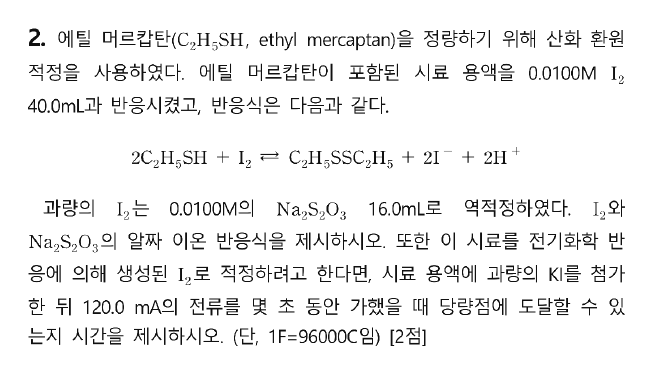

**정답** (1) $\mathrm{I_2 + 2S_2O_3^{2-} \rightarrow S_4O_6^{2-} + 2I^-}$  (2) **512 s**

**공식·핵심 개념**

- 역적정: 시료와 반응한 양 = 넣은 양 − 남은 양
- $\mathrm{I_2 + 2S_2O_3^{2-} \to S_4O_6^{2-} + 2I^-}$
- 전기량 적정: $Q = It$, $n_{e^-} = Q/F$, $\mathrm{2I^- \to I_2 + 2e^-}$

**2027 출제 가능성 ★★★★☆ 높음** — 산화환원 적정은 따로 기출 모음을 만들 만큼 반복해서 나온 분석화학 핵심 영역입니다. 요오드 적정과 전기량(쿨롬) 적정을 엮는 계산은 다시 나올 가능성이 높습니다.

**주어진 것 / 구할 것**

- 시료(C₂H₅SH) + 0.0100 M I₂ 40.0 mL, 반응 $2\mathrm{C_2H_5SH + I_2 \rightleftharpoons C_2H_5SSC_2H_5 + 2I^- + 2H^+}$
- 남은 I₂를 0.0100 M Na₂S₂O₃ 16.0 mL로 역적정
- 전기량 적정: 과량 KI에 120.0 mA, $F = 96000\ \mathrm{C\,mol^{-1}}$
- 구할 것: (1) I₂–S₂O₃²⁻ 알짜 이온 반응식, (2) 당량점까지 걸리는 시간(s)

**풀이 전략** 역적정 장부를 mmol로 작성해 시료가 소비한 I₂를 구합니다. 그 I₂를 전기분해로 만들 때 필요한 전자 몰수에서 $Q = nF$, $t = Q/I$로 시간을 구합니다.

**단계별 풀이**

**1.** **반쪽 반응식으로 알짜 반응식 만들기**

$$\mathrm{I_2 + 2e^- \rightarrow 2I^-} \qquad \mathrm{2S_2O_3^{2-} \rightarrow S_4O_6^{2-} + 2e^-}$$

$$\mathrm{I_2 + 2S_2O_3^{2-} \rightarrow 2I^- + S_4O_6^{2-}}$$

(S의 평균 산화수: S₂O₃²⁻ +2 → S₄O₆²⁻ +2.5. S 4개 × 0.5 = 전자 2개 ✓)

**2.** **넣은 I₂**: $0.0100\ \mathrm{mmol\,mL^{-1}} \times 40.0\ \mathrm{mL} = 0.400\ \mathrm{mmol}$

**3.** **소비된 S₂O₃²⁻**: $0.0100 \times 16.0 = 0.160\ \mathrm{mmol}$ → 남은 I₂ $= \dfrac{0.160}{2} = 0.0800\ \mathrm{mmol}$ (I₂ : S₂O₃²⁻ = 1 : 2)

**4.** **시료와 반응한 I₂**: $0.400 - 0.0800 = 0.320\ \mathrm{mmol}$ → C₂H₅SH $= 2 \times 0.320 = 0.640\ \mathrm{mmol}$

**5.** **전기량 적정**: 과량 KI를 산화해 I₂를 만듭니다($\mathrm{2I^- \rightarrow I_2 + 2e^-}$). 당량점은 시료가 소비하는 I₂ **0.320 mmol**이 생겼을 때입니다.

$$n_{e^-} = 2 \times 0.320\ \mathrm{mmol} = 0.640\ \mathrm{mmol} = 6.40\times10^{-4}\ \mathrm{mol}$$

**6.** **전하량**:

$$Q = n_{e^-}F = 6.40\times10^{-4}\ \mathrm{mol} \times 96000\ \mathrm{C\,mol^{-1}} = 61.44\ \mathrm{C}$$

**7.** **시간** (120.0 mA = 0.1200 A = 0.1200 C s⁻¹):

$$t = \frac{Q}{I} = \frac{61.44\ \mathrm{C}}{0.1200\ \mathrm{C\,s^{-1}}} = 512\ \mathrm{s}\ (8\text{분 } 32\text{초})$$

**검산** RSH 1분자는 전자 1개를 잃습니다($\mathrm{2RSH \rightarrow RSSR + 2H^+ + 2e^-}$). 그래서 $n_{e^-} = n_{\mathrm{RSH}} = 0.640\ \mathrm{mmol}$이어야 하고, 5단계 값과 같습니다 ✓

**채점 포인트·함정**

- 싸이오황산 적정에서 생성물은 사싸이온산 이온 $\mathrm{S_4O_6^{2-}}$입니다. 전하·원자 수를 맞춰 씁니다.
- 흔한 실수: 처음 넣은 I₂ 전체(0.400 mmol)로 계산하면 640 s가 나옵니다. 전기량 적정에서는 과량 I₂를 넣지 않으므로 **시료가 소비하는 I₂만큼만** 만들면 됩니다.
- 전류 단위 mA → A 환산(120.0 mA = 0.1200 A).

## A형 3번 · IR·NMR·MS로 구조 결정 {#a3}

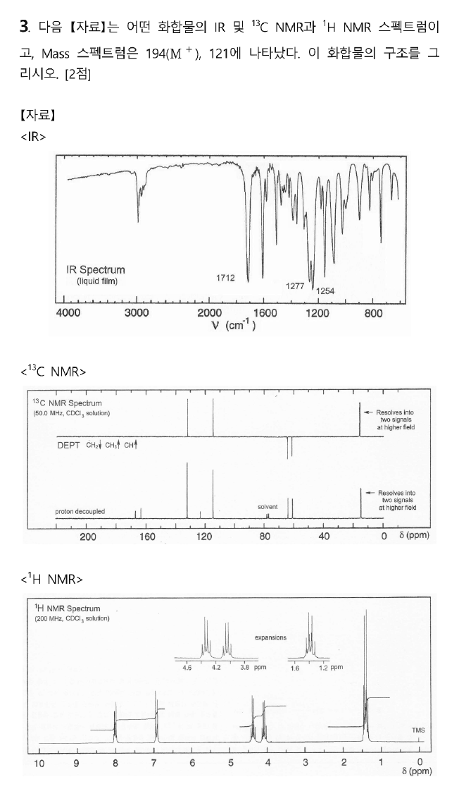

**정답** ethyl *p*-ethoxybenzoate (4-ethoxybenzoic acid ethyl ester), $\mathrm{C_{11}H_{14}O_3}$

**공식·핵심 개념**

- 불포화도 $= \dfrac{2C + 2 + N - H - X}{2}$
- IR: 에스터 C=O 1735 cm⁻¹, 콘쥬게이션되면 ~1715 cm⁻¹
- ¹H: *para* 이치환 → 2H 이중선 2개, OCH₂CH₃ → 사중선 + 삼중선
- DEPT: CH·CH₃ ↑, CH₂ ↓, 4차 탄소는 사라짐

**2027 출제 가능성 ★★★★★ 매우 높음** — IR·NMR·MS를 엮은 구조 결정은 유기 영역에서 거의 해마다 나오는 유형입니다. 2027에도 형태만 바뀌어 나올 가능성이 매우 높습니다.

**주어진 것 / 구할 것**

- IR(1712, 1277, 1254 cm⁻¹), ¹³C NMR + DEPT, ¹H NMR(200 MHz, 확대 그림 포함), MS: M⁺ 194, 121
- 구할 것: 구조

**풀이 전략** ① M⁺로 분자식 후보를 정하고 불포화도를 계산 → ② 스펙트럼에서 조각(작용기)을 찾고 → ③ 조각을 맞춰 분자식과 비교 → ④ 이성질체 후보를 화학 이동으로 걸러 냅니다.

**단계별 풀이**

**1.** **분자식 후보 (13의 규칙)**: M = 194가 짝수 → N은 0개(또는 짝수). $194 = 13 \times 14 + 12$ → 기본식 $\mathrm{C_{14}H_{26}}$. IR에 C=O와 C–O가 있으므로 O를 넣습니다. O 1개마다 CH₄(16)를 빼고 O(16)를 더하면, O 3개일 때 $\mathrm{C_{14}H_{26}} \to \mathrm{C_{11}H_{14}O_3}$.
   검산: $11(12) + 14(1) + 3(16) = 132 + 14 + 48 = 194$ ✓

**2.** **불포화도**:

$$\text{DBE} = \frac{2(11) + 2 - 14}{2} = \frac{10}{2} = 5 = \text{벤젠 고리 }4 + \text{C=O }1$$

**3.** **조각 찾기**

| 자료 | 신호 | 조각과 근거 |
|---|---|---|
| IR | 1712 cm⁻¹ (강) | 에스터 C=O. 보통 1735인데 벤젠과 콘쥬게이션되어 낮아짐 → **Ar–C(=O)–O–** |
| IR | 1277, 1254 cm⁻¹ | C–O 신축 두 개: 에스터 C(=O)–O, 아릴 에터 Ar–O |
| IR | 3000 cm⁻¹ 위 강한 띠 없음 | O–H, N–H 없음 |
| ¹H | δ 8.0 (d, 2H), 6.9 (d, 2H) | *para* 이치환 벤젠(AA′BB′). C=O 옆 H는 고리 전류 + C=O 비등방성으로 8.0, O 옆 H는 O의 공명 주개 효과로 차폐되어 6.9 |
| ¹H | δ 4.35 (q, 2H) | CO₂–**CH₂**–CH₃ (에스터 O에 붙은 CH₂, 이웃 CH₃ 3H → 사중선) |
| ¹H | δ 4.08 (q, 2H) | ArO–**CH₂**–CH₃ |
| ¹H | δ 1.4 (t 두 개 겹침, 6H) | CH₃ 두 개 (각각 이웃 CH₂ 2H → 삼중선) |
| ¹³C | 166 | 에스터 C=O (4차, DEPT에서 사라짐) |
| ¹³C | 163 | 산소가 붙은 방향족 C (4차) |
| ¹³C | 131, 114 (DEPT CH ↑) | 방향족 CH 두 종류 (*para* 대칭으로 2개씩 겹침) |
| ¹³C | 123 | C=O가 붙은 방향족 C (4차) |
| ¹³C | 64, 61 (DEPT CH₂ ↓) | O–CH₂ 두 개 |
| ¹³C | 14 (두 신호, DEPT CH₃ ↑) | CH₃ 두 개 |

**4.** **조각 맞추기**: $\mathrm{C_6H_4}$(*para*) + $\mathrm{C(=O)}$ + $\mathrm{OCH_2CH_3}$ ×2

$$\mathrm{C_6H_4} + \mathrm{CO} + 2(\mathrm{OC_2H_5}) = \mathrm{C_{6+1+4}H_{4+10}O_{1+2}} = \mathrm{C_{11}H_{14}O_3}\ ✓$$

**5.** **이성질체 걸러 내기**: 같은 조각으로 4-ethoxyphenyl propanoate(EtC(=O)–O–Ar–OEt)도 가능합니다. 하지만 그 경우 C(=O)–**CH₂**는 δ 2.6 근처, 페닐 에스터 C=O는 1760 cm⁻¹ 근처에 나타납니다. 실제 스펙트럼은 두 CH₂가 모두 4 ppm대(O에 결합), C=O는 1712로 콘쥬게이션되어 있습니다 → **ethyl 4-ethoxybenzoate**.

**6.** **MS 확인**:

$$194\ (\mathrm{M^+}) \xrightarrow{-\,\cdot\mathrm{OC_2H_5}\ (45)} 149\ (\mathrm{EtO{-}C_6H_4{-}C{\equiv}O^+}) \xrightarrow{-\,\mathrm{C_2H_4}\ (28)} 121\ (\mathrm{HO{-}C_6H_4{-}C{\equiv}O^+})$$

**검산** 탄소 환경 수 = 9 (C=O 1, 방향족 4, CH₂ 2, CH₃ 2) = ¹³C 신호 9개 ✓. ¹H 적분 2 : 2 : 2 : 2 : 6 = 14H ✓

**채점 포인트·함정**

- 탄소 신호는 9개뿐이지만 *para* 대칭 때문에 방향족 CH가 2개씩 겹친 것입니다(11개 탄소 = 9개 환경).
- 두 OCH₂를 구별해야 합니다. 에스터 쪽(CO₂CH₂)이 더 낮은 장(4.35)입니다.
- ethyl 4-ethoxybenzoate를 메틸·프로필 조합(예: propyl 4-methoxybenzoate)과 혼동하지 않도록, 사중선 2개 + 삼중선 2개 패턴으로 에틸 2개를 확정합니다.

## A형 4번 · 가상의 2차원 이온 결정 {#a4}

**정답** (1) 조성식 **XY**  (2) 점유 비율 $= \dfrac{4-2\sqrt2}{4}\pi = \dfrac{2-\sqrt2}{2}\pi \approx 0.920$

**공식·핵심 개념**

- 2차원 단위세포: 꼭짓점 ¼, 변 ½, 내부 1
- 접촉 조건: 음이온끼리(변) $a = 2r_-$, 양이온–음이온(대각선) $\sqrt2 a = 2r_- + 2r_+$
- 점유 비율 = (원 넓이의 합) / (세포 넓이)

**2027 출제 가능성 ★★★☆☆ 보통** — 이온 결정의 배위·거리 문제는 2023 A형 서술형 11번에도 나왔습니다. 가상 결정(2차원)으로 바꿔 내는 변형은 충분히 나올 수 있습니다.

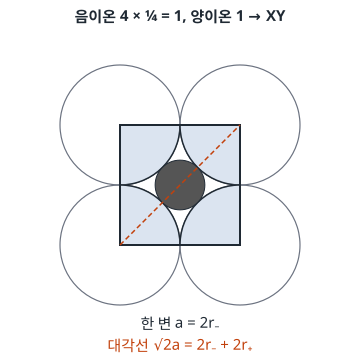

**주어진 것 / 구할 것**

- 2차원 정사각 단위세포: 네 꼭짓점에 음이온(흰 원, $r_-$)의 중심, 세포 중심에 양이온(검은 원, $r_+$)
- 접촉 조건: 음이온–음이온(변을 따라), 양이온–음이온(대각선을 따라)
- 구할 것: 조성식 $\mathrm{X}_n\mathrm{Y}_m$, 점유 비율(packing ratio, π 포함)

**풀이 전략** 단위세포 안에 실제로 들어 있는 원의 넓이 / 단위세포 넓이. 접촉 조건 두 개로 $a$와 $r_+$를 모두 $r_-$로 나타냅니다.

**단계별 풀이**

**1.** **개수 세기**: 꼭짓점의 원은 90° 부채꼴만 세포 안에 있으므로 $\tfrac14$개씩 → 음이온 $4 \times \tfrac14 = 1$. 중심의 양이온 1. 양이온 : 음이온 = 1 : 1 → **XY**.

**2.** **한 변 (음이온끼리 접촉)**: 이웃한 꼭짓점 중심 사이 거리 = $r_- + r_-$

$$a = 2r_-$$

**3.** **반대각선 (양이온–음이온 접촉)**: 꼭짓점 → 중심 거리 = 대각선의 절반

$$\frac{\sqrt2\,a}{2} = r_- + r_+ \;\Rightarrow\; \frac{\sqrt2(2r_-)}{2} = \sqrt2\,r_- = r_- + r_+ \;\Rightarrow\; r_+ = (\sqrt2 - 1)r_-$$

**4.** **세포 안의 원 넓이**:

$$S_- = 4\times\frac14\pi r_-^2 = \pi r_-^2, \qquad S_+ = \pi r_+^2 = \pi(\sqrt2-1)^2r_-^2 = \pi(3 - 2\sqrt2)r_-^2$$

$$S_- + S_+ = \pi r_-^2\,[1 + 3 - 2\sqrt2] = \pi(4 - 2\sqrt2)r_-^2$$

**5.** **세포 넓이**: $a^2 = (2r_-)^2 = 4r_-^2$

**6.** **점유 비율**:

$$\frac{S_- + S_+}{a^2} = \frac{\pi(4 - 2\sqrt2)r_-^2}{4r_-^2} = \frac{(4 - 2\sqrt2)\pi}{4} = \frac{(2 - \sqrt2)\pi}{2}$$

**검산**

- 수치: $(2 - 1.4142)/2 = 0.2929$, $\times\,\pi = 0.920 < 1$ ✓
- 양이온이 없을 때(정사각 배열의 원) $\pi/4 = 0.785$. 양이온이 빈틈을 채워 0.920으로 커지는 것이 맞습니다 ✓
- $r_+/r_- = 0.414$는 4배위(사각형) 배치의 임계 반지름 비와 같습니다 ✓

**채점 포인트·함정**

- 2차원이므로 "공간"은 **넓이**입니다. 부피($\tfrac43\pi r^3$)를 쓰면 틀립니다.
- $r_+/r_- = \sqrt2 - 1 \approx 0.414$는 사각형(4배위) 배치의 임계 반지름 비와 같은 값입니다.
- 답을 $r_+$, $r_-$로 남기지 말고, 접촉 조건으로 소거해 $\pi$만 남깁니다.

## A형 5번 · POE 수업 모형과 하슈웨의 인지갈등 모형 {#a5}

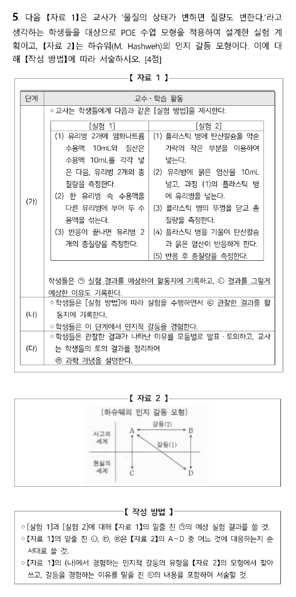

**정답**

- ㉠ 예상 결과: (학생의 선개념대로) 화학 반응이 일어나면 질량이 변한다. **[실험 1]은 앙금이 생겨 질량이 증가**하고, **[실험 2]는 기체가 생겨 질량이 감소**할 것이다.
- ㉡ → **A**, ㉢ → **D**, ㉣ → **B**
- 갈등 유형: **갈등 (1)**. 학생의 선개념(A) '물질의 상태가 변하면 질량도 변한다'로는 ㉢에서 관찰한 결과(D) '앙금 생성 반응과 기체 발생 반응에서도 총질량이 변하지 않는다'를 설명할 수 없기 때문이다.

**공식·핵심 개념**

- POE: 예상(P) → 관찰(O) → 설명(E)
- 하슈웨: 갈등 (1) = 선개념 A ↔ 실제 현상 D, 갈등 (2) = 선개념 A ↔ 과학 개념 B
- 질량 보존: 닫힌 계에서 반응 전후 총질량은 같음

**2027 출제 가능성 ★★★★★ 매우 높음** — 인지 갈등·개념 변화 모형(하슈웨, 포스너, 드라이버)은 화학교육론에서 가장 자주 나오는 축입니다. 2027에도 한 문항 이상은 나올 것으로 봅니다.

**핵심 개념 · POE**: 예상(Predict) → 관찰(Observe) → 설명(Explain). 학생이 이유와 함께 결과를 예상하게 한 뒤(가), 실험으로 예상과 다른 결과를 보게 하고(나), 그 차이를 설명하며 과학 개념을 정리합니다(다).

**하슈웨(Hashweh)의 인지갈등 모형**

| 기호 | 세계 | 의미 | 이 문항 |
|---|---|---|---|
| A | 사고의 세계 | 학생의 선개념 | ㉡ 그렇게 예상한 이유 (상태가 변하면 질량이 변함) |
| B | 사고의 세계 | 과학적 개념 | ㉣ 과학 개념 (질량 보존 법칙) |
| C | 현실 세계 | 선개념으로 설명되는 현상 | — |
| D | 현실 세계 | 선개념으로 설명되지 않는 현상 | ㉢ 관찰한 결과 (총질량 일정) |

- **갈등 (1)**: 선개념(A) ↔ 그것으로 설명할 수 없는 실제 현상(D). 실험·관찰로 유발됩니다.
- **갈등 (2)**: 선개념(A) ↔ 과학 개념(B). 교사의 설명 등으로 유발됩니다.

(나) 단계는 학생이 **실험을 하며** 인지적 갈등을 겪는 단계이므로 갈등 (1)입니다.

**채점 포인트·함정**

- ㉠은 **과학적으로 옳은 결과가 아니라 학생이 예상할 결과**를 묻습니다. "질량 변화 없음"이라고 쓰면 틀립니다.
- 실제로는 두 실험 모두 물질이 계 밖으로 나가지 않으므로(실험 2는 뚜껑을 닫은 닫힌 계) 반응 전후 총질량이 같습니다.
- 갈등 이유를 쓸 때 ㉢의 관찰 내용(질량 변화 없음)을 반드시 포함합니다.

## A형 6번 · 성취기준, 브루너의 표현양식, 피아제 {#a6}

**정답**

- ㉠ 과정·기능 요소: **자료 수집·분석 및 해석**
- ㉡ 이유: 수식과 같은 **상징적 표현**은 형식적 조작 단계의 학생이 이해할 수 있지만 **구체적 조작 단계** 학생에게는 어렵다. 그래서 학생의 인지 발달 단계에 맞추어 입자 모형과 같은 **영상적 표현**으로 이해하기 쉽게 하려는 것이다.
- ㉢ 활동: 풍선 속 기체 입자를 모형(입자와 화살표)으로 나타내되 **입자의 개수와 크기는 같게** 하고, 냉각한 (가)에서는 입자 운동이 느려지므로 화살표를 짧게, 가열한 (나)에서는 빨라지므로 화살표를 길게 그려, 온도에 따라 기체의 부피가 달라지는 것을 **입자 모형으로 설명**하게 한다.

**공식·핵심 개념**

- 2022 개정 과정·기능: 자료 수집·분석 및 해석 등 5요소
- 브루너 표현양식: 작동적 → 영상적 → 상징적
- 피아제: 구체적 조작기(입자 모형 등 영상) / 형식적 조작기(수식 등 상징)
- 샤를 법칙의 입자 모형: 입자 수·크기 일정, 운동 속도↑ → 부피↑

**2027 출제 가능성 ★★★★★ 매우 높음** — 2027학년도는 중학교 과학이 2022 개정으로 바뀐 뒤의 시험입니다. 2015 성취기준과 비교하는 문항과 브루너·피아제를 엮는 문항은 출제 가능성이 높습니다.

**㉠** 측정한 표를 바탕으로 그래프를 그리고 비례 관계를 찾는 활동은 2022 개정 과학과 '탐구 과정·기능' 중 **자료 수집·분석 및 해석**에 해당합니다.

**㉡ 브루너의 표현양식 × 피아제의 인지 발달 단계**

| 브루너 | 예 | 대응하는 피아제 단계 |
|---|---|---|
| 작동적(enactive) | 직접 조작, 실험 | 전조작기~구체적 조작기 |
| 영상적(iconic) | 그림, 입자 모형, 도식 | 구체적 조작기 |
| 상징적(symbolic) | 수식($V_1/T_1 = V_2/T_2$), 기호 | 형식적 조작기 |

중학생은 상당수가 구체적 조작기~과도기에 있으므로, 수식(상징)보다 입자 모형(영상)으로 설명하라는 것이 성취기준 해설의 취지입니다.

**㉢** 자료 1의 성취기준이 "입자 모형으로 해석"이고, 과정·기능이 "모형을 이용하여 현상을 설명하거나 예측하기"이므로, 그림 속 플라스크 상황을 **입자 모형으로 그려 설명하는 활동**이 들어가야 합니다.

**채점 포인트·함정**

- ㉢에서 꼭 들어갈 요소: (i) 입자의 **수·크기는 변하지 않음**, (ii) 온도에 따라 **운동 속도(화살표 길이)** 가 변함, (iii) 그 결과 **부피(입자 사이 거리)** 가 변함.
- "입자 크기가 커져서 부피가 커진다"는 대표적 오개념이므로 쓰면 안 됩니다.

## A형 7번 · 2022 개정 교육과정 설계의 개요와 탐구 과정 {#a7}

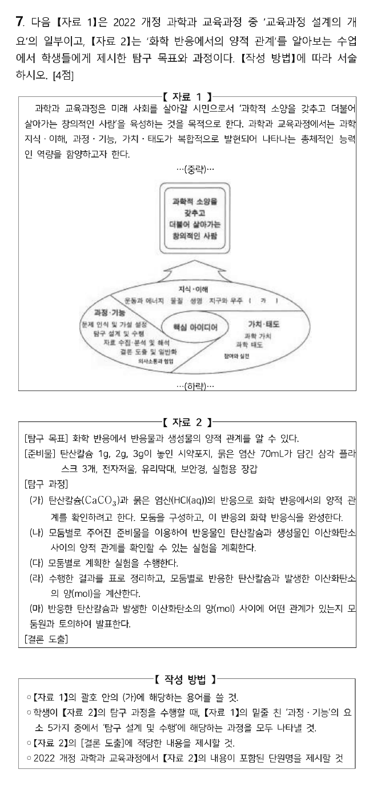

**정답**

- (가) **과학과 사회**
- '탐구 설계 및 수행'에 해당하는 과정: **(가)~(다)**
- 결론 도출: **반응한 탄산칼슘과 발생한 이산화탄소의 몰비는 1 : 1이며, 화학 반응에 관여한 물질의 몰비는 화학 반응식의 계수비와 같다.**
- 단원명: **화학의 언어**

**공식·핵심 개념**

- 2022 개정 지식·이해 영역: 운동과 에너지, 물질, 생명, 지구와 우주, **과학과 사회**
- 과정·기능 5요소: 문제 인식 및 가설 설정 / 탐구 설계 및 수행 / 자료 수집·분석 및 해석 / 결론 도출 및 일반화 / 의사소통과 협업
- 몰비 = 화학 반응식의 계수비

**2027 출제 가능성 ★★★★★ 매우 높음** — '과학과 사회'와 과정·기능 5요소는 2022 개정에서 새로 바뀐 용어입니다. 바뀐 교육과정의 용어를 묻는 기입형으로 나오기 좋아 우선순위가 높습니다.

**(가)** 2022 개정 과학과의 지식·이해 영역은 운동과 에너지 · 물질 · 생명 · 지구와 우주 · **과학과 사회**의 다섯 개입니다.

**과정·기능 5요소와 탐구 과정의 대응**

| 과정·기능 요소 | 자료 2의 과정 |
|---|---|
| 문제 인식 및 가설 설정 | [탐구 목표] 제시 |
| **탐구 설계 및 수행** | (가) 반응식 완성 → (나) 실험 계획 → (다) 실험 수행 |
| 자료 수집·분석 및 해석 | (라) 결과를 표로 정리하고 몰수 계산 |
| 결론 도출 및 일반화 | (마) 관계 토의, [결론 도출] |
| 의사소통과 협업 | (마) 모둠 토의·발표 |

**결론의 근거.** $\mathrm{CaCO_3(s) + 2HCl(aq) \rightarrow CaCl_2(aq) + H_2O(l) + CO_2(g)}$에서 CaCO₃ 1 g, 2 g, 3 g(0.01, 0.02, 0.03 mol)을 반응시키면 질량 감소(빠져나간 CO₂)도 0.44 g, 0.88 g, 1.32 g으로 같은 몰수(0.01, 0.02, 0.03 mol)가 됩니다. 즉 몰비가 반응식의 계수비(1 : 1)와 같습니다.

**채점 포인트·함정**

- 결론은 이 실험의 결과(CaCO₃ : CO₂ = 1 : 1)와 일반화(몰비 = 계수비)를 함께 쓰는 것이 안전합니다.
- 공식 답안은 (가)~(다)를 '탐구 설계 및 수행'으로 봅니다. (가)의 반응식 완성은 실험을 설계하기 위한 준비로 보는 것입니다.

## A형 8번 · 이상기체의 엔탈피 변화와 Joule–Thomson 계수 {#a8}

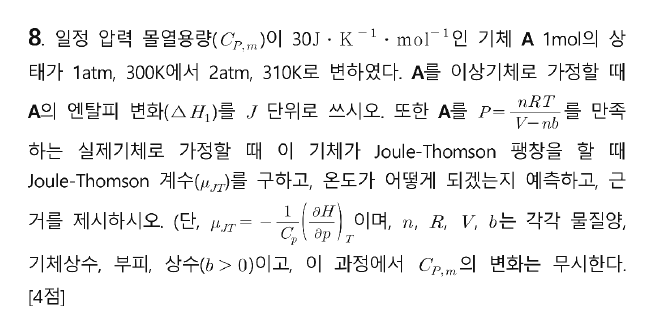

**정답** (1) $\Delta H_1 = 300\ \mathrm{J}$  (2) $\mu_{JT} = -\dfrac{nb}{C_p}$. $b>0$, $C_p>0$이므로 $\mu_{JT}<0$이고, Joule–Thomson 팽창(압력 감소, $dp<0$)에서 $dT = \mu_{JT}\,dp > 0$ → **온도가 올라간다.**

**공식·핵심 개념**

- 이상기체: $\Delta H = nC_{p,m}\Delta T$ (압력과 무관)
- $\mu_{JT} = -\dfrac{1}{C_p}\left(\dfrac{\partial H}{\partial p}\right)_T$, $\left(\dfrac{\partial H}{\partial p}\right)_T = V - T\left(\dfrac{\partial V}{\partial T}\right)_p$
- $\mu_{JT} < 0$이면 팽창할 때 온도 상승, $> 0$이면 냉각
- 반데르발스: $\mu_{JT} \approx \dfrac{1}{C_{p,m}}\left(\dfrac{2a}{RT} - b\right)$

**2027 출제 가능성 ★★★☆☆ 보통** — 열역학 관계식을 상태방정식에 적용하는 유형입니다. J–T 계수 외에 $(\partial U/\partial V)_T$(내부 압력)로 바꿔 낼 수도 있습니다.

**주어진 것 / 구할 것**

- $C_{p,m} = 30\ \mathrm{J\,K^{-1}\,mol^{-1}}$ (일정), $n = 1$ mol, (1 atm, 300 K) → (2 atm, 310 K)
- 실제기체 상태식 $p = \dfrac{nRT}{V - nb}$ ($b > 0$), $\mu_{JT} = -\dfrac{1}{C_p}\left(\dfrac{\partial H}{\partial p}\right)_T$
- 구할 것: (1) 이상기체일 때 $\Delta H_1$(J), (2) 실제기체의 $\mu_{JT}$와 Joule–Thomson 팽창 시 온도 변화 및 근거

**풀이 전략** $H$는 상태함수이므로 계산하기 쉬운 경로(등온 + 등압)로 나눕니다. 실제기체는 $(\partial H/\partial p)_T$를 열역학 관계식으로 구해 상태식에 대입합니다.

**단계별 풀이 — (1) 이상기체**

**1.** 경로를 둘로 나눕니다. ⓐ 300 K에서 1 atm → 2 atm(등온), ⓑ 2 atm에서 300 K → 310 K(등압)

**2.** ⓐ: 이상기체의 $H = U + pV = U(T) + nRT$는 $T$만의 함수 → $\left(\dfrac{\partial H}{\partial p}\right)_T = 0$ → $\Delta H_ⓐ = 0$

**3.** ⓑ: $\Delta H_ⓑ = \displaystyle\int_{300}^{310} nC_{p,m}dT = (1\ \mathrm{mol})(30\ \mathrm{J\,K^{-1}\,mol^{-1}})(10\ \mathrm{K}) = 300\ \mathrm{J}$

**4.** $\Delta H_1 = 0 + 300 = 300\ \mathrm{J}$

**단계별 풀이 — (2) 실제기체**

**1.** 기본식 $dH = T\,dS + V\,dp$에서 $T$ 일정으로 $p$에 대해 미분:

$$\left(\frac{\partial H}{\partial p}\right)_T = T\left(\frac{\partial S}{\partial p}\right)_T + V$$

**2.** 맥스웰 관계식($dG = -S\,dT + V\,dp$에서): $\left(\dfrac{\partial S}{\partial p}\right)_T = -\left(\dfrac{\partial V}{\partial T}\right)_p$. 따라서

$$\left(\frac{\partial H}{\partial p}\right)_T = V - T\left(\frac{\partial V}{\partial T}\right)_p$$

**3.** 상태식을 $V$에 대해 풀기: $p(V - nb) = nRT$ → $V = \dfrac{nRT}{p} + nb$

**4.** $\left(\dfrac{\partial V}{\partial T}\right)_p = \dfrac{nR}{p}$ → $T\left(\dfrac{\partial V}{\partial T}\right)_p = \dfrac{nRT}{p} = V - nb$

**5.** 2단계 식에 대입:

$$\left(\frac{\partial H}{\partial p}\right)_T = V - (V - nb) = nb$$

**6.** $$\mu_{JT} = -\frac{1}{C_p}\left(\frac{\partial H}{\partial p}\right)_T = -\frac{nb}{C_p} = -\frac{b}{C_{p,m}}$$

**7.** **부호 판단**: $b > 0$, $C_p > 0$ → $\mu_{JT} < 0$.

**8.** **온도 변화**: Joule–Thomson 팽창은 압력이 낮아지는 과정($dp < 0$)입니다.

$$dT = \mu_{JT}\,dp = \left(-\frac{nb}{C_p}\right)(dp < 0) > 0$$

→ **온도가 올라갑니다.**

**9.** **물리적 의미**: 이 상태식에는 분자 간 인력 항($a$)이 없고 반발(분자 부피 $b$)만 있습니다. 팽창하면 반발에 의해 저장된 에너지가 운동 에너지로 풀려 온도가 오릅니다(역전 온도보다 높은 H₂·He와 같은 거동).

**검산**

- 단위: $b/C_{p,m}$ = $\mathrm{m^3\,mol^{-1}}/(\mathrm{J\,K^{-1}\,mol^{-1}}) = \mathrm{K\,m^3\,J^{-1}} = \mathrm{K\,Pa^{-1}}$ ✓ (압력당 온도)
- 극한: $b \to 0$(이상기체)이면 $\mu_{JT} \to 0$ ✓
- 크기 예시: $b = 0.030\ \mathrm{L\,mol^{-1}} = 3.0\times10^{-5}\ \mathrm{m^3\,mol^{-1}}$이면 $\mu_{JT} = -1.0\times10^{-6}\ \mathrm{K\,Pa^{-1}} \approx -0.10\ \mathrm{K\,atm^{-1}}$

**채점 포인트·함정**

- (1)에서 압력 변화가 있다고 $V\Delta p$ 같은 항을 더하면 틀립니다(이상기체는 $(\partial H/\partial p)_T = 0$).
- (2)는 $\mu_{JT}$ 식, 부호 판단, **"압력이 감소하므로"** 라는 근거까지 써야 만점입니다.

## A형 9번 · 고리 위의 입자(2차원 회전) {#a9}

**정답**

1. 순환 경계조건 $\psi(\phi + 2\pi) = \psi(\phi)$ → $e^{2\pi i m_l} = (-1)^{2m_l} = 1$ → $m_l = 0, \pm1, \pm2, \dots$
2. 고유치 $m_l\hbar$
3. $\langle\phi\rangle = \pi$
4. $\Delta E_{\text{벤젠}} = \dfrac{3h^2}{8\pi^2 I}$, $\Delta E_{\text{포르핀}} = \dfrac{11h^2}{8\pi^2 I}$ → $\Delta E_{\text{포르핀}} - \Delta E_{\text{벤젠}} = \dfrac{h^2}{\pi^2 I} = hc\Delta\tilde\nu$ → $\Delta\tilde\nu = \dfrac{h}{\pi^2 c I}$

**공식·핵심 개념**

- 고리 위 입자: $E = \dfrac{m_l^2\hbar^2}{2I} = \dfrac{m_l^2h^2}{8\pi^2I}$, $I = mr^2$
- 순환 경계조건 $\psi(\phi + 2\pi) = \psi(\phi)$ → $m_l = 0, \pm1, \dots$
- $\hat l_z = \dfrac{\hbar}{i}\dfrac{d}{d\phi}$, 고유치 $m_l\hbar$
- $m_l \neq 0$ 준위는 이중 축퇴(전자 4개)

**2027 출제 가능성 ★★★☆☆ 보통** — 상자 속 입자·고리·강체 회전자는 양자역학 영역에서 돌아가며 나오는 모델입니다. 콘쥬게이션 고리의 HOMO–LUMO 전이 계산으로 응용되기 쉽습니다.

**주어진 것 / 구할 것**

- $\hat H = -\dfrac{\hbar^2}{2mr^2}\dfrac{d^2}{d\phi^2}$ ($I = mr^2$), $\psi_{m_l}(\phi) = \left(\dfrac{1}{2\pi}\right)^{1/2}e^{im_l\phi}$, $\hat l_z = \dfrac{\hbar}{i}\dfrac{d}{d\phi}$, $e^{i\pi} = -1$
- 구할 것: (1) 순환 경계조건과 허용되는 $m_l$, (2) $\hat l_z$ 고유치, (3) $\langle\phi\rangle$, (4) 벤젠·포르핀 HOMO→LUMO 전이 파수와 그 차이

**풀이 전략** 경계조건은 "한 바퀴 돌면 같은 값". 고유치와 기대치는 연산자를 직접 적용하고 적분합니다. 전이 에너지는 에너지 준위식을 구한 뒤 π 전자를 아래부터 채웁니다.

**단계별 풀이**

**1.** **에너지 준위식 (전이 계산에 필요)**: $\dfrac{d}{d\phi}e^{im_l\phi} = im_le^{im_l\phi}$, $\dfrac{d^2}{d\phi^2}e^{im_l\phi} = (im_l)^2e^{im_l\phi} = -m_l^2e^{im_l\phi}$

$$\hat H\psi = -\frac{\hbar^2}{2I}(-m_l^2)\psi = \frac{m_l^2\hbar^2}{2I}\psi \;\Rightarrow\; E_{m_l} = \frac{m_l^2\hbar^2}{2I} = \frac{m_l^2h^2}{8\pi^2I}\quad\left(\hbar = \frac{h}{2\pi}\right)$$

**2.** **(1) 순환 경계조건**: $\phi$와 $\phi + 2\pi$는 같은 점이므로 $\psi(\phi + 2\pi) = \psi(\phi)$.

$$\left(\frac{1}{2\pi}\right)^{1/2}e^{im_l\phi}e^{2\pi im_l} = \left(\frac{1}{2\pi}\right)^{1/2}e^{im_l\phi} \;\Rightarrow\; e^{2\pi im_l} = 1$$

$$e^{2\pi im_l} = \left(e^{i\pi}\right)^{2m_l} = (-1)^{2m_l} = 1 \;\Rightarrow\; 2m_l = \text{짝수} \;\Rightarrow\; m_l = 0, \pm1, \pm2, \dots$$

**3.** **(2) 각운동량 고유치**:

$$\hat l_z\psi = \frac{\hbar}{i}\frac{d}{d\phi}\left[\left(\frac{1}{2\pi}\right)^{1/2}e^{im_l\phi}\right] = \frac{\hbar}{i}\cdot im_l\left(\frac{1}{2\pi}\right)^{1/2}e^{im_l\phi} = m_l\hbar\,\psi$$

고유치 $m_l\hbar$.

**4.** **(3) 각도의 기대치**: 먼저 $\psi^*\psi = \dfrac{1}{2\pi}e^{-im_l\phi}e^{im_l\phi} = \dfrac{1}{2\pi}$ (정규화 확인: $\int_0^{2\pi}\frac{1}{2\pi}d\phi = 1$ ✓).

$$\langle\phi\rangle = \int_0^{2\pi}\psi^*\,\phi\,\psi\,d\phi = \frac{1}{2\pi}\int_0^{2\pi}\phi\,d\phi = \frac{1}{2\pi}\cdot\frac{(2\pi)^2}{2} = \pi$$

**5.** **(4) 전자 채우기**: $m_l = 0$은 한 준위(전자 2개), $\lvert m_l\rvert \ge 1$은 $\pm m_l$ 이중 축퇴(전자 4개).

| 고리 | π 전자 | 채운 준위 | HOMO | LUMO |
|---|---|---|---|---|
| 벤젠 | 6 | $0^2,\ (\pm1)^4$ | $\lvert m_l\rvert = 1$ | $\lvert m_l\rvert = 2$ |
| 포르핀 (답안 가정) | 22 | $0^2, (\pm1)^4, \dots, (\pm5)^4$ | $\lvert m_l\rvert = 5$ | $\lvert m_l\rvert = 6$ |

(포르핀: $2 + 4\times5 = 22$ ✓)

**6.** **전이 에너지**:

$$\Delta E_{\text{벤젠}} = (2^2 - 1^2)\frac{h^2}{8\pi^2I} = \frac{3h^2}{8\pi^2I}, \qquad \Delta E_{\text{포르핀}} = (6^2 - 5^2)\frac{h^2}{8\pi^2I} = \frac{11h^2}{8\pi^2I}$$

**7.** **파수**: $\Delta E = hc\tilde\nu$ → $\tilde\nu = \dfrac{\Delta E}{hc}$

$$\tilde\nu_{\text{벤젠}} = \frac{3h}{8\pi^2cI}, \qquad \tilde\nu_{\text{포르핀}} = \frac{11h}{8\pi^2cI}$$

**8.** **차이**:

$$\tilde\nu_{\text{포르핀}} - \tilde\nu_{\text{벤젠}} = \frac{(11 - 3)h}{8\pi^2cI} = \frac{h}{\pi^2cI}$$

**검토 메모.** 18π 모형([18]annulene 경로)을 쓰면 HOMO $\lvert m_l\rvert = 4$ → LUMO 5, $\Delta E = 9h^2/(8\pi^2I)$이고 차이는 $\dfrac{6h}{8\pi^2cI} = \dfrac{3h}{4\pi^2cI}$입니다. 문제가 π 전자 수를 주지 않으면 몇 개로 셌는지 답안에 밝혀 둡니다. 또 실제로는 두 고리의 $I$가 다르지만, 문제는 같은 $I$로 놓도록 했습니다.

**검산**

- 단위: $\dfrac{h}{cI} = \dfrac{\mathrm{J\,s}}{(\mathrm{m\,s^{-1}})(\mathrm{kg\,m^2})} = \dfrac{\mathrm{kg\,m^2\,s^{-1}}}{\mathrm{kg\,m^3\,s^{-1}}} = \mathrm{m^{-1}}$ (파수) ✓
- $\langle\phi\rangle = \pi$는 확률이 고르게 퍼져 있어 구간 $[0, 2\pi]$의 가운데라는 직관과 맞습니다 ✓

**채점 포인트·함정**

- (1)은 $e^{i\pi} = -1$을 써서 $(-1)^{2m_l} = 1$로 연결하는 과정이 핵심입니다.
- (3)에서 $e^{-im\phi}e^{im\phi} = 1$로 지수 부분이 사라지는 것을 보여 줍니다.
- (4)에서 $\hbar = h/2\pi$ 변환 실수가 잦습니다: $\dfrac{\hbar^2}{2I} = \dfrac{h^2}{8\pi^2 I}$.

## A형 10번 · 2,4-pentanedione의 반응과 Robinson 고리화 {#a10}

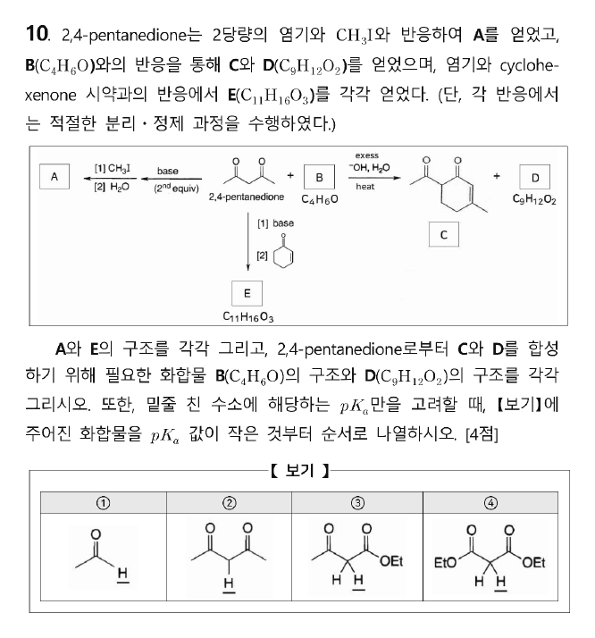

**정답** A, B, C, D, E 구조는 아래와 같고, $pK_a$가 작은 순서는 **② < ③ < ④ < ①**.

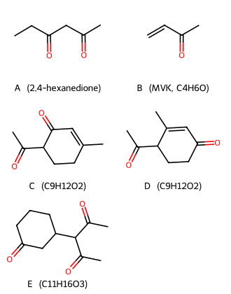

**공식·핵심 개념**

- pKa: 1,3-다이케톤(≈9) < β-케토에스터(≈11) < 말론산에스터(≈13) < 알데하이드 α-H(≈17)
- 다이음이온: 덜 안정한 말단 탄소음이온이 먼저 알킬화
- Robinson 고리화 = Michael 첨가 + 분자 내 aldol 축합(−H₂O)
- 안정화된 엔올레이트는 α,β-불포화 카보닐에 1,4-첨가

**2027 출제 가능성 ★★★★☆ 높음** — 엔올레이트 알킬화와 Michael·Robinson은 유기 서술형에서 자주 나오는 반응입니다. 산도 순서 비교도 같이 묻기 좋은 소재입니다.

**주어진 것 / 구할 것**

- 2,4-pentanedione + 염기 2당량, CH₃I → A
- 2,4-pentanedione + B(C₄H₆O), 과량 OH⁻/H₂O, 가열 → C(그림으로 주어짐) + D(C₉H₁₂O₂)
- 2,4-pentanedione + 염기, cyclohexenone → E(C₁₁H₁₆O₃)
- 구할 것: A, B, D, E의 구조, ①~④ 밑줄 친 H의 pKa 순서

**풀이 전략** 분자식 차이로 들어간 조각을 먼저 정하고, 각 반응을 "어느 탄소가 친핵체, 어느 탄소가 친전자체인가"로 따라갑니다. pKa는 짝염기 음전하가 몇 개의 C=O로, 얼마나 잘 퍼지는지로 비교합니다.

**분자식으로 조각 정하기**

| 생성물 | 계산 | 들어간 조각 |
|---|---|---|
| A | C₅H₈O₂ − H + CH₃ = C₆H₁₀O₂ | CH₃ 1개 |
| C, D | C₉H₁₂O₂ = C₅H₈O₂ + C₄H₆O − H₂O | B = C₄H₆O (MVK), 축합으로 H₂O 1개 빠짐 |
| E | C₅H₈O₂ + C₆H₈O = C₁₁H₁₆O₃ | cyclohexenone 전체(첨가만, 빠지는 것 없음) |

**A — 다이음이온의 알킬화.** 염기 1당량은 가장 산성인 가운데 CH₂(pKa ≈ 9)를 떼고, **2당량째** 염기가 말단 CH₃의 양성자를 떼어 다이음이온을 만듭니다. 이때 **덜 안정한(반응성이 큰) 말단 탄소음이온**이 CH₃I와 먼저 반응하므로, 물로 처리하면 말단이 메틸화된 **2,4-hexanedione**(CH₃COCH₂COCH₂CH₃)이 됩니다.

**메커니즘 ① A — 다이음이온 생성과 말단 알킬화**

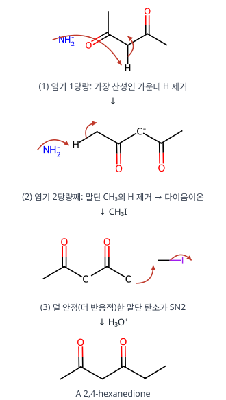

**B, C, D — Robinson 고리화.** C(C₉H₁₂O₂) − 2,4-pentanedione(C₅H₈O₂) = C₄H₄이고, 고리화(aldol 축합)에서 물 한 분자가 빠지므로 B = C₄H₄ + H₂O = **C₄H₆O, methyl vinyl ketone(MVK)** 입니다.

1. **Michael 첨가**: 2,4-pentanedione 엔올레이트가 MVK의 β-탄소에 1,4-첨가 → 3-acetyl-heptane-2,6-dione 형태의 1,5-다이카보닐.
2. **분자 내 aldol 축합 + 탈수**: 어느 메틸 케톤의 α-탄소가 어느 카보닐을 공격하느냐에 따라 6원 고리 두 가지가 생깁니다.
   - **C**: 아세틸의 CH₃ 엔올레이트가 MVK에서 온 C=O를 공격 → 6-acetyl-3-methylcyclohex-2-enone (고리 C=O 옆 탄소에 아세틸기)
   - **D**: MVK에서 온 CH₃의 엔올레이트가 아세틸 C=O를 공격 → 4-acetyl-3-methylcyclohex-2-enone (C=C의 CH₃ 옆 탄소에 아세틸기)

**메커니즘 ② Michael 첨가**

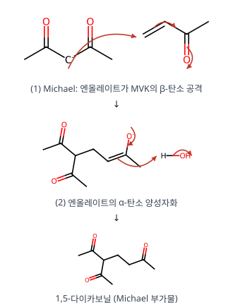

**메커니즘 ③ 분자 내 aldol 축합과 E1cB 탈수 (C)**

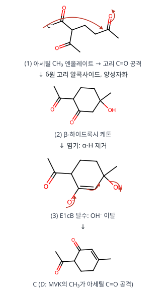

**E — Michael 첨가.** 2,4-pentanedione 엔올레이트가 cyclohexenone의 β-탄소에 1,4-첨가 → 3-(diacetylmethyl)cyclohexanone, $\mathrm{C_5H_7O_2 + C_6H_8O + H = C_{11}H_{16}O_3}$. 안정화된 엔올레이트(연한 친핵체)는 C=O(1,2)보다 β-탄소(1,4)를 공격합니다.

**메커니즘 ④ E (Michael 1,4-첨가)**

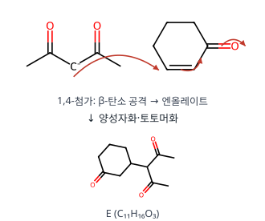

**pKa 비교 (밑줄 친 H)**

| 화합물 | 근거 | pKa(대략) |
|---|---|---|
| ② 2,4-pentanedione | 케톤 C=O 두 개로 음전하 비편재화 | ≈ 9 |
| ③ ethyl acetoacetate | C=O 두 개 중 하나가 에스터(OEt의 공명 주개 효과로 안정화 약함) | ≈ 11 |
| ④ diethyl malonate | 에스터 두 개 | ≈ 13 |
| ① acetaldehyde α-H | C=O 하나 | ≈ 17 |

**메커니즘 ⑤ D (다른 고리 닫힘)**

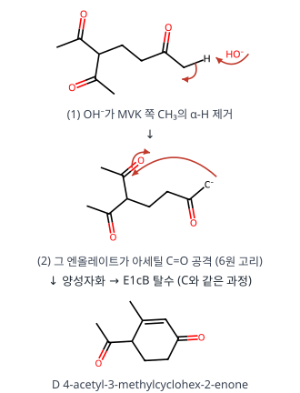

**왜 이 생성물인가**

- **A가 말단 메틸화인 이유**: 1당량째 염기는 pKa ≈ 9인 가운데 CH₂를 떼어 안정한 엔올레이트(음전하가 O 두 개로 퍼짐)를 만듭니다. 2당량째는 pKa ≈ 20인 말단 CH₃를 뗍니다. 다이음이온에서는 **덜 안정한 말단 탄소음이온이 더 반응적**이라 CH₃I와 먼저 SN2 반응합니다. 가운데 탄소는 산 처리 때 양성자화만 됩니다.
- **C와 D가 둘 다 생기는 이유**: Michael 부가물에는 메틸 케톤이 세 개 있고, 6원 고리를 만들 수 있는 (엔올레이트 탄소, C=O) 짝이 두 가지입니다. 아세틸 CH₃ → MVK 쪽 C=O는 C, MVK 쪽 CH₃ → 아세틸 C=O는 D입니다. 둘 다 6원 고리라 고리 크기로는 구별되지 않아 혼합물이 됩니다. 탈수 후 C=C가 C=O와 콘쥬게이션되는 것(α,β-불포화 케톤)이 탈수의 추진력입니다.
- **E가 1,4-첨가인 이유**: 2,4-pentanedione 엔올레이트는 음전하가 두 C=O로 퍼진 안정한(연한) 친핵체라, 되돌아갈 수 있는 1,2-첨가 대신 열역학적으로 유리한 1,4-첨가(Michael)를 합니다.

**pKa 순서의 근거 (짝염기 안정성)**

| 화합물 | 짝염기의 음전하가 퍼지는 곳 | pKa(대략) |
|---|---|---|
| ② 2,4-pentanedione | 케톤 C=O 두 개 | ≈ 9 |
| ③ ethyl acetoacetate | 케톤 C=O 1개 + 에스터 C=O 1개. 에스터 O의 비공유 전자쌍이 C=O로 공명 주개 → C=O가 음전하를 덜 받음 | ≈ 11 |
| ④ diethyl malonate | 에스터 C=O 두 개 (둘 다 약함) | ≈ 13 |
| ① acetaldehyde | C=O 하나 | ≈ 17 |

따라서 산성이 강한(pKa 작은) 순서 ② < ③ < ④ < ①.

**검산** 분자식: A C₆H₁₀O₂, C·D C₉H₁₂O₂, E C₁₁H₁₆O₃ (구조식으로 계산 확인) ✓. C와 D는 고리 C=O·C=C·아세틸의 위치만 다른 위치 이성질체 ✓

**채점 포인트·함정**

- A를 가운데 탄소가 메틸화된 3-methyl-2,4-pentanedione으로 쓰면 틀립니다. 2당량 염기 → 말단 알킬화가 핵심입니다.
- C와 D는 같은 분자식(C₉H₁₂O₂)의 위치 이성질체임을 확인합니다.

## A형 11번 · 이민·엔아민 형성과 환원성 아미노화 {#a11}

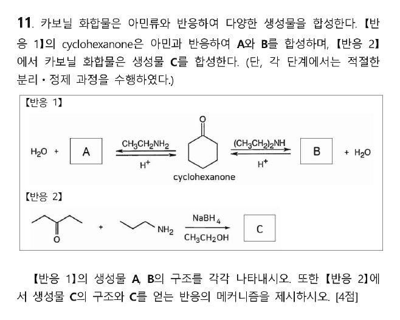

**정답** A: *N*-ethylcyclohexanimine (이민), B: 1-(diethylamino)cyclohexene (엔아민), C: *N*-propylpentan-3-amine

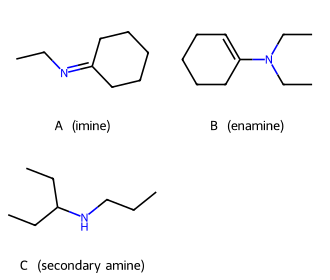

**공식·핵심 개념**

- 1차 아민 + 카보닐 → 이민(C=N–R), 2차 아민 → 엔아민(C=C–NR₂)
- 산 촉매·가역, pH ≈ 4~5에서 가장 빠름
- 환원성 아미노화: 카비놀아민 → 이미늄 → H⁻(NaBH₄, NaBH₃CN) → 아민

**2027 출제 가능성 ★★★★☆ 높음** — 카보닐에 대한 질소 친핵체 첨가는 메커니즘을 그리게 하는 서술형으로 나오기 좋습니다. 엔아민 알킬화(Stork)로 이어지는 변형도 대비해 두세요.

**주어진 것 / 구할 것**

- 반응 1: cyclohexanone + CH₃CH₂NH₂ (H⁺) ⇌ A + H₂O; cyclohexanone + (CH₃CH₂)₂NH (H⁺) ⇌ B + H₂O
- 반응 2: 3-pentanone + propylamine, NaBH₄/EtOH → C
- 구할 것: A, B, C의 구조와 C의 생성 메커니즘

**풀이 전략** 아민의 N이 카보닐 탄소를 공격 → 카비놀아민 → 물이 빠져 이미늄. 이미늄의 N에 H가 남아 있으면(1차 아민) N–H를 잃어 이민, 없으면(2차 아민) α-C–H를 잃어 엔아민. 환원제가 있으면 이미늄이 H⁻를 받아 아민이 됩니다.

**A, B.** 1차 아민(CH₃CH₂NH₂)은 카보닐과 축합해 **이민(C=N–R)** 을 만들고, 2차 아민((CH₃CH₂)₂NH)은 N에 떼어 낼 H가 없어 **α-탄소의 H가 빠지며 엔아민(C=C–NR₂)** 이 됩니다. 두 반응 모두 산 촉매·가역 반응이며 물이 빠집니다(물을 제거해 평형을 이동).

**메커니즘 ① 이민 A**

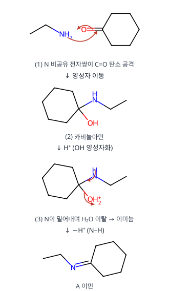

**메커니즘 ② 엔아민 B**

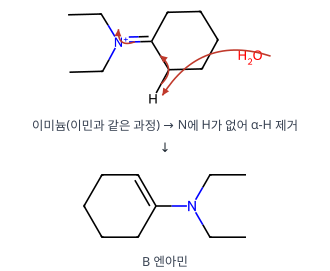

**C의 메커니즘 (환원성 아미노화)**

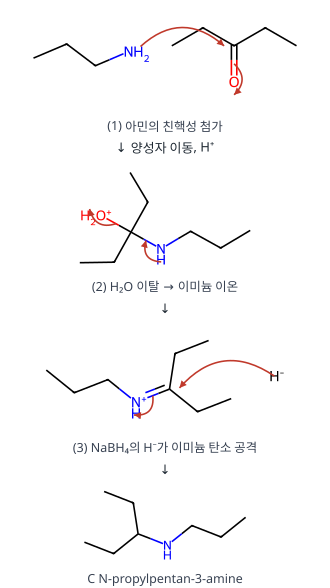

1. propylamine의 N 비공유 전자쌍이 3-pentanone의 카보닐 C를 친핵성 공격 → 쌍극 이온 사면체 중간체
2. 양성자 이동 → **카비놀아민**(hemiaminal)
3. OH가 양성자화되어 물로 이탈 → **이미늄 이온**(C=N⁺H–R) (중성 이민과 평형)
4. NaBH₄의 수소화 이온(H⁻)이 이미늄 탄소를 공격 → **2차 아민 C** (CH₃CH₂)₂CH–NH–CH₂CH₂CH₃

**왜 이 생성물인가**

- **이민 vs 엔아민**: 이미늄 이온 $\mathrm{R_2C{=}N^+R'_2}$에서 중성이 되려면 H⁺ 하나를 잃어야 합니다. 1차 아민에서 온 이미늄은 N에 H가 있어 N–H를 잃고 **C=N(이민)**. 2차 아민에서 온 이미늄은 N에 H가 없어 이웃 α-탄소의 H를 잃고 **C=C–N(엔아민)**.
- **pH ≈ 4~5가 최적인 이유**: 산이 너무 약하면 OH가 물로 떠나지 못하고(3단계), 너무 강하면 아민이 R–NH₃⁺로 양성자화되어 친핵성을 잃습니다(1단계).
- **환원성 아미노화에서 생성물이 아민인 이유**: 이미늄 C=N⁺는 케톤 C=O보다 훨씬 강한 친전자체라 NaBH₄의 H⁻가 이미늄을 먼저 환원합니다. 실험실에서는 케톤 환원을 더 막기 위해 NaBH₃CN을 자주 씁니다.

**검산** 분자식: A C₈H₁₅N(이민), B C₁₀H₁₉N(엔아민), C C₈H₁₉N. C = C₅H₁₀O + C₃H₉N − H₂O + H₂ = C₈H₁₉N ✓

**채점 포인트·함정**

- 메커니즘에서 화살표의 출발점(비공유 전자쌍·결합)과 양성자 이동 단계를 빠뜨리지 않습니다.
- 생성물은 이민이 아니라 **환원된 아민**입니다. NaBH₄가 이민(이미늄)의 C=N을 환원합니다.

## A형 12번 · ClF₃·PCl₂F₃의 진동 기약표현과 ¹⁹F NMR {#a12}

**정답**

1. ClF₃: $\Gamma_{\text{vib}} = 3A_1 + B_1 + 2B_2$, IR 활성 피크 **6개**
2. PCl₂F₃ (축 F 2개, $C_{2v}$): IR 활성 $\Gamma = 5A_1 + 3B_1 + 3B_2$
3. 나머지 구조: 축에 Cl 2개 → $D_{3h}$, 축에 F·Cl 하나씩 → $C_s$
4. NMR: −22 °C에서는 Berry 유사회전으로 축·적도 F가 빠르게 자리를 바꿔 구별되지 않고 P–F 짝지음에 의한 이중선 하나만 보인다. −143 °C에서는 교환이 멈춰 축 F 2개(F–F 짝지음으로 이중선, 다시 P–F로 이중선)와 적도 F 1개(축 F 2개에 의해 삼중선, 다시 P–F로 두 개)가 따로 관측된다.

**공식·핵심 개념**

- $\Gamma_{3N}$: (움직이지 않는 원자 수) × (원자당 기여: $E$ 3, $C_2$ −1, $\sigma$ 1)
- 축소 공식 $n_i = \dfrac{1}{h}\sum g\,\chi_i\,\chi$, $\Gamma_{\text{vib}} = \Gamma_{3N} - \Gamma_{\text{trans}} - \Gamma_{\text{rot}}$
- IR 활성: $x, y, z$와 같은 기약표현 / Raman 활성: 이차 함수
- 삼각쌍뿔의 Berry 유사회전 → 고온 NMR에서 축·적도 평균화

**2027 출제 가능성 ★★★★★ 매우 높음** — 대칭·점군·진동 기약표현은 무기 영역에서 거의 해마다 나오는 고정 출제 소재입니다. NMR 동역학(유사회전)과 엮인 형태도 대비해야 합니다.

**주어진 것 / 구할 것**

- 자료 1: T자형 ClF₃, $C_{2v}$ 지표표 ($z$ = C₂축, 분자 평면 = $yz$)
- 자료 2: PCl₂F₃의 ¹⁹F NMR, −22 °C에서 봉우리 2개(이중선), −143 °C에서 봉우리 두 무리
- 구할 것: ClF₃ $\Gamma_{\text{vib}}$와 IR 활성 피크 수, PCl₂F₃ IR 활성 $\Gamma$, 나머지 두 이성질체의 구조·점군, 온도에 따른 NMR 차이의 이유

**풀이 전략** $\Gamma_{3N}$ = (움직이지 않는 원자 수) × (원자 하나당 기여: E 3, C₂ −1, σ 1) → 축소 공식으로 기약표현 → 병진·회전 빼기 → $x, y, z$와 같은 기약표현만 IR 활성. NMR은 Berry 유사회전 속도와 NMR 시간 척도를 비교합니다.

**단계별 풀이 — (1) ClF₃**

**1.** **좌표**: C₂축은 Cl과 짧은 Cl–F(적도 F)를 지나는 $z$축입니다. 분자 평면이 $yz$ = σv′.

**2.** **각 연산에서 움직이지 않는 원자**

| $C_{2v}$ | $E$ | $C_2$ | $\sigma_v(xz)$ | $\sigma_v'(yz)$ |
|---|---|---|---|---|
| 움직이지 않는 원자 | 4 | 2 (Cl, F적도) | 2 (Cl, F적도) | 4 (분자 평면) |
| 원자당 기여 | 3 | −1 | 1 | 1 |
| $\Gamma_{3N}$ | 12 | −2 | 2 | 4 |

**3.** **축소 공식** $n_i = \dfrac{1}{h}\sum_R \chi_i(R)\chi(R)$, $h = 4$:

$$n(A_1) = \tfrac14[12(1) + (-2)(1) + 2(1) + 4(1)] = \tfrac{16}{4} = 4$$
$$n(A_2) = \tfrac14[12(1) + (-2)(1) + 2(-1) + 4(-1)] = \tfrac{4}{4} = 1$$
$$n(B_1) = \tfrac14[12(1) + (-2)(-1) + 2(1) + 4(-1)] = \tfrac{12}{4} = 3$$
$$n(B_2) = \tfrac14[12(1) + (-2)(-1) + 2(-1) + 4(1)] = \tfrac{16}{4} = 4$$

$\Gamma_{3N} = 4A_1 + A_2 + 3B_1 + 4B_2$ (차원 합 4 + 1 + 3 + 4 = 12 ✓)

**4.** **병진·회전 빼기** (지표표에서 $z \to A_1$, $x \to B_1$, $y \to B_2$, $R_z \to A_2$, $R_y \to B_1$, $R_x \to B_2$):

$$\Gamma_{\text{vib}} = (4A_1 + A_2 + 3B_1 + 4B_2)$$
$$\quad - (A_1 + B_1 + B_2)_{\text{병진}} - (A_2 + B_1 + B_2)_{\text{회전}}$$
$$= 3A_1 + B_1 + 2B_2$$

모드 수 3 + 1 + 2 = 6 = 3N − 6 ✓

**5.** **IR 활성**: $A_1(z)$, $B_1(x)$, $B_2(y)$ 모두 활성 → **6개**.

**단계별 풀이 — (2) PCl₂F₃ (축에 F 2개, 적도에 F 1개 + Cl 2개, $C_{2v}$)**

**1.** C₂축 = P–F(적도). 거울면 하나는 P·F 3개를 포함(축 F 두 개 + 적도 F), 다른 하나는 P·적도 F·Cl 2개를 포함.

| $C_{2v}$ | $E$ | $C_2$ | $\sigma_v$ (P, F 3개) | $\sigma_v'$ (P, F적도, Cl 2개) |
|---|---|---|---|---|
| 움직이지 않는 원자 | 6 | 2 | 4 | 4 |
| $\Gamma_{3N}$ | 18 | −2 | 4 | 4 |

**2.** **축소**:

$$n(A_1) = \tfrac14(18 - 2 + 4 + 4) = 6, \quad n(A_2) = \tfrac14(18 - 2 - 4 - 4) = 2$$
$$n(B_1) = \tfrac14(18 + 2 + 4 - 4) = 5, \quad n(B_2) = \tfrac14(18 + 2 - 4 + 4) = 5$$

(합 6 + 2 + 5 + 5 = 18 ✓)

**3.** $\Gamma_{\text{vib}} = (6 - 1)A_1 + (2 - 1)A_2 + (5 - 2)B_1 + (5 - 2)B_2 = 5A_1 + A_2 + 3B_1 + 3B_2$ (12 = 3N − 6 ✓)

**4.** $A_2$는 $x, y, z$ 어느 것과도 같지 않아 IR 비활성 → $\Gamma_{\text{IR}} = 5A_1 + 3B_1 + 3B_2$ (11개)

**단계별 풀이 — (3) 나머지 두 이성질체**

- 축에 Cl 2개, 적도에 F 3개 → C₃축, σh, C₂ 3개 → $D_{3h}$
- 축에 F 1개 + Cl 1개 → 남는 대칭은 F축·Cl축·적도 F 하나를 포함한 거울면 하나 → $C_s$
- 주어진 구조가 축 F 2개인 이유: 축 결합은 3중심 4전자 성격이라 전자 밀도가 커서, 전기음성도가 큰 F가 축을 선호합니다(Bent 규칙). 저온 NMR의 F 2 : 1 비율과도 맞습니다.

**단계별 풀이 — (4) 온도에 따른 ¹⁹F NMR**

**1.** **원자핵**: ¹⁹F($I = \tfrac12$, 100%), ³¹P($I = \tfrac12$, 100%). $n + 1$ 규칙 적용.

**2.** **−143 °C (느린 교환)**: 유사회전 속도 $k \ll \Delta\nu$ → 축 F와 적도 F가 따로 보입니다.

| F 환경 | 개수(세기) | P와 짝지음 | F–F 짝지음 | 모양 |
|---|---|---|---|---|
| 축 F | 2 | 이중선 | 적도 F 1개 → 이중선 | 이중선의 이중선 |
| 적도 F | 1 | 이중선 | 축 F 2개 → 삼중선 | 이중선의 삼중선 |

**3.** **−22 °C (빠른 교환)**: Berry 유사회전(축 2개 ↔ 적도 2개를 맞바꾸며 사각뿔 전이 상태를 거침)이 $k \gg \Delta\nu$로 빨라 F 3개가 평균 환경 하나로 보입니다. 동등해진 F끼리의 짝지음은 보이지 않고, P와의 평균 짝지음 $\bar J = \tfrac13(2J_{\text{ax}} + J_{\text{eq}})$만 남아 **이중선 하나**.

**검산** 저온 적분비 2 : 1 = 축 F 2 : 적도 F 1 ✓. 고온 이중선의 위치는 두 저온 신호의 가중 평균 근처 ✓

**채점 포인트·함정**

- (2)는 "IR 활성인" 기약표현만 묻습니다. $A_2$를 넣으면 틀립니다.
- (4)는 유사회전에 의한 평균화(고온), 교환 정지(저온), 갈라짐 원인(F–F, P–F)을 모두 씁니다.

# 전공 B

## B형 1번 · 산염기 적정과 이온교환 {#b1}

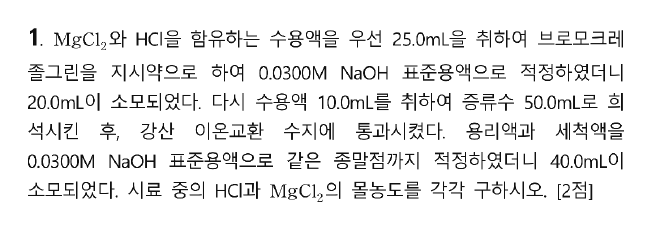

**정답** [HCl] = **0.0240 M**, [MgCl₂] = **0.0480 M**

**공식·핵심 개념**

- 산염기 적정: $n_{\mathrm{H^+}} = M_{\mathrm{NaOH}}V$
- H⁺형 양이온교환: $\mathrm{M^{n+}}$ 1개 → H⁺ $n$개 방출
- 지시약은 변색 범위가 당량점 pH를 포함해야 함

**2027 출제 가능성 ★★★☆☆ 보통** — 이온교환과 적정을 엮는 계산은 분석화학 기입형으로 무난한 소재입니다. EDTA 적정과 함께 나올 수도 있습니다.

**주어진 것 / 구할 것**

- 시료 25.0 mL, 지시약 브로모크레졸그린, 0.0300 M NaOH 20.0 mL 소비
- 시료 10.0 mL + 물 50.0 mL → 강산 양이온교환 수지 통과 → 용리액·세척액을 같은 종말점까지 0.0300 M NaOH 40.0 mL 소비
- 구할 것: [HCl], [MgCl₂]

**풀이 전략** 첫 적정은 HCl만, 두 번째는 수지가 모든 양이온을 H⁺로 바꾼 뒤 전체 양이온 당량을 셉니다. 차이가 Mg²⁺ 몫입니다.

**단계별 풀이**

**1.** **첫 적정에서 HCl만 반응하는 이유**: 브로모크레졸그린 변색 범위는 pH 3.8–5.4. Mg(OH)₂는 pH ≈ 10 이상에서야 침전하므로, 이 종말점에서는 H⁺만 중화됩니다.

**2.** $n_{\mathrm{NaOH}} = 0.0300\ \mathrm{mmol\,mL^{-1}} \times 20.0\ \mathrm{mL} = 0.600\ \mathrm{mmol} = n_{\mathrm{HCl}}$ (25.0 mL 속)

$$[\mathrm{HCl}] = \frac{0.600\ \mathrm{mmol}}{25.0\ \mathrm{mL}} = 0.0240\ \mathrm{M}$$

**3.** **이온교환 반응** (R = 수지):

$$\mathrm{R{-}SO_3H + H^+ \rightarrow \text{그대로 H}^+} \qquad \mathrm{2R{-}SO_3H + Mg^{2+} \rightarrow (R{-}SO_3)_2Mg + 2H^+}$$

→ 용리액의 H⁺ 몰수 = $n_{\mathrm{HCl}} + 2n_{\mathrm{Mg}}$ (물 50.0 mL는 몰수를 바꾸지 않음)

**4.** **두 번째 적정**: $n_{\mathrm{H^+}} = 0.0300 \times 40.0 = 1.20\ \mathrm{mmol}$ (10.0 mL 시료 몫)

**5.** 10.0 mL 속 HCl: $0.0240 \times 10.0 = 0.240\ \mathrm{mmol}$

**6.** Mg²⁺에서 온 H⁺: $1.20 - 0.240 = 0.960\ \mathrm{mmol}$ → $n_{\mathrm{Mg}} = \dfrac{0.960}{2} = 0.480\ \mathrm{mmol}$

$$[\mathrm{MgCl_2}] = \frac{0.480\ \mathrm{mmol}}{10.0\ \mathrm{mL}} = 0.0480\ \mathrm{M}$$

**검산** 전하 균형: $[\mathrm{Cl^-}] = [\mathrm{HCl}] + 2[\mathrm{MgCl_2}] = 0.0240 + 0.0960 = 0.120\ \mathrm{M}$, 두 번째 적정의 전체 당량 $1.20/10.0 = 0.120\ \mathrm{M}$과 같습니다 ✓

**채점 포인트·함정**

- 희석에 쓴 증류수 50.0 mL는 몰수에 영향이 없습니다(원래 시료 10.0 mL로 나눕니다).
- 두 번째 적정에서 첫 번째와 시료 부피(25.0 vs 10.0 mL)가 다른 점에 주의합니다.
- Mg²⁺ 하나가 H⁺ **두 개**와 교환되는 것을 놓치면 0.0960 M이 나옵니다.

## B형 2번 · 벤조나이트릴의 환원과 이민·사이아노하이드린 {#b2}

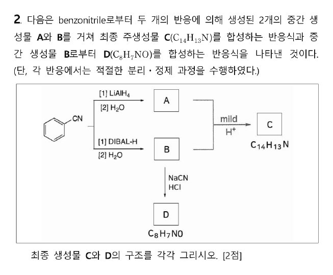

**정답** C: *N*-benzylidenebenzylamine (PhCH=N–CH₂Ph), D: mandelonitrile (PhCH(OH)CN)

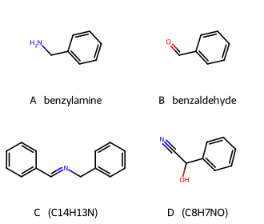

**공식·핵심 개념**

- LiAlH₄: RC≡N → RCH₂NH₂ (H⁻ 두 번)
- DIBAL-H(저온) → H₂O: RC≡N → RCHO (H⁻ 한 번)
- 1차 아민 + 알데하이드 → 이민(약산), HCN 첨가 → 사이아노하이드린

**2027 출제 가능성 ★★★☆☆ 보통** — 환원제의 선택성(LiAlH₄·DIBAL-H·NaBH₄)은 유기 기입형에서 꾸준히 나옵니다. 분자식으로 생성물을 추론하는 형태가 그대로 다시 나올 수 있습니다.

**주어진 것 / 구할 것**

- benzonitrile → ① LiAlH₄ ② H₂O → A; ① DIBAL-H ② H₂O → B
- A + B, 약산 → C(C₁₄H₁₃N); B + NaCN, HCl → D(C₈H₇NO)
- 구할 것: C, D의 구조

**풀이 전략** 환원제가 H⁻를 몇 번 주는지로 A·B를 정하고, 분자식 차이로 C·D의 반응(축합 / 첨가)을 판단합니다.

**분자식으로 반응 판단**

| 생성물 | 계산 | 결론 |
|---|---|---|
| A | PhCN(C₇H₅N) + 4H | C₇H₉N, 1차 아민 PhCH₂NH₂ |
| B | PhCN + H⁻ 1번 → 가수분해(N이 O로) | C₇H₆O, PhCHO |
| C | C₇H₉N + C₇H₆O − H₂O = C₁₄H₁₃N | 축합(물 빠짐) → 이민 |
| D | C₇H₆O + HCN = C₈H₇NO | 첨가(빠지는 것 없음) → 사이아노하이드린 |

| 단계 | 시약 | 반응 | 생성물 |
|---|---|---|---|
| A | LiAlH₄ → H₂O | 나이트릴 C≡N에 H⁻ 두 번 첨가 → 1차 아민 | PhCH₂NH₂ |
| B | DIBAL-H → H₂O | H⁻ 한 번 첨가(이민 알루미늄염에서 멈춤) → 가수분해 | PhCHO |
| C | A + B, 약산 | 1차 아민 + 알데하이드 → 이민(−H₂O) | PhCH=NCH₂Ph (C₁₄H₁₃N) |
| D | NaCN, HCl | CN⁻의 카보닐 친핵성 첨가 → 양성자화 | PhCH(OH)CN (C₈H₇NO) |

**메커니즘 — A: LiAlH₄ 환원**

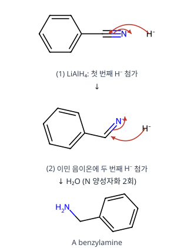

**메커니즘 — B: DIBAL-H 환원**

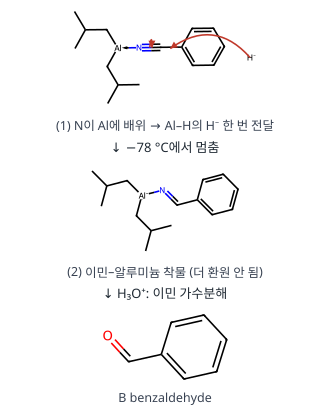

**메커니즘 — C: 이민 형성**

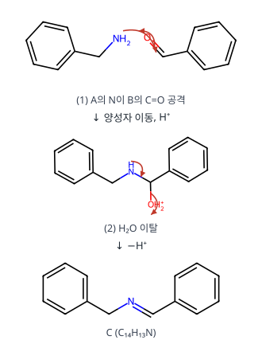

**메커니즘 — D: 사이아노하이드린**

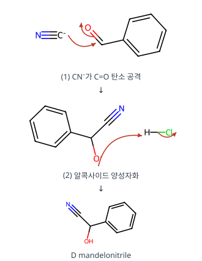

**왜 이 생성물인가**

- **LiAlH₄는 두 번, DIBAL-H는 한 번**: LiAlH₄는 H⁻ 공급원이 많고 반응성이 커서 이민 음이온에 두 번째 H⁻를 줍니다. DIBAL-H는 Al에 H가 하나뿐이고, −78 °C에서 N–Al 이민 착물이 안정해 두 번째 환원이 일어나지 않습니다. 물을 넣으면 이 이민이 가수분해되어 알데하이드가 됩니다.
- **C는 이민**: 1차 아민 + 알데하이드는 산 촉매 축합으로 C=N을 만듭니다. 벤즈알데하이드 쪽 C=N이 고리와 콘쥬게이션되어 안정합니다.
- **D는 사이아노하이드린**: NaCN + HCl에서 생긴 CN⁻가 C=O 탄소를 친핵 공격하고, 알콕사이드가 HCN/HCl에서 H⁺를 받습니다.

**검산** C₁₄H₁₃N: 불포화도 $(2\cdot14 + 2 + 1 - 13)/2 = 9$ = 벤젠 2개(8) + C=N(1) ✓. C₈H₇NO: $(16 + 2 + 1 - 7)/2 = 6$ = 벤젠(4) + C≡N(2) ✓

**채점 포인트·함정**

- DIBAL-H는 저온에서 H⁻를 **한 번만** 주어 알데하이드에서 멈춥니다. LiAlH₄와 구별이 핵심입니다.
- C의 분자식 확인: C₇H₉N + C₇H₆O − H₂O = C₁₄H₁₃N.
- 이민 형성은 pH ≈ 4~5의 약산(mild H⁺)에서 가장 빠릅니다(너무 강한 산이면 아민이 양성자화되어 친핵성을 잃음).

## B형 3번 · 모형, 귀추적 사고, 라카토스의 발견법 {#b3}

**정답**

- 자료 1의 기능: **모형을 이용하여 현상을 설명하거나 예측하기**
- 자료 2의 사고: **귀추적 사고**. 관찰한 사실(암모니아 냄새)에 대해 유사한 경험(바람이 없어도 꽃향기를 맡음)을 토대로 현재의 의문을 해결하는 설명(기체 입자가 스스로 움직인다)을 만들어 내는 사고.
- 학생 A: **부정적 발견법**. 핵심 가설(액체 입자에서는 확산이 일어나지 않는다)에 대한 반증 사례가 나타나자 보조 가설 '액체 입자는 기체보다 느리게 움직인다'를 '액체가 기체보다 빠르게 움직인다'로 바꾸어 핵을 보호하였다.
- 학생 B: **부정적 발견법**. 반증 사례를 설명할 수 없는 예외로 보고 무시하여, 보호대를 고치지도 않은 채 핵을 지켰다.

**공식·핵심 개념**

- 2022 개정 과정·기능: 모형을 이용하여 현상을 설명하거나 예측하기
- 귀추: 의문 현상 → 유사 경험(원천) → 설명 가설 생성
- 라카토스: 견고한 핵 + 보호대, 부정적 발견법(핵 보호) / 긍정적 발견법(보호대 발전)

**2027 출제 가능성 ★★★★★ 매우 높음** — 과학철학자(포퍼·쿤·라카토스)와 과학적 사고(귀납·연역·귀추)는 화학교육론에서 거의 빠지지 않습니다. 매해 나올 것을 전제로 정리해 두세요.

**자료 1 — 모형.** 눈에 보이지 않는 기체 입자를 '꼬리 달린 공'으로 표현해 확산을 설명하려는 것은 2022 개정 과학과 과정·기능의 **모형을 이용하여 현상을 설명하거나 예측하기**입니다.

**자료 2 — 귀추적 사고의 과정**

1. 의문 상황 인식: 마개를 연 암모니아수의 냄새를 맡는다 → 왜일까?
2. 유사 경험(원천) 탐색: 바람이 없어도 산에서 꽃향기를 맡는다.
3. 설명 가설 차용·생성: "기체 입자가 스스로 움직여 냄새가 퍼진다."

관찰된 결과로부터 그것을 가장 잘 설명하는 원인(가설)을 만들어 내는 추론이므로 연역·귀납과 구별됩니다.

**자료 3 — 라카토스의 연구 프로그램**

| 개념 | 의미 |
|---|---|
| 견고한 핵(hard core) | 반증으로부터 보호되는 핵심 가설 |
| 보호대(protective belt) | 핵을 둘러싼 보조 가설들 |
| 부정적 발견법 | 반증의 화살이 핵으로 향하지 않게 하고, 보호대를 고치거나 반례를 무시해 **핵을 보호**하는 규칙 |
| 긍정적 발견법 | 보호대를 수정·발전시켜 연구 프로그램을 **확장**하는 지침 |

두 학생 모두 반증 사례 앞에서 핵심 생각을 버리지 않고 지켰다는 점에서 부정적 발견법에 해당합니다. A는 보조 가설을 바꾸는 방식, B는 반례를 예외로 무시하는 방식입니다.

**채점 포인트·함정**

- 이유를 쓸 때 "핵을 보호했다"는 말과 함께 **무엇을 바꿨는지(A)**, **무엇을 무시했는지(B)** 를 구체적으로 씁니다.

## B형 4번 · 드라이버의 개념 변화 모형 {#b4}

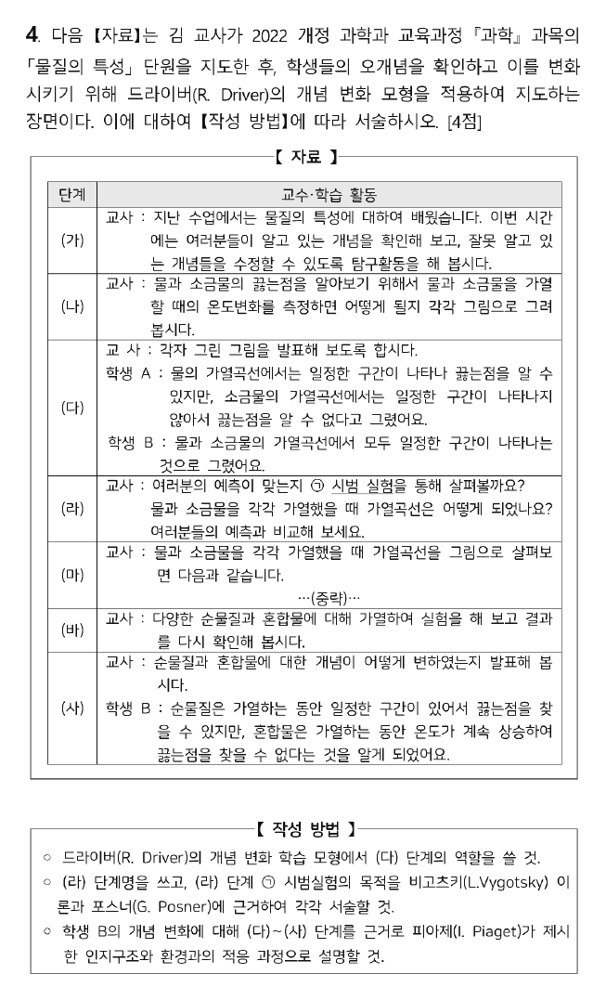

**정답**

- (다) 단계의 역할: **명료화와 교환** — 학생이 자신의 생각을 분명히 알도록 한다. 자신의 표현에 대해 왜 그렇게 생각했는지 말하고 친구들과 의견을 교환하며, 다른 학생의 견해에 비추어 자신의 관념을 명료화한다.
- (라) 단계명: **상충된 상황에 노출**
- 시범실험의 목적 — 비고츠키: 학생이 생각하지 못한 상황을 제시해 **근접 발달 영역(ZPD)** 안에서 학습이 일어나 잠재적 발달 수준에 도달하게 하기 위함. 포스너: 학생의 생각과 상충되는 상황을 보여 주어 **자신의 생각에 불만족**을 느끼게 하기 위함.
- 피아제: (다)에서 학생이 선개념을 명료화하는 **동화**, (라)에서 상충된 상황에 노출되어 **인지적 갈등(비평형)**, (마)에서 교사의 과학 개념 도입으로 **조절**, (바)의 동화와 조절을 거쳐 (사)에서 **새로운 평형**에 도달하였다.

**공식·핵심 개념**

- 드라이버: 오리엔테이션 → 생각의 표현 → 재구성(명료화와 교환, 상충 상황 노출, 새 생각의 구성·평가) → 적용 → 검토
- 비고츠키: ZPD, 잠재적 발달 수준
- 포스너: 불만족, 이해 가능성, 그럴듯함, 유용성
- 피아제: 동화 → 비평형 → 조절 → 평형

**2027 출제 가능성 ★★★★★ 매우 높음** — 개념 변화 수업 모형에 여러 학자를 엮어 묻는 4점 서술형의 대표 유형입니다. 2027에도 나올 가능성이 매우 높습니다.

**드라이버(Driver) 모형의 단계와 자료의 대응**

| 단계 | 자료 |
|---|---|
| 1. 오리엔테이션 | (가) 학습 목표·흥미 유발 |
| 2. 생각의 표현(유도) | (나) 예상을 그림으로 그림 |
| 3. 생각의 재구성 ① 명료화와 교환 | (다) 발표, 의견 교환 |
| ② 상충된 상황에 노출 | (라) 시범실험 |
| ③ 새로운 생각의 구성 | (마) 실제 가열 곡선 제시·설명 |
| ④ 새로운 생각의 평가 | — |
| 4. 생각의 적용 | (바) 다양한 순물질·혼합물로 확인 |
| 5. 생각 변화의 검토 | (사) 개념 변화 발표 |

**과학 내용.** 순물질(물)은 끓는 동안 온도가 일정한 구간이 있지만, 혼합물(소금물)은 물이 증발하며 농도가 진해져 끓는점이 계속 올라가므로 일정한 구간이 나타나지 않습니다. 학생 A의 예상이 옳았고, 학생 B가 개념 변화를 겪은 학생입니다.

**채점 포인트·함정**

- 비고츠키와 포스너의 목적을 **각각** 써야 합니다(ZPD / 불만족).
- 피아제 설명에는 동화 → 비평형(인지 갈등) → 조절 → 평형의 흐름과 단계 근거를 함께 씁니다.

## B형 5번 · 산·염기 정의의 역사와 산의 세기 {#b5}

**정답**

- 과학의 본성: **과학 지식은 변할 수 있다(잠정성, 가변성).**
- 반증 가능성이 가장 높은 것: **㉢ 루이스의 정의**. ㉢의 정의는 ㉠과 ㉡을 모두 포함할 만큼 더 포괄적이어서 설명하는 범위(정보량)가 넓고, 그만큼 반증될 가능성이 높다.
- ㉣과 관련된 포스너의 조건: 교사가 학생의 생각과 **상충되는 상황**을 제시하여 학생이 **자신의 생각에 불만족**을 느끼게 하려는 것이다.
- ㉥: **산의 세기는 수소의 개수가 아니라 산의 이온화 정도(이온화 상수 $K_a$)에 의해 결정된다.**

**공식·핵심 개념**

- 과학의 본성: 잠정성(가변성), 경험성, 사회·문화적 영향
- 포퍼: 반증 가능성이 높을수록(더 포괄·대담할수록) 좋은 이론
- 산의 세기 = 이온화 정도($K_a$), H 개수와 무관

**2027 출제 가능성 ★★★★☆ 높음** — 과학사 사례로 과학의 본성과 포퍼를 묻는 문항은 자주 나옵니다. 2022 개정 『화학』의 산·염기 단원과 엮이기 쉽습니다.

**과학의 본성.** 아레니우스 → 브뢴스테드–로우리 → 루이스로 정의가 새 현상(NH₃의 염기성, BF₃의 산성)을 설명하기 위해 바뀌어 왔습니다. 과학 지식은 새로운 증거에 따라 수정될 수 있는 잠정적인 지식입니다.

**포퍼의 반증 가능성.** 더 많은 것을 말하는(보편적이고 대담한) 이론일수록 틀릴 수 있는 경우가 많아 반증 가능성이 높고, 포퍼는 이런 이론을 더 좋은 이론으로 봅니다. 루이스 정의는 H⁺가 없는 반응까지 다루므로 가장 포괄적입니다.

**포스너(Posner)의 개념 변화 조건 4가지**

1. 기존 개념에 대한 **불만족** ← ㉣ (H₃PO₄는 H가 3개인데 약산이라는 상충 사례)
2. 새 개념의 **이해 가능성**
3. 새 개념의 **그럴듯함**
4. 새 개념의 **유용성(생산성)**

**오개념 ㉤.** 학생은 "H가 많을수록 강산"(H₃PO₄ > HCl)이라고 생각했습니다. 실제로 산의 세기는 물속에서 H⁺를 얼마나 잘 내놓는지, 즉 **이온화도(Ka)** 로 정해집니다. HCl은 거의 완전히 이온화하고(강산), H₃PO₄는 $K_{a1} \approx 7\times10^{-3}$으로 일부만 이온화합니다(약산).

## B형 6번 · 조화·비조화 진동자 {#b6}

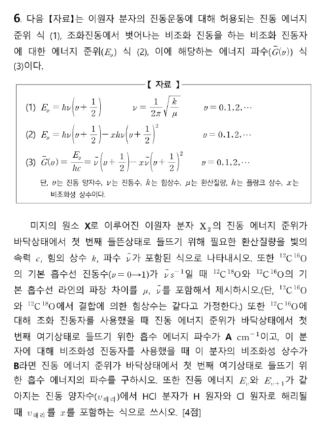

**정답**

1. $\mu = \dfrac{k}{4\pi^2c^2\tilde\nu^2}$
2. $\lambda(^{12}\mathrm{C}^{18}\mathrm{O}) - \lambda(^{12}\mathrm{C}^{16}\mathrm{O}) = \dfrac{1}{\tilde\nu}\left(\sqrt{\dfrac{\mu(^{12}\mathrm{C}^{18}\mathrm{O})}{\mu(^{12}\mathrm{C}^{16}\mathrm{O})}} - 1\right)$
3. $\tilde G(1) - \tilde G(0) = \tilde\nu - 2x\tilde\nu = A(1-2B)\ \mathrm{cm^{-1}}$
4. $v_{\text{해리}} = \dfrac{1}{2x} - 1$

**공식·핵심 개념**

- $\tilde\nu = \dfrac{1}{2\pi c}\sqrt{\dfrac{k}{\mu}}$, $\mu = \dfrac{m_1m_2}{m_1 + m_2}$
- 동위원소: $\nu \propto \mu^{-1/2}$, $\lambda \propto \mu^{1/2}$
- 비조화: $\tilde G(v) = \tilde\nu(v + \tfrac12) - x\tilde\nu(v + \tfrac12)^2$, $\Delta\tilde G = \tilde\nu[1 - 2x(v + 1)]$
- 해리: $\Delta\tilde G = 0$ → $v_{\max} = \dfrac{1}{2x} - 1$

**2027 출제 가능성 ★★★★☆ 높음** — 진동·회전 분광은 물리화학 서술형의 주요 출제원입니다. 동위원소 효과와 비조화성(해리 에너지 $D_0$)이 함께 나오는 형태를 대비하세요.

**주어진 것 / 구할 것**

- 조화 진동자 $E_v = h\nu(v + \tfrac12)$, $\nu = \dfrac{1}{2\pi}\sqrt{k/\mu}$
- 비조화 진동자 $\tilde G(v) = \tilde\nu(v + \tfrac12) - x\tilde\nu(v + \tfrac12)^2$
- ¹²C¹⁶O의 기본 흡수 $\tilde\nu$, 같은 힘상수
- 구할 것: (1) 0→1 전이에 필요한 $\mu$를 $c, k, \tilde\nu$로, (2) ¹²C¹⁸O와 ¹²C¹⁶O의 파장 차이, (3) 조화값 A, 비조화 상수 B일 때 0→1 파수, (4) 해리 양자수 $v_{\text{해리}}$

**풀이 전략** 에너지 간격 = 흡수 광자 에너지($hc\tilde\nu$). 동위원소는 $k$가 같고 $\mu$만 달라집니다. 해리는 준위 간격이 0이 되는 곳입니다.

**단계별 풀이 — (1)**

**1.** $E_1 - E_0 = h\nu\left(\tfrac32 - \tfrac12\right) = h\nu = \dfrac{h}{2\pi}\sqrt{\dfrac{k}{\mu}}$

**2.** 흡수 광자: $\Delta E = hc\tilde\nu$ → $hc\tilde\nu = \dfrac{h}{2\pi}\sqrt{\dfrac{k}{\mu}}$ → $\tilde\nu = \dfrac{1}{2\pi c}\sqrt{\dfrac{k}{\mu}}$

**3.** 제곱하고 $\mu$에 대해 풀기:

$$\tilde\nu^2 = \frac{k}{4\pi^2c^2\mu} \;\Rightarrow\; \mu = \frac{k}{4\pi^2c^2\tilde\nu^2}$$

**단계별 풀이 — (2) 동위원소 효과**

**1.** 환산질량(amu): $\mu_{16} = \dfrac{12\times16}{12 + 16} = \dfrac{192}{28} = 6.857$, $\mu_{18} = \dfrac{12\times18}{12 + 18} = \dfrac{216}{30} = 7.200$

**2.** $k$가 같으므로 $\tilde\nu \propto \mu^{-1/2}$ → $\tilde\nu_{18} = \tilde\nu_{16}\sqrt{\dfrac{\mu_{16}}{\mu_{18}}}$

**3.** 파장은 파수의 역수 $\lambda = 1/\tilde\nu$ → $\lambda \propto \mu^{1/2}$:

$$\lambda_{18} = \lambda_{16}\sqrt{\frac{\mu_{18}}{\mu_{16}}}, \qquad \lambda_{16} = \frac{1}{\tilde\nu}$$

$$\Delta\lambda = \lambda_{18} - \lambda_{16} = \frac{1}{\tilde\nu}\left(\sqrt{\frac{\mu(^{12}\mathrm{C}^{18}\mathrm{O})}{\mu(^{12}\mathrm{C}^{16}\mathrm{O})}} - 1\right)$$

**4.** 수치: $\sqrt{7.200/6.857} = \sqrt{1.0500} = 1.0247$ → $\Delta\lambda = 0.0247\,\lambda_{16}$. 실제 CO($\tilde\nu = 2143\ \mathrm{cm^{-1}}$)로 넣어 보면 $\lambda_{16} = 4.666\ \mu\mathrm{m}$, $\Delta\lambda \approx 0.115\ \mu\mathrm{m}$.

**검토 메모.** 문제는 $\tilde\nu$를 "진동수(s⁻¹)"라고 했습니다. 진동수로 읽으면 $\lambda_{16} = c/\tilde\nu$이고 답은 $\dfrac{c}{\tilde\nu}\left(\sqrt{\mu_{18}/\mu_{16}} - 1\right)$입니다. 공식 답안은 파수로 보고 $1/\tilde\nu$를 썼습니다. 어느 쪽으로 읽었는지 한 줄 밝혀 두세요.

**단계별 풀이 — (3) 비조화 진동자의 기본 흡수**

**1.** $\tilde G(0) = \tilde\nu\cdot\tfrac12 - x\tilde\nu\cdot\tfrac14 = \tfrac12\tilde\nu - \tfrac14x\tilde\nu$

**2.** $\tilde G(1) = \tilde\nu\cdot\tfrac32 - x\tilde\nu\cdot\tfrac94 = \tfrac32\tilde\nu - \tfrac94x\tilde\nu$

**3.** $\tilde G(1) - \tilde G(0) = \tilde\nu - 2x\tilde\nu = \tilde\nu(1 - 2x)$

**4.** $\tilde\nu = A$, $x = B$ 대입 → $A(1 - 2B)\ \mathrm{cm^{-1}}$

**단계별 풀이 — (4) 해리 양자수**

**1.** 이웃 준위 간격:

$$\Delta\tilde G(v) = \tilde G(v + 1) - \tilde G(v)$$
$$= \tilde\nu[(v + \tfrac32) - (v + \tfrac12)] - x\tilde\nu[(v + \tfrac32)^2 - (v + \tfrac12)^2]$$

**2.** $(v + \tfrac32)^2 - (v + \tfrac12)^2 = (2v + 2)(1) = 2(v + 1)$ → $\Delta\tilde G(v) = \tilde\nu[1 - 2x(v + 1)]$

**3.** 준위가 수렴(해리)하는 조건 $\Delta\tilde G = 0$ (즉 $E_v = E_{v+1}$):

$$1 - 2x(v + 1) = 0 \;\Rightarrow\; v_{\text{해리}} = \frac{1}{2x} - 1$$

**4.** 예: HCl($x \approx 0.0174$) → $v_{\text{해리}} \approx 27.7$, 즉 약 27~28번째 준위에서 해리합니다.

**검산** $x \to 0$(조화 진동자)이면 $v_{\text{해리}} \to \infty$(조화 진동자는 해리하지 않음) ✓. (3)에서 $x > 0$이면 기본 흡수가 조화값보다 작아짐 ✓

**채점 포인트·함정**

- (3)에서 비조화 진동자의 간격은 $v$가 커질수록 좁아집니다($-2x\tilde\nu(v+1)$).
- (2)는 $\lambda \propto \sqrt\mu$(진동수와 반대)를 정확히 써야 합니다.

## B형 7번 · SNAr, Birch 환원, benzyne {#b7}

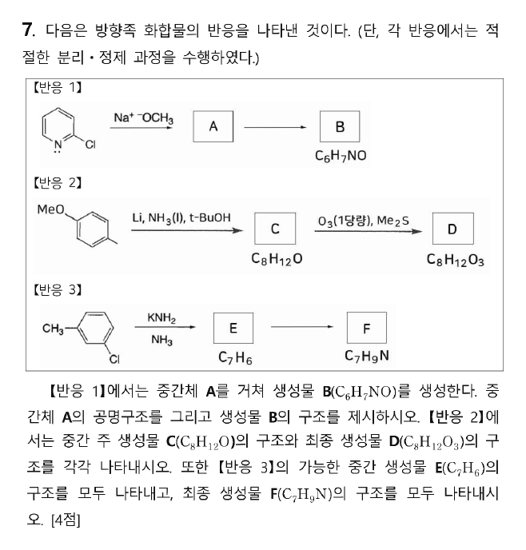

**정답**

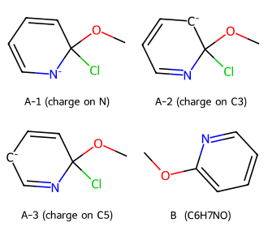
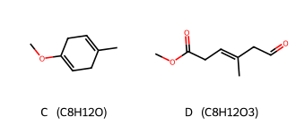
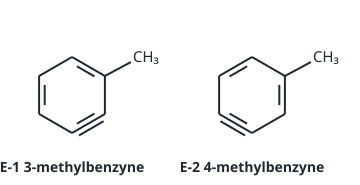
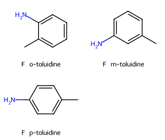

**공식·핵심 개념**

- SNAr(첨가–제거): 음전하가 N·EWG에 비편재화될 때 유리, 피리딘은 2·4-위치
- Birch: 전자 주개 탄소는 이중결합에 남고, 전자 끄개 탄소는 sp³
- benzyne(제거–첨가): Cl의 오르토 H 제거 → 위치 이성질체 혼합물
- 오존 분해: 전자가 풍부한 C=C가 먼저 반응

**2027 출제 가능성 ★★★★☆ 높음** — 방향족 반응의 위치 선택성은 유기에서 계속 나오는 축입니다. Birch 환원과 benzyne은 생성물 '모두' 그리기 형태로 나오기 좋습니다.

**주어진 것 / 구할 것**

- 반응 1: 2-chloropyridine + NaOCH₃ → 중간체 A → B(C₆H₇NO)
- 반응 2: 4-methylanisole + Li, NH₃(l), t-BuOH → C(C₈H₁₂O) → O₃(1당량), Me₂S → D(C₈H₁₂O₃)
- 반응 3: 3-chlorotoluene + KNH₂/NH₃ → E(C₇H₆) → F(C₇H₉N)
- 구할 것: A의 공명구조와 B, C와 D, 가능한 E 모두, F 모두

**풀이 전략** 분자식 변화로 각 단계의 성격을 정합니다. 반응 1은 Cl → OMe 치환(첨가–제거), 반응 2는 H 2개 첨가(Birch) 후 C=C 하나만 절단, 반응 3은 HCl 제거(benzyne) 후 NH₃ 첨가입니다.

**분자식으로 반응 판단**

| 단계 | 변화 | 의미 |
|---|---|---|
| 2-chloropyridine → B | C₅H₄ClN → C₆H₇NO | Cl이 OCH₃로 치환 |
| anisole → C | C₈H₁₀O → C₈H₁₂O | H 2개 첨가 (1,4-다이엔) |
| C → D | C₈H₁₂O → C₈H₁₂O₃ | O 2개 첨가 = C=C 하나만 오존 분해(고리 열림) |
| 3-chlorotoluene → E | C₇H₇Cl → C₇H₆ | HCl 제거 → benzyne |
| E → F | C₇H₆ → C₇H₉N | NH₃ 첨가 |

**[반응 1] 피리딘의 친핵성 방향족 치환(SNAr, 첨가–제거).** CH₃O⁻가 C–Cl 탄소(C2)를 공격해 고리의 방향족성이 깨진 음이온 중간체 **A**(Meisenheimer형)를 만듭니다. 음전하는 N, C3, C5에 비편재화되며, 특히 **전기음성도가 큰 N에 음전하가 놓이는 공명구조**가 있어 2-, 4-위치 치환이 유리합니다. 이어 Cl⁻가 떠나며 방향족성을 회복 → **B: 2-methoxypyridine** (C₆H₇NO).

**[반응 2] Birch 환원 → 선택적 오존 분해.**

- Li/NH₃(l)/t-BuOH: 전자 주개(OMe, CH₃)가 붙은 탄소는 **sp² 이중결합에 남는** 1,4-다이엔이 됩니다 → **C: 1-methoxy-4-methylcyclohexa-1,4-diene** (C₈H₁₂O).
- O₃ 1당량: 두 이중결합 중 **전자가 더 풍부한 엔올 에터(OMe가 붙은 C=C)** 가 먼저 오존과 반응합니다. 고리가 열리며 OMe가 붙은 탄소는 메틸 에스터, 다른 쪽은 알데하이드가 됩니다(Me₂S 환원성 처리) → **D: MeO₂C–CH₂–CH=C(CH₃)–CH₂–CHO** (C₈H₁₂O₃).

**[반응 3] benzyne (제거–첨가).** 3-chlorotoluene에서 NH₂⁻가 Cl의 오르토 H를 떼고 Cl⁻가 빠지며 benzyne이 생깁니다. Cl의 오르토 H가 두 곳(C2, C4)이므로

- C2–H 제거 → **3-methylbenzyne** (메틸이 삼중결합 탄소에 이웃): NH₂⁻ 첨가 위치에 따라 *o*-, *m*-toluidine
- C4–H 제거 → **4-methylbenzyne**: *m*-, *p*-toluidine

따라서 **F는 *o*-, *m*-, *p*-toluidine 세 가지** (C₇H₉N)입니다.

**메커니즘 — 반응 1: SNAr (첨가–제거)**

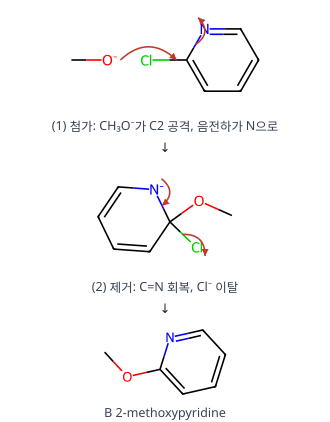

**메커니즘 — 반응 2: 선택적 오존 분해**

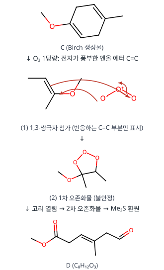

**메커니즘 — 반응 3: benzyne (제거–첨가)**

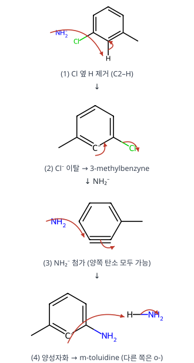

**메커니즘 — 반응 2: Birch 환원 (전자 2개, 양성자 2개)**

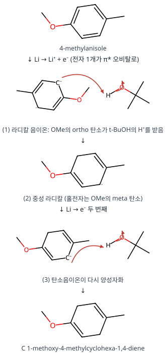

**메커니즘 — 반응 2: 1차 오존화물 이후 (D까지)**

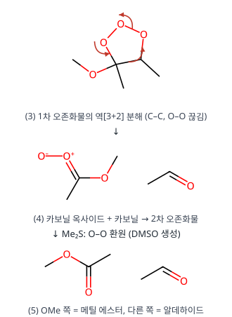

**왜 이 생성물인가**

- **반응 1, 2-위치 치환**: CH₃O⁻가 C2를 공격하면 음전하가 C3·C5와 **N**에 퍼집니다. 전기음성도가 큰 N에 음전하가 놓이는 공명구조가 중간체 A를 크게 안정화하므로 2·4-위치 공격이 빠릅니다(3-위치는 N에 음전하를 줄 수 없음). Cl⁻이 떠나며 방향족성이 회복됩니다.
- **반응 2, Birch 위치 선택성**: 라디칼 음이온의 음전하는 전자 주개(OMe)에서 먼 쪽보다 OMe의 **ortho·meta** 탄소에 놓이고, 거기서 양성자화됩니다. 그래서 OMe와 CH₃가 붙은 탄소는 C=C에 남는 **1-methoxy-4-methylcyclohexa-1,4-diene**이 됩니다(전자 주개 탄소는 sp²로 남음).
- **반응 2, 오존 선택성**: OMe가 붙은 C=C(엔올 에터)는 O의 비공유 전자쌍이 π 전자 밀도를 높여, 친전자체인 O₃와 훨씬 빨리 반응합니다. 그래서 1당량이면 이 C=C만 끊기고, OMe가 붙은 탄소는 에스터, 반대쪽 탄소는 알데하이드가 됩니다.
- **반응 3, 생성물 세 가지**: Cl의 ortho H가 C2와 C4 두 곳이라 benzyne이 두 종류입니다. 3-methylbenzyne에 NH₂⁻가 첨가되면 *o*-, *m*-toluidine, 4-methylbenzyne에서는 *m*-, *p*-toluidine이 생깁니다. *m*-은 양쪽에서 모두 나와 F는 세 가지입니다.

**검산** B C₆H₇NO, C C₈H₁₂O, D C₈H₁₂O₃, E C₇H₆, F C₇H₉N 모두 문제의 분자식과 일치 ✓

**채점 포인트·함정**

- A의 공명구조 중 **N에 음전하가 있는 구조**를 꼭 포함합니다.
- Birch 환원: 전자 주개는 이중결합에 남고, 전자 끄개(CO₂H 등)는 sp³ 탄소에 위치합니다.
- benzyne은 중간체 두 개, 생성물은 세 개(*m*-은 양쪽에서 모두 생김)입니다.

## B형 8번 · [FeO₄]⁴⁻·[Cr(CN)₆]⁴⁻의 결정장과 Jahn–Teller 효과 {#b8}

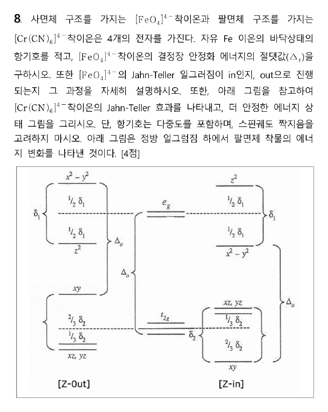

**정답**

1. 자유 Fe⁴⁺(d⁴) 이온의 바닥상태 항기호: **⁵D**
2. [FeO₄]⁴⁻의 CFSE 절댓값: **0.4Δt**
3. [FeO₄]⁴⁻: **z-out**으로 일그러진다. z-out은 t₂의 두 전자가 아래로 내려간 e(dxz, dyz)에 대칭적으로 들어가 z-in보다 $\tfrac13\delta$만큼 더 안정하다. z-in은 e 오비탈(dxz, dyz)에 전자가 하나만 들어가 비대칭이다.
4. [Cr(CN)₆]⁴⁻: t₂g⁴ 저스핀. **z-out**일 때 z-in보다 $\tfrac23\delta_2$만큼 더 안정하다.

**공식·핵심 개념**

- 사면체 CFSE: e −0.6Δt, t₂ +0.4Δt / 팔면체: t₂g −0.4Δo, eg +0.6Δo
- 항기호: $^{2S+1}L$, 반 이하로 찬 껍질은 $J = |L - S|$
- Jahn–Teller: 축퇴된 오비탈에 전자가 고르지 않게 차면 일그러짐
- 2 : 1 분할에서 무게중심 유지

**2027 출제 가능성 ★★★★★ 매우 높음** — 결정장·Jahn–Teller는 무기 영역의 최빈출 소재입니다. 사면체 Jahn–Teller처럼 덜 익숙한 변형까지 대비해 두면 좋습니다.

**주어진 것 / 구할 것**

- 사면체 [FeO₄]⁴⁻, 팔면체 [Cr(CN)₆]⁴⁻, 둘 다 d 전자 4개; 정방 일그러짐(z-out, z-in)에서 팔면체 준위 그림(δ₁: eg 갈라짐, δ₂: t₂g 갈라짐, 무게중심 유지)
- 스핀–궤도 짝지음은 무시
- 구할 것: 자유 Fe 이온의 바닥 항기호, [FeO₄]⁴⁻ CFSE 절댓값(Δt), [FeO₄]⁴⁻ 일그러짐 방향과 과정, [Cr(CN)₆]⁴⁻의 Jahn–Teller 효과와 더 안정한 상태

**풀이 전략** 산화수 → d 전자 수 → Hund 규칙으로 항기호. 결정장 준위에 전자를 채워 CFSE를 계산. 일그러진 두 경우의 에너지를 무게중심 규칙(2 : 1 분할)으로 비교합니다.

**단계별 풀이 — (1) 항기호**

**1.** 산화수: $x + 4(-2) = -4$ → $x = +4$. Fe: [Ar]3d⁶4s² → Fe⁴⁺: [Ar]3d⁴.

**2.** Hund 규칙: 전자 4개를 $m_l = +2, +1, 0, -1$에 하나씩, 스핀 모두 같은 방향.

**3.** $S = 4\times\tfrac12 = 2$ → $2S + 1 = 5$; $L = 2 + 1 + 0 + (-1) = 2$ → D

**4.** 항기호 **⁵D** (스핀–궤도 무시 조건이라 $J$는 쓰지 않음)

**단계별 풀이 — (2) CFSE**

**1.** 사면체: $e$(d$_{z^2}$, d$_{x^2-y^2}$)가 아래 $-0.6\Delta_t$, $t_2$(d$_{xy}$, d$_{xz}$, d$_{yz}$)가 위 $+0.4\Delta_t$. (무게중심: $2(-0.6) + 3(0.4) = 0$ ✓)

**2.** $\Delta_t \approx \tfrac49\Delta_o$로 작아 짝지음보다 작음 → 항상 고스핀: $e^2t_2^2$ (홀전자 4)

**3.** $$\mathrm{CFSE} = 2(-0.6\Delta_t) + 2(+0.4\Delta_t) = -1.2\Delta_t + 0.8\Delta_t = -0.4\Delta_t \;\Rightarrow\; |\mathrm{CFSE}| = 0.4\Delta_t$$

**단계별 풀이 — (3) [FeO₄]⁴⁻의 Jahn–Teller 방향**

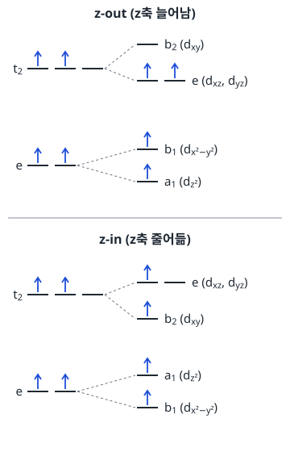

**1.** 축퇴 확인: $e^2$은 두 오비탈에 하나씩(대칭) → 일그러짐 이득 없음. $t_2^2$는 세 오비탈에 둘 → 축퇴된 바닥 상태 → 일그러짐.

**2.** $t_2$의 갈라짐 폭을 $\delta$라 하면 2 : 1 분할(무게중심 유지): 두 개짜리 $e$ 쌍은 $\mp\tfrac13\delta$, 하나짜리 $b_2$는 $\pm\tfrac23\delta$.

**3.** **z-out**: $e$(xz, yz) $-\tfrac13\delta$, $b_2$(xy) $+\tfrac23\delta$. $t_2$ 전자 2개가 xz, yz에 하나씩:

$$E_{\text{out}} = 2\left(-\tfrac13\delta\right) = -\tfrac23\delta$$

**4.** **z-in**: $b_2$(xy) $-\tfrac23\delta$, $e$(xz, yz) $+\tfrac13\delta$. 전자 2개 중 하나는 xy, 하나는 xz 또는 yz (고스핀):

$$E_{\text{in}} = -\tfrac23\delta + \tfrac13\delta = -\tfrac13\delta$$

**5.** 아래 $e$ 쌍($a_1$, $b_1$)의 전자 2개는 $\mp$ 같은 양으로 갈라진 두 준위에 하나씩 → 합 0 (두 경우 같음).

**6.** 비교: $E_{\text{out}} - E_{\text{in}} = -\tfrac13\delta$ → **z-out이 $\tfrac13\delta$ 더 안정**. 또 z-out은 전자가 축퇴된 쌍에 고르게 들어가 더 이상 축퇴가 남지 않습니다.

**단계별 풀이 — (4) [Cr(CN)₆]⁴⁻**

**1.** Cr: [Ar]3d⁵4s¹ → Cr²⁺ d⁴. CN⁻은 강한 장 → 저스핀 $t_{2g}^4e_g^0$ (홀전자 2).

**2.** 그림의 t₂g 갈라짐($\delta_2$): z-out은 xz, yz가 $-\tfrac13\delta_2$, xy가 $+\tfrac23\delta_2$; z-in은 xy가 $-\tfrac23\delta_2$, xz, yz가 $+\tfrac13\delta_2$.

**3.** **z-out**: 전자 4개를 낮은 xz, yz에 2개씩 → $E = 4\left(-\tfrac13\delta_2\right) = -\tfrac43\delta_2$

**4.** **z-in**: 낮은 xy에 2개, 남은 2개를 xz, yz에 하나씩 → $E = 2\left(-\tfrac23\delta_2\right) + 2\left(+\tfrac13\delta_2\right) = -\tfrac43\delta_2 + \tfrac23\delta_2 = -\tfrac23\delta_2$

**5.** $e_g$는 비어 있어 $\delta_1$ 기여 없음.

**6.** 차이 $\tfrac23\delta_2$ → **z-out이 더 안정**(그리고 z-out은 xz, yz가 꽉 차 축퇴가 사라짐).

**검산** 사면체 CFSE: e 4칸·t₂ 6칸 무게중심 $4(-0.6) + 6(0.4) = 0$ ✓. 일그러짐 분할: $2(-\tfrac13) + 1(\tfrac23) = 0$ ✓

**채점 포인트·함정**

- Fe의 산화수를 +2로 잡으면 d⁶이 되어 모두 틀립니다. 문제의 "4개의 전자"와 일치하는 Fe(IV)를 확인합니다.
- 문제에서 짝지음 에너지를 고려하지 말라고 했으므로 CFSE에 P를 넣지 않습니다.

## B형 9번 · [ML₅]⁺ 전이상태의 결정장 {#b9}

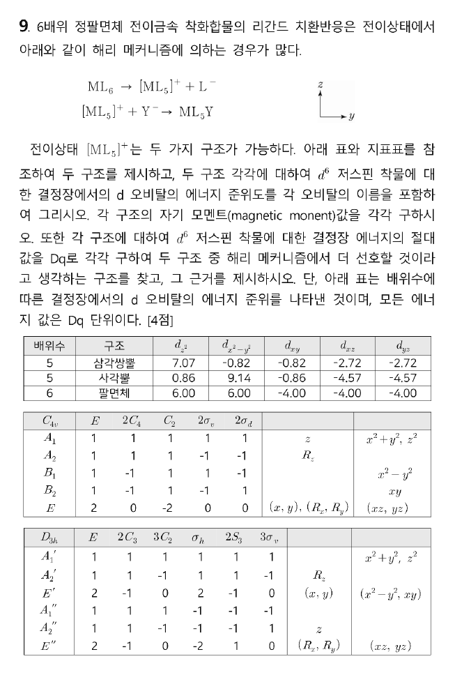

**정답**

| | 삼각쌍뿔(TBP, $D_{3h}$) | 사각뿔(SP, $C_{4v}$) |
|---|---|---|
| d 오비탈 준위 | $a_1'(z^2)$ > $e'(x^2-y^2, xy)$ > $e''(xz, yz)$ | $b_1(x^2-y^2)$ > $a_1(z^2)$ > $b_2(xy)$ > $e(xz, yz)$ |
| d⁶ 저스핀 배치 | $e''^4e'^2$ (홀전자 2) | $e^4b_2^2$ (홀전자 0) |
| 자기 모멘트 | $\sqrt{2(2+2)} = 2\sqrt2 \approx 2.83$ BM | 0 |
| \|결정장 에너지\| | 12.52 Dq | 20.00 Dq |

해리 메커니즘에서는 **사각뿔**을 선호한다. 정팔면체(d⁶ 저스핀, $t_{2g}^6$ = −24.00 Dq)에서 사각뿔로 갈 때 잃는 에너지는 4.00 Dq로, 삼각쌍뿔(11.48 Dq)보다 훨씬 작아 활성화 에너지가 작기 때문이다.

**공식·핵심 개념**

- d⁶ 저스핀 팔면체 CFSE $= -24\ \mathrm{Dq}$
- 해리 메커니즘의 결정장 활성화 에너지(LFAE) = $E_{\text{CF}}$(전이상태) − $E_{\text{CF}}$(팔면체)
- $\mu_{so} = \sqrt{n(n+2)}$ BM
- 축퇴된 준위에 남은 전자는 저스핀이라도 홀전자

**2027 출제 가능성 ★★★☆☆ 보통** — 치환 반응 메커니즘을 결정장으로 설명하는 유형은 가끔 나오는 고난도 소재입니다. 반응속도·불활성 착물(d³, d⁶ 저스핀)과 함께 정리해 두세요.

**주어진 것 / 구할 것**

- 전이상태 [ML₅]⁺ 두 구조(삼각쌍뿔, 사각뿔)의 d 오비탈 에너지(Dq) 표, $C_{4v}$·$D_{3h}$ 지표표, d⁶ 저스핀
- 구할 것: 두 구조, 오비탈 이름을 포함한 준위도, 자기 모멘트, |결정장 에너지|(Dq), 해리 메커니즘에서 선호되는 구조와 근거

**풀이 전략** 지표표의 이차 함수 열로 d 오비탈의 기약표현(이름)을 정합니다. 표의 에너지로 준위를 정렬해 6개 전자를 아래부터 채우고, 팔면체(출발 물질)와의 차이 = 결정장 활성화 에너지(LFAE)로 비교합니다.

**단계별 풀이**

**1.** **오비탈 이름 (지표표 이차 함수 열)**

| 오비탈 | 삼각쌍뿔 $D_{3h}$ | Dq | 사각뿔 $C_{4v}$ | Dq |
|---|---|---|---|---|
| d$_{z^2}$ | $a_1'$ | 7.07 | $a_1$ | 0.86 |
| d$_{x^2-y^2}$ | $e'$ | −0.82 | $b_1$ | 9.14 |
| d$_{xy}$ | $e'$ | −0.82 | $b_2$ | −0.86 |
| d$_{xz}$, d$_{yz}$ | $e''$ | −2.72 | $e$ | −4.57 |

**2.** **준위 순서**: TBP $a_1'$(7.07) > $e'$(−0.82) > $e''$(−2.72); SP $b_1$(9.14) > $a_1$(0.86) > $b_2$(−0.86) > $e$(−4.57)

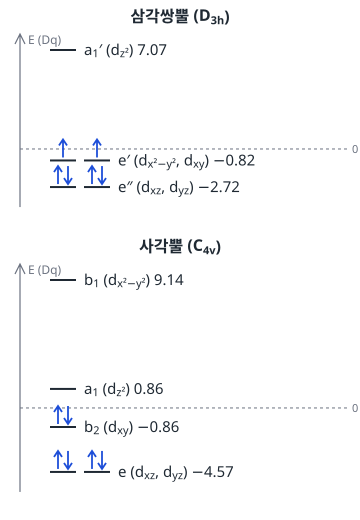

**3.** **d⁶ 저스핀 채우기**
- TBP: $e''$에 4개(가득) → 남은 2개는 축퇴된 $e'$ 두 오비탈에. 같은 에너지이므로 Hund 규칙에 따라 하나씩 → $e''^4e'^2$, **홀전자 2**
- SP: $e$에 4개 → 남은 2개는 축퇴되지 않은 $b_2$에 짝지어 → $e^4b_2^2$, **홀전자 0**

**4.** **자기 모멘트** $\mu_{so} = \sqrt{n(n+2)}$ BM

$$\mu_{\text{TBP}} = \sqrt{2(2 + 2)} = \sqrt8 = 2\sqrt2 \approx 2.83\ \mathrm{BM}, \qquad \mu_{\text{SP}} = 0$$

**5.** **결정장 에너지**

$$E_{\text{TBP}} = 4(-2.72) + 2(-0.82) = -10.88 - 1.64 = -12.52\ \mathrm{Dq} \;\Rightarrow\; 12.52\ \mathrm{Dq}$$

$$E_{\text{SP}} = 4(-4.57) + 2(-0.86) = -18.28 - 1.72 = -20.00\ \mathrm{Dq} \;\Rightarrow\; 20.00\ \mathrm{Dq}$$

$$E_{\text{Oh}} = 6(-4.00) = -24.00\ \mathrm{Dq}$$

**6.** **결정장 활성화 에너지 (LFAE = 전이상태 − 출발 팔면체)**

$$\mathrm{LFAE_{SP}} = -20.00 - (-24.00) = +4.00\ \mathrm{Dq}, \qquad \mathrm{LFAE_{TBP}} = -12.52 - (-24.00) = +11.48\ \mathrm{Dq}$$

**7.** **결론**: 사각뿔을 거치면 잃는 결정장 안정화가 4.00 Dq로 훨씬 작아 활성화 에너지가 낮습니다 → **사각뿔** 선호. (사각뿔은 팔면체에서 리간드 하나만 빠진 모양이라 구조 변화도 적음)

**검산** 오비탈 에너지 합: TBP $7.07 + 2(-0.82) + 2(-2.72) = 7.07 - 1.64 - 5.44 = -0.01 \approx 0$, SP $0.86 + 9.14 - 0.86 + 2(-4.57) = 0$ ✓ (무게중심). d⁶ 저스핀 팔면체가 치환에 불활성인 이유(LFAE가 큼)와도 일치 ✓

**채점 포인트·함정**

- 결론의 근거는 "결정장 에너지 손실(LFAE) = 활성화 에너지에 대한 결정장 기여"입니다: SP 24.00 − 20.00 = **4.00 Dq**, TBP 24.00 − 12.52 = **11.48 Dq**.
- 오비탈 이름(기약표현 기호)까지 쓰라고 했으므로 $a_1'$, $e'$, $e''$ / $b_1$, $a_1$, $b_2$, $e$를 빠뜨리지 않습니다.

## B형 10번 · 이양성자산 H₂A의 평형과 흡광도 {#b10}

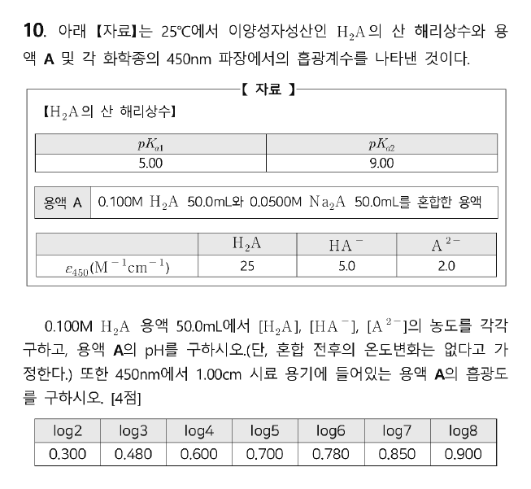

**정답** (1) [H₂A] = **0.0990 M**, [HA⁻] = **1.00×10⁻³ M**, [A²⁻] = **1.00×10⁻⁹ M**  (2) 용액 A의 pH = **5.30**  (3) 흡광도 = **0.875**

**공식·핵심 개념**

- 약산: $[\mathrm{H^+}] \approx \sqrt{K_{a1}C}$, $[\mathrm{A^{2-}}] \approx K_{a2}$
- 완충: $\mathrm{pH} = pK_a + \log\dfrac{[\mathrm{A^-}]}{[\mathrm{HA}]}$ (먼저 비례화 반응 처리)
- Beer 법칙 가산성: $A = b\sum \varepsilon_i c_i$

**2027 출제 가능성 ★★★★★ 매우 높음** — 다양성자산 평형과 흡광도를 엮는 계산은 분석화학 고빈도 유형입니다. 분율($\alpha$)이나 등전점 pH로 바뀌어 나올 수 있습니다.

**주어진 것 / 구할 것**

- H₂A: $pK_{a1} = 5.00$, $pK_{a2} = 9.00$
- 용액 A: 0.100 M H₂A 50.0 mL + 0.0500 M Na₂A 50.0 mL
- 450 nm 몰흡광계수: H₂A 25, HA⁻ 5.0, A²⁻ 2.0 M⁻¹cm⁻¹; log 2 = 0.300
- 구할 것: 0.100 M H₂A의 [H₂A], [HA⁻], [A²⁻], 용액 A의 pH, 1.00 cm 셀에서 용액 A의 흡광도

**풀이 전략** $K_{a2} \ll K_{a1}$이면 1단계만으로 [H⁺]를 정합니다. 혼합 용액은 H₂A와 A²⁻가 먼저 반응(비례화)하므로 그 반응을 끝낸 뒤 완충 식을 씁니다. 흡광도는 각 화학종 기여의 합입니다.

**단계별 풀이 — (1) 0.100 M H₂A**

**1.** $\mathrm{H_2A \rightleftharpoons H^+ + HA^-}$, $K_{a1} = 1.0\times10^{-5}$. 변화량을 $x$라 하면

$$\frac{x^2}{0.100 - x} = 1.0\times10^{-5}$$

**2.** $x \ll 0.100$ 가정: $x^2 = 1.0\times10^{-6}$ → $x = 1.00\times10^{-3}\ \mathrm{M}$

**3.** 가정 확인: $x/0.100 = 1\% < 5\%$ ✓. (근의 공식으로 풀면 $x = 9.95\times10^{-4}$로 0.5% 차이)

**4.** $[\mathrm{H^+}] = [\mathrm{HA^-}] = 1.00\times10^{-3}\ \mathrm{M}$, $[\mathrm{H_2A}] = 0.100 - 0.00100 = 0.0990\ \mathrm{M}$

**5.** 2단계: $K_{a2} = \dfrac{[\mathrm{H^+}][\mathrm{A^{2-}}]}{[\mathrm{HA^-}]}$ → $[\mathrm{A^{2-}}] = K_{a2}\dfrac{[\mathrm{HA^-}]}{[\mathrm{H^+}]} = K_{a2} = 1.00\times10^{-9}\ \mathrm{M}$

**단계별 풀이 — (2) 용액 A의 pH**

**1.** 몰수: H₂A $0.100 \times 50.0 = 5.00\ \mathrm{mmol}$, A²⁻ $0.0500 \times 50.0 = 2.50\ \mathrm{mmol}$

**2.** 비례화 반응 $\mathrm{H_2A + A^{2-} \rightarrow 2HA^-}$, $K = K_{a1}/K_{a2} = 10^{4} \gg 1$ → 사실상 완결

| | H₂A | A²⁻ | HA⁻ |
|---|---|---|---|
| 처음 (mmol) | 5.00 | 2.50 | 0 |
| 변화 | −2.50 | −2.50 | +5.00 |
| 나중 (mmol) | 2.50 | 0 | 5.00 |
| 농도 (100.0 mL) | 0.0250 M | ≈ 0 | 0.0500 M |

**3.** H₂A/HA⁻ 완충 → Henderson–Hasselbalch:

$$\mathrm{pH} = pK_{a1} + \log\frac{[\mathrm{HA^-}]}{[\mathrm{H_2A}]} = 5.00 + \log\frac{0.0500}{0.0250} = 5.00 + 0.300 = 5.30$$

**4.** 확인: $[\mathrm{H^+}] = 5.0\times10^{-6}\ \mathrm{M} \ll 0.0250$ → 완충 근사 성립 ✓

**단계별 풀이 — (3) 흡광도**

**1.** 남은 A²⁻: $[\mathrm{A^{2-}}] = K_{a2}\dfrac{[\mathrm{HA^-}]}{[\mathrm{H^+}]} = 10^{-9}\times\dfrac{0.0500}{5.0\times10^{-6}} = 1.0\times10^{-5}\ \mathrm{M}$

**2.** Beer 법칙 가산성 ($b = 1.00$ cm):

$$A = \varepsilon_{\mathrm{H_2A}}b[\mathrm{H_2A}] + \varepsilon_{\mathrm{HA^-}}b[\mathrm{HA^-}] + \varepsilon_{\mathrm{A^{2-}}}b[\mathrm{A^{2-}}]$$
$$= 25(0.0250) + 5.0(0.0500) + 2.0(1.0\times10^{-5}) = 0.625 + 0.250 + 0.00002 = 0.875$$

**검산** 질량 균형: $[\mathrm{H_2A}] + [\mathrm{HA^-}] + [\mathrm{A^{2-}}] = 0.0250 + 0.0500 = 0.0750\ \mathrm{M}$ = 전체 A 몰수 $7.50\ \mathrm{mmol}/100\ \mathrm{mL}$ ✓

**채점 포인트·함정**

- 혼합 후 부피는 100 mL입니다(50 + 50). 다만 완충 pH는 몰수비만으로도 같습니다.
- 처음부터 Henderson–Hasselbalch에 H₂A 5.00, A²⁻ 2.50을 넣으면 틀립니다. 먼저 **중화(비례화) 반응**을 처리합니다.

## B형 11번 · 지시약 BTB의 몰흡광계수와 혼합물 정량 {#b11}

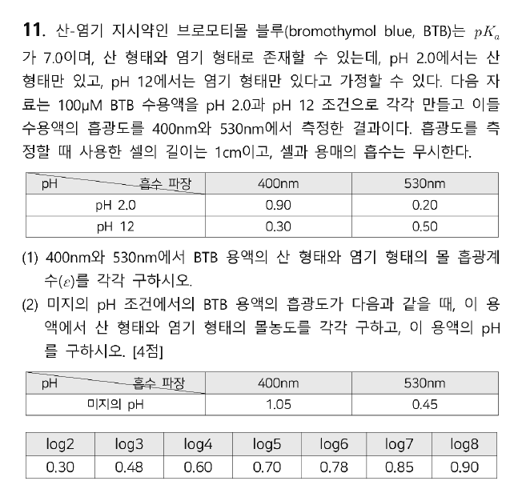

**정답**

| ε (M⁻¹cm⁻¹) | 산 형태(HIn) | 염기 형태(In⁻) |
|---|---|---|
| 400 nm | 9.0×10³ | 3.0×10³ |
| 530 nm | 2.0×10³ | 5.0×10³ |

미지 용액: [HIn] = **1.0×10⁻⁴ M**, [In⁻] = **5.0×10⁻⁵ M**, pH = **6.7**

**공식·핵심 개념**

- $\varepsilon = A/(bc)$ (순수 형태의 흡광도로 구함)
- 두 파장 연립: $A_\lambda = \varepsilon_{\mathrm{HIn},\lambda}b[\mathrm{HIn}] + \varepsilon_{\mathrm{In^-},\lambda}b[\mathrm{In^-}]$
- 지시약 pH $= pK_a + \log\dfrac{[\mathrm{In^-}]}{[\mathrm{HIn}]}$

**2027 출제 가능성 ★★★★☆ 높음** — 두 성분 분광 정량은 분석화학 기입형으로 자주 나옵니다. 등흡수점(isosbestic point)을 함께 묻는 변형도 대비하세요.

**주어진 것 / 구할 것**

- BTB $pK_a = 7.0$, pH 2.0 = 산 형태(HIn)만, pH 12 = 염기 형태(In⁻)만, 셀 1 cm
- 100 μM 용액의 흡광도: pH 2.0 → 0.90(400 nm), 0.20(530 nm); pH 12 → 0.30, 0.50
- 미지 pH 용액: 1.05(400 nm), 0.45(530 nm)
- 구할 것: (1) 두 파장에서 HIn, In⁻의 ε, (2) 미지 용액의 [HIn], [In⁻], pH

**풀이 전략** 순수 형태 용액으로 ε 4개를 구하고, 미지 용액은 두 파장에서 Beer 법칙 가산식 두 개를 세워 연립합니다.

**단계별 풀이 — (1) 몰흡광계수**

**1.** $c = 100\ \mu\mathrm{M} = 1.00\times10^{-4}\ \mathrm{M}$, $b = 1.00\ \mathrm{cm}$, $\varepsilon = \dfrac{A}{bc}$

| | 400 nm | 530 nm |
|---|---|---|
| HIn (pH 2.0) | $\dfrac{0.90}{1.00\times10^{-4}} = 9.0\times10^3$ | $\dfrac{0.20}{1.00\times10^{-4}} = 2.0\times10^3$ |
| In⁻ (pH 12) | $\dfrac{0.30}{1.00\times10^{-4}} = 3.0\times10^3$ | $\dfrac{0.50}{1.00\times10^{-4}} = 5.0\times10^3$ |

(단위 M⁻¹cm⁻¹)

**단계별 풀이 — (2) 미지 용액**

**1.** $a = [\mathrm{HIn}]$, $c = [\mathrm{In^-}]$:

$$\begin{cases} 400\ \mathrm{nm}: & 9.0\times10^3a + 3.0\times10^3c = 1.05 \\ 530\ \mathrm{nm}: & 2.0\times10^3a + 5.0\times10^3c = 0.45 \end{cases}$$

**2.** 크래머 공식: 행렬식

$$D = (9.0\times10^3)(5.0\times10^3) - (3.0\times10^3)(2.0\times10^3) = 4.5\times10^7 - 6.0\times10^6 = 3.9\times10^7$$

**3.** $$a = \frac{(1.05)(5.0\times10^3) - (3.0\times10^3)(0.45)}{D} = \frac{5250 - 1350}{3.9\times10^7} = \frac{3900}{3.9\times10^7} = 1.0\times10^{-4}\ \mathrm{M}$$

**4.** $$c = \frac{(9.0\times10^3)(0.45) - (2.0\times10^3)(1.05)}{D} = \frac{4050 - 2100}{3.9\times10^7} = \frac{1950}{3.9\times10^7} = 5.0\times10^{-5}\ \mathrm{M}$$

**5.** pH (지시약의 Henderson–Hasselbalch):

$$\mathrm{pH} = pK_a + \log\frac{[\mathrm{In^-}]}{[\mathrm{HIn}]} = 7.0 + \log\frac{5.0\times10^{-5}}{1.0\times10^{-4}} = 7.0 + \log\frac12 = 7.0 - 0.30 = 6.7$$

**검산** 다시 대입: 400 nm $0.90 + 0.15 = 1.05$ ✓, 530 nm $0.20 + 0.25 = 0.45$ ✓. pH 6.7 < pKa 7.0이므로 HIn이 더 많아야 하고, 실제로 [HIn] > [In⁻] ✓

**채점 포인트·함정**

- 미지 용액의 전체 지시약 농도는 $1.5\times10^{-4}$ M로 처음 용액(100 μM)과 달라도 됩니다. 별도로 만든 용액이므로 합이 100 μM이라고 가정하지 않습니다.
- 흡광도 가산성(Beer 법칙의 합)이 핵심이며, 두 파장에서 두 미지수를 푸는 전형적인 혼합물 분석입니다.

---

원문: 2025학년도 대비 전공화학 모의고사 1회(김지현, 지스쿨) 문제지·답안·1주 강의 안내. 이 해설은 개인 학습용으로 정리한 것입니다.

