# 2025학년도 대비 김지현 전공화학 모의고사 2회 — 상세해설

김지현 전공화학 모의고사 2회(전공 A 12문항 · 전공 B 11문항)의 문항별 해설입니다. 공식 「모의고사 2회 A형, B형 답안」과 강의 판서를 바탕으로 풀이 과정·개념·채점 포인트를 채웠고, 계산은 모두 다시 풀어 공식 답과 맞는지 확인했습니다. 구조식은 RDKit으로 분자식과 meso/라셈 여부를 확인했습니다.

문항마다 새 쪽에서 시작하며 3단으로 **문제지 원문 → 정답 → 공식·핵심 개념 → 2027 출제 가능성 → 풀이 → 채점 포인트·함정** 순서로 읽으면 됩니다. 아래 표의 문항 번호를 누르면 해당 쪽으로 이동합니다.

**2027 출제 가능성**(★ 5개 만점)은 1997~2026 기출에서 그 소재가 얼마나 자주 나왔는지와 2022 개정 교육과정 적용 시점을 함께 고려한 추정치입니다.

## 정답 한눈에 보기 (목차) {#toc}

### 전공 A (12문항 40점)

| 번호 | 영역 | 정답 요약 | 2027 출제 가능성 |
|---|---|---|---|
| [1](#a1) | 물리화학 · 완화법 | $\tau^{-1} = 4k_a[A]_{eq} + k_a'$, $\tau^{-2} = 8k_ak_a'[A]_{tot} + k_a'^2$ | ★★★☆☆ |
| [2](#a2) | 분석화학 · 전위차 EDTA 적정 | $E_{cell} = 0.192$ V | ★★★★☆ |
| [3](#a3) | 유기 · 분광 분석 | methyl 2,3-dibromo-3-(p-nitrophenyl)propionate | ★★★★★ |
| [4](#a4) | 무기 · 군론, SALC | $A_{1g} + E_g + T_{1u}$ | ★★★★★ |
| [5](#a5) | 화학교육 · 2022 개정 | 과학과 인류의 지속가능한 삶, 중화 적정 곡선 | ★★★★★ |
| [6](#a6) | 화학교육 · 비계, 브루너, 로슨 | 공유결합의 극성, 작동적 표현, 경험귀추 | ★★★★★ |
| [7](#a7) | 화학교육 · 피아제, 하슈웨, 라카토스 | 화학 반응의 세계, 갈등 (1)·(2), 긍정적 발견법 | ★★★★★ |
| [8](#a8) | 물리화학 · 상자 속 입자 | $\Delta x\Delta p = \frac{nh}{2}\sqrt{\frac{1}{12} - \frac{1}{2n^2\pi^2}}$ | ★★★☆☆ |
| [9](#a9) | 무기 · 역결합, Tolman 원뿔각 | νCO↑ = 역결합↓, 원뿔각↑ → 해리↑ | ★★★★☆ |
| [10](#a10) | 유기 · 합성, ¹H NMR | 프로펜 → … → 글리세롤 | ★★★★☆ |
| [11](#a11) | 유기 · Cannizzaro, Henry, Wittig | 벤조산 + 벤질 알코올 | ★★★★☆ |
| [12](#a12) | 분석화학 · 약산 적정 | 10.00 mL, pH 6.300(5.00 mL), 10.06 mL | ★★★★★ |

### 전공 B (11문항 40점)

| 번호 | 영역 | 정답 요약 | 2027 출제 가능성 |
|---|---|---|---|
| [1](#b1) | 유기 · 입체화학 | meso C, D / 라셈 A, F | ★★★★★ |
| [2](#b2) | 분석화학 · 전기분해 | −2.76 V | ★★★★☆ |
| [3](#b3) | 화학교육 · 5E, 오수벨, 클로퍼 | 학습 의욕, 탐색, 자료 해석과 일반화 | ★★★★★ |
| [4](#b4) | 화학교육 · 발견학습 | 물질과 규칙성, 결론 도출 및 적용 | ★★★★☆ |
| [5](#b5) | 화학교육 · 수행평가 | 평가 준거 수정, 상태 변화와 열에너지 | ★★★★☆ |
| [6](#b6) | 물리화학 · Clapeyron, Ehrenfest | $dp/dT = \Delta\alpha/\Delta\kappa_T$ | ★★★☆☆ |
| [7](#b7) | 물리화학 · Hückel | TMM $4\alpha + 2\sqrt3\beta$, allyl $3\alpha + 2\sqrt2\beta$ | ★★★★☆ |
| [8](#b8) | 무기 · IR 진동 | cis C₂ᵥ: A₁ + B₂ / trans: B₁ᵤ | ★★★★☆ |
| [9](#b9) | 무기 · Tanabe–Sugano | 축퇴도 1, ¹A₁g→¹T₁g, ⁶A₁g / ⁵T₂g | ★★★★★ |
| [10](#b10) | 유기 · Friedel–Crafts | 락톤 → 알킬화 → 테트랄론 | ★★★★☆ |
| [11](#b11) | 분석화학 · 모세관 전기이동 | B⁻ > C > A⁺, 250 s | ★★★★☆ |

**검토 메모**

1. **B형 6번**: 공식 답안의 $\dfrac{\alpha_2 - \alpha_1}{\kappa_{T,2} - \kappa_{T,2}}$는 오타입니다. 분모는 $\kappa_{T,2} - \kappa_{T,1}$이어야 합니다.
2. **B형 11번**: 공식 답안은 pH 2.5의 아미노프로필 모세관을 "속도가 크게 감소"라고 썼지만, 표의 값이 **−1.3 mm/s**이므로 전기삼투 흐름의 **방향이 반대(양극 쪽)**로 바뀐 것입니다. 벽의 –NH₃⁺가 양전하를 띠기 때문입니다.
3. **답안 머리말**: A형·B형 모두 "서술형 5~12번"으로 적혀 있습니다. 실제로 A형은 기입형 1~4번·서술형 5~12번이고, B형은 기입형 1~2번(각 2점)·서술형 3~11번(각 4점)입니다.

# 전공 A

## A형 1번 · 이합체화 반응의 완화 시간 {#a1}

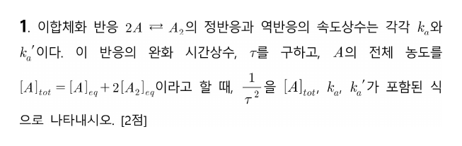

**정답** (1) $\tau = \dfrac{1}{4k_a[A]_{eq} + k_a'}$  (2) $\dfrac{1}{\tau^2} = 8k_ak_a'[A]_{tot} + (k_a')^2$

**공식·핵심 개념**

- 완화법: 평형에서 작은 변위 $x$, $dx/dt = -x/\tau$
- $2A \rightleftharpoons A_2$: $\tau^{-1} = 4k_a[A]_{eq} + k_a'$
- $A \rightleftharpoons B$: $\tau^{-1} = k_1 + k_{-1}$

**2027 출제 가능성 ★★★☆☆ 보통** — 완화법은 속도론에서 가끔 나오는 고급 소재입니다. 단순 가역 반응 $\tau^{-1} = k_1 + k_{-1}$부터 확실히 하세요.

**완화법.** 평형에서 조금 벗어난 양 $x$로 $[A] = [A]_{eq} + x$, $[A_2] = [A_2]_{eq} - x/2$를 놓습니다. A의 속도식

$$\frac{d[A]}{dt} = -2k_a[A]^2 + 2k_a'[A_2]$$

에 대입하고 $x^2$ 항을 버리면(평형 조건으로 상수항 소거)

$$\frac{dx}{dt} = -(4k_a[A]_{eq} + k_a')x \;\Rightarrow\; \frac1\tau = 4k_a[A]_{eq} + k_a'$$

**[A]tot로 바꾸기.** 양변을 제곱하면 $\tau^{-2} = 16k_a^2[A]_{eq}^2 + 8k_ak_a'[A]_{eq} + k_a'^2$. 평형 $k_a[A]_{eq}^2 = k_a'[A_2]_{eq}$와 $[A]_{tot} = [A]_{eq} + 2[A_2]_{eq}$에서 $16k_a^2[A]_{eq}^2 = 8k_ak_a'(2[A_2]_{eq})$이므로

$$\frac{1}{\tau^2} = 8k_ak_a'([A]_{eq} + 2[A_2]_{eq}) + k_a'^2 = 8k_ak_a'[A]_{tot} + (k_a')^2$$

**채점 포인트·함정**

- 이 식은 $\tau^{-2}$를 $[A]_{tot}$에 대해 그리면 직선이 되어, 기울기와 절편으로 $k_a$, $k_a'$을 함께 구할 수 있다는 것이 핵심입니다.
- 계수 2(2A)를 빠뜨리면 $4k_a$ 대신 $2k_a$가 나옵니다.

## A형 2번 · 수은의 전위차 EDTA 적정 {#a2}

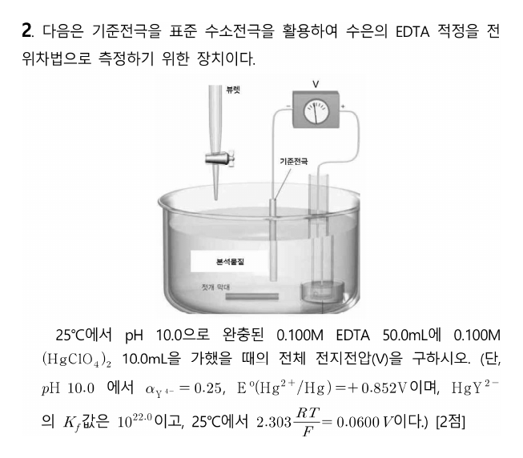

**정답** $E_{cell} = 0.192$ V

**공식·핵심 개념**

- 조건 형성상수 $K_f' = \alpha_{Y^{4-}}K_f$
- EDTA 과량 영역: $[M] = \dfrac{[MY]}{K_f'[EDTA]}$
- 네른스트 $E = E^\circ - \dfrac{0.0600}{n}\log\dfrac{1}{[M^{n+}]}$

**2027 출제 가능성 ★★★★☆ 높음** — EDTA 적정과 전기화학을 엮는 계산은 분석화학에서 자주 나옵니다(4회 B형 2번과 같은 계열).

**양적 관계.** EDTA 5.00 mmol, Hg²⁺ 1.00 mmol → HgY²⁻ 1.00 mmol, 남은 EDTA 4.00 mmol, 전체 60.0 mL.

**[Hg²⁺].** 조건 형성상수 $K_f' = \alpha_{Y^{4-}}K_f = 0.25 \times 10^{22}$:

$$[\mathrm{Hg^{2+}}] = \frac{[\mathrm{HgY^{2-}}]}{K_f'[\mathrm{EDTA}]} = \frac{1.00/60.0}{0.25\times10^{22}\times(4.00/60.0)} = 1.0\times10^{-22}\ \mathrm{M}$$

**전위.** 기준 전극이 표준 수소 전극(0 V)이므로

$$E_{cell} = E_{Hg} = 0.852 - \frac{0.0600}{2}\log\frac{1}{10^{-22}} = 0.852 - 0.660 = 0.192\ \mathrm{V}$$

**채점 포인트·함정**

- 부피는 약분되어 사라지지만(1 : 4 비), 비를 쓰기 전에 남은 EDTA 양을 정확히 구해야 합니다.
- $\alpha_{Y^{4-}}$를 곱해 조건 형성상수로 바꾸는 단계를 빼먹기 쉽습니다.

## A형 3번 · IR·NMR·MS로 구조 결정 {#a3}

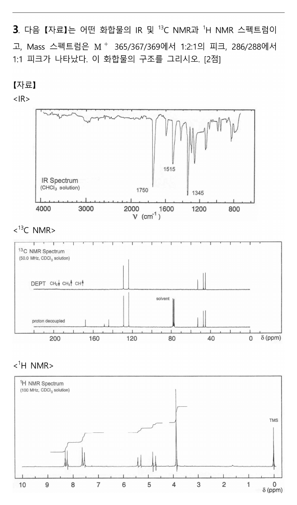

**정답** **methyl 2,3-dibromo-3-(p-nitrophenyl)propionate**, C₁₀H₉NO₄Br₂

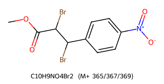

**공식·핵심 개념**

- 동위원소 피크: Br 1개 M:M+2 = 1:1, Br 2개 1:2:1, Cl 1개 3:1
- IR NO₂: 1520, 1350 cm⁻¹ / 에스터 C=O 1735~1750
- 불포화도 $= \dfrac{2C + 2 + N - H - X}{2}$

**2027 출제 가능성 ★★★★★ 매우 높음** — 분광 자료로 구조를 정하는 유형은 해마다 나옵니다. MS 동위원소 패턴은 할로젠 화합물에서 단골입니다.

| 자료 | 신호 | 해석 |
|---|---|---|
| MS | M⁺ 365/367/369 = 1 : 2 : 1 | **Br 2개** (⁷⁹Br : ⁸¹Br ≈ 1 : 1) |
| MS | 286/288 = 1 : 1 | M − Br (Br 1개 남음) |
| IR | 1750 cm⁻¹ | 에스터 C=O (콘쥬게이션 없음) |
| IR | 1515, 1345 cm⁻¹ | **NO₂** 비대칭·대칭 신축 |
| ¹H | δ 8.2 (d, 2H), 7.6 (d, 2H) | *para* 이치환 벤젠(NO₂ 쪽 H가 낮은 장) |
| ¹H | δ 5.4 (d, 1H), 4.8 (d, 1H) | Ar–C**H**Br–C**H**Br–, 서로 짝지음 |
| ¹H | δ 3.9 (s, 3H) | OCH₃ |
| ¹³C | ~168 | 에스터 C=O |
| ¹³C DEPT | 124, 129 (CH ↑), 50 근처 CH 2개, 53 CH₃ | 방향족 CH, CHBr 2개, OCH₃ |

**분자식 확인.** C₁₀H₉NO₄Br₂ = 120 + 9 + 14 + 64 + 158(⁷⁹Br₂) = **365** ✓. 불포화도 = (2·10 + 2 + 1 − 9 − 2)/2 = 6 (벤젠 4 + C=O 1 + N=O 1).

**채점 포인트·함정**

- M : M+2 : M+4 = 1 : 2 : 1은 Br 2개, 3 : 1은 Cl 1개의 표지입니다.
- 1345·1515 cm⁻¹ 한 쌍은 나이트로기의 지문입니다.

## A형 4번 · MoH₆의 σ 결합 SALC {#a4}

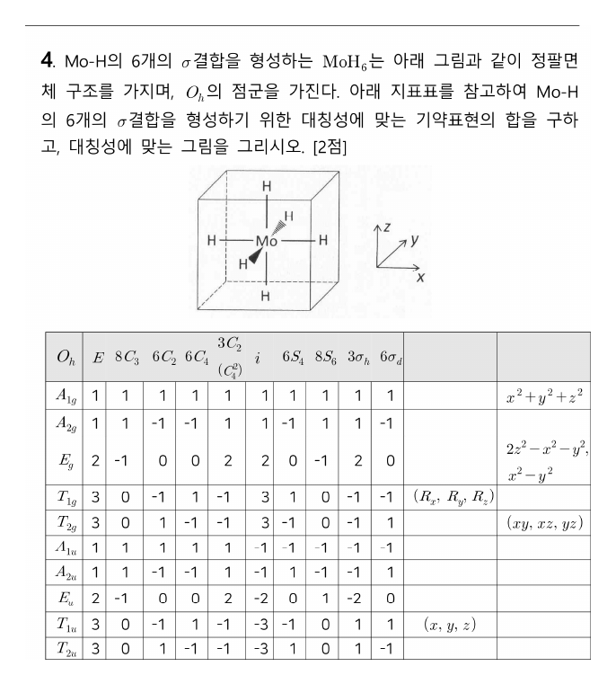

**정답** $\Gamma_\sigma = A_{1g} + E_g + T_{1u}$. 대응 Mo 오비탈: $A_{1g}$ – s, $E_g$ – $d_{z^2}$, $d_{x^2-y^2}$, $T_{1u}$ – $p_x$, $p_y$, $p_z$

**공식·핵심 개념**

- σ SALC: 제자리 리간드 수로 Γσ → 축소
- 축소 공식 $n_i = \dfrac1h\sum g\chi_i\chi$
- Oh: $A_{1g}$(s), $E_g$($d_{z^2}, d_{x^2-y^2}$), $T_{1u}$(p)

**2027 출제 가능성 ★★★★★ 매우 높음** — SALC와 기약표현은 무기 고정 출제 소재입니다. 그림까지 그리게 하는 형식도 나옵니다.

**환원 가능 표현.** 각 연산에서 제자리에 남는 H(σ 벡터) 수:

| $O_h$ | E | 8C₃ | 6C₂ | 6C₄ | 3C₂ | i | 6S₄ | 8S₆ | 3σh | 6σd |
|---|---|---|---|---|---|---|---|---|---|---|
| Γσ | 6 | 0 | 0 | 2 | 2 | 0 | 0 | 0 | 4 | 2 |

축소 공식 ($h = 48$): $n(A_{1g}) = \frac{1}{48}(6 + 12 + 6 + 12 + 12) = 1$, $n(E_g) = \frac{1}{48}(12 + 12 + 24) = 1$, $n(T_{1u}) = \frac{1}{48}(18 + 12 - 6 + 12 + 12) = 1$.

**그림 그리는 법.** 금속 오비탈의 로브 부호와 같은 부호로 H 1s를 배치합니다: $A_{1g}$ 6개 모두 +, $E_g$($d_{z^2}$) z축 둘 +·xy 넷 −(크기 ½), $E_g$($d_{x^2-y^2}$) x축 +·y축 −, $T_{1u}$($p_x$) +x는 +, −x는 −.

**채점 포인트·함정**

- C₂(=C₄²)와 σh에서 제자리 원자는 각각 2, 4개입니다.
- $t_{2g}$($d_{xy}, d_{xz}, d_{yz}$)는 σ SALC가 없어 비결합으로 남습니다.

## A형 5번 · 2022 개정 교육과정과 디지털 탐구 {#a5}

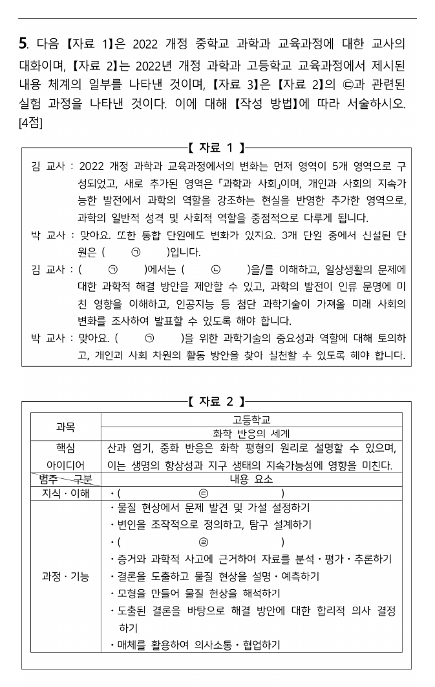

**정답**

- ㉠ **과학과 인류의 지속가능한 삶**, ㉡ **과학적 탐구 방법**
- ㉢ **중화 적정 곡선**, ㉣ **디지털 탐구 도구와 수학적 사고를 활용하여 정보를 수집·변환·해석하기**
- 지도: 중화 적정 곡선을 다룰 때 학생들이 **수학적 사고에 기반한 컴퓨팅 사고력과 디지털 소양**을 함양하도록 수업을 구성하여 지도한다.

**공식·핵심 개념**

- 2022 개정 중학교 통합 단원: 과학과 나의 미래, 과학과 첨단기술, 과학과 인류의 지속가능한 삶
- 과정·기능: 디지털 탐구 도구와 수학적 사고로 정보를 수집·변환·해석하기
- MBL 활용 중화 적정 곡선

**2027 출제 가능성 ★★★★★ 매우 높음** — 2022 개정 신설 내용(통합 단원, 디지털 소양)은 2027 출제 우선순위가 가장 높은 영역입니다.

**통합 단원.** 2022 개정 중학교 과학의 통합 단원 3개(과학과 나의 미래, 과학과 첨단기술, **과학과 인류의 지속가능한 삶**) 중 신설된 단원이 ㉠입니다.

**㉢·㉣.** 자료 3은 MBL로 NaOH를 떨어뜨리며 pH를 실시간 측정해 그래프로 얻는 활동 → 내용 요소는 [화학 반응의 세계]의 **중화 적정 곡선**, 과정·기능은 디지털 도구로 정보를 **수집·변환·해석**하기.

**채점 포인트·함정**

- '정보를 수집·변환·해석'이라는 2022 개정 고유 표현을 그대로 씁니다.

## A형 6번 · 비계, 브루너의 표현 양식, 로슨 {#a6}

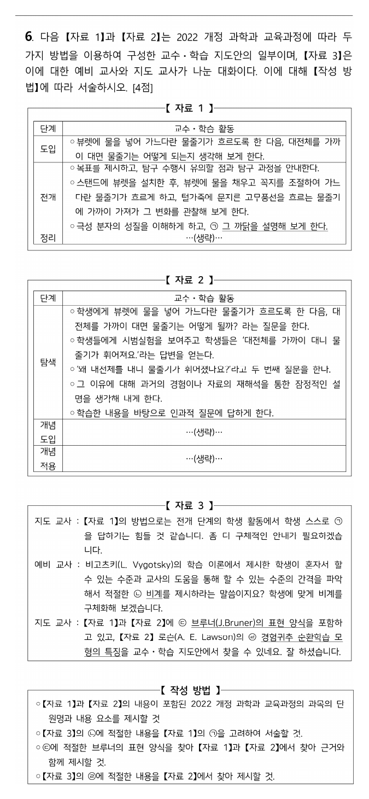

**정답**

- 단원: **물질의 구조와 성질**, 내용 요소: **공유결합의 극성**
- ㉡ 비계: "물 분자는 분자 내에 어떤 전하를 가지고 있나요?", "물을 구성하는 원자들의 전기음성도 차이는 어떻게 되나요?"
- ㉢ 작동적 표현 — 자료 1: 물줄기의 변화를 **관찰하는 행동**, 자료 2: **시범실험**으로 구체적 행동을 보여 줌
- ㉣ 탐색 단계에서 실험 결과를 근거로 인과적 질문에 대해 **과거 학습 경험으로 연결**하고, 실험 설계나 검증 과정 없이 **자료의 재해석**으로 인과적 질문에 답하는 과정을 포함한다.

**공식·핵심 개념**

- 비계: ZPD 안에서 과제를 쪼갠 단계적 도움
- 브루너: 작동적 → 영상적 → 상징적
- 로슨 경험-귀추적: 경험·자료 재해석으로 잠정 설명, 검증 실험 없음

**2027 출제 가능성 ★★★★★ 매우 높음** — 여러 학자를 한 수업 사례에 묶는 교육론 문항은 매년 나옵니다.

**비계(scaffolding).** 비고츠키의 근접발달영역(ZPD)에서 혼자 못 하는 과제를 해낼 수 있도록 주는 단계적 도움. "그 까닭을 설명해 보라"는 큰 질문을 **분자의 전하 → 전기음성도 차이**로 쪼갠 질문이 비계입니다.

**브루너 표현 양식**: 작동적(행동·조작) → 영상적(그림·모형) → 상징적(기호·수식). 물줄기를 직접 휘게 하는 활동은 작동적입니다.

**로슨 경험-귀추적 순환학습**: "왜?" 질문 → 경험·자료 재해석으로 잠정적 설명(귀추) → 검증 실험 없이 인과 질문에 답함(가설-연역적과의 차이).

**채점 포인트·함정**

- 비계는 ㉠(까닭 설명)을 쪼갠 **구체적 질문 형태**로 써야 합니다.

## A형 7번 · 피아제, 하슈웨, 라카토스 {#a7}

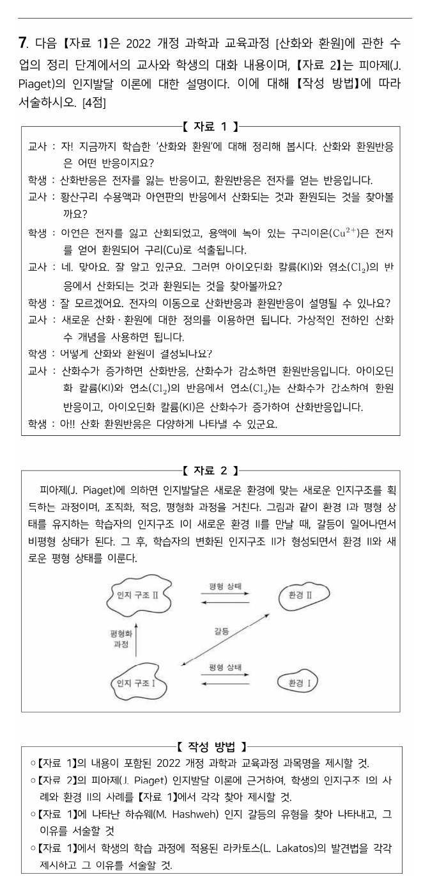

**정답**

- 과목명: **화학 반응의 세계**
- 인지구조 I: 산화반응은 전자를 잃는 반응, 환원반응은 전자를 얻는 반응이다. / 환경 II: KI와 Cl₂의 반응에서 KI는 산화되고 Cl₂는 환원된다.
- 갈등 (1): 기존 개념(C1, 전자 이동)으로 새 상황(R2, KI + Cl₂)을 설명할 수 없음. 갈등 (2): 기존 개념(C1)과 새 개념(C2, 산화수 증감)의 갈등 — C2는 R2와 R1을 모두 설명하며 C1의 확장 개념이다.
- **긍정적 발견법**: 핵(전자 이동으로 산화·환원 설명)은 유지하고, 설명이 어려운 변칙 사례(KI + Cl₂)에 대해 **산화수 증감**으로 보호대를 보완·확장하여 핵을 보호했다.

**공식·핵심 개념**

- 피아제: 동화 → 비평형(갈등) → 조절 → 평형
- 하슈웨: 갈등 (1) 선개념 ↔ 현상, 갈등 (2) 선개념 ↔ 새 개념
- 라카토스: 부정적 발견법(핵 보호) / 긍정적 발견법(보호대 발전)

**2027 출제 가능성 ★★★★★ 매우 높음** — 개념 변화 이론과 과학철학자를 묶는 형태는 1회·2회에 모두 나왔을 만큼 핵심입니다.

**하슈웨 모형**: 갈등 (1) = 선개념 ↔ 그것으로 설명 안 되는 현상(실험·사례), 갈등 (2) = 선개념 ↔ 새 과학 개념(교사 설명).

**라카토스**: 부정적 발견법 = 반증의 화살을 핵에서 돌려 **핵을 보호**하라는 규칙, 긍정적 발견법 = 보호대를 **수정·발전**시켜 연구 프로그램을 확장하는 지침. 여기서는 새 정의로 보호대를 적극 확장했으므로 긍정적 발견법.

**채점 포인트·함정**

- 피아제 사례에서 '환경 II'는 **새로운 상황(KI + Cl₂ 반응)**입니다.
- 공식 답안 기준 긍정적 발견법입니다. 근거에 '보호대 보완·확장'을 꼭 씁니다.

## A형 8번 · 상자 속 입자의 불확정성 {#a8}

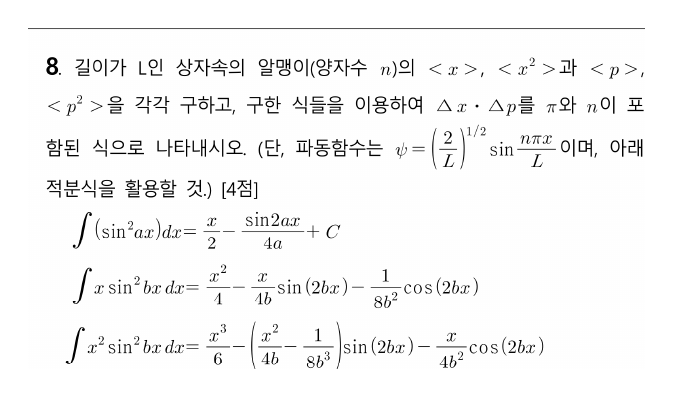

**정답**

- $\langle x\rangle = \dfrac L2$, $\langle x^2\rangle = L^2\left(\dfrac13 - \dfrac{1}{2n^2\pi^2}\right)$, $\Delta x = L\left(\dfrac1{12} - \dfrac{1}{2n^2\pi^2}\right)^{1/2}$
- $\langle p\rangle = 0$, $\langle p^2\rangle = \dfrac{n^2h^2}{4L^2}$, $\Delta p = \dfrac{nh}{2L}$
- $\Delta x\Delta p = \dfrac{nh}{2}\left(\dfrac1{12} - \dfrac{1}{2n^2\pi^2}\right)^{1/2} > \dfrac\hbar2$

**공식·핵심 개념**

- $\psi_n = \sqrt{2/L}\sin(n\pi x/L)$, $E_n = \dfrac{n^2h^2}{8mL^2}$
- $\Delta A = \sqrt{\langle A^2\rangle - \langle A\rangle^2}$
- $\langle p^2\rangle = 2mE$, 불확정성 $\Delta x\Delta p \ge \hbar/2$

**2027 출제 가능성 ★★★☆☆ 보통** — 상자 속 입자 기대치는 양자 영역의 기본형입니다. 적분 공식을 주는 형태로 출제됩니다.

**⟨x²⟩.** 주어진 적분 공식에 $b = n\pi/L$, 구간 0~L을 넣으면 sin 항은 0, cos 항은 $\cos(2n\pi) = 1$:

$$\langle x^2\rangle = \frac2L\left[\frac{L^3}{6} - \frac{L}{4b^2}\right] = L^2\left(\frac13 - \frac{1}{2n^2\pi^2}\right)$$

$\Delta x = \sqrt{\langle x^2\rangle - \langle x\rangle^2}$에서 $\frac13 - \frac14 = \frac1{12}$.

**⟨p⟩, ⟨p²⟩.** $\hat p = -i\hbar\frac{d}{dx}$: sin × cos 적분이 0이므로 $\langle p\rangle = 0$. $\hat p^2\psi = \hbar^2b^2\psi$이므로 $\langle p^2\rangle = \dfrac{n^2\pi^2\hbar^2}{L^2} = \dfrac{n^2h^2}{4L^2}$ (= 2mE).

**불확정성 확인.** n = 1: $\frac{h}{2}\sqrt{0.0833 - 0.0507} = 0.0903h = 0.567\hbar > 0.5\hbar$ ✓.

**채점 포인트·함정**

- $\langle x\rangle$와 $\langle p\rangle$는 **모든 n**에 대해 같다고 써야 합니다(대칭).

## A형 9번 · 역결합과 Tolman 원뿔각 {#a9}

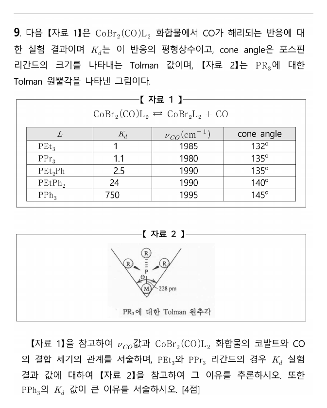

**정답**

- νCO가 클수록 C≡O 결합이 강하며, Co → CO **역결합이 적다**는 뜻이므로 **Co–CO 결합이 약하다**.
- PEt₃ vs PPr₃: νCO만 보면 PEt₃(1985)가 커서 CO가 더 잘 해리될 것 같지만, 원뿔각은 PPr₃가 커서 해리가 잘된다. 두 인자가 상충하는데 **원뿔각 인자가 더 크게 작용**하여 PPr₃의 Kd가 조금 더 크다.
- PPh₃: 원뿔각 145°로 가장 커 리간드 사이 **입체 장애**가 커서 CO 해리가 잘 일어난다(Kd = 750).

**공식·핵심 개념**

- 역결합↑ → M–C 강화, C≡O 약화 → νCO↓
- Tolman 원뿔각↑ → 입체 장애↑ → 리간드 해리↑
- 전자 효과(νCO)와 입체 효과(원뿔각) 구분

**2027 출제 가능성 ★★★★☆ 높음** — 카보닐 착물의 역결합·νCO 해석은 무기에서 자주 나옵니다.

**역결합 원리.** 금속 d 전자가 CO의 π*로 들어가면 M–C 결합은 강해지고 C≡O 결합은 약해져 νCO가 내려갑니다. 포스핀이 σ 주개로 금속에 전자를 많이 줄수록 역결합↑ → νCO↓.

**Tolman 원뿔각**: 금속에서 2.28 Å 떨어진 P를 꼭짓점으로 치환기의 반데르발스 외곽을 감싸는 원뿔의 각. 클수록 부피가 커서 다른 리간드를 밀어냅니다.

**채점 포인트·함정**

- 이 표에서 Kd는 νCO보다 **원뿔각**과 더 잘 맞습니다(132° → 145°, Kd 1 → 750). 전자 효과와 입체 효과를 구분해 쓰세요.

## A형 10번 · 1,2-dibromopropane에서 글리세롤까지 {#a10}

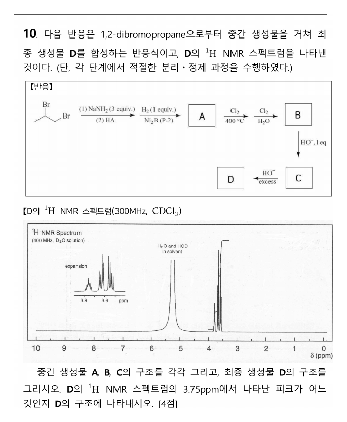

**정답** A **propene**, B **1,3-dichloro-2-propanol**, C **epichlorohydrin**, D **glycerol** (3.75 ppm = 가운데 **CH**)

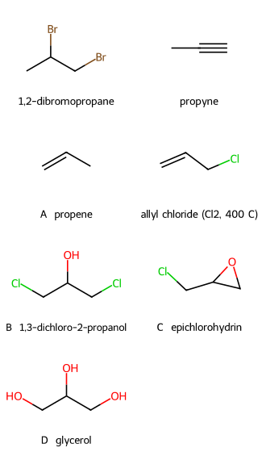

**공식·핵심 개념**

- 비자리 이할로젠화물 + NaNH₂ 3당량 → 말단 알카인
- Ni₂B(P-2) 또는 Lindlar: 알카인 → cis 알켄
- Cl₂ 고온: 알릴 치환 / Cl₂, H₂O: 할로하이드린
- 할로하이드린 + 염기 → 에폭사이드

**2027 출제 가능성 ★★★★☆ 높음** — 다단계 합성과 NMR 배정은 유기 서술형 고정 유형입니다.

1. **NaNH₂ 3당량**: E2 두 번으로 propyne, 세 번째 당량은 말단 알카인 H를 떼어 아세틸라이드 → HA로 양성자화.
2. **H₂ 1당량, Ni₂B(P-2)**: 알카인 → 알켄에서 멈춤 → **A propene**.
3. **Cl₂, 400 °C**: 라디칼 알릴 치환 → allyl chloride (고온에서는 첨가보다 치환).
4. **Cl₂/H₂O**: 클로로하이드린 형성(Markovnikov, OH가 더 치환된 탄소로) → **B** ClCH₂CH(OH)CH₂Cl.
5. **HO⁻ 1당량**: 알콕사이드가 이웃 C–Cl을 분자 내 SN2 → 에폭사이드 **C**.
6. **HO⁻ 과량**: 남은 C–Cl 치환과 에폭사이드 개환 → **D glycerol**.

**NMR.** D₂O에서 OH는 교환되어 HOD(~4.8)로 보이고, 3.75 ppm 다중선(1H)이 CH, 3.55–3.65 ppm이 CH₂ 두 개(4H)입니다.

**채점 포인트·함정**

- Cl₂ 400 °C(라디칼 치환)와 Cl₂/H₂O(할로하이드린)의 차이가 핵심입니다.

## A형 11번 · Cannizzaro, Henry, Wittig 반응 {#a11}

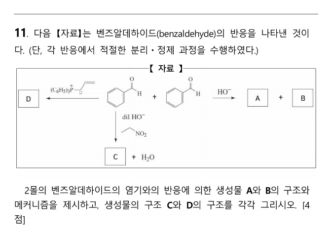

**정답** A **benzoic acid**(염기 조건에서는 benzoate), B **benzyl alcohol**, C **(E)-2-nitro-1-phenylpropene**, D **1-phenyl-1,3-butadiene**

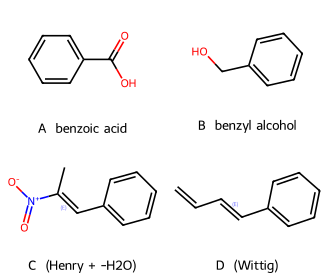

**공식·핵심 개념**

- Cannizzaro: α-H 없는 알데하이드 2분자 → 산 + 알코올 (H⁻ 전달)
- Henry: 니트로알케인 + 알데하이드 → β-니트로알코올 → 니트로알켄
- Wittig: Ph₃P=CHR + C=O → C=CHR + Ph₃P=O

**2027 출제 가능성 ★★★★☆ 높음** — 카보닐 반응(이름 반응) 메커니즘은 유기 서술형으로 자주 나옵니다.

**Cannizzaro 메커니즘** (α-H 없는 알데하이드 2분자, 진한 염기):

1. HO⁻가 PhCHO의 C=O 탄소를 공격 → 사면체 중간체 PhCH(OH)O⁻.
2. (진한 염기에서) OH의 H를 떼어 이음이온 PhCH(O⁻)₂.
3. 이 중간체가 **수소화 이온(H⁻)을 다른 PhCHO의 C=O로 전달** → PhCOO⁻ + PhCH₂O⁻.
4. 양성자 이동 → **벤조산 이온 + 벤질 알코올** (산 처리하면 벤조산).

한 분자는 산화, 다른 분자는 환원되는 **불균등화**입니다.

**C (Henry 반응 + 탈수).** 묽은 염기가 니트로에테인의 α-H(pKa ≈ 9)를 떼어 니트로네이트 → PhCHO에 첨가 → β-니트로 알코올 → 물이 빠져 콘쥬게이션된 니트로알켄.

**D (Wittig).** 알릴리덴 일라이드 Ph₃P=CH–CH=CH₂가 C=O와 [2+2] → 옥사포스페테인 → Ph₃P=O 빠지며 C=C 생성.

**채점 포인트·함정**

- 메커니즘의 핵심 화살표는 **H⁻ 전달 단계**입니다.

## A형 12번 · MES의 NaOH 적정 {#a12}

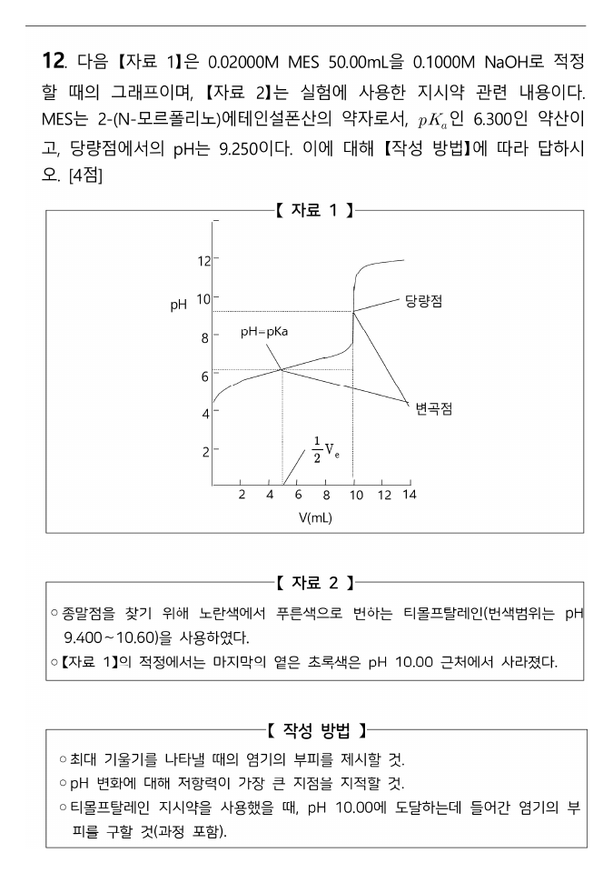

**정답** 최대 기울기 **10.00 mL**(당량점), 저항력 최대 **pH = pKa = 6.300, 5.00 mL**, pH 10.00까지 **10.06 mL**

**공식·핵심 개념**

- 당량점 $V_e = \dfrac{C_aV_a}{C_b}$, 기울기 최대
- 반당량점: pH = pKa, 완충 용량 최대(기울기 최소)
- 당량점 뒤: 과량 OH⁻로 pH 결정

**2027 출제 가능성 ★★★★★ 매우 높음** — 약산 적정 곡선과 적정 오차 계산은 분석화학 최빈출 유형입니다.

**당량점.** $V_e = \dfrac{0.02000 \times 50.00}{0.1000} = 10.00$ mL — 곡선 기울기 최대.

**완충 용량 최대.** 반당량점($V_b = 5.00$ mL)에서 [HA] = [A⁻], pH = pKa = 6.300 — 곡선 기울기 최소.

**pH 10.00.** 당량점(pH 9.25) 뒤이므로 과량 OH⁻가 pH를 결정:

$$[\mathrm{OH^-}] = 10^{-4.000} = \frac{0.1000\,V}{50.00 + 10.00 + V} \;\Rightarrow\; V = 0.0600\ \mathrm{mL}$$

종말점까지 넣은 염기 = 10.00 + 0.06 = **10.06 mL** (적정 오차 +0.06 mL).

**채점 포인트·함정**

- 분모 부피에 처음 50.00 mL와 당량점까지 넣은 10.00 mL를 모두 넣습니다.
- 약산 짝염기 A⁻에서 나오는 OH⁻(약 2.4 × 10⁻⁵ M)는 10⁻⁴ M보다 작아 무시합니다.

# 전공 B

## B형 1번 · syn·anti 첨가와 meso·라셈 {#b1}

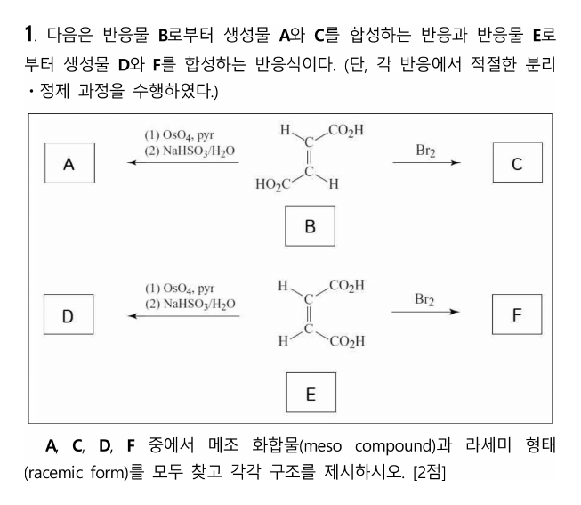

**정답** meso: **C, D** / 라셈: **A, F**

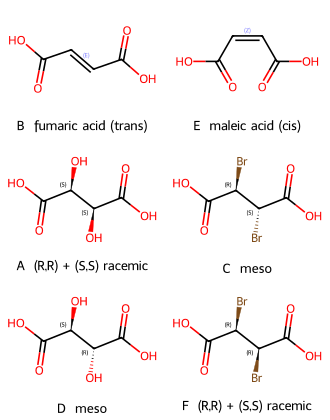

**공식·핵심 개념**

- OsO₄: syn 이하이드록시화 / Br₂: anti 첨가
- trans+syn·cis+anti → 라셈, trans+anti·cis+syn → meso
- meso: 입체중심 있어도 대칭면

**2027 출제 가능성 ★★★★★ 매우 높음** — 입체 특이적 첨가와 meso·라셈 판정은 유기에서 거의 매년 나옵니다.

| 출발물 | 시약 | 첨가 방식 | 생성물 |
|---|---|---|---|
| B fumaric (trans) | OsO₄ | **syn** | A (R,R)/(S,S) 라셈 |
| B fumaric (trans) | Br₂ | **anti** | C meso |
| E maleic (cis) | OsO₄ | syn | D meso |
| E maleic (cis) | Br₂ | anti | F (R,R)/(S,S) 라셈 |

**규칙**: 대칭 알켄에서 **trans + syn = 라셈, trans + anti = meso, cis + syn = meso, cis + anti = 라셈**.

**메커니즘.** OsO₄는 고리형 오스메이트 에스터를 거쳐 두 OH를 같은 면에(syn), Br₂는 브로모늄 이온의 뒷면 공격으로 반대 면에(anti) 넣습니다.

**채점 포인트·함정**

- 라셈은 **거울상 이성질체 두 개를 모두** 그려야 합니다.

## B형 2번 · Ni 석출에 필요한 전압 {#b2}

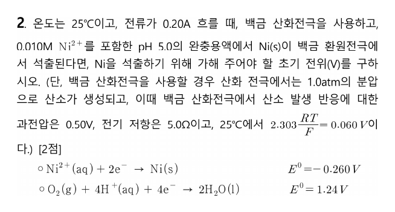

**정답** **−2.76 V**

**공식·핵심 개념**

- 네른스트로 각 전극 전위 → $E_{cell} = E_+ - E_-$
- 실제 전압 $E = E_{cell} - IR - \eta$
- 산소 발생: $\mathrm{O_2 + 4H^+ + 4e^- \rightleftharpoons 2H_2O}$

**2027 출제 가능성 ★★★★☆ 높음** — 전기분해에 필요한 전압(IR, 과전압 포함)은 분석화학 기입형으로 자주 나옵니다.

**반쪽 전위(네른스트).**

- 환원 전극: $E_{Ni} = -0.260 - \dfrac{0.060}{2}\log\dfrac{1}{0.010} = -0.320$ V
- 산화 전극(O₂, pH 5): $E_{O_2} = 1.24 - \dfrac{0.060}{4}\log\dfrac{1}{(1.0)(10^{-5})^4} = 1.24 - 0.30 = 0.94$ V
- $E_{cell} = E_+ - E_- = -0.320 - 0.94 = -1.26$ V

**실제로 걸어 줘야 할 전압.** 저항 손실(IR)과 과전압이 더해져 더 음수가 됩니다:

$$E = E_{cell} - IR - \eta = -1.26 - (0.20)(5.0) - 0.50 = -2.76\ \mathrm{V}$$

**채점 포인트·함정**

- IR = 1.0 V, 과전압 0.50 V 모두 **빼야** 합니다(절댓값이 커짐).
- 전체 반응식으로 풀어도 $E^\circ = -1.50$ V, $Q = 10^{-16}$ → $-1.50 + 0.24 = -1.26$ V로 같습니다.

## B형 3번 · 5E 모형과 유의미학습 {#b3}

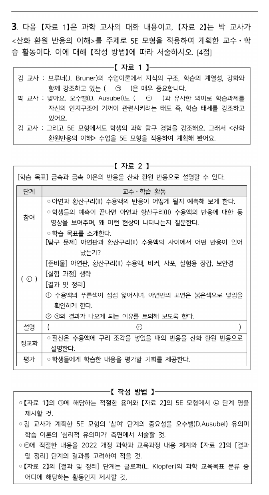

**정답**

- ㉠ **학습 의욕**, ㉡ **탐색**
- 참여 단계: 학생의 관심·흥미를 끌어 호기심을 충족시키는 **학습 의향(학습 태세)**을 갖게 하므로 오수벨의 **심리적 유의미가**를 갖는다.
- ㉢ 산화 환원 반응은 전자를 주고받는 반응이므로 산화와 환원은 항상 동시에 일어난다. Zn은 전자를 잃고 Zn²⁺로 녹아 들어가고, 푸른색 Cu²⁺는 전자를 얻어 Cu로 석출된다. 그래서 용액의 푸른색이 옅어지고 아연판 표면이 붉은 구리로 덮인다.
- 클로퍼: **탐구 과정 III — 자료 해석과 일반화**

**공식·핵심 개념**

- 5E: 참여 → 탐색 → 설명 → 정교화 → 평가
- 오수벨: 논리적·잠재적·심리적 유의미가
- 클로퍼 탐구 과정 I~IV

**2027 출제 가능성 ★★★★★ 매우 높음** — 5E 모형과 유의미학습·클로퍼 분류는 교육론 단골 조합입니다.

**5E**: 참여(Engage) → 탐색(Explore) → 설명(Explain) → 정교화(Elaborate) → 평가(Evaluate).

**오수벨의 유의미학습 조건**: 논리적 유의미가(과제 자체) + 잠재적 유의미가(학습자 인지구조에 관련 개념) + **심리적 유의미가(학습 의향, 태세)**.

**클로퍼 분류**: A 지식·이해, B 탐구 과정 I(관찰·측정), C II(문제 인식·가설·실험 설계), D **III(자료 해석·일반화)**, E IV(모형 형성·검증), F 응용, G 조작 기능, H 태도, I 지향.

**채점 포인트·함정**

- '결과 및 정리'는 관찰한 사실을 해석하는 단계이므로 III입니다(관찰만 하는 I과 구분).

## B형 4번 · 5단계 발견학습 {#b4}

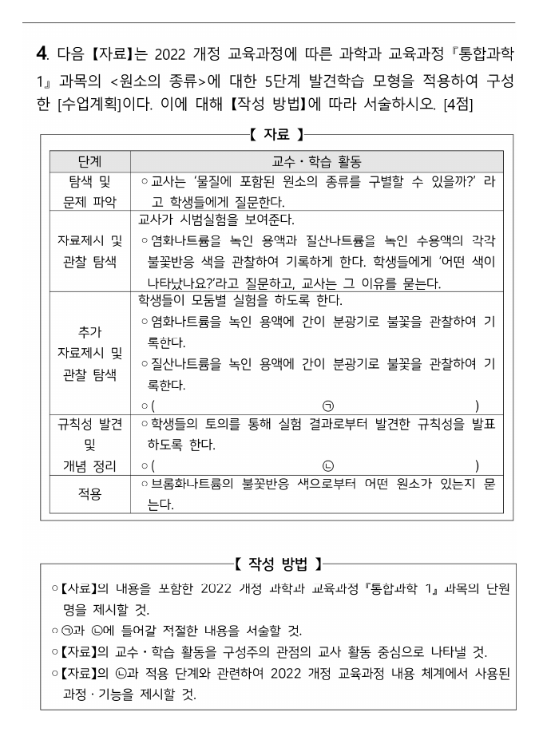

**정답**

- 단원명: **물질과 규칙성**
- ㉠ [교사의 시범실험]과 [학생의 모둠별 실험] 결과 사이의 **공통점**을 찾아보게 한다. ㉡ 교사는 **불꽃반응 색과 선 스펙트럼**으로 원소의 종류를 구별할 수 있음을 설명한다.
- 구성주의 관점: 학생이 실험 절차에 따라 스스로 계획·수행하고, 관찰 결과를 모둠원과 토의하여 원소에 따른 규칙성을 발견하며, 학급 전체에 발표하게 하여 **학습자 스스로 의미를 구성**하게 한다.
- 과정·기능: **결론을 도출하고 자연현상 및 문제 상황에 적용·설명하기**

**공식·핵심 개념**

- 발견학습 5단계: 탐색·문제 파악 → 자료 제시·관찰 → 추가 자료 → 규칙성 발견·개념 정리 → 적용
- 구성주의: 학습자 스스로 의미 구성
- 통합과학 1 '물질과 규칙성'

**2027 출제 가능성 ★★★★☆ 높음** — 발견학습 단계와 통합과학 단원 연결은 교육론에서 꾸준히 나옵니다.

**발견학습 5단계**: 탐색 및 문제 파악 → 자료 제시 및 관찰 탐색 → 추가 자료 제시 및 관찰 탐색 → 규칙성 발견 및 개념 정리 → 적용.

**과학 내용.** NaCl·NaNO₃ 모두 **노란색**(Na) → 음이온이 달라도 같은 금속 원소는 같은 불꽃색과 같은 선 스펙트럼 → 원소의 종류 구별.

**채점 포인트·함정**

- 추가 자료 단계(㉠)는 두 실험의 **공통점 찾기**, 개념 정리(㉡)는 **교사의 설명**입니다.

## B형 5번 · 실험 수행평가의 평가 준거 {#b5}

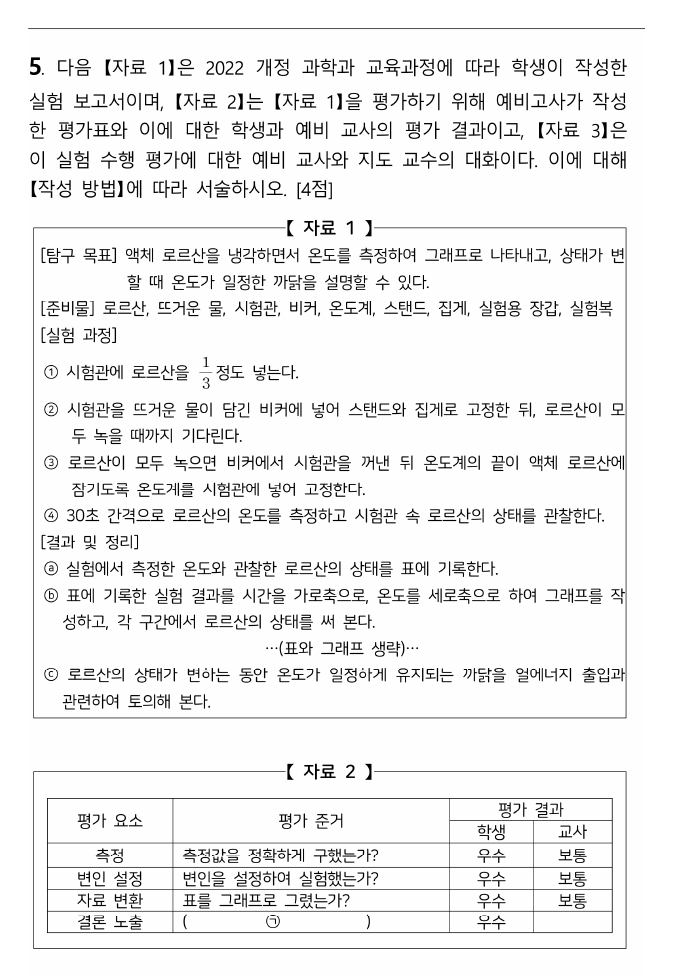

**정답**

- ㉠ 결론 진술 준거: **상태가 변할 때 로르산의 온도가 일정한 까닭을 열에너지와 관련하여 진술하였는가?**
- 변인 설정 수정: **조절 변인을 시간, 종속 변인을 온도로 설정하고, 나머지 변인을 통제 변인으로 설정하였는가?**
- ㉡ 녹는점·어는점은 각 상태 변화가 일어나는 **온도라는 측면**에 주안점을 둔다.
- 내용 요소: **상태 변화와 열에너지**

**공식·핵심 개념**

- 평가 준거는 평가 요소마다 구체적·실험 목적에 맞게
- 변인: 조절·종속·통제 변인
- 응고 중 온도 일정: 응고열 방출이 열 손실을 보충

**2027 출제 가능성 ★★★★☆ 높음** — 수행평가 준거 작성과 2022 개정 성취기준 적용 고려사항은 최근 교육론 경향입니다.

**평가 준거 작성 원칙.** 평가 요소마다 실험 목적에 맞게 **구체적**으로 써야 타당도·신뢰도가 높아집니다. 지도 교수가 '자료 변환'을 "실험 목적에 적합한 그래프를 작성하였는가?"로 고친 것과 같은 방식으로, 다른 요소도 '왜 보통인지'가 드러나게 바꿉니다.

**과학 내용.** 로르산이 응고하는 동안 방출하는 열(응고열)이 주위로 빠져나가는 열을 보충하므로 고체·액체가 공존하는 동안 온도가 일정합니다.

**채점 포인트·함정**

- 변인 준거에는 조절·종속·통제 변인을 **각각 구체적으로** 명시합니다.

## B형 6번 · Clapeyron 식과 2차 상전이 {#b6}

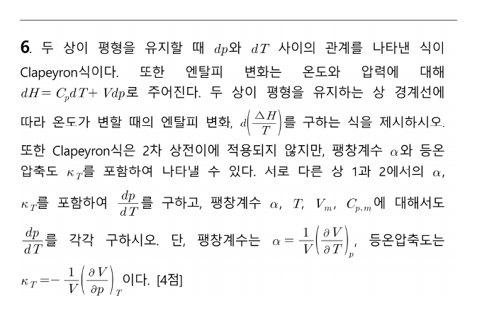

**정답**

- $d\left(\dfrac{\Delta H}{T}\right) = \dfrac{\Delta C_p}{T}dT = \Delta C_p\,d\ln T$
- $\dfrac{dp}{dT} = \dfrac{\alpha_2 - \alpha_1}{\kappa_{T,2} - \kappa_{T,1}}$
- $\dfrac{dp}{dT} = \dfrac{C_{p,m2} - C_{p,m1}}{TV_m(\alpha_2 - \alpha_1)}$

**공식·핵심 개념**

- Clapeyron: $\dfrac{dp}{dT} = \dfrac{\Delta H}{T\Delta V}$
- 2차 상전이(Ehrenfest): $\dfrac{dp}{dT} = \dfrac{\Delta\alpha}{\Delta\kappa_T} = \dfrac{\Delta C_{p,m}}{TV_m\Delta\alpha}$
- $dV = V(\alpha dT - \kappa_T dp)$

**2027 출제 가능성 ★★★☆☆ 보통** — 상평형 열역학은 Clapeyron 수준에서 자주, Ehrenfest 식은 드물게 나옵니다.

**(1)** 상 경계를 따라 $d\Delta H = \Delta C_p dT + \Delta V dp$이고, Clapeyron 식 $\Delta V dp = \dfrac{\Delta H}{T}dT$를 넣으면

$$d\left(\frac{\Delta H}{T}\right) = \frac{d\Delta H}{T} - \frac{\Delta H}{T^2}dT = \frac{\Delta C_p}{T}dT$$

**(2) 2차 상전이 (Ehrenfest).** $\Delta V = 0$, $\Delta H = 0$이라 Clapeyron 식이 0/0이 됩니다. 대신 두 상의 몰부피 변화가 경계를 따라 같다는 조건 $dV_1 = dV_2$:

$$V(\alpha_1 dT - \kappa_1 dp) = V(\alpha_2 dT - \kappa_2 dp) \;\Rightarrow\; \frac{dp}{dT} = \frac{\alpha_2 - \alpha_1}{\kappa_{T,2} - \kappa_{T,1}}$$

**(3)** 엔트로피 조건 $dS_1 = dS_2$, $dS = \dfrac{C_p}{T}dT - \alpha V dp$:

$$\frac{dp}{dT} = \frac{C_{p,m2} - C_{p,m1}}{TV_m(\alpha_2 - \alpha_1)}$$

**채점 포인트·함정**

- 공식 답안 분모의 $\kappa_{T,2} - \kappa_{T,2}$는 오타입니다(검토 메모 1).

## B형 7번 · Hückel 근사: TMM과 알릴 라디칼 {#b7}

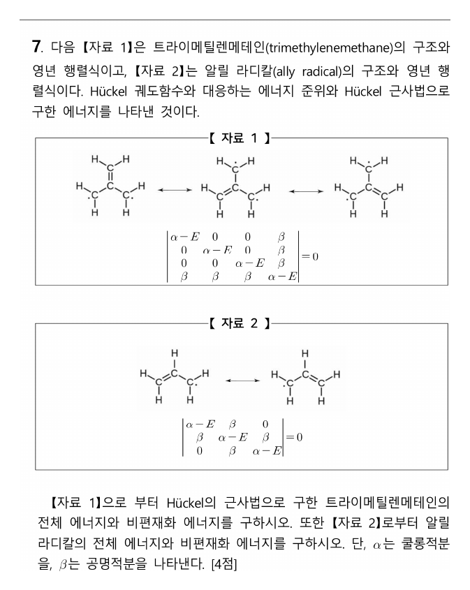

**정답** TMM: 전체 $4\alpha + 2\sqrt3\beta$, 비편재화 $(2\sqrt3 - 2)\beta$ / 알릴 라디칼: 전체 $3\alpha + 2\sqrt2\beta$, 비편재화 $(2\sqrt2 - 2)\beta$

**공식·핵심 개념**

- Hückel: $E = \alpha + x\beta$, 영년식 풀기
- 전체 π 에너지 = Σ(전자 수 × 준위 에너지)
- 비편재화 에너지 = 전체 − 국소화 구조 에너지

**2027 출제 가능성 ★★★★☆ 높음** — Hückel 계산은 물리화학·유기 경계 소재로 자주 나옵니다.

**TMM 영년식 풀기.** $x = (\alpha - E)/\beta$로 놓으면 $x^2(x^2 - 3) = 0$ → $E = \alpha \pm \sqrt3\beta$, $\alpha$(이중 축퇴).

π 전자 4개: $2(\alpha + \sqrt3\beta) + 1\cdot\alpha + 1\cdot\alpha = 4\alpha + 2\sqrt3\beta$ (축퇴된 비결합 오비탈에 홀전자 2개 — 이중 라디칼).

국소화 구조(C=C 1개 + 홀전자 2개) $= 2(\alpha + \beta) + 2\alpha = 4\alpha + 2\beta$ → 비편재화 에너지 $(2\sqrt3 - 2)\beta \approx 1.46\beta$.

**알릴.** $x(x^2 - 2) = 0$ → $E = \alpha \pm \sqrt2\beta$, $\alpha$. 전자 3개: $2(\alpha + \sqrt2\beta) + \alpha = 3\alpha + 2\sqrt2\beta$. 국소화 $3\alpha + 2\beta$ → 비편재화 $(2\sqrt2 - 2)\beta \approx 0.83\beta$.

**채점 포인트·함정**

- β < 0이므로 $(2\sqrt3 - 2)\beta$는 **안정화**(음수 에너지)를 뜻합니다.

## B형 8번 · [PdCl₂(NH₃)₂] 이성질체의 IR {#b8}

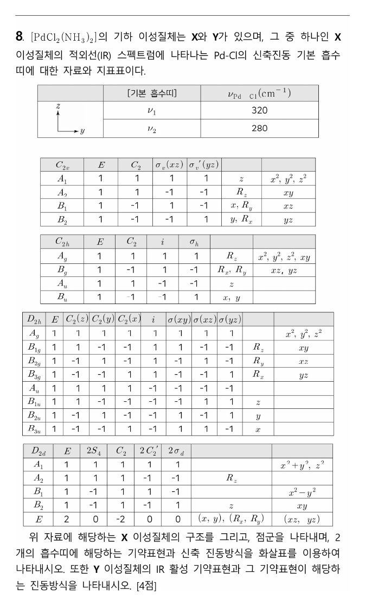

**정답** X = **cis-[PdCl₂(NH₃)₂]**, 점군 **C₂ᵥ**, ν₁·ν₂ = **A₁(대칭) + B₂(비대칭)**. Y = trans(D₂h), IR 활성 Pd–Cl 신축 **B₁ᵤ**(반대칭)

**공식·핵심 개념**

- 신축 진동: 결합 벡터의 Γ → 축소
- IR 활성: x, y, z 기약표현 / 상호 배제(중심 대칭)
- cis C₂ᵥ: A₁ + B₂(띠 2개), trans D₂h: B₁ᵤ(띠 1개)

**2027 출제 가능성 ★★★★☆ 높음** — IR 띠 수로 기하 이성질체를 구별하는 문항은 무기 대칭 단골입니다.

**Pd–Cl 신축 2개 벡터의 Γ.**

| | 구조 | Γ(Pd–Cl) | IR 활성 |
|---|---|---|---|
| X | cis, C₂ᵥ (분자 평면 yz) | A₁ + B₂ | **둘 다** (z, y) → 띠 2개 |
| Y | trans, D₂h (Cl이 z축) | A_g + B₁ᵤ | B₁ᵤ(z)만 → 띠 1개 |

IR 띠가 **2개**(320, 280 cm⁻¹)이므로 X는 cis입니다.

**진동 방식(화살표).** A₁: 두 Pd–Cl이 동시에 늘어남(대칭). B₂: 하나는 늘고 하나는 줄어듦(비대칭). Y의 B₁ᵤ: z축 위·아래 Cl이 같은 방향으로 움직여 한쪽 결합은 늘고 반대쪽은 줄어듦. 대칭(A₁)이 보통 더 높은 파수(320)입니다.

**채점 포인트·함정**

- trans의 A_g 신축은 쌍극자 변화가 없어 IR 비활성(Raman 활성) — 상호 배제 원리.

## B형 9번 · d⁵·d⁶ Tanabe–Sugano 도표 {#b9}

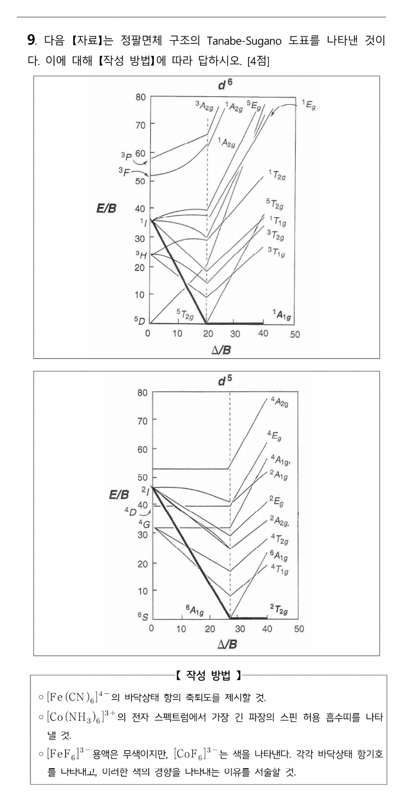

**정답** [Fe(CN)₆]⁴⁻ 바닥 상태 항 축퇴도 **1** / [Co(NH₃)₆]³⁺ 가장 긴 파장 스핀 허용 띠 **¹A₁g → ¹T₁g** / [FeF₆]³⁻ **⁶A₁g**, [CoF₆]³⁻ **⁵T₂g**

**공식·핵심 개념**

- d⁶ 강한 장 ¹A₁g, 약한 장 ⁵T₂g / d⁵ 고스핀 ⁶A₁g
- 스핀 허용: 같은 스핀 다중도끼리
- 축퇴도 = (2S+1) × 궤도 축퇴도

**2027 출제 가능성 ★★★★★ 매우 높음** — Tanabe–Sugano 해석과 색 설명은 무기 최빈출입니다.

**[Fe(CN)₆]⁴⁻.** Fe²⁺ d⁶, CN⁻ 강한 장 → 저스핀 t₂g⁶ = ¹A₁g → (2S+1)(궤도) = 1 × 1 = 1.

**[Co(NH₃)₆]³⁺.** Co³⁺ d⁶ 저스핀(도표 오른쪽, Δ/B > 20). 스핀 허용 전이는 ¹A₁g → ¹T₁g(낮은 에너지, 긴 파장), ¹T₂g. 가장 아래 들뜬 단일항이 ¹T₁g입니다.

**F⁻ 착물 (약한 장, 고스핀).**

- [FeF₆]³⁻: Fe³⁺ d⁵ → **⁶A₁g**. 도표에 스핀 다중도 6인 들뜬 상태가 **없어** 모든 d–d 전이가 스핀 금지 → 흡수가 매우 약해 **무색**.
- [CoF₆]³⁻: Co³⁺ d⁶ 고스핀 → **⁵T₂g**. 같은 다중도의 들뜬 상태 **⁵Eg**가 있어 스핀 허용 전이 1개 → 가시광선 흡수 → **색**.

**채점 포인트·함정**

- F⁻는 Co³⁺에도 약한 장이라 **고스핀**입니다(NH₃와 다름).

## B형 10번 · Sertraline 중간체 합성 {#b10}

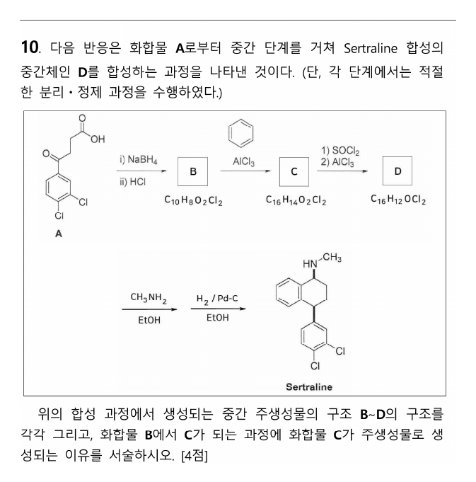

**정답** B **γ-락톤** 5-(3,4-dichlorophenyl)dihydrofuran-2-one, C **4-(3,4-dichlorophenyl)-4-phenylbutanoic acid**, D **4-(3,4-dichlorophenyl)-3,4-dihydronaphthalen-1(2H)-one**

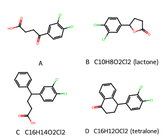

**공식·핵심 개념**

- NaBH₄: 케톤 선택적 환원
- Friedel–Crafts 알킬화: 안정한 탄소양이온 경유
- 분자 내 아실화 → 6원 고리 케톤(테트랄론)

**2027 출제 가능성 ★★★★☆ 높음** — 의약품 합성 경로 해석은 유기 고난도 서술형으로 출제됩니다.

**A → B.** NaBH₄가 케톤만 환원(카복실산은 그대로) → γ-하이드록시산 → HCl로 분자 내 에스터화 → 5원 고리 락톤 (C₁₀H₈O₂Cl₂ ✓).

**B → C (주생성물 이유).** AlCl₃가 락톤의 고리 산소에 배위하면 C–O 결합이 끊어지면서 **벤질 탄소양이온(구조 [1])**이 생깁니다. 이 양이온은 아릴 고리와 공명해 안정하므로 아실륨형 양이온(구조 [2])보다 우세하고, 벤젠이 이 탄소를 공격하는 **Friedel–Crafts 알킬화**로 C가 생깁니다(C₁₆H₁₄O₂Cl₂ ✓).

**C → D.** SOCl₂로 산 염화물 → AlCl₃로 **분자 내 Friedel–Crafts 아실화**. 전자가 더 풍부한 **비치환 페닐 고리**가 공격받아 6원 고리 테트랄론 D(C₁₆H₁₂OCl₂ ✓). 이후 CH₃NH₂(이민) → H₂/Pd-C(환원) → sertraline.

**채점 포인트·함정**

- 아실화가 다이클로로페닐 쪽이 아니라 **페닐 쪽**에서 일어나는 이유(Cl은 고리를 비활성화)를 쓰면 좋습니다.

## B형 11번 · 모세관 전기이동과 전기삼투 {#b11}

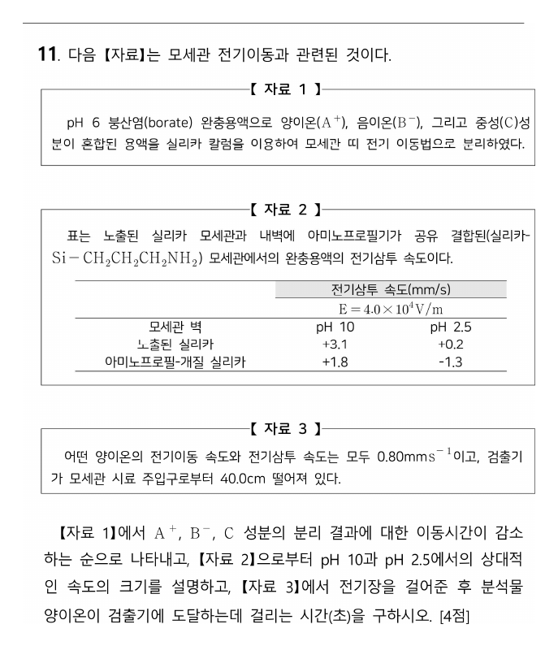

**정답** 이동 시간 **B⁻ > C > A⁺**. pH 10에서 실리카 > 아미노프로필, pH 2.5에서 실리카 흐름 ≈ 0, 아미노프로필은 반대 방향. 검출 시간 **250 s**

**공식·핵심 개념**

- $u_{net} = u_{ep} + u_{eo}$
- 실리카 벽 Si–O⁻ → 음극 쪽 EOF, pH↓ → EOF↓
- 이동 순서: 양이온 → 중성 → 음이온

**2027 출제 가능성 ★★★★☆ 높음** — 모세관 전기이동은 분석화학 기기분석에서 꾸준히 나옵니다.

**이동 순서.** 전기삼투 흐름(EOF)이 음극(검출기) 쪽으로 모든 성분을 운반합니다. 양이온은 EOF + 전기이동이 같은 방향 → 가장 빠름, 중성 C는 EOF 속도, 음이온은 전기이동이 반대 → 가장 느림. 걸리는 시간: **B⁻ > C > A⁺**.

**벽 전하와 EOF.**

| 모세관 | pH 10 | pH 2.5 |
|---|---|---|
| 노출된 실리카 | Si–O⁻ 많음 → 강한 EOF (+3.1) | Si–OH 거의 중성 → EOF ≈ 0 (+0.2) |
| 아미노프로필 | Si–O⁻ 일부가 아미노기로 대체·일부 양성자화 → 약해짐 (+1.8) | –NH₃⁺로 벽이 **양전하** → EOF **반대 방향** (−1.3) |

**검출 시간.**

$$u_{net} = u_{ep} + u_{eo} = 0.80 + 0.80 = 1.60\ \mathrm{mm/s} = 0.160\ \mathrm{cm/s}, \quad t = \frac{40.0}{0.160} = 250\ \mathrm{s}$$

**채점 포인트·함정**

- 음수 EOF는 "작아짐"이 아니라 **방향 역전**입니다(검토 메모 2).

---

원문: 2025학년도 대비 김지현 전공화학 모의고사 2회(지스쿨) 문제지·답안·강의 판서. 개인 학습용 정리입니다.

