# 2025학년도 대비 김지현 전공화학 모의고사 2회 — 상세해설

김지현 전공화학 모의고사 2회(전공 A 12문항 · 전공 B 11문항)의 문항별 해설입니다. 공식 「모의고사 2회 A형, B형 답안」과 강의 판서를 바탕으로 풀이 과정·개념·채점 포인트를 채웠고, 계산은 모두 다시 풀어 공식 답과 맞는지 확인했습니다. 구조식은 RDKit으로 분자식과 meso/라셈 여부를 확인했습니다.

문항마다 새 쪽에서 시작하며 3단으로 **문제지 원문 → 정답 → 공식·핵심 개념 → 2027 출제 가능성 → 풀이 → 채점 포인트·함정** 순서로 읽으면 됩니다. 아래 표의 문항 번호를 누르면 해당 쪽으로 이동합니다.

유기 문항(A형 10·11번, B형 1·10번)에는 **굽은 화살표로 전자 이동을 표시한 단계별 메커니즘 그림**을 넣었습니다(빨간 화살표: 전자쌍이 출발하는 결합·비공유 전자쌍 → 도착하는 원자·결합).

**2027 출제 가능성**(★ 5개 만점)은 1997~2026 기출에서 그 소재가 얼마나 자주 나왔는지와 2022 개정 교육과정 적용 시점을 함께 고려한 추정치입니다.

## 정답 한눈에 보기 (목차) {#toc}

### 전공 A (12문항 40점)

| 번호 | 영역 | 정답 요약 | 2027 출제 가능성 |
|---|---|---|---|
| [1](#a1) | 물리화학 · 완화법 | $\tau^{-1} = 4k_a[A]_{eq} + k_a'$, $\tau^{-2} = 8k_ak_a'[A]_{tot} + k_a'^2$ | ★★★☆☆ |
| [2](#a2) | 분석화학 · 전위차 EDTA 적정 | $E_{cell} = 0.192$ V | ★★★★☆ |
| [3](#a3) | 유기 · 분광 분석 | methyl 2,3-dibromo-3-(p-nitrophenyl)propionate | ★★★★★ |
| [4](#a4) | 무기 · 군론, SALC | $A_{1g} + E_g + T_{1u}$ | ★★★★★ |
| [5](#a5) | 화학교육 · 2022 개정 | 과학과 인류의 지속가능한 삶, 중화 적정 곡선 | ★★★★★ |
| [6](#a6) | 화학교육 · 비계, 브루너, 로슨 | 공유결합의 극성, 작동적 표현, 경험귀추 | ★★★★★ |
| [7](#a7) | 화학교육 · 피아제, 하슈웨, 라카토스 | 화학 반응의 세계, 갈등 (1)·(2), 긍정적 발견법 | ★★★★★ |
| [8](#a8) | 물리화학 · 상자 속 입자 | $\Delta x\Delta p = \frac{nh}{2}\sqrt{\frac{1}{12} - \frac{1}{2n^2\pi^2}}$ | ★★★☆☆ |
| [9](#a9) | 무기 · 역결합, Tolman 원뿔각 | νCO↑ = 역결합↓, 원뿔각↑ → 해리↑ | ★★★★☆ |
| [10](#a10) | 유기 · 합성, ¹H NMR | 프로펜 → … → 글리세롤 | ★★★★☆ |
| [11](#a11) | 유기 · Cannizzaro, Henry, Wittig | 벤조산 + 벤질 알코올 | ★★★★☆ |
| [12](#a12) | 분석화학 · 약산 적정 | 10.00 mL, pH 6.300(5.00 mL), 10.06 mL | ★★★★★ |

### 전공 B (11문항 40점)

| 번호 | 영역 | 정답 요약 | 2027 출제 가능성 |
|---|---|---|---|
| [1](#b1) | 유기 · 입체화학 | meso C, D / 라셈 A, F | ★★★★★ |
| [2](#b2) | 분석화학 · 전기분해 | −2.76 V | ★★★★☆ |
| [3](#b3) | 화학교육 · 5E, 오수벨, 클로퍼 | 학습 의욕, 탐색, 자료 해석과 일반화 | ★★★★★ |
| [4](#b4) | 화학교육 · 발견학습 | 물질과 규칙성, 결론 도출 및 적용 | ★★★★☆ |
| [5](#b5) | 화학교육 · 수행평가 | 평가 준거 수정, 상태 변화와 열에너지 | ★★★★☆ |
| [6](#b6) | 물리화학 · Clapeyron, Ehrenfest | $dp/dT = \Delta\alpha/\Delta\kappa_T$ | ★★★☆☆ |
| [7](#b7) | 물리화학 · Hückel | TMM $4\alpha + 2\sqrt3\beta$, allyl $3\alpha + 2\sqrt2\beta$ | ★★★★☆ |
| [8](#b8) | 무기 · IR 진동 | cis C₂ᵥ: A₁ + B₂ / trans: B₁ᵤ | ★★★★☆ |
| [9](#b9) | 무기 · Tanabe–Sugano | 축퇴도 1, ¹A₁g→¹T₁g, ⁶A₁g / ⁵T₂g | ★★★★★ |
| [10](#b10) | 유기 · Friedel–Crafts | 락톤 → 알킬화 → 테트랄론 | ★★★★☆ |
| [11](#b11) | 분석화학 · 모세관 전기이동 | B⁻ > C > A⁺, 250 s | ★★★★☆ |

**검토 메모**

1. **B형 6번**: 공식 답안의 $\dfrac{\alpha_2 - \alpha_1}{\kappa_{T,2} - \kappa_{T,2}}$는 오타입니다. 분모는 $\kappa_{T,2} - \kappa_{T,1}$이어야 합니다.
2. **B형 11번**: 공식 답안은 pH 2.5의 아미노프로필 모세관을 "속도가 크게 감소"라고 썼지만, 표의 값이 **−1.3 mm/s**이므로 전기삼투 흐름의 **방향이 반대(양극 쪽)**로 바뀐 것입니다. 벽의 –NH₃⁺가 양전하를 띠기 때문입니다.
3. **답안 머리말**: A형·B형 모두 "서술형 5~12번"으로 적혀 있습니다. 실제로 A형은 기입형 1~4번·서술형 5~12번이고, B형은 기입형 1~2번(각 2점)·서술형 3~11번(각 4점)입니다.

# 전공 A

## A형 1번 · 이합체화 반응의 완화 시간 {#a1}

**정답** (1) $\tau = \dfrac{1}{4k_a[A]_{eq} + k_a'}$  (2) $\dfrac{1}{\tau^2} = 8k_ak_a'[A]_{tot} + (k_a')^2$

**공식·핵심 개념**

- 완화법: 평형에서 작은 변위 $x$, $dx/dt = -x/\tau$
- $2A \rightleftharpoons A_2$: $\tau^{-1} = 4k_a[A]_{eq} + k_a'$
- $A \rightleftharpoons B$: $\tau^{-1} = k_1 + k_{-1}$

**2027 출제 가능성 ★★★☆☆ 보통** — 완화법은 속도론에서 가끔 나오는 고급 소재입니다. 단순 가역 반응 $\tau^{-1} = k_1 + k_{-1}$부터 확실히 하세요.

**주어진 것 / 구할 것**

- 반응 $2A \rightleftharpoons A_2$, 정반응 속도상수 $k_a$(속도 $= k_a[A]^2$), 역반응 $k_a'$(속도 $= k_a'[A_2]$)
- $[A]_{tot} = [A]_{eq} + 2[A_2]_{eq}$
- 구할 것: 완화 시간 $\tau$, 그리고 $1/\tau^2$을 $[A]_{tot}, k_a, k_a'$로

**풀이 전략** 평형에서 아주 조금 벗어난 양 $x$를 두고 속도식을 $x$에 대해 1차까지만 전개(선형화)하면 $dx/dt = -x/\tau$ 꼴이 됩니다. 그 계수가 $1/\tau$입니다.

**단계별 풀이**

**(1)** A의 알짜 변화 속도(A는 2개씩 소모·생성):

$$\frac{d[A]}{dt} = -2k_a[A]^2 + 2k_a'[A_2]$$

**(2)** 평형 조건(알짜 속도 0):

$$k_a[A]_{eq}^2 = k_a'[A_2]_{eq}$$

**(3)** 변위 정의: $[A] = [A]_{eq} + x$. A가 $x$만큼 늘면 $A_2$는 $x/2$만큼 줄어야 하므로 $[A_2] = [A_2]_{eq} - \tfrac{x}{2}$.

**(4)** 대입하고 전개:

$$\begin{aligned}
\frac{dx}{dt} &= -2k_a\left([A]_{eq}^2 + 2[A]_{eq}x + x^2\right) + 2k_a'\left([A_2]_{eq} - \tfrac{x}{2}\right)\\
&= \underbrace{\left(-2k_a[A]_{eq}^2 + 2k_a'[A_2]_{eq}\right)}_{=0\ (\text{단계 2})} - 4k_a[A]_{eq}x - k_a'x - 2k_ax^2
\end{aligned}$$

**(5)** $x$가 작으므로 $x^2$ 항을 버리면

$$\begin{gathered}\frac{dx}{dt} = -\left(4k_a[A]_{eq} + k_a'\right)x \;\Rightarrow\; x = x_0e^{-t/\tau}\\ \frac{1}{\tau} = 4k_a[A]_{eq} + k_a'\end{gathered}$$

**(6)** 측정 가능한 $[A]_{tot}$로 바꾸기 위해 제곱:

$$\frac{1}{\tau^2} = 16k_a^2[A]_{eq}^2 + 8k_ak_a'[A]_{eq} + k_a'^2$$

**(7)** 첫 항에 평형 조건(단계 2)을 넣으면

$$16k_a^2[A]_{eq}^2 = 16k_a\left(k_a[A]_{eq}^2\right) = 16k_ak_a'[A_2]_{eq} = 8k_ak_a'\left(2[A_2]_{eq}\right)$$

**(8)** 따라서

$$\frac{1}{\tau^2} = 8k_ak_a'\left([A]_{eq} + 2[A_2]_{eq}\right) + k_a'^2 = 8k_ak_a'[A]_{tot} + (k_a')^2$$

**검산** $[A]_{tot} \to 0$이면 $1/\tau \to k_a'$(이합체가 거의 없어 역반응만 남음)로 물리적으로 맞습니다. $1/\tau^2$ 대 $[A]_{tot}$ 그래프는 기울기 $8k_ak_a'$, 절편 $k_a'^2$인 직선 → 두 속도상수를 모두 구할 수 있습니다.

**채점 포인트·함정**

- 이 식은 $\tau^{-2}$를 $[A]_{tot}$에 대해 그리면 직선이 되어, 기울기와 절편으로 $k_a$, $k_a'$을 함께 구할 수 있다는 것이 핵심입니다.
- 계수 2(2A)를 빠뜨리면 $4k_a$ 대신 $2k_a$가 나옵니다.

## A형 2번 · 수은의 전위차 EDTA 적정 {#a2}

**정답** $E_{cell} = 0.192$ V

**공식·핵심 개념**

- 조건 형성상수 $K_f' = \alpha_{Y^{4-}}K_f$
- EDTA 과량 영역: $[M] = \dfrac{[MY]}{K_f'[EDTA]}$
- 네른스트 $E = E^\circ - \dfrac{0.0600}{n}\log\dfrac{1}{[M^{n+}]}$

**2027 출제 가능성 ★★★★☆ 높음** — EDTA 적정과 전기화학을 엮는 계산은 분석화학에서 자주 나옵니다(4회 B형 2번과 같은 계열).

**주어진 것 / 구할 것**

- EDTA 0.100 M × 50.0 mL, Hg(ClO₄)₂ 0.100 M × 10.0 mL, pH 10.0
- $\alpha_{Y^{4-}} = 0.25$, $K_f(\mathrm{HgY^{2-}}) = 10^{22.0}$, $E^\circ(\mathrm{Hg^{2+}/Hg}) = 0.852$ V, $\frac{2.303RT}{F} = 0.0600$ V
- 기준 전극 = 표준 수소 전극(0 V). 구할 것: 전지 전압

**풀이 전략** EDTA가 과량이므로 Hg²⁺는 거의 다 착물이 됩니다. 남은 아주 작은 [Hg²⁺]를 **조건 형성상수**로 구해 Hg 전극의 네른스트 식에 넣습니다.

**단계별 풀이**

**(1)** 몰수:

$$\begin{aligned}n_{\mathrm{EDTA}} &= 0.100 \times 50.0 = 5.00\ \mathrm{mmol}\\ n_{\mathrm{Hg}} &= 0.100 \times 10.0 = 1.00\ \mathrm{mmol}\end{aligned}$$

**(2)** 1 : 1 반응 $\mathrm{Hg^{2+} + EDTA \rightarrow HgY^{2-}}$ 후: HgY²⁻ 1.00 mmol, 남은 EDTA 4.00 mmol, 전체 부피 60.0 mL

$$\begin{gathered}[\mathrm{HgY^{2-}}] = \frac{1.00}{60.0} = 0.01667\ \mathrm{M}\\ [\mathrm{EDTA}]_{\text{남음}} = \frac{4.00}{60.0} = 0.06667\ \mathrm{M}\end{gathered}$$

**(3)** 조건 형성상수(pH 10에서 EDTA 중 Y⁴⁻ 형태는 25 %):

$$K_f' = \alpha_{Y^{4-}}K_f = 0.25 \times 10^{22.0} = 2.5\times10^{21}$$

**(4)** $K_f' = \dfrac{[\mathrm{HgY^{2-}}]}{[\mathrm{Hg^{2+}}][\mathrm{EDTA}]}$를 [Hg²⁺]에 대해 풀기:

$$\begin{aligned}[\mathrm{Hg^{2+}}] &= \frac{0.01667}{(2.5\times10^{21})(0.06667)}\\ &= \frac{1}{2.5\times10^{21}\times4} = 1.0\times10^{-22}\ \mathrm{M}\end{aligned}$$

**(5)** Hg 전극(지시 전극) 전위, $\mathrm{Hg^{2+} + 2e^- \rightarrow Hg(l)}$, $n = 2$:

$$\begin{aligned}E_{\mathrm{Hg}} &= 0.852 - \frac{0.0600}{2}\log\frac{1}{[\mathrm{Hg^{2+}}]}\\ &= 0.852 - 0.0300 \times 22.0\\ &= 0.852 - 0.660 = 0.192\ \mathrm{V}\end{aligned}$$

**(6)** 전지 전압 $= E_{\text{지시}} - E_{\text{기준}} = 0.192 - 0 = 0.192$ V

**검산** 부피가 [HgY]/[EDTA] 비에서 약분되므로 몰수비 1 : 4만으로도 $[\mathrm{Hg^{2+}}] = 1/(4K_f')$가 됩니다. Hg²⁺가 $10^{-22}$ M까지 줄어 전위가 표준값보다 0.660 V 낮아진 것도 착물 형성이 매우 강하다는 것과 맞습니다.

**채점 포인트·함정**

- 부피는 약분되어 사라지지만(1 : 4 비), 비를 쓰기 전에 남은 EDTA 양을 정확히 구해야 합니다.
- $\alpha_{Y^{4-}}$를 곱해 조건 형성상수로 바꾸는 단계를 빼먹기 쉽습니다.

## A형 3번 · IR·NMR·MS로 구조 결정 {#a3}

**정답** **methyl 2,3-dibromo-3-(p-nitrophenyl)propionate**, C₁₀H₉NO₄Br₂

**공식·핵심 개념**

- 동위원소 피크: Br 1개 M:M+2 = 1:1, Br 2개 1:2:1, Cl 1개 3:1
- IR NO₂: 1520, 1350 cm⁻¹ / 에스터 C=O 1735~1750
- 불포화도 $= \dfrac{2C + 2 + N - H - X}{2}$

**2027 출제 가능성 ★★★★★ 매우 높음** — 분광 자료로 구조를 정하는 유형은 해마다 나옵니다. MS 동위원소 패턴은 할로젠 화합물에서 단골입니다.

**주어진 것 / 구할 것**

- MS: M⁺ 365/367/369 (1 : 2 : 1), 286/288 (1 : 1)
- IR: 1750, 1515, 1345 cm⁻¹, 3000 cm⁻¹ 위 O–H/N–H 없음
- ¹³C(DEPT 포함), ¹H NMR 스펙트럼. 구할 것: 구조

**풀이 전략** MS로 할로젠 수 → IR로 작용기 → ¹H 적분·갈라짐으로 조각 → ¹³C/DEPT로 탄소 수 확인 → 분자식·불포화도로 조립하는 순서로 갑니다.

**단계별 풀이**

**(1)** **MS 동위원소 패턴.** ⁷⁹Br : ⁸¹Br ≈ 1 : 1이므로 Br 1개 → M : M+2 = 1 : 1, Br 2개 → $(1+1)^2$ 전개로 1 : 2 : 1. 따라서 **Br 2개**. 365 − 286 = 79 → Br 하나가 떨어진 조각(남은 Br 1개라 286/288 = 1 : 1).

**(2)** **IR.** 1750 cm⁻¹(강): 콘쥬게이션되지 않은 에스터 C=O. 1515/1345 cm⁻¹: NO₂의 비대칭·대칭 신축(방향족 니트로기). O–H, N–H 띠 없음.

**(3)** **¹H NMR 조각** (적분비 2 : 2 : 1 : 1 : 3)

| δ (ppm) | 적분 | 갈라짐 | 배정 | 근거 |
|---|---|---|---|---|
| 8.25 | 2H | d | NO₂ 옆 방향족 H | NO₂가 강한 전자 끌개 → 가장 낮은 장 |
| 7.6 | 2H | d | 반대쪽 방향족 H | AA′BB′ = *para* 이치환 |
| 5.4 | 1H | d | Ar–C**H**Br– | 벤질 + Br, 이웃 H 1개 |
| 4.8 | 1H | d | –C**H**Br–CO₂ | Br + C=O, 이웃 H 1개 |
| 3.9 | 3H | s | OCH₃ | 에스터 메톡시 |

두 CH 이중선은 서로만 짝지음(같은 J) → **–CHBr–CHBr–** 단위.

**(4)** **¹³C/DEPT.** ~168(C=O, DEPT에서 사라짐), ~148·~144(C–NO₂, 고리 ipso, 사라짐), 129·124(방향족 CH ↑), 53(OCH₃ ↑), ~50·~46(CHBr 두 개 ↑) → 고리 대칭으로 신호 8개 = 탄소 10개.

**(5)** **조립.** O₂N–C₆H₄–CHBr–CHBr–CO₂CH₃ = C₁₀H₉Br₂NO₄

$$M(^{79}\mathrm{Br}_2) = 10(12) + 9(1) + 2(79) + 14 + 4(16) = 365\ ✓$$

**(6)** **불포화도.**

$$\mathrm{DBE} = \frac{2C + 2 + N - H - X}{2} = \frac{20 + 2 + 1 - 9 - 2}{2} = 6$$

벤젠 고리 4 + C=O 1 + N=O 1 = 6 ✓

**검산** 이 화합물은 methyl 4-nitrocinnamate에 Br₂가 첨가된 생성물로, 두 CHBr의 화학적 이동(벤질 쪽이 더 낮은 장)과 1 : 2 : 1 패턴이 모두 맞습니다.

**채점 포인트·함정**

- M : M+2 : M+4 = 1 : 2 : 1은 Br 2개, 3 : 1은 Cl 1개의 표지입니다.
- 1345·1515 cm⁻¹ 한 쌍은 나이트로기의 지문입니다.

## A형 4번 · MoH₆의 σ 결합 SALC {#a4}

**정답** $\Gamma_\sigma = A_{1g} + E_g + T_{1u}$. 대응 Mo 오비탈: $A_{1g}$ – s, $E_g$ – $d_{z^2}$, $d_{x^2-y^2}$, $T_{1u}$ – $p_x$, $p_y$, $p_z$

**공식·핵심 개념**

- σ SALC: 제자리 리간드 수로 Γσ → 축소
- 축소 공식 $n_i = \dfrac1h\sum g\chi_i\chi$
- Oh: $A_{1g}$(s), $E_g$($d_{z^2}, d_{x^2-y^2}$), $T_{1u}$(p)

**2027 출제 가능성 ★★★★★ 매우 높음** — SALC와 기약표현은 무기 고정 출제 소재입니다. 그림까지 그리게 하는 형식도 나옵니다.

**주어진 것 / 구할 것**

- MoH₆, 정팔면체($O_h$), H 6개가 ±x, ±y, ±z 축 위
- $O_h$ 지표표. 구할 것: 6개 σ 결합의 가약 표현 → 기약표현의 합, 각 SALC 그림

**풀이 전략** 각 Mo–H σ 벡터를 기저로 삼아, 대칭 조작마다 **제자리에 남는 벡터 수**를 세어 $\Gamma_\sigma$를 만들고 축소 공식으로 분해합니다.

**단계별 풀이**

**(1)** **제자리 벡터 수 세기** (번호: σ₁ +x, σ₂ +y, σ₃ −x, σ₄ −y, σ₅ +z, σ₆ −z)

| 조작 | 남는 벡터 | χ |
|---|---|---|
| E | 6개 모두 | 6 |
| C₃ (몸체 대각선) | 없음(세 축을 돌림) | 0 |
| C₂ (모서리 중점 축) | 없음 | 0 |
| C₄ (z축) | σ₅, σ₆ | 2 |
| C₂ (= C₄², z축) | σ₅, σ₆ | 2 |
| i | 없음(+x ↔ −x) | 0 |
| S₄ | 없음 | 0 |
| S₆ | 없음 | 0 |
| σh (xy면) | σ₁~σ₄ | 4 |
| σd (z축 포함 대각면) | σ₅, σ₆ | 2 |

$$\Gamma_\sigma = (6,\ 0,\ 0,\ 2,\ 2,\ 0,\ 0,\ 0,\ 4,\ 2)$$

**(2)** **축소 공식** $n_i = \frac{1}{h}\sum_R g_R\,\chi_i(R)\,\chi_\sigma(R)$, $h = 48$. 0이 아닌 열(E, 6C₄, 3C₂, 3σh, 6σd)만 계산합니다. 괄호 안 각 항은 $g_R\times\chi_i\times\chi_\sigma$이고, 예를 들어 $A_{1g}$는 E: 1·1·6 = 6, 6C₄: 6·1·2 = 12, 3C₂: 3·1·2 = 6, 3σh: 3·1·4 = 12, 6σd: 6·1·2 = 12입니다.

$$\begin{aligned}
n(A_{1g}) &= \tfrac{1}{48}\left[6 + 12 + 6 + 12 + 12\right] = 1\\
n(A_{2g}) &= \tfrac{1}{48}\left[6 - 12 + 6 + 12 - 12\right] = 0\\
n(E_g) &= \tfrac{1}{48}\left[12 + 0 + 12 + 24 + 0\right] = 1\\
n(T_{1g}) &= \tfrac{1}{48}\left[18 + 12 - 6 - 12 - 12\right] = 0\\
n(T_{2g}) &= \tfrac{1}{48}\left[18 - 12 - 6 - 12 + 12\right] = 0\\
n(A_{1u}) &= \tfrac{1}{48}\left[6 + 12 + 6 - 12 - 12\right] = 0\\
n(A_{2u}) &= \tfrac{1}{48}\left[6 - 12 + 6 - 12 + 12\right] = 0\\
n(E_u) &= \tfrac{1}{48}\left[12 + 0 + 12 - 24 + 0\right] = 0\\
n(T_{1u}) &= \tfrac{1}{48}\left[18 + 12 - 6 + 12 + 12\right] = 1\\
n(T_{2u}) &= \tfrac{1}{48}\left[18 - 12 - 6 + 12 - 12\right] = 0
\end{aligned}$$

$$\Gamma_\sigma = A_{1g} + E_g + T_{1u}\quad(1 + 2 + 3 = 6\ ✓)$$

**(3)** **각 SALC와 짝이 되는 Mo 오비탈** (같은 기약표현끼리만 겹침)

| 기약표현 | Mo 오비탈 | SALC (정규화) |
|---|---|---|
| $A_{1g}$ | 5s | $\frac{1}{\sqrt6}(\sigma_1+\sigma_2+\sigma_3+\sigma_4+\sigma_5+\sigma_6)$ |
| $E_g$ | $4d_{z^2}$ | $\frac{1}{\sqrt{12}}(2\sigma_5+2\sigma_6-\sigma_1-\sigma_2-\sigma_3-\sigma_4)$ |
| $E_g$ | $4d_{x^2-y^2}$ | $\frac12(\sigma_1-\sigma_2+\sigma_3-\sigma_4)$ |
| $T_{1u}$ | $5p_x, 5p_y, 5p_z$ | $\frac{1}{\sqrt2}(\sigma_1-\sigma_3)$, $\frac{1}{\sqrt2}(\sigma_2-\sigma_4)$, $\frac{1}{\sqrt2}(\sigma_5-\sigma_6)$ |

**(4)** **그림 그리는 규칙.** 중심 오비탈 로브의 부호와 **같은 부호**로 H 1s를 칠합니다. $A_{1g}$: 6개 모두 같은 색. $d_{z^2}$: z축 두 개 큰 +, xy면 네 개 작은 −. $d_{x^2-y^2}$: x축 둘 +, y축 둘 −. $p_x$: +x는 +, −x는 −, 나머지 넷은 0.

**검산** $t_{2g}$($d_{xy}, d_{xz}, d_{yz}$)는 축 사이를 향하므로 σ SALC가 없고(축소 결과 $T_{2g}$ = 0) 비결합으로 남습니다.

**채점 포인트·함정**

- C₂(=C₄²)와 σh에서 제자리 원자는 각각 2, 4개입니다.
- $t_{2g}$($d_{xy}, d_{xz}, d_{yz}$)는 σ SALC가 없어 비결합으로 남습니다.

## A형 5번 · 2022 개정 교육과정과 디지털 탐구 {#a5}

**정답**

- ㉠ **과학과 인류의 지속가능한 삶**, ㉡ **과학적 탐구 방법**
- ㉢ **중화 적정 곡선**, ㉣ **디지털 탐구 도구와 수학적 사고를 활용하여 정보를 수집·변환·해석하기**
- 지도: 중화 적정 곡선을 다룰 때 학생들이 **수학적 사고에 기반한 컴퓨팅 사고력과 디지털 소양**을 함양하도록 수업을 구성하여 지도한다.

**공식·핵심 개념**

- 2022 개정 중학교 통합 단원: 과학과 나의 미래, 과학과 첨단기술, 과학과 인류의 지속가능한 삶
- 과정·기능: 디지털 탐구 도구와 수학적 사고로 정보를 수집·변환·해석하기
- MBL 활용 중화 적정 곡선

**2027 출제 가능성 ★★★★★ 매우 높음** — 2022 개정 신설 내용(통합 단원, 디지털 소양)은 2027 출제 우선순위가 가장 높은 영역입니다.

**통합 단원.** 2022 개정 중학교 과학의 통합 단원 3개(과학과 나의 미래, 과학과 첨단기술, **과학과 인류의 지속가능한 삶**) 중 신설된 단원이 ㉠입니다.

**㉢·㉣.** 자료 3은 MBL로 NaOH를 떨어뜨리며 pH를 실시간 측정해 그래프로 얻는 활동 → 내용 요소는 [화학 반응의 세계]의 **중화 적정 곡선**, 과정·기능은 디지털 도구로 정보를 **수집·변환·해석**하기.

**채점 포인트·함정**

- '정보를 수집·변환·해석'이라는 2022 개정 고유 표현을 그대로 씁니다.

## A형 6번 · 비계, 브루너의 표현 양식, 로슨 {#a6}

**정답**

- 단원: **물질의 구조와 성질**, 내용 요소: **공유결합의 극성**
- ㉡ 비계: "물 분자는 분자 내에 어떤 전하를 가지고 있나요?", "물을 구성하는 원자들의 전기음성도 차이는 어떻게 되나요?"
- ㉢ 작동적 표현 — 자료 1: 물줄기의 변화를 **관찰하는 행동**, 자료 2: **시범실험**으로 구체적 행동을 보여 줌
- ㉣ 탐색 단계에서 실험 결과를 근거로 인과적 질문에 대해 **과거 학습 경험으로 연결**하고, 실험 설계나 검증 과정 없이 **자료의 재해석**으로 인과적 질문에 답하는 과정을 포함한다.

**공식·핵심 개념**

- 비계: ZPD 안에서 과제를 쪼갠 단계적 도움
- 브루너: 작동적 → 영상적 → 상징적
- 로슨 경험-귀추적: 경험·자료 재해석으로 잠정 설명, 검증 실험 없음

**2027 출제 가능성 ★★★★★ 매우 높음** — 여러 학자를 한 수업 사례에 묶는 교육론 문항은 매년 나옵니다.

**비계(scaffolding).** 비고츠키의 근접발달영역(ZPD)에서 혼자 못 하는 과제를 해낼 수 있도록 주는 단계적 도움. "그 까닭을 설명해 보라"는 큰 질문을 **분자의 전하 → 전기음성도 차이**로 쪼갠 질문이 비계입니다.

**브루너 표현 양식**: 작동적(행동·조작) → 영상적(그림·모형) → 상징적(기호·수식). 물줄기를 직접 휘게 하는 활동은 작동적입니다.

**로슨 경험-귀추적 순환학습**: "왜?" 질문 → 경험·자료 재해석으로 잠정적 설명(귀추) → 검증 실험 없이 인과 질문에 답함(가설-연역적과의 차이).

**채점 포인트·함정**

- 비계는 ㉠(까닭 설명)을 쪼갠 **구체적 질문 형태**로 써야 합니다.

## A형 7번 · 피아제, 하슈웨, 라카토스 {#a7}

**정답**

- 과목명: **화학 반응의 세계**
- 인지구조 I: 산화반응은 전자를 잃는 반응, 환원반응은 전자를 얻는 반응이다. / 환경 II: KI와 Cl₂의 반응에서 KI는 산화되고 Cl₂는 환원된다.
- 갈등 (1): 기존 개념(C1, 전자 이동)으로 새 상황(R2, KI + Cl₂)을 설명할 수 없음. 갈등 (2): 기존 개념(C1)과 새 개념(C2, 산화수 증감)의 갈등 — C2는 R2와 R1을 모두 설명하며 C1의 확장 개념이다.
- **긍정적 발견법**: 핵(전자 이동으로 산화·환원 설명)은 유지하고, 설명이 어려운 변칙 사례(KI + Cl₂)에 대해 **산화수 증감**으로 보호대를 보완·확장하여 핵을 보호했다.

**공식·핵심 개념**

- 피아제: 동화 → 비평형(갈등) → 조절 → 평형
- 하슈웨: 갈등 (1) 선개념 ↔ 현상, 갈등 (2) 선개념 ↔ 새 개념
- 라카토스: 부정적 발견법(핵 보호) / 긍정적 발견법(보호대 발전)

**2027 출제 가능성 ★★★★★ 매우 높음** — 개념 변화 이론과 과학철학자를 묶는 형태는 1회·2회에 모두 나왔을 만큼 핵심입니다.

**하슈웨 모형**: 갈등 (1) = 선개념 ↔ 그것으로 설명 안 되는 현상(실험·사례), 갈등 (2) = 선개념 ↔ 새 과학 개념(교사 설명).

**라카토스**: 부정적 발견법 = 반증의 화살을 핵에서 돌려 **핵을 보호**하라는 규칙, 긍정적 발견법 = 보호대를 **수정·발전**시켜 연구 프로그램을 확장하는 지침. 여기서는 새 정의로 보호대를 적극 확장했으므로 긍정적 발견법.

**채점 포인트·함정**

- 피아제 사례에서 '환경 II'는 **새로운 상황(KI + Cl₂ 반응)**입니다.
- 공식 답안 기준 긍정적 발견법입니다. 근거에 '보호대 보완·확장'을 꼭 씁니다.

## A형 8번 · 상자 속 입자의 불확정성 {#a8}

**정답**

- $\langle x\rangle = \dfrac L2$, $\langle x^2\rangle = L^2\left(\dfrac13 - \dfrac{1}{2n^2\pi^2}\right)$, $\Delta x = L\left(\dfrac1{12} - \dfrac{1}{2n^2\pi^2}\right)^{1/2}$
- $\langle p\rangle = 0$, $\langle p^2\rangle = \dfrac{n^2h^2}{4L^2}$, $\Delta p = \dfrac{nh}{2L}$
- $\Delta x\Delta p = \dfrac{nh}{2}\left(\dfrac1{12} - \dfrac{1}{2n^2\pi^2}\right)^{1/2} > \dfrac\hbar2$

**공식·핵심 개념**

- $\psi_n = \sqrt{2/L}\sin(n\pi x/L)$, $E_n = \dfrac{n^2h^2}{8mL^2}$
- $\Delta A = \sqrt{\langle A^2\rangle - \langle A\rangle^2}$
- $\langle p^2\rangle = 2mE$, 불확정성 $\Delta x\Delta p \ge \hbar/2$

**2027 출제 가능성 ★★★☆☆ 보통** — 상자 속 입자 기대치는 양자 영역의 기본형입니다. 적분 공식을 주는 형태로 출제됩니다.

**주어진 것 / 구할 것**

- $\psi_n = \sqrt{\tfrac{2}{L}}\sin\tfrac{n\pi x}{L}$ ($0 \le x \le L$), 적분 공식 3개
- 구할 것: $\langle x\rangle, \langle x^2\rangle, \langle p\rangle, \langle p^2\rangle$, $\Delta x\Delta p$ ($\pi$, $n$ 포함)

**풀이 전략** 기대치 $\langle A\rangle = \int\psi^*\hat A\psi\,dx$를 적분 공식으로 계산하고, $\Delta A = \sqrt{\langle A^2\rangle - \langle A\rangle^2}$를 씁니다. $b = n\pi/L$로 두면 경계에서 $\sin(2bL) = \sin 2n\pi = 0$, $\cos(2bL) = 1$입니다.

**단계별 풀이**

**(1)** **⟨x⟩** (두 번째 공식)

$$\begin{aligned}\langle x\rangle &= \frac2L\left[\frac{x^2}{4} - \frac{x}{4b}\sin 2bx - \frac{\cos 2bx}{8b^2}\right]_0^L\\ &= \frac2L\left[\frac{L^2}{4} - 0 - \frac{1}{8b^2} + \frac{1}{8b^2}\right] = \frac{L}{2}\end{aligned}$$

**(2)** **⟨x²⟩** (세 번째 공식)

$$\begin{aligned}
\langle x^2\rangle &= \frac2L\left[\frac{x^3}{6} - \left(\frac{x^2}{4b} - \frac{1}{8b^3}\right)\sin 2bx - \frac{x}{4b^2}\cos 2bx\right]_0^L\\
&= \frac2L\left[\frac{L^3}{6} - 0 - \frac{L}{4b^2}\right] = \frac{L^2}{3} - \frac{1}{2b^2}\\
&= L^2\left(\frac13 - \frac{1}{2n^2\pi^2}\right)
\end{aligned}$$

**(3)** **Δx**

$$\begin{aligned}\Delta x &= \sqrt{\langle x^2\rangle - \langle x\rangle^2} = L\sqrt{\frac13 - \frac14 - \frac{1}{2n^2\pi^2}}\\ &= L\sqrt{\frac{1}{12} - \frac{1}{2n^2\pi^2}}\end{aligned}$$

**(4)** **⟨p⟩**, $\hat p = -i\hbar\frac{d}{dx}$:

$$\begin{aligned}\langle p\rangle &= -i\hbar\frac2L\cdot b\int_0^L\sin bx\cos bx\,dx\\ &= -i\hbar\frac{b}{L}\int_0^L\sin 2bx\,dx\\ &= -i\hbar\frac{b}{L}\left[-\frac{\cos 2bx}{2b}\right]_0^L = 0\end{aligned}$$

**(5)** **⟨p²⟩**, $\frac{d^2}{dx^2}\sin bx = -b^2\sin bx$이므로 $\hat p^2\psi = \hbar^2b^2\psi$:

$$\langle p^2\rangle = \hbar^2b^2\underbrace{\int_0^L\psi^2dx}_{=1} = \frac{n^2\pi^2\hbar^2}{L^2} = \frac{n^2h^2}{4L^2}$$

(검산: $\langle p^2\rangle/2m = n^2h^2/8mL^2 = E_n$ ✓)

**(6)** **Δp**: $\Delta p = \sqrt{\langle p^2\rangle - 0} = \dfrac{n\pi\hbar}{L} = \dfrac{nh}{2L}$

**(7)** **곱**

$$\begin{aligned}\Delta x\Delta p &= n\pi\hbar\sqrt{\frac{1}{12} - \frac{1}{2n^2\pi^2}} = \frac{nh}{2}\sqrt{\frac{1}{12} - \frac{1}{2n^2\pi^2}}\\ &= \frac{\hbar}{2}\sqrt{\frac{n^2\pi^2}{3} - 2}\end{aligned}$$

**검산** n = 1: $\frac{\hbar}{2}\sqrt{3.290 - 2} = 0.568\hbar > 0.5\hbar$, n = 2: $1.67\hbar$. 모든 n에서 불확정성 원리를 만족하고 n이 클수록 커집니다.

**채점 포인트·함정**

- $\langle x\rangle$와 $\langle p\rangle$는 **모든 n**에 대해 같다고 써야 합니다(대칭).

## A형 9번 · 역결합과 Tolman 원뿔각 {#a9}

**정답**

- νCO가 클수록 C≡O 결합이 강하며, Co → CO **역결합이 적다**는 뜻이므로 **Co–CO 결합이 약하다**.
- PEt₃ vs PPr₃: νCO만 보면 PEt₃(1985)가 커서 CO가 더 잘 해리될 것 같지만, 원뿔각은 PPr₃가 커서 해리가 잘된다. 두 인자가 상충하는데 **원뿔각 인자가 더 크게 작용**하여 PPr₃의 Kd가 조금 더 크다.
- PPh₃: 원뿔각 145°로 가장 커 리간드 사이 **입체 장애**가 커서 CO 해리가 잘 일어난다(Kd = 750).

**공식·핵심 개념**

- 역결합↑ → M–C 강화, C≡O 약화 → νCO↓
- Tolman 원뿔각↑ → 입체 장애↑ → 리간드 해리↑
- 전자 효과(νCO)와 입체 효과(원뿔각) 구분

**2027 출제 가능성 ★★★★☆ 높음** — 카보닐 착물의 역결합·νCO 해석은 무기에서 자주 나옵니다.

**주어진 것 / 구할 것**

| L | $K_d$ | $\nu_{CO}$ (cm⁻¹) | 원뿔각 |
|---|---|---|---|
| PEt₃ | 1 | 1985 | 132° |
| PPr₃ | 1.1 | 1980 | 135° |
| PEt₂Ph | 2.5 | 1990 | 135° |
| PEtPh₂ | 24 | 1990 | 140° |
| PPh₃ | 750 | 1995 | 145° |

구할 것: νCO와 Co–CO 결합 세기의 관계, PEt₃ vs PPr₃의 $K_d$ 해석, PPh₃의 $K_d$가 큰 이유

**풀이 전략** $K_d$에 영향을 주는 두 인자를 나눠 봅니다. ① **전자 효과**(νCO로 읽음: 역결합 정도), ② **입체 효과**(원뿔각). 한 인자가 같은 쌍을 비교하면 다른 인자의 효과만 분리됩니다.

**단계별 풀이**

**(1)** **νCO와 결합 세기.** Co의 d 전자가 CO π*로 들어가는 역결합이 클수록 Co–C 결합 차수↑, C≡O 결합 차수↓ → νCO↓. 반대로 **νCO가 클수록 역결합이 적어 Co–CO 결합이 약하고** CO가 잘 떨어집니다.

**(2)** **해리 자유 에너지로 환산** ($\Delta G^\circ = -RT\ln K_d$, 298 K): PEt₃ 0, PPr₃ −0.24, PEt₂Ph −2.3, PEtPh₂ −7.9, PPh₃ −16.4 kJ/mol. PPh₃는 PEt₃보다 해리가 16 kJ/mol 유리합니다.

**(3)** **입체 효과만 비교** (원뿔각이 같은 PPr₃ vs PEt₂Ph, 둘 다 135°): νCO 1980 → 1990으로 커질 때 $K_d$ 1.1 → 2.5. 전자 효과 자체는 존재하지만 작습니다(2배 정도).

**(4)** **PEt₃ vs PPr₃.** νCO만 보면 PEt₃(1985)가 역결합이 더 약해 CO가 더 잘 떨어져야 합니다. 그런데 실제로는 PPr₃의 $K_d$가 약간 더 큽니다(1.1 > 1). 원뿔각이 132° → 135°로 커져 **입체 반발이 해리를 돕는 효과가 전자 효과를 넘어섰기** 때문입니다. 다만 차이가 작은 것은 두 효과가 서로 상쇄되기 때문입니다.

**(5)** **PPh₃.** 원뿔각 145°로 가장 큽니다. 포스핀 두 개와 Br 두 개, CO가 금속 주위를 차지하면 리간드끼리 반발이 커서, CO가 떨어져 4배위 CoBr₂L₂가 되면 반발이 크게 풀립니다. νCO(1995)도 가장 커서 역결합도 가장 약하므로 **두 효과가 같은 방향** → $K_d$ = 750.

**검산** 원뿔각 132 → 145°(13° 증가)에 $K_d$가 750배, νCO 1980 → 1990(같은 원뿔각)에서는 2배 → 이 계열에서는 입체 효과가 지배적입니다.

**채점 포인트·함정**

- 이 표에서 Kd는 νCO보다 **원뿔각**과 더 잘 맞습니다(132° → 145°, Kd 1 → 750). 전자 효과와 입체 효과를 구분해 쓰세요.

## A형 10번 · 1,2-dibromopropane에서 글리세롤까지 {#a10}

**정답** A **propene**, B **1,3-dichloro-2-propanol**, C **epichlorohydrin**, D **glycerol** (3.75 ppm = 가운데 **CH**)

**공식·핵심 개념**

- 비자리 이할로젠화물 + NaNH₂ 3당량 → 말단 알카인
- Ni₂B(P-2) 또는 Lindlar: 알카인 → cis 알켄
- Cl₂ 고온: 알릴 치환 / Cl₂, H₂O: 할로하이드린
- 할로하이드린 + 염기 → 에폭사이드

**2027 출제 가능성 ★★★★☆ 높음** — 다단계 합성과 NMR 배정은 유기 서술형 고정 유형입니다.

**주어진 것 / 구할 것**

- 출발물 1,2-dibromopropane, 시약 순서: (1) NaNH₂ 3당량 (2) HA → H₂ 1당량, Ni₂B(P-2) → A → Cl₂ 400 °C → Cl₂/H₂O → B → HO⁻ 1당량 → C → HO⁻ 과량 → D
- D의 ¹H NMR(D₂O). 구할 것: A~D, 3.75 ppm 피크의 수소

**풀이 전략** 각 시약이 하는 일을 한 줄로 정리한 뒤, 탄소 3개 골격을 끝까지 따라갑니다. 위치 선택성은 중간체(라디칼, 클로로늄 이온)의 안정성으로 판단합니다.

**단계별 풀이**

**(1)** **NaNH₂ 3당량** — 비자리(vicinal) 이브로민화물의 E2 두 번 → propyne. 세 번째 NH₂⁻는 말단 ≡C–H(pKa ≈ 25)를 떼어 아세틸라이드를 만들어 평형을 생성물 쪽으로 끌고, (2) HA(약산) 처리에서 다시 양성자화됩니다.

**(2)** **H₂ 1당량, Ni₂B(P-2)** — 독이 든 촉매라 알카인 → 알켄에서 멈춤(syn 첨가) → **A propene** CH₂=CH–CH₃.

**(3)** **Cl₂, 400 °C** — 고온에서는 Cl₂ 첨가가 가역적이고, Cl·가 **알릴 H**(C–H 결합 해리 에너지 ≈ 369 kJ/mol로 가장 약함)를 떼어 공명 안정화된 알릴 라디칼을 만듭니다 → allyl chloride ClCH₂–CH=CH₂.

**(4)** **Cl₂/H₂O** — C=C가 Cl₂를 공격해 **클로로늄 이온**. 물은 양전하를 더 잘 나눠 갖는 **더 치환된 탄소(C2)**를 뒷면에서 공격(Markovnikov) → 탈양성자화 → **B** ClCH₂–CH(OH)–CH₂Cl (1,3-dichloro-2-propanol).

**(5)** **HO⁻ 1당량** — 산성이 가장 큰 OH를 떼어 알콕사이드 → 이웃 C–Cl 탄소를 분자 내 SN2 공격(3원 고리, 빠름) → **C** epichlorohydrin.

**(6)** **HO⁻ 과량** — 남은 CH₂Cl의 SN2 치환, 에폭사이드는 염기 조건이라 **덜 치환된 CH₂**에서 개환 → 양성자화 → **D glycerol** HOCH₂–CH(OH)–CH₂OH.

**D의 ¹H NMR 배정** (D₂O에서 OH는 D로 교환되어 HOD 신호 4.8~5.3 ppm에 합쳐짐)

| δ (ppm) | 적분 | 배정 | 근거 |
|---|---|---|---|
| 3.75 | 1H | 가운데 **CH**(OH) | 이웃 CH₂ 두 개(4H)와 짝지음 → 다중선, 1H |
| 3.55~3.65 | 4H | 양 끝 CH₂ | 대칭으로 같은 환경, 부분입체 수소라 복잡한 dd |

**왜 이 생성물인가** 400 °C에서는 엔트로피 때문에 첨가 생성물이 불리하고 라디칼 연쇄가 우세합니다. 반면 Cl₂/H₂O(실온, 극성 용매)에서는 이온성 첨가가 일어나 H₂O가 할로늄의 더 치환된 탄소를 공격합니다. 같은 Cl₂라도 조건이 생성물을 바꿉니다.

**메커니즘 — 이중 E2와 아세틸라이드 (→ A)**

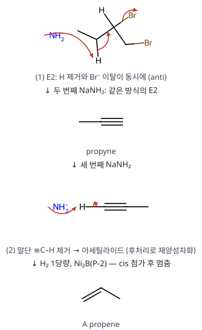

**메커니즘 — 알릴 라디칼 염소화**

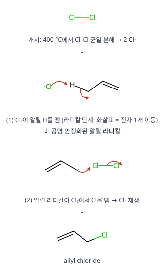

**메커니즘 — 클로로하이드린 형성 (→ B)**

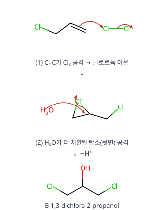

**메커니즘 — 에폭사이드 형성과 개환 (→ C, D)**

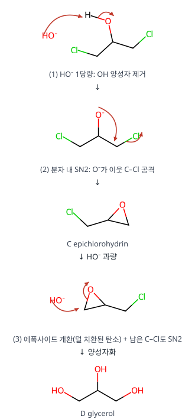

**검산** 분자식: A C₃H₆ → allyl chloride C₃H₅Cl → B C₃H₆Cl₂O → C C₃H₅ClO → D C₃H₈O₃. 탄소 3개가 끝까지 유지됩니다.

**채점 포인트·함정**

- Cl₂ 400 °C(라디칼 치환)와 Cl₂/H₂O(할로하이드린)의 차이가 핵심입니다.

## A형 11번 · Cannizzaro, Henry, Wittig 반응 {#a11}

**정답** A **benzoic acid**(염기 조건에서는 benzoate), B **benzyl alcohol**, C **(E)-2-nitro-1-phenylpropene**, D **1-phenyl-1,3-butadiene**

**공식·핵심 개념**

- Cannizzaro: α-H 없는 알데하이드 2분자 → 산 + 알코올 (H⁻ 전달)
- Henry: 니트로알케인 + 알데하이드 → β-니트로알코올 → 니트로알켄
- Wittig: Ph₃P=CHR + C=O → C=CHR + Ph₃P=O

**2027 출제 가능성 ★★★★☆ 높음** — 카보닐 반응(이름 반응) 메커니즘은 유기 서술형으로 자주 나옵니다.

**주어진 것 / 구할 것**

- 벤즈알데하이드(α-H 없음) 2분자 + HO⁻ → A + B
- 벤즈알데하이드 + 니트로에테인, 묽은 HO⁻ → C + H₂O
- 벤즈알데하이드 + 알릴리덴 일라이드 (C₆H₅)₃P⁺–C⁻H–CH=CH₂ → D
- 구할 것: A, B 구조와 메커니즘, C·D 구조

**풀이 전략** α-H가 없는 알데하이드는 엔올레이트를 만들 수 없어, 진한 염기에서 **Cannizzaro(불균등화)**를 합니다. 니트로에테인은 α-H가 매우 산성(pKa ≈ 8.6)이라 엔올레이트 대신 **니트로네이트**가 친핵체가 됩니다(Henry). 일라이드는 C=O를 C=C로 바꿉니다(Wittig).

**단계별 풀이 — A, B (Cannizzaro)**

**(1)** HO⁻가 PhCHO의 C=O 탄소를 공격 → 사면체 알콕사이드 PhCH(OH)O⁻.

**(2)** (진한 염기에서는) O–H가 한 번 더 탈양성자화되어 이음이온 PhCH(O⁻)₂ — 전자가 더 풍부해 H⁻를 더 잘 내놓습니다(속도 ∝ [PhCHO]²[HO⁻]² 항).

**(3)** 사면체 중간체에서 C=O가 다시 생기며 **H⁻가 두 번째 PhCHO의 카보닐 탄소로 직접 이동**(이 단계가 속도 결정 단계).

**(4)** 결과: PhCOOH + PhCH₂O⁻ → 바로 산–염기 반응 → **PhCOO⁻ + PhCH₂OH**. 산 처리하면 **A 벤조산**, **B 벤질 알코올**.

**(5)** 산화수로 확인: 카보닐 C +1 → 카복실 C +3(산화), CH₂OH의 C −1(환원) → 불균등화.

**단계별 풀이 — C (Henry 반응 + 탈수)**

**(1)** HO⁻가 CH₃CH₂NO₂의 α-H 제거 → 니트로네이트(음전하가 O로 비편재화).

**(2)** 니트로네이트의 탄소가 PhCHO의 C=O 공격 → 알콕사이드 → 양성자화 → β-니트로알코올 PhCH(OH)CH(CH₃)NO₂.

**(3)** NO₂ 옆 α-H가 산성이라 다시 떼어지고, OH⁻가 이탈하는 **E1cB 탈수** → 콘쥬게이션된 니트로알켄 **C** PhCH=C(CH₃)NO₂. 부피 큰 Ph와 NO₂가 반대쪽인 (E)가 주생성물.

**단계별 풀이 — D (Wittig)**

**(1)** 일라이드 탄소(C⁻)가 C=O 탄소를 공격, O⁻가 P⁺로 → 4원 고리 **옥사포스페테인**.

**(2)** 고리가 깨지며 매우 강한 P=O(≈ 575 kJ/mol)가 생기는 것이 구동력 → Ph₃P=O + **D** PhCH=CH–CH=CH₂ (1-phenyl-1,3-butadiene).

**메커니즘 — Cannizzaro 반응 (→ A, B)**

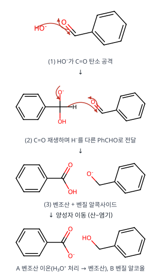

**메커니즘 — Henry 반응과 탈수 (→ C)**

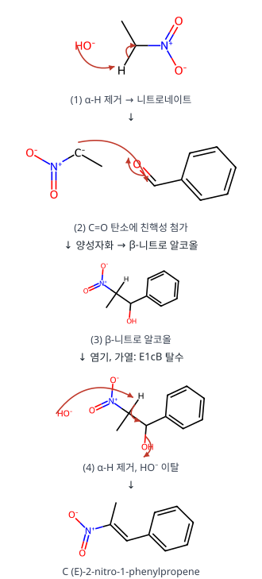

**메커니즘 — Wittig 반응 (→ D)**

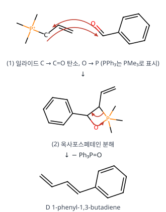

**왜 이 생성물인가** 벤즈알데하이드는 α-H가 없어 aldol을 할 수 없으므로 염기와는 Cannizzaro만 가능합니다. 니트로에테인이 함께 있으면 니트로네이트가 훨씬 쉽게 생겨(pKa 8.6 ≪ 알데하이드 α-H) 교차 축합(Henry)이 우선합니다. 탈수 생성물은 벤젠 고리–C=C–NO₂로 이어진 긴 콘쥬게이션 덕분에 안정합니다.

**검산** C: C₇H₆O + C₂H₅NO₂ − H₂O = C₉H₉NO₂ ✓, D: C₇H₆O + C₃H₄(일라이드 부분) − O = C₁₀H₁₀ ✓

**채점 포인트·함정**

- 메커니즘의 핵심 화살표는 **H⁻ 전달 단계**입니다.

## A형 12번 · MES의 NaOH 적정 {#a12}

**정답** 최대 기울기 **10.00 mL**(당량점), 저항력 최대 **pH = pKa = 6.300, 5.00 mL**, pH 10.00까지 **10.06 mL**

**공식·핵심 개념**

- 당량점 $V_e = \dfrac{C_aV_a}{C_b}$, 기울기 최대
- 반당량점: pH = pKa, 완충 용량 최대(기울기 최소)
- 당량점 뒤: 과량 OH⁻로 pH 결정

**2027 출제 가능성 ★★★★★ 매우 높음** — 약산 적정 곡선과 적정 오차 계산은 분석화학 최빈출 유형입니다.

**주어진 것 / 구할 것**

- MES 0.02000 M × 50.00 mL, NaOH 0.1000 M, pKa 6.300, 당량점 pH 9.250
- 티몰프탈레인 종말점 pH 10.00. 구할 것: 최대 기울기 부피, 완충력 최대 지점, pH 10.00까지 넣은 부피

**풀이 전략** 당량점(기울기 최대), 반당량점(기울기 최소 = 완충 용량 최대)을 구하고, 당량점 이후는 **과량 OH⁻**로 pH가 정해진다는 것을 이용합니다.

**단계별 풀이**

**(1)** **당량점**: $n_{\mathrm{MES}} = 0.02000 \times 50.00 = 1.000$ mmol

$$V_e = \frac{1.000\ \mathrm{mmol}}{0.1000\ \mathrm{M}} = 10.00\ \mathrm{mL}\quad(\text{기울기 최대})$$

**(2)** **반당량점** $V_b = 5.00$ mL에서 [HA] = [A⁻] → $\mathrm{pH} = \mathrm{p}K_a + \log 1 = 6.300$. 완충 용량

$$\beta = 2.303\,C\frac{K_a[\mathrm{H^+}]}{(K_a + [\mathrm{H^+}])^2}$$

은 $[\mathrm{H^+}] = K_a$일 때 최대 → pH 변화에 대한 저항력이 가장 큰 지점(곡선 기울기 최소).

**(3)** **당량점 pH 확인**: $[\mathrm{A^-}] = 1.000/60.00 = 0.01667$ M, $K_b = 10^{-14}/10^{-6.3} = 2.0\times10^{-8}$

$$\begin{aligned}[\mathrm{OH^-}] &= \sqrt{K_bC} = \sqrt{2.0\times10^{-8}\times0.01667}\\ &= 1.82\times10^{-5}\ \Rightarrow\ \mathrm{pH} = 9.26\ ✓\end{aligned}$$

**(4)** **pH 10.00까지**: 당량점을 지나 넣은 NaOH를 $\delta$ mL라 하면 과량 OH⁻가 pH를 결정

$$[\mathrm{OH^-}] = 10^{-4.00} = \frac{0.1000\,\delta}{50.00 + 10.00 + \delta}$$

$$\begin{aligned}1.00\times10^{-4}(60.00 + \delta) &= 0.1000\,\delta\\ \delta = \frac{6.00\times10^{-3}}{0.1000 - 0.0001} &= 0.0600\ \mathrm{mL}\end{aligned}$$

$$V = 10.00 + 0.06 = 10.06\ \mathrm{mL}$$

**(5)** **엄밀 확인**: pH 10에서 $[\mathrm{HA}] = [\mathrm{A^-}]\dfrac{[\mathrm{H^+}]}{K_a} = 0.01665 \times 10^{-3.7} = 3.3\times10^{-6}$ M → A⁻ 가수분해가 내는 OH⁻는 $10^{-4}$의 3 %라 결과는 10.058 ≈ **10.06 mL**로 같습니다.

**검산** 적정 오차 = +0.06 mL(+0.6 %). 티몰프탈레인 변색 범위(9.4~10.6)가 당량점 pH(9.25)보다 높아 조금 늦게 끝납니다.

**채점 포인트·함정**

- 분모 부피에 처음 50.00 mL와 당량점까지 넣은 10.00 mL를 모두 넣습니다.
- 약산 짝염기 A⁻에서 나오는 OH⁻(약 2.4 × 10⁻⁵ M)는 10⁻⁴ M보다 작아 무시합니다.

# 전공 B

## B형 1번 · syn·anti 첨가와 meso·라셈 {#b1}

**정답** meso: **C, D** / 라셈: **A, F**

**공식·핵심 개념**

- OsO₄: syn 이하이드록시화 / Br₂: anti 첨가
- trans+syn·cis+anti → 라셈, trans+anti·cis+syn → meso
- meso: 입체중심 있어도 대칭면

**2027 출제 가능성 ★★★★★ 매우 높음** — 입체 특이적 첨가와 meso·라셈 판정은 유기에서 거의 매년 나옵니다.

**주어진 것 / 구할 것**

- B fumaric acid(trans), E maleic acid(cis)
- (1) OsO₄, pyr (2) NaHSO₃/H₂O → syn 이하이드록시화 / Br₂ → anti 첨가
- 구할 것: A, C, D, F 중 meso와 라셈, 구조

**풀이 전략** 대칭 알켄(양쪽 치환기가 같은 HO₂C–CH=CH–CO₂H)에서는 **알켄 기하(cis/trans) × 첨가 방식(syn/anti)**만으로 결과가 정해집니다. 같은 면에서 둘을 넣으면 원래 배치가 그대로 보존된다고 생각하면 쉽습니다.

**단계별 풀이**

**(1)** **시약의 입체화학.** OsO₄는 [3+2] 협동 첨가로 고리형 오스메이트 에스터 → 두 C–O가 같은 면(**syn**). Br₂는 브로모늄 이온 → Br⁻가 반대 면에서 공격(**anti**).

**(2)** **네 가지 조합**

| 출발물 | 시약 | 첨가 | 생성물 | 판정 |
|---|---|---|---|---|
| B (trans) | OsO₄ | syn | **A** 타타르산 | (2R,3R) + (2S,3S) **라셈** |
| B (trans) | Br₂ | anti | **C** 2,3-dibromosuccinic acid | (2R,3S) **meso** |
| E (cis) | OsO₄ | syn | **D** 타타르산 | (2R,3S) **meso** |
| E (cis) | Br₂ | anti | **F** 2,3-dibromosuccinic acid | (2R,3R) + (2S,3S) **라셈** |

**(3)** **R/S 우선순위 정하기 (CIP).**

- 타타르산 C2: **–OH** (O) > **–COOH** (C에 O,O,O) > **–CH(OH)COOH** (C에 O,C,H) > H
- 다이브로모숙신산 C2: **–Br** > **–CH(Br)COOH** (C에 Br,C,H — 첫 원자 Br이 O보다 큼) > **–COOH** (C에 O,O,O) > H

**(4)** **meso 판정.** D와 C는 두 입체중심이 (R,S)이고, Fischer 투영식에서 가운데 가로선이 거울면 → 광학 비활성. A와 F는 (R,R)/(S,S)로 거울면이 없고, 대칭 알켄의 양면 공격 확률이 같아 1 : 1 라셈.

**메커니즘 — OsO₄ syn 이하이드록시화**

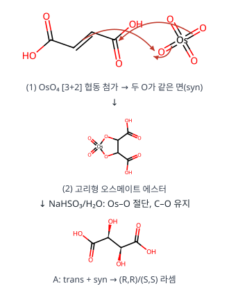

**메커니즘 — Br₂ anti 첨가**

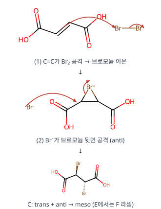

**왜 이 생성물인가** syn 첨가는 알켄의 기하를 그대로 입체배열로 옮기고(cis → 같은 쪽 → meso), anti 첨가는 하나를 뒤집습니다(cis → 반대쪽 → 라셈). 그래서 trans 알켄에서는 결과가 정반대가 됩니다.

**검산** 각 생성물은 입체중심 2개, 이론적 입체이성질체 3개(R,R / S,S / meso) 중 위 표대로 나뉩니다.

**채점 포인트·함정**

- 라셈은 **거울상 이성질체 두 개를 모두** 그려야 합니다.

## B형 2번 · Ni 석출에 필요한 전압 {#b2}

**정답** **−2.76 V**

**공식·핵심 개념**

- 네른스트로 각 전극 전위 → $E_{cell} = E_+ - E_-$
- 실제 전압 $E = E_{cell} - IR - \eta$
- 산소 발생: $\mathrm{O_2 + 4H^+ + 4e^- \rightleftharpoons 2H_2O}$

**2027 출제 가능성 ★★★★☆ 높음** — 전기분해에 필요한 전압(IR, 과전압 포함)은 분석화학 기입형으로 자주 나옵니다.

**주어진 것 / 구할 것**

- 25 °C, I = 0.20 A, R = 5.0 Ω, [Ni²⁺] = 0.010 M, pH 5.0, $P_{O_2}$ = 1.0 atm
- O₂ 발생 과전압 0.50 V, $\mathrm{Ni^{2+} + 2e^- \rightarrow Ni}$ (−0.260 V), $\mathrm{O_2 + 4H^+ + 4e^- \rightarrow 2H_2O}$ (1.24 V)
- 구할 것: Ni 석출에 걸어야 할 초기 전압

**풀이 전략** 전기분해에 필요한 전압 = (평형 전지 전위) − (저항 손실 IR) − (과전압). 먼저 네른스트로 두 전극의 평형 전위를 구합니다.

**단계별 풀이**

**(1)** **환원 전극(Ni)**

$$\begin{aligned}E_{\mathrm{Ni}} &= -0.260 - \frac{0.060}{2}\log\frac{1}{[\mathrm{Ni^{2+}}]}\\ &= -0.260 - 0.030\log\frac{1}{0.010}\\ &= -0.260 - 0.060 = -0.320\ \mathrm{V}\end{aligned}$$

**(2)** **산화 전극(O₂ 발생)**, 환원 반쪽 반응으로 쓰고 $[\mathrm{H^+}] = 10^{-5.0}$

$$\begin{aligned}E_{\mathrm{O_2}} &= 1.24 - \frac{0.060}{4}\log\frac{1}{P_{O_2}[\mathrm{H^+}]^4}\\ &= 1.24 - 0.015\log\frac{1}{(1.0)(10^{-5})^4}\\ &= 1.24 - 0.015(20) = 0.94\ \mathrm{V}\end{aligned}$$

**(3)** **평형 전지 전위** (Ni 쪽이 환원 전극)

$$E_{\text{전지}} = E_{\text{환원}} - E_{\text{산화}} = -0.320 - 0.94 = -1.26\ \mathrm{V}$$

(음수 → 비자발, 외부 전압 필요)

**(4)** **저항 손실**: $IR = 0.20\ \mathrm{A} \times 5.0\ \Omega = 1.0$ V

**(5)** **걸어야 할 전압**

$$E = E_{\text{전지}} - IR - \eta = -1.26 - 1.0 - 0.50 = -2.76\ \mathrm{V}$$

**검산** 전체 반응 $\mathrm{2Ni^{2+} + 2H_2O \rightarrow 2Ni + O_2 + 4H^+}$: $E^\circ = -0.260 - 1.24 = -1.50$ V, $Q = \dfrac{P_{O_2}[\mathrm{H^+}]^4}{[\mathrm{Ni^{2+}}]^2} = \dfrac{10^{-20}}{10^{-4}} = 10^{-16}$, $E = -1.50 - \frac{0.060}{4}\log 10^{-16} = -1.50 + 0.24 = -1.26$ V ✓. "초기" 전압인 이유: Ni²⁺가 줄고 H⁺가 늘면서 필요한 전압이 점점 커지기 때문입니다.

**채점 포인트·함정**

- IR = 1.0 V, 과전압 0.50 V 모두 **빼야** 합니다(절댓값이 커짐).
- 전체 반응식으로 풀어도 $E^\circ = -1.50$ V, $Q = 10^{-16}$ → $-1.50 + 0.24 = -1.26$ V로 같습니다.

## B형 3번 · 5E 모형과 유의미학습 {#b3}

**정답**

- ㉠ **학습 의욕**, ㉡ **탐색**
- 참여 단계: 학생의 관심·흥미를 끌어 호기심을 충족시키는 **학습 의향(학습 태세)**을 갖게 하므로 오수벨의 **심리적 유의미가**를 갖는다.
- ㉢ 산화 환원 반응은 전자를 주고받는 반응이므로 산화와 환원은 항상 동시에 일어난다. Zn은 전자를 잃고 Zn²⁺로 녹아 들어가고, 푸른색 Cu²⁺는 전자를 얻어 Cu로 석출된다. 그래서 용액의 푸른색이 옅어지고 아연판 표면이 붉은 구리로 덮인다.
- 클로퍼: **탐구 과정 III — 자료 해석과 일반화**

**공식·핵심 개념**

- 5E: 참여 → 탐색 → 설명 → 정교화 → 평가
- 오수벨: 논리적·잠재적·심리적 유의미가
- 클로퍼 탐구 과정 I~IV

**2027 출제 가능성 ★★★★★ 매우 높음** — 5E 모형과 유의미학습·클로퍼 분류는 교육론 단골 조합입니다.

**5E**: 참여(Engage) → 탐색(Explore) → 설명(Explain) → 정교화(Elaborate) → 평가(Evaluate).

**오수벨의 유의미학습 조건**: 논리적 유의미가(과제 자체) + 잠재적 유의미가(학습자 인지구조에 관련 개념) + **심리적 유의미가(학습 의향, 태세)**.

**클로퍼 분류**: A 지식·이해, B 탐구 과정 I(관찰·측정), C II(문제 인식·가설·실험 설계), D **III(자료 해석·일반화)**, E IV(모형 형성·검증), F 응용, G 조작 기능, H 태도, I 지향.

**채점 포인트·함정**

- '결과 및 정리'는 관찰한 사실을 해석하는 단계이므로 III입니다(관찰만 하는 I과 구분).

## B형 4번 · 5단계 발견학습 {#b4}

**정답**

- 단원명: **물질과 규칙성**
- ㉠ [교사의 시범실험]과 [학생의 모둠별 실험] 결과 사이의 **공통점**을 찾아보게 한다. ㉡ 교사는 **불꽃반응 색과 선 스펙트럼**으로 원소의 종류를 구별할 수 있음을 설명한다.
- 구성주의 관점: 학생이 실험 절차에 따라 스스로 계획·수행하고, 관찰 결과를 모둠원과 토의하여 원소에 따른 규칙성을 발견하며, 학급 전체에 발표하게 하여 **학습자 스스로 의미를 구성**하게 한다.
- 과정·기능: **결론을 도출하고 자연현상 및 문제 상황에 적용·설명하기**

**공식·핵심 개념**

- 발견학습 5단계: 탐색·문제 파악 → 자료 제시·관찰 → 추가 자료 → 규칙성 발견·개념 정리 → 적용
- 구성주의: 학습자 스스로 의미 구성
- 통합과학 1 '물질과 규칙성'

**2027 출제 가능성 ★★★★☆ 높음** — 발견학습 단계와 통합과학 단원 연결은 교육론에서 꾸준히 나옵니다.

**발견학습 5단계**: 탐색 및 문제 파악 → 자료 제시 및 관찰 탐색 → 추가 자료 제시 및 관찰 탐색 → 규칙성 발견 및 개념 정리 → 적용.

**과학 내용.** NaCl·NaNO₃ 모두 **노란색**(Na) → 음이온이 달라도 같은 금속 원소는 같은 불꽃색과 같은 선 스펙트럼 → 원소의 종류 구별.

**채점 포인트·함정**

- 추가 자료 단계(㉠)는 두 실험의 **공통점 찾기**, 개념 정리(㉡)는 **교사의 설명**입니다.

## B형 5번 · 실험 수행평가의 평가 준거 {#b5}

**정답**

- ㉠ 결론 진술 준거: **상태가 변할 때 로르산의 온도가 일정한 까닭을 열에너지와 관련하여 진술하였는가?**
- 변인 설정 수정: **조절 변인을 시간, 종속 변인을 온도로 설정하고, 나머지 변인을 통제 변인으로 설정하였는가?**
- ㉡ 녹는점·어는점은 각 상태 변화가 일어나는 **온도라는 측면**에 주안점을 둔다.
- 내용 요소: **상태 변화와 열에너지**

**공식·핵심 개념**

- 평가 준거는 평가 요소마다 구체적·실험 목적에 맞게
- 변인: 조절·종속·통제 변인
- 응고 중 온도 일정: 응고열 방출이 열 손실을 보충

**2027 출제 가능성 ★★★★☆ 높음** — 수행평가 준거 작성과 2022 개정 성취기준 적용 고려사항은 최근 교육론 경향입니다.

**평가 준거 작성 원칙.** 평가 요소마다 실험 목적에 맞게 **구체적**으로 써야 타당도·신뢰도가 높아집니다. 지도 교수가 '자료 변환'을 "실험 목적에 적합한 그래프를 작성하였는가?"로 고친 것과 같은 방식으로, 다른 요소도 '왜 보통인지'가 드러나게 바꿉니다.

**과학 내용.** 로르산이 응고하는 동안 방출하는 열(응고열)이 주위로 빠져나가는 열을 보충하므로 고체·액체가 공존하는 동안 온도가 일정합니다.

**채점 포인트·함정**

- 변인 준거에는 조절·종속·통제 변인을 **각각 구체적으로** 명시합니다.

## B형 6번 · Clapeyron 식과 2차 상전이 {#b6}

**정답**

- $d\left(\dfrac{\Delta H}{T}\right) = \dfrac{\Delta C_p}{T}dT = \Delta C_p\,d\ln T$
- $\dfrac{dp}{dT} = \dfrac{\alpha_2 - \alpha_1}{\kappa_{T,2} - \kappa_{T,1}}$
- $\dfrac{dp}{dT} = \dfrac{C_{p,m2} - C_{p,m1}}{TV_m(\alpha_2 - \alpha_1)}$

**공식·핵심 개념**

- Clapeyron: $\dfrac{dp}{dT} = \dfrac{\Delta H}{T\Delta V}$
- 2차 상전이(Ehrenfest): $\dfrac{dp}{dT} = \dfrac{\Delta\alpha}{\Delta\kappa_T} = \dfrac{\Delta C_{p,m}}{TV_m\Delta\alpha}$
- $dV = V(\alpha dT - \kappa_T dp)$

**2027 출제 가능성 ★★★☆☆ 보통** — 상평형 열역학은 Clapeyron 수준에서 자주, Ehrenfest 식은 드물게 나옵니다.

**주어진 것 / 구할 것**

- 두 상 공존 조건, Clapeyron 식, $dH = C_pdT + Vdp$
- 정의 $\alpha = \frac1V\left(\frac{\partial V}{\partial T}\right)_p$, $\kappa_T = -\frac1V\left(\frac{\partial V}{\partial p}\right)_T$
- 구할 것: 상 경계를 따른 $d(\Delta H/T)$, 2차 상전이에서 $dp/dT$를 (α, κ)와 ($C_{p,m}$, α)로

**풀이 전략** 1차 상전이는 상 경계를 따라 μ가 같다는 조건에서 Clapeyron 식이 나옵니다. 2차 상전이는 $\Delta V = \Delta S = 0$이라 0/0이 되므로, **V와 S가 경계를 따라 연속(dV₁ = dV₂, dS₁ = dS₂)**이라는 조건을 대신 씁니다(Ehrenfest).

**단계별 풀이 (1) $d(\Delta H/T)$**

**(1)** 각 상에서 $dH_i = C_{p,i}dT + V_idp$ → 빼면 $d\Delta H = \Delta C_pdT + \Delta Vdp$.

**(2)** 상 경계 위에서는 Clapeyron: $\dfrac{dp}{dT} = \dfrac{\Delta H}{T\Delta V}$ → $\Delta V\,dp = \dfrac{\Delta H}{T}dT$.

**(3)** 대입: $d\Delta H = \Delta C_pdT + \dfrac{\Delta H}{T}dT$.

**(4)** 몫의 미분:

$$\begin{aligned}d\left(\frac{\Delta H}{T}\right) &= \frac{d\Delta H}{T} - \frac{\Delta H}{T^2}dT\\ &= \frac{\Delta C_p}{T}dT + \frac{\Delta H}{T^2}dT - \frac{\Delta H}{T^2}dT\\ &= \Delta C_p\,d\ln T\end{aligned}$$

**단계별 풀이 (2) α, κ로 쓴 dp/dT**

**(1)** 부피를 $V(T, p)$로 보고 전미분: $dV = \left(\frac{\partial V}{\partial T}\right)_pdT + \left(\frac{\partial V}{\partial p}\right)_Tdp = V(\alpha\,dT - \kappa_T\,dp)$.

**(2)** 2차 상전이에서는 $V_1 = V_2$이고 경계를 따라서도 같으므로 $dV_1 = dV_2$:

$$V(\alpha_1dT - \kappa_{T,1}dp) = V(\alpha_2dT - \kappa_{T,2}dp)$$

**(3)** 정리:

$$(\kappa_{T,2} - \kappa_{T,1})dp = (\alpha_2 - \alpha_1)dT \;\Rightarrow\; \frac{dp}{dT} = \frac{\alpha_2 - \alpha_1}{\kappa_{T,2} - \kappa_{T,1}}$$

**단계별 풀이 (3) $C_{p,m}$, α로 쓴 dp/dT**

**(1)** 엔트로피 전미분: $dS = \left(\frac{\partial S}{\partial T}\right)_pdT + \left(\frac{\partial S}{\partial p}\right)_Tdp = \dfrac{C_p}{T}dT - \alpha V\,dp$ (맥스웰 관계식 $(\partial S/\partial p)_T = -(\partial V/\partial T)_p$).

**(2)** 1몰 기준 $dS_{m,1} = dS_{m,2}$:

$$\frac{C_{p,m1}}{T}dT - \alpha_1V_mdp = \frac{C_{p,m2}}{T}dT - \alpha_2V_mdp$$

**(3)** 정리:

$$\frac{dp}{dT} = \frac{C_{p,m2} - C_{p,m1}}{TV_m(\alpha_2 - \alpha_1)}$$

**검산** 두 식을 같다고 두면 $\Delta C_{p,m} = TV_m\dfrac{(\Delta\alpha)^2}{\Delta\kappa_T}$ — Ehrenfest 관계식으로 서로 모순 없이 이어집니다.

**채점 포인트·함정**

- 공식 답안 분모의 $\kappa_{T,2} - \kappa_{T,2}$는 오타입니다(검토 메모 1).

## B형 7번 · Hückel 근사: TMM과 알릴 라디칼 {#b7}

**정답** TMM: 전체 $4\alpha + 2\sqrt3\beta$, 비편재화 $(2\sqrt3 - 2)\beta$ / 알릴 라디칼: 전체 $3\alpha + 2\sqrt2\beta$, 비편재화 $(2\sqrt2 - 2)\beta$

**공식·핵심 개념**

- Hückel: $E = \alpha + x\beta$, 영년식 풀기
- 전체 π 에너지 = Σ(전자 수 × 준위 에너지)
- 비편재화 에너지 = 전체 − 국소화 구조 에너지

**2027 출제 가능성 ★★★★☆ 높음** — Hückel 계산은 물리화학·유기 경계 소재로 자주 나옵니다.

**주어진 것 / 구할 것**

- TMM(가운데 C4에 C1, C2, C3 연결)과 알릴 라디칼의 영년 행렬식
- 구할 것: 각 분자의 전체 π 에너지와 비편재화 에너지

**풀이 전략** 행렬식의 각 행을 β로 나누고 $x = (\alpha - E)/\beta$로 치환해 다항식을 풉니다. 에너지 준위에 전자를 아래부터 채워 합하고, 국소화된 구조(고립된 C=C + 홀전자)와의 차이가 비편재화 에너지입니다.

**단계별 풀이 — TMM**

**(1)** 치환한 행렬식:

$$\begin{vmatrix} x&0&0&1\\0&x&0&1\\0&0&x&1\\1&1&1&x \end{vmatrix} = 0$$

**(2)** 첫 행으로 전개하면 $x\cdot(x^3 - 2x) - 1\cdot(x^2) = x^4 - 3x^2 = x^2(x^2 - 3) = 0$.

**(3)** 해: $x = -\sqrt3, 0, 0, +\sqrt3$ → $E = \alpha - x\beta$:

| x | E | 성격 | 전자 |
|---|---|---|---|
| $-\sqrt3$ | $\alpha + \sqrt3\beta$ | 결합성 | 2 |
| 0 (2개) | $\alpha$ | 비결합(이중 축퇴) | 1 + 1 |
| $+\sqrt3$ | $\alpha - \sqrt3\beta$ | 반결합성 | 0 |

**(4)** π 전자 4개: $E_\pi = 2(\alpha + \sqrt3\beta) + \alpha + \alpha = 4\alpha + 2\sqrt3\beta$. 축퇴된 비결합 MO에 홀전자 2개 → 삼중항 이중 라디칼.

**(5)** 국소화 구조(C=C 하나 + 홀전자 두 개): $2(\alpha + \beta) + 2\alpha = 4\alpha + 2\beta$.

**(6)** 비편재화 에너지: $(4\alpha + 2\sqrt3\beta) - (4\alpha + 2\beta) = (2\sqrt3 - 2)\beta = 1.464\beta$.

**단계별 풀이 — 알릴 라디칼**

**(1)** $\begin{vmatrix} x&1&0\\1&x&1\\0&1&x \end{vmatrix} = x(x^2 - 1) - x = x^3 - 2x = x(x^2 - 2) = 0$ → $x = -\sqrt2, 0, \sqrt2$.

**(2)** MO(정규화 계수):

| E | MO | 전자 |
|---|---|---|
| $\alpha + \sqrt2\beta$ | $\psi_1 = \tfrac12\phi_1 + \tfrac{1}{\sqrt2}\phi_2 + \tfrac12\phi_3$ | 2 |
| $\alpha$ | $\psi_2 = \tfrac{1}{\sqrt2}(\phi_1 - \phi_3)$ (가운데 마디) | 1 |
| $\alpha - \sqrt2\beta$ | $\psi_3 = \tfrac12\phi_1 - \tfrac{1}{\sqrt2}\phi_2 + \tfrac12\phi_3$ | 0 |

**(3)** $E_\pi = 2(\alpha + \sqrt2\beta) + \alpha = 3\alpha + 2\sqrt2\beta$, 국소화 $3\alpha + 2\beta$ → 비편재화 에너지 $(2\sqrt2 - 2)\beta = 0.828\beta$.

**검산** 고윳값의 합 = 행렬의 대각합: TMM $(-\sqrt3) + 0 + 0 + \sqrt3 = 0$ ✓, 알릴 0 ✓. 홀전자가 들어간 알릴 ψ₂는 가운데 탄소에 계수 0 → 라디칼 성질은 양 끝 탄소에만 있습니다(공명 구조 2개와 일치). β < 0이므로 비편재화 에너지는 안정화입니다.

**채점 포인트·함정**

- β < 0이므로 $(2\sqrt3 - 2)\beta$는 **안정화**(음수 에너지)를 뜻합니다.

## B형 8번 · [PdCl₂(NH₃)₂] 이성질체의 IR {#b8}

**정답** X = **cis-[PdCl₂(NH₃)₂]**, 점군 **C₂ᵥ**, ν₁·ν₂ = **A₁(대칭) + B₂(비대칭)**. Y = trans(D₂h), IR 활성 Pd–Cl 신축 **B₁ᵤ**(반대칭)

**공식·핵심 개념**

- 신축 진동: 결합 벡터의 Γ → 축소
- IR 활성: x, y, z 기약표현 / 상호 배제(중심 대칭)
- cis C₂ᵥ: A₁ + B₂(띠 2개), trans D₂h: B₁ᵤ(띠 1개)

**2027 출제 가능성 ★★★★☆ 높음** — IR 띠 수로 기하 이성질체를 구별하는 문항은 무기 대칭 단골입니다.

**주어진 것 / 구할 것**

- [PdCl₂(NH₃)₂] 이성질체 X, Y(사각 평면). X의 Pd–Cl 신축 IR 띠 2개(320, 280 cm⁻¹)
- 좌표: z 위, y 오른쪽(분자 평면 = yz). C₂ᵥ, C₂ₕ, D₂ₕ, D₂d 지표표
- 구할 것: X의 구조·점군, 두 띠의 기약표현·진동 방식, Y의 IR 활성 기약표현

**풀이 전략** Pd–Cl 결합 두 개를 벡터로 두고, 대칭 조작마다 제자리에 남는 벡터 수로 가약 표현을 만들어 축소합니다. IR 활성은 x, y, z와 같은 기약표현입니다.

**단계별 풀이 — cis 이성질체 (C₂ᵥ)**

**(1)** cis: 두 Cl이 이웃(90°), C₂축은 두 Cl의 이등분선(z). 분자 평면 = σᵥ′(yz).

**(2)** Γ(Pd–Cl): E 2, C₂ 0(두 Cl 교환), σᵥ(xz) 0(교환), σᵥ′(yz) 2(분자 평면)

**(3)** 축소 ($h = 4$):

$$\begin{aligned}
n(A_1) &= \tfrac14[2 + 0 + 0 + 2] = 1, & n(A_2) &= \tfrac14[2 + 0 - 0 - 2] = 0\\
n(B_1) &= \tfrac14[2 - 0 + 0 - 2] = 0, & n(B_2) &= \tfrac14[2 - 0 - 0 + 2] = 1
\end{aligned}$$

$\Gamma = A_1(z) + B_2(y)$ → **둘 다 IR 활성 → 띠 2개**

**단계별 풀이 — trans 이성질체 (D₂ₕ)**

**(1)** trans: 두 Cl이 180°(z축 위), 중심 대칭.

**(2)** Γ(Pd–Cl): E 2, C₂(z) 2, C₂(y) 0, C₂(x) 0, i 0, σ(xy) 0, σ(xz) 2, σ(yz) 2

**(3)** 축소 ($h = 8$):

$$\begin{gathered}n(A_g) = \tfrac18[2 + 2 + 0 + 0 + 0 + 0 + 2 + 2] = 1\\ n(B_{1u}) = \tfrac18[2 + 2 - 0 - 0 - 0 - 0 + 2 + 2] = 1\end{gathered}$$

나머지 6개는 0 → $\Gamma = A_g + B_{1u}$. IR 활성은 **B₁ᵤ(z)** 하나 → 띠 1개(A_g는 Raman 활성, 상호 배제 원리).

**결론과 진동 방식**

| | X = cis (C₂ᵥ) | Y = trans (D₂ₕ) |
|---|---|---|
| 대칭 신축 | A₁: 두 Pd–Cl이 함께 늘어남 → ν₁ 320 cm⁻¹ | A_g: IR 비활성 |
| 비대칭 신축 | B₂: 하나 늘고 하나 줄어듦 → ν₂ 280 cm⁻¹ | B₁ᵤ: IR 활성 |

IR 띠가 2개 → **X = cis**.

**검산** 대칭 신축이 비대칭보다 높은 파수인 것은 cis 착물의 일반적인 경향과 맞고, 각 표현의 차원 합이 벡터 수(2)와 같습니다.

**채점 포인트·함정**

- trans의 A_g 신축은 쌍극자 변화가 없어 IR 비활성(Raman 활성) — 상호 배제 원리.

## B형 9번 · d⁵·d⁶ Tanabe–Sugano 도표 {#b9}

**정답** [Fe(CN)₆]⁴⁻ 바닥 상태 항 축퇴도 **1** / [Co(NH₃)₆]³⁺ 가장 긴 파장 스핀 허용 띠 **¹A₁g → ¹T₁g** / [FeF₆]³⁻ **⁶A₁g**, [CoF₆]³⁻ **⁵T₂g**

**공식·핵심 개념**

- d⁶ 강한 장 ¹A₁g, 약한 장 ⁵T₂g / d⁵ 고스핀 ⁶A₁g
- 스핀 허용: 같은 스핀 다중도끼리
- 축퇴도 = (2S+1) × 궤도 축퇴도

**2027 출제 가능성 ★★★★★ 매우 높음** — Tanabe–Sugano 해석과 색 설명은 무기 최빈출입니다.

**주어진 것 / 구할 것**

- d⁶, d⁵ Tanabe–Sugano 도표 (스핀 교차: d⁶ Δ/B ≈ 20, d⁵ Δ/B ≈ 28)
- 구할 것: [Fe(CN)₆]⁴⁻ 바닥 항 축퇴도, [Co(NH₃)₆]³⁺ 가장 긴 파장 스핀 허용 띠, [FeF₆]³⁻·[CoF₆]³⁻ 바닥 항과 색 차이의 이유

**풀이 전략** ① 산화수 → dⁿ, ② 리간드 장 세기(분광화학 계열) → 고스핀/저스핀, ③ 도표에서 바닥 항 → ④ 같은 스핀 다중도의 들뜬 항만 스핀 허용.

**단계별 풀이**

**(1)** **[Fe(CN)₆]⁴⁻**: $x + 6(-1) = -4$ → Fe(II), d⁶. CN⁻는 강한 장 → 저스핀 $t_{2g}^6$. 모든 전자가 짝 → S = 0, 꽉 찬 $t_{2g}$ → 궤도 비축퇴 → $^1A_{1g}$. 축퇴도 $= (2S+1)\times(\text{궤도}) = 1\times1 = 1$.

**(2)** **[Co(NH₃)₆]³⁺**: Co(III), d⁶. NH₃와 높은 전하 → 강한 장, 저스핀 $^1A_{1g}$. 스핀 허용(ΔS = 0) 전이는 단일항으로 가는 것뿐: $^1A_{1g}\to{}^1T_{1g}$(낮은 에너지 = **가장 긴 파장**), $^1A_{1g}\to{}^1T_{2g}$. 오비탈로 보면 $t_{2g}^6 \to t_{2g}^5e_g^1$.

**(3)** **[FeF₆]³⁻**: Fe(III), d⁵. F⁻는 약한 장 → 고스핀 $t_{2g}^3e_g^2$, S = 5/2 → $^6A_{1g}$. d⁵ 도표에는 **스핀 다중도 6인 들뜬 항이 없음** → 모든 d–d 전이가 스핀 금지(ΔS ≠ 0) + Laporte 금지 → 흡광 계수 매우 작음 → **무색**(연한 색).

**(4)** **[CoF₆]³⁻**: Co(III), d⁶. F⁻ 약한 장 → 고스핀 $t_{2g}^4e_g^2$, S = 2 → $^5T_{2g}$(축퇴도 5 × 3 = 15). 같은 오중항 들뜬 항 $^5E_g$($t_{2g}^3e_g^3$)가 있어 **스핀 허용 전이 1개** → 가시광 흡수 → **색**.

| 착물 | dⁿ | 스핀 | 배치 | 바닥 항 | 스핀 허용 d–d |
|---|---|---|---|---|---|
| [Fe(CN)₆]⁴⁻ | d⁶ | 저 | $t_{2g}^6$ | $^1A_{1g}$ | ¹T₁g, ¹T₂g |
| [Co(NH₃)₆]³⁺ | d⁶ | 저 | $t_{2g}^6$ | $^1A_{1g}$ | **¹T₁g**(장파장), ¹T₂g |
| [FeF₆]³⁻ | d⁵ | 고 | $t_{2g}^3e_g^2$ | $^6A_{1g}$ | 없음 |
| [CoF₆]³⁻ | d⁶ | 고 | $t_{2g}^4e_g^2$ | $^5T_{2g}$ | $^5E_g$ 1개 |

**검산** 같은 Co(III) d⁶라도 NH₃(강한 장)는 저스핀, F⁻(약한 장)는 고스핀으로 도표의 왼쪽/오른쪽에 놓여 바닥 항이 달라집니다.

**채점 포인트·함정**

- F⁻는 Co³⁺에도 약한 장이라 **고스핀**입니다(NH₃와 다름).

## B형 10번 · Sertraline 중간체 합성 {#b10}

**정답** B **γ-락톤** 5-(3,4-dichlorophenyl)dihydrofuran-2-one, C **4-(3,4-dichlorophenyl)-4-phenylbutanoic acid**, D **4-(3,4-dichlorophenyl)-3,4-dihydronaphthalen-1(2H)-one**

**공식·핵심 개념**

- NaBH₄: 케톤 선택적 환원
- Friedel–Crafts 알킬화: 안정한 탄소양이온 경유
- 분자 내 아실화 → 6원 고리 케톤(테트랄론)

**2027 출제 가능성 ★★★★☆ 높음** — 의약품 합성 경로 해석은 유기 고난도 서술형으로 출제됩니다.

**주어진 것 / 구할 것**

- A: 4-(3,4-dichlorophenyl)-4-oxobutanoic acid
- (i) NaBH₄ (ii) HCl → B (C₁₀H₈O₂Cl₂) → 벤젠, AlCl₃ → C (C₁₆H₁₄O₂Cl₂) → (1) SOCl₂ (2) AlCl₃ → D (C₁₆H₁₂OCl₂)
- 구할 것: B, C, D 구조와 B → C에서 C가 주생성물인 이유

**풀이 전략** 각 단계의 분자식 변화를 먼저 계산해 무엇이 더해지고 빠지는지 확인한 뒤, 시약의 선택성(NaBH₄: 케톤만, AlCl₃: 양이온 생성)으로 위치를 정합니다.

**단계별 풀이**

**(1)** **분자식 변화 추적**

| 단계 | 분자식 | 변화 | 해석 |
|---|---|---|---|
| A | C₁₀H₈O₃Cl₂ | | 케톤 + COOH |
| A → B | C₁₀H₈O₂Cl₂ | +2H(환원) − H₂O | 케톤 → 알코올 → 분자 내 에스터(락톤) |
| B → C | C₁₆H₁₄O₂Cl₂ | + C₆H₆ | 벤젠이 통째로 붙음(알킬화), 락톤 열림 |
| C → D | C₁₆H₁₂OCl₂ | − H₂O | 분자 내 아실화(고리화) |

**(2)** **A → B.** NaBH₄의 H⁻는 케톤 C=O만 환원(카복실산은 먼저 카복실레이트가 되어 반응 안 함) → γ-하이드록시산. HCl에서 COOH의 C=O가 양성자화 → γ-OH가 분자 내 공격 → 사면체 중간체 → 물 이탈 → **5원 고리 γ-락톤 B**(5원 고리라 분자 내 반응이 빠름).

**(3)** **B → C.** AlCl₃(루이스 산)가 락톤의 **고리(알킬) 산소**에 배위 → 벤질 C–O 결합이 끊어지며 **2차 벤질 탄소양이온** 생성. 양전하가 다이클로로페닐 고리로 공명 비편재화되어 안정 → 벤젠의 π 전자가 이 탄소를 공격(Friedel–Crafts 알킬화) → 아레늄 이온 → H⁺ 제거로 방향족성 회복 → 수용성 후처리로 COOH 회복 → **C**.

**(4)** **C → D.** SOCl₂로 산 염화물 → AlCl₃가 Cl을 떼어 **아실륨 이온** → 분자 내 Friedel–Crafts 아실화. 6원 고리가 생기는 자리이면서 **전자가 더 풍부한 비치환 페닐 고리**의 ortho 탄소가 공격 → 아레늄 이온 → H⁺ 제거 → **D 테트랄론**(4-(3,4-dichlorophenyl)-3,4-dihydronaphthalen-1(2H)-one).

**왜 C가 주생성물인가** AlCl₃가 락톤에서 만들 수 있는 양이온은 두 가지입니다. ① 고리 O–C(벤질) 결합이 끊어진 **벤질 탄소양이온**(아릴 공명 + 2차) ② 카보닐 쪽이 끊어진 아실륨형 양이온. ①이 훨씬 안정하고 쉽게 생기므로 벤젠은 벤질 탄소에 붙고(알킬화), 아실화 생성물(케톤)은 생기지 않습니다. 또 생성물 C에 붙은 새 페닐기는 알킬 치환 벤젠이라 다음 단계 고리화에서 다이클로로페닐(Cl 두 개로 비활성)보다 친전자체를 잘 받아들입니다.

**메커니즘 — NaBH₄의 케톤 선택적 환원**

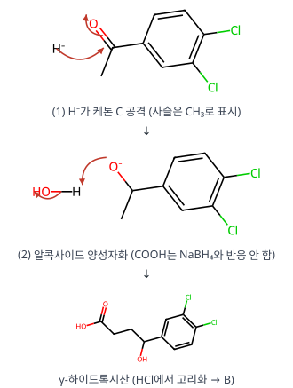

**메커니즘 — A → B 락톤 형성**

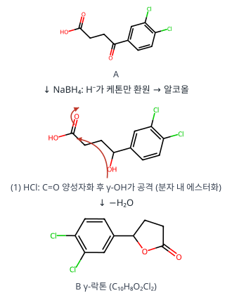

**메커니즘 — B → C Friedel–Crafts 알킬화**

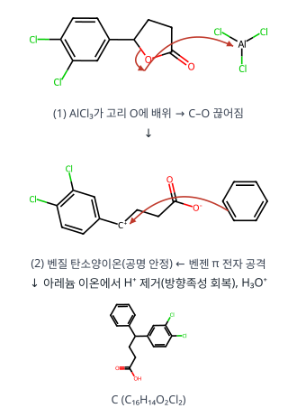

**메커니즘 — 아실륨 이온 생성과 아레늄 이온 탈양성자화**

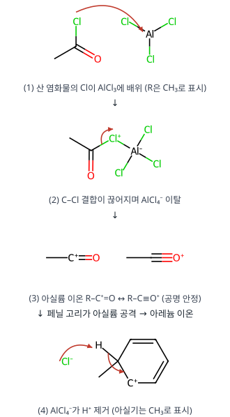

**메커니즘 — C → D 분자 내 Friedel–Crafts 아실화**

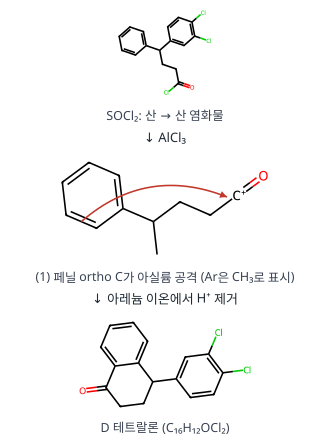

**검산** 분자식이 모든 단계에서 문제와 일치하고(RDKit 확인), D에 CH₃NH₂(이민) → H₂/Pd-C(환원)를 하면 문제의 sertraline 골격이 됩니다.

**채점 포인트·함정**

- 아실화가 다이클로로페닐 쪽이 아니라 **페닐 쪽**에서 일어나는 이유(Cl은 고리를 비활성화)를 쓰면 좋습니다.

## B형 11번 · 모세관 전기이동과 전기삼투 {#b11}

**정답** 이동 시간 **B⁻ > C > A⁺**. pH 10에서 실리카 > 아미노프로필, pH 2.5에서 실리카 흐름 ≈ 0, 아미노프로필은 반대 방향. 검출 시간 **250 s**

**공식·핵심 개념**

- $u_{net} = u_{ep} + u_{eo}$
- 실리카 벽 Si–O⁻ → 음극 쪽 EOF, pH↓ → EOF↓
- 이동 순서: 양이온 → 중성 → 음이온

**2027 출제 가능성 ★★★★☆ 높음** — 모세관 전기이동은 분석화학 기기분석에서 꾸준히 나옵니다.

**주어진 것 / 구할 것**

- 자료 1: pH 6 붕산염 완충액, A⁺, B⁻, 중성 C, 실리카 모세관
- 자료 2: 전기삼투 속도 (E = 4.0 × 10⁴ V/m) — 노출 실리카 pH 10 +3.1, pH 2.5 +0.2 / 아미노프로필 pH 10 +1.8, pH 2.5 −1.3 mm/s
- 자료 3: 양이온 $u_{ep} = u_{eo} = 0.80$ mm/s, 주입구–검출기 40.0 cm
- 구할 것: 이동 시간 순서, pH에 따른 속도 설명, 검출 시간

**풀이 전략** 관측 속도 = 전기삼투 흐름(EOF, 모든 성분이 같은 속도로 음극 쪽) + 각 이온의 전기이동(양이온 음극 쪽 +, 음이온 양극 쪽 −). 벽 표면 전하의 부호와 크기가 EOF를 결정합니다.

**단계별 풀이**

**(1)** **이동 순서** ($u_{net} = u_{eo} + u_{ep}$, 음극 방향 +)

- A⁺: $u_{eo} + |u_{ep}|$ → 가장 빠름
- C: $u_{eo}$ → 중간
- B⁻: $u_{eo} - |u_{ep}|$ → 가장 느림 ($|u_{ep}| < u_{eo}$여야 검출됨)

   이동 시간이 **감소하는 순서: B⁻ > C > A⁺**

**(2)** **벽 전하 → EOF**

- 노출 실리카: Si–OH ⇌ Si–O⁻ + H⁺ (pKa 약 2~9 분포). pH 10에서는 거의 다 Si–O⁻ → 음전하 큼 → 벽 옆 양이온층이 음극으로 끌려가며 강한 EOF(+3.1). pH 2.5에서는 대부분 Si–OH(중성) → EOF ≈ 0(+0.2).
- 아미노프로필: –CH₂CH₂CH₂NH₂(pKa ≈ 10). pH 10에서 일부 Si–O⁻는 남지만 일부 표면이 아민으로 덮여 음전하 감소 → EOF 감소(+1.8). pH 2.5에서는 –NH₃⁺로 **벽이 양전하** → 벽 옆에 음이온층이 생겨 양극 쪽으로 흐름 → EOF **방향 역전**(−1.3).

**(3)** **검출 시간**

$$\begin{gathered}u_{net} = 0.80 + 0.80 = 1.60\ \mathrm{mm/s} = 0.160\ \mathrm{cm/s}\\ t = \frac{40.0\ \mathrm{cm}}{0.160\ \mathrm{cm/s}} = 250\ \mathrm{s}\end{gathered}$$

**(4)** **이동도로 환산(참고)**: $\mu = u/E$ → $\mu_{ep} = \dfrac{0.80\times10^{-3}\ \mathrm{m/s}}{4.0\times10^4\ \mathrm{V/m}} = 2.0\times10^{-8}\ \mathrm{m^2/(V\cdot s)}$ (전형적인 작은 이온 값).

**검산** 중성 C만 있었다면 $40.0/0.080 = 500$ s → 양이온은 전기이동이 더해져 정확히 절반 시간(250 s)에 도착합니다.

**채점 포인트·함정**

- 음수 EOF는 "작아짐"이 아니라 **방향 역전**입니다(검토 메모 2).

---

원문: 2025학년도 대비 김지현 전공화학 모의고사 2회(지스쿨) 문제지·답안·강의 판서. 개인 학습용 정리입니다.

