# 2025학년도 대비 김지현 전공화학 모의고사 3회 — 상세해설

김지현 전공화학 모의고사 3회(전공 A 12문항 · 전공 B 11문항)의 문항별 해설입니다. 공식 「모의고사 3회 답안」과 강의 판서를 바탕으로 풀이 과정·개념·채점 포인트를 채웠고, 계산은 모두 다시 풀어 공식 답과 맞는지 확인했습니다. 구조식은 RDKit으로 분자식을 확인했습니다.

문항마다 새 쪽에서 시작하며 3단으로 **문제지 원문 → 정답 → 공식·핵심 개념 → 2027 출제 가능성 → 풀이 → 채점 포인트·함정** 순서로 읽으면 됩니다. 아래 표의 문항 번호를 누르면 해당 쪽으로 이동합니다.

**2027 출제 가능성**(★ 5개 만점)은 1997~2026 기출에서 그 소재가 얼마나 자주 나왔는지와 2022 개정 교육과정 적용 시점을 함께 고려한 추정치입니다.

## 정답 한눈에 보기 (목차) {#toc}

### 전공 A (12문항 40점)

| 번호 | 영역 | 정답 요약 | 2027 출제 가능성 |
|---|---|---|---|
| [1](#a1) | 물리화학 · 내부 압력, 단열 팽창 | $\pi_T = naT^2/V$, $T_2 = 3^{-a/b}\times300$ K | ★★★☆☆ |
| [2](#a2) | 무기 · CH₄ 광전자 스펙트럼 | (A) T₂ = (c) 1t₂, (B) A₁ = (d) 1a₁ | ★★★★☆ |
| [3](#a3) | 유기 · IR, ¹H NMR | 4,4-dimethoxy-2-butanone | ★★★★★ |
| [4](#a4) | 분석화학 · 전기량 분석 | Cu $4.00\times10^{-3}x$ g, Pb $1.00\times10^{-4}y$ g | ★★★★☆ |
| [5](#a5) | 화학교육 · 2022 개정 [화학] | 중화 반응의 양적 관계, 안전·지속 가능 사회에 기여 | ★★★★★ |
| [6](#a6) | 화학교육 · 비고츠키, [물질과 에너지] | 화학 변화의 자발성, 깁스 자유 에너지 제외 | ★★★★★ |
| [7](#a7) | 화학교육 · 포도덩굴 모형 | 가영 학교 학습, 나영 조화 상황 | ★★★★☆ |
| [8](#a8) | 물리화학 · 진동-회전 스펙트럼 | Δ = 4B̃, $N_1/N_0 = 3e^{-2hc\tilde B/kT}$ | ★★★★☆ |
| [9](#a9) | 무기 · d⁸ 결정장 | Δo = ³A₂g→³T₂g, E/B = 27, 상자성, 1.2Δo | ★★★★★ |
| [10](#a10) | 유기 · 아닐린 반응 | 2,4,6-tribromoaniline, 보호·차단기, butter yellow | ★★★★☆ |
| [11](#a11) | 유기 · Claisen 자리옮김, Diels–Alder | para-crotyl 페놀, 엔도 부가물 | ★★★★☆ |
| [12](#a12) | 분석화학 · 기체 크로마토그래피 | γ 1.08, L 1.30 m, K 17.3, 12.4/13.4 min | ★★★★☆ |

### 전공 B (11문항 40점)

| 번호 | 영역 | 정답 요약 | 2027 출제 가능성 |
|---|---|---|---|
| [1](#b1) | 유기 · C₆H₁₀ 구조 결정 | 1-hexyne, 3-hexyne, cyclohexene | ★★★★☆ |
| [2](#b2) | 분석화학 · 전위와 형성상수 | $K_f(\mathrm{FeY^{2-}})/K_f(\mathrm{FeY^-}) = 2.0\times10^{-13}$ | ★★★★☆ |
| [3](#b3) | 화학교육 · 발생학습, 라카토스, 하슈웨 | 예비·초점·도전·적용, 긍정적 발견법 | ★★★★★ |
| [4](#b4) | 화학교육 · 오수벨 | 하위적/상위적 학습, 점진적 분화/통합적 조정 | ★★★★☆ |
| [5](#b5) | 화학교육 · STAD | 개인 성취 점수, 간단한 정수비 | ★★★★☆ |
| [6](#b6) | 물리화학 · 열역학 관계식 | $a = -\alpha V$, $b = \alpha/\kappa_T$, Δp 5.0 atm | ★★★☆☆ |
| [7](#b7) | 물리화학 · 변분법 | $\langle E\rangle = 5h^2/(4\pi^2mL^2)$ | ★★★☆☆ |
| [8](#b8) | 무기 · IO₂F₃²⁻ 이성질체, IR | C₂ᵥ·Cs·Cs, 구조 2 (2A′) | ★★★★☆ |
| [9](#b9) | 무기 · H₂O MO | 1b₁, 1b₂, 2b₁, HOMO 2py | ★★★★★ |
| [10](#b10) | 유기 · 락톤의 반응 | 1,5-pentanediol, 5-hydroxypentanoic acid, D | ★★★★☆ |
| [11](#b11) | 분석화학 · 탄산 오차 | 10.00 mL, 0.099 M, 페놀프탈레인 | ★★★★☆ |

**검토 메모**

1. **A형 12번 (2)**: 답안 1.30 m는 반올림한 γ = 1.08을 $R = \frac{\sqrt N}{4}(\gamma - 1)$에 넣은 값입니다. 반올림하지 않은 γ = 1.0839를 쓰면 N = 2273, **L = 1.18 m**입니다. 머무름 인자를 넣는 식 $R = \frac{\sqrt N}{4}\frac{\alpha-1}{\alpha}\frac{k_2}{1+k_2}$로 풀면 1.39 m가 나와, 어떤 식을 쓰는지 답안에 밝혀야 합니다.
2. **B형 11번 (3)**: 브로모크레졸그린을 쓰면 탄산 이온이 H⁺ 두 개를 모두 받아 NaOH가 원래 농도 0.100 M처럼 작용하므로, HCl 0.990 mmol에 필요한 부피는 **9.90 mL**입니다. 답안의 10.00 mL는 (1)의 값을 옮겨 적은 것으로 보입니다.
3. **B형 9번**: 답안은 비공유 전자쌍을 2a₁, 1b₂로 썼지만, 대부분의 교재(Miessler 등)는 **3a₁, 1b₂**로 봅니다. 2a₁은 O 2s 성분이 큰 결합성 MO입니다.
4. **B형 3번·A형 7번(2회)**: 이 강의는 "보호대를 고쳐 핵을 지키면 긍정적 발견법"으로 채점합니다. 1회 B형 3번(다른 기준)과 판단이 다르므로, 실제 답안에는 근거를 함께 써야 합니다.
5. **답안 머리말**: B형도 "기입형 1~4번"으로 적혀 있지만 실제는 기입형 1~2번(각 2점), 서술형 3~11번(각 4점)입니다.

# 전공 A

## A형 1번 · 내부 압력과 진공으로의 단열 팽창 {#a1}

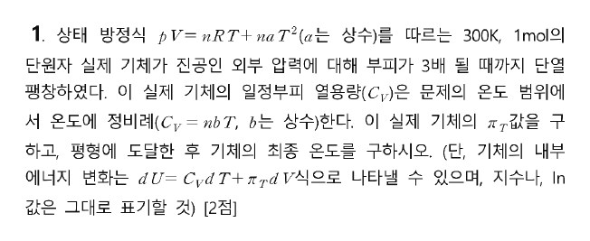

**정답** $\pi_T = \dfrac{naT^2}{V}$, $T_2 = 300\times3^{-a/b}\ \mathrm{K} = 300\,e^{-(a/b)\ln3}\ \mathrm{K}$

**공식·핵심 개념**

- $\pi_T = T(\partial p/\partial T)_V - p$
- $dU = C_VdT + \pi_TdV$
- 진공으로의 단열 팽창: $q = w = 0$ → $\Delta U = 0$ (Joule 팽창)

**2027 출제 가능성 ★★★☆☆ 보통** — 내부 압력과 Joule 팽창은 열역학 관계식 문항의 단골 변형입니다(4회 B형 10번과 같은 계열).

**내부 압력.** $\pi_T = T\left(\dfrac{\partial p}{\partial T}\right)_V - p$이고, $p = \dfrac{nRT + naT^2}{V}$이므로

$$\pi_T = T\cdot\frac{nR + 2naT}{V} - \frac{nRT + naT^2}{V} = \frac{naT^2}{V}$$

**최종 온도.** 진공으로의 팽창은 $w = 0$, 단열이라 $q = 0$ → $dU = 0$:

$$C_VdT + \pi_TdV = nbT\,dT + \frac{naT^2}{V}dV = 0 \;\Rightarrow\; b\frac{dT}{T} = -a\frac{dV}{V}$$

$$b\ln\frac{T_2}{300} = -a\ln3 \;\Rightarrow\; T_2 = 300\times3^{-a/b}\ \mathrm{K}$$

**채점 포인트·함정**

- 이상기체였다면 $\pi_T = 0$이라 온도가 변하지 않습니다. 이 기체는 $a > 0$이면 냉각됩니다.

## A형 2번 · CH₄의 광전자 스펙트럼 {#a2}

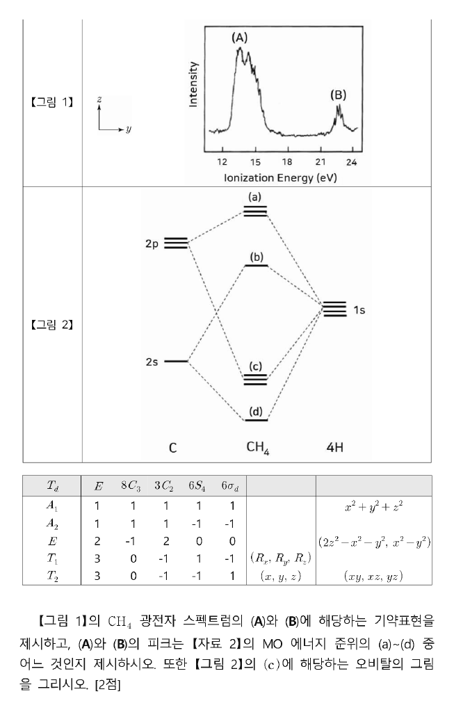

**정답** (A) **T₂** = (c) **1t₂**, (B) **A₁** = (d) **1a₁**. (c)는 C의 2p 하나와 같은 부호로 겹치는 H 1s 4개 조합(세 개 중 하나: 예 C 2pz + 위쪽 H 두 개 +, 아래쪽 두 개 −)

**공식·핵심 개념**

- Td H 1s SALC: $A_1 + T_2$
- 쿠프만스 정리: IE = −ε(MO)
- PES 띠 세기 ∝ 그 MO의 전자 수

**2027 출제 가능성 ★★★★☆ 높음** — 광전자 스펙트럼과 MO 대응은 무기 서술형에서 자주 나옵니다. H₂O·NH₃·CO로 바뀌어 나올 수 있습니다.

**H 1s SALC.** Td에서 Γ(4H) = 4, 1, 0, 0, 2 → **A₁ + T₂**. C 2s는 A₁, 2p는 T₂(x, y, z)와 맞습니다.

**MO 순서.** 결합성 1a₁(d, 가장 낮음) < 1t₂(c, 삼중 축퇴) < 비결합 없음 < 반결합성 2a₁(b), 2t₂(a). 전자 8개가 1a₁², 1t₂⁶을 채웁니다.

**PES.** 이온화 에너지가 작은 (A, ~14 eV)가 **1t₂**(전자 6개라 세기가 큼, Jahn–Teller로 넓게 갈라짐), 큰 (B, ~23 eV)가 **1a₁**입니다(쿠프만스 정리: IE = −ε).

**채점 포인트·함정**

- 띠 세기가 대략 3 : 1인 것(전자 6 : 2)도 근거로 쓸 수 있습니다.

## A형 3번 · C₆H₁₂O₃의 구조 결정 {#a3}

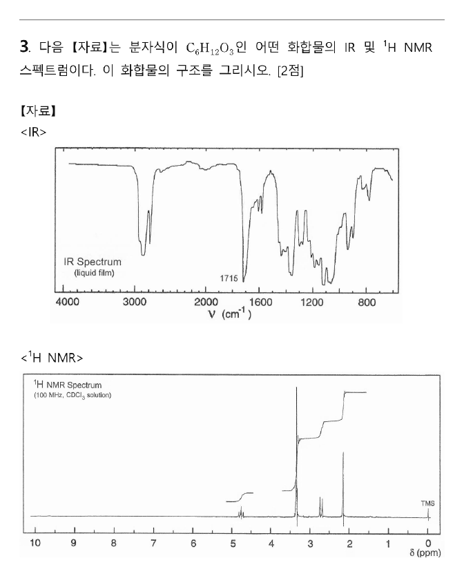

**정답** **4,4-dimethoxy-2-butanone**, CH₃COCH₂CH(OCH₃)₂

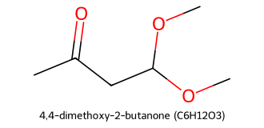

**공식·핵심 개념**

- 불포화도 $= \dfrac{2C + 2 - H}{2}$
- 케톤 C=O 1715 cm⁻¹
- 아세탈 CH(OR)₂: δ 4.5–5.0

**2027 출제 가능성 ★★★★★ 매우 높음** — IR·NMR 구조 결정은 해마다 나오는 유형입니다.

**불포화도** = (2·6 + 2 − 12)/2 = 1 → C=O 하나.

| 자료 | 신호 | 해석 |
|---|---|---|
| IR | 1715 cm⁻¹ | 지방족 케톤 C=O |
| IR | 1050–1150 cm⁻¹ | C–O (아세탈) |
| ¹H | δ 2.2 (s, 3H) | CH₃–C=O |
| ¹H | δ 2.7 (d, 2H) | C(=O)–CH₂–CH |
| ¹H | δ 3.35 (s, 6H) | OCH₃ 두 개(동등) |
| ¹H | δ 4.8 (t, 1H) | CH(OMe)₂ — O 두 개가 붙어 낮은 장 |

**채점 포인트·함정**

- 4.8 ppm 삼중선(1H)이 **아세탈 CH**의 표지입니다. 이웃 CH₂ 때문에 삼중선이 됩니다.

## A형 4번 · 조절 전위 전기량 분석 {#a4}

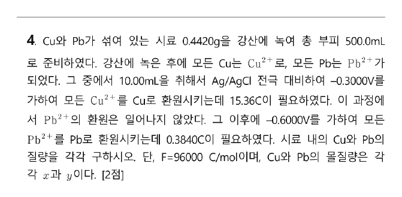

**정답** Cu **$(4.00\times10^{-3}x)$ g**, Pb **$(1.00\times10^{-4}y)$ g**

**공식·핵심 개념**

- $q = nF$, $n_{\text{금속}} = n_{e^-}/z$
- 조절 전위로 순차 환원(E°가 큰 금속부터)
- 분취량 → 전체 부피 환산

**2027 출제 가능성 ★★★★☆ 높음** — 전기량 분석(쿨롬법)은 분석화학 기입형으로 자주 나옵니다.

**Cu.** $n_{e^-} = \dfrac{15.36}{96000} = 1.60\times10^{-4}$ mol → Cu²⁺ = $8.00\times10^{-5}$ mol (10.00 mL 속). 전체 500.0 mL로 환산 ×50 → $4.00\times10^{-3}$ mol × x g/mol.

**Pb.** $n_{e^-} = \dfrac{0.3840}{96000} = 4.00\times10^{-6}$ mol → Pb²⁺ $2.00\times10^{-6}$ mol × 50 = $1.00\times10^{-4}$ mol × y g/mol.

**전위 선택.** −0.30 V에서는 Cu²⁺만 환원(Cu의 E°가 더 양수), −0.60 V로 내려야 Pb²⁺가 환원 → 순차적으로 분리 정량.

**채점 포인트·함정**

- 2전자 반응이라 전자 몰수를 **2로 나누고**, 분취량(10 mL)에서 전체(500 mL)로 **50배**합니다.

## A형 5번 · 2022 개정 [화학] 중화 반응 {#a5}

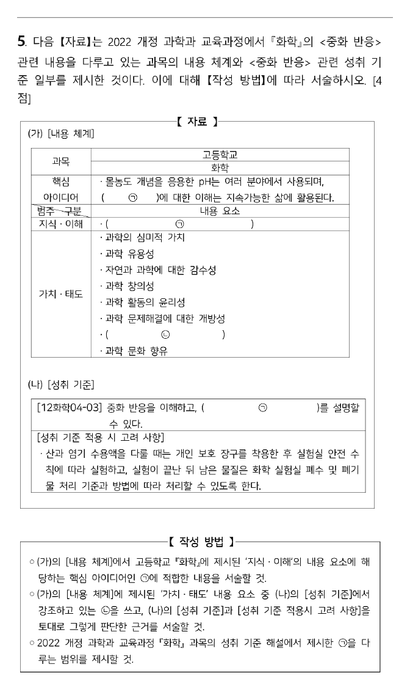

**정답**

- ㉠ **중화 반응의 양적 관계**
- ㉡ **안전·지속 가능 사회에 기여**. 근거: 산·염기 수용액을 다루고 실험 후 남은 물질은 환경 오염을 일으킬 수 있으므로, 안전하고 환경을 오염시키지 않도록 폐수·폐기물 처리 기준에 따라 처리하여 미래 세대를 위한 책임감을 가지고 지속가능한 사회에 기여하는 태도를 지녀야 한다.
- 범위: 중화 반응의 양적 관계는 **강산과 강염기의 반응으로 제한**한다.

**공식·핵심 개념**

- 2022 개정 [화학] 중화 반응의 양적 관계: 강산·강염기로 제한
- 가치·태도: 안전·지속 가능 사회에 기여
- 성취기준 적용 시 고려 사항: 폐수·폐기물 처리

**2027 출제 가능성 ★★★★★ 매우 높음** — 2022 개정 [화학] 성취기준 해설과 가치·태도 요소는 2027 최우선 영역입니다.

**2022 개정 가치·태도 요소**: 과학의 심미적 가치, 과학 유용성, 자연과 과학에 대한 감수성, 과학 창의성, 과학 활동의 윤리성, 과학 문제 해결에 대한 개방성, **안전·지속 가능 사회에 기여**, 과학 문화 향유.

**채점 포인트·함정**

- 근거에는 성취기준 적용 시 고려 사항의 "폐수 및 폐기물 처리 기준과 방법"을 연결합니다.

## A형 6번 · 원격수업과 비고츠키 {#a6}

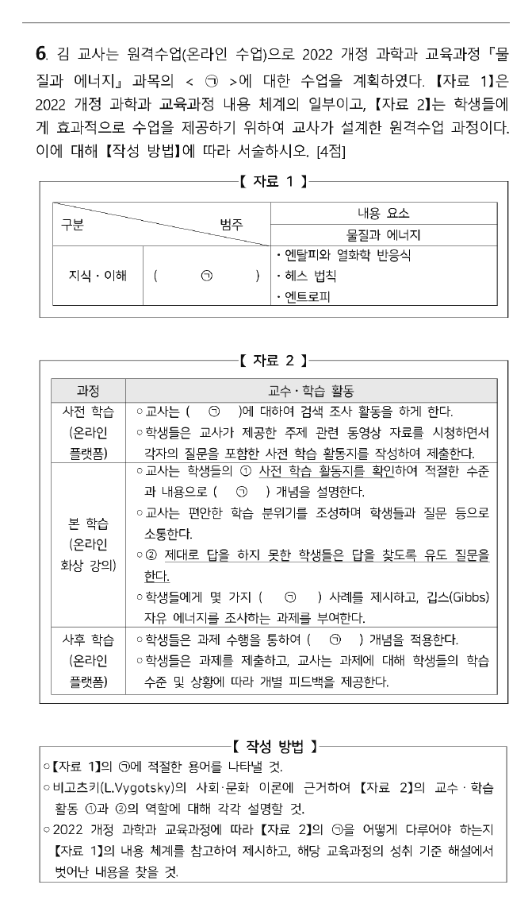

**정답**

- ㉠ **화학 변화의 자발성**
- ① 사전 학습 활동지 확인: 학생의 **실제적 발달 수준을 진단**하기 위함
- ② 유도 질문: **근접발달영역(ZPD)** 안에서 어려움을 겪는 학생에게 **비계**를 제공해 잠재적 발달 수준에 도달하도록 하는 언어적 상호작용
- 다루는 방법: 엔탈피와 엔트로피 변화로 화학 변화의 자발성을 설명하며, **깁스 자유 에너지는 다루지 않는다** → 벗어난 내용: "깁스 자유 에너지를 조사하는 과제"

**공식·핵심 개념**

- 비고츠키: 실제적 발달 수준 — ZPD — 잠재적 발달 수준
- 비계: 언어적 상호작용, 점차 줄여 감
- [물질과 에너지]: 자발성은 엔탈피·엔트로피까지(깁스 X)

**2027 출제 가능성 ★★★★★ 매우 높음** — 교육과정 범위 이탈 찾기와 비고츠키는 함께 자주 출제됩니다.

**비고츠키**: 실제적 발달 수준(혼자 해결) — 근접발달영역 — 잠재적 발달 수준(도움 받아 해결). 비계는 학습자가 성장하면 점차 줄여 나갑니다(fading).

**채점 포인트·함정**

- ①은 "진단", ②는 "비계 · ZPD · 언어적 상호작용"이 핵심어입니다.

## A형 7번 · 파인즈와 웨스트의 포도덩굴 모형 {#a7}

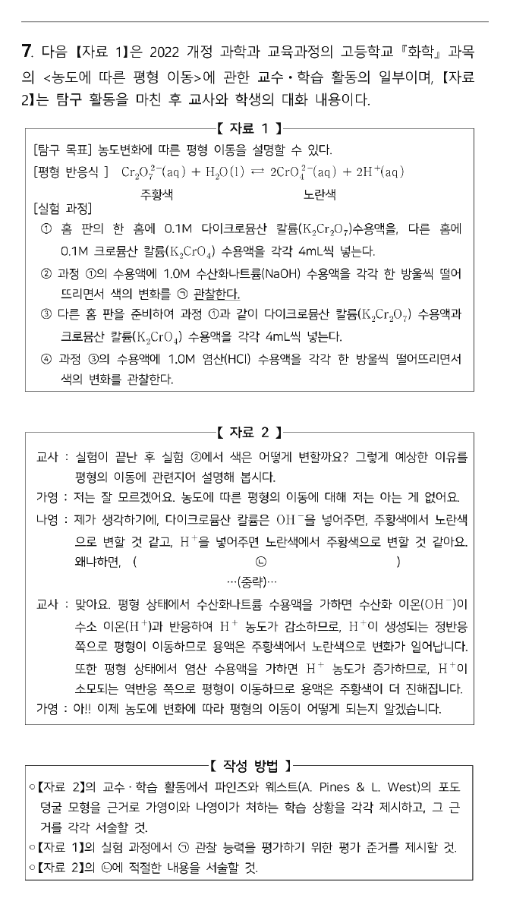

**정답**

- 가영: **학교 학습 상황(형식 기호적 상황)** — 인지구조에 관련 지식(자발적 개념)이 없고 학교에서 배운 상황만 있음
- 나영: **조화 상황(일치 상황)** — 자발적으로 학습한 내용과 학교에서 학습한 내용이 같음
- ㉠ 평가 준거: **적절한 감각을 활용하여 색 변화를 정확하게 관찰하였는가?**
- ㉡ H⁺ 농도가 묽어지면 H⁺가 생성되는 방향으로, H⁺ 농도가 진해지면 H⁺가 소모되는 방향으로 평형이 이동합니다.

**공식·핵심 개념**

- 포도덩굴 모형: 조화, 갈등, 학교 학습, 자발적 학습 상황
- 관찰 평가 준거: 감각 활용·정확성
- 르샤틀리에: 농도 변화 → 그것을 줄이는 방향

**2027 출제 가능성 ★★★★☆ 높음** — 파인즈와 웨스트 모형은 개념 변화 이론 중 꾸준히 나오는 소재입니다.

**포도덩굴 모형 4가지 상황**

| 상황 | 자발적 개념(아래 덩굴) | 형식적 개념(위 덩굴) |
|---|---|---|
| 조화(일치) | 있음 | 있음, 서로 같음 |
| 갈등 | 있음 | 있음, 서로 다름 |
| 학교 학습(형식 기호) | 없음 | 있음 |
| 자발적 학습 | 있음 | 없음 |

**채점 포인트·함정**

- 나영의 설명이 교사의 과학적 설명과 일치하므로 조화 상황입니다.

## A형 8번 · HCl의 진동-회전 스펙트럼 {#a8}

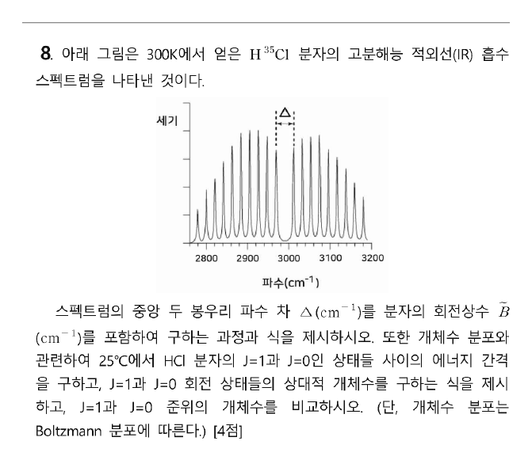

**정답** $\Delta = 4\tilde B$, $\varepsilon_1 - \varepsilon_0 = 2hc\tilde B$, $\dfrac{N_1}{N_0} = 3e^{-2hc\tilde B/kT}$. J = 1이 J = 0보다 에너지는 높지만 **3중 축퇴**라 개체수가 더 많다.

**공식·핵심 개념**

- $R(J) = \tilde\nu + 2\tilde B(J+1)$, $P(J) = \tilde\nu - 2\tilde BJ$
- $E_J = hc\tilde BJ(J+1)$, 축퇴도 $2J+1$
- $N_J/N_0 = (2J+1)e^{-E_J/kT}$

**2027 출제 가능성 ★★★★☆ 높음** — 진동-회전 스펙트럼 해석은 물리화학 분광 단골입니다.

**가지의 위치.** $R(J) = \tilde\nu + 2\tilde B(J + 1)$, $P(J) = \tilde\nu - 2\tilde BJ$. 가운데 두 봉우리는 R(0)과 P(1):

$$\Delta = [\tilde\nu + 2\tilde B] - [\tilde\nu - 2\tilde B] = 4\tilde B$$

(Q 가지(ΔJ = 0)는 없어서 가운데가 비어 있습니다.)

**개체수.** $E_J = hc\tilde BJ(J+1)$, 축퇴도 $2J + 1$:

$$\frac{N_1}{N_0} = \frac{3}{1}e^{-2hc\tilde B/kT}$$

HCl($\tilde B \approx 10.6\ \mathrm{cm^{-1}}$), 25 °C($kT/hc \approx 207\ \mathrm{cm^{-1}}$): $3e^{-0.102} \approx 2.7$ → J = 1이 더 많음.

**채점 포인트·함정**

- 스펙트럼에서 봉우리 세기가 J = 3~4 근처에서 최대인 것도 같은 이유(축퇴도 × 볼츠만 인자)입니다.

## A형 9번 · Ni²⁺ 착물의 결정장 {#a9}

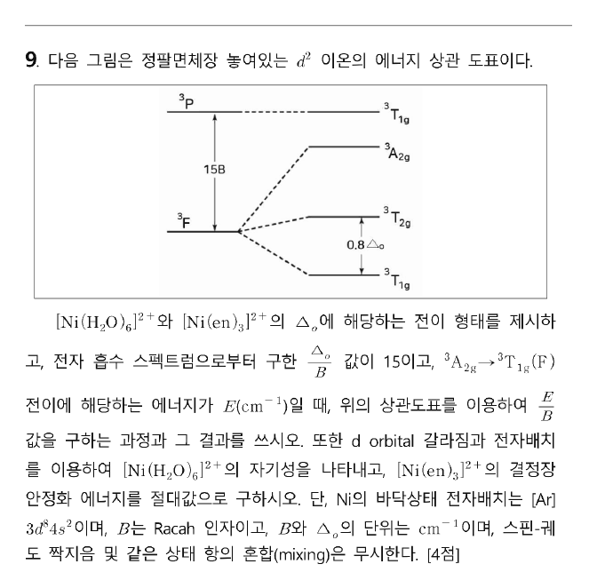

**정답** Δo = **³A₂g → ³T₂g** 전이, **E/B = 27**, [Ni(H₂O)₆]²⁺ **상자성**(홀전자 2개), [Ni(en)₃]²⁺ CFSE **|1.2Δo|**

**공식·핵심 개념**

- d⁸ 팔면체: ³A₂g → ³T₂g = Δo, → ³T₁g(F) = 1.8Δo, → ³T₁g(P) = 1.2Δo + 15B
- CFSE d⁸ = −1.2Δo
- d⁸ 도표 = d² 도표 뒤집기

**2027 출제 가능성 ★★★★★ 매우 높음** — Ni²⁺ 전자 스펙트럼은 결정장 문항의 대표 예시입니다.

**d⁸은 d² 도표를 뒤집은 것.** Ni²⁺ = [Ar]3d⁸. 팔면체 d⁸의 바닥 상태는 ³A₂g(t₂g⁶eg²)이고, 들뜬 상태는 위로 ³T₂g, ³T₁g(F), ³T₁g(P) 순입니다(혼합 무시).

| 전이 | 에너지 |
|---|---|
| ³A₂g → ³T₂g | Δo |
| ³A₂g → ³T₁g(F) | 1.8Δo (도표에서 Δo + 0.8Δo) |
| ³A₂g → ³T₁g(P) | 1.2Δo + 15B |

$$\frac EB = 1.8\times\frac{\Delta_o}{B} = 1.8\times15 = 27$$

**자기성·CFSE.** t₂g⁶eg² → eg에 홀전자 2개(상자성). CFSE = 6(−0.4Δo) + 2(0.6Δo) = **−1.2Δo** (d⁸은 강한 장·약한 장 배치가 같음).

**채점 포인트·함정**

- 전자 4s²가 먼저 빠져 Ni²⁺는 d⁸입니다.

## A형 10번 · 아닐린의 친전자성 치환과 아조 염료 {#a10}

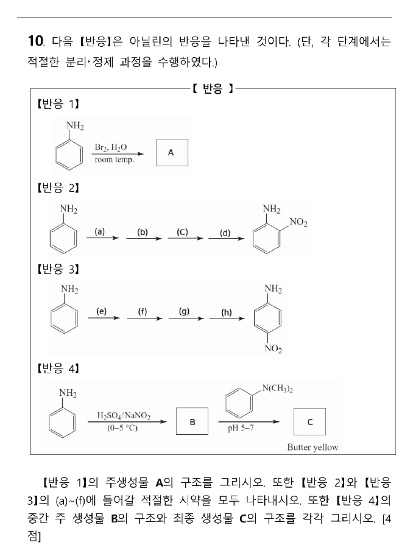

**정답** A **2,4,6-tribromoaniline**, (a)·(e) **CH₃COCl 또는 (CH₃CO)₂O**, (b) **진한 H₂SO₄**, (c) **HNO₃**, (d) **(1) 묽은 H₂SO₄, 가열 (2) HO⁻**, (f) **HNO₃/H₂SO₄**, (g) **H₃O⁺**, (h) **HO⁻**, B **벤젠다이아조늄 이온**, C **4-(dimethylamino)azobenzene(butter yellow)**

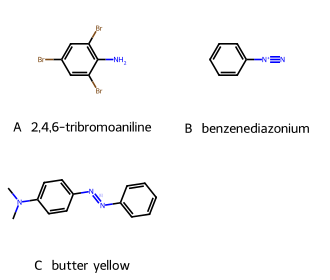

**공식·핵심 개념**

- –NH₂ 강한 o,p 활성기 → 아세틸화로 조절
- 술폰화는 가역 → 차단기
- 아조 짝지음: ArN₂⁺ + 활성 방향족(para)

**2027 출제 가능성 ★★★★☆ 높음** — 방향족 치환 위치 조절(보호·차단기) 문항은 유기에서 꾸준히 나옵니다.

**[반응 1]** –NH₂는 매우 강한 활성기라 Br₂ 수용액에서 촉매 없이 o, p 세 자리 모두 치환됩니다.

**[반응 2] 오르토 니트로화.** 아세틸화로 활성을 낮추고 → 진한 H₂SO₄로 **para를 SO₃H로 막고(차단기)** → 니트로화는 남은 ortho로 → 묽은 산 가열로 술폰화를 되돌리고(탈술폰화) 아마이드도 가수분해 → 염기로 중화.

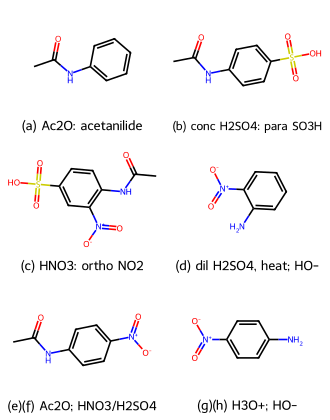

**[반응 3] 파라 니트로화.** 아세틸화(보호, 부피로 ortho 억제) → 혼산 니트로화(para) → 산 가수분해 → 염기 처리. 보호하지 않으면 산성 혼산에서 –NH₃⁺(메타 지향)가 되고 산화도 일어납니다.

**[반응 4] 아조 짝지음.** 0–5 °C 다이아조화 → B. pH 5–7에서 N,N-dimethylaniline의 **para**를 B가 공격(친전자성 치환) → C.

**채점 포인트·함정**

- 술폰화가 **가역**이라 차단기로 쓸 수 있다는 점이 [반응 2]의 핵심입니다.

## A형 11번 · 방향족 Claisen 자리옮김 {#a11}

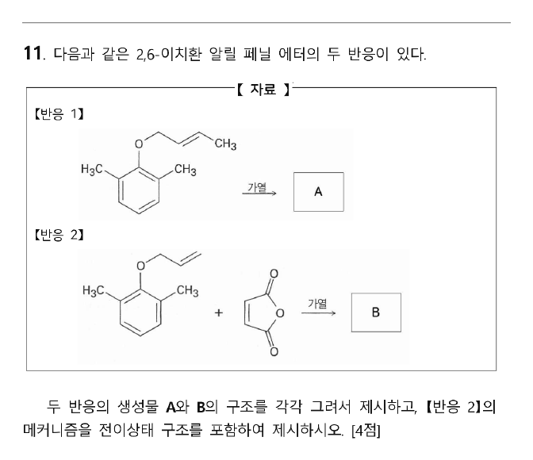

**정답** A **4-(but-2-enyl)-2,6-dimethylphenol**, B **엔도 Diels–Alder 부가물** (Claisen → 2,4-cyclohexadienone → 말레산 무수물)

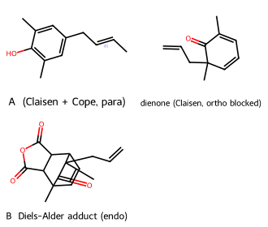

**공식·핵심 개념**

- 방향족 Claisen: [3,3], 알릴 말단 뒤집힘
- ortho가 막히면 Cope로 para 이동
- 다이엔온 + 친다이엔체: Diels–Alder(엔도)

**2027 출제 가능성 ★★★★☆ 높음** — 페리고리 반응(Claisen·Cope·Diels–Alder)은 유기 고난도 서술형 소재입니다.

**[반응 1].** [3,3] Claisen 자리옮김으로 알릴기가 ortho로 옮겨 가는데, 두 ortho가 CH₃로 막혀 있어 방향족성을 회복할 수 없습니다. 그래서 다이엔온에서 **두 번째 [3,3](Cope) 자리옮김**으로 para까지 이동한 뒤 토토머화되어 페놀이 됩니다. [3,3]이 두 번 일어나 알릴 말단이 두 번 뒤집히므로, 원래처럼 **크로틸(CH₂–CH=CH–CH₃)** 형태로 para에 붙습니다.

**[반응 2].** 첫 Claisen으로 생긴 6-allyl-2,6-dimethylcyclohexa-2,4-dienone이 **s-cis 다이엔**이므로, 방향족화(Cope)보다 먼저 말레산 무수물과 [4+2] 고리화 → 바이사이클로[2.2.2]옥테논에 무수물이 붙은 B(엔도 규칙).

**전이 상태.** Claisen: 의자형 6원 고리 전이 상태(C–O 끊어짐, C–C 생성 동시). Diels–Alder: 다이엔의 양 끝과 친다이엔체의 두 탄소가 동시에 결합하는 고리형 전이 상태, 무수물 C=O가 다이엔 아래(엔도)에 위치.

**채점 포인트·함정**

- 분자식 검산: 다이엔온 C₁₁H₁₄O + 말레산 무수물 C₄H₂O₃ = **C₁₅H₁₆O₄**.

## A형 12번 · 기체 크로마토그래피 계산 {#a12}

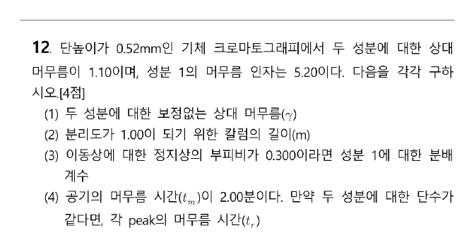

**정답** (1) γ = **1.08** (2) L = **1.30 m** (답안 기준) (3) K = **17.3** (4) $t_{r1}$ = **12.4 min**, $t_{r2}$ = **13.4 min**

**공식·핵심 개념**

- $\alpha = k_2/k_1$, $\gamma = t_{r2}/t_{r1}$
- $R = \frac{\sqrt N}{4}(\gamma - 1)$, $L = NH$
- $K = k\,V_m/V_s$, $t_r = t_m(1 + k)$

**2027 출제 가능성 ★★★★☆ 높음** — 크로마토그래피 계산은 분석화학 고빈도 유형입니다.

**(1)** $k_2 = \alpha k_1 = 1.10\times5.20 = 5.72$. 보정하지 않은 상대 머무름:

$$\gamma = \frac{t_{r2}}{t_{r1}} = \frac{1 + k_2}{1 + k_1} = \frac{6.72}{6.20} = 1.08$$

**(2)** $R = \dfrac{\sqrt N}{4}(\gamma - 1)$: $\sqrt N = \dfrac{4}{0.08} = 50$ → N = 2500 → L = NH = 2500 × 0.52 mm = **1.30 m**. (γ = 1.0839로 계산하면 1.18 m — 검토 메모 1)

**(3)** $K = k\dfrac{V_m}{V_s} = \dfrac{5.20}{0.300} = 17.3$

**(4)** $t_{r1} = t_m(1 + k_1) = 2.00\times6.20 = 12.4$ min, $t_{r2} = 2.00\times6.72 = 13.4$ min

**채점 포인트·함정**

- α(보정, $k_2/k_1$)와 γ(보정 없음, $t_{r2}/t_{r1}$)를 구분합니다.

# 전공 B

## B형 1번 · C₆H₁₀ 세 화합물 {#b1}

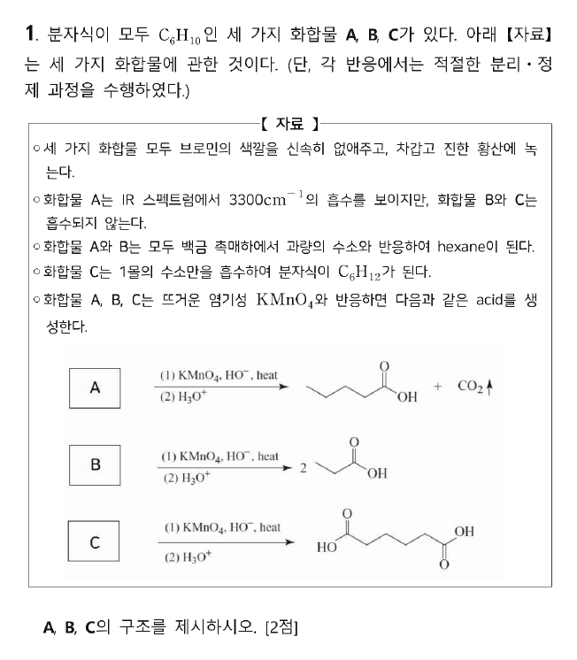

**정답** A **1-hexyne**, B **3-hexyne**, C **cyclohexene**

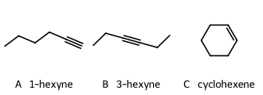

**공식·핵심 개념**

- C₆H₁₀ 불포화도 2
- 말단 알카인 ≡C–H 3300 cm⁻¹
- KMnO₄ 산화 절단: 말단 탄소 → CO₂, 고리 알켄 → 이산

**2027 출제 가능성 ★★★★☆ 높음** — 산화 절단 생성물로 구조를 역추적하는 문항은 유기 기입형 단골입니다.

C₆H₁₀ 불포화도 2: 삼중결합 하나 또는 고리 + 이중결합.

- **A**: 3300 cm⁻¹ = 말단 ≡C–H. KMnO₄ 산화로 pentanoic acid + CO₂(말단 탄소) → 1-hexyne.
- **B**: H₂ 2몰 → hexane(사슬), 산화로 propanoic acid 2분자 → 대칭 내부 알카인 3-hexyne.
- **C**: H₂ 1몰만 → C₆H₁₂(고리 하나 남음), 산화로 adipic acid(고리가 열린 이산) → cyclohexene.

**채점 포인트·함정**

- H₂ 흡수량이 고리 여부를 가릅니다(A·B 2몰, C 1몰).

## B형 2번 · 전위로 구하는 형성상수 비 {#b2}

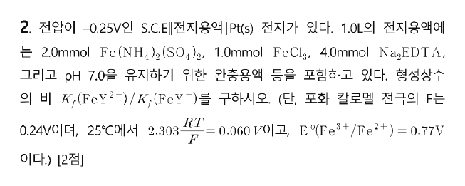

**정답** $\dfrac{K_f(\mathrm{FeY^{2-}})}{K_f(\mathrm{FeY^-})} = 2.0\times10^{-13}$

**공식·핵심 개념**

- $E_{cell} = E_+ - E_-$, SCE 0.24 V
- 네른스트로 [Fe²⁺]/[Fe³⁺] 계산
- 과량 EDTA → 착물 비 = 넣은 금속 비

**2027 출제 가능성 ★★★★☆ 높음** — 전위와 착물 평형을 엮는 계산은 분석화학에서 자주 나옵니다.

**Pt 전극 전위.** $E_{cell} = E_{Pt} - E_{SCE}$ → $E_{Pt} = -0.25 + 0.24 = -0.01$ V.

$$-0.01 = 0.77 - 0.060\log\frac{[\mathrm{Fe^{2+}}]}{[\mathrm{Fe^{3+}}]} \;\Rightarrow\; \frac{[\mathrm{Fe^{2+}}]}{[\mathrm{Fe^{3+}}]} = 10^{13}$$

**착물 농도.** EDTA 4.0 mmol이 과량이므로 Fe²⁺ 2.0 mmol → FeY²⁻ 2.0, Fe³⁺ 1.0 mmol → FeY⁻ 1.0.

$$\frac{K_f(\mathrm{FeY^{2-}})}{K_f(\mathrm{FeY^-})} = \frac{[\mathrm{FeY^{2-}}]}{[\mathrm{FeY^-}]}\cdot\frac{[\mathrm{Fe^{3+}}]}{[\mathrm{Fe^{2+}}]} = 2\times10^{-13}$$

([Y⁴⁻]는 약분)

**채점 포인트·함정**

- 전위가 크게 음으로 내려간 것은 Fe³⁺가 EDTA와 훨씬 강하게 결합하기 때문입니다.

## B형 3번 · 발생학습 모형과 인지 갈등 {#b3}

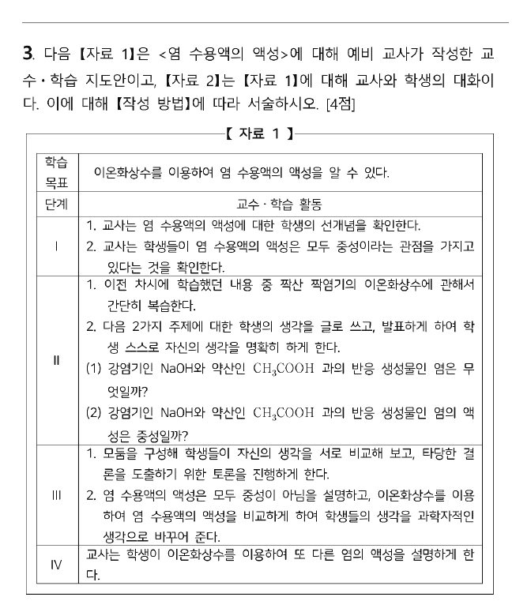

**정답**

- 단계: **발생학습 모형** I 예비, II 초점, III 도전, IV 적용
- 나영: **긍정적 발견법**(답안 기준). "모든 염 수용액은 중성"이라는 핵을 지키려고 반증 사례 앞에서 **같은 몰 수** 개념을 보호대에 추가·보완했다.
- ㉠ 강산과 강염기가 반응해 생긴 염 수용액은 중성이지만, 다른 산·염기로 만들어진 염은 액성이 다릅니다. 염을 이루는 이온이 물과 반응(가수분해)해 H⁺나 OH⁻를 내놓아 산성 또는 염기성을 띱니다.
- C1: 산과 염기의 중화 반응으로 생성된 염은 모두 중성이다. C2: 생성된 염의 액성에 따라 산성 또는 염기성을 나타낸다.

**공식·핵심 개념**

- 발생학습: 예비 → 초점 → 도전 → 적용
- 라카토스: 핵·보호대, 긍정적/부정적 발견법
- 하슈웨: C1(기존 개념), C2(새 개념)

**2027 출제 가능성 ★★★★★ 매우 높음** — 개념 변화 모형과 과학철학자 조합은 교육론 최빈출입니다.

**발생학습(Osborne & Freyberg)**: 예비(학생 생각 파악) → 초점(구체적 상황에서 자기 생각 명확히) → 도전(생각 비교·과학적 관점 제시) → 적용(새 상황에 적용).

**가수분해.** CH₃COO⁻ + H₂O ⇌ CH₃COOH + OH⁻ (약산의 짝염기 → 염기성).

**채점 포인트·함정**

- 라카토스 판단은 강사마다 기준이 다릅니다(검토 메모 4).

## B형 4번 · 오수벨의 유의미 학습 유형 {#b4}

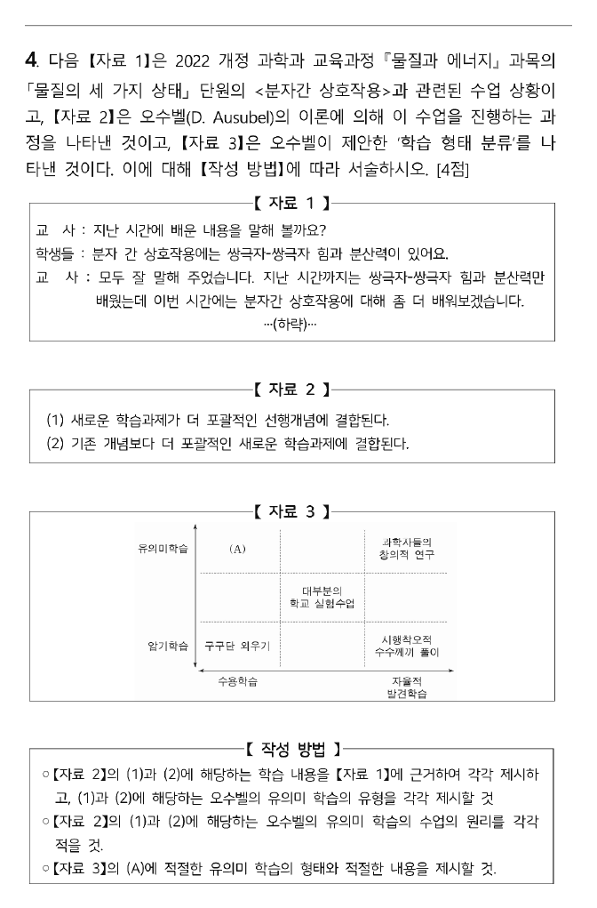

**정답**

- (1) **하위적 학습**: 분자 간 상호작용(쌍극자–쌍극자 힘, 분산력)을 아는 학생이 **수소 결합**을 학습
- (2) **상위적 학습**: 쌍극자–쌍극자 힘과 분산력을 아는 학생이 이를 묶는 **분자 간 상호작용**을 학습
- 원리: 하위적 → **점진적 분화**, 상위적 → **통합적 조정**
- (A) **유의미 수용학습** — 애매하게 알던 내용을 교사의 설명으로 이해하고, 새 지식으로 개념 간 관계가 명료해짐

**공식·핵심 개념**

- 오수벨: 하위적(파생·상관적)·상위적·병렬적 학습
- 점진적 분화 / 통합적 조정
- 유의미 수용학습

**2027 출제 가능성 ★★★★☆ 높음** — 오수벨 학습 유형과 원리는 교육론에서 꾸준히 나옵니다.

**오수벨 학습 형태**: 수용–발견 축과 기계적–유의미 축은 독립. (A)는 수용학습이면서 유의미학습인 칸 = 잘 설계된 설명식 수업(개념 간 관계 명료화).

**채점 포인트·함정**

- 하위적: 새 내용이 **기존의 더 포괄적인 개념 아래로**, 상위적: 기존 개념들을 **묶는 더 포괄적인 새 개념**.

## B형 5번 · STAD와 기체 반응 법칙 {#b5}

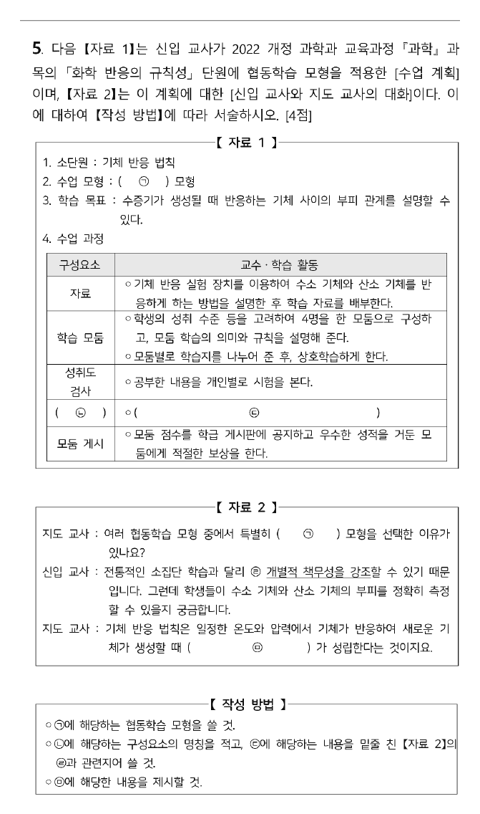

**정답**

- ㉠ **STAD**, ㉡ **개인 성취 점수**
- ㉢ 사전 검사·이전 평균 등으로 **개인별 기본 점수**를 정하고, 기본 점수보다 향상된 점수를 확인해 기준에 따라 개인 성취 점수로 환산한 뒤, 모둠별로 더해 **모둠 향상 점수**를 계산한다.
- ㉣ 개별 평가·개별 향상 점수로 개별 보상과 집단 보상이 함께 나타나, 무임승차를 막고 각자 모둠 목표에 책임감을 가지므로 개별적 책무성이 강조된다.
- ㉤ 각 기체의 부피 사이에 **간단한 정수비**

**공식·핵심 개념**

- STAD: 개별 평가 → 향상 점수 → 모둠 보상
- 개별적 책무성
- 기체 반응 법칙: 부피는 간단한 정수비

**2027 출제 가능성 ★★★★☆ 높음** — 협동 학습모형은 해마다 한 번 이상 나오는 소재입니다.

**게이뤼삭 기체 반응 법칙**: 같은 온도·압력에서 반응하거나 생성되는 기체의 부피는 간단한 정수비(H₂ : O₂ : H₂O(g) = 2 : 1 : 2).

**채점 포인트·함정**

- STAD의 핵심은 **향상 점수**(기본 점수 대비)입니다. 원점수 합산이 아닙니다.

## B형 6번 · 엔트로피 변화율과 압축·J-T 냉각 {#b6}

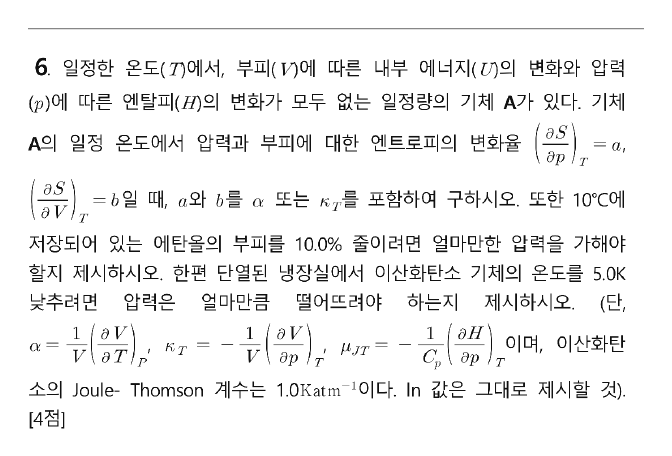

**정답** $a = -\alpha V$, $b = \dfrac{\alpha}{\kappa_T}$, 에탄올 $\Delta p = -\dfrac{\ln0.9}{\kappa_T}$, CO₂ **5.0 atm** 떨어뜨림

**공식·핵심 개념**

- 맥스웰: $(\partial S/\partial p)_T = -(\partial V/\partial T)_p$, $(\partial S/\partial V)_T = (\partial p/\partial T)_V$
- $(\partial p/\partial T)_V = \alpha/\kappa_T$
- $\Delta T = \mu_{JT}\Delta p$

**2027 출제 가능성 ★★★☆☆ 보통** — 맥스웰 관계식 응용은 물리화학 기입형에 가끔 나옵니다.

**맥스웰 관계식.** $\left(\dfrac{\partial S}{\partial p}\right)_T = -\left(\dfrac{\partial V}{\partial T}\right)_p = -\alpha V$, $\left(\dfrac{\partial S}{\partial V}\right)_T = \left(\dfrac{\partial p}{\partial T}\right)_V = \dfrac{\alpha}{\kappa_T}$ (순환 관계 $(\partial p/\partial T)_V = -(\partial V/\partial T)_p/(\partial V/\partial p)_T$).

**에탄올 압축.** $dV/V = -\kappa_Tdp$ → $\ln0.900 = -\kappa_T\Delta p$ → $\Delta p = -\dfrac{\ln0.900}{\kappa_T}$ (≈ 0.105/κT).

**J-T 냉각.** $\Delta T \approx \mu_{JT}\Delta p$ → $\Delta p = -5.0/1.0 = -5.0$ atm → 압력을 5.0 atm 낮춥니다.

**채점 포인트·함정**

- 기체 A의 $(\partial U/\partial V)_T = 0$, $(\partial H/\partial p)_T = 0$ 조건은 a, b 식에 직접 필요하지 않습니다(완전 기체라면 a = −nR/p, b = nR/V로 확인 가능).

## B형 7번 · 시험 파동함수의 에너지 {#b7}

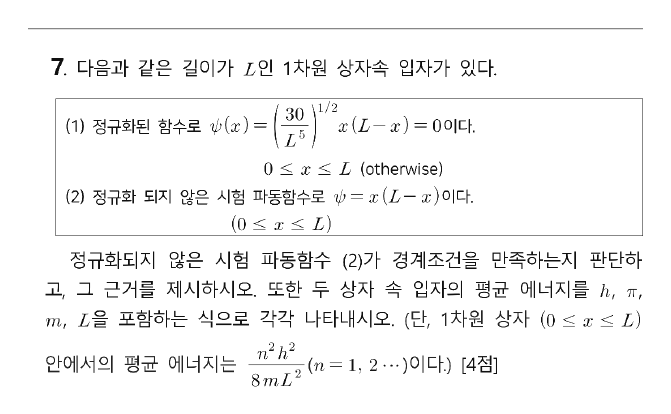

**정답** ψ(0) = ψ(L) = 0이므로 **경계조건 만족**. 두 함수 모두 $\langle E\rangle = \dfrac{5h^2}{4\pi^2mL^2}$

**공식·핵심 개념**

- 경계조건 ψ(0) = ψ(L) = 0
- $\langle E\rangle = \dfrac{\langle\psi|\hat H|\psi\rangle}{\langle\psi|\psi\rangle}$
- 변분 원리: 시험 에너지 ≥ 참 바닥 에너지

**2027 출제 가능성 ★★★☆☆ 보통** — 변분법은 양자 영역에서 가끔 나오는 고급 소재입니다.

**정규화되지 않은 함수(2).** $\hat H = -\dfrac{\hbar^2}{2m}\dfrac{d^2}{dx^2}$, $\psi'' = -2$:

$$\langle E\rangle = \frac{\int\psi\hat H\psi\,dx}{\int\psi^2dx} = \frac{\frac{\hbar^2}{m}\int_0^Lx(L-x)dx}{\int_0^Lx^2(L-x)^2dx} = \frac{\hbar^2L^3/6m}{L^5/30} = \frac{5\hbar^2}{mL^2} = \frac{5h^2}{4\pi^2mL^2}$$

정규화된 함수(1)는 분모가 1이고 같은 값입니다(정규화 상수는 에너지에 영향 없음).

**변분 원리 확인.** 정확한 바닥 상태 $\dfrac{h^2}{8mL^2}$와 비교하면 $\dfrac{5/4\pi^2}{1/8} = \dfrac{10}{\pi^2} = 1.013$ → 시험 함수 에너지가 1.3% 높음(항상 ≥ 참값).

**채점 포인트·함정**

- 정규화 안 된 함수는 반드시 **분모 ⟨ψ|ψ⟩로 나눕니다**.

## B형 8번 · IO₂F₃²⁻의 이성질체와 IR {#b8}

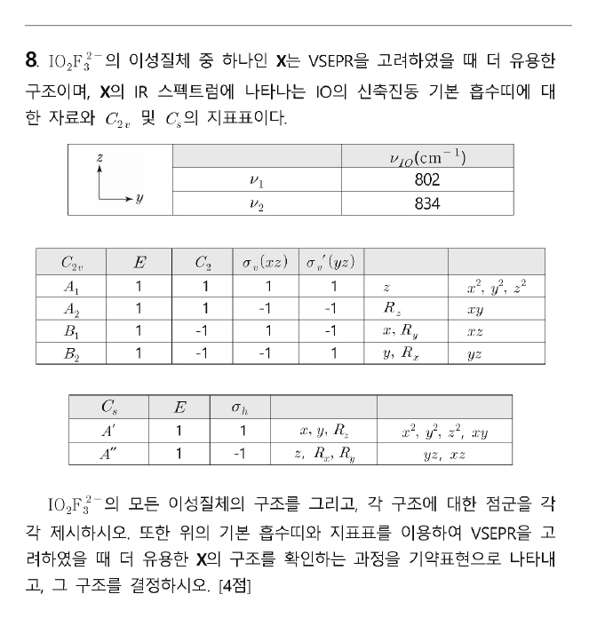

**정답** 이성질체 3개: **구조 1 C₂ᵥ**(O 두 개 trans), **구조 2 Cs**(O 하나가 고립쌍과 trans), **구조 3 Cs**(F가 고립쌍과 trans, O 두 개 cis). X = **구조 2**, $\Gamma_{I=O}$ = (E 2, σ 2) = **2A′**

**공식·핵심 개념**

- VSEPR: AX₅E 사각뿔, 이중결합은 큰 전자 영역
- 신축 진동 Γ → IR 활성 기약표현
- 이성질체 구별: IR 띠 수

**2027 출제 가능성 ★★★★☆ 높음** — VSEPR 이성질체와 IR 대칭을 엮는 무기 문항은 자주 나옵니다.

**VSEPR.** 원자가 전자 7 + 12 + 21 + 2 = 42 → I 주위 결합 5개 + 고립쌍 1개 = **AX₅E**, 사각뿔(팔면체 한 자리를 고립쌍이 차지).

| 구조 | 고립쌍 trans 자리 | 아래 평면 | 점군 | I=O 신축 IR |
|---|---|---|---|---|
| 1 | F | O, O trans + F, F | C₂ᵥ | 비대칭 1개만 활성 |
| 2 | O | O + F 3개 | Cs | 2A′ → 2개 |
| 3 | F | O, O cis + F, F | Cs | 2A′ → 2개 |

**결정.** IR 띠가 2개(802, 834)이므로 구조 1 제외. 고립쌍과 이중결합(큰 전자 영역)의 90° 반발을 줄여야 하는데, 구조 2는 O 하나가 고립쌍과 180°(90° 반발 1개), 구조 3은 O 둘 다 90°(반발 2개) → **구조 2**가 더 안정.

**채점 포인트·함정**

- 구조 1의 대칭 신축(O=I=O)은 쌍극자 변화가 거의 없어 IR에 나타나지 않습니다.

## B형 9번 · H₂O의 분자 궤도함수 {#b9}

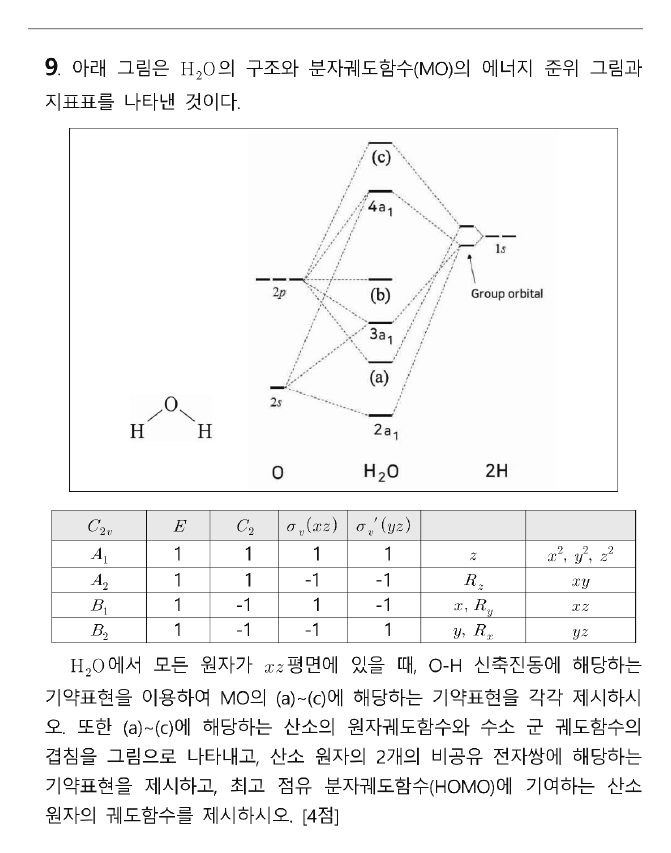

**정답** O–H 신축 = **A₁ + B₁** → (a) **1b₁**, (b) **1b₂**, (c) **2b₁**. 비공유 전자쌍 **2a₁, 1b₂**(답안), HOMO **1b₂ = O 2py**

**공식·핵심 개념**

- H₂O(xz 평면): O–H SALC = A₁ + B₁
- 1b₂(O 2py) 비결합 = HOMO
- MO 순서: 2a₁ < 1b₁ < 3a₁ < 1b₂ < 4a₁ < 2b₁

**2027 출제 가능성 ★★★★★ 매우 높음** — H₂O MO 도표는 무기 MO의 표준 예시로 반복 출제됩니다.

**좌표.** 분자 평면 = xz, C₂ = z. H 1s 군 궤도함수: 같은 부호 → a₁, 반대 부호 → b₁(x 방향, 평면 안).

| MO | O 오비탈 | H 군 궤도 | 성격 |
|---|---|---|---|
| 2a₁ | 2s (+2pz) | a₁ (+, +) | 결합성 |
| (a) 1b₁ | 2px | b₁ (+, −) 같은 위상 | 결합성 |
| 3a₁ | 2pz (+2s) | a₁ | 약한 결합성 |
| (b) 1b₂ | 2py (평면에 수직) | 없음 | **비결합, HOMO** |
| 4a₁ | 2s, 2pz | a₁ 반대 위상 | 반결합성 |
| (c) 2b₁ | 2px | b₁ 반대 위상 | 반결합성 |

전자 8개: 2a₁² 1b₁² 3a₁² 1b₂² → HOMO 1b₂.

**채점 포인트·함정**

- 평면이 **xz**이므로 평면 밖 오비탈은 **py(B₂)**입니다. 평면을 yz로 잡으면 b₁/b₂가 바뀝니다.
- 비공유 전자쌍 배정은 검토 메모 3 참고.

## B형 10번 · δ-발레로락톤의 반응 {#b10}

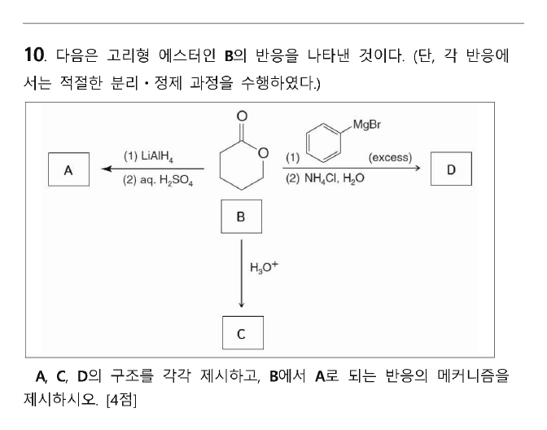

**정답** A **1,5-pentanediol**, C **5-hydroxypentanoic acid**, D **1,1-diphenylpentane-1,5-diol**

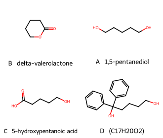

**공식·핵심 개념**

- 락톤 + LiAlH₄ → 다이올
- 산 가수분해 → 하이드록시산
- 에스터 + RMgX 과량 → 3차 알코올

**2027 출제 가능성 ★★★★☆ 높음** — 카복실산 유도체 반응과 메커니즘은 유기 서술형 단골입니다.

**B → A 메커니즘 (LiAlH₄).**

1. H⁻가 C=O 탄소를 공격 → 사면체 알콕사이드 중간체.
2. C=O가 다시 생기며 고리 O가 이탈(고리 열림) → 알데하이드 + 말단 알콕사이드.
3. 두 번째 H⁻가 알데하이드를 공격 → 다이알콕사이드.
4. 묽은 H₂SO₄로 양성자화 → 1,5-pentanediol.

**C.** 산 촉매 가수분해로 고리가 열려 하이드록시산.

**D.** PhMgBr 과량: 첫 당량이 아실 치환으로 케톤(고리 열림), 케톤이 에스터보다 반응성이 커서 두 번째 당량이 바로 첨가 → 3차 알코올. NH₄Cl/H₂O로 양성자화 → C₁₇H₂₀O₂.

**채점 포인트·함정**

- 에스터 + LiAlH₄/RMgX는 항상 **두 당량**이 들어갑니다(중간 알데하이드·케톤이 더 반응적).

## B형 11번 · CO₂를 흡수한 NaOH와 지시약 {#b11}

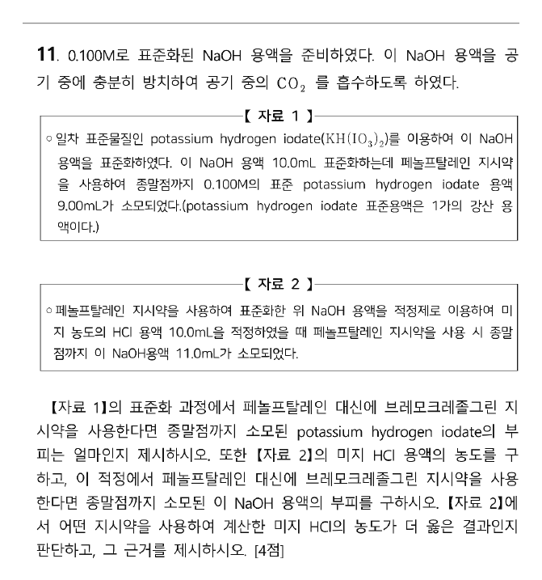

**정답** (1) **10.00 mL** (2) **0.099 M** (3) 9.90 mL(직접 계산; 답안 10.00 mL — 검토 메모 2) (4) **페놀프탈레인** 결과가 옳다

**공식·핵심 개념**

- CO₂ 흡수: 2OH⁻ + CO₂ → CO₃²⁻
- 페놀프탈레인: CO₃²⁻ → HCO₃⁻ / BCG: → H₂CO₃
- 표준화와 적정에 같은 지시약 → 탄산 오차 상쇄

**2027 출제 가능성 ★★★★☆ 높음** — 탄산 오차는 산염기 적정 실험 문항의 고전적 소재입니다.

**탄산 오차.** CO₂ 흡수: 2OH⁻ + CO₂ → CO₃²⁻ + H₂O.

- 페놀프탈레인(pH ≈ 9): CO₃²⁻ → HCO₃⁻에서 멈춤(H⁺ 1개) → 염기 일부를 "잃은" 것처럼 보임
- 브로모크레졸그린(pH ≈ 4–5): CO₃²⁻ → H₂CO₃(H⁺ 2개) → 원래 염기량 전부

| | 페놀프탈레인 | 브로모크레졸그린 |
|---|---|---|
| NaOH 유효 농도 | 0.900 mmol / 10.0 mL = **0.0900 M** | **0.100 M** (원래 값) |
| (1) KH(IO₃)₂ 부피 | 9.00 mL | 1.00 mmol / 0.100 = **10.00 mL** |
| HCl 적정 NaOH 부피 | 11.0 mL | 0.990 / 0.100 = **9.90 mL** |

**(2)** HCl = 0.0900 × 11.0 / 10.0 = **0.099 M**.

**(4)** 표준화와 적정을 **같은 지시약(페놀프탈레인)**으로 했으므로 탄산 오차가 서로 상쇄되어 0.099 M이 참값입니다. 표준화와 적정의 지시약이 다르면 오차가 남습니다.

**채점 포인트·함정**

- 판단 근거는 "두 단계에서 같은 지시약 → 같은 비율로 오차가 상쇄"입니다.

---

원문: 2025학년도 대비 김지현 전공화학 모의고사 3회(지스쿨) 문제지·답안·강의 판서. 개인 학습용 정리입니다.

