# 2025학년도 대비 김지현 전공화학 모의고사 3회 — 상세해설

김지현 전공화학 모의고사 3회(전공 A 12문항 · 전공 B 11문항)의 문항별 해설입니다. 공식 「모의고사 3회 답안」과 강의 판서를 바탕으로 풀이 과정·개념·채점 포인트를 채웠고, 계산은 모두 다시 풀어 공식 답과 맞는지 확인했습니다. 구조식은 RDKit으로 분자식을 확인했습니다.

문항마다 새 쪽에서 시작하며 3단으로 **문제지 원문 → 정답 → 공식·핵심 개념 → 2027 출제 가능성 → 풀이 → 채점 포인트·함정** 순서로 읽으면 됩니다. 아래 표의 문항 번호를 누르면 해당 쪽으로 이동합니다.

유기 문항(A형 10·11번, B형 10번)에는 **굽은 화살표로 전자 이동을 표시한 단계별 메커니즘 그림**을 넣었습니다(빨간 화살표: 전자쌍이 출발하는 결합·비공유 전자쌍 → 도착하는 원자·결합).

전공 문항(교육론 제외)은 **주어진 것 / 구할 것 → 풀이 전략 → 단계별 풀이 → 검산** 순서로, 계산은 대입 과정까지 모두 적었습니다.

**2027 출제 가능성**(★ 5개 만점)은 1997~2026 기출에서 그 소재가 얼마나 자주 나왔는지와 2022 개정 교육과정 적용 시점을 함께 고려한 추정치입니다.

## 정답 한눈에 보기 (목차) {#toc}

### 전공 A (12문항 40점)

| 번호 | 영역 | 정답 요약 | 2027 출제 가능성 |
|---|---|---|---|
| [1](#a1) | 물리화학 · 내부 압력, 단열 팽창 | $\pi_T = naT^2/V$, $T_2 = 3^{-a/b}\times300$ K | ★★★☆☆ |
| [2](#a2) | 무기 · CH₄ 광전자 스펙트럼 | (A) T₂ = (c) 1t₂, (B) A₁ = (d) 1a₁ | ★★★★☆ |
| [3](#a3) | 유기 · IR, ¹H NMR | 4,4-dimethoxy-2-butanone | ★★★★★ |
| [4](#a4) | 분석화학 · 전기량 분석 | Cu $4.00\times10^{-3}x$ g, Pb $1.00\times10^{-4}y$ g | ★★★★☆ |
| [5](#a5) | 화학교육 · 2022 개정 [화학] | 중화 반응의 양적 관계, 안전·지속 가능 사회에 기여 | ★★★★★ |
| [6](#a6) | 화학교육 · 비고츠키, [물질과 에너지] | 화학 변화의 자발성, 깁스 자유 에너지 제외 | ★★★★★ |
| [7](#a7) | 화학교육 · 포도덩굴 모형 | 가영 학교 학습, 나영 조화 상황 | ★★★★☆ |
| [8](#a8) | 물리화학 · 진동-회전 스펙트럼 | Δ = 4B̃, $N_1/N_0 = 3e^{-2hc\tilde B/kT}$ | ★★★★☆ |
| [9](#a9) | 무기 · d⁸ 결정장 | Δo = ³A₂g→³T₂g, E/B = 27, 상자성, 1.2Δo | ★★★★★ |
| [10](#a10) | 유기 · 아닐린 반응 | 2,4,6-tribromoaniline, 보호·차단기, butter yellow | ★★★★☆ |
| [11](#a11) | 유기 · Claisen 자리옮김, Diels–Alder | para-crotyl 페놀, 엔도 부가물 | ★★★★☆ |
| [12](#a12) | 분석화학 · 기체 크로마토그래피 | γ 1.08, L 1.30 m, K 17.3, 12.4/13.4 min | ★★★★☆ |

### 전공 B (11문항 40점)

| 번호 | 영역 | 정답 요약 | 2027 출제 가능성 |
|---|---|---|---|
| [1](#b1) | 유기 · C₆H₁₀ 구조 결정 | 1-hexyne, 3-hexyne, cyclohexene | ★★★★☆ |
| [2](#b2) | 분석화학 · 전위와 형성상수 | $K_f(\mathrm{FeY^{2-}})/K_f(\mathrm{FeY^-}) = 2.0\times10^{-13}$ | ★★★★☆ |
| [3](#b3) | 화학교육 · 발생학습, 라카토스, 하슈웨 | 예비·초점·도전·적용, 긍정적 발견법 | ★★★★★ |
| [4](#b4) | 화학교육 · 오수벨 | 하위적/상위적 학습, 점진적 분화/통합적 조정 | ★★★★☆ |
| [5](#b5) | 화학교육 · STAD | 개인 성취 점수, 간단한 정수비 | ★★★★☆ |
| [6](#b6) | 물리화학 · 열역학 관계식 | $a = -\alpha V$, $b = \alpha/\kappa_T$, Δp 5.0 atm | ★★★☆☆ |
| [7](#b7) | 물리화학 · 변분법 | $\langle E\rangle = 5h^2/(4\pi^2mL^2)$ | ★★★☆☆ |
| [8](#b8) | 무기 · IO₂F₃²⁻ 이성질체, IR | C₂ᵥ·Cs·Cs, 구조 2 (2A′) | ★★★★☆ |
| [9](#b9) | 무기 · H₂O MO | 1b₁, 1b₂, 2b₁, HOMO 2py | ★★★★★ |
| [10](#b10) | 유기 · 락톤의 반응 | 1,5-pentanediol, 5-hydroxypentanoic acid, D | ★★★★☆ |
| [11](#b11) | 분석화학 · 탄산 오차 | 10.00 mL, 0.099 M, 페놀프탈레인 | ★★★★☆ |

**검토 메모**

1. **A형 12번 (2)**: 답안 1.30 m는 반올림한 γ = 1.08을 $R = \frac{\sqrt N}{4}(\gamma - 1)$에 넣은 값입니다. 반올림하지 않은 γ = 1.0839를 쓰면 N = 2273, **L = 1.18 m**입니다. 머무름 인자를 넣는 식 $R = \frac{\sqrt N}{4}\frac{\alpha-1}{\alpha}\frac{k_2}{1+k_2}$로 풀면 1.39 m가 나와, 어떤 식을 쓰는지 답안에 밝혀야 합니다.
2. **B형 11번 (3)**: 브로모크레졸그린을 쓰면 탄산 이온이 H⁺ 두 개를 모두 받아 NaOH가 원래 농도 0.100 M처럼 작용하므로, HCl 0.990 mmol에 필요한 부피는 **9.90 mL**입니다. 답안의 10.00 mL는 (1)의 값을 옮겨 적은 것으로 보입니다.
3. **B형 9번**: 답안은 비공유 전자쌍을 2a₁, 1b₂로 썼지만, 대부분의 교재(Miessler 등)는 **3a₁, 1b₂**로 봅니다. 2a₁은 O 2s 성분이 큰 결합성 MO입니다.
4. **B형 3번·A형 7번(2회)**: 이 강의는 "보호대를 고쳐 핵을 지키면 긍정적 발견법"으로 채점합니다. 1회 B형 3번(다른 기준)과 판단이 다르므로, 실제 답안에는 근거를 함께 써야 합니다.
5. **답안 머리말**: B형도 "기입형 1~4번"으로 적혀 있지만 실제는 기입형 1~2번(각 2점), 서술형 3~11번(각 4점)입니다.

# 전공 A

## A형 1번 · 내부 압력과 진공으로의 단열 팽창 {#a1}

**정답** $\pi_T = \dfrac{naT^2}{V}$, $T_2 = 300\times3^{-a/b}\ \mathrm{K} = 300\,e^{-(a/b)\ln3}\ \mathrm{K}$

**공식·핵심 개념**

- $\pi_T = T(\partial p/\partial T)_V - p$
- $dU = C_VdT + \pi_TdV$
- 진공으로의 단열 팽창: $q = w = 0$ → $\Delta U = 0$ (Joule 팽창)

**2027 출제 가능성 ★★★☆☆ 보통** — 내부 압력과 Joule 팽창은 열역학 관계식 문항의 단골 변형입니다(4회 B형 10번과 같은 계열).

**주어진 것 / 구할 것**

- 상태식 $pV = nRT + naT^2$ ($a$ 상수), $C_V = nbT$ ($b$ 상수), $n = 1$ mol, $T_1 = 300$ K
- 진공으로($p_{ex} = 0$) 단열 팽창, $V_2 = 3V_1$
- 구할 것: ① $\pi_T$ ② 최종 온도 $T_2$

**풀이 전략** 내부 압력은 열역학 상태식 $\pi_T = T(\partial p/\partial T)_V - p$로 구하고, 진공 단열 팽창은 $q = 0$, $w = 0$ → $dU = 0$을 $dU = C_VdT + \pi_TdV$에 넣어 적분합니다.

**단계별 풀이**

1. 상태식을 $p$에 대해 정리합니다.
$$p = \frac{nRT + naT^2}{V}$$
2. 부피 일정에서 $T$로 미분합니다.
$$\left(\frac{\partial p}{\partial T}\right)_V = \frac{nR + 2naT}{V}$$
3. 열역학 상태식에 대입합니다.
$$\pi_T = T\cdot\frac{nR + 2naT}{V} - \frac{nRT + naT^2}{V}$$
$$= \frac{nRT + 2naT^2 - nRT - naT^2}{V} = \frac{naT^2}{V}$$
4. 진공 팽창: $w = -p_{ex}\Delta V = 0$, 단열: $q = 0$ → $\Delta U = 0$, 즉 과정 내내 $dU = 0$.
5. $dU = C_VdT + \pi_TdV = 0$에 대입합니다.
$$nbT\,dT + \frac{naT^2}{V}\,dV = 0$$
6. 양변을 $nT^2$로 나눠 변수를 분리합니다.
$$\frac{b}{T}\,dT = -\frac{a}{V}\,dV$$
7. $T: 300 \to T_2$, $V: V_1 \to 3V_1$로 적분합니다.
$$b\ln\frac{T_2}{300\ \mathrm{K}} = -a\ln\frac{3V_1}{V_1} = -a\ln3$$
8. 정리합니다.
$$T_2 = 300\ \mathrm{K}\times e^{-(a/b)\ln3} = 300\times3^{-a/b}\ \mathrm{K}$$

**의미.** $a > 0$이면 $\pi_T > 0$(분자 사이 인력 우세)이라 팽창하며 일 없이도 분자 간 퍼텐셜 에너지가 커지고, 그만큼 운동 에너지가 줄어 온도가 내려갑니다(Joule 팽창 냉각). 이상기체($a = 0$)라면 $T_2 = 300$ K 그대로입니다.

**검산** $a = 0$이면 $T_2 = 300$ K ✓ (이상기체는 Joule 팽창에서 온도 불변). 차원: $naT^2/V$가 압력이므로 $[a] = \mathrm{J\,K^{-2}\,mol^{-1}}$, $C_V = nbT$에서 $[b] = \mathrm{J\,K^{-2}\,mol^{-1}}$ → 지수 $a/b$는 무차원 ✓

**채점 포인트·함정**

- 이상기체였다면 $\pi_T = 0$이라 온도가 변하지 않습니다. 이 기체는 $a > 0$이면 냉각됩니다.

## A형 2번 · CH₄의 광전자 스펙트럼 {#a2}

**정답** (A) **T₂** = (c) **1t₂**, (B) **A₁** = (d) **1a₁**. (c)는 C의 2p 하나와 같은 부호로 겹치는 H 1s 4개 조합(세 개 중 하나: 예 C 2pz + 위쪽 H 두 개 +, 아래쪽 두 개 −)

**공식·핵심 개념**

- Td H 1s SALC: $A_1 + T_2$
- 쿠프만스 정리: IE = −ε(MO)
- PES 띠 세기 ∝ 그 MO의 전자 수

**2027 출제 가능성 ★★★★☆ 높음** — 광전자 스펙트럼과 MO 대응은 무기 서술형에서 자주 나옵니다. H₂O·NH₃·CO로 바뀌어 나올 수 있습니다.

**주어진 것 / 구할 것**

- CH₄(Td) 광전자 스펙트럼: 띠 (A) ≈ 14 eV(넓고 큼), (B) ≈ 23 eV(작음)
- MO 준위도 (a)~(d), Td 지표표
- 구할 것: (A)·(B)의 기약표현과 MO 대응, (c) 오비탈 그림

**풀이 전략** H 1s 4개의 군 궤도함수(SALC)를 지표표로 축소해 C의 2s·2p와 짝지은 뒤, 쿠프만스 정리(IE ≈ −ε)로 PES 띠를 채워진 MO에 대응합니다.

**단계별 풀이**

1. H 1s 4개에 대한 가환 표현(제자리에 남는 H 수):

| Td | E | 8C₃ | 3C₂ | 6S₄ | 6σd |
|---|---|---|---|---|---|
| Γ(4H) | 4 | 1 | 0 | 0 | 2 |

2. 축소 공식 $n_i = \frac1{24}\sum_R g_R\,\chi_i(R)\,\chi(R)$:
$$n(A_1) = \tfrac{1}{24}[4 + 8(1) + 0 + 0 + 6(2)] = \tfrac{24}{24} = 1$$
$$n(A_2) = \tfrac{1}{24}[4 + 8(1) + 0 + 0 + 6(2)(-1)] = 0$$
$$n(E) = \tfrac{1}{24}[2\cdot4 + 8(-1)(1) + 0 + 0 + 0] = 0$$
$$n(T_1) = \tfrac{1}{24}[3\cdot4 + 0 + 0 + 0 + 6(-1)(2)] = 0$$
$$n(T_2) = \tfrac{1}{24}[3\cdot4 + 0 + 0 + 0 + 6(1)(2)] = 1$$
→ $\Gamma(4H) = A_1 + T_2$
3. C 원자 오비탈의 대칭(지표표에서): 2s → $A_1$, 2p$(x,y,z)$ → $T_2$
4. 같은 대칭끼리 섞어 MO를 만듭니다: $A_1$ 결합성 1a₁(d) / 반결합성 2a₁(b), $T_2$ 결합성 1t₂(c, 3중 축퇴) / 반결합성 2t₂(a).
5. 전자 수: C 4 + H 4 = 8 → 1a₁² 1t₂⁶ (HOMO = 1t₂).
6. 쿠프만스 정리: 이온화 에너지 ≈ −(오비탈 에너지). 낮은 IE(≈14 eV) = 덜 안정한 1t₂ → (A), 높은 IE(≈23 eV) = 가장 안정한 1a₁ → (B).
7. 세기 비교: 1t₂ 전자 6개 vs 1a₁ 전자 2개 → (A)가 약 3배 큼 ✓. (A)가 넓고 갈라진 것은 CH₄⁺(t₂⁵)의 Jahn–Teller 일그러짐 때문.

**(c) 1t₂ 그림.** 세 개 중 하나: C 2p_z의 + 로브 쪽(+z)에 있는 H 두 개는 +, −z 쪽 H 두 개는 −로 같은 위상끼리 겹치게 그립니다(나머지 둘은 2p_x, 2p_y로 같은 방식).

**검산** 차원 $1 + 3 = 4$ = H 1s 개수 ✓

**채점 포인트·함정**

- 띠 세기가 대략 3 : 1인 것(전자 6 : 2)도 근거로 쓸 수 있습니다.

## A형 3번 · C₆H₁₂O₃의 구조 결정 {#a3}

**정답** **4,4-dimethoxy-2-butanone**, CH₃COCH₂CH(OCH₃)₂

**공식·핵심 개념**

- 불포화도 $= \dfrac{2C + 2 - H}{2}$
- 케톤 C=O 1715 cm⁻¹
- 아세탈 CH(OR)₂: δ 4.5–5.0

**2027 출제 가능성 ★★★★★ 매우 높음** — IR·NMR 구조 결정은 해마다 나오는 유형입니다.

**주어진 것 / 구할 것**

- 분자식 C₆H₁₂O₃, IR, ¹H NMR(100 MHz, CDCl₃)
- 구할 것: 구조

**풀이 전략** 불포화도 → IR로 작용기 → ¹H NMR의 화학적 이동·적분·갈라짐으로 조각을 만든 뒤 분자식에 맞게 잇습니다.

**단계별 풀이**

1. 불포화도
$$\frac{2C + 2 - H}{2} = \frac{2(6) + 2 - 12}{2} = 1$$
→ C=O 또는 C=C 하나(고리 없음).
2. IR
   - 1715 cm⁻¹ 강함 → 포화 케톤 C=O(알데하이드면 2720·2820 cm⁻¹ C–H가 함께 나와야 하는데 없음)
   - 3200–3600 cm⁻¹ 넓은 띠 없음 → O–H 없음
   - 1050–1150 cm⁻¹ 강함 → C–O 단일결합
   - 산소 3개 = 케톤 O 1개 + C–O–C 산소 2개
3. ¹H NMR (적분 비 3 : 2 : 6 : 1 = 12H)

| δ (ppm) | 적분 | 갈라짐 | 배정 | 근거 |
|---|---|---|---|---|
| 2.2 | 3H | s | CH₃–C(=O) | 이웃 H 없음, C=O 옆 |
| 2.7 | 2H | d | C(=O)–CH₂–CH | 이웃 CH 1개 → 이중선 |
| 3.35 | 6H | s | 2 × OCH₃ (동등) | O에 붙은 CH₃, 이웃 H 없음 |
| 4.8 | 1H | t | CH(OCH₃)₂ | O 두 개가 붙어 낮은 장, 이웃 CH₂ → 삼중선 |

4. 조각 잇기: CH₃–C(=O)– + –CH₂– + –CH(OCH₃)₂ → CH₃COCH₂CH(OCH₃)₂
5. 분자식 확인: C 1+1+1+1+2 = 6, H 3+2+1+6 = 12, O 1+2 = 3 → C₆H₁₂O₃ ✓

**왜 아세탈인가.** 4.8 ppm의 CH는 O 하나가 붙은 CH(3.3–4.0)보다 훨씬 낮은 장 → 산소 두 개가 같은 탄소에 붙은 아세탈 탄소의 H. 이 H와 2.7 ppm CH₂가 서로 짝지음(t ↔ d)을 이루는 것이 연결의 증거입니다.

**검산** 2.7 ppm d(2H) ↔ 4.8 ppm t(1H): n+1 규칙으로 서로 맞음 ✓

**채점 포인트·함정**

- 4.8 ppm 삼중선(1H)이 **아세탈 CH**의 표지입니다. 이웃 CH₂ 때문에 삼중선이 됩니다.

## A형 4번 · 조절 전위 전기량 분석 {#a4}

**정답** Cu **$(4.00\times10^{-3}x)$ g**, Pb **$(1.00\times10^{-4}y)$ g**

**공식·핵심 개념**

- $q = nF$, $n_{\text{금속}} = n_{e^-}/z$
- 조절 전위로 순차 환원(E°가 큰 금속부터)
- 분취량 → 전체 부피 환산

**2027 출제 가능성 ★★★★☆ 높음** — 전기량 분석(쿨롬법)은 분석화학 기입형으로 자주 나옵니다.

**주어진 것 / 구할 것**

- 시료 0.4420 g → 산에 녹여 500.0 mL, 그중 10.00 mL 분취
- −0.3000 V: Cu²⁺ → Cu에 15.36 C, −0.6000 V: Pb²⁺ → Pb에 0.3840 C
- F = 96000 C/mol, 몰질량 Cu = $x$, Pb = $y$ g/mol
- 구할 것: 시료 속 Cu와 Pb의 질량

**풀이 전략** 패러데이 법칙 $Q = nF$로 전자 몰수 → 반쪽 반응의 전자 수(2)로 금속 몰수 → 분취 비(500/10)로 전체 → 몰질량을 곱합니다.

**단계별 풀이**

1. 반쪽 반응: $\mathrm{Cu^{2+} + 2e^- \to Cu}$, $\mathrm{Pb^{2+} + 2e^- \to Pb}$ (금속 1 mol당 전자 2 mol)
2. Cu 단계 전자 몰수
$$n_{e^-} = \frac{Q}{F} = \frac{15.36\ \mathrm{C}}{96000\ \mathrm{C\,mol^{-1}}} = 1.600\times10^{-4}\ \mathrm{mol}$$
3. 10.00 mL 속 Cu²⁺
$$n_{\mathrm{Cu}} = \frac{1.600\times10^{-4}}{2} = 8.000\times10^{-5}\ \mathrm{mol}$$
4. 500.0 mL 전체로 환산(× 500.0/10.00 = 50)
$$8.000\times10^{-5}\times50 = 4.000\times10^{-3}\ \mathrm{mol}$$
→ $m_{\mathrm{Cu}} = 4.00\times10^{-3}\,x$ g
5. Pb 단계 전자 몰수
$$n_{e^-} = \frac{0.3840}{96000} = 4.000\times10^{-6}\ \mathrm{mol}$$
→ 10.00 mL 속 Pb²⁺ $= 2.000\times10^{-6}$ mol
6. 전체: $2.000\times10^{-6}\times50 = 1.000\times10^{-4}$ mol → $m_{\mathrm{Pb}} = 1.00\times10^{-4}\,y$ g

**왜 순서대로 분리되는가.** $E^\circ(\mathrm{Cu^{2+}/Cu}) = +0.34$ V > $E^\circ(\mathrm{Pb^{2+}/Pb}) = -0.13$ V. 작업 전극을 −0.30 V(vs Ag/AgCl)로 잡으면 Cu²⁺만 환원되고 Pb²⁺는 그대로 남습니다. 전위를 −0.60 V로 더 낮춰야 Pb²⁺가 환원됩니다(조절 전위 전기량법).

**검산** 실제 몰질량을 넣으면 Cu 0.254 g + Pb 0.0207 g = 0.275 g < 0.4420 g (나머지는 다른 성분) — 질량이 시료보다 작아 모순 없음 ✓

**채점 포인트·함정**

- 2전자 반응이라 전자 몰수를 **2로 나누고**, 분취량(10 mL)에서 전체(500 mL)로 **50배**합니다.

## A형 5번 · 2022 개정 [화학] 중화 반응 {#a5}

**정답**

- ㉠ **중화 반응의 양적 관계**
- ㉡ **안전·지속 가능 사회에 기여**. 근거: 산·염기 수용액을 다루고 실험 후 남은 물질은 환경 오염을 일으킬 수 있으므로, 안전하고 환경을 오염시키지 않도록 폐수·폐기물 처리 기준에 따라 처리하여 미래 세대를 위한 책임감을 가지고 지속가능한 사회에 기여하는 태도를 지녀야 한다.
- 범위: 중화 반응의 양적 관계는 **강산과 강염기의 반응으로 제한**한다.

**공식·핵심 개념**

- 2022 개정 [화학] 중화 반응의 양적 관계: 강산·강염기로 제한
- 가치·태도: 안전·지속 가능 사회에 기여
- 성취기준 적용 시 고려 사항: 폐수·폐기물 처리

**2027 출제 가능성 ★★★★★ 매우 높음** — 2022 개정 [화학] 성취기준 해설과 가치·태도 요소는 2027 최우선 영역입니다.

**2022 개정 가치·태도 요소**: 과학의 심미적 가치, 과학 유용성, 자연과 과학에 대한 감수성, 과학 창의성, 과학 활동의 윤리성, 과학 문제 해결에 대한 개방성, **안전·지속 가능 사회에 기여**, 과학 문화 향유.

**채점 포인트·함정**

- 근거에는 성취기준 적용 시 고려 사항의 "폐수 및 폐기물 처리 기준과 방법"을 연결합니다.

## A형 6번 · 원격수업과 비고츠키 {#a6}

**정답**

- ㉠ **화학 변화의 자발성**
- ① 사전 학습 활동지 확인: 학생의 **실제적 발달 수준을 진단**하기 위함
- ② 유도 질문: **근접발달영역(ZPD)** 안에서 어려움을 겪는 학생에게 **비계**를 제공해 잠재적 발달 수준에 도달하도록 하는 언어적 상호작용
- 다루는 방법: 엔탈피와 엔트로피 변화로 화학 변화의 자발성을 설명하며, **깁스 자유 에너지는 다루지 않는다** → 벗어난 내용: "깁스 자유 에너지를 조사하는 과제"

**공식·핵심 개념**

- 비고츠키: 실제적 발달 수준 — ZPD — 잠재적 발달 수준
- 비계: 언어적 상호작용, 점차 줄여 감
- [물질과 에너지]: 자발성은 엔탈피·엔트로피까지(깁스 X)

**2027 출제 가능성 ★★★★★ 매우 높음** — 교육과정 범위 이탈 찾기와 비고츠키는 함께 자주 출제됩니다.

**비고츠키**: 실제적 발달 수준(혼자 해결) — 근접발달영역 — 잠재적 발달 수준(도움 받아 해결). 비계는 학습자가 성장하면 점차 줄여 나갑니다(fading).

**채점 포인트·함정**

- ①은 "진단", ②는 "비계 · ZPD · 언어적 상호작용"이 핵심어입니다.

## A형 7번 · 파인즈와 웨스트의 포도덩굴 모형 {#a7}

**정답**

- 가영: **학교 학습 상황(형식 기호적 상황)** — 인지구조에 관련 지식(자발적 개념)이 없고 학교에서 배운 상황만 있음
- 나영: **조화 상황(일치 상황)** — 자발적으로 학습한 내용과 학교에서 학습한 내용이 같음
- ㉠ 평가 준거: **적절한 감각을 활용하여 색 변화를 정확하게 관찰하였는가?**
- ㉡ H⁺ 농도가 묽어지면 H⁺가 생성되는 방향으로, H⁺ 농도가 진해지면 H⁺가 소모되는 방향으로 평형이 이동합니다.

**공식·핵심 개념**

- 포도덩굴 모형: 조화, 갈등, 학교 학습, 자발적 학습 상황
- 관찰 평가 준거: 감각 활용·정확성
- 르샤틀리에: 농도 변화 → 그것을 줄이는 방향

**2027 출제 가능성 ★★★★☆ 높음** — 파인즈와 웨스트 모형은 개념 변화 이론 중 꾸준히 나오는 소재입니다.

**포도덩굴 모형 4가지 상황**

| 상황 | 자발적 개념(아래 덩굴) | 형식적 개념(위 덩굴) |
|---|---|---|
| 조화(일치) | 있음 | 있음, 서로 같음 |
| 갈등 | 있음 | 있음, 서로 다름 |
| 학교 학습(형식 기호) | 없음 | 있음 |
| 자발적 학습 | 있음 | 없음 |

**채점 포인트·함정**

- 나영의 설명이 교사의 과학적 설명과 일치하므로 조화 상황입니다.

## A형 8번 · HCl의 진동-회전 스펙트럼 {#a8}

**정답** $\Delta = 4\tilde B$, $\varepsilon_1 - \varepsilon_0 = 2hc\tilde B$, $\dfrac{N_1}{N_0} = 3e^{-2hc\tilde B/kT}$. J = 1이 J = 0보다 에너지는 높지만 **3중 축퇴**라 개체수가 더 많다.

**공식·핵심 개념**

- $R(J) = \tilde\nu + 2\tilde B(J+1)$, $P(J) = \tilde\nu - 2\tilde BJ$
- $E_J = hc\tilde BJ(J+1)$, 축퇴도 $2J+1$
- $N_J/N_0 = (2J+1)e^{-E_J/kT}$

**2027 출제 가능성 ★★★★☆ 높음** — 진동-회전 스펙트럼 해석은 물리화학 분광 단골입니다.

**주어진 것 / 구할 것**

- 300 K, H³⁵Cl 고분해능 IR 스펙트럼(P 가지·R 가지)
- 구할 것: ① 가운데 두 봉우리 간격 Δ를 $\tilde B$로 ② J = 1과 J = 0 사이 에너지 간격 ③ 상대 개체수 식 ④ 비교

**풀이 전략** 강체 회전자 + 조화 진동자 근사로 진동-회전 전이 파수를 세우고(선택 규칙 Δv = +1, ΔJ = ±1), 개체수는 볼츠만 분포에 축퇴도 $2J+1$을 곱합니다.

**단계별 풀이**

1. 에너지 준위(파수 단위): $\tilde E(v, J) = \tilde\nu(v + \tfrac12) + \tilde BJ(J+1)$
2. R 가지(J → J+1):
$$\tilde\nu_R(J) = \tilde\nu + \tilde B[(J+1)(J+2) - J(J+1)] = \tilde\nu + 2\tilde B(J+1)$$
3. P 가지(J → J−1):
$$\tilde\nu_P(J) = \tilde\nu + \tilde B[(J-1)J - J(J+1)] = \tilde\nu - 2\tilde BJ$$
4. 이원자 분자(¹Σ)는 ΔJ = 0(Q 가지)이 금지 → 가운데가 비어 있음. 가운데 양쪽 첫 봉우리는 R(0), P(1):
$$\Delta = \tilde\nu_R(0) - \tilde\nu_P(1) = (\tilde\nu + 2\tilde B) - (\tilde\nu - 2\tilde B) = 4\tilde B$$
(나머지 이웃 봉우리 간격은 $2\tilde B$ — 가운데만 두 배)
5. J = 1과 J = 0 에너지 간격:
$$\varepsilon_1 - \varepsilon_0 = hc\tilde B[1(2) - 0] = 2hc\tilde B$$
6. 볼츠만 분포(축퇴도 $g_J = 2J+1$: J = 0 → 1, J = 1 → 3, $M_J = 0, \pm1$):
$$\frac{N_1}{N_0} = \frac{g_1}{g_0}e^{-(\varepsilon_1-\varepsilon_0)/kT} = 3e^{-2hc\tilde B/kT}$$
7. 수치 확인(HCl $\tilde B \approx 10.4\ \mathrm{cm^{-1}}$, 그림의 Δ ≈ 42 cm⁻¹에서):
$$\frac{kT}{hc} = 0.6950\ \mathrm{cm^{-1}K^{-1}}\times298\ \mathrm{K} = 207\ \mathrm{cm^{-1}}$$
$$\frac{N_1}{N_0} = 3e^{-20.8/207} = 3e^{-0.100} = 2.71$$
→ $N_1 > N_0$

**④ 비교.** J = 1이 J = 0보다 에너지는 높지만 축퇴도가 3배여서 개체수가 더 많습니다. 가장 많은 준위는 $J_{\max} = \sqrt{kT/2hc\tilde B} - \tfrac12 = \sqrt{207/20.8} - 0.5 \approx 2.7$ → J ≈ 3, 그래서 스펙트럼 세기가 가운데에서 3~4번째 봉우리에서 최대입니다.

**검산** $e^{-0.100} = 0.905$, $3\times0.905 = 2.71$ ✓

**채점 포인트·함정**

- 스펙트럼에서 봉우리 세기가 J = 3~4 근처에서 최대인 것도 같은 이유(축퇴도 × 볼츠만 인자)입니다.

## A형 9번 · Ni²⁺ 착물의 결정장 {#a9}

**정답** Δo = **³A₂g → ³T₂g** 전이, **E/B = 27**, [Ni(H₂O)₆]²⁺ **상자성**(홀전자 2개), [Ni(en)₃]²⁺ CFSE **|1.2Δo|**

**공식·핵심 개념**

- d⁸ 팔면체: ³A₂g → ³T₂g = Δo, → ³T₁g(F) = 1.8Δo, → ³T₁g(P) = 1.2Δo + 15B
- CFSE d⁸ = −1.2Δo
- d⁸ 도표 = d² 도표 뒤집기

**2027 출제 가능성 ★★★★★ 매우 높음** — Ni²⁺ 전자 스펙트럼은 결정장 문항의 대표 예시입니다.

**주어진 것 / 구할 것**

- d² 상관 도표(³F → ³T₁g, ³T₂g, ³A₂g, ³P → ³T₁g(P)), Ni = [Ar]3d⁸4s²
- $[\mathrm{Ni(H_2O)_6}]^{2+}$, $[\mathrm{Ni(en)_3}]^{2+}$, Δo/B = 15, ³A₂g → ³T₁g(F) 전이 에너지 E
- 구할 것: Δo에 해당하는 전이, E/B, 자기성, [Ni(en)₃]²⁺ CFSE 절댓값

**풀이 전략** d⁸ = "정공 2개" → d² 도표를 위아래로 뒤집으면 d⁸ 도표. 바닥 상태가 ³A₂g가 되고, 그 위 준위 간격을 Δo로 나타냅니다.

**단계별 풀이**

1. Ni²⁺: 4s² 두 개가 먼저 빠져 [Ar]3d⁸.
2. 팔면체 d⁸ 바닥 배치: t₂g⁶eg² (강·약한 장 같음). 전자 2개가 eg 두 오비탈에 하나씩.
3. d² 도표(그림)에서 ³F 아래에서부터 ³T₁g – (0.8Δo) – ³T₂g – (Δo) – ³A₂g 순. d⁸은 뒤집어서 바닥이 ³A₂g:

| d⁸ 준위 | ³A₂g 기준 에너지 | 배치 |
|---|---|---|
| ³T₁g(F) | 1.8Δo | t₂g⁵eg³ |
| ³T₂g | Δo | t₂g⁵eg³ |
| ³A₂g (바닥) | 0 | t₂g⁶eg² |

4. ³A₂g → ³T₂g: t₂g 전자 하나가 eg로 → 에너지 차가 정확히 **Δo** (가장 긴 파장 띠, 직접 Δo를 읽음).
5. ³A₂g → ³T₁g(F): 그림에서 Δo + 0.8Δo = 1.8Δo (혼합 무시)
$$\frac EB = \frac{1.8\Delta_o}{B} = 1.8\times15 = 27$$
6. 자기성: eg²의 두 전자가 서로 다른 오비탈에 평행 스핀 → 홀전자 2개 → **상자성**, $\mu_{so} = \sqrt{2(2+2)} = 2.83$ BM.
7. CFSE([Ni(en)₃]²⁺, t₂g⁶eg²):
$$6(-0.4\Delta_o) + 2(+0.6\Delta_o)$$
$$= -2.4\Delta_o + 1.2\Delta_o = -1.2\Delta_o$$
→ 절댓값 $1.2\Delta_o$

**왜 d² 도표를 뒤집나.** d⁸의 전자 배치는 꽉 찬 d¹⁰에서 "구멍" 2개가 빠진 것과 같고, 구멍은 전자와 반대로 에너지가 낮은 오비탈일수록 불안정합니다. 그래서 d² (t₂g²) 바닥 ³T₁g ↔ d⁸ 바닥 ³A₂g로 순서가 뒤집힙니다.

**검산** 홀전자 2개 → 스핀 다중도 3 = ³A₂g의 위첨자 ✓

**채점 포인트·함정**

- 전자 4s²가 먼저 빠져 Ni²⁺는 d⁸입니다.

## A형 10번 · 아닐린의 친전자성 치환과 아조 염료 {#a10}

**정답** A **2,4,6-tribromoaniline**, (a)·(e) **CH₃COCl 또는 (CH₃CO)₂O**, (b) **진한 H₂SO₄**, (c) **HNO₃**, (d) **(1) 묽은 H₂SO₄, 가열 (2) HO⁻**, (f) **HNO₃/H₂SO₄**, (g) **H₃O⁺**, (h) **HO⁻**, B **벤젠다이아조늄 이온**, C **4-(dimethylamino)azobenzene(butter yellow)**

**공식·핵심 개념**

- –NH₂ 강한 o,p 활성기 → 아세틸화로 조절
- 술폰화는 가역 → 차단기
- 아조 짝지음: ArN₂⁺ + 활성 방향족(para)

**2027 출제 가능성 ★★★★☆ 높음** — 방향족 치환 위치 조절(보호·차단기) 문항은 유기에서 꾸준히 나옵니다.

**주어진 것 / 구할 것**

- 반응 1: 아닐린 + Br₂(물, 실온) → A
- 반응 2: 아닐린 → (a)(b)(c)(d) → o-nitroaniline / 반응 3: (e)(f)(g)(h) → p-nitroaniline
- 반응 4: 아닐린 → H₂SO₄/NaNO₂(0–5 °C) → B → N,N-dimethylaniline(pH 5–7) → C(butter yellow)

**풀이 전략** –NH₂의 비공유 전자쌍이 σ 착물의 양전하를 직접 안정화하는 자리(ortho·para)가 반응합니다. 원하는 자리만 반응시키려면 ① 아세틸화로 활성을 낮추고(보호) ② 술폰화로 para를 막는(가역 차단기) 두 도구를 씁니다.

**단계별 풀이**

1. **반응 1.** –NH₂는 가장 강한 활성기 중 하나 → 루이스산 촉매 없이도 Br₂가 친전자체로 작용. ortho 두 곳, para 한 곳이 모두 치환 → A = 2,4,6-tribromoaniline(흰 침전). 한 번만 멈추게 할 수 없는 이유: 첫 Br이 들어가도 고리가 여전히 매우 활성.
2. **σ 착물 비교(왜 ortho·para인가).** para 공격 시 공명구조 중 하나는 + 가 N이 붙은 탄소에 놓이고, N의 비공유 전자쌍이 이를 이미늄(C=N⁺)으로 안정화 → 4개의 공명구조. meta 공격은 + 가 N 쪽 탄소에 오지 않아 3개뿐 → 활성화 에너지가 높음.
3. **반응 2 (ortho 니트로화).**
   - (a) CH₃COCl 또는 (CH₃CO)₂O: –NH₂ → –NHCOCH₃. N 전자쌍이 C=O와 공명해 활성이 중간 정도로 낮아지고, 부피가 커서 ortho 공격이 줄어듭니다.
   - (b) 진한 H₂SO₄(SO₃): 부피 영향으로 **para**가 먼저 SO₃H로 치환 → para 차단.
   - (c) HNO₃: 남은 활성 자리 = –NHAc의 ortho → NO₂ 도입.
   - (d) 묽은 H₂SO₄·가열: ① 술폰화의 역반응(ipso 양성자화 후 SO₃ 이탈) ② 아마이드 산 가수분해 → o-nitroanilinium, 이어 HO⁻로 중화 → o-nitroaniline.
4. **반응 3 (para 니트로화).** (e) 아세틸화 → (f) HNO₃/H₂SO₄(NO₂⁺): 부피 때문에 para가 주생성물 → (g) H₃O⁺ 가수분해 → (h) HO⁻ 중화 → p-nitroaniline. 보호하지 않으면 강산에서 –NH₃⁺(meta 지향, 비활성)이 되고 HNO₃에 의한 산화도 일어나 수율이 나빠집니다.
5. **반응 4.** NaNO₂ + H⁺ → HONO → NO⁺(니트로소늄). 아닐린 N이 NO⁺ 공격 → N-니트로소아민 → 토토머화·탈수 → B(ArN₂⁺). 0–5 °C 유지(가열하면 N₂ 잃고 페놀). B는 약한 친전자체라 매우 활성인 N,N-dimethylaniline의 **para** 탄소만 공격 → σ 착물 → H⁺ 제거 → C(아조 화합물, 확장된 콘쥬게이션으로 노란색).
6. **pH 5–7인 이유.** 너무 산성이면 N,N-dimethylaniline이 양성자화(–NHMe₂⁺)되어 비활성, 너무 염기성이면 ArN₂⁺가 다이아조테이트(ArN=N–O⁻)로 바뀌어 친전자성을 잃음.

**메커니즘 — 반응 1: 아닐린 브로민화 (친전자성 방향족 치환)**

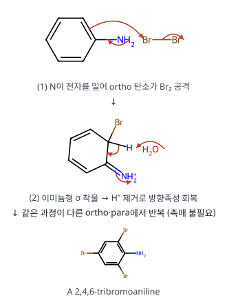

**메커니즘 — 아세틸화 (a·e)**

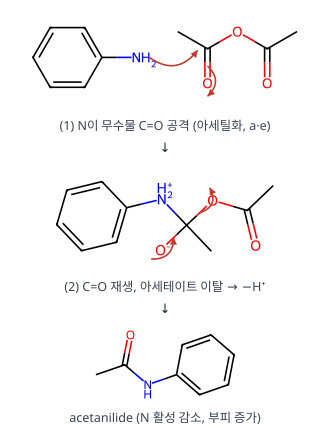

**메커니즘 — 반응 2: 술폰화로 para 차단 → ortho 니트로화 → 탈술폰화 (b·c·d)**

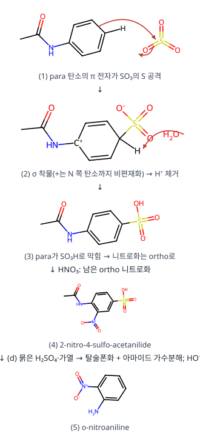

**메커니즘 — 니트로화 (f) — σ 착물 경유**

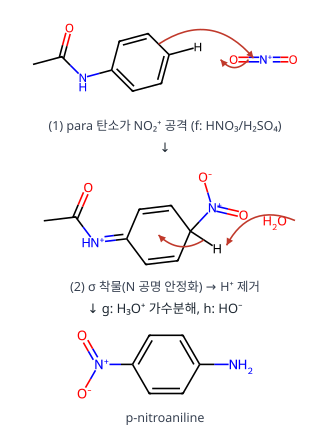

**메커니즘 — 다이아조화와 아조 짝지음 (반응 4)**

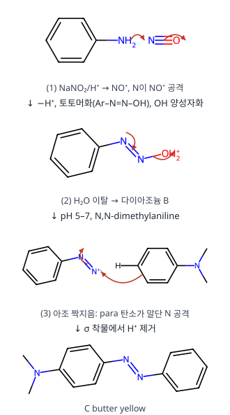

**검산** A C₆H₄Br₃N, B C₆H₅N₂⁺, C C₁₄H₁₅N₃ (C₆H₅N₂⁺ + C₈H₁₁N − H⁺) ✓

**채점 포인트·함정**

- 술폰화가 **가역**이라 차단기로 쓸 수 있다는 점이 [반응 2]의 핵심입니다.

## A형 11번 · 방향족 Claisen 자리옮김 {#a11}

**정답** A **4-(but-2-enyl)-2,6-dimethylphenol**, B **엔도 Diels–Alder 부가물** (Claisen → 2,4-cyclohexadienone → 말레산 무수물)

**공식·핵심 개념**

- 방향족 Claisen: [3,3], 알릴 말단 뒤집힘
- ortho가 막히면 Cope로 para 이동
- 다이엔온 + 친다이엔체: Diels–Alder(엔도)

**2027 출제 가능성 ★★★★☆ 높음** — 페리고리 반응(Claisen·Cope·Diels–Alder)은 유기 고난도 서술형 소재입니다.

**주어진 것 / 구할 것**

- 반응 1: 2,6-dimethylphenyl (E)-but-2-enyl ether, 가열 → A
- 반응 2: 2,6-dimethylphenyl allyl ether + 말레산 무수물, 가열 → B
- 구할 것: A, B 구조, 반응 2 메커니즘(전이 상태 포함)

**풀이 전략** 알릴 아릴 에터의 가열은 [3,3] 시그마결합 자리옮김(Claisen). ortho가 둘 다 CH₃로 막혀 있으면 방향족화(토토머화)를 못 하므로 ① 두 번째 [3,3](Cope)로 para로 가거나 ② 생긴 사이클로헥사다이엔온(s-cis 다이엔)이 친다이엔체에 잡힙니다(Diels–Alder).

**단계별 풀이 — 반응 1 (A)**

1. **Claisen [3,3]**: O–CH₂ 결합(σ)이 끊어지고, 알릴 말단 C(γ, CH–CH₃)와 ortho 탄소 사이 새 C–C가 생깁니다. 6원 고리 의자형 전이 상태, 세 쌍의 전자가 동시에 이동(협동). 생성물: 6-(but-3-en-2-yl)-2,6-dimethylcyclohexa-2,4-dienone (ortho 탄소가 sp³, CH₃와 곁사슬을 같이 가짐).
2. ortho 탄소에 H가 없어 토토머화로 방향족을 회복할 수 없음.
3. **Cope [3,3]**: ortho C–C(곁사슬) σ 결합이 끊어지고, 곁사슬 말단 CH₂와 **para** 탄소가 결합. 알릴 단위가 다시 한 번 뒤집혀 para에는 CH₂–CH=CH–CH₃(크로틸)로 붙습니다.
4. 이제 para 탄소에 H가 있으므로 토토머화(H⁺ 이동) → 방향족 페놀 A = 4-(but-2-en-1-yl)-2,6-dimethylphenol.
5. 이중결합 기하: 의자형 전이 상태에서 CH₃가 적도 방향을 차지 → **E**(trans) 크로틸이 주생성물.

**단계별 풀이 — 반응 2 (B)**

1. 알릴 에터의 Claisen → 6-allyl-2,6-dimethylcyclohexa-2,4-dienone(C₁₁H₁₄O). 고리 속 C2=C3–C4=C5가 **고정된 s-cis 다이엔**.
2. 이 다이엔온은 방향족화(Cope)보다 빨리 옆에 있는 말레산 무수물(전자 부족 친다이엔체)과 [4+2] 반응합니다.
3. **Diels–Alder 전이 상태**: 다이엔 C2·C5와 말레산 무수물의 두 탄소가 동시에 결합(6개 π 전자의 고리형 이동). 무수물의 C=O가 다이엔 π계 아래에 놓이는 **엔도** 배향(2차 오비탈 상호작용) → 엔도 부가물.
4. 결과: 바이사이클로[2.2.2]옥테논 골격에 숙신산 무수물이 cis로 붙은 B, 남은 C=C 하나(옛 C3=C4).

**왜 이 생성물인가.** 반응 1은 친다이엔체가 없어 다이엔온이 Cope로 para까지 가서 방향족화(가장 안정)됩니다. 반응 2는 말레산 무수물이 있어 다이엔온이 즉시 "포획"되므로 페놀까지 가지 못하고 Diels–Alder 부가물이 남습니다. 둘 다 ortho 차단이 핵심입니다.

**메커니즘 — 반응 1: Claisen [3,3] 자리옮김**

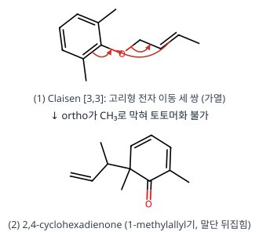

**메커니즘 — 반응 1: Cope [3,3] → para, 토토머화**

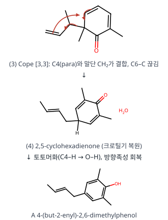

**메커니즘 — 반응 2: Diels–Alder [4+2]**

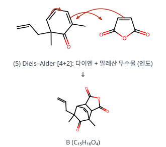

**검산** A C₁₂H₁₆O = 출발 에터 C₁₂H₁₆O (자리옮김이라 분자식 그대로) ✓, B C₁₅H₁₆O₄ = C₁₁H₁₄O + C₄H₂O₃ ✓

**채점 포인트·함정**

- 분자식 검산: 다이엔온 C₁₁H₁₄O + 말레산 무수물 C₄H₂O₃ = **C₁₅H₁₆O₄**.

## A형 12번 · 기체 크로마토그래피 계산 {#a12}

**정답** (1) γ = **1.08** (2) L = **1.30 m** (답안 기준) (3) K = **17.3** (4) $t_{r1}$ = **12.4 min**, $t_{r2}$ = **13.4 min**

**공식·핵심 개념**

- $\alpha = k_2/k_1$, $\gamma = t_{r2}/t_{r1}$
- $R = \frac{\sqrt N}{4}(\gamma - 1)$, $L = NH$
- $K = k\,V_m/V_s$, $t_r = t_m(1 + k)$

**2027 출제 가능성 ★★★★☆ 높음** — 크로마토그래피 계산은 분석화학 고빈도 유형입니다.

**주어진 것 / 구할 것**

- 단 높이 H = 0.52 mm, 상대 머무름 α = 1.10, 성분 1의 머무름 인자 $k_1 = 5.20$
- (3) $V_s/V_m = 0.300$, (4) $t_m = 2.00$ min, 두 성분 단수 같음
- 구할 것: (1) 보정 없는 상대 머무름 γ (2) R = 1.00이 되는 칼럼 길이 (3) 분배 계수 K (4) $t_{r1}$, $t_{r2}$

**풀이 전략** α는 머무름 인자의 비($k_2/k_1$), γ는 머무름 시간의 비($t_{r2}/t_{r1}$)입니다. $t_r = t_m(1 + k)$, $K = k\,V_m/V_s$, 분리도는 강의식 $R = \frac{\sqrt N}{4}(\gamma - 1)$로 N을 구하고 $L = NH$.

**단계별 풀이**

1. $k_2 = \alpha k_1 = 1.10\times5.20 = 5.72$
2. (1) $$\gamma = \frac{t_{r2}}{t_{r1}} = \frac{t_m(1 + k_2)}{t_m(1 + k_1)} = \frac{6.72}{6.20} = 1.0839 \approx 1.08$$
3. (2) $R = \frac{\sqrt N}{4}(\gamma - 1)$에 R = 1.00, γ = 1.08:
$$\sqrt N = \frac{4R}{\gamma - 1} = \frac{4.00}{0.08} = 50.0$$
$$\Rightarrow\; N = 2500$$
$$L = NH = 2500\times0.52\ \mathrm{mm} = 1300\ \mathrm{mm} = 1.30\ \mathrm{m}$$
4. (3) $$K = k_1\frac{V_m}{V_s} = \frac{5.20}{0.300} = 17.3$$
5. (4) $$t_{r1} = t_m(1 + k_1) = 2.00\times6.20 = 12.4\ \text{min}$$
$$t_{r2} = 2.00\times6.72 = 13.44 \approx 13.4\ \text{min}$$

**식에 따라 달라지는 값 (검토 메모 1).**

| 계산 방법 | √N | N | L |
|---|---|---|---|
| γ = 1.08(반올림) | 50.0 | 2500 | 1.30 m (답안) |
| γ = 1.0839(반올림 안 함) | 47.7 | 2273 | 1.18 m |
| $R = \frac{\sqrt N}{4}\frac{\alpha-1}{\alpha}\frac{k_2}{1+k_2}$ | 51.7 | 2672 | 1.39 m |

**검산** $t_{r2}/t_{r1} = 13.44/12.4 = 1.084$ = γ ✓, $(t_{r2}-t_m)/(t_{r1}-t_m) = 11.44/10.4 = 1.10$ = α ✓

**채점 포인트·함정**

- α(보정, $k_2/k_1$)와 γ(보정 없음, $t_{r2}/t_{r1}$)를 구분합니다.

# 전공 B

## B형 1번 · C₆H₁₀ 세 화합물 {#b1}

**정답** A **1-hexyne**, B **3-hexyne**, C **cyclohexene**

**공식·핵심 개념**

- C₆H₁₀ 불포화도 2
- 말단 알카인 ≡C–H 3300 cm⁻¹
- KMnO₄ 산화 절단: 말단 탄소 → CO₂, 고리 알켄 → 이산

**2027 출제 가능성 ★★★★☆ 높음** — 산화 절단 생성물로 구조를 역추적하는 문항은 유기 기입형 단골입니다.

**주어진 것 / 구할 것**

- 세 화합물 A, B, C 모두 C₆H₁₀; 모두 Br₂ 색을 없앰(불포화), 진한 황산에 녹음
- A만 IR 3300 cm⁻¹; A·B는 H₂ 과량으로 hexane, C는 1몰만 흡수해 C₆H₁₂
- 뜨거운 염기성 KMnO₄ 후 H₃O⁺: A → pentanoic acid + CO₂, B → propanoic acid 2분자, C → adipic acid(HOOC(CH₂)₄COOH)

**풀이 전략** 불포화도로 가능한 골격을 나누고, H₂ 흡수량으로 "삼중결합 vs 고리+이중결합"을 가르며, KMnO₄ 산화 절단 생성물을 거꾸로 붙여 원래 다중결합 위치를 찾습니다.

**단계별 풀이**

1. 불포화도 $= \frac{2(6) + 2 - 10}{2} = 2$ → 삼중결합 1개, 또는 이중결합 2개, 또는 고리 1 + 이중결합 1.
2. H₂ 흡수량
   - A, B: H₂ 2몰 → C₆H₁₄(hexane, 사슬) → 고리 없음 + π 결합 2개(삼중결합 또는 다이엔)
   - C: H₂ 1몰 → C₆H₁₂(불포화도 1 남음) → **고리 1 + C=C 1**
3. A: IR 3300 cm⁻¹ (sp C–H 신축) → **말단 알카인**. KMnO₄로 말단 ≡CH 탄소는 CO₂로, 나머지는 C₅ 카복실산 → 삼중결합이 C1–C2 → **1-hexyne**.
4. B: 3300 cm⁻¹ 없음 → 내부 알카인. 절단 생성물이 같은 C₃ 산 두 개 → 삼중결합이 정확히 가운데(C3≡C4) → **3-hexyne**.
5. C: 고리 + C=C, 산화로 양끝이 COOH인 C₆ 사슬(adipic acid) → 고리 C=C가 끊어져 사슬로 열림 → **cyclohexene**.

**KMnO₄ 산화 절단 정리**

| 다중결합 탄소 | 생성물 |
|---|---|
| =CH₂ / ≡CH (말단) | CO₂ |
| =CHR / ≡CR | RCOOH |
| =CR₂ | 케톤 R₂C=O |

**왜 다이엔이 아닌가.** A·B가 다이엔이라면 KMnO₄ 절단으로 산 3조각(또는 옥살산 등)이 나와야 하고, A의 3300 cm⁻¹(≡C–H)도 설명되지 않습니다.

**메커니즘 — C: KMnO₄ 산화 절단(단순화한 경로)**

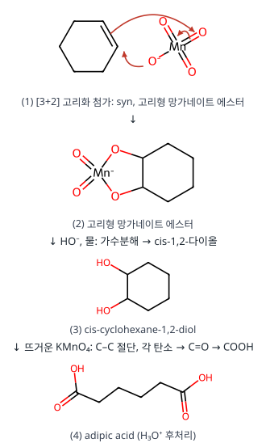

**검산** 1-hexyne: C₅ 산 + CO₂(C1) = C6 ✓, 3-hexyne: C₃ × 2 = C6 ✓, cyclohexene → adipic acid C₆H₁₀O₄ ✓

**채점 포인트·함정**

- H₂ 흡수량이 고리 여부를 가릅니다(A·B 2몰, C 1몰).

## B형 2번 · 전위로 구하는 형성상수 비 {#b2}

**정답** $\dfrac{K_f(\mathrm{FeY^{2-}})}{K_f(\mathrm{FeY^-})} = 2.0\times10^{-13}$

**공식·핵심 개념**

- $E_{cell} = E_+ - E_-$, SCE 0.24 V
- 네른스트로 [Fe²⁺]/[Fe³⁺] 계산
- 과량 EDTA → 착물 비 = 넣은 금속 비

**2027 출제 가능성 ★★★★☆ 높음** — 전위와 착물 평형을 엮는 계산은 분석화학에서 자주 나옵니다.

**주어진 것 / 구할 것**

- 전지: S.C.E ‖ 전지 용액 | Pt(s), $E_{cell} = -0.25$ V, $E_{SCE} = 0.24$ V
- 1.0 L에 Fe(NH₄)₂(SO₄)₂ 2.0 mmol(Fe²⁺), FeCl₃ 1.0 mmol(Fe³⁺), Na₂EDTA 4.0 mmol, pH 7.0 완충
- $E^\circ(\mathrm{Fe^{3+}/Fe^{2+}}) = 0.77$ V, $2.303RT/F = 0.060$ V
- 구할 것: $K_f(\mathrm{FeY^{2-}})/K_f(\mathrm{FeY^-})$

**풀이 전략** 측정 전위에서 Pt 전극 전위를 구하고, 네른스트 식으로 **유리** $[\mathrm{Fe^{2+}}]/[\mathrm{Fe^{3+}}]$ 비를 얻습니다. 두 형성상수 식을 나누면 $[\mathrm{Y^{4-}}]$가 약분되어 그 비와 착물 농도 비만 남습니다.

**단계별 풀이**

1. 선 표기에서 왼쪽이 기준(SCE), 오른쪽이 Pt:
$$E_{cell} = E_{Pt} - E_{SCE}$$
$$\Rightarrow\; E_{Pt} = -0.25 + 0.24 = -0.01\ \mathrm{V}$$
2. Pt 전극 반쪽 반응 $\mathrm{Fe^{3+} + e^- \rightleftharpoons Fe^{2+}}$의 네른스트 식:
$$E_{Pt} = 0.77 - 0.060\log\frac{[\mathrm{Fe^{2+}}]}{[\mathrm{Fe^{3+}}]}$$
3. 대입해 풀기:
$$-0.01 = 0.77 - 0.060\log\frac{[\mathrm{Fe^{2+}}]}{[\mathrm{Fe^{3+}}]}$$
$$\Rightarrow\; \log\frac{[\mathrm{Fe^{2+}}]}{[\mathrm{Fe^{3+}}]} = \frac{0.78}{0.060} = 13.0$$
$$\frac{[\mathrm{Fe^{2+}}]}{[\mathrm{Fe^{3+}}]} = 1.0\times10^{13}$$
4. 착물 농도: EDTA 4.0 mmol > 금속 3.0 mmol(과량) → 금속은 거의 전부 착물
   - $[\mathrm{FeY^{2-}}] \approx 2.0\times10^{-3}$ M, $[\mathrm{FeY^-}] \approx 1.0\times10^{-3}$ M
5. 형성상수:
$$K_f(\mathrm{FeY^{2-}}) = \frac{[\mathrm{FeY^{2-}}]}{[\mathrm{Fe^{2+}}][\mathrm{Y^{4-}}]}$$
$$K_f(\mathrm{FeY^-}) = \frac{[\mathrm{FeY^-}]}{[\mathrm{Fe^{3+}}][\mathrm{Y^{4-}}]}$$
6. 나누면 $[\mathrm{Y^{4-}}]$ 약분:
$$\frac{K_f(\mathrm{FeY^{2-}})}{K_f(\mathrm{FeY^-})} = \frac{[\mathrm{FeY^{2-}}]}{[\mathrm{FeY^-}]}\times\frac{[\mathrm{Fe^{3+}}]}{[\mathrm{Fe^{2+}}]}$$
$$= \frac{2.0}{1.0}\times\frac{1}{1.0\times10^{13}} = 2.0\times10^{-13}$$

**해석.** 착물이 없을 때 Pt 전위는 $0.77 - 0.060\log2 \approx 0.75$ V여야 하는데 −0.01 V까지 내려갔습니다. EDTA가 Fe³⁺를 Fe²⁺보다 약 $10^{12.7}$배 강하게 붙잡아 유리 Fe³⁺가 극히 적어졌기 때문입니다(실제 log Kf: FeY⁻ 25.1, FeY²⁻ 14.3 → 차이 10.8, 같은 경향).

**검산** 구한 비를 다시 넣으면 $E_{Pt} = 0.77 - 0.060\times13.0 = -0.01$ V, $E_{cell} = -0.01 - 0.24 = -0.25$ V ✓

**채점 포인트·함정**

- 전위가 크게 음으로 내려간 것은 Fe³⁺가 EDTA와 훨씬 강하게 결합하기 때문입니다.

## B형 3번 · 발생학습 모형과 인지 갈등 {#b3}

**정답**

- 단계: **발생학습 모형** I 예비, II 초점, III 도전, IV 적용
- 나영: **긍정적 발견법**(답안 기준). "모든 염 수용액은 중성"이라는 핵을 지키려고 반증 사례 앞에서 **같은 몰 수** 개념을 보호대에 추가·보완했다.
- ㉠ 강산과 강염기가 반응해 생긴 염 수용액은 중성이지만, 다른 산·염기로 만들어진 염은 액성이 다릅니다. 염을 이루는 이온이 물과 반응(가수분해)해 H⁺나 OH⁻를 내놓아 산성 또는 염기성을 띱니다.
- C1: 산과 염기의 중화 반응으로 생성된 염은 모두 중성이다. C2: 생성된 염의 액성에 따라 산성 또는 염기성을 나타낸다.

**공식·핵심 개념**

- 발생학습: 예비 → 초점 → 도전 → 적용
- 라카토스: 핵·보호대, 긍정적/부정적 발견법
- 하슈웨: C1(기존 개념), C2(새 개념)

**2027 출제 가능성 ★★★★★ 매우 높음** — 개념 변화 모형과 과학철학자 조합은 교육론 최빈출입니다.

**발생학습(Osborne & Freyberg)**: 예비(학생 생각 파악) → 초점(구체적 상황에서 자기 생각 명확히) → 도전(생각 비교·과학적 관점 제시) → 적용(새 상황에 적용).

**가수분해.** CH₃COO⁻ + H₂O ⇌ CH₃COOH + OH⁻ (약산의 짝염기 → 염기성).

**채점 포인트·함정**

- 라카토스 판단은 강사마다 기준이 다릅니다(검토 메모 4).

## B형 4번 · 오수벨의 유의미 학습 유형 {#b4}

**정답**

- (1) **하위적 학습**: 분자 간 상호작용(쌍극자–쌍극자 힘, 분산력)을 아는 학생이 **수소 결합**을 학습
- (2) **상위적 학습**: 쌍극자–쌍극자 힘과 분산력을 아는 학생이 이를 묶는 **분자 간 상호작용**을 학습
- 원리: 하위적 → **점진적 분화**, 상위적 → **통합적 조정**
- (A) **유의미 수용학습** — 애매하게 알던 내용을 교사의 설명으로 이해하고, 새 지식으로 개념 간 관계가 명료해짐

**공식·핵심 개념**

- 오수벨: 하위적(파생·상관적)·상위적·병렬적 학습
- 점진적 분화 / 통합적 조정
- 유의미 수용학습

**2027 출제 가능성 ★★★★☆ 높음** — 오수벨 학습 유형과 원리는 교육론에서 꾸준히 나옵니다.

**오수벨 학습 형태**: 수용–발견 축과 기계적–유의미 축은 독립. (A)는 수용학습이면서 유의미학습인 칸 = 잘 설계된 설명식 수업(개념 간 관계 명료화).

**채점 포인트·함정**

- 하위적: 새 내용이 **기존의 더 포괄적인 개념 아래로**, 상위적: 기존 개념들을 **묶는 더 포괄적인 새 개념**.

## B형 5번 · STAD와 기체 반응 법칙 {#b5}

**정답**

- ㉠ **STAD**, ㉡ **개인 성취 점수**
- ㉢ 사전 검사·이전 평균 등으로 **개인별 기본 점수**를 정하고, 기본 점수보다 향상된 점수를 확인해 기준에 따라 개인 성취 점수로 환산한 뒤, 모둠별로 더해 **모둠 향상 점수**를 계산한다.
- ㉣ 개별 평가·개별 향상 점수로 개별 보상과 집단 보상이 함께 나타나, 무임승차를 막고 각자 모둠 목표에 책임감을 가지므로 개별적 책무성이 강조된다.
- ㉤ 각 기체의 부피 사이에 **간단한 정수비**

**공식·핵심 개념**

- STAD: 개별 평가 → 향상 점수 → 모둠 보상
- 개별적 책무성
- 기체 반응 법칙: 부피는 간단한 정수비

**2027 출제 가능성 ★★★★☆ 높음** — 협동 학습모형은 해마다 한 번 이상 나오는 소재입니다.

**게이뤼삭 기체 반응 법칙**: 같은 온도·압력에서 반응하거나 생성되는 기체의 부피는 간단한 정수비(H₂ : O₂ : H₂O(g) = 2 : 1 : 2).

**채점 포인트·함정**

- STAD의 핵심은 **향상 점수**(기본 점수 대비)입니다. 원점수 합산이 아닙니다.

## B형 6번 · 엔트로피 변화율과 압축·J-T 냉각 {#b6}

**정답** $a = -\alpha V$, $b = \dfrac{\alpha}{\kappa_T}$, 에탄올 $\Delta p = -\dfrac{\ln0.9}{\kappa_T}$, CO₂ **5.0 atm** 떨어뜨림

**공식·핵심 개념**

- 맥스웰: $(\partial S/\partial p)_T = -(\partial V/\partial T)_p$, $(\partial S/\partial V)_T = (\partial p/\partial T)_V$
- $(\partial p/\partial T)_V = \alpha/\kappa_T$
- $\Delta T = \mu_{JT}\Delta p$

**2027 출제 가능성 ★★★☆☆ 보통** — 맥스웰 관계식 응용은 물리화학 기입형에 가끔 나옵니다.

**주어진 것 / 구할 것**

- 기체 A: $(\partial U/\partial V)_T = 0$, $(\partial H/\partial p)_T = 0$
- $a = (\partial S/\partial p)_T$, $b = (\partial S/\partial V)_T$를 α, κT로
- 10 °C 에탄올 부피 10.0 % 감소에 필요한 압력, CO₂를 5.0 K 냉각하는 압력 강하($\mu_{JT} = 1.0$ K atm⁻¹)
- $\alpha = \frac1V(\partial V/\partial T)_p$, $\kappa_T = -\frac1V(\partial V/\partial p)_T$, $\mu_{JT} = (\partial T/\partial p)_H$

**풀이 전략** 엔트로피 편미분은 기본식 $dG$, $dA$에서 나오는 맥스웰 관계식으로 측정 가능한 양(α, κT)으로 바꿉니다. 압축은 κT의 정의를 적분하고, J-T 냉각은 $\Delta T \approx \mu_{JT}\Delta p$.

**단계별 풀이**

1. $dG = -S\,dT + V\,dp$ → 교차 미분이 같음:
$$a = \left(\frac{\partial S}{\partial p}\right)_T = -\left(\frac{\partial V}{\partial T}\right)_p = -\alpha V$$
2. $dA = -S\,dT - p\,dV$ →
$$b = \left(\frac{\partial S}{\partial V}\right)_T = \left(\frac{\partial p}{\partial T}\right)_V$$
3. 순환 관계 $\left(\frac{\partial p}{\partial T}\right)_V\left(\frac{\partial T}{\partial V}\right)_p\left(\frac{\partial V}{\partial p}\right)_T = -1$ 로 바꾸면
$$\left(\frac{\partial p}{\partial T}\right)_V = -\frac{(\partial V/\partial T)_p}{(\partial V/\partial p)_T}$$
$$= -\frac{\alpha V}{-\kappa_TV} = \frac{\alpha}{\kappa_T}$$
$$\Rightarrow\; b = \frac{\alpha}{\kappa_T}$$
4. 에탄올 등온 압축: $\kappa_T = -\frac1V\left(\frac{\partial V}{\partial p}\right)_T$ → $\frac{dV}{V} = -\kappa_T\,dp$. κT를 상수로 보고 적분:
$$\ln\frac{V_2}{V_1} = -\kappa_T\Delta p$$
$$\Rightarrow\; \Delta p = -\frac{\ln(0.900)}{\kappa_T} = \frac{0.105}{\kappa_T}$$
(참고: 에탄올 $\kappa_T \approx 1.1\times10^{-4}\ \mathrm{bar^{-1}}$이면 Δp ≈ 9.6 × 10² bar)
5. J-T 팽창(등엔탈피): $\mu_{JT} = (\partial T/\partial p)_H$ → 작은 변화에서
$$\Delta T = \mu_{JT}\Delta p$$
$$\Rightarrow\; \Delta p = \frac{-5.0\ \mathrm{K}}{1.0\ \mathrm{K\,atm^{-1}}} = -5.0\ \mathrm{atm}$$
→ 압력을 5.0 atm 떨어뜨림.

**기체 A 조건의 의미.** $(\partial U/\partial V)_T = 0$, $(\partial H/\partial p)_T = 0$은 완전(이상) 기체의 성질입니다. 그러면 $\alpha = 1/T$, $\kappa_T = 1/p$이므로 $a = -V/T = -nR/p$, $b = p/T = nR/V$로 위 일반식과 일치합니다(확인용).

**검산** 이상기체로 $b = \alpha/\kappa_T = (1/T)/(1/p) = p/T$ ✓

**채점 포인트·함정**

- 기체 A의 $(\partial U/\partial V)_T = 0$, $(\partial H/\partial p)_T = 0$ 조건은 a, b 식에 직접 필요하지 않습니다(완전 기체라면 a = −nR/p, b = nR/V로 확인 가능).

## B형 7번 · 시험 파동함수의 에너지 {#b7}

**정답** ψ(0) = ψ(L) = 0이므로 **경계조건 만족**. 두 함수 모두 $\langle E\rangle = \dfrac{5h^2}{4\pi^2mL^2}$

**공식·핵심 개념**

- 경계조건 ψ(0) = ψ(L) = 0
- $\langle E\rangle = \dfrac{\langle\psi|\hat H|\psi\rangle}{\langle\psi|\psi\rangle}$
- 변분 원리: 시험 에너지 ≥ 참 바닥 에너지

**2027 출제 가능성 ★★★☆☆ 보통** — 변분법은 양자 영역에서 가끔 나오는 고급 소재입니다.

**주어진 것 / 구할 것**

- 길이 L인 1차원 상자, (1) 정규화된 $\psi = (30/L^5)^{1/2}x(L-x)$, (2) 정규화 안 된 $\psi = x(L-x)$
- 참값 $E = n^2h^2/8mL^2$
- 구할 것: (2)의 경계조건 판단과 근거, 두 함수의 평균 에너지

**풀이 전략** 상자 벽에서 ψ = 0인지 확인합니다. 에너지 기대값은 $\langle E\rangle = \int\psi^*\hat H\psi\,dx \big/ \int\psi^*\psi\,dx$ (정규화돼 있으면 분모 1). 상자 안 퍼텐셜 0 → $\hat H = -\frac{\hbar^2}{2m}\frac{d^2}{dx^2}$.

**단계별 풀이**

1. 경계조건: $\psi(0) = 0\cdot L = 0$, $\psi(L) = L(L - L) = 0$ → 만족. 또한 상자 안에서 연속·유한·한 값이므로 허용되는 시험 함수.
2. 2차 도함수: $\psi = Lx - x^2$ → $\psi' = L - 2x$ → $\psi'' = -2$
$$\hat H\psi = -\frac{\hbar^2}{2m}(-2) = \frac{\hbar^2}{m}$$
3. 분자 적분:
$$\int_0^L\psi\hat H\psi\,dx = \frac{\hbar^2}{m}\int_0^L(Lx - x^2)dx$$
$$= \frac{\hbar^2}{m}\left[\frac{L^3}{2} - \frac{L^3}{3}\right] = \frac{\hbar^2L^3}{6m}$$
4. 분모 적분:
$$\int_0^Lx^2(L-x)^2dx = \int_0^L(L^2x^2 - 2Lx^3 + x^4)dx$$
$$= L^5\left(\frac13 - \frac12 + \frac15\right) = \frac{L^5}{30}$$
5. 정규화 안 된 (2):
$$\langle E\rangle = \frac{\hbar^2L^3/6m}{L^5/30} = \frac{5\hbar^2}{mL^2} = \frac{5h^2}{4\pi^2mL^2}$$
$$(\hbar = h/2\pi)$$
6. 정규화된 (1): 분모가 1이고 분자에 $30/L^5$가 곱해짐
$$\langle E\rangle = \frac{30}{L^5}\cdot\frac{\hbar^2L^3}{6m} = \frac{5\hbar^2}{mL^2} = \frac{5h^2}{4\pi^2mL^2}$$
(정규화 상수는 분자·분모에서 약분되므로 결과가 같음)

**변분 원리로 확인.** 참 바닥 에너지 $\frac{h^2}{8mL^2}$와의 비:
$$\frac{5/4\pi^2}{1/8} = \frac{10}{\pi^2} = 1.013$$
시험 함수 에너지가 1.3 % 높습니다 — 변분 원리(시험 에너지 ≥ 참값)와 일치. 포물선 $x(L-x)$가 sin 함수와 매우 비슷해서 오차가 작습니다.

**검산** 공식 답안 분자 $h^2L^3/24\pi^2m$ = $\hbar^2L^3/6m$ ✓ (×30/L⁵ → $5h^2/4\pi^2mL^2$)

**채점 포인트·함정**

- 정규화 안 된 함수는 반드시 **분모 ⟨ψ|ψ⟩로 나눕니다**.

## B형 8번 · IO₂F₃²⁻의 이성질체와 IR {#b8}

**정답** 이성질체 3개: **구조 1 C₂ᵥ**(O 두 개 trans), **구조 2 Cs**(O 하나가 고립쌍과 trans), **구조 3 Cs**(F가 고립쌍과 trans, O 두 개 cis). X = **구조 2**, $\Gamma_{I=O}$ = (E 2, σ 2) = **2A′**

**공식·핵심 개념**

- VSEPR: AX₅E 사각뿔, 이중결합은 큰 전자 영역
- 신축 진동 Γ → IR 활성 기약표현
- 이성질체 구별: IR 띠 수

**2027 출제 가능성 ★★★★☆ 높음** — VSEPR 이성질체와 IR 대칭을 엮는 무기 문항은 자주 나옵니다.

**주어진 것 / 구할 것**

- IO₂F₃²⁻, IR의 I=O 신축 기본띠 ν₁ 802, ν₂ 834 cm⁻¹ (2개), C₂ᵥ·Cs 지표표
- 구할 것: 가능한 이성질체 구조와 점군, 기약표현으로 X 확인, X 결정

**풀이 전략** VSEPR로 전자 영역 배치(사각뿔 AX₅E)를 정하고, 리간드 배치별 점군 → I=O 결합 벡터 2개의 Γ → 축소 → IR 활성 띠 수를 실험(2개)과 비교. 남은 후보는 VSEPR 반발로 고릅니다.

**단계별 풀이**

1. 원자가 전자: I 7 + O 2×6 + F 3×7 + 전하 2 = 42.
2. 중심 I: 결합 5개(I=O 2, I–F 3) + 비공유 전자쌍 1 → 전자 영역 6 → 팔면체 배치, 분자 모양 **사각뿔(AX₅E)**.
3. 고립쌍 자리(축)를 정하면 반대쪽 축 1자리 + 적도 4자리에 O 2개, F 3개를 놓습니다. 서로 다른 배치 3가지:

| 구조 | 고립쌍과 trans | 적도의 두 O | 점군 |
|---|---|---|---|
| 1 | F | 서로 trans (O–I–O 일직선) | C₂ᵥ |
| 2 | O | (O 하나만 적도) | Cs |
| 3 | F | 서로 cis | Cs |

4. 구조 2 (Cs, 두 O가 모두 대칭면 위):

| Cs | E | σh |
|---|---|---|
| Γ(I=O) | 2 | 2 |

$$n(A') = \tfrac12(2\cdot1 + 2\cdot1) = 2$$
$$n(A'') = \tfrac12(2 - 2) = 0$$
$$\Rightarrow\; \Gamma = 2A'$$
A′는 x, y와 같은 대칭 → 둘 다 IR 활성 → 띠 2개.
5. 구조 3 (Cs, 대칭면이 두 O 사이를 지나 서로 바꿈): Γ = (2, 0) → $A' + A''$, 둘 다 IR 활성 → 띠 2개.
6. 구조 1 (C₂ᵥ, C₂축이 고립쌍–I–F 방향, 두 O는 trans):

| C₂ᵥ | E | C₂ | σᵥ(O 포함) | σᵥ′ |
|---|---|---|---|---|
| Γ(I=O) | 2 | 0 | 2 | 0 |

$$n(A_1) = \tfrac14(2 + 0 + 2 + 0) = 1$$
$$n(A_2) = \tfrac14(2 - 2) = 0$$
$$n(B_1) = \tfrac14(2 + 2) = 1$$
$$n(B_2) = 0$$
→ $A_1 + B_1$. O=I=O가 거의 일직선이라 대칭 신축(A₁)은 쌍극자 변화가 거의 없어 IR에 거의 안 나옴 → 실제 띠 1개 → 실험(2개)과 불일치, 제외.
7. 구조 2 vs 3: 이중결합(I=O)은 전자 밀도가 큰 영역. 고립쌍과 90°로 마주치는 I=O 수를 비교하면 구조 2는 1개(나머지 O는 고립쌍과 180°), 구조 3은 2개 → 반발이 적은 **구조 2 = X**.

**검산** 각 Γ의 차원 2 = I=O 결합 수 ✓

**채점 포인트·함정**

- 구조 1의 대칭 신축(O=I=O)은 쌍극자 변화가 거의 없어 IR에 나타나지 않습니다.

## B형 9번 · H₂O의 분자 궤도함수 {#b9}

**정답** O–H 신축 = **A₁ + B₁** → (a) **1b₁**, (b) **1b₂**, (c) **2b₁**. 비공유 전자쌍 **2a₁, 1b₂**(답안), HOMO **1b₂ = O 2py**

**공식·핵심 개념**

- H₂O(xz 평면): O–H SALC = A₁ + B₁
- 1b₂(O 2py) 비결합 = HOMO
- MO 순서: 2a₁ < 1b₁ < 3a₁ < 1b₂ < 4a₁ < 2b₁

**2027 출제 가능성 ★★★★★ 매우 높음** — H₂O MO 도표는 무기 MO의 표준 예시로 반복 출제됩니다.

**주어진 것 / 구할 것**

- H₂O, 모든 원자가 xz 평면, C₂ = z축; MO 준위도 (a)~(c)와 2a₁, 3a₁, 4a₁; C₂ᵥ 지표표
- 구할 것: O–H 신축의 기약표현으로 (a)~(c) 대칭, 겹침 그림, 비공유 전자쌍 대칭, HOMO에 기여하는 O 오비탈

**풀이 전략** H 1s 2개의 군 궤도함수 대칭(= O–H 신축 대칭)을 구하고, O의 2s·2p 대칭과 같은 것끼리 섞어 결합성·반결합성 MO를 만듭니다. 짝이 없는 O 오비탈은 비결합으로 남습니다.

**단계별 풀이**

1. H 1s 2개(또는 O–H 결합 벡터 2개)의 표현. σᵥ(xz)는 분자 평면이라 둘 다 제자리, C₂와 σᵥ′(yz)는 두 H를 맞바꿈:

| C₂ᵥ | E | C₂ | σᵥ(xz) | σᵥ′(yz) |
|---|---|---|---|---|
| Γ(2H) | 2 | 0 | 2 | 0 |

2. 축소($h = 4$):
$$n(A_1) = \tfrac14(2 + 0 + 2 + 0) = 1$$
$$n(A_2) = \tfrac14(2 + 0 - 2 - 0) = 0$$
$$n(B_1) = \tfrac14(2 - 0 + 2 - 0) = 1$$
$$n(B_2) = \tfrac14(2 - 0 - 2 + 0) = 0$$
→ $\Gamma = A_1 + B_1$ (대칭 신축 A₁, 비대칭 신축 B₁)
3. O 오비탈의 대칭(지표표 오른쪽 열): 2s → $A_1$, 2p_z → $A_1$, 2p_x → $B_1$(x), 2p_y → $B_2$(y)
4. MO 만들기
   - $A_1$: O 2s, 2p_z + H 군 궤도(+,+) → 2a₁(결합, 2s 위주), 3a₁(약한 결합, 2p_z 위주), 4a₁(반결합)
   - $B_1$: O 2p_x + H 군 궤도(+,−) → **(a) 1b₁**(같은 위상, 결합성), **(c) 2b₁**(반대 위상, 반결합성)
   - $B_2$: O 2p_y는 짝이 되는 H 군 궤도가 없음 → **(b) 1b₂**, 비결합(순수 O 2p_y, 분자 평면에 수직)
5. 전자 채우기: O 6 + H 2 = 8 → 2a₁² 1b₁² 3a₁² 1b₂² → HOMO = **1b₂ = O 2p_y**
6. 비공유 전자쌍: 결합에 거의 기여하지 않는 두 준위 → 1b₂(완전 비결합)와 3a₁(약한 결합, O 쪽에 몰림). 공식 답안은 2a₁, 1b₂로 씀(검토 메모 3).

**겹침 그림 (말로 그리는 법)**

- (a) 1b₁: O 2p_x의 + 로브 쪽 H는 +, − 로브 쪽 H는 − (같은 위상 겹침)
- (b) 1b₂: O 2p_y만, 로브가 분자 평면 위아래(y 방향), H와 마디면으로 직교
- (c) 2b₁: O 2p_x의 + 로브 쪽 H가 −(반대 위상), 마디면이 O–H 사이에 생김

**검산** MO 수 = 원자 오비탈 수: O 4개 + H 2개 = 6 = 2a₁, 1b₁, 3a₁, 1b₂, 4a₁, 2b₁ ✓

**채점 포인트·함정**

- 평면이 **xz**이므로 평면 밖 오비탈은 **py(B₂)**입니다. 평면을 yz로 잡으면 b₁/b₂가 바뀝니다.
- 비공유 전자쌍 배정은 검토 메모 3 참고.

## B형 10번 · δ-발레로락톤의 반응 {#b10}

**정답** A **1,5-pentanediol**, C **5-hydroxypentanoic acid**, D **1,1-diphenylpentane-1,5-diol**

**공식·핵심 개념**

- 락톤 + LiAlH₄ → 다이올
- 산 가수분해 → 하이드록시산
- 에스터 + RMgX 과량 → 3차 알코올

**2027 출제 가능성 ★★★★☆ 높음** — 카복실산 유도체 반응과 메커니즘은 유기 서술형 단골입니다.

**주어진 것 / 구할 것**

- B: δ-valerolactone(6원 고리 에스터, C₅H₈O₂)
- B → (1) LiAlH₄ (2) aq. H₂SO₄ → A / B → H₃O⁺ → C / B → (1) PhMgBr 과량 (2) NH₄Cl, H₂O → D
- 구할 것: A, C, D 구조, B → A 메커니즘

**풀이 전략** 락톤 = 고리 에스터. 친핵체가 C=O 탄소를 공격 → 사면체 중간체 → 고리 O가 이탈기로 빠지며 고리가 열립니다(친핵성 아실 치환). 강한 친핵체(H⁻, Ph⁻)는 생긴 알데하이드·케톤에 한 번 더 첨가합니다.

**단계별 풀이 — B → A (LiAlH₄)**

1. AlH₄⁻의 H⁻가 C=O 탄소 공격 → 사면체 알콕사이드(O⁻–Al).
2. O⁻의 전자쌍이 C=O를 다시 만들며 고리 O(알콕시)가 이탈 → 고리 열림: 5-(옥시)펜탄알(알데하이드 + 말단 알콕사이드).
3. 알데하이드는 에스터보다 반응성이 커서 즉시 두 번째 H⁻ 첨가 → 다이알콕사이드.
4. aq. H₂SO₄: 두 O⁻ 양성자화 → A = HO(CH₂)₅OH (1,5-pentanediol).

**단계별 풀이 — B → C (H₃O⁺)**

1. 카보닐 O 양성자화 → C=O 탄소의 친전자성 증가.
2. H₂O가 C=O 탄소 공격 → 사면체 중간체 → 양성자 이동(OH₂⁺ → 고리 O에 H⁺).
3. 고리 O가 이탈(고리 열림) → C=O 재생 → −H⁺ → C = HO(CH₂)₄COOH (5-hydroxypentanoic acid).
4. 산 촉매 반응은 모두 가역 — 물이 많으면 열린 하이드록시산 쪽, 탈수 조건이면 다시 락톤.

**단계별 풀이 — B → D (PhMgBr 과량)**

1. Ph⁻(C–Mg 결합 전자)가 C=O 공격 → 사면체 중간체 → 고리 O 이탈 → 케톤 PhCO(CH₂)₄O⁻MgBr⁺.
2. 케톤은 에스터보다 친전자성이 커서 두 번째 PhMgBr가 즉시 첨가 → 3차 알콕사이드.
3. NH₄Cl(약산) 처리: 두 O⁻ 양성자화 → D = Ph₂C(OH)(CH₂)₄OH (1,1-diphenylpentane-1,5-diol).
4. NH₄Cl을 쓰는 이유: 강산이면 3차 벤질 알코올이 탈수(E1)되어 알켄이 생기기 때문.

**왜 두 당량인가.** 첫 첨가 후 생긴 알데하이드(A 경로)·케톤(D 경로)은 출발 에스터보다 C=O가 더 친전자적(알콕시의 전자 주개 공명이 없음)이므로, 반응을 중간에서 멈출 수 없고 두 번째 친핵체가 들어갑니다.

**메커니즘 — B → A: LiAlH₄ 환원 (고리 열림 포함)**

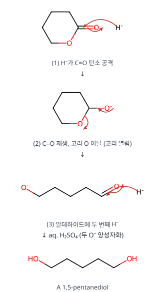

**메커니즘 — B → C: 산 촉매 가수분해**

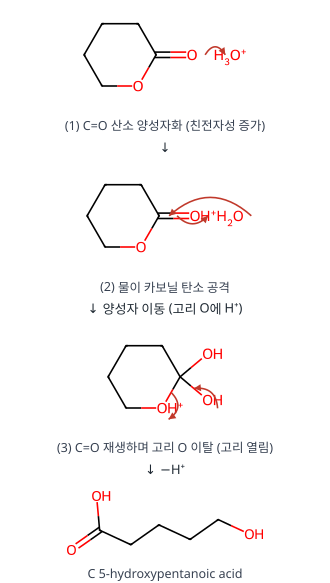

**메커니즘 — B → D: PhMgBr 두 번 첨가**

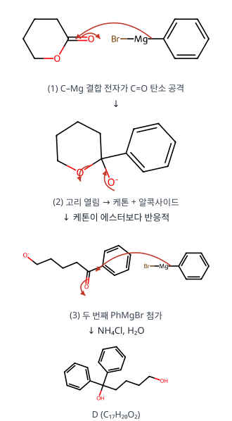

**검산** A C₅H₁₂O₂ (B + 4H), C C₅H₁₀O₃ (B + H₂O), D C₁₇H₂₀O₂ (B + 2C₆H₅ + 2H) ✓

**채점 포인트·함정**

- 에스터 + LiAlH₄/RMgX는 항상 **두 당량**이 들어갑니다(중간 알데하이드·케톤이 더 반응적).

## B형 11번 · CO₂를 흡수한 NaOH와 지시약 {#b11}

**정답** (1) **10.00 mL** (2) **0.099 M** (3) 9.90 mL(직접 계산; 답안 10.00 mL — 검토 메모 2) (4) **페놀프탈레인** 결과가 옳다

**공식·핵심 개념**

- CO₂ 흡수: 2OH⁻ + CO₂ → CO₃²⁻
- 페놀프탈레인: CO₃²⁻ → HCO₃⁻ / BCG: → H₂CO₃
- 표준화와 적정에 같은 지시약 → 탄산 오차 상쇄

**2027 출제 가능성 ★★★★☆ 높음** — 탄산 오차는 산염기 적정 실험 문항의 고전적 소재입니다.

**주어진 것 / 구할 것**

- 0.100 M로 표준화된 NaOH가 공기 중 CO₂를 흡수
- 자료 1: 이 NaOH 10.0 mL를 0.100 M KH(IO₃)₂(1가 강산)로 적정, 페놀프탈레인 종말점 9.00 mL
- 자료 2: 이 NaOH로 미지 HCl 10.0 mL 적정, 페놀프탈레인 종말점 11.0 mL
- 구할 것: (1) 브로모크레졸그린(BCG)이면 KH(IO₃)₂ 부피 (2) HCl 농도 (3) BCG면 NaOH 부피 (4) 어느 결과가 옳은가

**풀이 전략** 흡수된 CO₂는 2OH⁻ + CO₂ → CO₃²⁻ + H₂O. 페놀프탈레인(pH ≈ 8–10) 종말점에서는 CO₃²⁻가 HCO₃⁻까지만(H⁺ 1개), BCG(pH ≈ 4–5)에서는 H₂CO₃까지(H⁺ 2개) 반응합니다. 그래서 BCG는 "원래 NaOH 양 전부"를, 페놀프탈레인은 그보다 적게 셉니다.

**단계별 풀이**

1. 10.0 mL 속 원래 OH⁻: $0.100\times10.0 = 1.000$ mmol. 흡수된 CO₂를 $x$ mmol이라 하면 남은 OH⁻ $1.000 - 2x$, CO₃²⁻ $x$.
2. 페놀프탈레인 종말점에서 반응한 H⁺:
$$(1.000 - 2x) + x = 1.000 - x$$
$$= 0.100\times9.00 = 0.900\ \mathrm{mmol}$$
$$\Rightarrow\; x = 0.100\ \mathrm{mmol}$$
→ 페놀프탈레인 기준 NaOH 유효 농도 $0.900/10.0 = 0.0900$ M
3. (1) BCG 종말점: $(1.000 - 2x) + 2x = 1.000$ mmol H⁺ 필요
$$V = \frac{1.000\ \mathrm{mmol}}{0.100\ \mathrm{M}} = 10.00\ \mathrm{mL}$$
4. (2) 자료 2(페놀프탈레인): NaOH 유효 0.0900 M
$$n_{\mathrm{HCl}} = 0.0900\times11.0 = 0.990\ \mathrm{mmol}$$
$$[\mathrm{HCl}] = \frac{0.990}{10.0} = 0.0990\ \mathrm{M}$$
5. (3) BCG로 같은 HCl을 적정하면 NaOH가 원래 0.100 M처럼 작용
$$V = \frac{0.990\ \mathrm{mmol}}{0.100\ \mathrm{M}} = 9.90\ \mathrm{mL}$$
(공식 답안 10.00 mL — 검토 메모 2)
6. (4) 표준화(자료 1)와 미지 적정(자료 2)을 **둘 다 페놀프탈레인**으로 했으므로, NaOH 농도를 "페놀프탈레인 기준 유효 농도(0.0900 M)"로 정하고 같은 기준으로 썼습니다. 탄산 오차가 두 단계에서 똑같이 들어가 상쇄 → 0.0990 M가 참값.

**표로 정리**

| | 페놀프탈레인 | BCG |
|---|---|---|
| CO₃²⁻가 받는 H⁺ | 1개 (→ HCO₃⁻) | 2개 (→ H₂CO₃) |
| NaOH 유효 농도 | 0.0900 M | 0.100 M |
| KH(IO₃)₂ 부피 (10.0 mL 적정) | 9.00 mL | 10.00 mL |
| HCl 0.990 mmol 적정 NaOH 부피 | 11.0 mL | 9.90 mL |

**검산** 표준화와 적정을 같은 지시약으로 하면 어느 쪽이든 HCl = 0.0990 M: 페놀프탈레인 0.0900×11.0/10.0 = 0.0990, BCG 0.100×9.90/10.0 = 0.0990 ✓

**채점 포인트·함정**

- 판단 근거는 "두 단계에서 같은 지시약 → 같은 비율로 오차가 상쇄"입니다.

---

원문: 2025학년도 대비 김지현 전공화학 모의고사 3회(지스쿨) 문제지·답안·강의 판서. 개인 학습용 정리입니다.

