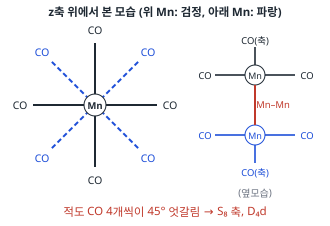
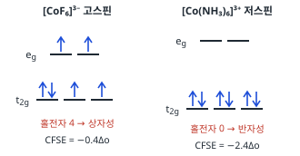
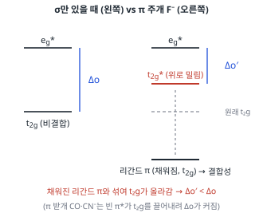
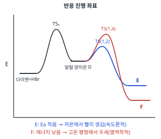
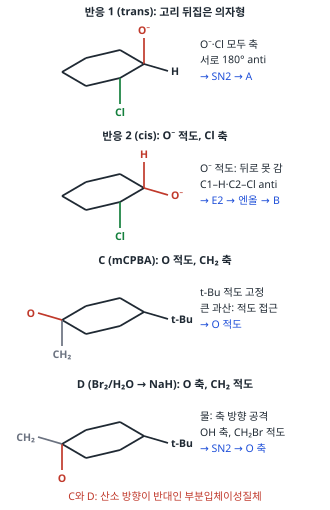
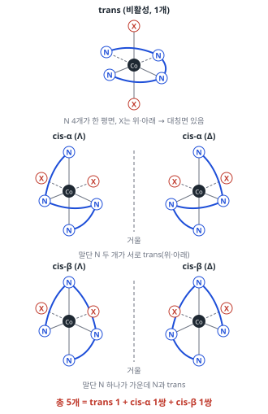

# 2025학년도 대비 김지현 전공화학 모의고사 4회 — 상세해설

김지현 전공화학 모의고사 4회(전공 A 12문항 · 전공 B 11문항)의 문항별 해설입니다. 공식 「모의고사 4회 답안」과 강의 판서를 바탕으로 풀이 과정·개념·채점 포인트를 채웠고, 계산은 모두 다시 풀어 공식 답과 맞는지 확인했습니다. 구조식은 RDKit으로 분자식을 확인했습니다.

전공 문항(화학교육론 제외)은 **주어진 것 / 구할 것 → 풀이 전략 → 단계별 풀이 → 검산** 순서로, 대입·단위 환산·중간값까지 생략 없이 적었습니다. 문항마다 새 쪽에서 시작하며 3단으로 **문제지 원문 → 정답 → 공식·핵심 개념 → 2027 출제 가능성 → 풀이 → 채점 포인트·함정** 순서로 읽으면 됩니다. 아래 표의 문항 번호를 누르면 해당 쪽으로 이동합니다.

유기 문항(A형 10·11번, B형 1·10번)에는 **굽은 화살표로 전자 이동을 표시한 단계별 메커니즘 그림**을 넣었습니다(빨간 화살표: 전자쌍이 출발하는 결합·비공유 전자쌍 → 도착하는 원자·결합).

**2027 출제 가능성**(★ 5개 만점)은 1997~2026 기출에서 그 소재가 얼마나 자주 나왔는지와 2022 개정 교육과정 적용 시점을 함께 고려한 추정치입니다.

## 정답 한눈에 보기 (목차) {#toc}

### 전공 A (12문항 40점)

| 번호 | 영역 | 정답 요약 | 2027 출제 가능성 |
|---|---|---|---|
| [1](#a1) | 무기 · D₄d 지표표, CO 진동 | ① 2C₄, ② 4σd, IR 활성 2B₂ + E₁ | ★★★★★ |
| [2](#a2) | 물리화학 · 효소 반응 속도론 | $v = \frac{v_{max}K[S]_0}{1+K[S]_0}$, $K_M = 8.0$ mmol dm⁻³ | ★★★★☆ |
| [3](#a3) | 유기 · IR·NMR 구조 결정 | ethyl p-aminobenzoate / p-ethoxybenzamide | ★★★★★ |
| [4](#a4) | 분석화학 · 질량 균형, 용해도 | $S = \sqrt{K_{sp}/(\alpha_{Ba^{2+}}\alpha_{SO_4^{2-}})}$ | ★★★☆☆ |
| [5](#a5) | 화학교육 · 로슨 순환학습 | 가설-연역적 / 서술적 / 경험-귀추적 | ★★★★★ |
| [6](#a6) | 화학교육 · STS 수업 모형 | 탐색, 설명 및 해결방안 제시, 통합과학 2 | ★★★★☆ |
| [7](#a7) | 화학교육 · 2022 개정, 평가 준거 | 의사소통과 협업, 디지털 소양 | ★★★★★ |
| [8](#a8) | 무기 · CFSE, 자성, σ·π 결합 | 차이 2.0Δo, 그래프 2·4, $A_{1g}+E_g+T_{1u}$ | ★★★★★ |
| [9](#a9) | 물리화학 · 영점 에너지, 동위원소 | ²H₂의 $D_0 = 424$ kJ/mol | ★★★★☆ |
| [10](#a10) | 유기 · 알릴 양이온, 속도론적·열역학적 지배 | B 85% / C 15%, E(1,2) / F(1,4) | ★★★★★ |
| [11](#a11) | 유기 · 할로하이드린, 에폭사이드 입체화학 | 에폭사이드 / 사이클로헥산온 | ★★★★☆ |
| [12](#a12) | 분석화학 · 혼합 산 적정 | [HCl] 0.16 M, pH 6.77 | ★★★★★ |

### 전공 B (11문항 40점)

| 번호 | 영역 | 정답 요약 | 2027 출제 가능성 |
|---|---|---|---|
| [1](#b1) | 유기 · Stork 엔아민, Robinson 고리화 | A 엔아민 부가물, B 다이케톤, C 엔온 | ★★★★☆ |
| [2](#b2) | 분석화학 · 표준 전위, 전위차법 | $E^\circ = 0.36$ V, pAsO₄ = 6.40 | ★★★★☆ |
| [3](#b3) | 화학교육 · 과학철학 | 사회적 합의, 가설연역법, 핵·수수께끼 풀이 | ★★★★★ |
| [4](#b4) | 화학교육 · 브루너 나선형 교육과정 | 계열성, 화학 반응의 세계 · 산 염기 평형 | ★★★★★ |
| [5](#b5) | 화학교육 · 고윈의 V도 | 이론, 초점 질문 수정, 자료 변환 준거 | ★★★★☆ |
| [6](#b6) | 무기 · 결합 이성질 (SCN⁻) | NH₃ 쪽 S-결합, PR₃ 쪽 N-결합 | ★★★☆☆ |
| [7](#b7) | 무기 · [Co(trien)X₂]⁺ 이성질체 | 총 5개, 광학 이성질체 2쌍 | ★★★★☆ |
| [8](#b8) | 물리화학 · 열기관 순환 | $3^{3.5}$배, 7RT₀, 5RT₀, η = 0.393 | ★★★★☆ |
| [9](#b9) | 물리화학 · 수소 원자 ⟨r⟩ | 1.5a₀, 5a₀, 차이 3.5a₀ | ★★★☆☆ |
| [10](#b10) | 유기 · 에폭시화, 탈수, 산화 절단 | B 에폭시 알코올, C 알켄, D 메틸 케톤 | ★★★★☆ |
| [11](#b11) | 분석화학 · 다이크로뮴산 역적정 | 0.386 g/mL | ★★★★★ |

**검토 메모**

1. **A형 12번**: 공식 답안은 pH를 $7.20 + \log\frac38$까지만 썼습니다. 계산하면 **pH ≈ 6.77**입니다.
2. **B형 9번**: 문제의 $\psi_A$는 지수가 $e^{-r/a_0}$로, 실제 수소 2s 오비탈($e^{-r/2a_0}$, ⟨r⟩ = 6a₀)과 다릅니다. 주어진 함수 자체는 정규화되어 있으므로 답(1.5a₀)은 주어진 식대로 계산한 값입니다.
3. **B형 8번**: 효율은 $1 - \frac{7}{10.5\ln3} \approx 0.393$입니다(같은 두 온도 사이 Carnot 효율 0.667보다 작음).
4. **A형 9번**: ²H₂의 진동 파수는 실제로는 $4000/\sqrt2 \approx 2830$ cm⁻¹ 정도지만, 문제가 준 3200 cm⁻¹로 계산했습니다.
5. **답안 머리말**: B형 답안에 "서술형 5~12번"으로 적혀 있지만 실제 B형은 기입형 1~2번, 서술형 3~11번입니다.
6. **A형 10번**: 문제 그림의 두 번째 염화물은 3-chloro-**3-methyl**-1-butene입니다(이름표 '3-chloro-1-butene'은 메틸이 빠진 표기). 그래야 같은 알릴 양이온 A가 생깁니다.
7. **B형 10번**: 기존 해설의 'SOCl₂/Et₃N 탈수 = E1(3차 탄소양이온)'을 **E2**(클로로설파이트에서 Et₃N이 H 제거와 동시에 이탈)로 바로잡았습니다.

# 전공 A

## A형 1번 · Mn₂(CO)₁₀의 지표표와 CO 신축 진동 {#a1}

**정답** ① **2C₄**, ② **4σd**. 엇갈린(staggered) Mn₂(CO)₁₀ 구조, IR 활성 CO 신축 = **2B₂ + E₁** (띠 3개)

**공식·핵심 개념**

- 지표표 빈칸: 위수 $h = \sum g$, 기약표현 직교성 $\sum g\chi_i\chi_j = 0$
- CO 신축 Γ: 제자리 CO 수 → 축소
- IR 활성: x, y, z와 같은 기약표현

**2027 출제 가능성 ★★★★★ 매우 높음** — 지표표 완성과 진동 기약표현은 무기 대칭의 고정 출제 소재입니다.

**주어진 것 / 구할 것**

- 주어진 것: D₄d 지표표(빈칸 ①·②), Mn₂(CO)₁₀이 18전자 규칙을 만족, IR 활성 CO 신축 띠 3개
- 구할 것: ①·② 대칭 조작, Mn₂(CO)₁₀ 구조, IR 활성 기약표현의 합

**풀이 전략** 빈칸은 ① 위수(h) 합과 ② 기약표현의 직교성으로 채웁니다. 진동은 "제자리에 남는 CO 개수"로 Γ를 만든 뒤 축소 공식으로 나눕니다.

**단계별 풀이**

1) **위수.** D₄d의 대칭 조작 수 h = 16. 표에 보이는 계수 합은 $1 + 2 + 2 + 1 + 4 = 10$이므로 빈칸 두 열의 계수 합은 $16 - 10 = 6$입니다.

2) **① 계수 (E₂와 A₁의 직교).** 두 기약표현 i, j에 대해 $\sum_R g_R\chi_i(R)\chi_j(R) = 0$.
E₂ 지표 (2, 0, −2, 0, 2, 0, 0), A₁ 지표 모두 1, 계수 (1, 2, n₁, 2, 1, 4, n₂):
$$1(2) + 2(0) + n_1(-2) + 2(0) + 1(2) + 4(0) + n_2(0) = 4 - 2n_1 = 0$$
→ $n_1 = 2$. 이 열의 E₂ 지표 −2는 C₄(90° 회전)의 값이므로 ① = **2C₄**.

3) **② 계수 (A₁과 A₂의 직교).**
$$1 + 2 + 2 + 2 + 1 - 4 - n_2 = 0 \;\Rightarrow\; n_2 = 4$$
이 열은 A₂에서 −1, B₂에서 +1인 반사면 → ② = **4σd**. 검산: $2 + 4 = 6$ ✓

4) **구조와 18전자.** 각 Mn(0): 원자가 전자 7 + CO 5개 × 2 = 17, Mn–Mn 결합 1개로 +1 → **18**. 두 Mn(CO)₅ 단위가 Mn–Mn 축을 따라 마주 보고, 적도 CO 4개씩이 **45° 엇갈려**(staggered) 있어야 S₈ 축이 생기고 점군이 D₄d가 됩니다(겹친 배열이면 D₄h).

5) **Γ_CO 만들기.** CO 신축 벡터 10개 중 각 조작에서 **움직이지 않는 벡터 수**:

| 조작 | 제자리 CO | 이유 |
|---|---|---|
| E | 10 | 모두 |
| 2S₈ | 0 | 45° 돌리고 뒤집어 모든 CO가 자리 이동 |
| 2C₄ | 2 | 축 CO 2개만 제자리 |
| 2S₈³ | 0 | S₈과 같은 이유 |
| C₂ | 2 | 축 CO 2개 |
| 4C₂′ | 0 | 위·아래 Mn(CO)₅를 맞바꿈 |
| 4σd | 4 | 축 CO 2개 + 그 평면 위 적도 CO 2개 |

6) **축소.** $n_i = \frac1h\sum_R g_R\chi_i(R)\chi_\Gamma(R)$, $\chi_\Gamma = (10, 0, 2, 0, 2, 0, 4)$:

| 기약표현 | 계산 | n |
|---|---|---|
| A₁ | $(10 + 2\cdot2 + 2 + 4\cdot4)/16 = 32/16$ | 2 |
| A₂ | $(10 + 4 + 2 - 16)/16 = 0$ | 0 |
| B₁ | $(10 + 4 + 2 - 16)/16 = 0$ | 0 |
| B₂ | $(10 + 4 + 2 + 16)/16 = 32/16$ | 2 |
| E₁ | $(20 + 0 - 4 + 0)/16 = 16/16$ | 1 |
| E₂ | $(20 - 8 + 4 + 0)/16 = 16/16$ | 1 |
| E₃ | $(20 + 0 - 4 + 0)/16 = 16/16$ | 1 |

$\Gamma_{CO} = 2A_1 + 2B_2 + E_1 + E_2 + E_3$ (차원 2 + 2 + 2 + 2 + 2 = 10 ✓)

7) **IR 선택 규칙.** x, y, z와 같은 기약표현만 IR 활성: z → B₂, (x, y) → E₁. → **2B₂ + E₁**: 띠 3개(B₂ 2개 + E₁ 1개)로 문제와 일치합니다. A₁, E₂, E₃는 Raman 활성.

**검산** h = 1 + 2 + 2 + 2 + 1 + 4 + 4 = 16 ✓, Γ 차원 10 ✓, IR 띠 3개 ✓

**채점 포인트·함정**

- C₄에서 축 CO 2개, σd에서 축 CO 2개 + 평면 위 적도 CO 2개가 제자리입니다.

## A형 2번 · Michaelis–Menten 속도식과 Lineweaver–Burk 도시 {#a2}

**정답** (1) $v = \dfrac{v_{max}K[S]_0}{1 + K[S]_0}$  (2) $K_M = 8.0\ \mathrm{mmol\,dm^{-3}}$

**공식·핵심 개념**

- 사전 평형: $v = \dfrac{v_{max}K[S]}{1+K[S]}$
- 정류 상태: $v = \dfrac{v_{max}[S]}{K_M + [S]}$
- Lineweaver–Burk: 기울기 $K_M/v_{max}$, 절편 $1/v_{max}$

**2027 출제 가능성 ★★★★☆ 높음** — 효소 속도론과 이중 역수 도시는 속도론에서 꾸준히 나옵니다.

**주어진 것 / 구할 것**

- 주어진 것: E + S ⇌ ES (k_a, k_a′), ES → P + E (k_b), Lineweaver–Burk 직선의 기울기 40.0, 절편 5.0 (1/v 단위 mmol⁻¹ dm³ s, 1/[S]₀ 단위 mmol⁻¹ dm³)
- 구할 것: 사전 평형 근사 속도식(K, v_max, [S]₀ 포함), K_M

**풀이 전략** 사전 평형 → ES 농도를 평형 상수로 표현 → 효소 질량 균형으로 [E] 소거. K_M은 Lineweaver–Burk 식의 기울기·절편 비교.

**단계별 풀이**

1) **사전 평형.** $K = \dfrac{k_a}{k_a'} = \dfrac{[\mathrm{ES}]}{[\mathrm{E}][\mathrm{S}]}$ → $[\mathrm{E}] = \dfrac{[\mathrm{ES}]}{K[\mathrm{S}]}$

2) **효소 질량 균형.** $[\mathrm E]_0 = [\mathrm E] + [\mathrm{ES}] = [\mathrm{ES}]\left(\dfrac{1}{K[\mathrm S]} + 1\right)$, 기질이 효소보다 훨씬 많으므로 $[\mathrm S] \approx [\mathrm S]_0$:
$$[\mathrm{ES}] = \frac{K[\mathrm E]_0[\mathrm S]_0}{1 + K[\mathrm S]_0}$$

3) **속도.** $v = k_b[\mathrm{ES}]$, 최대속도 $v_{max} = k_b[\mathrm E]_0$ (모든 효소가 ES일 때):
$$v = \frac{v_{max}K[\mathrm S]_0}{1 + K[\mathrm S]_0}$$
분자·분모를 K로 나누면 $v = \dfrac{v_{max}[\mathrm S]_0}{1/K + [\mathrm S]_0}$ → 사전 평형에서는 $K_M$ 자리에 $1/K = k_a'/k_a$가 옵니다($k_b \ll k_a'$이면 $K_M = (k_a' + k_b)/k_a \approx 1/K$).

4) **Lineweaver–Burk.** 자료 1의 식 $v = \dfrac{v_{max}}{1 + K_M/[\mathrm S]_0}$의 역수:
$$\frac1v = \frac{1}{v_{max}} + \frac{K_M}{v_{max}}\cdot\frac{1}{[\mathrm S]_0} \quad\Rightarrow\quad \text{절편} = \frac1{v_{max}},\ \text{기울기} = \frac{K_M}{v_{max}}$$

5) **v_max.** $\dfrac1{v_{max}} = 5.0\ \mathrm{mmol^{-1}\,dm^3\,s}$ → $v_{max} = 0.20\ \mathrm{mmol\,dm^{-3}\,s^{-1}}$

6) **K_M.** $K_M = \text{기울기}\times v_{max} = 40.0\ \mathrm{s} \times 0.20\ \mathrm{mmol\,dm^{-3}\,s^{-1}} = 8.0\ \mathrm{mmol\,dm^{-3}}$
(기울기 단위: $\dfrac{\mathrm{mmol^{-1}\,dm^3\,s}}{\mathrm{mmol^{-1}\,dm^3}} = \mathrm s$)

**검산** x절편 $= -1/K_M = -0.125\ \mathrm{mmol^{-1}\,dm^3}$ — 기울기·절편으로 구해도 $-\text{절편}/\text{기울기} = -5.0/40.0 = -0.125$ ✓

**채점 포인트·함정**

- 사전 평형 근사의 K(형성 상수)는 정류 상태의 $K_M$(해리 성격)과 역수 관계에 가깝습니다($k_b \ll k_a'$이면 $K_M \approx 1/K$).

## A형 3번 · C₉H₁₁NO₂ 두 이성질체의 IR·NMR {#a3}

**정답** 자료 1 **ethyl p-aminobenzoate**(벤조카인), 자료 2 **p-ethoxybenzamide**

**공식·핵심 개념**

- 불포화도 5 = 벤젠 + C=O
- 아마이드 C=O 1650 < 에스터 1700~1735
- N–H: 아민 3~5 ppm, 아마이드 5~9 ppm, D₂O 교환

**2027 출제 가능성 ★★★★★ 매우 높음** — IR·NMR 구조 결정은 유기에서 해마다 나옵니다.

**주어진 것 / 구할 것**

- 주어진 것: 분자식 C₉H₁₁NO₂, 두 화합물의 IR·¹H NMR
- 구할 것: 두 화합물의 구조

**풀이 전략** 불포화도 → 작용기(IR) → ¹H 신호의 위치·적분·갈라짐으로 조각 맞추기 → 남은 원자 수로 연결 확인.

**단계별 풀이**

1) **불포화도.** $\dfrac{2C + 2 + N - H}{2} = \dfrac{18 + 2 + 1 - 11}{2} = 5$ → 벤젠 고리(4) + C=O(1).

2) **두 화합물의 공통 조각.** 두 스펙트럼 모두 7.8/6.6~6.9 ppm에 2H 이중선 두 개(AA′BB′) → **para 이치환 벤젠** C₆H₄. 4.1~4.3 ppm 사중선 2H + 1.3 ppm 삼중선 3H → **에틸기가 O에 붙음(–OCH₂CH₃)**. D₂O로 사라지는 2H → **NH₂**. 남는 원자: C₉H₁₁NO₂ − C₆H₄ − OC₂H₅ − NH₂ = **C, O** → C=O 하나.

3) **연결 방법 두 가지.** C=O가 OEt와 붙으면 에스터(–CO₂Et) + 고리의 NH₂(아민), C=O가 NH₂와 붙으면 아마이드(–CONH₂) + 고리의 OEt(에터).

**자료 1 신호 배정 → ethyl 4-aminobenzoate**

| 자료 | 값 | 배정 | 근거 |
|---|---|---|---|
| IR | 3410, 3327 cm⁻¹ | 1차 아민 N–H (비대칭·대칭) | 띠 2개 |
| IR | ~2900 (강함) | nujol C–H | 시료 매질 |
| IR | 1680 cm⁻¹ | 에스터 C=O | 고리 + para-NH₂ 공명으로 보통 에스터(1735)보다 많이 낮아짐 |
| ¹H | 7.8 (d, 2H) | C=O 쪽 고리 H | 전자 끄개 옆 → 낮은 장 |
| ¹H | 6.6 (d, 2H) | NH₂ 쪽 고리 H | NH₂ 공명 주개 → 높은 장 |
| ¹H | 4.3 (q, 2H) | CO₂C**H₂** | 에스터 O에 붙음(4.1~4.4) |
| ¹H | ~4.1 (넓음, 2H, D₂O 교환) | ArN**H₂** | 아민 N–H |
| ¹H | 1.35 (t, 3H) | CH₃ | CH₂와 짝지음 |

**자료 2 신호 배정 → 4-ethoxybenzamide**

| 자료 | 값 | 배정 | 근거 |
|---|---|---|---|
| IR | 3380, 3155 cm⁻¹ | 1차 아마이드 N–H | 수소 결합으로 넓고 낮음 |
| IR | 1646 cm⁻¹ | 아마이드 C=O (amide I) | N의 공명 → 에스터보다 낮음 |
| ¹H | 7.8 (d, 2H) + 7.9·7.2 (넓음, 각 1H, D₂O 교환) | 고리 H + CONH₂ | 아마이드 NH 두 개는 C–N 회전 제한으로 따로 보임 |
| ¹H | 6.85 (d, 2H) | OEt 쪽 고리 H | O 공명 주개 → 높은 장 |
| ¹H | 4.05 (q, 2H) | ArOC**H₂** | 방향족 에터 O–CH₂(3.9~4.1) |
| ¹H | 1.35 (t, 3H) | CH₃ | |

4) **결정적 차이.** C=O 파수(1680 vs 1646)와 N–H 위치(아민 ~4 ppm vs 아마이드 7~8 ppm). OCH₂도 에스터(4.3) > 에터(4.05)로 구별됩니다.

**검산** 두 구조 모두 C₉H₁₁NO₂, H 수: 4(고리) + 2(NH₂) + 2(CH₂) + 3(CH₃) = 11 ✓

**채점 포인트·함정**

- 아마이드 C=O(1650)가 에스터(1680~1735)보다 낮고, 아마이드 N–H는 5~9 ppm, 아민 N–H는 3~5 ppm입니다.

## A형 4번 · BaSO₄의 질량 균형과 용해도 {#a4}

**정답** (1) $[\mathrm{Ba^{2+}}] + [\mathrm{BaOH^+}] = [\mathrm{SO_4^{2-}}] + [\mathrm{HSO_4^-}] + [\mathrm{H_2SO_4}]$  (2) $S = \sqrt{\dfrac{K_{sp}}{\alpha_{Ba^{2+}}\,\alpha_{SO_4^{2-}}}}$

**공식·핵심 개념**

- 질량 균형: 녹은 양이온 전체 = 음이온 전체
- 분율 $\alpha = [\text{유리 이온}]/F$
- $K_{sp} = \alpha_M\alpha_X S^2$

**2027 출제 가능성 ★★★☆☆ 보통** — 체계적 평형 처리는 분석화학에서 가끔 기입형으로 나옵니다.

**주어진 것 / 구할 것**

- 주어진 것: BaSO₄ 용해(Ksp), Ba²⁺ 가수분해(Ka′), H₂SO₄ 해리(Ka1, Ka2)
- 구할 것: 질량 균형식, 용해도 S를 Ksp, α로 표현

**풀이 전략** 녹은 BaSO₄ 1 mol은 Ba 1 mol과 SO₄ 1 mol을 내놓으므로, 각 원소를 포함한 화학종의 합이 같습니다. 분율 α로 유리 이온 농도를 S에 연결합니다.

**단계별 풀이**

1) **화학종 목록.** Ba를 포함: Ba²⁺, BaOH⁺. 황산을 포함: SO₄²⁻, HSO₄⁻, H₂SO₄.

2) **질량 균형.** $F_{Ba} = F_{SO_4} = S$:
$$[\mathrm{Ba^{2+}}] + [\mathrm{BaOH^+}] = [\mathrm{SO_4^{2-}}] + [\mathrm{HSO_4^-}] + [\mathrm{H_2SO_4}]$$

3) **분율 정의.**
$$\alpha_{Ba^{2+}} = \frac{[\mathrm{Ba^{2+}}]}{[\mathrm{Ba^{2+}}] + [\mathrm{BaOH^+}]} = \frac{[\mathrm{H^+}]}{[\mathrm{H^+}] + K_a'}$$
$$\alpha_{SO_4^{2-}} = \frac{[\mathrm{SO_4^{2-}}]}{F_{SO_4}} = \frac{K_{a1}K_{a2}}{[\mathrm{H^+}]^2 + K_{a1}[\mathrm{H^+}] + K_{a1}K_{a2}}$$
(분자·분모를 [Ba²⁺], [SO₄²⁻]로 나누고 평형식 $[\mathrm{BaOH^+}] = K_a'[\mathrm{Ba^{2+}}]/[\mathrm{H^+}]$, $[\mathrm{HSO_4^-}] = [\mathrm{H^+}][\mathrm{SO_4^{2-}}]/K_{a2}$ 등을 넣어 얻음)

4) **Ksp에 대입.** $[\mathrm{Ba^{2+}}] = \alpha_{Ba^{2+}}S$, $[\mathrm{SO_4^{2-}}] = \alpha_{SO_4^{2-}}S$:
$$K_{sp} = [\mathrm{Ba^{2+}}][\mathrm{SO_4^{2-}}] = \alpha_{Ba^{2+}}\alpha_{SO_4^{2-}}S^2$$

5) **용해도.**
$$S = \sqrt{\frac{K_{sp}}{\alpha_{Ba^{2+}}\,\alpha_{SO_4^{2-}}}}$$

**검산** 부반응이 없으면 α = 1 → $S = \sqrt{K_{sp}}$로 돌아갑니다 ✓. 산성일수록 α_SO₄ 감소 → S 증가(산에서 BaSO₄가 조금 더 녹음) ✓

**채점 포인트·함정**

- α < 1이므로 부반응(가수분해·양성자화)이 있으면 용해도가 커집니다.

## A형 5번 · 로슨의 세 가지 순환학습 {#a5}

**정답**

- 자료 1 **가설-연역적** 순환학습: 가설을 검증하기 위한 구체적인 실험을 설계·수행·검증한다.
- 자료 2 **서술적(기술적)** 순환학습: 탐색 단계에서 인과적 의문을 생성하지 않고 관찰한 양상을 그대로 기술할 뿐, 원인이나 이유를 제시하지 않는다.
- 자료 3 **경험-귀추적** 순환학습: 실험 결과를 근거로 인과적 질문에 대해 학습한 내용으로 답하되, 실험 설계·검증 없이 자료의 재해석으로 답한다.
- 자료 2의 과학적 방법: **귀납적 추리**. 기초 탐구 기능은 **관찰**, 한계는 **관찰의 이론 의존성**.

**공식·핵심 개념**

- 로슨: 서술적(귀납) / 경험-귀추적 / 가설-연역적
- 세 유형의 차이는 **탐색 단계**
- 귀납의 한계: 관찰의 이론 의존성

**2027 출제 가능성 ★★★★★ 매우 높음** — 로슨 순환학습 세 유형 구분은 교육론 최빈출입니다.

| 유형 | 탐색 단계 | 추리 |
|---|---|---|
| 서술적 | 관찰·기술, 규칙성 발견 | 귀납 |
| 경험-귀추적 | 인과적 질문 → 유사 경험으로 잠정 설명 | 귀추 |
| 가설-연역적 | 가설 → 예측 → 실험으로 검증 | 가설-연역 |

**귀납의 한계.** 관찰은 이미 가진 이론에 따라 무엇을 볼지 정해지므로(이론 의존성) 순수한 관찰에서 일반화한다는 귀납의 전제가 흔들립니다. 유한한 관찰로 보편 법칙을 확정할 수 없다는 문제도 있습니다.

**채점 포인트·함정**

- 세 자료는 개념 도입·적용 단계가 같고 **탐색 단계만** 다릅니다. 근거는 탐색 단계에서 찾습니다.

## A형 6번 · STS 수업 모형 {#a6}

**정답**

- ㉠ **탐색**, ㉡ **설명 및 해결방안 제시**
- STS 근거: 생활과 밀접한 토양 산성화 문제를 제시해 흥미를 끌고, 학생이 스스로 자료를 조사하는 학생 중심 활동을 하며, 여러 해결 방안을 종합적으로 검토·토의해 결론을 내리고 **실천(실행)** 하므로 과학–기술–사회의 관련성을 이해하게 한다.
- ㉢ **모둠원과 서로 의사소통하는 과정에 적극적으로 참여하여 자신의 생각을 발표하였는가?**
- 과목·단원: **통합과학 2, 변화와 다양성**

**공식·핵심 개념**

- STS(Yager): 문제로의 초대 → 탐색 → 설명 및 해결방안 제시 → 실행
- 평가 준거는 관찰 가능한 행동으로

**2027 출제 가능성 ★★★★☆ 높음** — STS·사회적 쟁점 수업은 2022 개정 '과학과 사회'와 맞물려 꾸준히 나옵니다.

**STS 수업 모형(Yager)**: 문제로의 초대 → 탐색 → 설명 및 해결방안 제시 → 실행.

**㉢.** 자료 2가 "태도"에서 의사소통·참여 의지를 평가한다고 했으므로 그 행동을 준거로 씁니다.

**채점 포인트·함정**

- STS의 핵심은 **사회적 문제 → 의사결정 → 실천**입니다. 마지막 '실행' 단계를 근거에 꼭 넣습니다.

## A형 7번 · 2022 개정 [과학] 질량 관계 수업과 평가 {#a7}

**정답**

- ㉠ **의사소통과 협업**, ㉡ **디지털 소양**
- ㉢ **산화구리(II)를 구성하는 구리와 산소의 질량 관계를 설명해 보자.**
- ㉣ **화합물을 구성하는 성분 원소들 사이의 질량 관계와 관련된 가설을 설정하였는가?**
- ㉤ **실험 결과를 토대로 화합물을 구성하는 성분 원소들 사이의 질량 관계를 진술하였는가?**

**공식·핵심 개념**

- 2022 개정 과정·기능 '의사소통과 협업', 기초 소양 '디지털 소양'
- 일정 성분비 법칙: 구리 : 산소 = 4 : 1
- 평가 준거 = 실험 목적 + 구체적 행동

**2027 출제 가능성 ★★★★★ 매우 높음** — 2022 개정 성취기준 적용 고려사항과 평가 준거 작성은 2027 우선순위가 높습니다.

**자료 계산.** 산소 질량 = 산화구리 − 구리: 0.1, 0.2, 0.3, 0.4 g → 구리 : 산소 = **4 : 1**로 일정(일정 성분비 법칙).

**평가 준거 쓰는 법.** 자료 3의 다른 항목처럼 "실험 목적에 맞게 + 구체적 행동"으로 씁니다. 가설 설정은 '질량 관계에 대한 가설', 결론 도출은 '실험 결과를 근거로 질량 관계 진술'.

**채점 포인트·함정**

- ㉡ 디지털 소양은 2022 개정 총론의 기초 소양(언어·수리·디지털) 중 하나입니다.

## A형 8번 · 코발트 착물의 CFSE·자성과 π 결합 효과 {#a8}

**정답**

- CFSE 차이 절댓값 **2.0Δo**
- Na₃[CoF₆]: **상자성, 그래프 2** / [Co(NH₃)₆]Cl₃: **반자성, 그래프 4**
- σ 결합 기약표현: **$A_{1g} + E_g + T_{1u}$**
- π 결합 효과: F⁻는 **π 주개** → 채워진 리간드 π 오비탈이 t₂g와 섞여 t₂g가 올라감 → **Δo 감소**

**공식·핵심 개념**

- 팔면체 CFSE: t₂g −0.4Δo, eg +0.6Δo
- 상자성 χ ∝ 1/T, 반자성 χ < 0 일정
- π 주개 → Δo↓, π 받개 → Δo↑

**2027 출제 가능성 ★★★★★ 매우 높음** — 결정장·MO와 자성은 무기 최빈출입니다.

**주어진 것 / 구할 것**

- 주어진 것: A = Na₃[CoF₆], B = [Co(NH₃)₆]Cl₃, 자화율–온도 그래프 1~4, ML₆ σ MO 도표
- 구할 것: CFSE 차이(Δo 단위), 그래프 번호, A의 σ 결합 기약표현, π 결합에 따른 Δo 변화 그림

**풀이 전략** 산화수 → dⁿ → 리간드 세기로 고/저스핀 → 전자 배치로 CFSE와 홀전자 수. σ SALC는 제자리 리간드 수로 Γ를 만들어 축소.

**단계별 풀이**

1) **산화수.** A: $3(+1) + x + 6(-1) = 0$ → Co³⁺. B: $x + 0 + 3(-1) = 0$ → Co³⁺. 둘 다 **d⁶**.

2) **스핀 상태.** F⁻는 분광화학 계열에서 약한 장(π 주개) → 고스핀. NH₃는 Co³⁺에 대해 강한 장 → 저스핀.

3) **CFSE** (t₂g −0.4Δo, eg +0.6Δo, 짝지음 에너지 제외):

- A: t₂g⁴eg² → $4(-0.4) + 2(+0.6) = -1.6 + 1.2 = -0.4\Delta_o$
- B: t₂g⁶eg⁰ → $6(-0.4) = -2.4\Delta_o$
- 차이: $|-0.4 - (-2.4)|\Delta_o = $ **2.0Δo**

4) **자화율 그래프 고르기.**

| 그래프 | 거동 | 물질 |
|---|---|---|
| 1 | T_C 아래에서 급증 | 강자성 |
| **2** | χ ∝ 1/T (퀴리 법칙) | **상자성 → A** (홀전자 4) |
| 3 | T_N에서 최대 | 반강자성 |
| **4** | 온도와 무관, 작음 | **반자성 → B** (홀전자 0) |

A의 스핀만 자기 모멘트: $\mu = \sqrt{n(n+2)} = \sqrt{24} = 4.90$ BM.

5) **σ SALC의 Γ.** 리간드 6개의 σ 벡터(금속을 향함) 중 제자리 수:

| O_h | E | 8C₃ | 6C₂ | 6C₄ | 3C₂(=C₄²) |
|---|---|---|---|---|---|
| Γσ | 6 | 0 | 0 | 2 | 2 |

| O_h | i | 6S₄ | 8S₆ | 3σh | 6σd |
|---|---|---|---|---|---|
| Γσ | 0 | 0 | 0 | 4 | 2 |

6) **축소** (h = 48):

- A₁g: $(6 + 6\cdot2 + 3\cdot2 + 3\cdot4 + 6\cdot2)/48 = 48/48 = 1$
- Eg: $(12 + 0 + 3\cdot2\cdot2 + 3\cdot2\cdot4 + 0)/48 = (12 + 12 + 24)/48 = 1$
- T₁u: $(18 + 6\cdot1\cdot2 + 3(-1)\cdot2 + 3\cdot1\cdot4 + 6\cdot1\cdot2)/48 = (18 + 12 - 6 + 12 + 12)/48 = 1$
- 나머지(A₂g, T₁g, T₂g, A₁u, A₂u, Eu, T₂u)는 모두 0
- → $\Gamma_\sigma = A_{1g} + E_g + T_{1u}$ (차원 1 + 2 + 3 = 6 ✓). 짝: A₁g–s, Eg–$d_{z^2}, d_{x^2-y^2}$, T₁u–p. **t₂g는 σ 짝이 없어 비결합**.

7) **π 효과.** F⁻의 채워진 p 오비탈이 만드는 t₂g 대칭 π SALC는 금속 t₂g보다 **낮고 채워져** 있습니다. 섞이면 아래쪽(결합성)은 리간드 성격, 위쪽은 금속 t₂g*로 **올라감** → eg*와의 간격 Δo가 **줄어듭니다**.

**검산** CFSE 차이 2.0Δo는 B 쪽이 짝지음 에너지 2P를 더 쓰므로, 저스핀이 되려면 Δo > P여야 한다는 조건과도 맞습니다 ✓

**채점 포인트·함정**

- ML₆의 σ SALC에서 t₂g는 빠지므로 t₂g는 σ만 있을 때 비결합성입니다.

## A형 9번 · 동위원소와 결합 해리 에너지 {#a9}

**정답** ²H₂의 $\tilde D_0 = 424$ kJ/mol

**공식·핵심 개념**

- $D_e = D_0 + \tfrac12\tilde\nu$ (영점 에너지)
- $D_e$는 동위원소와 무관
- $\tilde\nu \propto \mu^{-1/2}$

**2027 출제 가능성 ★★★★☆ 높음** — 진동 분광과 영점 에너지는 물리화학에서 자주 나옵니다.

**주어진 것 / 구할 것**

- 주어진 것: ¹H₂: $\tilde\nu = 4000\ \mathrm{cm^{-1}}$, $\tilde D_0 = 420$ kJ/mol; ²H₂: $\tilde\nu = 3200\ \mathrm{cm^{-1}}$; 1 cm⁻¹ = 0.01 kJ/mol; 두 분자의 퍼텐셜 곡선 같음
- 구할 것: ²H₂의 $\tilde D_0$ (kJ/mol)

**풀이 전략** 퍼텐셜 깊이 $\tilde D_e$는 전자 구조(Born–Oppenheimer)로만 정해져 동위원소와 무관 → ¹H₂로 $\tilde D_e$를 구하고 ²H₂의 영점 에너지를 빼면 됩니다.

**단계별 풀이**

1) **관계식.** 그림에서 $hc\tilde D_e = hc\tilde D_0 + E_0$, 영점 에너지 $E_0 = \tfrac12hc\tilde\nu$ (조화 진동자 v = 0). 파수 단위로 $\tilde D_e = \tilde D_0 + \tfrac12\tilde\nu$.

2) **¹H₂ 영점 에너지.** $\tfrac12 \times 4000\ \mathrm{cm^{-1}} = 2000\ \mathrm{cm^{-1}}$ → $2000 \times 0.01 = 20$ kJ/mol

3) **D_e.** $D_e = 420 + 20 = 440$ kJ/mol (두 동위원소 공통)

4) **²H₂ 영점 에너지.** $\tfrac12 \times 3200 = 1600\ \mathrm{cm^{-1}}$ → $1600 \times 0.01 = 16$ kJ/mol

5) **²H₂의 D₀.** $D_0 = D_e - E_0 = 440 - 16 = $ **424 kJ/mol**

**검산** 무거운 동위원소 → 진동수↓ → 영점 에너지↓ → 바닥 준위가 우물 바닥에 더 가까움 → 해리에 더 많은 에너지(424 > 420) ✓. 참고로 $\tilde\nu \propto \mu^{-1/2}$이고 $\mu(\mathrm D_2) = 2\mu(\mathrm H_2)$이므로 실제 값은 $4000/\sqrt2 = 2828\ \mathrm{cm^{-1}}$ — 문제의 3200은 가정한 값입니다.

**채점 포인트·함정**

- 무거운 동위원소일수록 영점 에너지가 낮아 **D₀가 커집니다**(결합이 끊기 어려움).
- $\tilde\nu \propto \mu^{-1/2}$이므로 실제 D₂는 약 2830 cm⁻¹입니다(검토 메모 4).

## A형 10번 · 알릴 양이온: 위치 선택성과 속도론적·열역학적 지배 {#a10}

**정답** 두 염화물 모두 Ag⁺로 같은 **공명 안정화 알릴 양이온 A**를 만듭니다. B **2-methyl-3-buten-2-ol** (85%), C **3-methyl-2-buten-1-ol** (15%), D **알릴 양이온**, E **3-bromo-2,3-dimethyl-1-butene**(1,2-첨가, 속도론적), F **1-bromo-2,3-dimethyl-2-butene**(1,4-첨가, 열역학적)

**공식·핵심 개념**

- 알릴 양이온: 공명으로 양전하가 두 탄소에
- 속도론적 지배 = 낮은 활성화 에너지(1,2-첨가)
- 열역학적 지배 = 안정한 생성물(1,4-첨가)

**2027 출제 가능성 ★★★★★ 매우 높음** — 콘쥬게이션 다이엔의 1,2/1,4-첨가와 에너지 도표는 유기 단골입니다.

**주어진 것 / 구할 것**

- 반응 1: 1-chloro-3-methyl-2-butene 또는 3-chloro-3-methyl-1-butene + Ag₂O → A (+AgCl) → H₂O → B(85%) + C(15%)
- 반응 2: 2,3-dimethyl-1,3-butadiene + HBr → D → E(속도론적) + F(열역학적)
- 구할 것: 중간체 A로 본 이유, B·C, 반응 2의 과정과 E·F, 에너지 도표

**풀이 전략** 두 출발물이 같은 생성물 비율을 주는 것은 **같은 중간체(공명 안정 알릴 양이온)** 를 거친다는 증거입니다. 친핵체가 양이온의 어느 끝을 공격하느냐로 생성물이 갈립니다.

**단계별 풀이 — 반응 1**

1) **이온화.** Ag⁺는 Cl⁻와 결합해 AgCl(Ksp ≈ 10⁻¹⁰)로 침전 → C–Cl이 끊어지는 SN1을 강하게 끌어당김.

2) **같은 양이온.** 1차 알릴 염화물에서 생긴 (CH₃)₂C=CH–CH₂⁺와 3차 염화물에서 생긴 (CH₃)₂C⁺–CH=CH₂는 **같은 알릴 양이온 A의 두 공명 구조**입니다(π 전자 2개가 C1–C2–C3에 퍼짐).

3) **어느 공명 구조가 더 중요한가.** 양전하가 3차 탄소에 있는 구조는 메틸 2개의 초공액·유발 효과로 안정 → 기여가 큼 → **3차 탄소의 양전하 밀도가 더 큼**.

4) **물의 공격.** 물은 양전하가 큰 3차 탄소를 주로 공격 → 탈양성자화 → **B (CH₃)₂C(OH)–CH=CH₂, 2-methyl-3-buten-2-ol (85%)**. 1차 탄소 공격 → **C (CH₃)₂C=CH–CH₂OH, 3-methyl-2-buten-1-ol (15%)**.

**왜 이 생성물인가** 출발물이 달라도 B : C = 85 : 15로 같다는 사실 자체가, 두 반응이 같은 중간체 A를 공유한다는 증거입니다. 각 출발물이 SN2로 반응했다면 출발물마다 다른 단일 생성물이 나왔을 것입니다.

**단계별 풀이 — 반응 2**

5) **양성자화 위치.** H⁺가 말단 C1에 붙으면 C2에 **3차 + 알릴** 양이온 D가 생깁니다(가운데 C2·C3에 붙으면 1차 양이온이고 콘쥬게이션도 끊김 → 불리).

6) **D의 공명.** 양전하가 C2(3차)와 C4(1차)에 나뉩니다.

7) **Br⁻ 공격 두 갈래.**

- C2 공격(1,2-첨가) → **E: CH₂=C(CH₃)–C(CH₃)₂Br, 3-bromo-2,3-dimethyl-1-butene**. 양전하가 큰 C2이고, 막 떨어진 Br⁻가 이온쌍으로 C2 가까이 있음 → **활성화 에너지가 낮음** → 저온(예: −80 °C)에서 우세 = 속도론적 생성물.
- C4 공격(1,4-첨가) → **F: (CH₃)₂C=C(CH₃)–CH₂Br, 1-bromo-2,3-dimethyl-2-butene**. 사치환 알켄(E는 이치환)이라 **생성물이 더 안정** → 고온(예: 40 °C)에서 E ⇌ D ⇌ F 평형이 생겨 우세 = 열역학적 생성물.

8) **에너지 도표 읽기.** D → E의 전이 상태(파랑)가 D → F의 전이 상태(빨강)보다 낮고, F의 에너지 준위는 E보다 낮게 그립니다. 고온에서는 E가 다시 D로 돌아갈 만큼 에너지가 충분해 결국 가장 안정한 F로 모입니다.

**메커니즘 — 반응 1: Ag⁺ 보조 SN1과 알릴 양이온 A (주생성물 B)**

**메커니즘 — 반응 1: 부생성물 C**

**메커니즘 — 반응 2: HBr 첨가, 1,2-첨가(E)와 1,4-첨가(F)**

**검산** E, F 모두 C₆H₁₁Br (다이엔 C₆H₁₀ + HBr) ✓. B, C 모두 C₅H₁₀O ✓

**채점 포인트·함정**

- 속도론적 생성물 = **낮은 활성화 에너지**, 열역학적 생성물 = **낮은 생성물 에너지**. 도표에서 두 기준을 함께 보여야 합니다.

## A형 11번 · 2-chlorocyclohexanol과 methylenecyclohexane 에폭시화 {#a11}

**정답** A **cyclohexene oxide**(trans 출발물), B **cyclohexanone**(cis 출발물). C·D는 4-tert-butyl 고리의 서로 다른 **스피로 에폭사이드 부분입체이성질체**

**공식·핵심 개념**

- 할로하이드린 + 염기: O⁻와 X가 anti-periplanar면 에폭사이드
- 그렇지 않으면 E2 → 엔올 → 케톤
- mCPBA는 덜 막힌 면, 할로하이드린 경로는 반대 입체

**2027 출제 가능성 ★★★★☆ 높음** — 의자형 배좌와 입체 선택성을 묻는 서술형은 유기 고난도 단골입니다.

**주어진 것 / 구할 것**

- 반응 1: trans-2-chlorocyclohexanol + NaOH → A, 반응 2: cis 이성질체 + NaOH → B
- 반응 3: 4-tert-butyl-methylenecyclohexane + mCPBA → C, 반응 4: 같은 출발물 + Br₂/H₂O → NaH → D
- 구할 것: A·B가 다른 이유와 의자형 구조, C·D의 입체 구조

**풀이 전략** SN2와 E2는 모두 **anti-periplanar(180°)** 배치를 요구합니다. 의자형에서 축 방향 두 치환기만 이웃 탄소 사이에서 180°를 이룹니다. 4-tert-butyl기는 항상 적도에 있어 고리를 한 가지 의자형으로 고정합니다.

**단계별 풀이 — 반응 1 (trans → A)**

1) NaOH가 OH의 H를 떼어 알콕사이드 O⁻ (pKa ≈ 16의 알코올과 OH⁻의 평형, 적은 양으로도 충분).

2) trans는 두 의자형 중 **O⁻와 Cl이 모두 축**인 형태(이축)를 취할 수 있음 → O⁻가 C–Cl 결합의 정확히 뒤쪽(180°)에 위치.

3) 분자 내 SN2(3원 고리 형성, Williamson) → Cl⁻ 이탈 → **A: cyclohexene oxide (C₆H₁₀O)**.

**단계별 풀이 — 반응 2 (cis → B)**

4) cis에서는 한쪽이 축이면 다른 쪽은 적도 → O⁻와 C–Cl이 180°가 될 수 없음 → 에폭사이드 불가.

5) Cl이 축인 의자형에서, **카비놀 탄소(C1)의 H가 축**이고 C2–Cl과 anti-periplanar.

6) 염기가 C1–H를 떼는 E2 → C1=C2 이중결합 + Cl⁻ 이탈 → **엔올**(C1에 OH가 남음).

7) 엔올–케토 토토머화(양성자 이동) → **B: cyclohexanone (C₆H₁₀O)**. (알콕사이드에서 C1의 H⁻가 C2로 옮겨 가며 Cl⁻이 떨어지는 1,2-수소 이동으로 설명해도 같은 생성물입니다.)

**왜 이 생성물인가** A와 B는 같은 분자식(C₆H₁₀O)이지만, 출발물의 상대 배치(trans/cis)가 어떤 원자가 C–Cl의 뒤쪽에 설 수 있는지를 정해 반응 경로 자체가 달라집니다.

**단계별 풀이 — 반응 3·4 (C·D)**

8) **고리 고정.** tert-butyl은 축이면 1,3-이축 반발이 매우 큼(A값 > 4.9 kcal/mol) → 항상 적도 → 고리 뒤집기 불가.

9) **C (mCPBA).** 협동(나비형) 전이 상태로 O 하나를 C=C의 한 면에 전달. 부피가 큰 과산은 축 방향 H들(C3·C5)의 방해가 적은 **적도 방향**에서 접근 → 고리 탄소의 C–O 결합이 **적도**, CH₂가 축.

10) **D (Br₂/H₂O → NaH).** Br₂가 C=C에 브로모늄 이온을 만들고, 물이 더 치환된 고리 탄소(양전하를 더 잘 견디는 3차 탄소, Markovnikov)를 **축 방향**에서 공격(의자형 전이 상태, trans-이축 개환) → OH 축, CH₂Br 적도. NaH가 OH를 O⁻로 만들고, O⁻가 CH₂Br을 뒤쪽에서 SN2 → 고리 탄소의 C–O가 **축**인 스피로 에폭사이드.

11) **관계.** C(O 적도)와 D(O 축)는 같은 분자식 C₁₁H₂₀O의 **부분입체이성질체**. 한쪽은 산소를 '직접' 넣고(mCPBA), 다른 쪽은 산소를 반대 면에서 넣은 뒤 고리를 닫아 산소 방향이 뒤바뀝니다.

**메커니즘 — 반응 1: trans → 분자 내 SN2 → A**

**메커니즘 — 반응 2: cis → E2 → 엔올 → B**

**메커니즘 — 반응 3: mCPBA 에폭시화 → C**

**메커니즘 — 반응 4: 브로모늄 → 할로하이드린 → 분자 내 SN2 → D**

**검산** A, B: C₆H₁₀O (C₆H₁₁ClO − HCl) ✓. C, D: C₁₁H₂₀O (C₁₁H₂₀ + O) ✓

**채점 포인트·함정**

- 의자형으로 그려 OH·Cl의 축/적도를 표시해야 이유가 드러납니다.

## A형 12번 · HCl + H₃A 혼합물의 두 지시약 적정 {#a12}

**정답** [HCl] = **0.16 M** ([H₃A] = 0.11 M). 30.0 mL에서 $\mathrm{H_2A^- + OH^- \to HA^{2-} + H_2O}$, pH = $7.20 + \log\dfrac38 \approx$ **6.77**

**공식·핵심 개념**

- 지시약별 종말점: BCG = 첫째 양성자, 페놀프탈레인 = 둘째 양성자
- 연립: $n_{HCl} + n_{H_3A}$, $n_{HCl} + 2n_{H_3A}$
- 완충 구간 pH = pKa + log(염기/산)

**2027 출제 가능성 ★★★★★ 매우 높음** — 다양성자산 혼합물 적정은 분석화학 최빈출 계산입니다.

**주어진 것 / 구할 것**

- 주어진 것: HCl + H₃A 혼합 10.0 mL (두 번), 0.100 M NaOH; pKa = 2.15, 7.20, 12.38; BCG 종말점 27.0 mL(변색 3.8~5.4), 페놀프탈레인 38.0 mL(8.3~10.0)
- 구할 것: [HCl], 30.0 mL에서 반응식과 pH

**풀이 전략** 지시약의 변색 pH가 어느 당량점과 겹치는지 먼저 정하고, 두 종말점에서 소비된 OH⁻로 연립방정식을 세웁니다.

**단계별 풀이**

1) **당량점 pH 계산(지시약 배정).**

- 첫째 당량점(H₂A⁻ 용액): $\mathrm{pH} \approx \dfrac{pK_{a1} + pK_{a2}}{2} = \dfrac{2.15 + 7.20}{2} = 4.68$ → BCG(3.8~5.4) 안 ✓
- 둘째 당량점(HA²⁻ 용액): $\dfrac{7.20 + 12.38}{2} = 9.79$ → 페놀프탈레인(8.3~10.0) 안 ✓
- 셋째 양성자(pKa₃ 12.38)는 너무 약해 물속에서 뚜렷한 당량점이 없음.
- HCl(강산)과 H₃A의 첫 양성자(pKa₁ 2.15)는 세기가 비슷해 **함께** 적정됩니다.

2) **연립방정식** (n: mmol).
$$\text{적정 I: } n_{HCl} + n_{H_3A} = 0.100 \times 27.0 = 2.70$$
$$\text{적정 II: } n_{HCl} + 2n_{H_3A} = 0.100 \times 38.0 = 3.80$$

3) **풀기.** 두 식을 빼면 $n_{H_3A} = 1.10$ mmol, $n_{HCl} = 2.70 - 1.10 = 1.60$ mmol.

4) **농도.** $[\mathrm{HCl}] = \dfrac{1.60\ \mathrm{mmol}}{10.0\ \mathrm{mL}} = $ **0.160 M** ($[\mathrm{H_3A}] = 0.110$ M)

5) **30.0 mL에서의 조성.** 27.0 mL까지 HCl과 H₃A → H₂A⁻ 완료. 추가 3.0 mL × 0.100 M = 0.30 mmol OH⁻:
$$\mathrm{H_2A^- + OH^- \longrightarrow HA^{2-} + H_2O}$$

| | H₂A⁻ | OH⁻ | HA²⁻ |
|---|---|---|---|
| 처음(mmol) | 1.10 | 0.30 | 0 |
| 변화 | −0.30 | −0.30 | +0.30 |
| 나중 | 0.80 | 0 | 0.30 |

6) **pH (완충 용액, H₂A⁻/HA²⁻ 짝).**
$$\mathrm{pH} = pK_{a2} + \log\frac{n_{HA^{2-}}}{n_{H_2A^-}} = 7.20 + \log\frac{0.30}{0.80} = 7.20 + (-0.426) = \textbf{6.77}$$
(같은 부피에 있으므로 몰수 비 = 농도 비)

**검산** 두 당량점 차 38.0 − 27.0 = 11.0 mL = H₃A 1.10 mmol ✓. 30.0 mL는 둘째 구간의 3/11 지점이라 반당량점(32.5 mL, pH 7.20)보다 앞 → pH < 7.20 ✓

**채점 포인트·함정**

- 페놀프탈레인은 세 번째 양성자(pKa₃ 12.38)까지 가지 않습니다 — 그래서 계수 2.

# 전공 B

## B형 1번 · Stork 엔아민 반응과 Robinson 고리화 {#b1}

**정답** A **엔아민의 Michael 부가물**(C₁₈H₂₃NO), B **1-(3-oxobutyl)-2-tetralone**(C₁₄H₁₆O₂), C **삼환 엔온**(C₁₄H₁₄O)

**공식·핵심 개념**

- Stork 엔아민: 엔아민 β-탄소 = 친핵체 → Michael → 가수분해
- Robinson 고리화 = Michael + 분자 내 aldol + 탈수

**2027 출제 가능성 ★★★★☆ 높음** — 엔아민·Robinson 고리화는 유기 합성 경로 문제로 자주 나옵니다.

**주어진 것 / 구할 것**

- 주어진 것: 엔아민 X(2-tetralone + pyrrolidine), MVK(CH₃COCH=CH₂), A C₁₈H₂₃NO, B C₁₄H₁₆O₂, C C₁₄H₁₄O
- 구할 것: A~C 구조

**풀이 전략** 분자식 차이로 각 단계에서 무엇이 더해지고 빠졌는지 확인한 뒤(X + MVK = A, A − 피롤리딘 + O = B, B − H₂O = C), 엔아민의 친핵성 탄소와 Robinson 고리화 위치를 정합니다.

**단계별 풀이**

1) **X의 분자식.** 2-tetralone(C₁₀H₁₀O) + pyrrolidine(C₄H₉N) − H₂O = C₁₄H₁₇N.

2) **친핵성 탄소.** 엔아민 N의 비공유 전자쌍이 C=C로 밀려 **β-탄소(C1)** 가 친핵체(공명: N=C–C⁻). X에서 C=C는 벤젠과 콘쥬게이션되는 C1=C2 쪽으로 형성되므로(더 치환·콘쥬게이션 → 더 안정) 반응 위치는 **C1(벤질 자리)** 입니다.

3) **Michael 첨가(X → A).** C1이 MVK의 β-탄소(CH₂=)를 공격 → 이미늄 + 엔올레이트. 양성자 이동(엔올레이트의 α-C가 H⁺를 받고, 이미늄의 C1–H가 떨어짐) → 엔아민이 다시 형성된 **A**. 분자식: C₁₄H₁₇N + C₄H₆O = **C₁₈H₂₃NO** ✓ (첨가 반응이라 원자 손실 없음)

4) **가수분해(A → B).** H₃O⁺가 엔아민의 C1을 양성자화 → 이미늄 → 물이 C2를 공격 → 카비놀아민 → 피롤리딘 이탈 → 케톤. **B: 1-(3-oxobutyl)-3,4-dihydronaphthalen-2(1H)-one**. 분자식: C₁₈H₂₃NO + H₂O − C₄H₉N = **C₁₄H₁₆O₂** ✓

5) **분자 내 aldol(B → C).** ⁻OH가 곁사슬 메틸 케톤의 **CH₃**에서 H를 떼어 엔올레이트 → 고리 C2=O를 공격(새 고리: C2–C1–CH₂–CH₂–C(=O)–CH₂ → **6원 고리**) → β-하이드록시 케톤.

6) **E1cB 탈수.** 가열 조건에서 C=O의 α-H가 떨어져 엔올레이트 → OH⁻가 β-자리에서 이탈 → C=O와 콘쥬게이션된 C=C. **C: 삼환 α,β-불포화 케톤**. 분자식: C₁₄H₁₆O₂ − H₂O = **C₁₄H₁₄O** ✓

**왜 이 생성물인가** 다른 엔올레이트도 가능하지만(예: C1의 H, 곁사슬 CH₂), 그 경우 4원 고리나 다리 고리가 되어 불리합니다. 메틸 케톤의 CH₃ 엔올레이트만 고리 C=O와 **6원 고리**를 만들고, 탈수로 콘쥬게이션 엔온이 생기므로 평형이 그쪽으로 끌려갑니다(Robinson 고리화 = Michael + aldol + 탈수).

**메커니즘 — X → A: Stork 엔아민 Michael 첨가**

**메커니즘 — A → B: 엔아민 가수분해**

**메커니즘 — B → C: 분자 내 aldol + E1cB 탈수**

**검산** X → A → B → C 원자 수: C₁₄H₁₇N → C₁₈H₂₃NO → C₁₄H₁₆O₂ → C₁₄H₁₄O ✓

**채점 포인트·함정**

- 엔아민은 LDA 없이도 케톤의 α-탄소를 친핵체로 쓰는 방법(Stork). 산 가수분해 단계를 빠뜨리지 않습니다.

## B형 2번 · Ag₃AsO₄ 전극의 표준 전위와 pAsO₄ {#b2}

**정답** (1) $E^\circ_{Ag_3AsO_4} = 0.36$ V  (2) pAsO₄ = **6.40**

**공식·핵심 개념**

- 침전 전극: $E^\circ_{MX} = E^\circ_M + \dfrac{0.060}{n}\log K_{sp}$
- $E_{cell} = E_{지시} - E_{기준}$
- pX = −log[X]

**2027 출제 가능성 ★★★★☆ 높음** — 침전·착물 전극 전위는 분석화학 전기화학 단골입니다.

**주어진 것 / 구할 것**

- 주어진 것: Ag₃AsO₄(s) + 3e⁻ ⇌ 3Ag(s) + AsO₄³⁻, E°(Ag⁺/Ag) = 0.800 V, Ksp = 1.0 × 10⁻²², E(SCE) = 0.241 V, 2.303RT/F = 0.060 V, E_cell = 0.247 V
- 구할 것: E°(Ag₃AsO₄/Ag), 전지 전위 식, pAsO₄

**풀이 전략** Ag₃AsO₄ 전극도 결국 표면에서 Ag⁺/Ag 반응이 일어납니다. Ag⁺ 농도를 Ksp로 AsO₄³⁻ 농도로 바꿔 쓰면 새 표준 전위가 나옵니다.

**단계별 풀이**

1) **Ag⁺/Ag 네른스트 식.**
$$E = 0.800 - 0.060\log\frac{1}{[\mathrm{Ag^+}]} = 0.800 + 0.060\log[\mathrm{Ag^+}]$$

2) **Ksp로 치환.** $K_{sp} = [\mathrm{Ag^+}]^3[\mathrm{AsO_4^{3-}}]$ → $\log[\mathrm{Ag^+}] = \tfrac13\left(\log K_{sp} - \log[\mathrm{AsO_4^{3-}}]\right)$

3) **대입.**
$$E = 0.800 + \frac{0.060}{3}\log K_{sp} - \frac{0.060}{3}\log[\mathrm{AsO_4^{3-}}] = 0.800 + 0.020(-22.0) + 0.020\,\mathrm{pAsO_4}$$

4) **E°.** [AsO₄³⁻] = 1 M(pAsO₄ = 0)일 때: $E^\circ = 0.800 - 0.440 = $ **0.360 V**. 같은 결과를 반응식 그대로 쓴 네른스트 식 $E = E^\circ - \frac{0.060}{3}\log[\mathrm{AsO_4^{3-}}]$과 비교해도 얻습니다.

5) **전지 전위 식.** Ag가 지시 전극(양극 쪽으로 연결), SCE가 기준:
$$E_{cell} = E_{ind} - E_{SCE} = (0.360 + 0.020\,\mathrm{pAsO_4}) - 0.241 = 0.119 + 0.020\,\mathrm{pAsO_4}$$

6) **pAsO₄.**
$$0.247 = 0.119 + 0.020\,\mathrm{pAsO_4} \;\Rightarrow\; \mathrm{pAsO_4} = \frac{0.128}{0.020} = \textbf{6.40}$$

**검산** [AsO₄³⁻] = 10⁻⁶·⁴⁰ = 4.0 × 10⁻⁷ M → [Ag⁺] = (10⁻²²/4.0×10⁻⁷)^{1/3} = 6.3 × 10⁻⁶ M → E = 0.800 + 0.060 log(6.3×10⁻⁶) = 0.488 V, 0.488 − 0.241 = 0.247 V ✓

**채점 포인트·함정**

- 3전자 반응이므로 계수는 0.060/3 = 0.020입니다.

## B형 3번 · 라부아지에, 밀리컨, 허셜 — 과학철학 {#b3}

**정답**

- 자료 1: **사회적 합의** — 발표 당시 바로 받아들여지지 않았지만, 다른 과학자들이 결과를 확인하여 과학자 사회의 인정을 받았다.
- 자료 2: **가설연역법** — 가설(전하량은 기본 단위의 배수)을 세우고 실험(기름방울)으로 검증하여 기본 전하량을 증명했다.
- 라카토스 견고한 핵: **뉴턴 이론(만유인력의 법칙)**
- 쿤의 수수께끼 풀이: 천왕성 궤도가 뉴턴 이론을 지지하도록 계산으로 확인하여, 패러다임에서 벗어난 **변칙 사례를 패러다임 안에서 해결**해 패러다임을 정교화했다.

**공식·핵심 개념**

- 사회적 합의, 가설연역법
- 라카토스: 견고한 핵 + 보호대
- 쿤: 정상과학의 수수께끼 풀이, 변칙 사례

**2027 출제 가능성 ★★★★★ 매우 높음** — 과학사 사례로 과학철학자를 묻는 문항은 교육론에서 매년 나옵니다.

**라카토스**: 해왕성 예측은 핵(뉴턴 이론)을 지키며 보호대(미지의 행성 가정)를 추가해 새로운 사실을 예측·확인한 **전진적 연구 프로그램**의 예입니다.

**쿤**: 정상과학 시기에 패러다임을 의심하지 않고 그 틀 안에서 문제를 푸는 활동이 수수께끼 풀이입니다.

**채점 포인트·함정**

- 같은 사례를 라카토스(핵 보호)와 쿤(정상과학)으로 각각 해석할 수 있어야 합니다.

## B형 4번 · 브루너의 나선형 교육과정 {#b4}

**정답**

- ㉠ **계열(성)**
- ㉡ **화학 반응의 세계**, ㉢ **산 염기 평형**
- 나선형 교육과정: 과학지식의 기본구조를 학년에 따라 기초적인 것에서 시작해 반복적으로 심화하여 제시하는 것으로, 발달 과정과 지적 수준에 맞추고 학습의 순서는 계열성을 유지한다.
- 근거 가설: **어떤 교과든 지적으로 올바른 형태로 표현하면 어떤 발달 단계의 아동에게도 효과적으로 가르칠 수 있다.**

**공식·핵심 개념**

- 브루너 수업이론: 학습 의욕, 지식의 구조, 계열, 강화
- 나선형 교육과정: 기본 구조를 반복·심화
- 2022 개정 진로 선택 '화학 반응의 세계'

**2027 출제 가능성 ★★★★★ 매우 높음** — 2022 개정 과목 체계와 학자 이론을 묶는 형태는 2027 우선순위가 높습니다.

**브루너 수업이론 4요소**: 학습 의욕(경향성), 지식의 구조, **계열**, 강화(상벌).

**나선 예**: 초 5~6 산·염기 용액 분류 → 통합과학 2 산·염기와 중화 → 화학(역동적인 화학반응) 중화 양적 관계 → 화학 반응의 세계(산 염기 평형) 브뢴스테드–로우리, 이온화 상수, 적정 곡선.

**채점 포인트·함정**

- 2022 개정 진로 선택 과목명 '화학 반응의 세계'를 정확히 씁니다.

## B형 5번 · 고윈의 V도 평가 {#b5}

**정답**

- ㉠ **이론**: 온도가 높아지면 용매 분자와 용질 분자 사이의 상호작용이 활발해져 용해도가 증가한다.
- 초점 질문 수정: **온도는 용해도에 영향을 미치는 요인인가?**
- 개념 미충족 근거: 핵심 개념인 **용해도와 온도가 빠짐**
- ㉡ **초점 질문에 답하기 위해 측정·기록한 온도에 따라 녹은 질산칼륨의 값을 그래프로 나타내었는가?**

**공식·핵심 개념**

- V도: 개념적 측면 ↔ 초점 질문 ↔ 방법론적 측면
- 초점 질문에는 변인(독립 변인)이 드러나야
- 자료 변환 = 기록을 해석하기 쉬운 형태로

**2027 출제 가능성 ★★★★☆ 높음** — V도 평가는 실험 수업·평가와 엮여 종종 나옵니다.

**V도 구조**: 개념적 측면(세계관·철학·이론·원리·개념) ↔ 초점 질문 ↔ 방법론적 측면(기록·변환·지식 주장·가치 주장), 아래 꼭짓점에 사건·사물.

**초점 질문.** 원래 질문 "용해도는 어떻게 달라지는가?"에는 변인(온도)이 빠져 탐구 대상이 드러나지 않습니다.

**채점 포인트·함정**

- 자료 변환 준거는 '기록을 해석하기 쉬운 형태(그래프)로 바꾸었는가'입니다.

## B형 6번 · 싸이오사이아네이트 결합 이성질 {#b6}

**정답**

- A **SCN**(S-결합), B **NCS**(N-결합): [Pt(SCN)₂(NH₃)₂]와 [Pt(NCS)₂(PR₃)₂]
- 자료 2: X(P의 trans) **NCS**(N-결합), Y(N의 trans) **SCN**(S-결합, 굽은 Pd–S–C)

**공식·핵심 개념**

- HSAB: Pt²⁺·Pd²⁺(무름) ↔ S 결합 선호
- trans 자리 π 받개와 경쟁 → N 결합으로 전환
- 입체 효과: S-결합은 굽음, N-결합은 직선

**2027 출제 가능성 ★★★☆☆ 보통** — 결합 이성질과 trans 효과는 무기에서 가끔 나옵니다.

**주어진 것 / 구할 것**

- 주어진 것: 자료 1 [Pt(A)₂(NH₃)₂], [Pt(B)₂(PR₃)₂]; 자료 2 Me₂N–(CH₂)₃–PPh₂ 킬레이트 Pd 착물의 X, Y
- 구할 것: A, B(SCN⁻의 결합 원자), 자료 2 구조와 이유

**풀이 전략** SCN⁻는 S(무름)와 N(단단함) 두 원자로 결합할 수 있는 양쪽 자리 리간드입니다. ① HSAB, ② 같은 금속 d 오비탈을 두고 trans 리간드와 벌이는 π 경쟁, ③ 결합 각도에 따른 입체 효과를 차례로 적용합니다.

**단계별 풀이**

1) **기본 선호(HSAB).** Pt²⁺, Pd²⁺(d⁸, 큰 이온, 낮은 전하 밀도)는 무른 산 → 무른 염기인 **S로 결합(M–SCN)**.

2) **자료 1 A (NH₃ 옆).** NH₃는 σ 주개뿐이고 π 받개가 아님 → S-결합 SCN⁻가 π 받개 역할을 하는 데 경쟁자가 없음 → **A = SCN (S-결합)**: [Pt(SCN)₂(NH₃)₂].

3) **자료 1 B (PR₃ 옆).** PR₃는 강한 σ 주개이면서 **π 받개**(빈 P–C σ* 오비탈). trans 자리 PR₃가 금속의 같은 d 오비탈 전자를 끌어가므로, S-결합의 π 받개 성격이 불리해짐 → 결합 원자를 N으로 바꿈 → **B = NCS (N-결합)**: [Pt(NCS)₂(PR₃)₂]. (PR₃는 부피도 커서 아래 4번의 입체 효과도 함께 작용)

4) **입체 효과.** M–S–C는 약 100°로 **굽어** SCN 막대가 옆으로 누워 공간을 차지하고, M–N–C는 거의 **180° 직선**이라 좁은 공간에도 들어갑니다.

5) **자료 2 적용.**

- **X (P의 trans)**: trans에 π 받개 PPh₂ → π 경쟁을 피해 **N-결합(Pd–NCS, 직선)**
- **Y (N의 trans)**: trans에 σ 주개뿐인 NMe₂ → 기본 선호대로 **S-결합(Pd–SCN, 굽음)**
- 구조: 평면 사각형 Pd, 킬레이트 N·P가 한쪽 두 자리, X = NCS(P 맞은편), Y = SCN(N 맞은편).

**왜 이 구조인가** 실제로 이 착물(Miessler 교재 예)은 한 분자 안에서 N-결합과 S-결합 싸이오사이아네이트를 동시에 가지며, 그 위치가 맞은편 리간드의 π 받개 성격으로 정해집니다. 이것이 "결합 이성질 + trans 효과"의 대표 예입니다.

**검산** 두 이유(전자적 π 경쟁, 입체 효과)가 모두 "PPh₂ 쪽 = N-결합"으로 같은 결론을 줍니다 ✓

**채점 포인트·함정**

- 전자 효과(π 경쟁)와 입체 효과를 **둘 다** 이유로 씁니다.

## B형 7번 · [Co(trien)X₂]⁺의 이성질체 {#b7}

**정답** 총 이성질체 **5개**, 광학 이성질체 **2쌍**. 광학 비활성: **trans**(1개, 세 고리가 한 평면). 광학 활성: **cis-α**(고리 두 개가 한 평면, 1쌍) + **cis-β**(같은 평면 고리 없음, 1쌍)

**공식·핵심 개념**

- 사배위 사슬 리간드: trans, cis-α, cis-β
- 대칭면·대칭심 없으면 광학 활성
- 거울상은 쌍으로

**2027 출제 가능성 ★★★★☆ 높음** — 착물 이성질체 개수 세기는 무기 단골입니다.

**주어진 것 / 구할 것**

- 주어진 것: 팔면체 [Co(trien)X₂]⁺, trien = N–N–N–N 사슬형 사배위 리간드
- 구할 것: 모든 이성질체 그림, 광학 이성질체 쌍의 수, 광학 활성/비활성 구분

**풀이 전략** 남은 X 두 개가 서로 trans인지 cis인지로 먼저 나누고, cis면 사슬의 말단 N 두 개가 서로 trans인지(α) 아닌지(β)로 다시 나눕니다. 각 배치에서 대칭면(σ)·대칭 중심(i)이 있는지 확인해 광학 활성을 판정합니다.

**단계별 풀이**

1) **trans.** X가 위·아래(trans) → trien의 N 네 개가 적도면을 차례로 둘러쌈. 세 킬레이트 고리가 모두 한 평면에 놓이고, 그 평면 자체가 거울면 → **광학 비활성, 1개**.

2) **cis-α.** X 두 개가 cis. 사슬 양 끝 N이 서로 trans(위·아래)이고, 가운데 N 두 개가 X와 같은 평면에 있음. 바깥 고리 두 개가 서로 다른 평면에 있고 가운데 고리만 X 평면에 놓임 → 대칭면·대칭심 없음, 대신 C₂ 축만 있음 → **광학 활성, 거울상 1쌍(Δ, Λ)**.

3) **cis-β.** X 두 개가 cis이지만, 말단 N 하나는 X와 trans, 다른 말단 N은 가운데 N과 trans. 대칭 요소 없음(C₁) → **광학 활성, 거울상 1쌍**.

4) **세기.** trans 1 + cis-α 2 + cis-β 2 = **5개**, 광학 이성질체 **2쌍**.

**판정 요약**

| 이성질체 | 점군(근사) | 광학 활성 | 개수 |
|---|---|---|---|
| trans | C₂ᵥ 근사(거울면 있음) | 비활성 | 1 |
| cis-α | C₂ | 활성 | 2 (1쌍) |
| cis-β | C₁ | 활성 | 2 (1쌍) |

**검산** 거울상을 실제로 겹쳐 보면 cis-α·cis-β는 회전으로 겹쳐지지 않음(Δ/Λ 나선) ✓. 참고: 가운데 NH 두 개의 배치(질소 입체중심)까지 따지면 이성질체가 더 늘어나지만, 이 문항은 리간드 배치만 셉니다.

**채점 포인트·함정**

- 거울상을 **둘 다** 그려야 "광학 이성질체 2쌍"이 드러납니다.

## B형 8번 · 이원자 이상기체의 3단계 순환 {#b8}

**정답** $P_A = 3^{3.5}P_C$, B→C 방출 열 **7RT₀**, C→A $\Delta U = $ **5RT₀**, $\eta = 1 - \dfrac{7}{10.5\ln3} \approx$ **0.393**

**공식·핵심 개념**

- 단열: $TV^{\gamma-1}$, $PV^\gamma$ 일정
- 등온: $q = nRT\ln(V_2/V_1)$, 등압: $q = nC_P\Delta T$
- $\eta = 1 - |q_c|/q_h$

**2027 출제 가능성 ★★★★☆ 높음** — 열기관 순환 효율 계산은 물리화학 서술형으로 꾸준히 나옵니다.

**주어진 것 / 구할 것**

- 주어진 것: 이원자 이상기체 1 mol, $C_{V,m} = \tfrac52R$; A(3T₀) → B(3T₀) 등온, B → C(T₀) 등압, C → A 단열
- 구할 것: P_A/P_C, B→C 방출 열, C→A의 ΔU, 효율

**풀이 전략** 각 과정에서 ΔU = C_VΔT(이상기체), q와 w를 과정 조건으로 구한 뒤 흡수 열과 방출 열로 효율을 계산합니다.

**단계별 풀이**

1) **상수.** $C_{P,m} = C_{V,m} + R = \tfrac72R$, $\gamma = C_P/C_V = \tfrac75$, $\dfrac{\gamma}{\gamma - 1} = \dfrac{7/5}{2/5} = \dfrac72$.

2) **단열 관계.** 가역 단열에서 $T^\gamma P^{1-\gamma} = $ 일정 ⟺ $P \propto T^{\gamma/(\gamma-1)}$:
$$\frac{P_A}{P_C} = \left(\frac{T_A}{T_C}\right)^{7/2} = 3^{3.5} = 46.8$$

3) **A → B (등온 팽창, 3T₀).** 등압 B→C이므로 $P_B = P_C$ → $\dfrac{V_B}{V_A} = \dfrac{P_A}{P_B} = 3^{3.5}$.
$\Delta U = 0$, $q_{AB} = -w_{AB} = RT\ln\dfrac{V_B}{V_A} = R(3T_0)(3.5\ln3) = 10.5RT_0\ln3 = 11.54RT_0$ (**흡수**)

4) **B → C (등압 냉각, 3T₀ → T₀).**

- $q_{BC} = C_P\Delta T = \tfrac72R(T_0 - 3T_0) = -7RT_0$ → **7RT₀ 방출**
- $\Delta U_{BC} = C_V\Delta T = \tfrac52R(-2T_0) = -5RT_0$
- $w_{BC} = \Delta U - q = -5RT_0 + 7RT_0 = +2RT_0$ (= $-P\Delta V = -R\Delta T$, 압축되어 일을 받음)

5) **C → A (단열 압축, T₀ → 3T₀).** $q = 0$, $\Delta U_{CA} = C_V\Delta T = \tfrac52R(2T_0) = $ **5RT₀** $= w_{CA}$

6) **순환 수지.**

| 과정 | q | w(계가 받은 일) | ΔU |
|---|---|---|---|
| A→B | +11.54RT₀ | −11.54RT₀ | 0 |
| B→C | −7RT₀ | +2RT₀ | −5RT₀ |
| C→A | 0 | +5RT₀ | +5RT₀ |
| 합 | +4.54RT₀ | −4.54RT₀ | 0 ✓ |

7) **효율.** 기체가 한 순 일 $= 4.54RT_0$, 흡수 열 $q_h = 11.54RT_0$:
$$\eta = \frac{W}{q_h} = 1 - \frac{|q_c|}{q_h} = 1 - \frac{7}{10.5\ln3} = 1 - \frac{7}{11.535} = \textbf{0.393}$$

**검산** 같은 두 온도 사이 Carnot 효율 $1 - T_0/3T_0 = 0.667$보다 작음 ✓ (등압 과정이 비가역적 열 교환 구간을 포함)

**채점 포인트·함정**

- 이 순환은 Carnot 순환이 아니므로 $1 - T_c/T_h$(0.667)를 쓰면 틀립니다.

## B형 9번 · 수소 원자 들뜬 상태의 ⟨r⟩ {#b9}

**정답** $\langle r\rangle_A = \dfrac32a_0$, $\langle r\rangle_B = 5a_0$, 차이 $\dfrac72a_0$

**공식·핵심 개념**

- $\langle r\rangle = \int\psi^* r\psi\,r^2\sin\theta\,dr\,d\theta\,d\phi$
- $\int_0^\infty x^ne^{-bx}dx = n!/b^{n+1}$
- 수소 ⟨r⟩ $= \frac{a_0}{2}[3n^2 - l(l+1)]$

**2027 출제 가능성 ★★★☆☆ 보통** — 수소 원자 기대치는 양자 영역에서 가끔 나옵니다.

**주어진 것 / 구할 것**

- 주어진 것: $\psi_A = (\pi a_0^3)^{-1/2}(2 - r/a_0)e^{-r/a_0}$, $\psi_B = (32\pi a_0^5)^{-1/2}r\sin\theta\cos\phi\,e^{-r/2a_0}$, 부피 요소와 적분 공식
- 구할 것: $\langle r\rangle_A$, $\langle r\rangle_B$, 차이

**풀이 전략** $\langle r\rangle = \int\psi^* r\psi\,dV$. 동경·θ·φ 적분을 따로 계산해 곱합니다. 치환 $x = r/a_0$로 단위를 정리합니다.

**단계별 풀이 — ⟨r⟩_A**

1) **각도 적분.** ψ_A는 각도에 무관 → $\int_0^\pi\sin\theta\,d\theta\int_0^{2\pi}d\phi = 2 \times 2\pi = 4\pi$.

2) **식 세우기.**
$$\langle r\rangle_A = \frac{4\pi}{\pi a_0^3}\int_0^\infty r\,(2 - r/a_0)^2e^{-2r/a_0}r^2\,dr$$

3) **치환 $r = a_0x$, $dr = a_0dx$.** $r^3dr = a_0^4x^3dx$:
$$\langle r\rangle_A = 4a_0\int_0^\infty(4x^3 - 4x^4 + x^5)e^{-2x}dx$$

4) **공식 $\int x^ne^{-bx}dx = n!/b^{n+1}$ (b = 2).**

- $4\cdot\dfrac{3!}{2^4} = 4\cdot\dfrac{6}{16} = 1.5$
- $-4\cdot\dfrac{4!}{2^5} = -4\cdot\dfrac{24}{32} = -3.0$
- $\dfrac{5!}{2^6} = \dfrac{120}{64} = 1.875$
- 합 = 0.375 → $\langle r\rangle_A = 4a_0 \times 0.375 = $ **1.5a₀**

**단계별 풀이 — ⟨r⟩_B**

5) **식 세우기.** $|\psi_B|^2 = \dfrac{1}{32\pi a_0^5}r^2\sin^2\theta\cos^2\phi\,e^{-r/a_0}$:
$$\langle r\rangle_B = \frac{1}{32\pi a_0^5}\int_0^\infty r^5e^{-r/a_0}dr\int_0^\pi\sin^3\theta\,d\theta\int_0^{2\pi}\cos^2\phi\,d\phi$$

6) **동경.** $\int_0^\infty r^5e^{-r/a_0}dr = 5!\,a_0^6 = 120a_0^6$

7) **θ.** $\left[-\cos\theta + \tfrac13\cos^3\theta\right]_0^\pi = (1 - \tfrac13) - (-1 + \tfrac13) = \tfrac43$

8) **φ.** $\left[\tfrac12\phi + \tfrac14\sin2\phi\right]_0^{2\pi} = \pi$

9) **곱.** $\langle r\rangle_B = \dfrac{120a_0^6 \cdot \tfrac43 \cdot \pi}{32\pi a_0^5} = \dfrac{160}{32}a_0 = $ **5a₀**

10) **차이.** $\langle r\rangle_B - \langle r\rangle_A = 5a_0 - 1.5a_0 = $ **3.5a₀** $= \tfrac72a_0$

**검산** 정규화: ψ_A → $4\int(2-x)^2x^2e^{-2x}dx = 4(1 - 1.5 + 0.75) = 1$ ✓, ψ_B → $\dfrac{24a_0^5\cdot\frac43\pi}{32\pi a_0^5} = 1$ ✓. 수소 2p 공식 $\frac{a_0}{2}[3n^2 - l(l+1)] = \frac{a_0}{2}(12 - 2) = 5a_0$와 일치 ✓

**채점 포인트·함정**

- 부피 요소 $r^2\sin\theta$를 반드시 곱합니다. ψ_A는 실제 2s와 지수가 다릅니다(검토 메모 2).

## B형 10번 · 하이드로아줄렌의 에폭시화 → 탈수 → 산화 절단 {#b10}

**정답** B **에폭시 알코올**(C₁₅H₂₆O₂), C **이소프로펜일 알켄**(C₁₅H₂₄O), D **메틸 케톤**(C₁₄H₂₂O₂)

**공식·핵심 개념**

- mCPBA: 전자 풍부한 C=C
- SOCl₂/Et₃N: 3차 알코올 → 클로로설파이트 → 탈수(E2)
- OsO₄/NMO + NaIO₄: C=C 산화 절단(Lemieux–Johnson)

**2027 출제 가능성 ★★★★☆ 높음** — 천연물 다단계 합성과 메커니즘은 유기 서술형으로 자주 나옵니다.

**주어진 것 / 구할 것**

- 주어진 것: A(C₁₅H₂₆O, 3차 알코올 + 고리 삼치환 C=C) → mCPBA, NaHCO₃ → B(C₁₅H₂₆O₂) → SOCl₂, Et₃N → C(C₁₅H₂₄O) → OsO₄·2H₂O, NMO, NaIO₄ → D(C₁₄H₂₂O₂)
- 구할 것: B, C, D 구조, B → C 메커니즘

**풀이 전략** 단계마다 분자식 차이로 반응 종류를 확인합니다: +O(에폭시화), −H₂O(탈수), −CH₂ +O(말단 C=CH₂ 산화 절단).

**단계별 풀이**

1) **A → B (+O).** mCPBA는 전자가 풍부한 C=C에 O 하나를 협동적으로 전달(나비형 TS). A의 C=C는 고리의 **삼치환** 알켄 하나뿐 → 그 자리에 에폭사이드. NaHCO₃는 부산물 m-클로로벤조산을 중화해 **에폭사이드가 산으로 열리는 것을 막음**. B = 에폭시 알코올, C₁₅H₂₆O + O = **C₁₅H₂₆O₂** ✓

2) **B → C (−H₂O).**

- 3차 OH의 O가 SOCl₂의 S를 공격 → Cl⁻ 이탈 → Et₃N이 O–H 탈양성자화 → **클로로설파이트 R–O–S(O)Cl**(좋은 이탈기).
- Et₃N이 이웃 **CH₃의 H**를 떼면서 C–O 결합이 끊어짐(**E2**, anti-periplanar) → 이탈기는 SO₂ + Cl⁻로 분해.
- C = 이소프로펜일기(C(CH₃)=CH₂)를 가진 에폭사이드, C₁₅H₂₆O₂ − H₂O = **C₁₅H₂₄O** ✓

3) **왜 이소프로펜일(덜 치환된 알켄)인가** 고리 쪽 C–H는 하나뿐이고 의자·봉투 고리 위에서 이탈기와 180°를 이루기 어렵지만, 메틸 H 6개는 자유 회전으로 언제든 anti 배치가 됩니다. 염기 조건 E2는 탄소양이온을 거치지 않으므로 이웃 에폭사이드가 열리거나 자리옮김이 일어나지 않습니다.

4) **C → D (−CH₂, +O).**

- OsO₄가 1,1-이치환 C=CH₂에 [3+2] 고리화 첨가 → 오스메이트 에스터 → 가수분해로 **syn 1,2-다이올**. NMO가 Os(VI)를 Os(VIII)로 재산화해 OsO₄는 촉매량만 필요.
- NaIO₄가 다이올과 고리형 아이오데이트 에스터를 만든 뒤 C–C를 절단 → 고리 쪽 탄소는 **메틸 케톤**(C(=O)CH₃), 말단 CH₂는 **HCHO**로 떨어져 나감.
- D = 메틸 케톤 + 에폭사이드, C₁₅H₂₄O − CH₂ + O = **C₁₄H₂₂O₂** ✓ (탄소 1개 감소)

5) **화학 선택성.** OsO₄는 이미 에폭사이드가 된 고리 탄소와는 반응하지 않고 C=CH₂ 하나에만 작용합니다.

**메커니즘 — A → B: mCPBA 에폭시화**

**메커니즘 — B → C: SOCl₂/Et₃N 탈수 (E2)**

**메커니즘 — C → D: OsO₄/NMO, NaIO₄ 산화 절단**

**검산** C₁₅H₂₆O → C₁₅H₂₆O₂ → C₁₅H₂₄O → C₁₄H₂₂O₂ (불포화도 3 → 3 → 4 → 4) ✓

**채점 포인트·함정**

- 메커니즘 화살표: O → S 공격, Cl⁻ 이탈, 염기의 H 제거와 C–O 이탈(E2)을 모두 그립니다.

## B형 11번 · 에탄올의 다이크로뮴산 역적정 {#b11}

**정답** (3) **0.386 g/mL**

(1) $$\mathrm{2Cr_2O_7^{2-} + 3C_2H_5OH + 16H^+ \to 4Cr^{3+} + 3CH_3COOH + 11H_2O}$$

(2) $$\mathrm{Cr_2O_7^{2-} + 6Fe^{2+} + 14H^+ \to 2Cr^{3+} + 6Fe^{3+} + 7H_2O}$$

**공식·핵심 개념**

- 산화수 변화로 반쪽 반응 균형
- 역적정: 넣은 산화제 − 남은 산화제 = 시료 소비량
- 희석 배율 반영

**2027 출제 가능성 ★★★★★ 매우 높음** — 산화환원 적정은 분석화학 최빈출 계산입니다.

**주어진 것 / 구할 것**

- 주어진 것: 에탄올 시료 5.0 mL → 1.0 L로 희석 → 25 mL 취함 + 0.02 M K₂Cr₂O₇ 50.0 mL, 가열; 0.2 M Fe²⁺ 15.0 mL 첨가; 남은 Fe²⁺를 0.02 M K₂Cr₂O₇ 10 mL로 역적정; C₂H₅OH 46.0
- 구할 것: 두 알짜 이온 반응식, 에탄올 농도(g/mL, 유효숫자 3자리)

**풀이 전략** 산화수 변화로 반쪽 반응을 맞춘 뒤, 넣은 산화제 전체(Cr₂O₇²⁻ 두 번)에서 Fe²⁺가 소비한 양을 빼면 에탄올이 소비한 Cr₂O₇²⁻가 남습니다.

**단계별 풀이 — 반응식**

1) **환원 반쪽 반응.** Cr: +6 → +3, Cr 2개 → 전자 6개.
$$\mathrm{Cr_2O_7^{2-} + 14H^+ + 6e^- \longrightarrow 2Cr^{3+} + 7H_2O}$$
(O는 H₂O 7개로, H는 H⁺ 14개로 맞춤, 전하: −2 + 14 − 6 = +6 = 2(+3) ✓)

2) **에탄올 산화 반쪽 반응.** CH₃CH₂OH(작용기 C −1) → CH₃COOH(+3): 전자 4개.
$$\mathrm{C_2H_5OH + H_2O \longrightarrow CH_3COOH + 4H^+ + 4e^-}$$

3) **전자 수 맞추기** (6과 4의 최소공배수 12): 환원 × 2, 산화 × 3을 더하고 H⁺·H₂O 정리:
$$\mathrm{2Cr_2O_7^{2-} + 3C_2H_5OH + 16H^+ \longrightarrow 4Cr^{3+} + 3CH_3COOH + 11H_2O}$$
(H⁺: 28 − 12 = 16, H₂O: 14 − 3 = 11)

4) **Fe²⁺ 반응.** Fe²⁺ → Fe³⁺ + e⁻ (× 6):
$$\mathrm{Cr_2O_7^{2-} + 6Fe^{2+} + 14H^+ \longrightarrow 2Cr^{3+} + 6Fe^{3+} + 7H_2O}$$

**단계별 풀이 — 농도**

5) **넣은 Cr₂O₇²⁻ 전체.** $0.02 \times 50.0 + 0.02 \times 10 = 1.00 + 0.20 = 1.20$ mmol

6) **Fe²⁺가 소비한 Cr₂O₇²⁻.** Fe²⁺ $0.2 \times 15.0 = 3.0$ mmol은 결국 전부 Fe³⁺가 됨(남은 Cr₂O₇²⁻와 반응한 것 + 역적정 Cr₂O₇²⁻와 반응한 것) → $3.0/6 = 0.50$ mmol

7) **에탄올이 소비한 Cr₂O₇²⁻.** $1.20 - 0.50 = 0.70$ mmol

8) **에탄올 몰수 (2 : 3).** $0.70 \times \tfrac32 = 1.05$ mmol → 질량 $1.05 \times 46.0 = 48.3$ mg $= 0.0483$ g

9) **분취량 속 원래 시료 부피.** 5.0 mL를 1000 mL로 희석했으므로 25 mL 속에는 $5.0 \times \dfrac{25}{1000} = 0.125$ mL

10) **농도.** $\dfrac{0.0483\ \mathrm g}{0.125\ \mathrm{mL}} = $ **0.386 g/mL**

**검산** 순수 에탄올 밀도 0.789 g/mL의 약 절반 → 약 49 %(부피) 수용액으로 현실적인 값 ✓. 역적정 Cr₂O₇²⁻(0.20 mmol)를 빼먹으면 (1.00 − 0.50) × 1.5 × 46.0 / 0.125 = 0.276 g/mL로 틀립니다.

**채점 포인트·함정**

- 역적정에 쓴 Cr₂O₇²⁻ 10 mL도 **Fe²⁺를 산화한 쪽**이므로 전체 Cr₂O₇²⁻에 더해야 합니다.
- 반쪽 반응: C₂H₅OH → CH₃COOH는 4전자, Cr₂O₇²⁻ → 2Cr³⁺는 6전자 → 2 : 3.

---

원문: 2025학년도 대비 김지현 전공화학 모의고사 4회(지스쿨) 문제지·답안·강의 판서. 개인 학습용 정리입니다.

