# 2025학년도 대비 김지현 전공화학 모의고사 4회 — 상세해설

김지현 전공화학 모의고사 4회(전공 A 12문항 · 전공 B 11문항)의 문항별 해설입니다. 공식 「모의고사 4회 답안」과 강의 판서를 바탕으로 풀이 과정·개념·채점 포인트를 채웠고, 계산은 모두 다시 풀어 공식 답과 맞는지 확인했습니다. 구조식은 RDKit으로 분자식을 확인했습니다.

문항마다 새 쪽에서 시작하며 3단으로 **문제지 원문 → 정답 → 공식·핵심 개념 → 2027 출제 가능성 → 풀이 → 채점 포인트·함정** 순서로 읽으면 됩니다. 아래 표의 문항 번호를 누르면 해당 쪽으로 이동합니다.

유기 문항(A형 10·11번, B형 1·10번)에는 **굽은 화살표로 전자 이동을 표시한 단계별 메커니즘 그림**을 넣었습니다(빨간 화살표: 전자쌍이 출발하는 결합·비공유 전자쌍 → 도착하는 원자·결합).

**2027 출제 가능성**(★ 5개 만점)은 1997~2026 기출에서 그 소재가 얼마나 자주 나왔는지와 2022 개정 교육과정 적용 시점을 함께 고려한 추정치입니다.

## 정답 한눈에 보기 (목차) {#toc}

### 전공 A (12문항 40점)

| 번호 | 영역 | 정답 요약 | 2027 출제 가능성 |
|---|---|---|---|
| [1](#a1) | 무기 · D₄d 지표표, CO 진동 | ① 2C₄, ② 4σd, IR 활성 2B₂ + E₁ | ★★★★★ |
| [2](#a2) | 물리화학 · 효소 반응 속도론 | $v = \frac{v_{max}K[S]_0}{1+K[S]_0}$, $K_M = 8.0$ mmol dm⁻³ | ★★★★☆ |
| [3](#a3) | 유기 · IR·NMR 구조 결정 | ethyl p-aminobenzoate / p-ethoxybenzamide | ★★★★★ |
| [4](#a4) | 분석화학 · 질량 균형, 용해도 | $S = \sqrt{K_{sp}/(\alpha_{Ba^{2+}}\alpha_{SO_4^{2-}})}$ | ★★★☆☆ |
| [5](#a5) | 화학교육 · 로슨 순환학습 | 가설-연역적 / 서술적 / 경험-귀추적 | ★★★★★ |
| [6](#a6) | 화학교육 · STS 수업 모형 | 탐색, 설명 및 해결방안 제시, 통합과학 2 | ★★★★☆ |
| [7](#a7) | 화학교육 · 2022 개정, 평가 준거 | 의사소통과 협업, 디지털 소양 | ★★★★★ |
| [8](#a8) | 무기 · CFSE, 자성, σ·π 결합 | 차이 2.0Δo, 그래프 2·4, $A_{1g}+E_g+T_{1u}$ | ★★★★★ |
| [9](#a9) | 물리화학 · 영점 에너지, 동위원소 | ²H₂의 $D_0 = 424$ kJ/mol | ★★★★☆ |
| [10](#a10) | 유기 · 알릴 양이온, 속도론적·열역학적 지배 | B 85% / C 15%, E(1,2) / F(1,4) | ★★★★★ |
| [11](#a11) | 유기 · 할로하이드린, 에폭사이드 입체화학 | 에폭사이드 / 사이클로헥산온 | ★★★★☆ |
| [12](#a12) | 분석화학 · 혼합 산 적정 | [HCl] 0.16 M, pH 6.77 | ★★★★★ |

### 전공 B (11문항 40점)

| 번호 | 영역 | 정답 요약 | 2027 출제 가능성 |
|---|---|---|---|
| [1](#b1) | 유기 · Stork 엔아민, Robinson 고리화 | A 엔아민 부가물, B 다이케톤, C 엔온 | ★★★★☆ |
| [2](#b2) | 분석화학 · 표준 전위, 전위차법 | $E^\circ = 0.36$ V, pAsO₄ = 6.40 | ★★★★☆ |
| [3](#b3) | 화학교육 · 과학철학 | 사회적 합의, 가설연역법, 핵·수수께끼 풀이 | ★★★★★ |
| [4](#b4) | 화학교육 · 브루너 나선형 교육과정 | 계열성, 화학 반응의 세계 · 산 염기 평형 | ★★★★★ |
| [5](#b5) | 화학교육 · 고윈의 V도 | 이론, 초점 질문 수정, 자료 변환 준거 | ★★★★☆ |
| [6](#b6) | 무기 · 결합 이성질 (SCN⁻) | NH₃ 쪽 S-결합, PR₃ 쪽 N-결합 | ★★★☆☆ |
| [7](#b7) | 무기 · [Co(trien)X₂]⁺ 이성질체 | 총 5개, 광학 이성질체 2쌍 | ★★★★☆ |
| [8](#b8) | 물리화학 · 열기관 순환 | $3^{3.5}$배, 7RT₀, 5RT₀, η = 0.393 | ★★★★☆ |
| [9](#b9) | 물리화학 · 수소 원자 ⟨r⟩ | 1.5a₀, 5a₀, 차이 3.5a₀ | ★★★☆☆ |
| [10](#b10) | 유기 · 에폭시화, 탈수, 산화 절단 | B 에폭시 알코올, C 알켄, D 메틸 케톤 | ★★★★☆ |
| [11](#b11) | 분석화학 · 다이크로뮴산 역적정 | 0.386 g/mL | ★★★★★ |

**검토 메모**

1. **A형 12번**: 공식 답안은 pH를 $7.20 + \log\frac38$까지만 썼습니다. 계산하면 **pH ≈ 6.77**입니다.
2. **B형 9번**: 문제의 $\psi_A$는 지수가 $e^{-r/a_0}$로, 실제 수소 2s 오비탈($e^{-r/2a_0}$, ⟨r⟩ = 6a₀)과 다릅니다. 주어진 함수 자체는 정규화되어 있으므로 답(1.5a₀)은 주어진 식대로 계산한 값입니다.
3. **B형 8번**: 효율은 $1 - \frac{7}{10.5\ln3} \approx 0.393$입니다(같은 두 온도 사이 Carnot 효율 0.667보다 작음).
4. **A형 9번**: ²H₂의 진동 파수는 실제로는 $4000/\sqrt2 \approx 2830$ cm⁻¹ 정도지만, 문제가 준 3200 cm⁻¹로 계산했습니다.
5. **답안 머리말**: B형 답안에 "서술형 5~12번"으로 적혀 있지만 실제 B형은 기입형 1~2번, 서술형 3~11번입니다.
6. **A형 10번**: 문제 그림의 두 번째 염화물은 3-chloro-**3-methyl**-1-butene입니다(이름표 '3-chloro-1-butene'은 메틸이 빠진 표기). 그래야 같은 알릴 양이온 A가 생깁니다.
7. **B형 10번**: 기존 해설의 'SOCl₂/Et₃N 탈수 = E1(3차 탄소양이온)'을 **E2**(클로로설파이트에서 Et₃N이 H 제거와 동시에 이탈)로 바로잡았습니다.

# 전공 A

## A형 1번 · Mn₂(CO)₁₀의 지표표와 CO 신축 진동 {#a1}

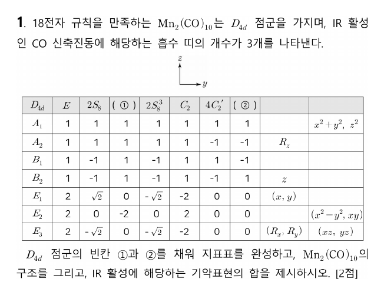

**정답** ① **2C₄**, ② **4σd**. 엇갈린(staggered) Mn₂(CO)₁₀ 구조, IR 활성 CO 신축 = **2B₂ + E₁** (띠 3개)

**공식·핵심 개념**

- 지표표 빈칸: 위수 $h = \sum g$, 기약표현 직교성 $\sum g\chi_i\chi_j = 0$
- CO 신축 Γ: 제자리 CO 수 → 축소
- IR 활성: x, y, z와 같은 기약표현

**2027 출제 가능성 ★★★★★ 매우 높음** — 지표표 완성과 진동 기약표현은 무기 대칭의 고정 출제 소재입니다.

**빈칸 채우기.** D₄d 위수 h = 16 = 1+2+(①)+2+1+4+(②). 기약표현의 직교성을 쓰면 됩니다.

- E₂ × A₁: $2 + 0 - 2n_① + 0 + 2 + 0 + 0 = 0$ → 열 ①의 계수 2 → **2C₄**
- A₁ × A₂: $1 + 2 + 2 + 2 + 1 - 4 - n_② = 0$ → **4σd**

**구조.** 18전자: Mn(7) + CO 5개(10) + Mn–Mn 1 = 18. 두 Mn(CO)₅ 단위가 45° 엇갈려 D₄d.

**CO 신축 Γ.** 제자리 CO 수:

| D₄d | E | 2S₈ | 2C₄ | 2S₈³ | C₂ | 4C₂′ | 4σd |
|---|---|---|---|---|---|---|---|
| Γ_CO | 10 | 0 | 2 | 0 | 2 | 0 | 4 |

축소하면 $\Gamma = 2A_1 + 2B_2 + E_1 + E_2 + E_3$. IR 활성은 z(B₂), (x, y)(E₁) → **2B₂ + E₁**, 문제의 "띠 3개"와 일치합니다.

**채점 포인트·함정**

- C₄에서 축 CO 2개, σd에서 축 CO 2개 + 평면 위 적도 CO 2개가 제자리입니다.

## A형 2번 · Michaelis–Menten 속도식과 Lineweaver–Burk 도시 {#a2}

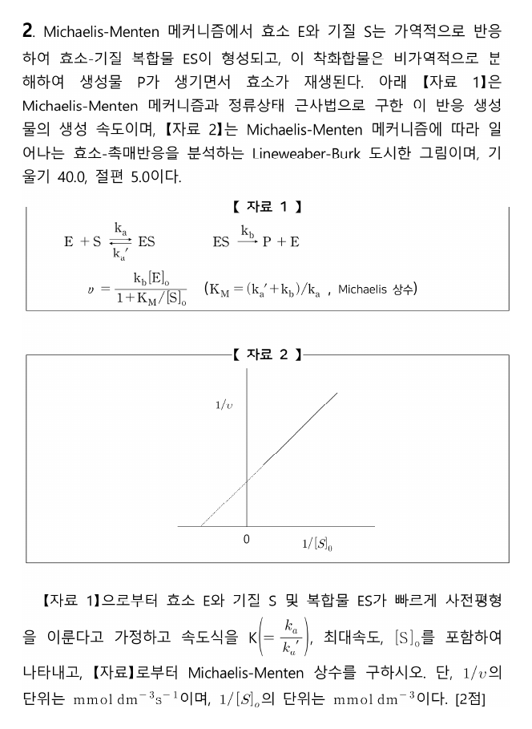

**정답** (1) $v = \dfrac{v_{max}K[S]_0}{1 + K[S]_0}$  (2) $K_M = 8.0\ \mathrm{mmol\,dm^{-3}}$

**공식·핵심 개념**

- 사전 평형: $v = \dfrac{v_{max}K[S]}{1+K[S]}$
- 정류 상태: $v = \dfrac{v_{max}[S]}{K_M + [S]}$
- Lineweaver–Burk: 기울기 $K_M/v_{max}$, 절편 $1/v_{max}$

**2027 출제 가능성 ★★★★☆ 높음** — 효소 속도론과 이중 역수 도시는 속도론에서 꾸준히 나옵니다.

**사전 평형.** $K = \dfrac{k_a}{k_a'} = \dfrac{[ES]}{[E][S]}$, $[E]_0 = [E] + [ES]$ ($[S] \approx [S]_0$):

$$[ES] = \frac{K[E]_0[S]_0}{1 + K[S]_0}, \quad v = k_b[ES] = \frac{v_{max}K[S]_0}{1 + K[S]_0} \quad (v_{max} = k_b[E]_0)$$

**Lineweaver–Burk.** $\dfrac1v = \dfrac{K_M}{v_{max}}\cdot\dfrac{1}{[S]_0} + \dfrac{1}{v_{max}}$ → 절편 5.0 = $1/v_{max}$ → $v_{max} = 0.20$, 기울기 40.0 = $K_M/v_{max}$ → $K_M = 40.0 \times 0.20 = 8.0$ mmol dm⁻³.

**채점 포인트·함정**

- 사전 평형 근사의 K(형성 상수)는 정류 상태의 $K_M$(해리 성격)과 역수 관계에 가깝습니다($k_b \ll k_a'$이면 $K_M \approx 1/K$).

## A형 3번 · C₉H₁₁NO₂ 두 이성질체의 IR·NMR {#a3}

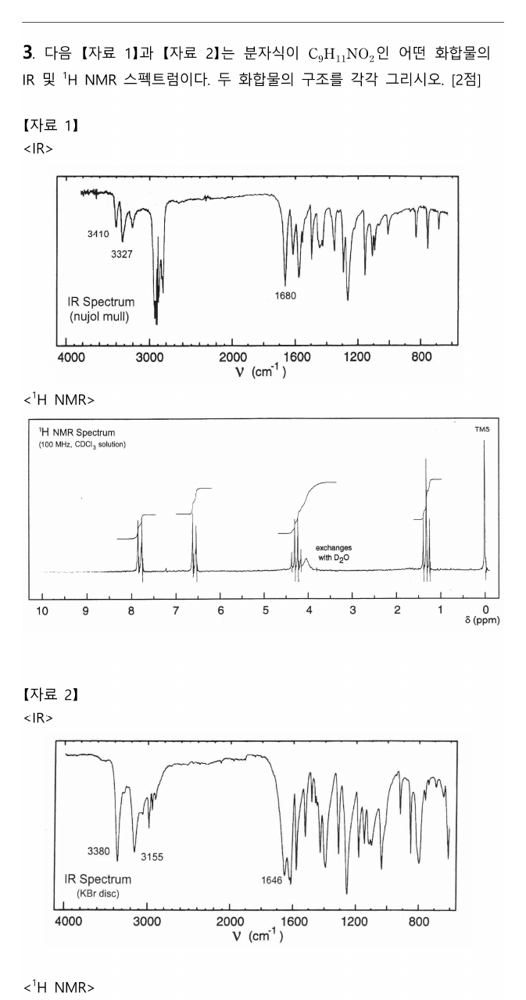

**정답** 자료 1 **ethyl p-aminobenzoate**(벤조카인), 자료 2 **p-ethoxybenzamide**

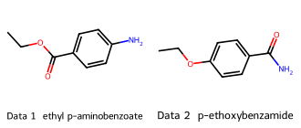

**공식·핵심 개념**

- 불포화도 5 = 벤젠 + C=O
- 아마이드 C=O 1650 < 에스터 1700~1735
- N–H: 아민 3~5 ppm, 아마이드 5~9 ppm, D₂O 교환

**2027 출제 가능성 ★★★★★ 매우 높음** — IR·NMR 구조 결정은 유기에서 해마다 나옵니다.

불포화도 = (2·9 + 2 + 1 − 11)/2 = **5** (벤젠 4 + C=O 1).

| | 자료 1 | 자료 2 |
|---|---|---|
| IR N–H | 3410, 3327 (1차 아민 2개) | 3380, 3155 (1차 아마이드) |
| IR C=O | **1680** (콘쥬게이션 에스터) | **1646** (아마이드, 낮음) |
| ¹H | 7.8·6.6 (d, para), 4.3 (q, OCH₂), 1.3 (t), ~4.0 NH₂(D₂O 교환) | 7.8·6.9 (d), 4.1 (q, OCH₂), 1.3 (t), 7.0~7.6 CONH₂(넓음, D₂O 교환) |
| 핵심 | OCH₂가 C=O에 붙음(에스터) | OCH₂가 고리에 붙음(에터) |

**채점 포인트·함정**

- 아마이드 C=O(1650)가 에스터(1680~1735)보다 낮고, 아마이드 N–H는 5~9 ppm, 아민 N–H는 3~5 ppm입니다.

## A형 4번 · BaSO₄의 질량 균형과 용해도 {#a4}

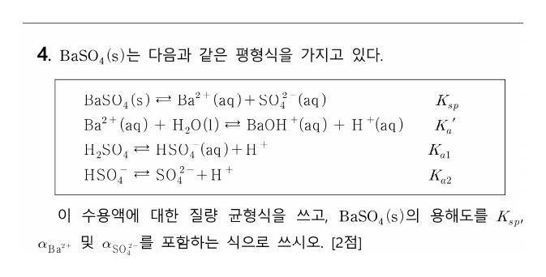

**정답** (1) $[\mathrm{Ba^{2+}}] + [\mathrm{BaOH^+}] = [\mathrm{SO_4^{2-}}] + [\mathrm{HSO_4^-}] + [\mathrm{H_2SO_4}]$  (2) $S = \sqrt{\dfrac{K_{sp}}{\alpha_{Ba^{2+}}\,\alpha_{SO_4^{2-}}}}$

**공식·핵심 개념**

- 질량 균형: 녹은 양이온 전체 = 음이온 전체
- 분율 $\alpha = [\text{유리 이온}]/F$
- $K_{sp} = \alpha_M\alpha_X S^2$

**2027 출제 가능성 ★★★☆☆ 보통** — 체계적 평형 처리는 분석화학에서 가끔 기입형으로 나옵니다.

**질량 균형.** BaSO₄가 녹으면 Ba와 SO₄가 1 : 1로 나오므로 (Ba 전체) = (황산 전체).

**분율.** $\alpha_{Ba^{2+}} = [\mathrm{Ba^{2+}}]/F_{Ba}$, $\alpha_{SO_4^{2-}} = [\mathrm{SO_4^{2-}}]/F_{SO_4}$, 그리고 $F_{Ba} = F_{SO_4} = S$:

$$K_{sp} = [\mathrm{Ba^{2+}}][\mathrm{SO_4^{2-}}] = \alpha_{Ba^{2+}}\alpha_{SO_4^{2-}}S^2 \;\Rightarrow\; S = \sqrt{\frac{K_{sp}}{\alpha_{Ba^{2+}}\alpha_{SO_4^{2-}}}}$$

**채점 포인트·함정**

- α < 1이므로 부반응(가수분해·양성자화)이 있으면 용해도가 커집니다.

## A형 5번 · 로슨의 세 가지 순환학습 {#a5}

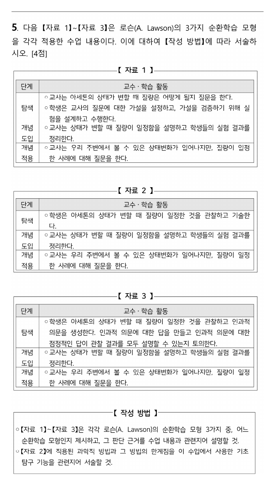

**정답**

- 자료 1 **가설-연역적** 순환학습: 가설을 검증하기 위한 구체적인 실험을 설계·수행·검증한다.
- 자료 2 **서술적(기술적)** 순환학습: 탐색 단계에서 인과적 의문을 생성하지 않고 관찰한 양상을 그대로 기술할 뿐, 원인이나 이유를 제시하지 않는다.
- 자료 3 **경험-귀추적** 순환학습: 실험 결과를 근거로 인과적 질문에 대해 학습한 내용으로 답하되, 실험 설계·검증 없이 자료의 재해석으로 답한다.
- 자료 2의 과학적 방법: **귀납적 추리**. 기초 탐구 기능은 **관찰**, 한계는 **관찰의 이론 의존성**.

**공식·핵심 개념**

- 로슨: 서술적(귀납) / 경험-귀추적 / 가설-연역적
- 세 유형의 차이는 **탐색 단계**
- 귀납의 한계: 관찰의 이론 의존성

**2027 출제 가능성 ★★★★★ 매우 높음** — 로슨 순환학습 세 유형 구분은 교육론 최빈출입니다.

| 유형 | 탐색 단계 | 추리 |
|---|---|---|
| 서술적 | 관찰·기술, 규칙성 발견 | 귀납 |
| 경험-귀추적 | 인과적 질문 → 유사 경험으로 잠정 설명 | 귀추 |
| 가설-연역적 | 가설 → 예측 → 실험으로 검증 | 가설-연역 |

**귀납의 한계.** 관찰은 이미 가진 이론에 따라 무엇을 볼지 정해지므로(이론 의존성) 순수한 관찰에서 일반화한다는 귀납의 전제가 흔들립니다. 유한한 관찰로 보편 법칙을 확정할 수 없다는 문제도 있습니다.

**채점 포인트·함정**

- 세 자료는 개념 도입·적용 단계가 같고 **탐색 단계만** 다릅니다. 근거는 탐색 단계에서 찾습니다.

## A형 6번 · STS 수업 모형 {#a6}

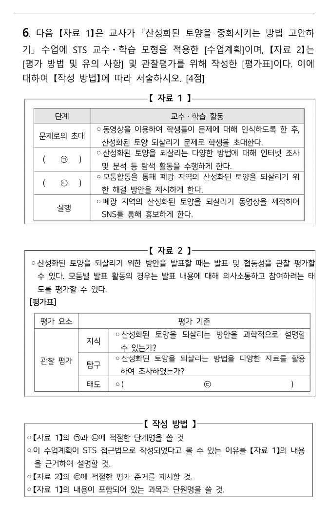

**정답**

- ㉠ **탐색**, ㉡ **설명 및 해결방안 제시**
- STS 근거: 생활과 밀접한 토양 산성화 문제를 제시해 흥미를 끌고, 학생이 스스로 자료를 조사하는 학생 중심 활동을 하며, 여러 해결 방안을 종합적으로 검토·토의해 결론을 내리고 **실천(실행)** 하므로 과학–기술–사회의 관련성을 이해하게 한다.
- ㉢ **모둠원과 서로 의사소통하는 과정에 적극적으로 참여하여 자신의 생각을 발표하였는가?**
- 과목·단원: **통합과학 2, 변화와 다양성**

**공식·핵심 개념**

- STS(Yager): 문제로의 초대 → 탐색 → 설명 및 해결방안 제시 → 실행
- 평가 준거는 관찰 가능한 행동으로

**2027 출제 가능성 ★★★★☆ 높음** — STS·사회적 쟁점 수업은 2022 개정 '과학과 사회'와 맞물려 꾸준히 나옵니다.

**STS 수업 모형(Yager)**: 문제로의 초대 → 탐색 → 설명 및 해결방안 제시 → 실행.

**㉢.** 자료 2가 "태도"에서 의사소통·참여 의지를 평가한다고 했으므로 그 행동을 준거로 씁니다.

**채점 포인트·함정**

- STS의 핵심은 **사회적 문제 → 의사결정 → 실천**입니다. 마지막 '실행' 단계를 근거에 꼭 넣습니다.

## A형 7번 · 2022 개정 [과학] 질량 관계 수업과 평가 {#a7}

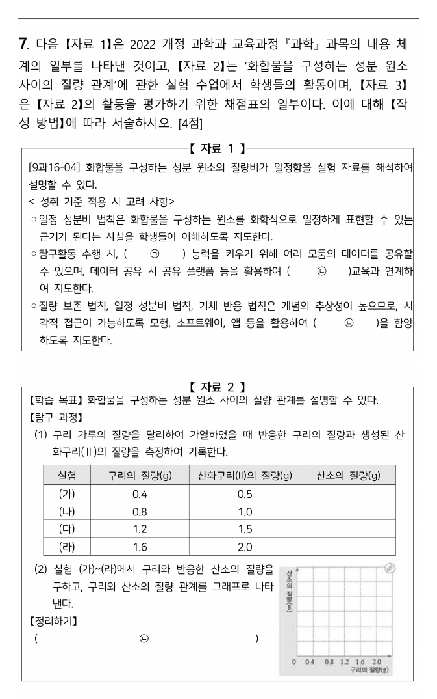

**정답**

- ㉠ **의사소통과 협업**, ㉡ **디지털 소양**
- ㉢ **산화구리(II)를 구성하는 구리와 산소의 질량 관계를 설명해 보자.**
- ㉣ **화합물을 구성하는 성분 원소들 사이의 질량 관계와 관련된 가설을 설정하였는가?**
- ㉤ **실험 결과를 토대로 화합물을 구성하는 성분 원소들 사이의 질량 관계를 진술하였는가?**

**공식·핵심 개념**

- 2022 개정 과정·기능 '의사소통과 협업', 기초 소양 '디지털 소양'
- 일정 성분비 법칙: 구리 : 산소 = 4 : 1
- 평가 준거 = 실험 목적 + 구체적 행동

**2027 출제 가능성 ★★★★★ 매우 높음** — 2022 개정 성취기준 적용 고려사항과 평가 준거 작성은 2027 우선순위가 높습니다.

**자료 계산.** 산소 질량 = 산화구리 − 구리: 0.1, 0.2, 0.3, 0.4 g → 구리 : 산소 = **4 : 1**로 일정(일정 성분비 법칙).

**평가 준거 쓰는 법.** 자료 3의 다른 항목처럼 "실험 목적에 맞게 + 구체적 행동"으로 씁니다. 가설 설정은 '질량 관계에 대한 가설', 결론 도출은 '실험 결과를 근거로 질량 관계 진술'.

**채점 포인트·함정**

- ㉡ 디지털 소양은 2022 개정 총론의 기초 소양(언어·수리·디지털) 중 하나입니다.

## A형 8번 · 코발트 착물의 CFSE·자성과 π 결합 효과 {#a8}

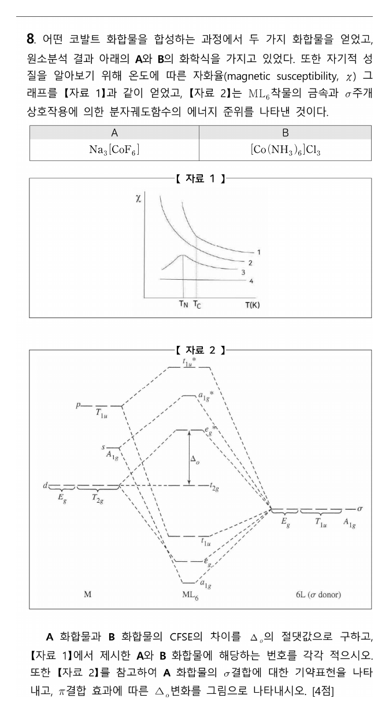

**정답**

- CFSE 차이 절댓값 **2.0Δo**
- Na₃[CoF₆]: **상자성, 그래프 2** / [Co(NH₃)₆]Cl₃: **반자성, 그래프 4**
- σ 결합 기약표현: **$A_{1g} + E_g + T_{1u}$**
- π 결합 효과: F⁻는 **π 주개** → 채워진 리간드 π 오비탈이 t₂g와 섞여 t₂g가 올라감 → **Δo 감소**

**공식·핵심 개념**

- 팔면체 CFSE: t₂g −0.4Δo, eg +0.6Δo
- 상자성 χ ∝ 1/T, 반자성 χ < 0 일정
- π 주개 → Δo↓, π 받개 → Δo↑

**2027 출제 가능성 ★★★★★ 매우 높음** — 결정장·MO와 자성은 무기 최빈출입니다.

**CFSE.** Co³⁺ d⁶.

- [CoF₆]³⁻ (약한 장, 고스핀) t₂g⁴eg²: $4(-0.4) + 2(0.6) = -0.4\Delta_o$
- [Co(NH₃)₆]³⁺ (강한 장, 저스핀) t₂g⁶: $6(-0.4) = -2.4\Delta_o$
- 차이 **2.0Δo** (짝지음 에너지 제외)

**자성 그래프.** 고스핀 d⁶은 홀전자 4개 → 퀴리 법칙 χ ∝ 1/T(그래프 2). 저스핀 d⁶은 홀전자 0 → 온도와 무관한 음의 작은 χ(그래프 4).

**π 효과.** 리간드 π SALC(t₂g)가 금속 t₂g보다 낮은 에너지에 채워져 있으면(π 주개) 금속 t₂g는 반결합성(t₂g*)이 되어 올라가고 Δo가 작아집니다. π 받개(CO, CN⁻)는 반대로 t₂g를 낮춰 Δo를 키웁니다.

**채점 포인트·함정**

- ML₆의 σ SALC에서 t₂g는 빠지므로 t₂g는 σ만 있을 때 비결합성입니다.

## A형 9번 · 동위원소와 결합 해리 에너지 {#a9}

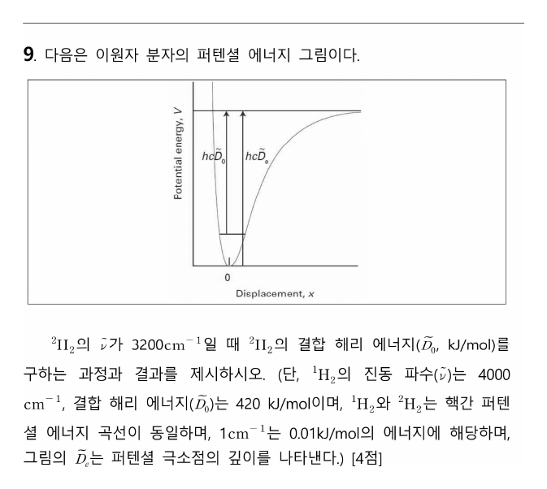

**정답** ²H₂의 $\tilde D_0 = 424$ kJ/mol

**공식·핵심 개념**

- $D_e = D_0 + \tfrac12\tilde\nu$ (영점 에너지)
- $D_e$는 동위원소와 무관
- $\tilde\nu \propto \mu^{-1/2}$

**2027 출제 가능성 ★★★★☆ 높음** — 진동 분광과 영점 에너지는 물리화학에서 자주 나옵니다.

**원리.** 퍼텐셜 곡선의 깊이 $D_e$는 전자 구조로 정해지므로 동위원소와 무관합니다. 측정되는 $D_0$은 바닥 진동 준위(영점 에너지)부터 잰 값: $D_e = D_0 + \tfrac12\tilde\nu$.

- ¹H₂: $\tfrac12(4000)(0.01) = 20$ kJ/mol → $D_e = 420 + 20 = 440$ kJ/mol
- ²H₂: $\tfrac12(3200)(0.01) = 16$ kJ/mol → $D_0 = 440 - 16 = 424$ kJ/mol

**채점 포인트·함정**

- 무거운 동위원소일수록 영점 에너지가 낮아 **D₀가 커집니다**(결합이 끊기 어려움).
- $\tilde\nu \propto \mu^{-1/2}$이므로 실제 D₂는 약 2830 cm⁻¹입니다(검토 메모 4).

## A형 10번 · 알릴 양이온: 위치 선택성과 속도론적·열역학적 지배 {#a10}

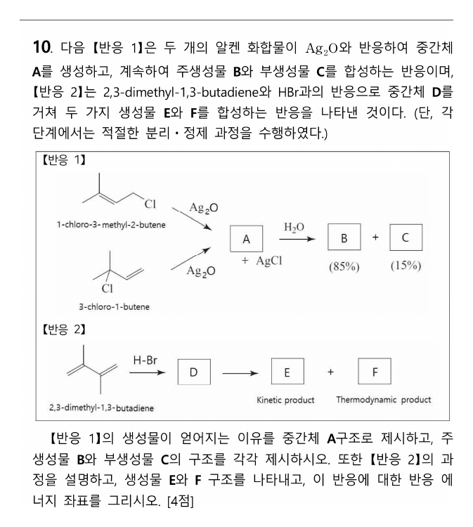

**정답** 두 염화물 모두 Ag⁺로 같은 **공명 안정화 알릴 양이온 A**를 만듭니다. B **2-methyl-3-buten-2-ol** (85%), C **3-methyl-2-buten-1-ol** (15%), D **알릴 양이온**, E **3-bromo-2,3-dimethyl-1-butene**(1,2-첨가, 속도론적), F **1-bromo-2,3-dimethyl-2-butene**(1,4-첨가, 열역학적)

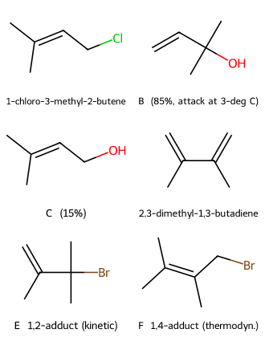

**공식·핵심 개념**

- 알릴 양이온: 공명으로 양전하가 두 탄소에
- 속도론적 지배 = 낮은 활성화 에너지(1,2-첨가)
- 열역학적 지배 = 안정한 생성물(1,4-첨가)

**2027 출제 가능성 ★★★★★ 매우 높음** — 콘쥬게이션 다이엔의 1,2/1,4-첨가와 에너지 도표는 유기 단골입니다.

**반응 1.** Ag⁺가 Cl⁻를 AgCl로 끌어내 SN1: 1-chloro-3-methyl-2-butene와 3-chloro-3-methyl-1-butene(문제 그림의 구조; 이름표 '3-chloro-1-butene'은 메틸 하나가 빠진 표기) 모두 같은 (CH₃)₂C⁺–CH=CH₂ ↔ (CH₃)₂C=CH–CH₂⁺ 공명 양이온이 됩니다. 3차 탄소 쪽 공명 구조(I)가 양전하를 더 잘 안정화하므로 물이 그 탄소를 주로 공격 → 3차 알코올 B(주), 1차 알코올 C(부).

**반응 2.** H⁺가 말단 C에 붙어 3차·알릴 양이온 D. Br⁻가

- 가까운 C2(3차 양이온 쪽)를 공격 → **E (1,2-첨가)**: 활성화 에너지가 낮음 → 저온·짧은 시간에서 우세
- C4를 공격 → **F (1,4-첨가)**: 사치환 알켄으로 더 안정 → 고온·평형에서 우세

**반응 에너지 도표.** 다이엔 → (TS₁) → D → E로 가는 TS가 더 낮고, F로 가는 TS는 더 높지만 F 자체의 에너지가 E보다 낮게 그립니다.

**메커니즘 — 반응 1: Ag⁺ 보조 SN1과 알릴 양이온 A (주생성물 B)**

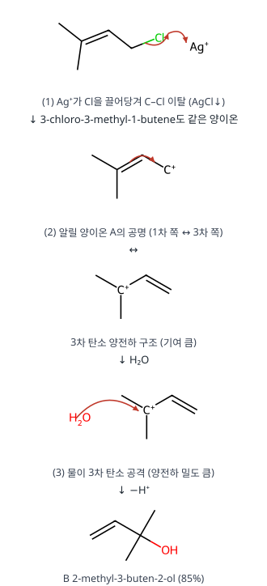

**메커니즘 — 반응 1: 부생성물 C**

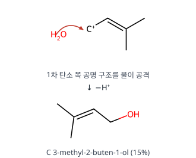

**메커니즘 — 반응 2: HBr 첨가, 1,2-첨가(E)와 1,4-첨가(F)**

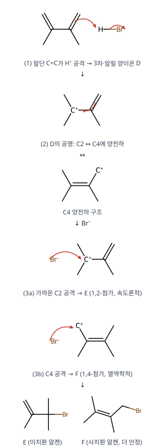

**채점 포인트·함정**

- 속도론적 생성물 = **낮은 활성화 에너지**, 열역학적 생성물 = **낮은 생성물 에너지**. 도표에서 두 기준을 함께 보여야 합니다.

## A형 11번 · 2-chlorocyclohexanol과 methylenecyclohexane 에폭시화 {#a11}

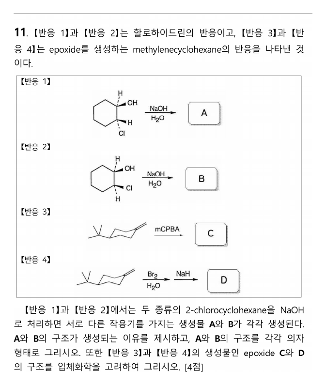

**정답** A **cyclohexene oxide**(trans 출발물), B **cyclohexanone**(cis 출발물). C·D는 4-tert-butyl 고리의 서로 다른 **스피로 에폭사이드 부분입체이성질체**

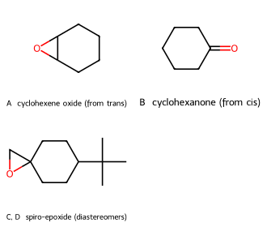

**공식·핵심 개념**

- 할로하이드린 + 염기: O⁻와 X가 anti-periplanar면 에폭사이드
- 그렇지 않으면 E2 → 엔올 → 케톤
- mCPBA는 덜 막힌 면, 할로하이드린 경로는 반대 입체

**2027 출제 가능성 ★★★★☆ 높음** — 의자형 배좌와 입체 선택성을 묻는 서술형은 유기 고난도 단골입니다.

**trans → A.** 고리 뒤집기로 OH와 Cl이 모두 **축 방향(trans-diaxial)** 이 되면 O⁻가 C–Cl의 뒤쪽에서 분자 내 SN2 → 에폭사이드.

**cis → B.** cis에서는 O⁻와 C–Cl이 반대편 배치를 만들 수 없습니다. 대신 카비놀 탄소의 H가 Cl과 anti-periplanar → 염기가 이 H를 떼는 E2 → **엔올** → 토토머화 → 사이클로헥산온.

**C (mCPBA).** tert-butyl이 고리를 의자형에 고정. mCPBA는 덜 막힌 **적도 방향**에서 C=C에 접근 → 에폭사이드 O가 적도, CH₂가 축 방향.

**D (Br₂/H₂O → NaH).** Br⁺가 적도 방향에서 붙어 브로모늄 → 물이 3차 탄소를 **축 방향**에서 공격(OH 축, CH₂Br 적도) → NaH로 생긴 O⁻가 CH₂Br을 치환 → O가 **축 방향**인 에폭사이드. 그래서 C와 D는 산소 방향이 반대인 부분입체이성질체입니다.

**메커니즘 — 반응 1: trans → 분자 내 SN2 → A**

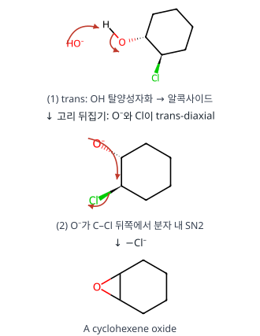

**메커니즘 — 반응 2: cis → E2 → 엔올 → B**

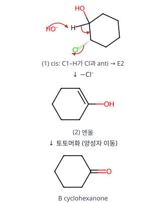

**메커니즘 — 반응 3: mCPBA 에폭시화 → C**

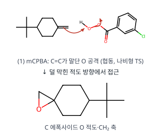

**메커니즘 — 반응 4: 브로모늄 → 할로하이드린 → 분자 내 SN2 → D**

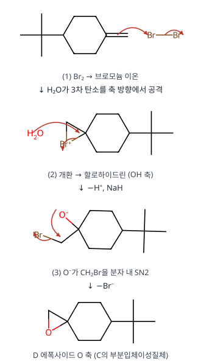

**채점 포인트·함정**

- 의자형으로 그려 OH·Cl의 축/적도를 표시해야 이유가 드러납니다.

## A형 12번 · HCl + H₃A 혼합물의 두 지시약 적정 {#a12}

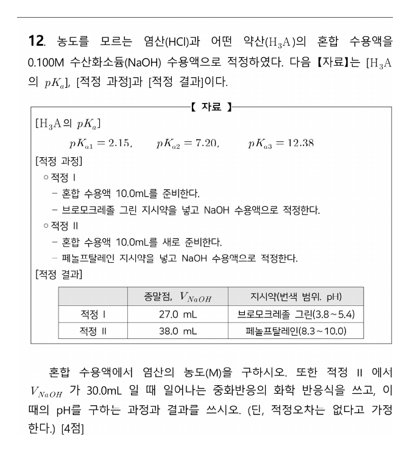

**정답** [HCl] = **0.16 M** ([H₃A] = 0.11 M). 30.0 mL에서 $\mathrm{H_2A^- + OH^- \to HA^{2-} + H_2O}$, pH = $7.20 + \log\dfrac38 \approx$ **6.77**

**공식·핵심 개념**

- 지시약별 종말점: BCG = 첫째 양성자, 페놀프탈레인 = 둘째 양성자
- 연립: $n_{HCl} + n_{H_3A}$, $n_{HCl} + 2n_{H_3A}$
- 완충 구간 pH = pKa + log(염기/산)

**2027 출제 가능성 ★★★★★ 매우 높음** — 다양성자산 혼합물 적정은 분석화학 최빈출 계산입니다.

**두 종말점.** 브로모크레졸 그린(pH ~4.5)은 HCl + H₃A의 **첫 번째** 양성자까지, 페놀프탈레인(pH ~9)은 **두 번째** 양성자까지(pKa₂ 7.20 지나고 pKa₃ 12.38 전).

$$n_{HCl} + n_{H_3A} = 0.100 \times 27.0 = 2.70\ \mathrm{mmol}, \quad n_{HCl} + 2n_{H_3A} = 0.100 \times 38.0 = 3.80\ \mathrm{mmol}$$

→ $n_{H_3A} = 1.10$, $n_{HCl} = 1.60$ mmol → [HCl] = 1.60/10.0 = **0.160 M**.

**30.0 mL.** 첫 종말점(27.0 mL) 뒤 3.0 mL = 0.30 mmol OH⁻가 H₂A⁻(1.10 mmol)와 반응 → HA²⁻ 0.30, H₂A⁻ 0.80 mmol:

$$\mathrm{pH} = 7.20 + \log\frac{0.30}{0.80} = 7.20 - 0.43 = 6.77$$

**채점 포인트·함정**

- 페놀프탈레인은 세 번째 양성자(pKa₃ 12.38)까지 가지 않습니다 — 그래서 계수 2.

# 전공 B

## B형 1번 · Stork 엔아민 반응과 Robinson 고리화 {#b1}

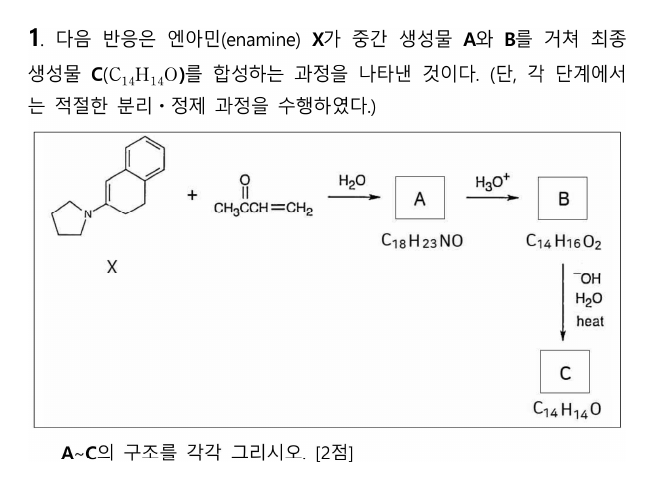

**정답** A **엔아민의 Michael 부가물**(C₁₈H₂₃NO), B **1-(3-oxobutyl)-2-tetralone**(C₁₄H₁₆O₂), C **삼환 엔온**(C₁₄H₁₄O)

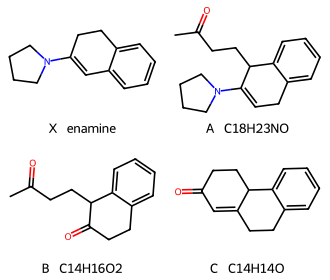

**공식·핵심 개념**

- Stork 엔아민: 엔아민 β-탄소 = 친핵체 → Michael → 가수분해
- Robinson 고리화 = Michael + 분자 내 aldol + 탈수

**2027 출제 가능성 ★★★★☆ 높음** — 엔아민·Robinson 고리화는 유기 합성 경로 문제로 자주 나옵니다.

1. **X + MVK (Michael).** 엔아민의 β-탄소(C1, 벤질 자리)가 MVK의 β-탄소를 공격 → 이미늄 → 양성자 이동으로 엔아민 A가 다시 생김. C₁₄H₁₇N + C₄H₆O = **C₁₈H₂₃NO** ✓
2. **H₃O⁺.** 엔아민 가수분해 → 케톤 B + 피롤리딘. **C₁₄H₁₆O₂** ✓
3. **⁻OH, 가열 (분자 내 aldol + 탈수).** 메틸 케톤의 CH₃ 엔올레이트가 고리 C=O를 공격 → β-하이드록시 케톤 → E1cB 탈수 → 콘쥬게이션 엔온 C. **C₁₄H₁₄O** ✓

**메커니즘 — X → A: Stork 엔아민 Michael 첨가**

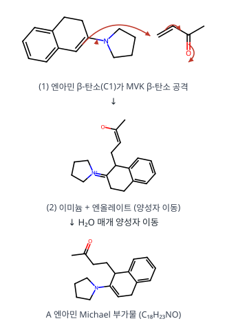

**메커니즘 — A → B: 엔아민 가수분해**

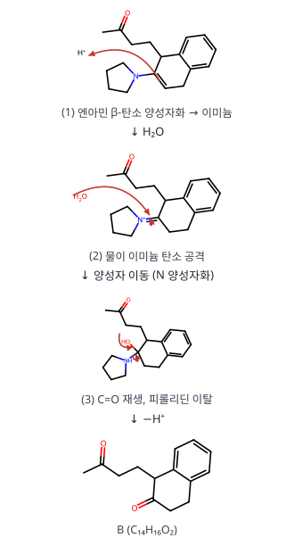

**메커니즘 — B → C: 분자 내 aldol + E1cB 탈수**

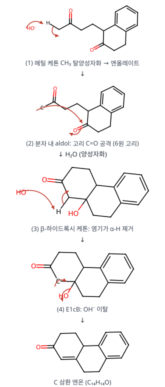

**채점 포인트·함정**

- 엔아민은 LDA 없이도 케톤의 α-탄소를 친핵체로 쓰는 방법(Stork). 산 가수분해 단계를 빠뜨리지 않습니다.

## B형 2번 · Ag₃AsO₄ 전극의 표준 전위와 pAsO₄ {#b2}

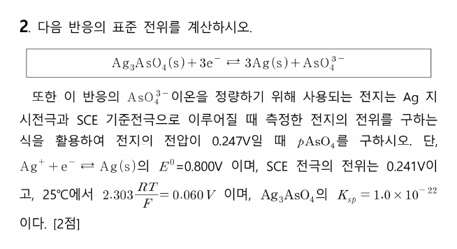

**정답** (1) $E^\circ_{Ag_3AsO_4} = 0.36$ V  (2) pAsO₄ = **6.40**

**공식·핵심 개념**

- 침전 전극: $E^\circ_{MX} = E^\circ_M + \dfrac{0.060}{n}\log K_{sp}$
- $E_{cell} = E_{지시} - E_{기준}$
- pX = −log[X]

**2027 출제 가능성 ★★★★☆ 높음** — 침전·착물 전극 전위는 분석화학 전기화학 단골입니다.

**E°.** Ag 전극 전위를 $[\mathrm{Ag^+}] = (K_{sp}/[\mathrm{AsO_4^{3-}}])^{1/3}$로 바꾸면

$$E = 0.800 + 0.060\log[\mathrm{Ag^+}] = 0.800 + \frac{0.060}{3}\log K_{sp} - \frac{0.060}{3}\log[\mathrm{AsO_4^{3-}}]$$

[AsO₄³⁻] = 1일 때 $E^\circ = 0.800 + 0.020(-22) = 0.360$ V.

**pAsO₄.** $E_{cell} = E_{Ag} - E_{SCE}$ → $E_{Ag} = 0.247 + 0.241 = 0.488$ V.

$$0.488 = 0.360 + 0.020\,\mathrm{pAsO_4} \;\Rightarrow\; \mathrm{pAsO_4} = 6.40$$

**채점 포인트·함정**

- 3전자 반응이므로 계수는 0.060/3 = 0.020입니다.

## B형 3번 · 라부아지에, 밀리컨, 허셜 — 과학철학 {#b3}

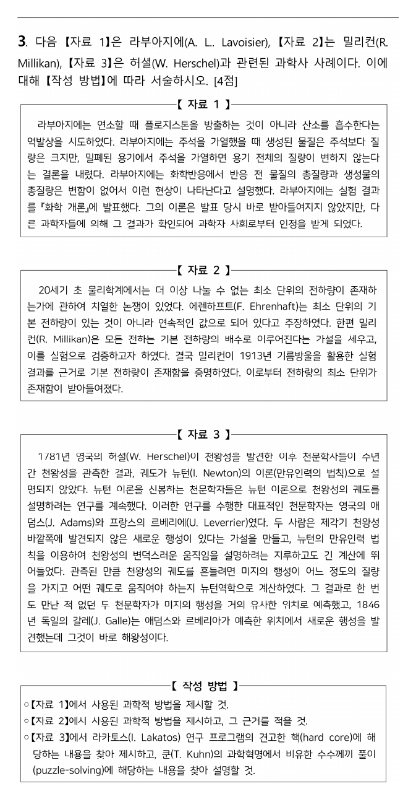

**정답**

- 자료 1: **사회적 합의** — 발표 당시 바로 받아들여지지 않았지만, 다른 과학자들이 결과를 확인하여 과학자 사회의 인정을 받았다.
- 자료 2: **가설연역법** — 가설(전하량은 기본 단위의 배수)을 세우고 실험(기름방울)으로 검증하여 기본 전하량을 증명했다.
- 라카토스 견고한 핵: **뉴턴 이론(만유인력의 법칙)**
- 쿤의 수수께끼 풀이: 천왕성 궤도가 뉴턴 이론을 지지하도록 계산으로 확인하여, 패러다임에서 벗어난 **변칙 사례를 패러다임 안에서 해결**해 패러다임을 정교화했다.

**공식·핵심 개념**

- 사회적 합의, 가설연역법
- 라카토스: 견고한 핵 + 보호대
- 쿤: 정상과학의 수수께끼 풀이, 변칙 사례

**2027 출제 가능성 ★★★★★ 매우 높음** — 과학사 사례로 과학철학자를 묻는 문항은 교육론에서 매년 나옵니다.

**라카토스**: 해왕성 예측은 핵(뉴턴 이론)을 지키며 보호대(미지의 행성 가정)를 추가해 새로운 사실을 예측·확인한 **전진적 연구 프로그램**의 예입니다.

**쿤**: 정상과학 시기에 패러다임을 의심하지 않고 그 틀 안에서 문제를 푸는 활동이 수수께끼 풀이입니다.

**채점 포인트·함정**

- 같은 사례를 라카토스(핵 보호)와 쿤(정상과학)으로 각각 해석할 수 있어야 합니다.

## B형 4번 · 브루너의 나선형 교육과정 {#b4}

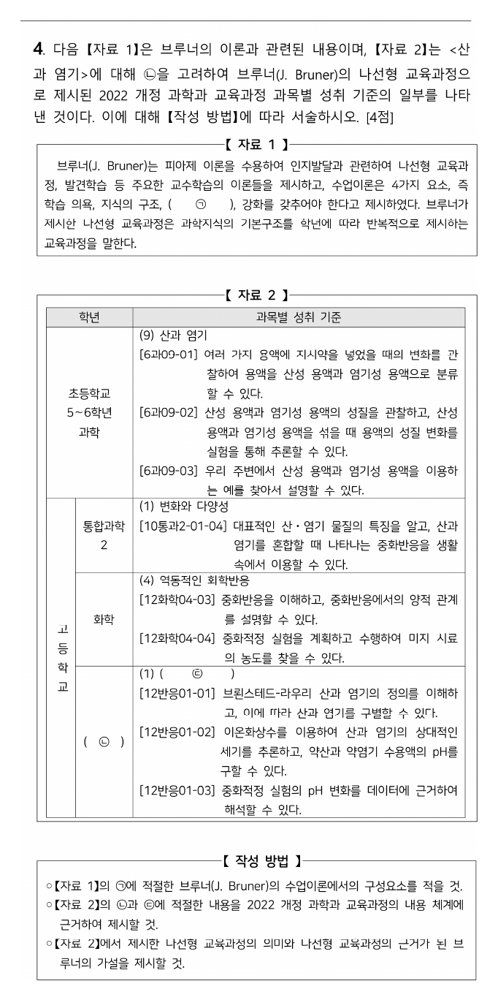

**정답**

- ㉠ **계열(성)**
- ㉡ **화학 반응의 세계**, ㉢ **산 염기 평형**
- 나선형 교육과정: 과학지식의 기본구조를 학년에 따라 기초적인 것에서 시작해 반복적으로 심화하여 제시하는 것으로, 발달 과정과 지적 수준에 맞추고 학습의 순서는 계열성을 유지한다.
- 근거 가설: **어떤 교과든 지적으로 올바른 형태로 표현하면 어떤 발달 단계의 아동에게도 효과적으로 가르칠 수 있다.**

**공식·핵심 개념**

- 브루너 수업이론: 학습 의욕, 지식의 구조, 계열, 강화
- 나선형 교육과정: 기본 구조를 반복·심화
- 2022 개정 진로 선택 '화학 반응의 세계'

**2027 출제 가능성 ★★★★★ 매우 높음** — 2022 개정 과목 체계와 학자 이론을 묶는 형태는 2027 우선순위가 높습니다.

**브루너 수업이론 4요소**: 학습 의욕(경향성), 지식의 구조, **계열**, 강화(상벌).

**나선 예**: 초 5~6 산·염기 용액 분류 → 통합과학 2 산·염기와 중화 → 화학(역동적인 화학반응) 중화 양적 관계 → 화학 반응의 세계(산 염기 평형) 브뢴스테드–로우리, 이온화 상수, 적정 곡선.

**채점 포인트·함정**

- 2022 개정 진로 선택 과목명 '화학 반응의 세계'를 정확히 씁니다.

## B형 5번 · 고윈의 V도 평가 {#b5}

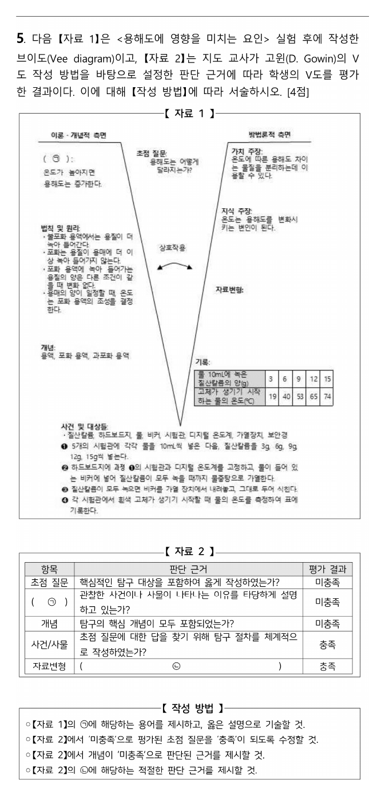

**정답**

- ㉠ **이론**: 온도가 높아지면 용매 분자와 용질 분자 사이의 상호작용이 활발해져 용해도가 증가한다.
- 초점 질문 수정: **온도는 용해도에 영향을 미치는 요인인가?**
- 개념 미충족 근거: 핵심 개념인 **용해도와 온도가 빠짐**
- ㉡ **초점 질문에 답하기 위해 측정·기록한 온도에 따라 녹은 질산칼륨의 값을 그래프로 나타내었는가?**

**공식·핵심 개념**

- V도: 개념적 측면 ↔ 초점 질문 ↔ 방법론적 측면
- 초점 질문에는 변인(독립 변인)이 드러나야
- 자료 변환 = 기록을 해석하기 쉬운 형태로

**2027 출제 가능성 ★★★★☆ 높음** — V도 평가는 실험 수업·평가와 엮여 종종 나옵니다.

**V도 구조**: 개념적 측면(세계관·철학·이론·원리·개념) ↔ 초점 질문 ↔ 방법론적 측면(기록·변환·지식 주장·가치 주장), 아래 꼭짓점에 사건·사물.

**초점 질문.** 원래 질문 "용해도는 어떻게 달라지는가?"에는 변인(온도)이 빠져 탐구 대상이 드러나지 않습니다.

**채점 포인트·함정**

- 자료 변환 준거는 '기록을 해석하기 쉬운 형태(그래프)로 바꾸었는가'입니다.

## B형 6번 · 싸이오사이아네이트 결합 이성질 {#b6}

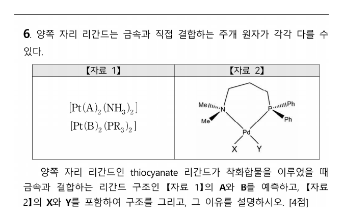

**정답**

- A **SCN**(S-결합), B **NCS**(N-결합): [Pt(SCN)₂(NH₃)₂]와 [Pt(NCS)₂(PR₃)₂]
- 자료 2: X(P의 trans) **NCS**(N-결합), Y(N의 trans) **SCN**(S-결합, 굽은 Pd–S–C)

**공식·핵심 개념**

- HSAB: Pt²⁺·Pd²⁺(무름) ↔ S 결합 선호
- trans 자리 π 받개와 경쟁 → N 결합으로 전환
- 입체 효과: S-결합은 굽음, N-결합은 직선

**2027 출제 가능성 ★★★☆☆ 보통** — 결합 이성질과 trans 효과는 무기에서 가끔 나옵니다.

**HSAB.** Pt²⁺·Pd²⁺는 무른 산 → 기본적으로 무른 S로 결합합니다.

**π 경쟁(전자 효과).** S-결합 SCN⁻는 π 받개 성격을 가집니다. trans 자리에 강한 π 받개 PR₃가 있으면 같은 d 오비탈을 놓고 경쟁해야 하므로 SCN⁻는 **N 쪽으로 결합 방식을 바꿉니다**. NH₃처럼 π 결합을 못 하는 리간드의 trans에서는 S로 결합합니다.

**입체 효과.** S-결합은 Pd–S–C가 굽어(약 100°) 공간을 많이 차지하고, N-결합은 직선형입니다. 부피 큰 PPh₂ 옆에는 직선형 NCS가 유리합니다.

**채점 포인트·함정**

- 전자 효과(π 경쟁)와 입체 효과를 **둘 다** 이유로 씁니다.

## B형 7번 · [Co(trien)X₂]⁺의 이성질체 {#b7}

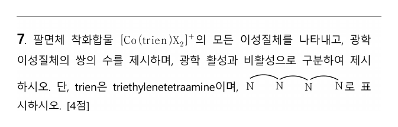

**정답** 총 이성질체 **5개**, 광학 이성질체 **2쌍**. 광학 비활성: **trans**(1개, 세 고리가 한 평면). 광학 활성: **cis-α**(고리 두 개가 한 평면, 1쌍) + **cis-β**(같은 평면 고리 없음, 1쌍)

**공식·핵심 개념**

- 사배위 사슬 리간드: trans, cis-α, cis-β
- 대칭면·대칭심 없으면 광학 활성
- 거울상은 쌍으로

**2027 출제 가능성 ★★★★☆ 높음** — 착물 이성질체 개수 세기는 무기 단골입니다.

**사배위 사슬 리간드 trien(N–N–N–N)** 이 팔면체 네 자리를 차지하고 X 두 개가 남습니다.

| 배치 | X 위치 | 특징 | 개수 |
|---|---|---|---|
| trans | 서로 trans | 네 N이 적도면, 대칭면 있음 | 1 (비활성) |
| cis-α | cis | 바깥쪽 두 고리가 같은 평면 | 2 (거울상 1쌍) |
| cis-β | cis | 같은 평면 고리 없음 | 2 (거울상 1쌍) |

**채점 포인트·함정**

- 거울상을 **둘 다** 그려야 "광학 이성질체 2쌍"이 드러납니다.

## B형 8번 · 이원자 이상기체의 3단계 순환 {#b8}

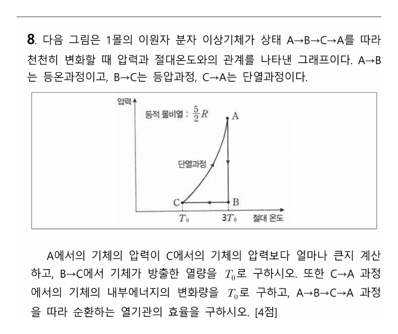

**정답** $P_A = 3^{3.5}P_C$, B→C 방출 열 **7RT₀**, C→A $\Delta U = $ **5RT₀**, $\eta = 1 - \dfrac{7}{10.5\ln3} \approx$ **0.393**

**공식·핵심 개념**

- 단열: $TV^{\gamma-1}$, $PV^\gamma$ 일정
- 등온: $q = nRT\ln(V_2/V_1)$, 등압: $q = nC_P\Delta T$
- $\eta = 1 - |q_c|/q_h$

**2027 출제 가능성 ★★★★☆ 높음** — 열기관 순환 효율 계산은 물리화학 서술형으로 꾸준히 나옵니다.

이원자 이상기체 $C_{V,m} = \tfrac52R$, $C_{P,m} = \tfrac72R$, $\gamma = \tfrac75$. $T_A = T_B = 3T_0$, $T_C = T_0$.

**압력비 (C→A 단열).** $T^{\gamma}P^{1-\gamma} = $ 일정 → $\dfrac{P_A}{P_C} = \left(\dfrac{T_A}{T_C}\right)^{\gamma/(\gamma-1)} = 3^{7/2}$.

**B→C (등압 냉각).** $q = C_P\Delta T = \tfrac72R(T_0 - 3T_0) = -7RT_0$ → **7RT₀ 방출**.

**C→A (단열).** $\Delta U = C_V\Delta T = \tfrac52R(2T_0) = 5RT_0$ (q = 0이므로 w = 5RT₀).

**효율.** 흡수 열은 A→B 등온 팽창뿐: $V_B/V_A = P_A/P_B = 3^{3.5}$,

$$q_h = R(3T_0)\ln3^{3.5} = 10.5RT_0\ln3, \quad \eta = 1 - \frac{7RT_0}{10.5RT_0\ln3} = 1 - \frac{7}{11.54} = 0.393$$

**채점 포인트·함정**

- 이 순환은 Carnot 순환이 아니므로 $1 - T_c/T_h$(0.667)를 쓰면 틀립니다.

## B형 9번 · 수소 원자 들뜬 상태의 ⟨r⟩ {#b9}

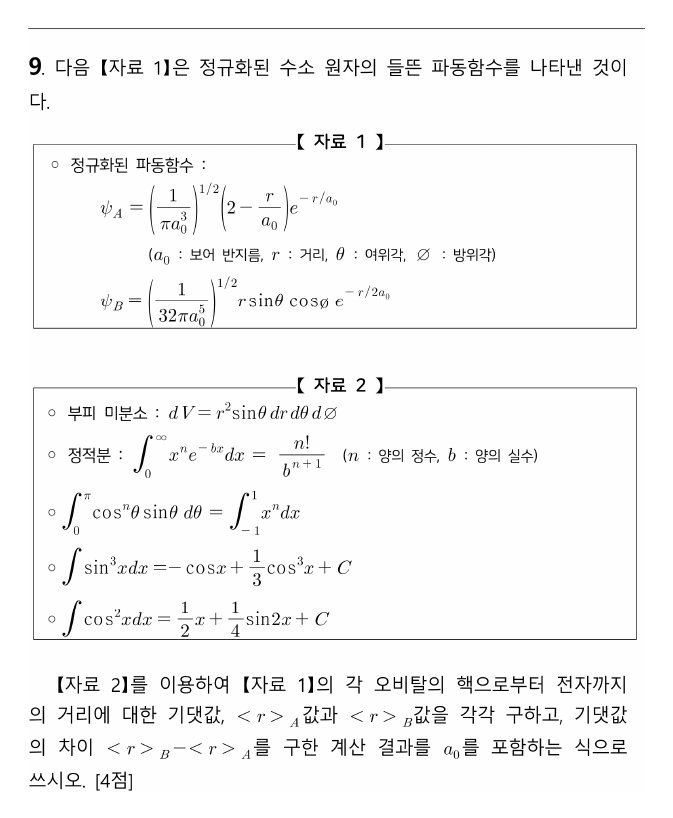

**정답** $\langle r\rangle_A = \dfrac32a_0$, $\langle r\rangle_B = 5a_0$, 차이 $\dfrac72a_0$

**공식·핵심 개념**

- $\langle r\rangle = \int\psi^* r\psi\,r^2\sin\theta\,dr\,d\theta\,d\phi$
- $\int_0^\infty x^ne^{-bx}dx = n!/b^{n+1}$
- 수소 ⟨r⟩ $= \frac{a_0}{2}[3n^2 - l(l+1)]$

**2027 출제 가능성 ★★★☆☆ 보통** — 수소 원자 기대치는 양자 영역에서 가끔 나옵니다.

**⟨r⟩_A.** 각도 적분 $4\pi$, $x = r/a_0$:

$$\langle r\rangle_A = \frac{4\pi}{\pi a_0^3}a_0^4\int_0^\infty(4x^3 - 4x^4 + x^5)e^{-2x}dx = 4a_0\left(\frac{24}{16} - \frac{96}{32} + \frac{120}{64}\right) = 4a_0(0.375) = 1.5a_0$$

**⟨r⟩_B (2pₓ).** $\int_0^\pi\sin^3\theta\,d\theta = \tfrac43$, $\int_0^{2\pi}\cos^2\phi\,d\phi = \pi$:

$$\langle r\rangle_B = \frac{1}{32\pi a_0^5}\cdot\frac{5!}{(1/a_0)^6}\cdot\frac43\cdot\pi = \frac{120 \cdot 4}{32 \cdot 3}a_0 = 5a_0$$

**채점 포인트·함정**

- 부피 요소 $r^2\sin\theta$를 반드시 곱합니다. ψ_A는 실제 2s와 지수가 다릅니다(검토 메모 2).

## B형 10번 · 하이드로아줄렌의 에폭시화 → 탈수 → 산화 절단 {#b10}

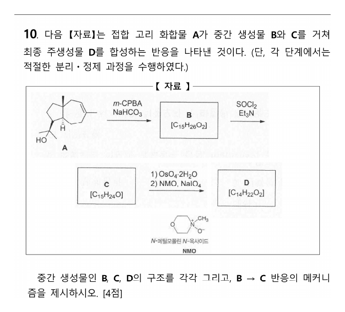

**정답** B **에폭시 알코올**(C₁₅H₂₆O₂), C **이소프로펜일 알켄**(C₁₅H₂₄O), D **메틸 케톤**(C₁₄H₂₂O₂)

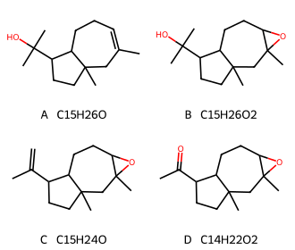

**공식·핵심 개념**

- mCPBA: 전자 풍부한 C=C
- SOCl₂/Et₃N: 3차 알코올 → 클로로설파이트 → 탈수(E2)
- OsO₄/NMO + NaIO₄: C=C 산화 절단(Lemieux–Johnson)

**2027 출제 가능성 ★★★★☆ 높음** — 천연물 다단계 합성과 메커니즘은 유기 서술형으로 자주 나옵니다.

1. **mCPBA, NaHCO₃**: 고리의 삼치환 C=C만 에폭시화(NaHCO₃는 산을 중화해 에폭사이드 개환 방지) → B.
2. **SOCl₂, Et₃N**: 3차 알코올 O가 S를 공격 → 클로로설파이트 → Et₃N이 이웃 CH₃의 H를 떼는 동시에 –OS(O)Cl이 이탈(**E2**, SO₂ + Cl⁻로 분해) → 1,1-이치환 알켄 C. 염기(Et₃N·피리딘)가 있는 SOCl₂ 탈수는 탄소양이온을 거치지 않는 E2로 설명하는 것이 표준이며, 양이온 경로라면 이웃 에폭사이드가 열리거나 자리옮김이 일어날 수 있습니다.
3. **OsO₄/NMO → NaIO₄**: C=C를 cis-다이올로 만든 뒤 NaIO₄가 C–C 절단 → 메틸 케톤 D + HCHO(탄소 1개 감소, C₁₄).

**메커니즘 — A → B: mCPBA 에폭시화**

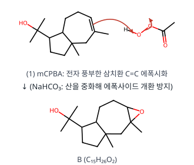

**메커니즘 — B → C: SOCl₂/Et₃N 탈수 (E2)**

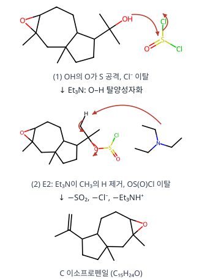

**메커니즘 — C → D: OsO₄/NMO, NaIO₄ 산화 절단**

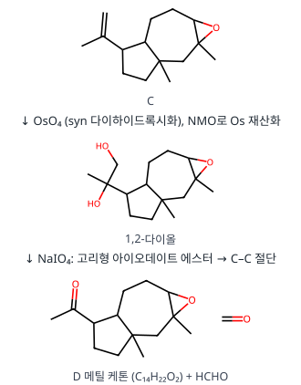

**채점 포인트·함정**

- 메커니즘 화살표: O → S 공격, Cl⁻ 이탈, 염기의 H 제거와 C–O 이탈(E2)을 모두 그립니다.

## B형 11번 · 에탄올의 다이크로뮴산 역적정 {#b11}

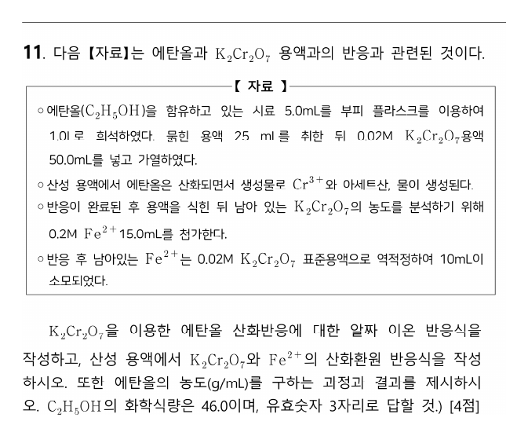

**정답** (3) **0.386 g/mL**

(1) $$\mathrm{2Cr_2O_7^{2-} + 3C_2H_5OH + 16H^+ \to 4Cr^{3+} + 3CH_3COOH + 11H_2O}$$

(2) $$\mathrm{Cr_2O_7^{2-} + 6Fe^{2+} + 14H^+ \to 2Cr^{3+} + 6Fe^{3+} + 7H_2O}$$

**공식·핵심 개념**

- 산화수 변화로 반쪽 반응 균형
- 역적정: 넣은 산화제 − 남은 산화제 = 시료 소비량
- 희석 배율 반영

**2027 출제 가능성 ★★★★★ 매우 높음** — 산화환원 적정은 분석화학 최빈출 계산입니다.

**Cr₂O₇²⁻ 수지.** 넣은 양 전체 = 처음 50.0 mL + 역적정 10.0 mL: $0.02 \times 60.0 = 1.20$ mmol.

- Fe²⁺(0.2 × 15.0 = 3.0 mmol)가 소비한 Cr₂O₇²⁻: 3.0/6 = 0.50 mmol
- 에탄올이 소비한 Cr₂O₇²⁻: 1.20 − 0.50 = 0.70 mmol
- 에탄올: 0.70 × 3/2 = 1.05 mmol = 0.0483 g

**농도.** 분취한 25 mL에 든 원래 시료 = 5.0 mL × 25/1000 = 0.125 mL:

$$\frac{0.0483\ \mathrm{g}}{0.125\ \mathrm{mL}} = 0.386\ \mathrm{g/mL}$$

**채점 포인트·함정**

- 역적정에 쓴 Cr₂O₇²⁻ 10 mL도 **Fe²⁺를 산화한 쪽**이므로 전체 Cr₂O₇²⁻에 더해야 합니다.
- 반쪽 반응: C₂H₅OH → CH₃COOH는 4전자, Cr₂O₇²⁻ → 2Cr³⁺는 6전자 → 2 : 3.

---

원문: 2025학년도 대비 김지현 전공화학 모의고사 4회(지스쿨) 문제지·답안·강의 판서. 개인 학습용 정리입니다.

