# 2025학년도 대비 김지현 전공화학 모의고사 5회 — 상세해설

김지현 전공화학 모의고사 5회(전공 A 12문항 · 전공 B 11문항)의 문항별 해설입니다. 공식 「모의고사 5회 A형, B형 답안」과 5주차 강의 안내를 바탕으로 풀이 과정·개념·채점 포인트를 채웠고, 계산은 모두 다시 풀어 공식 답과 맞는지 확인했습니다. 구조식은 RDKit으로 분자식을 확인했습니다.

문항마다 새 쪽에서 시작하며 3단으로 **문제지 원문 → 정답 → 공식·핵심 개념 → 2027 출제 가능성 → 풀이 → 채점 포인트·함정** 순서로 읽으면 됩니다. 아래 표의 문항 번호를 누르면 해당 쪽으로 이동합니다.

교육론을 뺀 전공 문항은 **주어진 것/구할 것 → 풀이 전략 → 단계별 풀이 → 검산** 순서로 계산·유도·대칭 축소 과정을 빠짐없이 적었습니다. 유기 문항(A형 3·10·11번, B형 1·10번)에는 **굽은 화살표로 전자 이동을 표시한 단계별 메커니즘 그림**을 넣었습니다(빨간 화살표: 전자쌍이 출발하는 결합·비공유 전자쌍 → 도착하는 원자·결합, 라디칼 단계의 반쪽 화살표는 전자 1개 이동).

**2027 출제 가능성**(★ 5개 만점)은 1997~2026 기출에서 그 소재가 얼마나 자주 나왔는지와 2022 개정 교육과정 적용 시점을 함께 고려한 추정치입니다.

## 정답 한눈에 보기 (목차) {#toc}

### 전공 A (12문항 40점)

| 번호 | 영역 | 정답 요약 | 2027 출제 가능성 |
|---|---|---|---|
| [1](#a1) | 물리화학 · 아레니우스, 반트호프 | $E_{a,역} = 6400$ J/mol | ★★★☆☆ |
| [2](#a2) | 무기 · 라만 활성, 군론 | AsP₃ (2A₁ + 2E, 라만 4개) | ★★★★★ |
| [3](#a3) | 유기 · 분광 분석 | 3,3-dimethylindan-1-one | ★★★★★ |
| [4](#a4) | 분석화학 · 표준물 첨가법 | 5.0 mg/L, ε = 2.28×10⁴ | ★★★★☆ |
| [5](#a5) | 화학교육 · 비고츠키, 라카토스 | 실제적 발달 수준 진단, 핵의 교체 | ★★★★★ |
| [6](#a6) | 화학교육 · 드라이버 | 명료화와 교환, 상충된 상황에 노출 | ★★★★★ |
| [7](#a7) | 화학교육 · 기초 탐구 과정 | 관찰·분류 미충족, ㉠ 추리 | ★★★★☆ |
| [8](#a8) | 물리화학 · 조화 진동자 | $\langle V\rangle = \langle T\rangle = \frac34\hbar\sqrt{k/\mu}$ | ★★★★☆ |
| [9](#a9) | 무기 · LMCT | 띠 2개/1개, [CoI₄]⁻ < [CoBr₄]⁻ < [CoCl₄]⁻ | ★★★★☆ |
| [10](#a10) | 유기 · Baeyer–Villiger | 락톤 B → 하이드록시산 C | ★★★★☆ |
| [11](#a11) | 유기 · Hofmann, Curtius | penta-1,4-diene, neopentylamine, indan-2-amine | ★★★★☆ |
| [12](#a12) | 분석화학 · 적정 오차 | 22.0 mL | ★★★★★ |

### 전공 B (11문항 40점)

| 번호 | 영역 | 정답 요약 | 2027 출제 가능성 |
|---|---|---|---|
| [1](#b1) | 유기 · Friedel–Crafts, Wolff–Kishner | 7-methyl-1-tetralone | ★★★★☆ |
| [2](#b2) | 분석화학 · 지시약 pKa | pKa ≈ 9.6~9.7 | ★★★★☆ |
| [3](#b3) | 화학교육 · 로슨 서술적 순환학습 | 내용 범위·인과 질문 수정, ③ | ★★★★★ |
| [4](#b4) | 화학교육 · 발견·발생학습 | 귀납, 유용성, 화학 평형 | ★★★★★ |
| [5](#b5) | 화학교육 · 실험 평가 | 결과물 평가, 리커트, ⑤ 수정 | ★★★★☆ |
| [6](#b6) | 물리화학 · 엔트로피 | $\Delta S_2 - \Delta S_1 = -C_p/56$ | ★★★☆☆ |
| [7](#b7) | 물리화학 · 회전 분광 | ²Π, 8B̃, $J_{max}$ | ★★★★☆ |
| [8](#b8) | 무기 · BF₃ SALC | A₁′ + E′ (sp²), π: A₂″ | ★★★★★ |
| [9](#b9) | 무기 · CO IR | 사각뿔, A₁ + E | ★★★★☆ |
| [10](#b10) | 유기 · 라디칼 할로젠화 | Hammond 가설 | ★★★★☆ |
| [11](#b11) | 분석화학 · 폴라로그래피 | −0.26 V | ★★★☆☆ |

**검토 메모**

1. **B형 7번**: J = 4 ← J = 3 전이의 파수는 $F(4) - F(3) = 20\tilde B - 12\tilde B = 8\tilde B$입니다. 공식 답안의 $6\tilde B$는 J = 3 ← 2 전이 값입니다. (3)의 식도 계수 6 대신 8을 써서 $\tilde\nu = \frac{2\hbar(m_N+m_O)}{\pi c r^2 m_N m_O}$가 됩니다.
2. **B형 2번**: 흡광도로 정확히 풀면 $[\mathrm{In^-}]/[\mathrm{HIn}] = 0.05/0.214$, pKa = **9.63**입니다. 공식 답안(9.70)은 농도를 5.0×10⁻⁶, 2.5×10⁻⁵ M로 반올림한 값입니다.
3. **A형 4번**: 공식 답안은 Fe³⁺ 0.5 mg/L를 FeSCN²⁺ 몰질량(114)으로 나눠 ε = 2.28×10⁴를 얻었습니다. 농도가 **Fe 기준 mg/L**이므로 Fe 원자량(55.85)으로 나누면 ε ≈ 1.12×10⁴입니다. 문제가 114를 주었으니 시험에서는 답안 방식을 따르되, 차이를 알아 두세요.
4. **A형 8번**: 문제가 $\alpha$를 두 가지($\sqrt{\mu k}/\hbar$와 $(\hbar^2/mk)^{1/4}$)로 정의합니다. 공식 답 $a = (2v+1)^{1/2}\alpha$는 길이 단위인 두 번째 정의를 쓴 것이고, 첫 번째 정의로는 $a = \sqrt{(2v+1)/\alpha}$입니다.
5. **A형 12번**: 답안 (1)의 "당량점에서는"은 "종말점에서는"이 맞습니다(당량점은 20.0 mL).
6. **답안 머리말**: B형도 "기입형 1~4번, 서술형 5~12번"으로 적혀 있지만 실제로는 기입형 1~2번(각 2점), 서술형 3~11번(각 4점)입니다.

# 전공 A

## A형 1번 · 역반응의 활성화 에너지 {#a1}

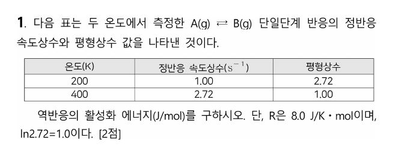

**정답** $E_{a,역} = 6400$ J/mol

**공식·핵심 개념**

- 아레니우스: $\ln\dfrac{k_2}{k_1} = \dfrac{E_a}{R}\left(\dfrac1{T_1} - \dfrac1{T_2}\right)$
- 반트호프: $\ln\dfrac{K_2}{K_1} = -\dfrac{\Delta H}{R}\left(\dfrac1{T_2} - \dfrac1{T_1}\right)$
- 기본 반응: $\Delta H = E_{a,정} - E_{a,역}$

**2027 출제 가능성 ★★★☆☆ 보통** — 속도론과 평형을 묶는 기입형은 꾸준히 나옵니다. 기본 반응 조건을 꼭 확인하세요.

**주어진 것 / 구할 것**

| 온도 | 정반응 $k$ (s⁻¹) | $K$ |
|---|---|---|
| 200 K | 1.00 | 2.72 |
| 400 K | 2.72 | 1.00 |

$R = 8.0$ J/(K·mol), $\ln 2.72 = 1.0$, 단일단계 반응 A ⇌ B → 구할 것: 역반응 활성화 에너지 $E_{a,역}$

**풀이 전략.** 정반응 $k$의 온도 변화 → 아레니우스로 $E_{a,정}$, $K$의 온도 변화 → 반트호프로 $\Delta H$. 단일단계(기본) 반응이면 에너지 도표에서 $\Delta H = E_{a,정} - E_{a,역}$이므로 둘을 빼면 끝납니다.

**단계별 풀이**

**(1)** 온도 역수의 차를 먼저 계산합니다.
$$\frac{1}{T_1} - \frac{1}{T_2} = \frac{1}{200} - \frac{1}{400} = \frac{2 - 1}{400} = \frac{1}{400}\ \mathrm{K^{-1}}$$

**(2)** 아레니우스 식(두 온도형)에 대입합니다.
$$\ln\frac{k_{400}}{k_{200}} = \frac{E_{a,정}}{R}\left(\frac{1}{T_1} - \frac{1}{T_2}\right)$$
$$\ln\frac{2.72}{1.00} = 1.0 = \frac{E_{a,정}}{8.0}\times\frac{1}{400} \;\Rightarrow\; E_{a,정} = 1.0\times8.0\times400 = 3200\ \mathrm{J/mol}$$

**(3)** 반트호프 식에 대입합니다. $K$가 2.72 → 1.00으로 **줄었으므로** 발열을 예상합니다.
$$\ln\frac{K_{400}}{K_{200}} = -\frac{\Delta H^\circ}{R}\left(\frac{1}{T_2} - \frac{1}{T_1}\right)$$
$$\ln\frac{1.00}{2.72} = -1.0 = -\frac{\Delta H^\circ}{8.0}\times\left(-\frac{1}{400}\right) = \frac{\Delta H^\circ}{3200} \;\Rightarrow\; \Delta H^\circ = -3200\ \mathrm{J/mol}$$

**(4)** 단일단계 반응의 에너지 도표: 반응물 → 전이상태(높이 $E_{a,정}$) → 생성물. 생성물에서 전이상태까지가 $E_{a,역}$이므로
$$\Delta H = E_{a,정} - E_{a,역} \;\Rightarrow\; E_{a,역} = E_{a,정} - \Delta H = 3200 - (-3200) = 6400\ \mathrm{J/mol}$$

**다른 풀이(같은 결과).** $K = k_정/k_역$이므로 $k_역 = k_정/K$: 200 K에서 $1.00/2.72$, 400 K에서 $2.72/1.00$. 
$$\ln\frac{k_{역,400}}{k_{역,200}} = \ln(2.72\times2.72) = 2.0 = \frac{E_{a,역}}{8.0}\times\frac{1}{400} \Rightarrow E_{a,역} = 6400\ \mathrm{J/mol}$$

**검산.** 두 풀이가 6400 J/mol로 일치하고, $E_{a,역} > E_{a,정}$은 발열 반응의 에너지 도표와 맞습니다.

**채점 포인트·함정**

- 단일단계(기본) 반응이라는 조건이 있어야 $\Delta H = E_{a,정} - E_{a,역}$을 쓸 수 있습니다.
- K가 온도에 따라 줄면 발열($\Delta H<0$)입니다.

## A형 2번 · P₄와 AsP₃의 라만 스펙트럼 {#a2}

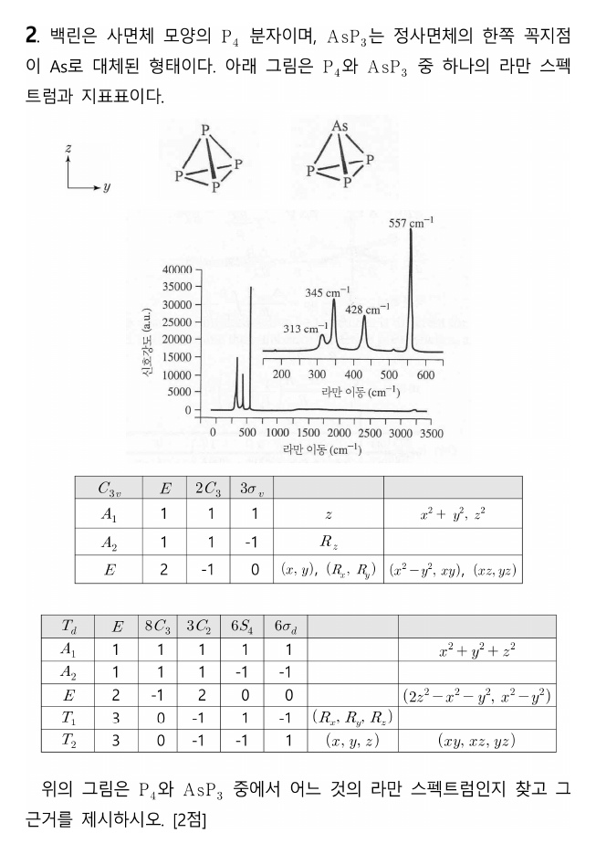

**정답** **AsP₃**. P₄(T_d)는 진동 $A_1 + E + T_2$ → 라만 활성 3개, AsP₃(C₃ᵥ)는 진동 $2A_1 + 2E$ → 라만 활성 4개. 스펙트럼의 봉우리가 4개(313, 345, 428, 557 cm⁻¹)이므로 AsP₃.

**공식·핵심 개념**

- $\Gamma_{3N}$ → 축소 → 병진·회전 제외 → $\Gamma_{vib}$
- 라만 활성: 이차 함수($x^2, xy, \dots$)와 같은 기약표현
- T_d P₄: $A_1 + E + T_2$ / C₃ᵥ AsP₃: $2A_1 + 2E$

**2027 출제 가능성 ★★★★★ 매우 높음** — 대칭으로 IR·라만 띠 수를 세는 문항은 무기 고정 출제 소재입니다.

**주어진 것 / 구할 것.** P₄(정사면체, T_d)와 AsP₃(꼭짓점 하나가 As, C₃ᵥ)의 지표표, 라만 봉우리 4개(313, 345, 428, 557 cm⁻¹) → 어느 분자의 스펙트럼인지, 근거.

**풀이 전략.** 원자 4개 → $3N = 12$. 각 대칭 조작에서 **움직이지 않는 원자 수 × 원자당 기여도**로 $\Gamma_{3N}$을 만들고, 축소 공식 $n_i = \frac1h\sum_R g_R\,\chi_i(R)\,\chi(R)$로 나눈 뒤 병진·회전을 뺍니다. 라만 활성 = 이차 함수와 같은 기약표현.

원자당 기여도: E = 3, C₃ = 0 ($1 + 2\cos120°$), C₂ = −1, S₄ = −1, σ = 1.

**단계별 풀이 ① P₄ (T_d, h = 24)**

| T_d | E | 8C₃ | 3C₂ | 6S₄ | 6σ_d |
|---|---|---|---|---|---|
| 움직이지 않는 원자 | 4 | 1 | 0 | 0 | 2 |
| 원자당 기여 | 3 | 0 | −1 | −1 | 1 |
| $\Gamma_{3N}$ | 12 | 0 | 0 | 0 | 2 |

- $n(A_1) = \frac{1}{24}(12\cdot1 + 6\cdot2\cdot1) = \frac{24}{24} = 1$

- $n(A_2) = \frac{1}{24}(12 + 6\cdot2\cdot(-1)) = 0$

- $n(E) = \frac{1}{24}(12\cdot2 + 6\cdot2\cdot0) = 1$

- $n(T_1) = \frac{1}{24}(12\cdot3 + 6\cdot2\cdot(-1)) = \frac{24}{24} = 1$

- $n(T_2) = \frac{1}{24}(12\cdot3 + 6\cdot2\cdot1) = \frac{48}{24} = 2$

$\Gamma_{3N} = A_1 + E + T_1 + 2T_2$ (차원 1 + 2 + 3 + 6 = 12 ✓). 병진 $T_2$(x, y, z), 회전 $T_1$을 빼면
$$\Gamma_{vib}(\mathrm{P_4}) = A_1 + E + T_2 \quad(3N - 6 = 6\ \text{진동, 서로 다른 진동수 3개})$$
라만: $A_1$($x^2+y^2+z^2$), $E$, $T_2$($xy, xz, yz$) 모두 활성 → **봉우리 3개**.

**단계별 풀이 ② AsP₃ (C₃ᵥ, h = 6)**

| C₃ᵥ | E | 2C₃ | 3σᵥ |
|---|---|---|---|
| 움직이지 않는 원자 | 4 | 1 (As) | 2 (As + P 1개) |
| 원자당 기여 | 3 | 0 | 1 |
| $\Gamma_{3N}$ | 12 | 0 | 2 |

- $n(A_1) = \frac16(12 + 0 + 3\cdot2) = 3$

- $n(A_2) = \frac16(12 + 0 - 3\cdot2) = 1$

- $n(E) = \frac16(24 + 0 + 0) = 4$

$\Gamma_{3N} = 3A_1 + A_2 + 4E$ (3 + 1 + 8 = 12 ✓). 병진 $A_1 + E$, 회전 $A_2 + E$를 빼면
$$\Gamma_{vib}(\mathrm{AsP_3}) = 2A_1 + 2E$$
$A_1$($z^2$), $E$($x^2-y^2, xy$) 모두 라만 활성 → **봉우리 4개**.

**결론.** 관측 봉우리 4개 = AsP₃. 대칭이 낮아지며(T_d → C₃ᵥ) P₄의 $T_2$가 $A_1 + E$로 갈라져 봉우리가 하나 늘어난 것입니다.

**검산.** 진동 수: P₄ 1 + 2 + 3 = 6, AsP₃ 2 + 4 = 6 = 3N − 6 ✓.

**채점 포인트·함정**

- σ_d·σ_v 안에 놓인 원자는 2개이고 각각 기여도 1입니다.
- 띠 **개수**로 판단하는 문제이므로 축퇴된 E는 띠 1개로 셉니다.

## A형 3번 · IR·NMR·MS로 구조 결정 {#a3}

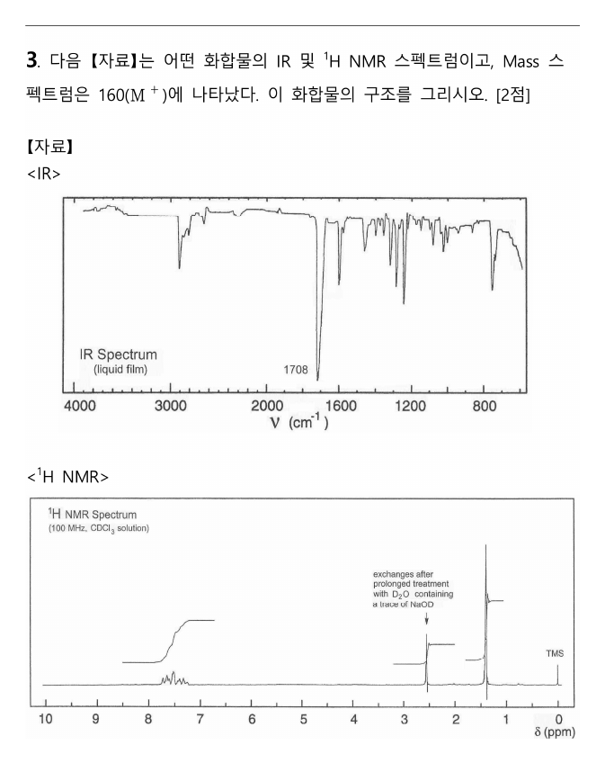

**정답** **3,3-dimethylindan-1-one** (C₁₁H₁₂O, M = 160)

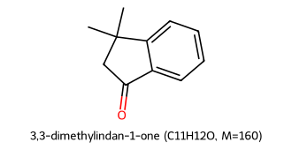

**공식·핵심 개념**

- 불포화도 $= \dfrac{2C + 2 - H}{2}$
- 5원 고리 아릴 케톤 C=O ≈ 1710 cm⁻¹
- NaOD/D₂O 교환: 카보닐 α-H

**2027 출제 가능성 ★★★★★ 매우 높음** — 분광 자료 구조 결정은 해마다 나옵니다. D₂O 교환 단서는 α-H·OH·NH 구분에 자주 쓰입니다.

**주어진 것 / 구할 것.** M⁺ = 160, IR 1708 cm⁻¹(강), ¹H NMR 7.3–7.8(m), 2.6(s, NaOD/D₂O에서 교환), 1.4(s) → 구조.

**풀이 전략.** 분자식 → 불포화도 → 작용기(IR) → 수소 환경(NMR 적분·갈라짐) → 조각 연결 순서로 풉니다.

**단계별 풀이**

**(1)** **분자식.** 케톤(IR 1708)이므로 O 1개를 가정: 160 − 16 = 144 = C₁₂H₀(불가)·C₁₁H₁₂ → **C₁₁H₁₂O**.
$$\text{불포화도} = \frac{2(11) + 2 - 12}{2} = 6$$
벤젠 고리 4 + C=O 1 + 고리 1 = 6 → **벤젠에 고리가 하나 더 붙은 케톤**(이고리 화합물).

**(2)** **IR.** 1708 cm⁻¹: 일반 아릴 케톤(1685)보다 높음 → 콘쥬게이션된 C=O가 **5원 고리**에 있어 고리 긴장으로 파수 상승(indan-1-one ≈ 1710). 3000 cm⁻¹ 이상 넓은 O–H 없음.

**(3)** **¹H NMR 적분비.** 전체 H 12개를 신호 높이 비에 나누면

| δ (ppm) | 적분 | 갈라짐 | 배정 | 근거 |
|---|---|---|---|---|
| 7.3–7.8 | 4H | m | 오르토 이치환 벤젠 H 4개 | 방향족 영역, 4H → 이치환 |
| 2.6 | 2H | s | C(=O)–C**H₂** | C=O 옆(δ 2–2.7), 이웃 C에 H 없음 → 단일선 |
| 1.4 | 6H | s | C(C**H₃**)₂ | 동등한 메틸 2개, 4차 탄소에 붙어 단일선 |

**(4)** **D₂O/NaOD 교환.** 2.6 ppm 신호가 사라짐 = **카보닐 α-수소**(염기 촉매 엔올화로 D 교환, 아래 그림). OH였다면 D₂O만으로 금방 교환되므로, "미량 NaOD + 오래" 조건은 C–H 산성(α-H)임을 알려 줍니다.

**(5)** **조각 연결.** 벤젠(C₆H₄) + C=O + CH₂ + C(CH₃)₂ = C₁₁H₁₂O ✓. 5원 고리: 벤젠 두 탄소 – C(=O) – CH₂ – CMe₂ – 고리 닫힘. CH₂와 CMe₂가 모두 단일선이 되려면 CH₂의 양쪽 이웃이 C=O와 4차 탄소여야 하므로 → **3,3-dimethylindan-1-one**.

**메커니즘 — NaOD/D₂O에서 α-H가 D로 바뀌는 과정(엔올화)**

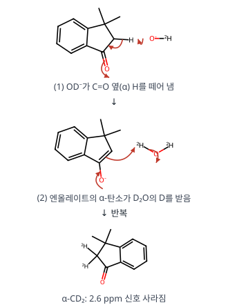

**검산.** C₁₁H₁₂O: 12(11) + 12 + 16 = 160 ✓, 적분 4 : 2 : 6 = H 12 ✓.

**채점 포인트·함정**

- CH₂와 CMe₂가 모두 단일선 → 서로 이웃하지만 H가 있는 탄소끼리 붙어 있지 않음(CH₂–C(CH₃)₂) 구조입니다.

## A형 4번 · 표준물 첨가법 {#a4}

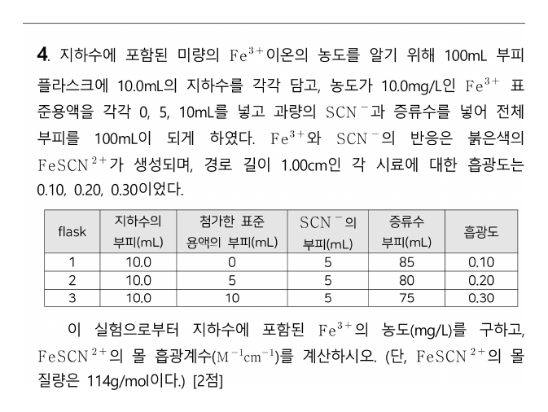

**정답** Fe³⁺ **5.0 mg/L**, 몰 흡광계수 **2.28×10⁴ M⁻¹cm⁻¹** (공식 답안 기준)

**공식·핵심 개념**

- 표준물 첨가: $A = m(C_x + C_{첨가})$, x절편 $= -C_x$
- 희석 배수 보정
- Beer 법칙 $A = \varepsilon bc$

**2027 출제 가능성 ★★★★☆ 높음** — 표준물 첨가법과 내부 표준법은 분석화학 기입형 단골입니다.

**주어진 것 / 구할 것.** 각 플라스크: 지하수 10.0 mL + Fe³⁺ 표준(10.0 mg/L) 0, 5, 10 mL + SCN⁻ → 전체 100 mL. 흡광도 0.10, 0.20, 0.30, $b = 1.00$ cm, FeSCN²⁺ 114 g/mol → 지하수 Fe³⁺(mg/L), ε.

**풀이 전략.** 표준물 첨가법: 플라스크 속 농도 = (지하수에서 온 Fe) + (첨가한 Fe). 흡광도가 농도에 비례($A = \varepsilon bc$)하므로 직선을 그려 x절편을 구하고, 희석 배수를 되돌립니다.

**단계별 풀이**

**(1)** **첨가한 Fe의 플라스크 속 농도.** 희석식 $C_1V_1 = C_2V_2$:
$$C_{첨가} = 10.0\ \mathrm{mg/L}\times\frac{V_{표준}}{100\ \mathrm{mL}} \Rightarrow 0,\ 0.50,\ 1.00\ \mathrm{mg/L}$$

**(2)** **검량선.** 점 (0, 0.10), (0.50, 0.20), (1.00, 0.30):
$$\text{기울기} = \frac{0.30 - 0.10}{1.00 - 0} = 0.20\ \mathrm{(mg/L)^{-1}}, \qquad A = 0.20\,C_{첨가} + 0.10$$

**(3)** **x절편.** $A = 0$ → $C_{첨가} = -\frac{0.10}{0.20} = -0.50$ mg/L. 따라서 플라스크 속 지하수 유래 Fe = **0.50 mg/L**.

**(4)** **희석 보정.** 지하수 10.0 mL → 100 mL (10배 희석):
$$C_{지하수} = 0.50\ \mathrm{mg/L}\times\frac{100}{10.0} = 5.0\ \mathrm{mg/L}$$

**(5)** **몰 흡광계수(공식 답안 방식).** 첫 플라스크 $A = 0.10$, 농도 0.50 mg/L:
$$c = \frac{0.50\times10^{-3}\ \mathrm{g/L}}{114\ \mathrm{g/mol}} = 4.39\times10^{-6}\ \mathrm{M}$$
$$\varepsilon = \frac{A}{bc} = \frac{0.10}{(1.00\ \mathrm{cm})(4.39\times10^{-6}\ \mathrm{M})} = 2.28\times10^4\ \mathrm{M^{-1}cm^{-1}}$$
(기울기로 구해도 같음: 1 mg/L당 A 0.20 → 1 mg/L = 8.77×10⁻⁶ M → ε = 0.20/8.77×10⁻⁶ = 2.28×10⁴)

**(6)** **엄밀한 값.** 농도는 **Fe 기준** mg/L이므로 Fe 원자량 55.85로 나눠야 몰 농도가 됩니다: $c = 8.95\times10^{-6}$ M, $\varepsilon = 1.12\times10^4$ M⁻¹cm⁻¹(검토 메모 3).

**검산.** 둘째 플라스크: $0.20\times(0.50 + 0.50) = 0.20$ ✓, 셋째: $0.20\times(1.00 + 0.50) = 0.30$ ✓.

**채점 포인트·함정**

- 직선 외삽: A = 0.10 + 0.20 × (첨가 mg/L) → x절편 −0.50 mg/L.
- 희석 배수(×10)를 빼먹으면 0.50 mg/L로 틀립니다.

## A형 5번 · 비고츠키와 라카토스 {#a5}

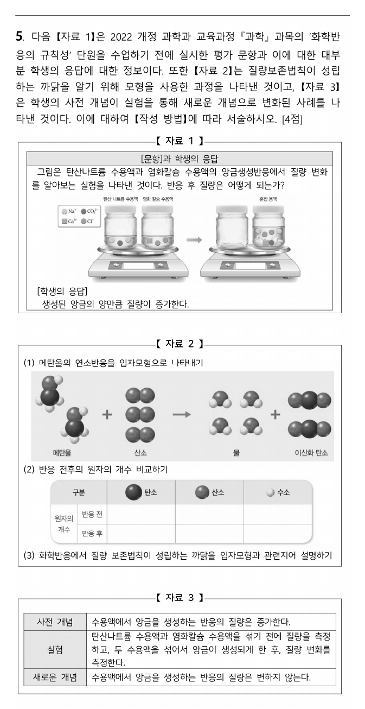

**정답**

- 수업 전 평가 이유: 학생의 **실제적 발달 수준을 진단**하기 위함이다.
- 오개념: **화학 반응에서 반응 전후의 총질량은 변한다.** (앙금이 생기면 질량이 증가한다)
- 과정·기능: **모형을 이용하여 현상을 설명하거나 예측하기**
- 라카토스: **핵의 교체** — '수용액에서 앙금을 생성하는 반응의 질량은 증가한다'는 핵이 '변하지 않는다'로 완전히 교체되었다.

**공식·핵심 개념**

- 비고츠키: 실제적 발달 수준 진단 → ZPD 안 비계
- 질량 보존: 원자의 종류·개수 불변
- 라카토스: 보호대 수정 / 핵의 교체

**2027 출제 가능성 ★★★★★ 매우 높음** — 개념 변화와 과학철학을 묶는 교육론 문항은 매년 나옵니다.

**비고츠키.** ZPD는 실제적 발달 수준(혼자 해결)과 잠재적 발달 수준(도움 받아 해결) 사이. 수업 전 진단으로 실제적 수준을 알아야 그 위에 비계를 설계할 수 있습니다.

**질량 보존의 입자적 설명.** 메탄올 연소 모형에서 반응 전후 C, H, O 원자의 **종류와 개수가 같다** → 원자는 재배열만 되므로 총질량이 같습니다.

**라카토스.** 반증이 쌓여 보호대 수정으로는 핵을 지킬 수 없을 때 **핵 자체가 바뀌면** 연구 프로그램의 교체(퇴행 → 진보적 프로그램으로 이동)입니다.

**채점 포인트·함정**

- 오개념은 학생의 말 그대로("앙금의 양만큼 질량 증가")를 일반화해서 씁니다.

## A형 6번 · 드라이버 모형과 VSEPR {#a6}

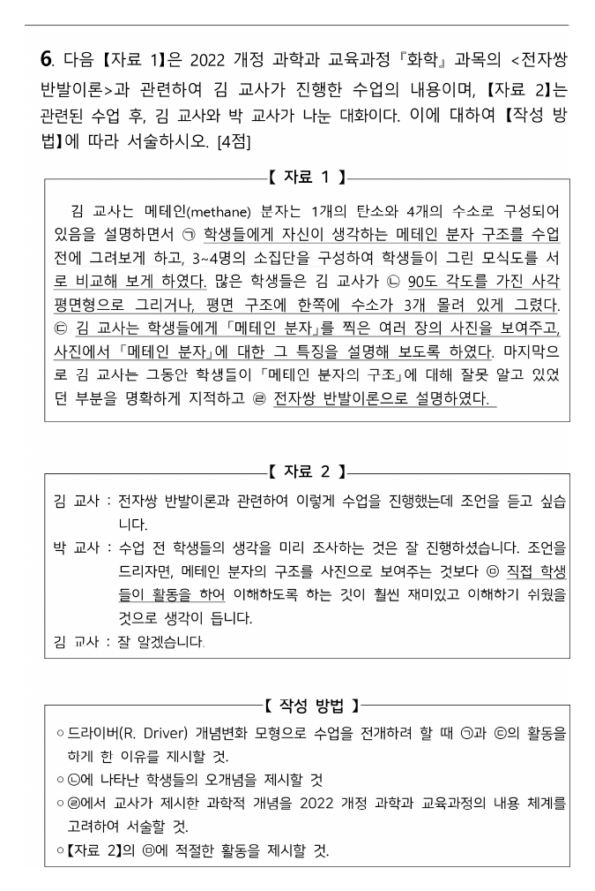

**정답**

- ㉠ **명료화와 교환**: 학생들이 자신의 생각을 분명히 알도록 하기 위함. ㉢ **상충된 상황에 노출**: 메테인 구조에 대한 선지식과 **인지적 갈등을 유발**하기 위함.
- ㉡ 오개념: **메테인 분자는 평면 구조를 가진다.**
- ㉣ 전자쌍 반발 이론: 중심 원자 주위의 전자쌍들은 반발을 최소화하도록 가능한 한 멀리 떨어져 배치된다. 메테인의 공유 전자쌍 4개는 정사면체 꼭짓점을 향해 109.5°로 배치되므로 평면 구조가 아니다.
- ㉤ **고무풍선 4개를 묶어** 풍선이 서로 멀어지도록 배치되는 모습을 관찰하는 비유 활동(풍선 = 공유 전자쌍).

**공식·핵심 개념**

- 드라이버: 명료화와 교환 → 상충된 상황 노출 → 새 생각 구성
- VSEPR: 전자쌍 반발 최소화 → CH₄ 정사면체 109.5°
- 비유(풍선 모형)

**2027 출제 가능성 ★★★★★ 매우 높음** — 드라이버 모형과 2022 개정 [화학] 분자 구조 단원 결합형은 우선순위가 높습니다.

**드라이버 개념 변화 모형**: 오리엔테이션 → 생각의 표현 → 생각의 재구성(명료화와 교환 → 상충된 상황에 노출 → 새로운 생각의 구성 → 평가) → 적용 → 검토.

**채점 포인트·함정**

- ㉣은 2022 개정 [화학] '전자쌍 반발 이론과 분자 구조'의 표현대로 "전자쌍 사이 반발 최소화 → 입체 구조"를 씁니다.

## A형 7번 · 기초 탐구 과정 평가 {#a7}

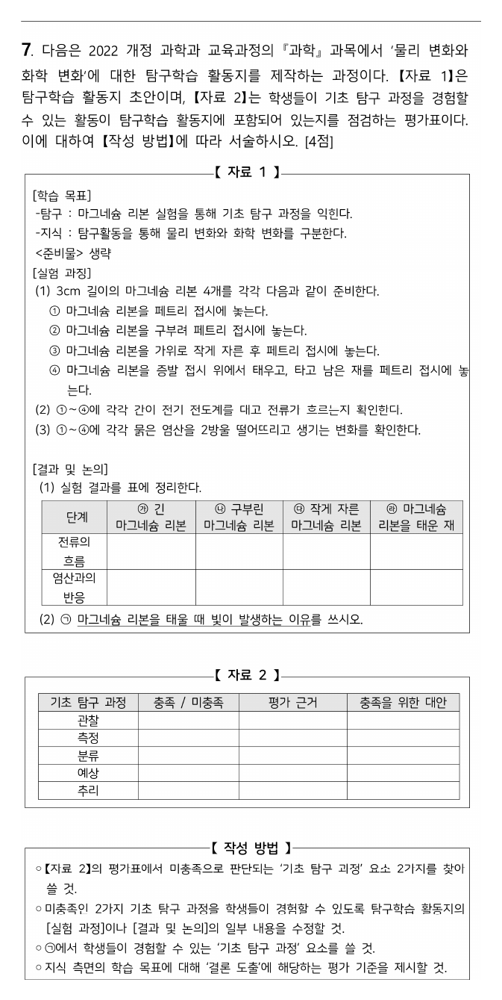

**정답**

- 미충족 기초 탐구 과정: **관찰, 분류**
- 수정: ① 관찰 — [실험 과정] (3) "…묽은 염산을 2방울 떨어뜨리고 생기는 변화를 **관찰한다**." ② 분류 — [결과 및 논의]에 "실험 결과를 정리하고, 성질이 변하는 것과 변하지 않는 것을 묶어 **물리 변화와 화학 변화로 분류한다**." 추가
- ㉠ **추리**
- 평가 기준: **마그네슘의 성질 변화에 따라 물리 변화와 화학 변화를 구분하였는가?**

**공식·핵심 개념**

- 기초 탐구 과정: 관찰, 분류, 측정, 예상, 추리
- 통합 탐구 과정: 문제 인식, 가설, 변인 통제, 자료 해석, 결론 도출
- 평가 기준 = 학습 목표에 맞춘 구체적 진술

**2027 출제 가능성 ★★★★☆ 높음** — 탐구 과정 요소 찾기와 활동지 수정은 교육론 서술형으로 꾸준히 나옵니다.

**기초 탐구 과정**: 관찰, 분류, 측정, 예상, 추리. 통합 탐구 과정: 문제 인식, 가설 설정, 변인 통제, 자료 변환·해석, 결론 도출, 일반화.

**왜 미충족?** (3)은 "확인한다"로 관찰을 명시하지 않았고, 결과 정리 후 묶는(분류) 활동이 없습니다. ㉠ "빛이 발생하는 이유"는 관찰 사실을 바탕으로 원인을 설명하는 **추리**입니다.

**채점 포인트·함정**

- 강의 노트: 염산 반응을 '예상'으로 보는 견해도 있었지만, 예상은 관찰 사실로부터 **정량적·합리적 추측**이어야 하므로 이 활동은 예상이 아니라고 봅니다.

## A형 8번 · 조화 진동자의 에너지와 반환점 {#a8}

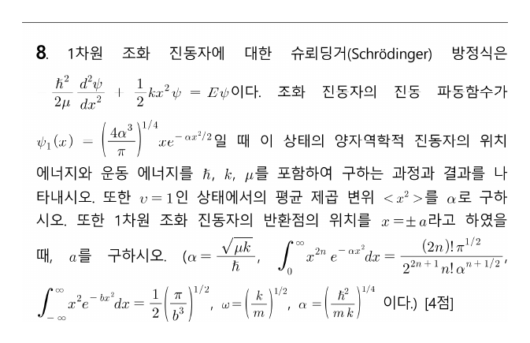

**정답** $\langle V\rangle = \dfrac34\hbar\sqrt{\dfrac k\mu}$, $\langle T\rangle = \dfrac34\hbar\sqrt{\dfrac k\mu}$ (비리얼 정리), $\langle x^2\rangle = \dfrac{3}{2\alpha}$, $a = (2v+1)^{1/2}\alpha$ ($\alpha = (\hbar^2/mk)^{1/4}$)

**공식·핵심 개념**

- $\langle V\rangle = \frac12k\langle x^2\rangle$
- 비리얼 정리(조화): $\langle T\rangle = \langle V\rangle = \frac12E_v$
- 반환점: $E_v = \frac12ka^2$

**2027 출제 가능성 ★★★★☆ 높음** — 조화 진동자 기대치와 고전적 반환점은 양자 영역 서술형 단골입니다.

**주어진 것 / 구할 것.** $\psi_1 = \left(\frac{4\alpha^3}{\pi}\right)^{1/4}xe^{-\alpha x^2/2}$, $\alpha = \sqrt{\mu k}/\hbar$, 적분 공식 → $\langle V\rangle$, $\langle T\rangle$, $\langle x^2\rangle$, 반환점 $a$.

**풀이 전략.** $\langle V\rangle = \frac12k\langle x^2\rangle$이므로 $\langle x^2\rangle$부터 적분으로 구합니다. $\langle T\rangle$는 $E_1 - \langle V\rangle$(또는 비리얼 정리). 반환점은 고전적으로 운동에너지가 0인 곳($E = V$).

**단계별 풀이**

**(1)** **⟨x²⟩.** 
$$\langle x^2\rangle = \int_{-\infty}^{\infty}\psi_1^*x^2\psi_1\,dx = \left(\frac{4\alpha^3}{\pi}\right)^{1/2}\int_{-\infty}^{\infty}x^4e^{-\alpha x^2}dx$$
피적분 함수가 짝함수이므로 $\int_{-\infty}^\infty = 2\int_0^\infty$. 주어진 공식에서 $n = 2$:
$$\int_0^\infty x^4e^{-\alpha x^2}dx = \frac{4!\,\pi^{1/2}}{2^5\cdot2!\cdot\alpha^{5/2}} = \frac{24\sqrt\pi}{64\,\alpha^{5/2}} = \frac{3\sqrt\pi}{8\alpha^{5/2}}$$
$$\langle x^2\rangle = \frac{2\alpha^{3/2}}{\sqrt\pi}\times2\times\frac{3\sqrt\pi}{8\alpha^{5/2}} = \frac{3}{2\alpha}$$

**(2)** **위치에너지.** $\alpha = \sqrt{\mu k}/\hbar$ 대입:
$$\langle V\rangle = \frac12k\cdot\frac{3}{2\alpha} = \frac{3k}{4}\cdot\frac{\hbar}{\sqrt{\mu k}} = \frac34\hbar\sqrt{\frac{k}{\mu}}$$

**(3)** **전체 에너지.** $E_v = \left(v + \frac12\right)\hbar\omega$, $\omega = \sqrt{k/\mu}$ → $E_1 = \frac32\hbar\sqrt{k/\mu}$.

**(4)** **운동에너지.**
$$\langle T\rangle = E_1 - \langle V\rangle = \frac32\hbar\sqrt{\frac k\mu} - \frac34\hbar\sqrt{\frac k\mu} = \frac34\hbar\sqrt{\frac k\mu}$$
비리얼 정리($V\propto x^2$이면 $\langle T\rangle = \langle V\rangle$)와 일치합니다.

**(5)** **반환점.** 고전 입자가 멈추는 곳: $E_v = \frac12ka^2$.
$$a^2 = \frac{2E_v}{k} = \frac{(2v + 1)\hbar\omega}{k} = (2v+1)\frac{\hbar}{\sqrt{mk}}$$
문제의 두 번째 정의 $\alpha = (\hbar^2/mk)^{1/4}$(길이)를 쓰면 $\hbar/\sqrt{mk} = \alpha^2$이므로
$$a = (2v+1)^{1/2}\alpha$$
(첫 번째 정의 $\alpha = \sqrt{\mu k}/\hbar$로 쓰면 $a = \sqrt{(2v+1)/\alpha}$ — 검토 메모 4)

**검산.** 수치 적분(α = 1.7)으로 정규화 1.000, $\langle x^2\rangle = 0.882 = 3/(2\times1.7)$ ✓.

**채점 포인트·함정**

- $\int_{-\infty}^\infty = 2\int_0^\infty$: n = 2 공식 $\frac{4!\sqrt\pi}{2^5\,2!\,\alpha^{5/2}} = \frac{3\sqrt\pi}{8\alpha^{5/2}}$을 2배.
- α의 두 정의에 주의(검토 메모 4).

## A형 9번 · 리간드→금속 전하 이동(LMCT) {#a9}

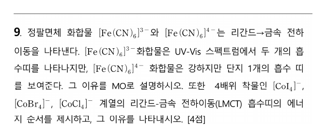

**정답**

- [Fe(CN)₆]³⁻: 저스핀 d⁵(t₂g⁵). 리간드 σ 전자가 **t₂g의 빈자리와 e_g 두 곳**으로 이동 가능 → 띠 **2개** (e_g로의 이동이 강하고, t₂g로의 이동이 약함)
- [Fe(CN)₆]⁴⁻: 저스핀 d⁶(t₂g⁶). t₂g가 꽉 차 **e_g로만** 이동 → 띠 **1개**(강함)
- LMCT 에너지: **[CoI₄]⁻ < [CoBr₄]⁻ < [CoCl₄]⁻**

**공식·핵심 개념**

- LMCT: 리간드 오비탈 → 금속 빈 오비탈
- 저스핀 d⁵: t₂g 빈자리 + e_g → 띠 2개 / d⁶: e_g만 → 1개
- 리간드 전기음성도↑ → LMCT 에너지↑

**2027 출제 가능성 ★★★★☆ 높음** — 전하 이동 띠와 d–d 전이 구분은 무기 분광 영역에서 자주 나옵니다.

**주어진 것 / 구할 것.** [Fe(CN)₆]³⁻ LMCT 띠 2개, [Fe(CN)₆]⁴⁻ 띠 1개(강함) → MO로 이유. [CoX₄]⁻ (X = I, Br, Cl) LMCT 에너지 순서와 이유.

**풀이 전략.** 산화수 → d 전자 수 → 스핀 상태(CN⁻ 강한 장) → 금속 오비탈의 **빈자리** 개수를 셉니다. LMCT = 꽉 찬 리간드 오비탈 → 금속 빈 오비탈.

**단계별 풀이**

**(1)** **산화수와 d 전자.**

- [Fe(CN)₆]³⁻: $x + 6(-1) = -3$ → Fe(III), d⁵

- [Fe(CN)₆]⁴⁻: $x + 6(-1) = -4$ → Fe(II), d⁶

**(2)** **스핀 상태.** CN⁻는 분광화학 계열에서 가장 강한 장 리간드 → Δo가 짝지음 에너지보다 커서 **저스핀**: d⁵ = t₂g⁵eg⁰, d⁶ = t₂g⁶eg⁰.

**(3)** **MO 준위와 전자 배치(아래 그림).** 아래부터 리간드 σ/π(꽉 참) → 금속 t₂g → eg*.

- d⁵: t₂g에 **빈자리 1개**와 빈 eg* 두 개가 있음 → 리간드 → t₂g(②, 낮은 에너지) / 리간드 → eg*(①, 높은 에너지) **두 종류의 전이** → 띠 2개.

- d⁶: t₂g가 꽉 차 받을 자리가 eg*뿐 → 리간드 → eg*(①) **한 종류** → 띠 1개.

**(4)** **세기.** LMCT는 리간드(주로 리간드 성격)와 금속(주로 금속 성격) 사이의 전하 이동이라 전이 쌍극자가 커서 매우 강합니다(ε ~ 10⁴). d⁶은 빈 eg*로 가는 전이 하나에 세기가 모입니다.

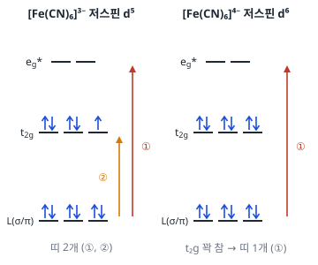

**(5)** **[CoX₄]⁻ 순서.** 리간드 오비탈 에너지는 할로젠의 전기음성도·이온화 에너지로 정해집니다.

| X | 전기음성도 | 리간드 오비탈 에너지 | 금속까지 간격 = LMCT 에너지 |
|---|---|---|---|
| Cl | 3.16 | 가장 낮음(전자를 꽉 붙잡음) | 가장 큼 |
| Br | 2.96 | 중간 | 중간 |
| I | 2.66 | 가장 높음(쉽게 산화) | 가장 작음 |

$$E_{LMCT}:\ [\mathrm{CoI_4}]^- < [\mathrm{CoBr_4}]^- < [\mathrm{CoCl_4}]^-$$
즉 흡수 파장은 I 착물이 가장 길고(적색 쪽), Cl 착물이 가장 짧습니다.

**검산.** 리간드가 산화되기 쉬울수록(I⁻ > Br⁻ > Cl⁻), 금속이 환원되기 쉬울수록 LMCT 에너지가 낮다는 일반 규칙과 일치합니다.

**채점 포인트·함정**

- 띠 세기 차이: 꽉 찬 리간드 → 완전히 빈 e_g가 더 허용적이고 강합니다.

## A형 10번 · Baeyer–Villiger 산화와 락톤 가수분해 {#a10}

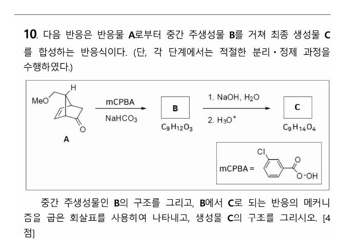

**정답** B = **브리지 락톤**(머리 탄소와 C=O 사이에 O 삽입, C₉H₁₂O₃), C = **2-[3-hydroxy-2-(methoxymethyl)cyclopent-4-en-1-yl]acetic acid** (하이드록시산, C₉H₁₄O₄)

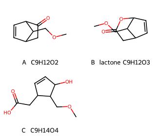

**공식·핵심 개념**

- Baeyer–Villiger: 이동 경향 3° > 2° ≈ 아릴 > 1° > 메틸, 입체 유지
- 락톤 염기 가수분해 → 하이드록시산
- mCPBA: 케톤 산화 vs 알켄 에폭시화

**2027 출제 가능성 ★★★★☆ 높음** — Baeyer–Villiger 위치 선택성과 메커니즘은 유기 서술형으로 자주 나옵니다.

**주어진 것 / 구할 것.** A(바이사이클로[2.2.1] 케톤, C=C·CH₂OMe 포함) + mCPBA/NaHCO₃ → B (C₉H₁₂O₃) → NaOH/H₂O, H₃O⁺ → C (C₉H₁₄O₄). B 구조, B → C 메커니즘, C 구조.

**풀이 전략.** 분자식 차이로 반응 종류를 정한 뒤, Baeyer–Villiger의 **이동 경향(전이상태의 양전하를 잘 견디는 탄소가 이동)**으로 위치를 결정합니다.

**단계별 풀이**

**(1)** **A의 분자식.** C₉H₁₂O₂(케톤 O + 에터 O). B는 C₉H₁₂O₃ → **O 1개만 추가**. mCPBA가 할 수 있는 일은 (i) C=C 에폭시화, (ii) 케톤 → 에스터(락톤) 두 가지인데, 둘 다 O 1개 추가라 분자식으로는 구별이 안 됩니다. B → C에서 **H₂O가 더해지고(C₉H₁₄O₄) 산이 생기는** 가수분해가 일어나므로 B는 **락톤**, 즉 Baeyer–Villiger 생성물입니다. NaHCO₃는 부산물 m-CBA를 중화해 산 촉매 에폭사이드 개환·부반응을 막습니다.

**(2)** **어느 탄소가 이동하나.** 카보닐 탄소의 두 이웃: ① 브리지 머리 **CH(2차)**, ② **CH₂(1차)**. 이동 단계에서 이동하는 탄소는 부분 양전하를 띠므로 더 치환된 탄소가 유리합니다.
$$\text{이동 경향: } 3° > 2° \approx \text{아릴} > 1° > \mathrm{CH_3}$$
→ 머리 CH가 O로 이동 → O가 **머리 탄소와 C=O 사이**에 삽입된 6원 락톤(바이사이클로[3.2.1]) = B. 이동하는 탄소의 입체배열은 **유지**됩니다(협동적 1,2-이동).

**(3)** **Criegee 중간체(메커니즘 ①).** 과산 O–H의 O가 C=O 탄소를 공격 → 양성자 이동으로 사면체 Criegee 중간체 → O⁻가 C=O를 다시 만들면서 머리 C–C 결합 전자쌍이 O로 옮겨 가고 동시에 약한 O–O 결합이 끊어져 m-클로로벤조산 이온이 떠납니다.

**(4)** **B → C (메커니즘 ②).** 염기 가수분해(비누화):

- (1) HO⁻가 락톤 C=O 탄소를 공격 → 사면체 알콕사이드 중간체

- (2) C=O가 다시 생기며 고리 O–C 결합이 끊어짐(알콕사이드 이탈) → **고리 열림**

- (3) 생긴 카복실산 H가 알콕사이드로 이동(산–염기, 비가역) → 카복실산 이온 + 알코올

- (4) H₃O⁺로 카복실산 이온 양성자화 → C

**(5)** **C의 구조.** 고리 열림 후 5원 고리(사이클로펜텐)에 –OH(옛 머리 탄소), –CH₂COOH(옛 C=O 쪽 사슬), –CH₂OMe가 남습니다 → 2-[3-hydroxy-2-(methoxymethyl)cyclopent-4-en-1-yl]acetic acid, C₉H₁₄O₄.

**메커니즘 — A → B Baeyer–Villiger 산화**

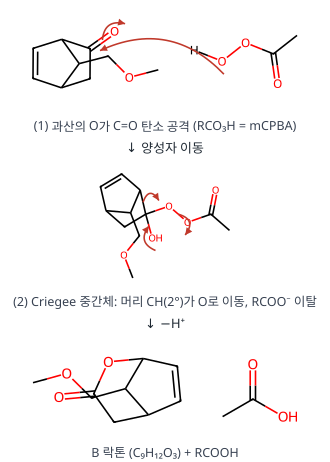

**메커니즘 — B → C 락톤 염기 가수분해**

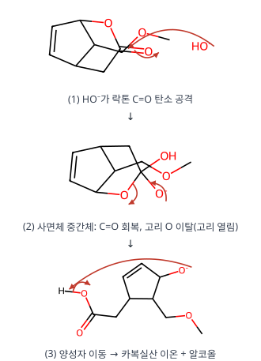

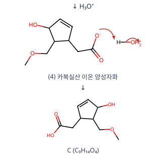

**왜 이 생성물인가.** (i) 케톤 쪽이 먼저 반응하는 것은 NaHCO₃ 완충 조건과 Corey 락톤 합성에서 확립된 선택성 때문이고, (ii) 머리 CH가 이동하는 것은 2차 탄소가 1차 CH₂보다 이동 전이상태의 양전하를 더 잘 안정화하기 때문입니다. (iii) 가수분해는 마지막 산–염기 단계(카복실산 → 카복실산 이온)가 비가역이라 염기 조건에서 끝까지 진행됩니다.

**검산.** B C₉H₁₂O₃ + H₂O = C₉H₁₄O₄ = C ✓(RDKit 확인).

**채점 포인트·함정**

- 이동 경향: 3차 > 2차 ≈ 아릴 > 1차 > 메틸. 메틸렌(CH₂)이 아니라 머리 CH가 이동합니다.
- 이 생성물은 프로스타글란딘 합성의 Corey 락톤 계열 중간체입니다.

## A형 11번 · Hofmann 제거, Curtius·Hofmann 자리옮김 {#a11}

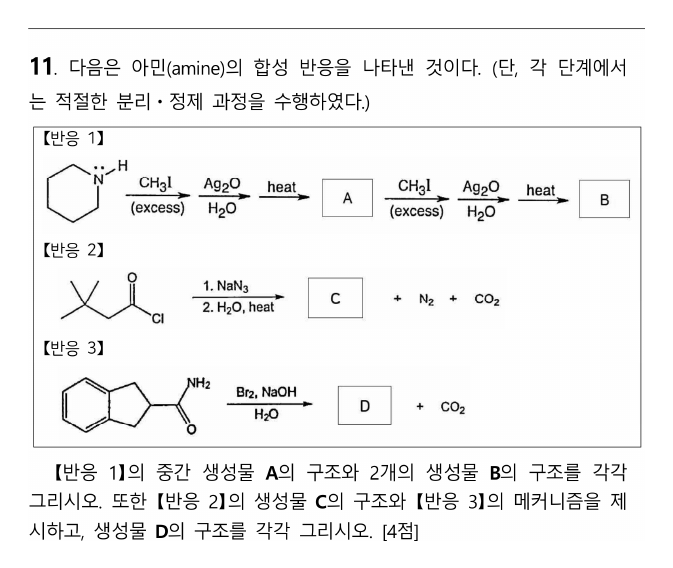

**정답** A **N,N-dimethylpent-4-en-1-amine**, B **penta-1,4-diene + (CH₃)₃N**, C **neopentylamine** (CH₃)₃CCH₂NH₂, D **indan-2-amine**

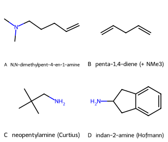

**공식·핵심 개념**

- Hofmann 제거: 4차 암모늄 수산화물 → 덜 치환된 알켄
- Curtius: RCON₃ → RNCO → RNH₂
- Hofmann 자리옮김: RCONH₂ + Br₂/NaOH → RNH₂ + CO₂

**2027 출제 가능성 ★★★★☆ 높음** — 아민 합성(이름 반응) 메커니즘은 유기 서술형 고빈도 소재입니다.

**주어진 것 / 구할 것.** [반응 1] piperidine → (CH₃I 과량, Ag₂O/H₂O, 가열) ×2 → A, B. [반응 2] 3,3-dimethylbutanoyl chloride + NaN₃ → H₂O, 가열 → C + N₂ + CO₂. [반응 3] indane-2-carboxamide + Br₂/NaOH → D + CO₂. A, B, C, D 구조와 [반응 3] 메커니즘.

**풀이 전략.** [반응 1] = Hofmann 제거(완전 메틸화 → E2, 덜 치환된 알켄). [반응 2]·[반응 3] = 아실 질소 자리옮김(Curtius, Hofmann): R기가 C=O 탄소에서 N으로 옮겨 **아이소사이아네이트** → 가수분해·탈카복실 → **탄소가 하나 적은 1차 아민**.

**단계별 풀이 ① [반응 1] Hofmann 제거**

**(1)** CH₃I 과량: 2차 아민 N이 SN2로 두 번 메틸화 → N,N-dimethylpiperidinium 이온(4차 암모늄, 좋은 이탈기 –NR₃⁺).

**(2)** Ag₂O/H₂O: I⁻를 AgI로 침전시키고 반대 이온을 **OH⁻**(강염기)로 바꿈.

**(3)** 가열: OH⁻가 β-H를 떼는 **E2** — 부피 큰 –NMe₂⁺ 이탈기 때문에 접근 쉬운 β-H를 떼어 **덜 치환된 알켄**(Hofmann 규칙). 고리 안 C–N 결합이 끊어지므로 고리가 열림 → **A = CH₂=CH–CH₂CH₂CH₂–N(CH₃)₂** (N,N-dimethylpent-4-en-1-amine).

**(4)** 한 번 더 반복: A의 3차 아민 → 4차 암모늄 → E2 → **B = CH₂=CH–CH₂–CH=CH₂(penta-1,4-diene) + N(CH₃)₃**.

**단계별 풀이 ② [반응 2] Curtius 자리옮김**

**(1)** 아실 치환: N₃⁻가 산 염화물 C=O를 공격 → 사면체 중간체 → Cl⁻ 이탈 → 아실 아자이드 R–CO–N₃.

**(2)** 가열: N₂(아주 좋은 이탈기)가 빠지면서 **동시에** R(= (CH₃)₃CCH₂–)이 C에서 N으로 이동 → 아이소사이아네이트 R–N=C=O. 이동하는 R의 입체배열은 유지.

**(3)** H₂O가 N=C=O의 탄소에 첨가 → 카밤산 R–NH–COOH → CO₂ 방출 → **C = (CH₃)₃C–CH₂–NH₂ (neopentylamine)**.

**단계별 풀이 ③ [반응 3] Hofmann 자리옮김 메커니즘**

**(1)** HO⁻가 아마이드 N–H(pKa ≈ 17)를 떼어 아마이드 음이온.

**(2)** 아마이드 음이온 N이 Br₂를 공격 → N-브로모아마이드 + Br⁻.

**(3)** 남은 N–H가 Br의 전자 끌기로 더 산성 → HO⁻가 떼어 N-브로모아마이드 음이온.

**(4)** **자리옮김**: N의 음전하가 C=O 쪽으로 밀리며 인단-2-일기가 C에서 N으로 이동, 동시에 Br⁻ 이탈 → 아이소사이아네이트.

**(5)** HO⁻(물)가 N=C=O 탄소에 첨가 → 카밤산 → 탈카복실(CO₂) → **D = indan-2-amine**.

**메커니즘 — 반응 1 Hofmann 제거 (2회)**

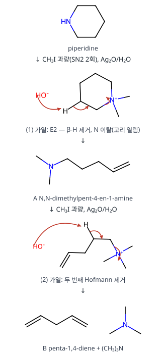

**메커니즘 — 반응 2 아실 아자이드 형성과 Curtius 자리옮김**

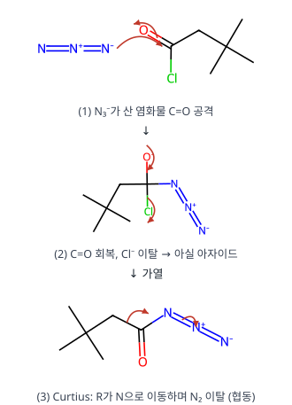

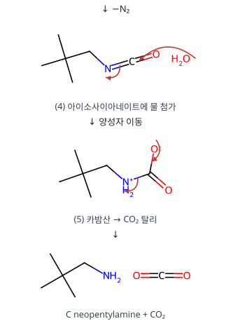

**메커니즘 — 반응 3 Hofmann 자리옮김**

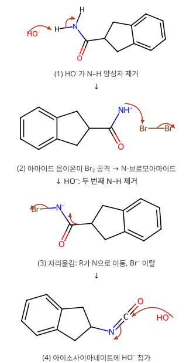

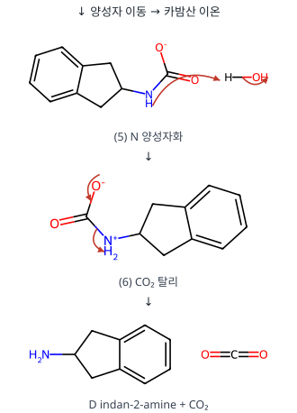

**왜 이 생성물인가.** Hofmann 제거에서 Zaitsev 생성물이 아닌 덜 치환된 알켄이 생기는 것은 이탈기가 크고 전이상태가 탄소음이온 성격(E1cB 쪽)을 띠어, 가장 산성이고 입체 장애가 적은 β-H가 떨어지기 때문입니다. 두 자리옮김은 이탈기(N₂, Br⁻)가 떠나는 순간 전자가 부족해진 N으로 이웃 탄소가 협동 이동하는 같은 원리입니다.

**검산.** C: C₆H₁₁ClO → C₅H₁₃N(탄소 1 감소, CO₂로 빠짐) ✓. D: C₁₀H₁₁NO → C₉H₁₁N ✓.

**채점 포인트·함정**

- Curtius·Hofmann 모두 생성 아민의 탄소 수가 하나 줄고, R기의 입체배열은 유지됩니다.

## A형 12번 · KHP로 NaOH 표정 — 종말점 부피 {#a12}

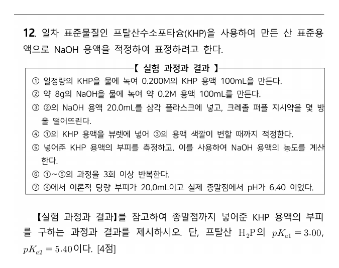

**정답** **22.0 mL**

**공식·핵심 개념**

- 당량점: $n_{산} = n_{염기}$
- 종말점 pH로 완충비 $\dfrac{[A^-]}{[HA]} = 10^{pH - pK_a}$
- 적정 오차 = 종말점 − 당량점

**2027 출제 가능성 ★★★★★ 매우 높음** — 적정 오차 계산은 분석화학 최빈출 유형입니다(2회 A형 12번과 같은 계열).

**주어진 것 / 구할 것.** KHP 0.200 M(뷰렛), NaOH 20.0 mL(삼각 플라스크), 이론적 당량 부피 20.0 mL, 종말점 pH 6.40, H₂P: pKa₁ 3.00, pKa₂ 5.40 → 종말점까지 넣은 KHP 부피.

**풀이 전략.** 산(KHP)을 염기(NaOH)에 넣는 적정입니다. 당량점에서는 P²⁻만 있어 약염기성(pH > 7)인데 종말점 pH 6.40은 그보다 낮음 → **당량점을 지나 HP⁻가 과량** 들어간 HP⁻/P²⁻ 완충 영역. pKa₂로 비를 구해 부피를 역산합니다.

**단계별 풀이**

**(1)** **NaOH 몰수.** 당량 부피 20.0 mL이므로 $n_{OH^-} = 0.200\times20.0 = 4.00$ mmol (NaOH 농도 0.200 M).

**(2)** **반응.** $\mathrm{HP^- + OH^- \rightarrow P^{2-} + H_2O}$ (1 : 1).

**(3)** **KHP $x$ mL 넣은 뒤(x > 20.0) 조성.**

| | HP⁻ | OH⁻ | P²⁻ |
|---|---|---|---|
| 처음 (mmol) | $0.200x$ | 4.00 | 0 |
| 반응 | −4.00 | −4.00 | +4.00 |
| 종말점 | $0.200x - 4.00$ | 0 | 4.00 |

**(4)** **Henderson–Hasselbalch (pKa₂).**
$$6.40 = 5.40 + \log\frac{n(\mathrm{P^{2-}})}{n(\mathrm{HP^-})} \;\Rightarrow\; \frac{4.00}{0.200x - 4.00} = 10^{1.00} = 10$$
(같은 용액이므로 부피가 약분되어 몰수 비로 계산 가능)

**(5)** **풀기.**
$$0.200x - 4.00 = 0.400 \;\Rightarrow\; 0.200x = 4.40 \;\Rightarrow\; x = 22.0\ \mathrm{mL}$$

**(6)** **오차의 의미.** 실제보다 2.0 mL 더 넣었으므로 이 값으로 NaOH 농도를 계산하면 $\frac{0.200\times22.0}{20.0} = 0.220$ M로 **10% 과대** 평가됩니다.

**검산.** 22.0 mL 대입: HP⁻ 0.400 mmol, P²⁻ 4.00 mmol → pH = 5.40 + log 10 = 6.40 ✓. pKa₁(3.00)은 H₂P가 거의 없어 쓰이지 않습니다.

**채점 포인트·함정**

- KHP를 뷰렛에 넣는(산으로 염기를 적정) 역방향 적정입니다. 종말점이 당량점보다 **2.0 mL 늦음** → NaOH 농도를 과대 계산하게 됩니다.

# 전공 B

## B형 1번 · 분자 내 Friedel–Crafts 아실화 {#b1}

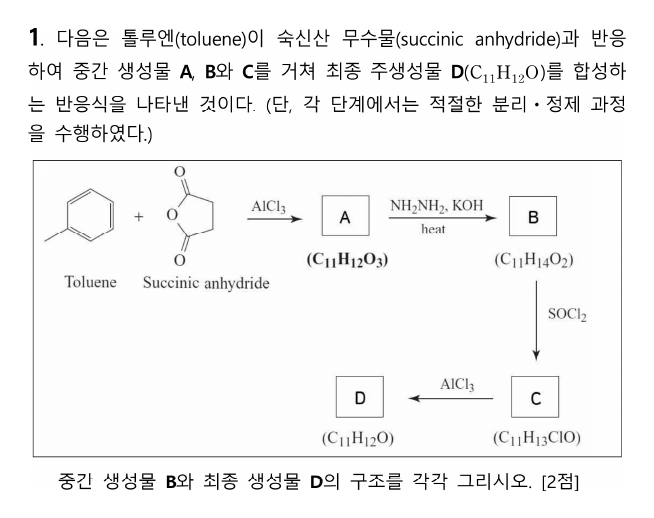

**정답** B **4-(4-methylphenyl)butanoic acid**, D **7-methyl-3,4-dihydronaphthalen-1(2H)-one** (7-methyl-1-tetralone)

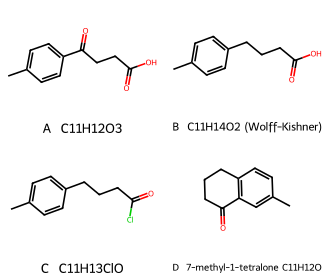

**공식·핵심 개념**

- Friedel–Crafts 아실화: 산무수물 + AlCl₃
- Wolff–Kishner: C=O → CH₂ (염기)
- 분자 내 아실화 → 6원 고리 테트랄론

**2027 출제 가능성 ★★★★☆ 높음** — Haworth 합성(아실화 → 환원 → 고리화)은 유기 합성 경로 문항 단골입니다.

**주어진 것 / 구할 것.** toluene + succinic anhydride → (AlCl₃) A C₁₁H₁₂O₃ → (NH₂NH₂, KOH, 가열) B C₁₁H₁₄O₂ → (SOCl₂) C C₁₁H₁₃ClO → (AlCl₃) D C₁₁H₁₂O. B와 D 구조.

**풀이 전략.** 각 단계의 분자식 변화로 반응을 확인합니다(Haworth 합성): 아실화(+C₄H₄O₃) → C=O → CH₂(O 1개 빠지고 H 2개 추가) → COOH → COCl → 분자 내 아실화(−HCl).

**단계별 풀이**

**(1)** **A (Friedel–Crafts 아실화).** AlCl₃가 무수물 C=O 산소에 배위 → 아실륨(또는 아실륨형 착물) 생성 → 톨루엔 고리가 공격(σ 착물) → H⁺ 제거로 방향족성 회복. CH₃는 o/p 지향기이고 아실화 시약이 부피가 커 ortho는 막힘 → **para**. 무수물이 열리므로 반대쪽 끝은 –COOH.

- A = 4-oxo-4-(p-tolyl)butanoic acid. 분자식: C₇H₈ + C₄H₄O₃ = **C₁₁H₁₂O₃** ✓

**(2)** **B (Wolff–Kishner).** 케톤 + H₂NNH₂ → 하이드라존 → KOH가 N–H를 떼고 C 양성자화(토토머화) 반복 → N₂ 방출로 탄소음이온 → 양성자화 → CH₂. 염기성 조건이라 –COOH는 카복실산 이온으로만 있다가 후처리에서 돌아옵니다.

- B = **4-(4-methylphenyl)butanoic acid**, C₁₁H₁₂O₃ − O + 2H = **C₁₁H₁₄O₂** ✓

**(3)** **C (SOCl₂).** COOH → COCl(SO₂, HCl 발생): C₁₁H₁₃ClO ✓

**(4)** **D (분자 내 아실화).** AlCl₃로 아실륨 생성 → 같은 분자의 벤젠 고리 **ortho(사슬이 붙은 자리 옆)**를 공격 → 6원 고리 형성(5원보다 각도 긴장 적고, 7원보다 엔트로피 유리). H⁺ 제거.

- D = **7-methyl-3,4-dihydronaphthalen-1(2H)-one**(7-methyl-1-tetralone), C₁₁H₁₃ClO − HCl = **C₁₁H₁₂O** ✓

**(5)** **메틸 위치 번호.** 사슬과 CH₃는 para였음. 고리화로 새 C=O가 붙는 탄소를 C8a 옆(C1의 이웃)으로 번호 매기면, 원래 CH₃는 C=O가 붙은 방향족 탄소에서 **meta** 위치 = 테트랄론의 **7번**.

**메커니즘 — A Friedel–Crafts 아실화 (숙신산 무수물)**

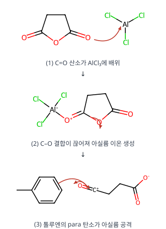

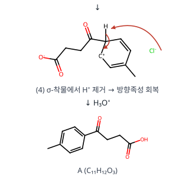

**메커니즘 — A → B Wolff–Kishner 환원**

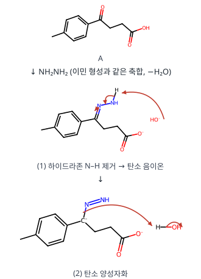

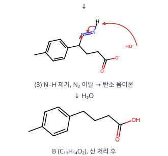

**메커니즘 — C → D 분자 내 Friedel–Crafts 아실화**

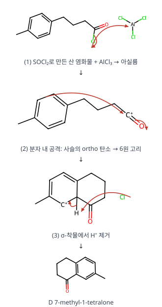

**왜 이 생성물인가.** 아실화는 다중 치환이 일어나지 않고(생성 케톤이 고리를 비활성화) 자리옮김도 없어 직선 사슬이 그대로 붙습니다. Wolff–Kishner는 산에 약한 기질에도 쓰지만, 여기서는 Clemmensen(산성) 대신 써도 결과는 같습니다. 고리화 위치는 사슬 길이(C4 사슬 → 6원 고리)로 정해집니다.

**검산.** 네 분자식 모두 RDKit으로 확인 ✓.

**채점 포인트·함정**

- 메틸은 사슬과 para였으므로 고리화 후 테트랄론의 **7번** 자리에 놓입니다.
- Clemmensen(Zn(Hg)/HCl) 대신 Wolff–Kishner를 쓴 조건(염기)도 확인합니다.

## B형 2번 · 분광법으로 지시약 pKa 구하기 {#b2}

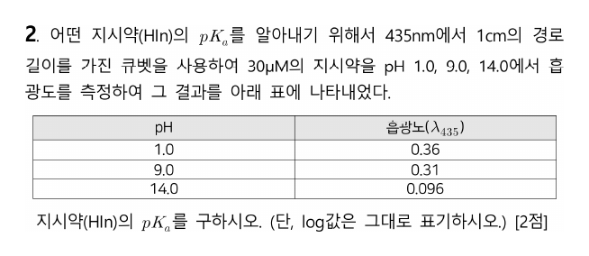

**정답** 공식 답안 $\mathrm{p}K_a = 9.0 - \log\left(\dfrac{5.0\times10^{-6}}{2.5\times10^{-5}}\right) = 10.0 - \log2 \approx 9.70$ (정확히 계산하면 $9.0 + \log\dfrac{0.214}{0.050} \approx 9.63$)

**공식·핵심 개념**

- 순수 HIn, In⁻ 흡광도로 비: $\dfrac{[In^-]}{[HIn]} = \dfrac{A_{HIn} - A}{A - A_{In}}$
- $\mathrm{p}K_a = \mathrm{pH} - \log\dfrac{[In^-]}{[HIn]}$

**2027 출제 가능성 ★★★★☆ 높음** — 분광법 pKa 결정은 분석화학 기입형으로 자주 나옵니다.

**주어진 것 / 구할 것.** 지시약 30 μM, b = 1 cm, 435 nm 흡광도: pH 1.0 → 0.36, pH 9.0 → 0.31, pH 14.0 → 0.096. pKa (log는 그대로 표기).

**풀이 전략.** pH 1.0은 전부 HIn, pH 14.0은 전부 In⁻로 보고 각 형태의 흡광도를 얻습니다. pH 9.0의 흡광도는 두 형태의 합(Beer 법칙 가산성) → 분율 → Henderson–Hasselbalch.

**단계별 풀이**

**(1)** **몰 흡광계수.**
$$\varepsilon_{HIn} = \frac{0.36}{(1)(30\times10^{-6})} = 1.2\times10^4,\quad \varepsilon_{In^-} = \frac{0.096}{30\times10^{-6}} = 3.2\times10^3\ \mathrm{M^{-1}cm^{-1}}$$

**(2)** **pH 9.0 혼합물.** $[\mathrm{HIn}] + [\mathrm{In^-}] = 30\ \mu\mathrm{M}$, In⁻의 분율을 $f$라 하면
$$0.31 = 0.36(1 - f) + 0.096f \;\Rightarrow\; f = \frac{0.36 - 0.31}{0.36 - 0.096} = \frac{0.050}{0.264} = 0.189$$
$$[\mathrm{In^-}] = 0.189\times30 = 5.7\ \mu\mathrm{M},\qquad [\mathrm{HIn}] = 24.3\ \mu\mathrm{M}$$

**(3)** **pKa.**
$$\mathrm{p}K_a = \mathrm{pH} - \log\frac{[\mathrm{In^-}]}{[\mathrm{HIn}]} = 9.0 - \log\frac{0.050}{0.214} = 9.0 + \log\frac{0.214}{0.050} = 9.0 + \log4.28 \approx 9.63$$

**(4)** **공식 답안 표현.** 농도를 $5.0\times10^{-6}$, $2.5\times10^{-5}$ M로 반올림하면
$$\mathrm{p}K_a = 9.0 - \log\frac{5.0\times10^{-6}}{2.5\times10^{-5}} = 9.0 - \log\frac15 = 10.0 - \log2 \approx 9.70$$
(검토 메모 2: 반올림 차이)

**검산.** $f$ = 0.189 < 0.5 → pH 9.0에서 HIn이 우세 → pKa > 9.0 ✓.

**채점 포인트·함정**

- $\varepsilon$를 따로 구하지 않아도 흡광도 비만으로 풀 수 있습니다.

## B형 3번 · 서술적 순환학습과 에너지 출입 {#b3}

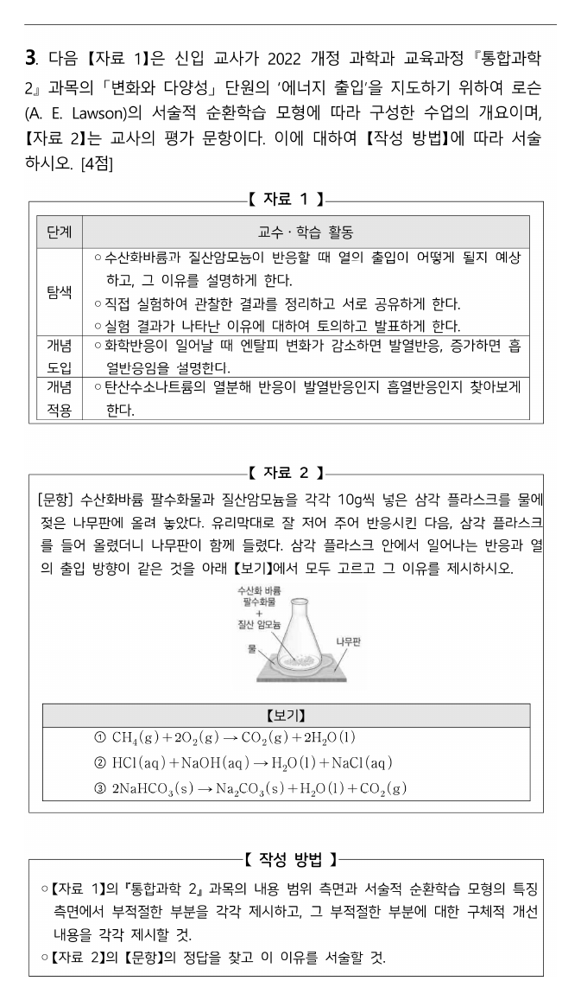

**정답**

- 내용 범위: 부적절 — 개념 도입에서 **엔탈피 변화**로 발열·흡열을 설명한 것(『물질과 에너지』 내용). 개선 — 화학 반응이 일어날 때 **에너지를 방출하면 발열, 흡수하면 흡열 반응**이라고 설명한다.
- 서술적 순환학습: 부적절 — 탐색 단계에서 **예상과 그 이유(인과적 의문)**를 묻는 것. 개선 — 수산화바륨과 염화(질산)암모늄이 반응할 때 열 출입의 **결과를 정리하고 기술**하게 한다.
- 문항 정답: **③**. 물이 얼어 나무판이 들리므로 플라스크 안에서 주위의 열을 흡수하는 **흡열 반응**이 일어났고, ③ 탄산수소나트륨 분해도 흡열 반응이다.

**공식·핵심 개념**

- 로슨: 서술적(인과 의문 없음) / 경험-귀추적 / 가설-연역적
- 통합과학 2: 에너지 방출·흡수까지(엔탈피는 『물질과 에너지』)
- 흡열 반응: 주위 온도 하강

**2027 출제 가능성 ★★★★★ 매우 높음** — 순환학습 유형 구분과 과목별 내용 범위 판단은 2022 개정 핵심 출제 포인트입니다.

**로슨 순환학습 3유형**: 서술적(관찰·기술, 인과 의문 없음), 경험-귀추적(인과 의문 + 귀추), 가설-연역적(가설 검증).

**채점 포인트·함정**

- ① 연소, ② 중화는 발열 → 오답입니다.

## B형 4번 · 발견학습·발생학습과 ZPD {#b4}

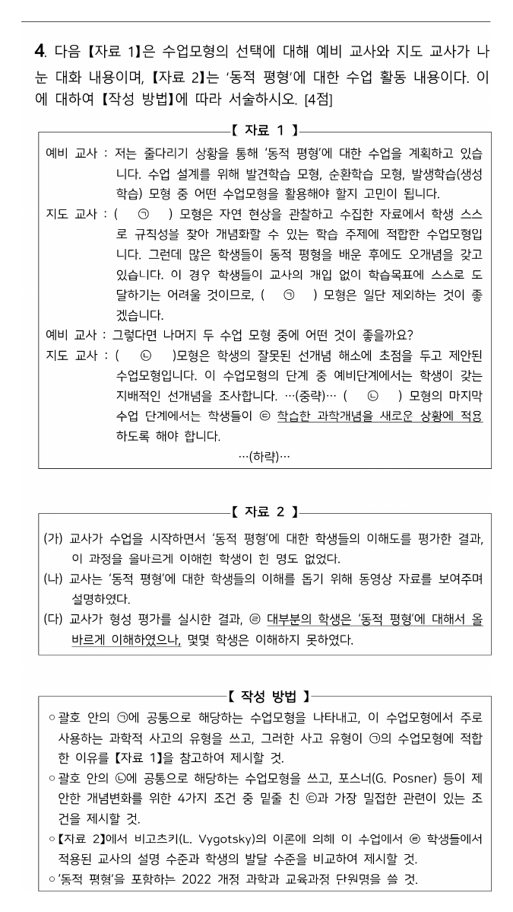

**정답**

- ㉠ **발견학습 모형**, 사고 유형 **귀납적 사고**: 자연 현상을 관찰하고 수집한 자료에서 규칙성을 발견해 일반화하기 때문
- ㉡ **발생학습 모형**, ㉢과 관련된 포스너 조건: **유용성(생산성)** — 새 개념이 새로운 상황에 적용되어야 개념 변화가 일어난다
- ㉣: 교사의 설명이 **ZPD 안에서** 이루어져 학생의 실제적 발달 수준보다 높은 수준으로 설명하여 잠재적 발달 수준으로 이끌었다
- 단원명: **화학 평형**

**공식·핵심 개념**

- 발견학습: 귀납적 사고, 규칙성 발견
- 발생학습: 예비 → 초점 → 도전 → 적용
- 포스너: 불만족·이해 가능성·그럴듯함·유용성

**2027 출제 가능성 ★★★★★ 매우 높음** — 수업 모형 비교와 포스너·비고츠키 결합은 교육론 최빈출입니다.

**발생학습 모형(Osborne & Freyberg)**: 예비 단계 → 초점 단계 → 도전 단계 → 적용 단계. 선개념 해소에 초점.

**발견학습이 부적절한 이유**: 오개념이 많은 주제에서는 교사 개입 없이 학생 스스로 목표에 도달하기 어렵습니다.

**채점 포인트·함정**

- 포스너 4조건(불만족·이해 가능성·그럴듯함·유용성) 중 "새로운 상황 적용"은 유용성입니다.

## B형 5번 · 실험 평가와 정의적 영역 평가 {#b5}

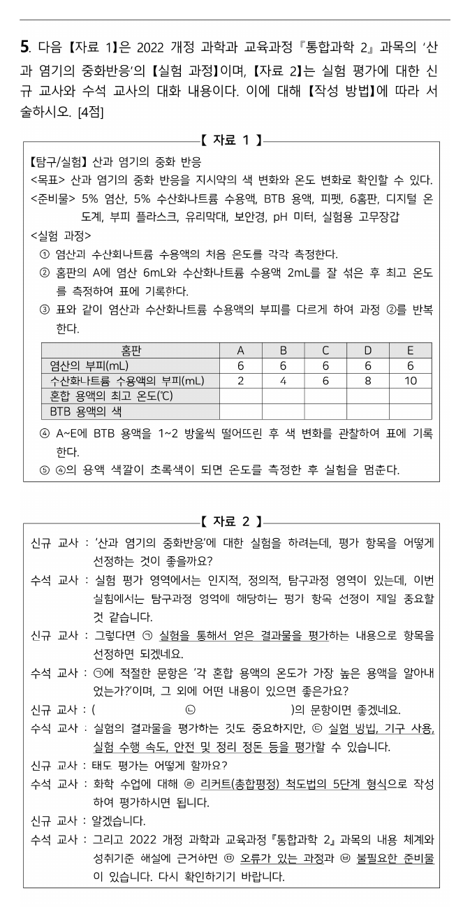

**정답**

- ㉡ **각 혼합 용액의 지시약 색을 정확히 관찰하여 기록하였는가?**
- ㉣ 리커트 문항: "다음은 화학 수업에 관한 의견을 알아보기 위한 설문입니다. 동의하는 기호에 √ 하시오." ㄱ. 매우 동의한다 ~ ㅁ. 전혀 동의하지 않는다 (예: 과학 실험이 흥미롭다)
- 오류 과정 **⑤**: "용액 색깔이 초록색이 되더라도 계속 진행하여 **푸른색이 될 때까지** 온도를 측정한다"로 수정
- ㉥: 『통합과학 2』는 지시약의 색 변화와 온도 변화를 **정성적으로** 확인하므로, pH 개념에 쓰는 **pH 미터**와 정확한 농도 용액 제조용 **부피 플라스크**는 『화학』 내용이라 불필요하다.

**공식·핵심 개념**

- 결과물 평가 / 수행 과정 평가 구분
- 리커트 척도: 5단계 동의 정도
- 통합과학 2 중화: 지시약 색·온도의 정성적 확인

**2027 출제 가능성 ★★★★☆ 높음** — 실험 평가 문항 작성과 준비물·과정 오류 찾기는 최근 교육론 경향입니다.

**결과물 평가(㉠)**: 실험으로 얻은 결과(최고 온도, 색)를 평가. ㉢은 수행 과정 평가입니다.

**⑤가 틀린 이유**: 목표가 "색 변화와 온도 변화로 중화 반응 확인"이므로, 중화점(초록) 이후 염기가 과량인 구간(푸른색)까지 관찰해야 온도가 다시 내려가는 경향을 볼 수 있습니다.

**채점 포인트·함정**

- 리커트 척도는 **5단계 동의 정도** 형식을 그대로 보여 줘야 합니다.

## B형 6번 · 가열 과정에 따른 엔트로피 생성 {#b6}

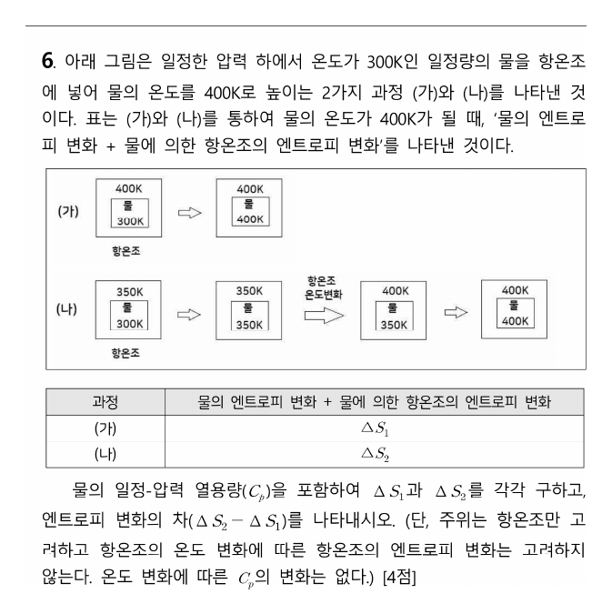

**정답** $\Delta S_1 = C_p\ln\dfrac43 - \dfrac14C_p$, $\Delta S_2 = C_p\ln\dfrac43 - \dfrac{15}{56}C_p$, $\Delta S_2 - \Delta S_1 = -\dfrac{1}{56}C_p$

**공식·핵심 개념**

- 계: $\Delta S = C_p\ln(T_2/T_1)$
- 주위(열원): $\Delta S = -q/T_{열원}$
- 단계 수↑ → 가역에 근접 → 엔트로피 생성↓

**2027 출제 가능성 ★★★☆☆ 보통** — 가역·비가역 과정의 엔트로피 비교는 열역학 서술형으로 가끔 나옵니다.

**주어진 것 / 구할 것.** 물 300 K → 400 K, $C_p$ 일정. (가) 400 K 항온조 1단계, (나) 350 K 항온조 → 400 K 항온조 2단계. $\Delta S_1$, $\Delta S_2$(물 + 항온조), $\Delta S_2 - \Delta S_1$.

**풀이 전략.** 물의 엔트로피는 상태 함수라 경로와 무관($C_p\ln T_2/T_1$). 항온조는 온도가 일정한 열원이므로 $\Delta S = -q/T_{항온조}$. 둘을 더한 것이 우주(엔트로피 생성)입니다.

**단계별 풀이**

**(1)** **물.** 일정 압력에서 $dS = C_pdT/T$:
$$\Delta S_{물} = \int_{300}^{400}\frac{C_p}{T}dT = C_p\ln\frac{400}{300} = C_p\ln\frac43\ (\approx 0.2877C_p)$$

**(2)** **물이 받은 열.** $q = C_p\Delta T$.

- (가): $q = C_p(400 - 300) = 100C_p$

- (나): 1단계 $50C_p$(350 K 항온조), 2단계 $50C_p$(400 K 항온조)

**(3)** **항온조 엔트로피.** 항온조는 그만큼 열을 잃음:
$$(가)\ \Delta S_{항온조} = -\frac{100C_p}{400} = -\frac14C_p = -0.2500C_p$$
$$(나)\ \Delta S_{항온조} = -\frac{50C_p}{350} - \frac{50C_p}{400} = -\left(\frac17 + \frac18\right)C_p = -\frac{15}{56}C_p = -0.2679C_p$$

**(4)** **합.**
$$\Delta S_1 = C_p\ln\frac43 - \frac14C_p \approx 0.0377C_p,\qquad \Delta S_2 = C_p\ln\frac43 - \frac{15}{56}C_p \approx 0.0198C_p$$

**(5)** **차.**
$$\Delta S_2 - \Delta S_1 = -\frac{15}{56}C_p + \frac{14}{56}C_p = -\frac{1}{56}C_p \approx -0.0179C_p$$

**해석.** 두 값 모두 양수(비가역)이지만 단계를 나누면 물과 열원의 온도 차가 줄어 엔트로피 생성이 작아집니다. 단계를 무한히 나누면 $\Delta S_{항온조} \to -C_p\ln\frac43$이 되어 합이 0(가역)에 수렴합니다.

**검산.** 수치: $\ln(4/3) - 0.25 = 0.0377$, $\ln(4/3) - 0.2679 = 0.0198$, 차 −0.0179 = −1/56 ✓.

**채점 포인트·함정**

- 주위 엔트로피는 **주위 온도**(항온조)로 나눕니다. 물 온도로 나누면 틀립니다.

## B형 7번 · NO의 회전 스펙트럼 {#b7}

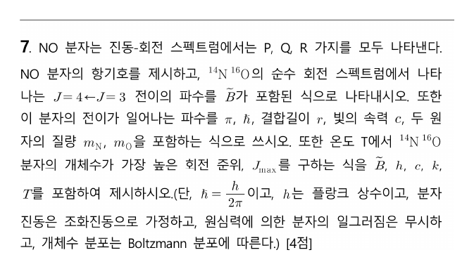

**정답** 항기호 **²Π**, J = 4 ← 3 파수 **8B̃** (공식 답안 6B̃), $\tilde\nu = \dfrac{2\hbar(m_N + m_O)}{\pi c r^2 m_N m_O}$, $J_{max} = \left(\dfrac{kT}{2hc\tilde B}\right)^{1/2} - \dfrac12$

**공식·핵심 개념**

- $F(J) = \tilde BJ(J+1)$, $\tilde\nu = 2\tilde B(J+1)$ (J는 아래 준위)
- $\tilde B = \hbar/(4\pi cI)$, $I = \mu r^2$
- $J_{max} = \sqrt{kT/2hc\tilde B} - \frac12$

**2027 출제 가능성 ★★★★☆ 높음** — 회전 스펙트럼과 개체수 분포는 물리화학 분광 단골입니다(3회 A형 8번과 연결).

**주어진 것 / 구할 것.** ¹⁴N¹⁶O, 강체 회전자 가정 → 항기호, J = 4 ← 3 파수(B̃로), 그 파수를 π, ħ, r, c, $m_N$, $m_O$로, $J_{max}$를 B̃, h, c, k, T로.

**풀이 전략.** 원자가 전자 배치로 Λ, S를 정해 항기호. 회전 준위 $F(J) = \tilde BJ(J+1)$의 차로 전이 파수, $\tilde B$를 관성 모멘트로 바꾸고, 개체수 분포 $N_J\propto(2J+1)e^{-E_J/kT}$를 J로 미분해 최댓값.

**단계별 풀이**

**(1)** **항기호.** 원자가 전자 5 + 6 = 11: $(\sigma_{2s})^2(\sigma^*_{2s})^2(\sigma_{2p})^2(\pi_{2p})^4(\pi^*_{2p})^1$. 홀전자 1개가 π* 오비탈($m_l = \pm1$) → Λ = 1(**Π**), S = ½ → 2S + 1 = 2 → **²Π**. Λ ≠ 0이라 진동-회전 스펙트럼에 Q 가지(ΔJ = 0)가 나타납니다.

**(2)** **회전 준위.** $F(J) = \tilde BJ(J+1)$: $F(3) = 12\tilde B$, $F(4) = 20\tilde B$.
$$\tilde\nu(4\leftarrow3) = F(4) - F(3) = 20\tilde B - 12\tilde B = 8\tilde B$$
(일반식 $\tilde\nu = 2\tilde B(J''+1)$, $J'' = 3$ → $8\tilde B$. 공식 답 $6\tilde B$는 J = 3 ← 2 — 검토 메모 1)

**(3)** **B̃를 분자 상수로.** $E_J = \frac{\hbar^2}{2I}J(J+1) = hc\tilde BJ(J+1)$ → 
$$\tilde B = \frac{\hbar^2}{2Ihc} = \frac{\hbar}{4\pi cI}\quad(h = 2\pi\hbar),\qquad I = \mu r^2 = \frac{m_Nm_O}{m_N + m_O}r^2$$
$$\tilde\nu = 8\tilde B = \frac{8\hbar}{4\pi c}\cdot\frac{m_N + m_O}{m_Nm_Or^2} = \frac{2\hbar(m_N + m_O)}{\pi c\,r^2m_Nm_O}$$

**(4)** **최대 개체수 준위.** $N_J\propto(2J+1)\exp\!\left[-\frac{hc\tilde BJ(J+1)}{kT}\right]$. J를 연속 변수로 보고 미분:
$$\frac{dN_J}{dJ}\propto\left[2 - (2J+1)^2\frac{hc\tilde B}{kT}\right]e^{-\dots} = 0$$
$$(2J+1)^2 = \frac{2kT}{hc\tilde B} \;\Rightarrow\; J_{max} = \left(\frac{kT}{2hc\tilde B}\right)^{1/2} - \frac12$$

**검산.** 예: B̃ = 1.70 cm⁻¹(NO), T = 298 K(kT/hc = 207 cm⁻¹) → $J_{max} = \sqrt{207/3.40} - 0.5 \approx 7.3$ → J ≈ 7 근처 봉우리가 가장 셉니다.

**채점 포인트·함정**

- 일반식 $\tilde\nu = 2\tilde B(J+1)$에서 J는 **아래** 준위(3) → 8B̃(검토 메모 1).

## B형 8번 · BF₃의 σ·π SALC와 혼성 {#b8}

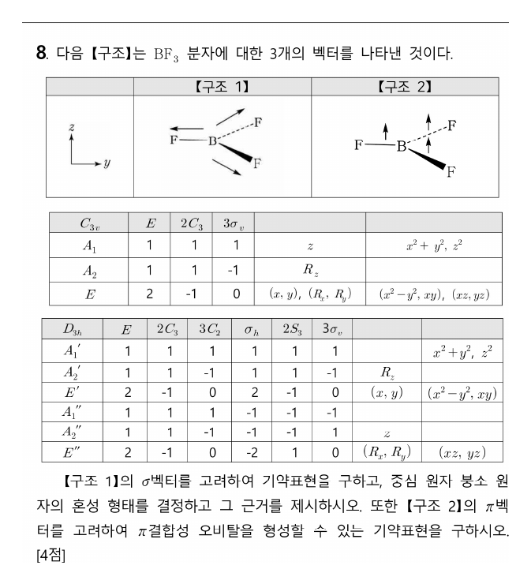

**정답** σ: $\Gamma = A_1' + E'$ → **sp² 혼성(2s, 2pₓ, 2p_y)**. π: $\Gamma = A_2'' + E''$ 중 B의 2p_z와 맞는 **A₂″**만 π 결합

**공식·핵심 개념**

- σ SALC: 제자리 벡터 수로 Γ
- D₃h: Γσ = A₁′ + E′ → sp², Γπ = A₂″ + E″
- 2주기 원소: d 오비탈 혼성 제외

**2027 출제 가능성 ★★★★★ 매우 높음** — SALC로 혼성·π 결합을 판단하는 문항은 무기 대칭 고정 소재입니다.

**주어진 것 / 구할 것.** BF₃(D₃h), 구조 1: B–F 방향 σ 벡터 3개, 구조 2: 분자 평면에 수직(z)인 π 벡터 3개 → σ의 기약표현과 B의 혼성·근거, π 결합성 오비탈을 만들 수 있는 기약표현.

**풀이 전략.** 각 조작에서 **제자리에 남는 벡터의 기여**(그대로 +1, 뒤집힘 −1, 이동 0)로 Γ를 만들고 축소 공식(h = 12)으로 나눕니다. 나온 기약표현과 같은 대칭인 B의 원자 오비탈(지표표 오른쪽 열)을 찾습니다.

**단계별 풀이 ① σ 벡터**

| D₃h | E | 2C₃ | 3C₂ | σh | 2S₃ | 3σᵥ |
|---|---|---|---|---|---|---|
| 제자리 벡터 | 3 | 0 | 1 | 3 | 0 | 1 |
| Γσ | 3 | 0 | 1 | 3 | 0 | 1 |

(C₂ 축 위의 F 하나는 B–F 방향 벡터가 그대로, σh는 분자 평면이라 3개 모두 그대로)

- $n(A_1') = \frac1{12}(3 + 0 + 3\cdot1\cdot1 + 3 + 0 + 3\cdot1\cdot1) = \frac{12}{12} = 1$
- $n(A_2') = \frac1{12}(3 + 0 - 3 + 3 + 0 - 3) = 0$
- $n(E') = \frac1{12}(6 + 0 + 0 + 6 + 0 + 0) = 1$
- $n(A_1'') = \frac1{12}(3 + 0 + 3 - 3 + 0 - 3) = 0$
- $n(A_2'') = \frac1{12}(3 + 0 - 3 - 3 + 0 + 3) = 0$
- $n(E'') = \frac1{12}(6 + 0 + 0 - 6 + 0 + 0) = 0$

$$\Gamma_\sigma = A_1' + E'$$

**혼성 결정.** $A_1'$ ↔ s($x^2+y^2$) 또는 $d_{z^2}$, $E'$ ↔ ($p_x, p_y$) 또는 ($d_{x^2-y^2}, d_{xy}$). B는 2주기라 2d가 없고 3d는 너무 높으므로 **2s + 2pₓ + 2p_y = sp²** (평면 삼각형, 120°).

**단계별 풀이 ② π 벡터(z 방향)**

| D₃h | E | 2C₃ | 3C₂ | σh | 2S₃ | 3σᵥ |
|---|---|---|---|---|---|---|
| Γπ | 3 | 0 | −1 | −3 | 0 | 1 |

(C₂는 평면 안의 축이라 z 벡터를 뒤집음 −1, σh도 z를 뒤집어 −3, σᵥ는 수직 평면이라 그대로 +1)

- $n(A_1') = \frac1{12}(3 - 3 - 3 + 3) = 0$, $n(A_2') = \frac1{12}(3 + 3 - 3 - 3) = 0$, $n(E') = \frac1{12}(6 + 0 - 6 + 0) = 0$
- $n(A_1'') = \frac1{12}(3 - 3 + 3 - 3) = 0$, $n(A_2'') = \frac1{12}(3 + 3 + 3 + 3) = 1$, $n(E'') = \frac1{12}(6 + 0 + 6 + 0) = 1$

$$\Gamma_\pi = A_2'' + E''$$

**π 결합.** $A_2''$ ↔ z → B의 빈 **2p_z**와 겹침 → F의 꽉 찬 p_z가 B로 전자를 주는 π 결합(역공여, BF₃가 약한 루이스 산인 이유). $E''$ ↔ ($d_{xz}, d_{yz}$)뿐이라 B에 맞는 오비탈이 없어 비결합. → π 결합성 오비탈: **A₂″**.

**검산.** Γσ 차원 1 + 2 = 3, Γπ 차원 1 + 2 = 3 = 벡터 수 ✓.

**채점 포인트·함정**

- σh에서 π 벡터(z 방향)는 뒤집혀 −3입니다.

## B형 9번 · Ti(CO)₄의 구조와 CO IR {#b9}

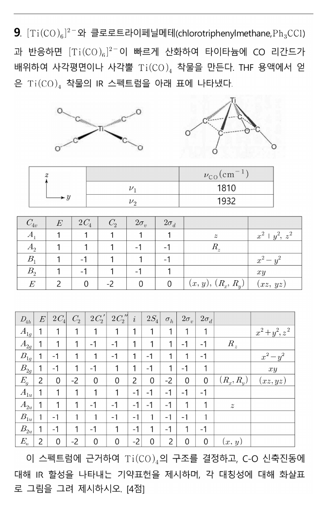

**정답** **사각뿔(C₄ᵥ)**. IR 활성 C–O 신축 **A₁ + E** (띠 2개). 사각평면(D₄h)이면 **Eᵤ** 1개뿐.

**공식·핵심 개념**

- CO 신축: 움직이지 않는 CO 수로 Γ
- D₄h ML₄: A₁g + B₁g + Eᵤ (IR 1개)
- C₄ᵥ ML₄: A₁ + B₁ + E (IR 2개)

**2027 출제 가능성 ★★★★☆ 높음** — IR 띠 수로 구조를 결정하는 카보닐 착물 문항은 자주 나옵니다.

**주어진 것 / 구할 것.** Ti(CO)₄: 사각평면(D₄h) 또는 사각뿔(C₄ᵥ), IR ν(CO) 1810, 1932 cm⁻¹(띠 2개) → 구조, IR 활성 기약표현, 진동 방식 화살표.

**풀이 전략.** CO 신축 벡터 4개(C–O 결합 방향)의 Γ를 두 점군에서 각각 만들고, IR 활성(x, y, z와 같은 대칭) 개수를 띠 수와 비교합니다.

**단계별 풀이 ① 사각평면 D₄h (h = 16)**

| D₄h | E | 2C₄ | C₂ | 2C₂′ | 2C₂″ | i | 2S₄ | σh | 2σᵥ | 2σd |
|---|---|---|---|---|---|---|---|---|---|---|
| Γ_CO | 4 | 0 | 0 | 2 | 0 | 0 | 0 | 4 | 2 | 0 |

- $n(A_{1g}) = \frac1{16}(4 + 2\cdot2 + 4 + 2\cdot2) = 1$
- $n(B_{1g}) = \frac1{16}(4 + 2\cdot2 + 4 + 2\cdot2) = 1$
- $n(E_u) = \frac1{16}(4\cdot2 + 4\cdot2) = 1$ (Eᵤ: E 2, σh 2)
- 나머지(A₂g, B₂g, E_g, A₁ᵤ, A₂ᵤ, B₁ᵤ, B₂ᵤ)는 모두 0 (예: $n(E_g) = \frac1{16}(8 - 8) = 0$)

Γ = A₁g + B₁g + Eᵤ → IR 활성은 **Eᵤ(x, y) 하나** → 띠 1개.

**단계별 풀이 ② 사각뿔 C₄ᵥ (h = 8)**

| C₄ᵥ | E | 2C₄ | C₂ | 2σᵥ | 2σd |
|---|---|---|---|---|---|
| Γ_CO | 4 | 0 | 0 | 2 | 0 |

- $n(A_1) = \frac18(4 + 2\cdot2) = 1$, $n(A_2) = \frac18(4 - 4) = 0$
- $n(B_1) = \frac18(4 + 2\cdot2) = 1$, $n(B_2) = \frac18(4 - 4) = 0$
- $n(E) = \frac18(4\cdot2) = 1$

Γ = A₁ + B₁ + E → IR 활성 **A₁(z) + E(x, y)** → 띠 2개.

**결론.** 관측 띠 2개 → **사각뿔(C₄ᵥ)**.

**진동 방식과 배정.**

| 기약표현 | 화살표 모양 | IR | 배정 |
|---|---|---|---|
| A₁ | 네 C–O가 동시에 늘어남(모두 바깥쪽) | 활성(z) | 1932 cm⁻¹ (대칭, 높은 파수) |
| E | 마주 보는 한 쌍은 +, −(하나 늘고 하나 줄고), 다른 쌍은 정지 — x형·y형 두 개 | 활성(x, y), 축퇴 | 1810 cm⁻¹ (세기 큼) |
| B₁ | 이웃끼리 +, −, +, − 교대 | 비활성(라만만) | 관측 안 됨 |

**검산.** 차원: D₄h 1 + 1 + 2 = 4, C₄ᵥ 1 + 1 + 2 = 4 = CO 수 ✓.

**채점 포인트·함정**

- B₁은 두 구조 모두 IR 비활성(라만 활성)입니다.

## B형 10번 · 프로페인의 라디칼 할로젠화와 Hammond 가설 {#b10}

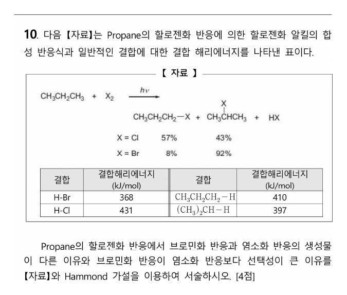

**정답**

- 염소화: 수소 추출이 **발열**(1° −21, 2° −34 kJ/mol) → Hammond 가설에 따라 전이상태가 **출발물질**을 닮아 두 전이상태의 에너지 차가 작음 → 두 라디칼이 비슷하게 생겨 **혼합물**(57 : 43).
- 브로민화: 수소 추출이 **흡열**(1° +42, 2° +29 kJ/mol) → 전이상태가 **라디칼(생성물)**을 닮아 더 안정한 2° 라디칼 쪽 전이상태가 훨씬 낮음 → 2-bromopropane 우세(92%), **선택성 큼**.

**공식·핵심 개념**

- ΔH = Σ(끊는 결합) − Σ(만드는 결합)
- Hammond: 발열 → 반응물 닮은 TS, 흡열 → 생성물 닮은 TS
- 라디칼 안정성: 3° > 2° > 1°

**2027 출제 가능성 ★★★★☆ 높음** — 라디칼 할로젠화 선택성은 유기 서술형으로 반복 출제됩니다.

**주어진 것 / 구할 것.** 프로페인 + X₂(hν): Cl → 1-클로로 57%, 2-클로로 43% / Br → 1-브로모 8%, 2-브로모 92%. 결합 해리 에너지: H–Br 368, H–Cl 431, 1° C–H 410, 2° C–H 397 kJ/mol. 두 반응의 생성물 비가 다른 이유와 브로민화의 선택성이 큰 이유(Hammond 가설).

**풀이 전략.** 생성물 비를 정하는 단계는 **수소 추출**(X· + R–H → HX + R·)입니다. 이 단계의 ΔH를 결합 에너지로 계산해 발열·흡열을 판단하고, Hammond 가설로 전이상태(TS)가 어느 쪽을 닮는지 결정합니다.

**단계별 풀이**

**(1)** **수소 추출의 ΔH = (끊는 C–H) − (만드는 H–X).**

| | 1° H (410) | 2° H (397) | 차이 |
|---|---|---|---|
| Cl· (H–Cl 431) | 410 − 431 = **−21** | 397 − 431 = **−34** | 13 |
| Br· (H–Br 368) | 410 − 368 = **+42** | 397 − 368 = **+29** | 13 |

**(2)** **Hammond 가설.** 발열 단계의 TS는 에너지가 가까운 **반응물**을 닮고(이른 TS), 흡열 단계의 TS는 **생성물(라디칼)**을 닮습니다(늦은 TS).

**(3)** **염소화.** 발열 → TS가 R–H + Cl·를 닮아 C–H가 조금만 끊어짐 → 1°/2° 라디칼 안정성 차이(13 kJ/mol)가 TS에 거의 반영되지 않음 → 활성화 에너지 차이 작음 → 반응성 차이가 작아 **혼합물**.

**(4)** **브로민화.** 흡열 → TS가 R· + HBr를 닮아 C–H가 거의 끊어진 상태 → 라디칼 안정성 차이(2° > 1°)가 TS에 대부분 반영 → 2° 쪽 활성화 에너지가 훨씬 낮음 → **2-bromopropane 92%**.

**(5)** **통계 보정(H 하나당 반응성).** 1° H 6개, 2° H 2개.
$$\text{Cl: } \frac{43/2}{57/6} = \frac{21.5}{9.5} \approx 2.3 \qquad \text{Br: } \frac{92/2}{8/6} = \frac{46}{1.33} \approx 35$$
→ 브로민은 2° H를 1° H보다 약 35배 선호(염소는 2.3배).

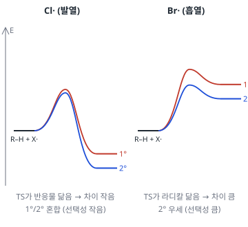

**메커니즘 — 라디칼 브로민화 연쇄 반응 (반쪽 화살표 = 전자 1개 이동)**

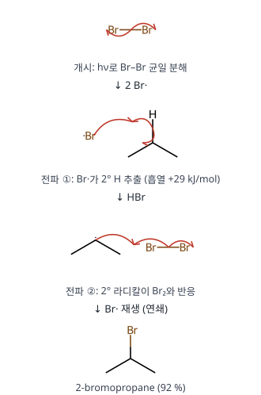

**왜 이 생성물인가.** 개시(X₂ → 2X·, hν) → 전파 ① X· + R–H → R· + HX(선택성 결정) → 전파 ② R· + X₂ → R–X + X· → 종결(라디칼끼리 결합). 선택성은 전파 ①의 TS 위치(Hammond)가 정합니다. "반응성이 클수록(Cl·) 선택성이 작다"는 반응성–선택성 원리의 대표 예입니다.

**검산.** 두 할로젠 모두 1°/2° ΔH 차이는 13 kJ/mol로 같지만, 생성물 비는 크게 다름 → 차이를 만드는 것은 ΔH 자체가 아니라 TS의 위치임을 확인할 수 있습니다.

**채점 포인트·함정**

- 통계 인자: 1° H 6개, 2° H 2개. 염소화 57 : 43을 H 하나당으로 보면 2° 반응성이 약 2.3배.

## B형 11번 · 폴라로그래피 반파 전위의 pH 의존성 {#b11}

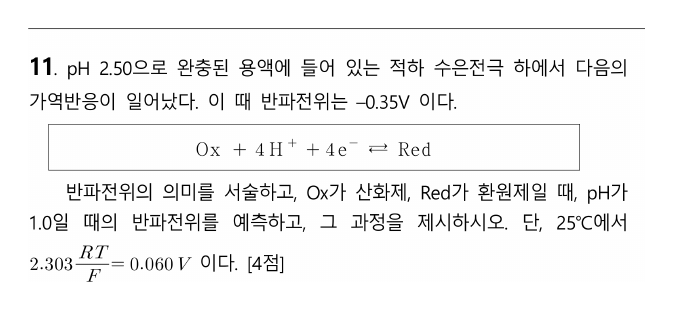

**정답** 반파 전위: 확산 전류(한계 전류)의 **절반**이 될 때의 전위로 물질의 특성값. pH 1.0에서 **−0.26 V**

**공식·핵심 개념**

- 반파 전위: 한계 전류 ½에서의 전위(물질 특성값)
- $E_{1/2} = \text{const} - \dfrac{0.060m}{n}\mathrm{pH}$ (H⁺ m개, 전자 n개)

**2027 출제 가능성 ★★★☆☆ 보통** — 폴라로그래피·전압전류법은 기기분석에서 가끔 나옵니다.

**주어진 것 / 구할 것.** pH 2.50 완충 용액, 적하 수은 전극, $\mathrm{Ox + 4H^+ + 4e^- \rightleftharpoons Red}$(가역), $E_{1/2} = -0.35$ V, $2.303RT/F = 0.060$ V → 반파 전위의 의미, pH 1.0의 반파 전위.

**풀이 전략.** 네른스트 식을 전극 표면 농도로 쓰고, 반파 지점(전류 = 한계 전류의 ½)에서 표면 Ox와 Red 농도가 같다는 조건을 넣어 $E_{1/2}$와 pH의 관계식을 얻습니다.

**단계별 풀이**

**(1)** **반파 전위의 의미.** 전류–전위 곡선(폴라로그램)에서 전류가 확산 한계 전류의 **절반**이 되는 전위. 농도와 무관하고 물질·조건(용매, pH, 착물)에 따라 정해지는 **정성 분석용 특성값**입니다(가역계에서 $E_{1/2}\approx E^{\circ\prime}$).

**(2)** **네른스트 식(표면 농도 s).**
$$E = E^\circ - \frac{0.060}{4}\log\frac{[\mathrm{Red}]_s}{[\mathrm{Ox}]_s[\mathrm{H^+}]^4} = E^\circ - \frac{0.060}{4}\log\frac{[\mathrm{Red}]_s}{[\mathrm{Ox}]_s} - 0.060\,\mathrm{pH}$$
($-\frac{0.060}{4}\log[\mathrm{H^+}]^{-4} = -\frac{0.060}{4}\times4\,\mathrm{pH}$)

**(3)** **반파 조건.** 전류가 한계의 ½이면 표면에서 Ox가 절반 소모되어 $[\mathrm{Ox}]_s = [\mathrm{Red}]_s$(확산계수 같다고 가정) → log 항 = 0:
$$E_{1/2} = E^\circ - 0.060\,\mathrm{pH}\quad(\text{기준 전극 대비 상수항 포함})$$

**(4)** **상수 결정(pH 2.50).**
$$-0.35 = E^\circ - 0.060\times2.50 = E^\circ - 0.15 \;\Rightarrow\; E^\circ = -0.20\ \mathrm{V}$$

**(5)** **pH 1.0.**
$$E_{1/2} = -0.20 - 0.060\times1.0 = -0.26\ \mathrm{V}$$

**검산.** 기울기 $dE_{1/2}/d\mathrm{pH} = -0.060\times\frac{m}{n} = -0.060\times\frac44 = -0.060$ V/pH. pH가 1.5 낮아졌으니 +0.090 V 이동: −0.35 + 0.09 = −0.26 V ✓.

**채점 포인트·함정**

- H⁺ 4개와 전자 4개이므로 pH 1 당 0.060 V씩 이동합니다. pH가 낮을수록 환원이 쉬워져 반파 전위가 양의 방향으로 이동합니다.

---

원문: 2025학년도 대비 김지현 전공화학 모의고사 5회(지스쿨) 문제지·답안·강의 안내. 개인 학습용 정리입니다.

