# 2025학년도 대비 김지현 전공화학 모의고사 6회 — 상세해설

김지현 전공화학 모의고사 6회(전공 A 12문항 · 전공 B 11문항)의 문항별 해설입니다. 공식 「모의고사 6회 A형, B형 답안」과 강의 판서를 바탕으로 풀이 과정·개념·채점 포인트를 채웠고, 계산은 모두 다시 풀어 공식 답과 맞는지 확인했습니다. 구조식은 RDKit으로 분자식을 확인했습니다.

문항마다 새 쪽에서 시작하며 3단으로 **문제지 원문 → 정답 → 공식·핵심 개념 → 2027 출제 가능성 → 풀이 → 채점 포인트·함정** 순서로 읽으면 됩니다. 아래 표의 문항 번호를 누르면 해당 쪽으로 이동합니다.

유기 문항(A형 10·11번, B형 1·11번)에는 **굽은 화살표로 전자 이동을 표시한 단계별 메커니즘 그림**을 넣었습니다(빨간 화살표: 전자쌍이 출발하는 결합·비공유 전자쌍 → 도착하는 원자·결합).

전공(화학교육론 제외) 문항은 **주어진 것 / 구할 것 → 풀이 전략 → 단계별 풀이 → 검산** 순서로 계산·유도 과정을 생략 없이 적었습니다.

**2027 출제 가능성**(★ 5개 만점)은 1997~2026 기출에서 그 소재가 얼마나 자주 나왔는지와 2022 개정 교육과정 적용 시점을 함께 고려한 추정치입니다.

## 정답 한눈에 보기 (목차) {#toc}

### 전공 A (12문항 40점)

| 번호 | 영역 | 정답 요약 | 2027 출제 가능성 |
|---|---|---|---|
| [1](#a1) | 물리화학 · 비가역 등온 팽창 | \|w\| = 400 J, ΔS = ln5 J/K | ★★★★☆ |
| [2](#a2) | 무기 · 18전자, CO 진동 | M = Fe, $A_1' + E'$ | ★★★★☆ |
| [3](#a3) | 유기 · 분광 분석 | 2,4,6-trimethyl-1,3,5-trioxane | ★★★★★ |
| [4](#a4) | 분석화학 · 양쪽성 염 | $[\mathrm{H_3O^+}] = \sqrt{\frac{K_{a1}K_{a2}F + K_{a1}K_w}{K_{a1} + F}}$ | ★★★★☆ |
| [5](#a5) | 화학교육 · POE | 설명 단계 수정, 질량 보존 가설 | ★★★★★ |
| [6](#a6) | 화학교육 · 2022 개정 내용 체계 | 화학반응의 규칙성, 물질의 변화, 입자수의 비 | ★★★★★ |
| [7](#a7) | 화학교육 · 비고츠키, 쿤 | 실제적·잠재적 발달 수준, 비계, 변칙 사례 | ★★★★★ |
| [8](#a8) | 물리화학 · 회전 분광 | 축퇴도 7, $2\sqrt3\hbar$, $\tilde B_0 = 6.42$, $\tilde B_1 = 6.26$ | ★★★★☆ |
| [9](#a9) | 무기 · CH₂ MO, Walsh 도표 | HOMO $p_x, p_y$, ⁻CH₂ 굽은형 | ★★★☆☆ |
| [10](#a10) | 유기 · 에폭사이드 개환 | A: ¹⁸O가 3차 탄소, B: ¹⁸O가 1차 탄소 | ★★★★★ |
| [11](#a11) | 유기 · 방향족성과 산도 | B, D | ★★★★☆ |
| [12](#a12) | 분석화학 · 요오드 적정 | 0.42 mg/L, $K = 10^{(b-c)/0.030}$ | ★★★★☆ |

### 전공 B (11문항 40점)

| 번호 | 영역 | 정답 요약 | 2027 출제 가능성 |
|---|---|---|---|
| [1](#b1) | 유기 · 피롤의 친전자성 치환 | C 2-nitropyrrole, D 3-nitropyrrole | ★★★★☆ |
| [2](#b2) | 분석화학 · 선택적 침전 | 분리 가능, $3.0\times10^{-12} \le [\mathrm{OH^-}] < 8.0\times10^{-6}$ | ★★★★☆ |
| [3](#b3) | 화학교육 · 오수벨 | 상위적 학습, 통합적 조정, 비교 선행조직자 | ★★★★★ |
| [4](#b4) | 화학교육 · 드라이버, 포스너, POE | 불만족, 일치(조화) 상황 | ★★★★★ |
| [5](#b5) | 화학교육 · Jigsaw | 기체의 압력, 전문가 집단, ZPD | ★★★★☆ |
| [6](#b6) | 물리화학 · 해리 평형, van't Hoff | p(Br) = 1/3, K = 1/6, ΔH (검토 메모 1) | ★★★★☆ |
| [7](#b7) | 물리화학 · XPS, 스핀-궤도 결합 | A j = 5/2, B j = 7/2, ²S₁/₂ | ★★★☆☆ |
| [8](#b8) | 무기 · d³ Tanabe–Sugano, LFSE | ν₃ = 48000 cm⁻¹, Δo = 11600 cm⁻¹ | ★★★★★ |
| [9](#b9) | 무기 · Jahn–Teller | z-out, 두 전이가 겹쳐 어깨 | ★★★★☆ |
| [10](#b10) | 분석화학 · EDTA 가림 적정 | Pb 25, Mg 21, Zn 48 mg | ★★★★☆ |
| [11](#b11) | 유기 · 하이드라존, Wittig, Knoevenagel | A, B, C(신남산) | ★★★★☆ |

**검토 메모**

1. **B형 6번 반응 엔탈피**: 공식 답안은 **−11.2 kJ/mol**이지만, 주어진 값으로 van't Hoff 식을 풀면 $\ln\dfrac{K_{2000}}{K_{1000}} = \ln\dfrac{1/2}{1/6} = \ln3$이므로 $\Delta_rH^\circ = 2000R\ln3 = 16\ln3 \approx$ **+17.6 kJ/mol**입니다. 온도를 올렸을 때 K가 커졌으므로(1/6 → 1/2) 흡열 반응이어야 하고, Br₂ 해리는 실제로도 흡열입니다. 답안 값은 $\ln\frac12 = -0.7$을 $\ln(K_2/K_1)$로 넣어 계산한 것으로 보입니다.
2. **B형 답안 머리말**: "기입형 1~4번 / 서술형 5~12번"으로 적혀 있지만 실제 B형은 기입형 1~2번(각 2점), 서술형 3~11번(각 4점)입니다.
3. **B형 1번**: 피롤은 진한 HNO₃/H₂SO₄에서 쉽게 고분자화되어, 실제 니트로화에는 보통 아세틸 나이트레이트(HNO₃/Ac₂O)를 씁니다. 답(2-니트로 주생성물)은 같습니다.
4. **A형 10번**: 답안의 "anti 입체화학"은 A(3차 탄소에서 반전)에만 의미가 있습니다. B는 입체중심이 아닌 CH₂가 공격받으므로 입체중심의 배열이 그대로 유지됩니다.

# 전공 A

## A형 1번 · 일정 외부 압력에 대한 등온 팽창 {#a1}

**정답** $|w| = 400$ J, $\Delta S_{계} = \ln5$ J/K (≈ 1.61 J/K)

**공식·핵심 개념**

- 비가역 팽창 일 $|w| = p_{ex}\Delta V$
- 등온 이상기체 $\Delta S = nR\ln(V_2/V_1)$ (상태함수 → 가역 경로로 계산)
- $nR = pV/T$, 1 L·bar = 100 J

**2027 출제 가능성 ★★★★☆ 높음** — 가역/비가역 경로의 일과 엔트로피 비교는 물리화학 기입형의 고정 소재입니다. 주위·우주의 ΔS까지 묻는 변형도 대비하세요.

**주어진 것 / 구할 것**

- 처음: $T = 500$ K, $p_1 = 5.0$ bar, $V_1 = 1.0$ L / 나중: $T = 500$ K, $p_2 = 1.0$ bar, $V_2 = 5.0$ L
- 외부 압력 $p_{ex} = 1.0$ bar 일정, 1 bar = 10² J/L
- 구할 것: $|w|$(J), $\Delta S_{계}$(J/K)

**풀이 전략.** 일은 **경로 함수**라 실제로 일어난 경로(일정 외부 압력에 맞선 비가역 팽창)로 계산하고, 엔트로피는 **상태 함수**라 같은 처음·끝 상태를 잇는 가역 등온 경로로 계산합니다.

**단계별 풀이**

**1)** 비가역 팽창의 일(계가 한 일의 크기):

$$|w| = p_{ex}(V_2 - V_1) = (1.0\ \mathrm{bar})(5.0 - 1.0)\ \mathrm{L} = 4.0\ \mathrm{L\,bar}$$

**2)** 단위 환산: $1\ \mathrm{bar} = 10^2\ \mathrm{J/L}$이므로 $1\ \mathrm{L\,bar} = 10^2\ \mathrm{J}$

$$|w| = 4.0 \times 10^2\ \mathrm{J} = 400\ \mathrm{J}$$

**3)** $nR$ 구하기 (이상기체 $pV = nRT$, 처음 상태 사용):

$$nR = \frac{p_1V_1}{T} = \frac{(5.0\ \mathrm{bar})(1.0\ \mathrm{L})}{500\ \mathrm{K}} = 1.0\times10^{-2}\ \mathrm{L\,bar/K} = 1.0\ \mathrm{J/K}$$

(나중 상태로 구해도 $\frac{1.0 \times 5.0}{500}$로 같음 → 등온 확인)

**4)** 가역 등온 경로에서 $dS = \dfrac{dq_{rev}}{T} = \dfrac{p\,dV}{T} = nR\dfrac{dV}{V}$이므로

$$\Delta S_{계} = nR\ln\frac{V_2}{V_1} = (1.0\ \mathrm{J/K})\ln\frac{5.0}{1.0} = \ln5\ \mathrm{J/K} \approx 1.61\ \mathrm{J/K}$$

**검산.** 등온 이상기체 → $\Delta U = 0$ → 실제로 흡수한 열 $q = -w = +400$ J. 주위 $\Delta S_{주위} = -\dfrac{400}{500} = -0.80$ J/K, 우주 $\Delta S = 1.61 - 0.80 = +0.81$ J/K > 0 → 비가역(자발) 과정과 일치합니다. 가역이었다면 $|w_{rev}| = T\Delta S = 500\ln5 = 805$ J로 실제(400 J)보다 큽니다.

**채점 포인트·함정**

- 일은 **실제 경로**(외부 압력)로, 엔트로피는 **가역 경로**로 계산합니다.
- $n$과 $R$을 따로 구할 필요 없이 $nR = pV/T$로 바로 구하면 단위 실수가 줄어듭니다.

## A형 2번 · M₂(CO)₃Cp₂의 18전자 규칙과 CO 진동 {#a2}

**정답** M = **Fe**(8족), CO 신축 진동 $\Gamma = A_1' + E'$ ($A_1'$ 라만 활성, $E'$ IR·라만 활성)

**공식·핵심 개념**

- 18전자: 금속 전자 + Cp 5 + CO 2 + M–M 결합(결합차 × 1, 금속당)
- 다리 CO도 2전자 리간드
- CO 신축: 움직이지 않는 CO 수로 Γ → 축소, IR(x,y,z)/Raman(이차 함수)

**2027 출제 가능성 ★★★★☆ 높음** — 금속 카보닐 전자 수 세기와 CO 진동 대칭은 무기에서 꾸준히 나옵니다.

**주어진 것 / 구할 것**

- $\mathrm{M_2(CO)_3Cp_2}$: Cp 2개(각 η⁵), **다리 CO 3개**, 금속–금속 이중결합(그림의 M=M), 18전자 규칙, M은 4주기 전이 금속
- 중심 부분 점군 $D_{3h}$, 지표표 / 구할 것: M, CO 신축 진동의 기약표현

**풀이 전략.** (1) 금속 하나 기준으로 18전자를 세어 족(원자가 전자 수)을 구합니다. (2) CO 신축은 C≡O 결합 벡터 3개를 기저로 각 대칭 조작에서 **제자리에 남는 벡터 수**를 세어 Γ를 만들고 축소 공식으로 나눕니다.

**단계별 풀이 ① 전자 수 (중성 원자 계산법, 금속 하나 기준)**

| 기여 | 전자 수 |
|---|---|
| M (족 번호) | $x$ |
| η⁵-Cp (중성 라디칼) | 5 |
| 다리 CO 3개 (μ-CO는 두 금속에 1개씩) | 3 × 1 = 3 |
| M=M 이중결합 | 2 |
| 합 | $x + 10 = 18$ → $x = 8$ |

4주기 8족 → **Fe**. (분자 전체: $2x + 2(5) + 3(2) + 2(2) = 36 = 2 \times 18$로 같은 결과)

**단계별 풀이 ② CO 신축 진동의 Γ**

z축 = M–M 축(C₃), 세 CO는 모두 M–M 축에 수직인 σh 평면에 놓입니다.

| $D_{3h}$ | $E$ | $2C_3$ | $3C_2$ | $\sigma_h$ | $2S_3$ | $3\sigma_v$ |
|---|---|---|---|---|---|---|
| 제자리 CO 수 | 3 | 0 | 1 | 3 | 0 | 1 |
| 근거 | 모두 | 서로 돌아감 | C₂ 축 위의 CO 1개 | 평면 안 3개 | 돌아감 | 평면 위 CO 1개 |

축소 공식 $n_i = \dfrac1h\sum_R g_R\,\chi_i(R)\,\chi_\Gamma(R)$, $h = 12$:

- $n(A_1') = \frac1{12}[3(1) + 0 + 3(1)(1) + 3(1) + 0 + 3(1)(1)] = \frac{12}{12} = 1$
- $n(A_2') = \frac1{12}[3 + 0 + 3(1)(-1) + 3 + 0 + 3(1)(-1)] = 0$
- $n(E') = \frac1{12}[3(2) + 0 + 3(1)(0) + 3(2) + 0 + 3(1)(0)] = \frac{12}{12} = 1$
- $n(A_1'') = \frac1{12}[3 + 0 + 3 - 3 - 0 - 3] = 0$, $n(A_2'') = \frac1{12}[3 + 0 - 3 - 3 + 0 + 3] = 0$, $n(E'') = \frac1{12}[6 + 0 + 0 - 6 + 0 + 0] = 0$

$$\Gamma_{CO} = A_1' + E'$$

**활성.** $E'$는 $(x, y)$로 변환 → IR 활성(띠 1개, 다리 CO라 약 1800 cm⁻¹ 근처), $A_1'$은 $x^2+y^2, z^2$ → 라만 활성. $E'$는 이차 함수 $(x^2-y^2, xy)$도 있어 라만에도 나타납니다.

**검산.** 차원 합 $1 + 2 = 3$ = CO 수 ✓

**채점 포인트·함정**

- 다리 CO도 전자 2개를 두 금속에 나눠 줍니다(합으로 세면 2개씩).

## A형 3번 · C₆H₁₂O₃의 구조 결정 {#a3}

**정답** **2,4,6-trimethyl-1,3,5-trioxane** (paraldehyde, 아세트알데하이드 삼량체)

**공식·핵심 개념**

- 불포화도 $= \dfrac{2C + 2 + N - H - X}{2}$
- ¹³C 90~100 ppm: O–C–O 아세탈 탄소
- 신호 수가 탄소 수보다 적으면 대칭 구조

**2027 출제 가능성 ★★★★★ 매우 높음** — 스펙트럼으로 구조 결정은 해마다 나오는 유기 핵심 유형입니다.

**주어진 것 / 구할 것**

- 분자식 C₆H₁₂O₃, IR, ¹³C(양성자 짝풀림 + off-resonance), ¹H NMR / 구할 것: 구조

**풀이 전략.** 불포화도로 고리·π결합 수를 정하고 → IR로 작용기를 거른 뒤 → NMR **신호 수 < 탄소 수**라는 점에서 대칭을 찾습니다.

**단계별 풀이**

**1)** 불포화도: $\dfrac{2C + 2 - H}{2} = \dfrac{2(6) + 2 - 12}{2} = 1$ → 고리 1개 또는 π결합 1개.

**2)** IR: 1700 cm⁻¹ 부근 C=O **없음**, 3300 O–H **없음**, 1100–1200 cm⁻¹ 강한 띠 여러 개 → C–O–C. 불포화 1개는 **고리**입니다.

**3)** 신호 배정

| 스펙트럼 | 신호 | 배정 | 근거 |
|---|---|---|---|
| ¹³C | ~99 ppm, off-resonance 이중선 | O–**C**H–O (아세탈 C) | 산소 2개가 붙어 100 ppm 근처, H 1개 → 이중선 |
| ¹³C | ~21 ppm, 사중선 | **C**H₃ | H 3개 → 사중선 |
| ¹H | δ 5.0, 사중선, 적분 1 | O₂C**H**–CH₃ | O 두 개로 크게 탈차폐, 이웃 CH₃ 3H → 4갈래 |
| ¹H | δ 1.3, 이중선, 적분 3 | CH–C**H₃** | 이웃 CH 1H → 2갈래 |

**4)** 탄소 6개인데 ¹³C 신호가 2개, ¹H 비율 1 : 3 → **CH(CH₃) 단위 3개가 완전히 같은 환경** → 3회 대칭.

**5)** 남은 원자: O 3개. CH(CH₃) 3개와 O 3개를 번갈아 이은 6원 고리 –[CH(CH₃)–O]₃– → C₃H₃·(CH₃)₃·O₃ = C₆H₁₂O₃ ✓

**왜 이 구조인가 (생성 원리).** paraldehyde는 아세트알데하이드 3분자가 산 촉매로 고리형 아세탈을 만든 것입니다. C=O가 양성자화되어 생긴 옥소카베늄 탄소를 다음 알데하이드의 산소가 공격하는 과정이 반복되고, 끝의 OH가 고리를 닫습니다. 세 CH₃가 모두 적도 방향인 cis 이성질체가 안정해서 세 단위가 같은 신호를 줍니다.

**메커니즘 — 아세트알데하이드의 산 촉매 삼량화 (참고)**

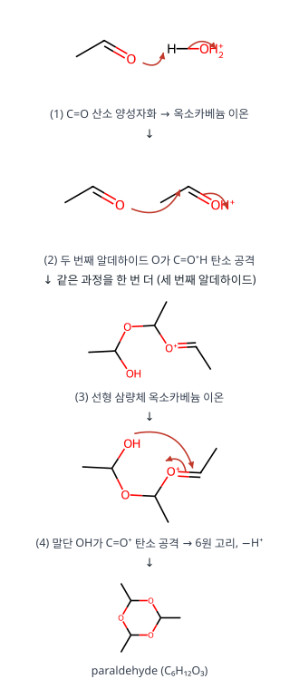

**검산.** 분자식 C₆H₁₂O₃ (RDKit 계산 일치), H 수 = 3(CH) + 9(CH₃) = 12 ✓

**채점 포인트·함정**

- 99 ppm은 C=O(>170)가 아니라 **산소 두 개가 붙은 아세탈 탄소**입니다.

## A형 4번 · 양쪽성 염 NaHA의 pH {#a4}

**정답** 질량 균형식 $F_{NaHA} = [\mathrm{H_2A}] + [\mathrm{HA^-}] + [\mathrm{A^{2-}}]$, $[\mathrm{H_3O^+}] = \sqrt{\dfrac{K_{a1}K_{a2}F_{NaHA} + K_{a1}K_w}{K_{a1} + F_{NaHA}}}$

**공식·핵심 개념**

- 질량 균형: $F = [H_2A] + [HA^-] + [A^{2-}]$
- 양성자 조건: $[H^+] + [H_2A] = [A^{2-}] + [OH^-]$
- 근사 $[H^+] \approx \sqrt{K_{a1}K_{a2}}$

**2027 출제 가능성 ★★★★☆ 높음** — 다양성자산과 양쪽성 화학종의 pH는 분석화학에서 자주 나옵니다.

**주어진 것 / 구할 것**

- $\mathrm{H_2A} \rightleftharpoons \mathrm{H^+ + HA^-}$ ($K_{a1}$), $\mathrm{HA^- \rightleftharpoons H^+ + A^{2-}}$ ($K_{a2}$), $K_w$, NaHA 초기 농도 $F_{NaHA}$
- 구할 것: 질량 균형식, $[\mathrm{H_3O^+}]$ 식

**풀이 전략.** HA⁻는 산(→A²⁻)과 염기(→H₂A) 역할을 동시에 하므로, **전하 균형 + 질량 균형**(또는 양성자 조건)을 세우고 모든 화학종을 $[\mathrm{H^+}]$와 $[\mathrm{HA^-}]$로 바꿉니다.

**단계별 풀이**

**1)** 질량 균형(A를 포함한 모든 화학종의 합 = 넣은 양), 그리고 Na⁺:

$$F_{NaHA} = [\mathrm{H_2A}] + [\mathrm{HA^-}] + [\mathrm{A^{2-}}], \qquad [\mathrm{Na^+}] = F_{NaHA}$$

**2)** 전하 균형: $[\mathrm{Na^+}] + [\mathrm{H^+}] = [\mathrm{HA^-}] + 2[\mathrm{A^{2-}}] + [\mathrm{OH^-}]$

**3)** 1에서 $[\mathrm{Na^+}]$ 자리에 질량 균형식을 넣고 정리(양성자 조건):

$$[\mathrm{H^+}] + [\mathrm{H_2A}] = [\mathrm{A^{2-}}] + [\mathrm{OH^-}]$$

**4)** 평형식으로 치환: $[\mathrm{H_2A}] = \dfrac{[\mathrm{H^+}][\mathrm{HA^-}]}{K_{a1}}$, $[\mathrm{A^{2-}}] = \dfrac{K_{a2}[\mathrm{HA^-}]}{[\mathrm{H^+}]}$, $[\mathrm{OH^-}] = \dfrac{K_w}{[\mathrm{H^+}]}$

$$[\mathrm{H^+}] + \frac{[\mathrm{H^+}][\mathrm{HA^-}]}{K_{a1}} = \frac{K_{a2}[\mathrm{HA^-}] + K_w}{[\mathrm{H^+}]}$$

**5)** 양변에 $K_{a1}[\mathrm{H^+}]$를 곱함:

$$[\mathrm{H^+}]^2\big(K_{a1} + [\mathrm{HA^-}]\big) = K_{a1}K_{a2}[\mathrm{HA^-}] + K_{a1}K_w$$

**6)** HA⁻는 산으로도 염기로도 약해서 대부분 그대로 남음 → $[\mathrm{HA^-}] \approx F_{NaHA}$:

$$[\mathrm{H_3O^+}] = \sqrt{\frac{K_{a1}K_{a2}F_{NaHA} + K_{a1}K_w}{K_{a1} + F_{NaHA}}}$$

**7)** 추가 근사: $F \gg K_{a1}$, $K_{a2}F \gg K_w$이면 $[\mathrm{H^+}] \approx \sqrt{K_{a1}K_{a2}}$ → $\mathrm{pH} = \tfrac12(\mathrm{p}K_{a1} + \mathrm{p}K_{a2})$ (농도와 무관)

**검산(숫자 예).** NaHCO₃ 0.10 M ($K_{a1} = 4.5\times10^{-7}$, $K_{a2} = 4.7\times10^{-11}$): 6의 식 → $[\mathrm{H^+}] = 4.60\times10^{-9}$ M, pH 8.34 / 7의 근사 → pH 8.34. 두 값이 일치하므로 근사가 타당합니다.

**채점 포인트·함정**

- 가정 $[\mathrm{HA^-}] \approx F$를 밝혀 써야 합니다.

## A형 5번 · POE 모형과 질량 보존 {#a5}

**정답**

- 타당하지 않은 것: 관찰 뒤 **곧바로 교사의 설명**이 이어진 부분. 수정안: 교사가 설명하기 전에 학생들이 **자신의 예상과 관찰 결과를 비교**해 의견을 교환하고 발표하게 한다.
- ㉠ 가설: **화학 반응이 일어날 때 물질의 총질량은 변하지 않는다.**
- ㉡ 결과: 부피(양)가 달라져도 **반응 전후 총질량은 변하지 않는다.**
- POE의 장점: 예측과 그 근거를 쓰는 과정에서 선개념이 드러나고, 예측과 다른 관찰 결과가 나올 때 흥미와 인지 갈등을 유발한다.

**공식·핵심 개념**

- POE: 예상(이유 포함) → 관찰 → 설명(예상과 관찰 비교, 학생이 먼저)
- 질량 보존: 원자의 종류·수 불변

**2027 출제 가능성 ★★★★★ 매우 높음** — POE·개념 변화 수업 모형은 1회·6회에 모두 나왔을 만큼 핵심입니다.

**POE의 설명(Explain) 단계**는 학생이 먼저 예상과 관찰의 차이를 스스로 설명해 보는 단계입니다. 교사가 바로 답을 주면 학생의 인지 갈등이 해소되지 않아 "잘 모르겠는데 신기해요"라는 반응이 나옵니다.

**과학 내용.** NaCl + AgNO₃ → AgCl(앙금) + NaNO₃. 원자는 재배열될 뿐 종류와 수가 보존되므로 총질량은 같습니다. 양을 5 mL로 줄여도 마찬가지입니다.

**채점 포인트·함정**

- 가설은 "~이면 ~이다" 형태의 검증 가능한 진술로 씁니다.

## A형 6번 · 2022 개정 「물질」 영역 내용 체계 {#a6}

**정답** ㉠ **화학반응의 규칙성**, ㉡ **물질의 변화**, ㉢ **화학반응의 규칙성**(단원명), ㉣ **입자수의 비**

**공식·핵심 개념**

- 2022 개정 중학교 「물질」 영역 단원 구성
- 지식·이해 범주: 물질의 변화
- 계수비 = 입자수의 비(중학교)

**2027 출제 가능성 ★★★★★ 매우 높음** — 2015 ↔ 2022 개정 비교는 2027 교육과정 문항의 최우선 소재입니다.

**㉠·㉡.** 핵심 아이디어의 "화학반응을 통해 물질은 다른 물질로 변하며, (화학반응의 규칙성)은 새로운 물질의 생성 원리가 된다." 지식·이해의 범주는 화학 변화, 화학 반응식, 질량 보존·일정 성분비·기체 반응 법칙을 묶는 **물질의 변화**입니다.

**㉣.** 2015 개정은 화학 반응식 계수비를 "입자 수의 비"로 해석하며, 2022 개정도 같습니다(몰 개념은 고등학교).

**채점 포인트·함정**

- 중학교에서는 계수비를 **몰비가 아니라 입자수의 비**로 다룹니다.

## A형 7번 · 비고츠키의 ZPD와 쿤의 변칙 사례 {#a7}

**정답**

- 실제적 발달 수준: 모든 촉매는 반응속도를 빠르게 한다. 잠재적 발달 수준: 정촉매는 반응속도를 빠르게, 부촉매는 느리게 한다.
- ㉠ 시범실험의 역할: **비계 설정**
- 변칙 사례: 부촉매(인산)를 넣었을 때 반응이 느려지는 실험 결과 — 가영이의 "모든 촉매는 반응을 빠르게 한다"는 생각으로 설명되지 않는 현상이다.
- ㉡ 부촉매는 반응의 **활성화 에너지를 높이기** 때문에 (㉢ 활성화 에너지)

**공식·핵심 개념**

- 비고츠키: 실제적·잠재적 발달 수준, ZPD, 비계
- 쿤: 정상과학, 변칙 사례, 위기, 패러다임 전환
- 부촉매: 활성화 에너지↑ → 속도↓

**2027 출제 가능성 ★★★★★ 매우 높음** — 비고츠키와 과학철학자를 엮는 문항은 화학교육론 단골입니다.

**비고츠키.** 실제적 발달 수준 = 혼자 해결할 수 있는 수준(자료 1의 응답), 잠재적 발달 수준 = 교사 도움으로 도달하는 수준(대화 끝의 깨달음). 그 사이가 ZPD이고, 시범실험은 이를 건너게 하는 비계입니다.

**쿤.** 정상과학의 패러다임으로 설명되지 않는 현상이 변칙 사례이고, 쌓이면 위기 → 과학 혁명(패러다임 전환)으로 이어집니다.

**채점 포인트·함정**

- ㉡에는 자료 3 내용 요소 **활성화 에너지**라는 용어를 꼭 넣습니다.

## A형 8번 · 구면 회전자와 진동-회전 스펙트럼 {#a8}

**정답** $l = 3$: 축퇴도 **7**, $|L| = \sqrt{12}\hbar = 2\sqrt3\hbar$, $L_z = 0, \pm\hbar, \pm2\hbar, \pm3\hbar$. $\tilde B_0 = 6.42\ \mathrm{cm^{-1}}$, $\tilde B_1 = 6.26\ \mathrm{cm^{-1}}$

**공식·핵심 개념**

- 구면 회전자: 축퇴도 $2l + 1$, $|L| = \sqrt{l(l+1)}\hbar$, $L_z = m_l\hbar$
- 결합차: $R(J-1) - P(J+1) = 4\tilde B_0(J + \tfrac12)$, $R(J) - P(J) = 4\tilde B_1(J + \tfrac12)$

**2027 출제 가능성 ★★★★☆ 높음** — 진동-회전 스펙트럼 해석은 물리화학 서술형으로 자주 나옵니다.

**주어진 것 / 구할 것**

- 구면 회전자 모형(I 고정, H가 회전), $l = 3$ / 진동-회전 선: R(0) 2242.08, R(1) 2254.26, P(1) 2216.72, P(2) 2203.54 cm⁻¹
- 구할 것: 축퇴도, $|L|$, $L_z$, $\tilde B_0$, $\tilde B_1$ (유효숫자 3자리)

**풀이 전략.** (1) 구면 조화함수의 양자수 성질을 그대로 씁니다. (2) **결합차(combination difference)**: 위 준위가 같은 두 선의 차는 아래 상태 $\tilde B_0$만, 아래 준위가 같은 두 선의 차는 위 상태 $\tilde B_1$만 남깁니다.

**단계별 풀이 ① 구면 회전자**

- 에너지 $E_l = \dfrac{l(l+1)\hbar^2}{2I}$, $m_l = -l, \dots, +l$ → 축퇴도 $2l + 1 = 2(3) + 1 = 7$
- $|L| = \sqrt{l(l+1)}\,\hbar = \sqrt{3 \times 4}\,\hbar = \sqrt{12}\,\hbar = 2\sqrt3\,\hbar$
- $L_z = m_l\hbar = 0, \pm\hbar, \pm2\hbar, \pm3\hbar$ (7개)

**단계별 풀이 ② 선 위치 식 세우기** ($v = 0 \to 1$, $\tilde\nu_0$ = 밴드 중심)

$$R(J) = \tilde\nu_0 + \tilde B_1(J+1)(J+2) - \tilde B_0J(J+1) \quad (J \to J+1)$$

$$P(J) = \tilde\nu_0 + \tilde B_1(J-1)J - \tilde B_0J(J+1) \quad (J \to J-1)$$

**③ $\tilde B_0$: 같은 위 준위(J′ = J)로 가는 R(J−1)과 P(J+1)**

$$R(J-1) - P(J+1) = \tilde B_0[(J+1)(J+2) - (J-1)J] = \tilde B_0(4J + 2)$$

J = 1 (R(0)와 P(2) 모두 J′ = 1로 감):

$$2242.08 - 2203.54 = 38.54 = 6\tilde B_0 \Rightarrow \tilde B_0 = 6.423 \approx 6.42\ \mathrm{cm^{-1}}$$

**④ $\tilde B_1$: 같은 아래 준위(J″ = J)에서 출발하는 R(J)와 P(J)**

$$R(J) - P(J) = \tilde B_1[(J+1)(J+2) - (J-1)J] = \tilde B_1(4J + 2)$$

J = 1:

$$2254.26 - 2216.72 = 37.54 = 6\tilde B_1 \Rightarrow \tilde B_1 = 6.257 \approx 6.26\ \mathrm{cm^{-1}}$$

**해석.** $\tilde B \propto 1/I = 1/(\mu r^2)$이고 $\tilde B_1 < \tilde B_0$ → 들뜬 진동 상태의 평균 결합 길이가 더 깁니다(비조화성). $\tilde B_e$와 진동-회전 상호작용 상수: $\tilde B_v = \tilde B_e - \alpha(v + \tfrac12)$ → $\alpha = \tilde B_0 - \tilde B_1 = 0.17\ \mathrm{cm^{-1}}$.

**검산.** 밴드 중심 $\tilde\nu_0 = R(0) - 2\tilde B_1 = 2242.08 - 12.51 = 2229.57$, $P(1) + 2\tilde B_0 = 2216.72 + 12.85 = 2229.57$ cm⁻¹ — 두 길로 같은 값 ✓

**채점 포인트·함정**

- 어느 차가 B₀, 어느 차가 B₁인지(공통 준위가 위냐 아래냐) 헷갈리기 쉽습니다.

## A형 9번 · 선형 CH₂의 MO와 Walsh 도표 {#a9}

**정답**

- 1σg: C 2s + 두 H 1s(같은 부호), 1σu: C 2pz + 두 H 1s(반대 부호)
- HOMO: **1πu = C 2px, 2py**(비결합)
- 선형이라면 CH₂(1σg²1σu²1πu²)와 ⁻CH₂(1σg²1σu²1πu³)의 결합 길이는 **거의 같다** — 추가 전자가 비결합 1πu에 들어가 결합 차수가 변하지 않음.
- ⁻CH₂(원자가 전자 7개)는 **굽은형**: 굽으면 1πu에서 나온 2a₁이 크게 안정화되므로 1a₁²2a₁²1b₂²1b₁¹ 배치의 굽은 구조가 더 낮은 에너지.

**공식·핵심 개념**

- 선형 XH₂: 1σg, 1σu(결합), 1πu(비결합)
- Walsh: 굽힐수록 1πu → 2a₁ 크게 안정화
- 원자가 전자 4개 이하 선형, 5개 이상 굽은형

**2027 출제 가능성 ★★★☆☆ 보통** — Walsh 도표는 가끔 나오는 고급 소재입니다. H₂O·BeH₂ 비교 형태로 대비하세요.

**주어진 것 / 구할 것**

- 그림 1: 선형 CH₂의 MO(1σg, 1σu, 1πu, 2σg, 2σu), 그림 2: XH₂ Walsh 도표($p_z$ = 분자 축 방향)
- 구할 것: 1σg·1σu의 오비탈 겹침, HOMO, 선형 가정 시 CH₂와 ⁻CH₂ 결합 길이 비교, ⁻CH₂의 모양

**풀이 전략.** D∞h에서 C 원자 오비탈과 H 1s 군 궤도함수(같은 부호 σg, 반대 부호 σu)를 대칭이 같은 것끼리 짝지은 뒤, 전자 수(원자가 전자)를 채워 HOMO와 결합 차수를 판단하고, Walsh 도표에서 굽힐 때 점유 MO 에너지의 합이 어떻게 변하는지 봅니다.

**단계별 풀이 ① MO 구성**

| MO | C 오비탈 | H 군 궤도 ($\phi_1 \pm \phi_2$) | 성격 |
|---|---|---|---|
| 1σg | 2s | $\phi_1 + \phi_2$ (같은 부호) | 결합성 |
| 1σu | 2pz | $\phi_1 - \phi_2$ (반대 부호, pz 로브 부호와 맞춤) | 결합성 |
| 1πu | 2px, 2py | 맞는 군 궤도 없음 | **비결합** |
| 2σg, 2σu | 2s, 2pz | 반대 위상 | 반결합성 |

**② 전자 배치**

- CH₂: 원자가 전자 C 4 + H 2 = 6 → $1\sigma_g^2\,1\sigma_u^2\,1\pi_u^2$, HOMO = **1πu (C 2px, 2py)**
- ⁻CH₂: 7개 → $1\sigma_g^2\,1\sigma_u^2\,1\pi_u^3$

**③ 결합 길이(선형 가정).** 결합 차수 = ½(결합성 전자 − 반결합성 전자) = ½(4 − 0) = 2 (두 C–H에 나누면 각 1). 추가 전자는 **비결합 1πu**에 들어가므로 결합 차수 변화 없음 → 결합 길이 **거의 같음**(전자 반발로 아주 조금 늘어날 수는 있음).

**④ Walsh 도표로 모양 예측.** 180° → 90°로 굽힐 때:

| 선형 MO | 굽은형 MO | 에너지 변화 | 이유 |
|---|---|---|---|
| 1σg | 1a₁ | 조금 ↓ | H 1s끼리 가까워져 겹침 증가 |
| 1σu | 1b₂ | ↑ | p 로브와 H 겹침 감소 |
| 1πu (평면 안 성분) | 2a₁ | **크게 ↓** | 굽으면 H 1s, C 2s와 섞여 결합성이 됨 |
| 1πu (평면 수직 성분) | 1b₁ | 변화 없음 | H와 겹칠 수 없음 |

⁻CH₂ 굽은형 배치: $1a_1^2\,1b_2^2\,2a_1^2\,1b_1^1$. 1b₂ 상승(전자 2개)보다 2a₁의 큰 하강(전자 2개)이 커서 전체 에너지가 낮아짐 → **굽은형**. 같은 7전자 분자 NH₂(약 103°)와 일치합니다.

**검산.** 전자 수 기준 경향: 4개(BeH₂) 선형 / 5개 이상 2a₁이 채워지기 시작 → 굽은형.

**채점 포인트·함정**

- 1σg 그림은 세 원자 모두 같은 부호, 1σu는 C의 pz 로브 부호가 양쪽 H와 맞도록 그립니다.

## A형 10번 · 에폭사이드의 산·염기 개환 {#a10}

**정답** A: ¹⁸OH가 **3차 탄소**에, B: ¹⁸OH가 **1차 탄소(CH₂)**에 붙은 2-methylbutane-1,2-diol

**공식·핵심 개념**

- 산 촉매 개환: 더 치환된 탄소 공격(SN1 성격), anti
- 염기 개환: 덜 치환된 탄소 공격(SN2)
- 동위원소 표지로 공격 위치 추적

**2027 출제 가능성 ★★★★★ 매우 높음** — 에폭사이드 개환의 위치·입체 선택성은 유기에서 매우 자주 나옵니다.

**주어진 것 / 구할 것**

- 출발물: 2-ethyl-2-methyloxirane (C2 = 3차 탄소, 입체중심 / C1 = CH₂)
- 반응 1: H₃¹⁸O⁺ (산 촉매), 반응 2: Na¹⁸OH / H₂¹⁸O 후 H₂O
- 구할 것: A, B 구조와 위치·입체 선택성의 이유

**풀이 전략.** 친핵체가 **어느 탄소**를 공격하는지 정하는 요인이 조건마다 다릅니다. 산성에서는 양성자화된 에폭사이드의 C–O가 늘어나며 **양전하를 더 잘 버티는 탄소**(전자적 요인)가, 염기성에서는 **입체 장애가 작은 탄소**(SN2)가 공격받습니다. ¹⁸O가 붙은 위치로 이것을 확인합니다.

**단계별 풀이 ① 반응 1 (산 촉매, A)**

**1)** 에폭사이드 O가 H₃¹⁸O⁺의 H⁺를 받아 옥소늄 이온이 됩니다(빠른 평형).

**2)** C2–O 결합이 C1–O보다 많이 늘어난 비대칭 전이 상태: C2에 δ+가 크게 쌓이고 3차라 초공액·유발 효과로 안정화(SN1 성격).

**3)** H₂¹⁸O가 C2를 **고리 산소의 반대쪽(뒷면)**에서 공격 → C2 배열 **반전**.

**4)** 생성된 ¹⁸OH₂⁺에서 물이 H⁺를 가져가 중성 다이올.

→ **A**: HOCH₂–C(CH₃)(¹⁸OH)–CH₂CH₃ (¹⁸O가 3차 탄소)

**② 반응 2 (염기, B)**

**1)** ¹⁸OH⁻(강한 친핵체, 이탈기 활성화 없음)가 고리를 SN2로 엽니다. 3차 C2는 막혀 있어 **CH₂(C1)**를 뒷면 공격.

**2)** 고리가 열리며 C2에 알콕사이드(O⁻)가 남음 — 이 O는 원래 에폭사이드 O(¹⁶O).

**3)** H₂O가 알콕사이드를 양성자화.

→ **B**: H¹⁸OCH₂–C(CH₃)(OH)–CH₂CH₃ (¹⁸O가 1차 탄소)

**③ 입체화학**

| | 공격 탄소 | 입체중심(C2)의 배열 | 예 |
|---|---|---|---|
| A | C2 (입체중심 자체) | **반전** | (R)-에폭사이드 → (S)-다이올 계열* |
| B | C1 (입체중심 아님) | **유지** | C2의 C–O 결합이 끊어지지 않음 |

\*CIP 순위가 바뀔 수 있으므로 "R/S 기호"보다 "공간 배열의 반전"으로 쓰는 것이 안전합니다. 출발물이 라셈이면 생성물도 라셈입니다.

**메커니즘 — 반응 1: 산 촉매 개환 (A)**

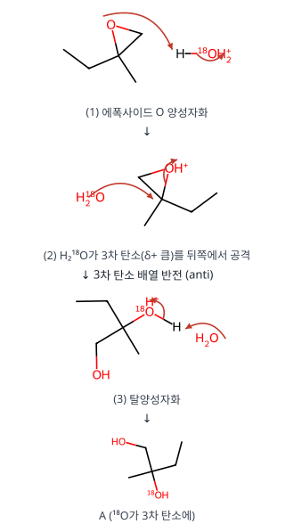

**메커니즘 — 반응 2: 염기 개환 (B)**

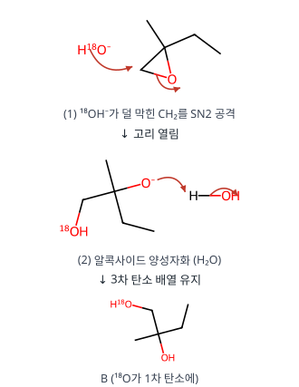

**왜 이 생성물인가.** A와 B는 분자식·골격이 같고 ¹⁸O 위치만 다른 동위원소 이성질체입니다. 산성에서는 "더 치환된 탄소 = 더 안정한 부분 양전하", 염기성에서는 "덜 치환된 탄소 = 접근이 쉬움"이 결정 요인입니다.

**검산.** 두 생성물 모두 C₅H₁₂O₂(2-methylbutane-1,2-diol) ✓

**채점 포인트·함정**

- 위치 선택성의 근거(산: 탄소양이온 성격, 염기: 입체 장애)를 각각 씁니다.

## A형 11번 · 방향족 짝염기와 산도 {#a11}

**정답** 구조 1: **B**가 더 산성, 구조 2: **D**가 가장 산성

**공식·핵심 개념**

- 짝염기의 안정성 ↑ → 산도 ↑
- Cp⁻: 6π 방향족(Hückel 4n+2)
- 풀벤의 메틸 H 제거 → 방향족 음이온

**2027 출제 가능성 ★★★★☆ 높음** — 방향족성과 산도 비교는 유기 기입형의 단골입니다.

**주어진 것 / 구할 것**

- 구조 1: A (phenylcyclopentane, 표시된 H는 sp³ C–H), B (5-phenylcyclopenta-1,3-diene, 표시된 H는 sp³ C5–H)
- 구조 2: C, D, E, F (C=C 3개를 가진 C₉ 탄화수소, 각 표시된 H)
- 구할 것: 더(가장) 산성인 것과 이유

**풀이 전략.** 산도는 **짝염기(탄소음이온)의 안정성**으로 판단합니다. 음전하가 π계로 비편재화되고, 특히 그 결과 **고리가 6π 방향족(4n+2, n = 1)**이 되면 짝염기가 크게 안정해집니다.

**단계별 풀이 ① 구조 1**

| 산 | H를 뗀 뒤 | 안정화 | pKa(대략) |
|---|---|---|---|
| A | 포화 고리의 2차 탄소음이온 (sp³, 국소화) | 거의 없음 | ~50 |
| B | C5에 음전하 → 고리의 두 C=C와 콘쥬게이션 → 다섯 탄소 모두 sp², 6π 전자 | **방향족 Cp⁻** | ~16 |

Hückel 판정: 고리(5원) · 평면 · 완전 콘쥬게이션(5개 p 오비탈) · π전자 = C=C 2개(4) + 음전하 1쌍(2) = **6** → 방향족 → **B가 더 산성**.

**② 구조 2** — 표시된 H를 뗐을 때 음전하가 고리로 가서 Cp⁻가 될 수 있는지 봅니다.

| 산 | 표시된 H의 위치 | 짝염기 | 판정 |
|---|---|---|---|
| C | 이소프로필 CH₃ (sp³ CH에 붙음) | π계와 콘쥬게이션 안 됨 → 국소화 1차 탄소음이온 | 약함 |
| **D** | 고리 밖 C=C에 붙은 CH₃ (알릴 위치) | CH₂⁻ → C=C 이동 → **고리 탄소에 음전하**, 고리에 C=C 2개 → **6π Cp⁻** | **가장 산성** |
| E | 이소프로필 CH₃ | C와 같은 이유로 국소화 | 약함 |
| F | 고리 밖 C=C의 CH₃ | 알릴 음이온으로 비편재화되지만 고리에 sp³ CH₂가 있어 고리 전체 콘쥬게이션 불가 → 방향족 아님 | 중간 |

**③ D의 공명(음전하 이동)**: H⁺ 제거 → [⁻CH₂–C(CH₃)=C(고리)] ↔ [CH₂=C(CH₃)–C⁻(고리)] → 고리 음전하가 다섯 탄소에 퍼짐(Cp⁻ 공명구조 5개).

**메커니즘 — 구조 1: B의 탈양성자화**

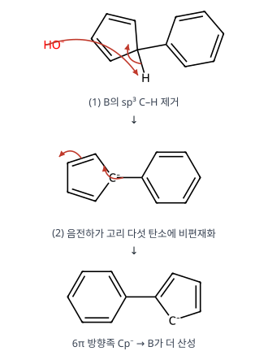

**메커니즘 — 구조 2: D의 탈양성자화**

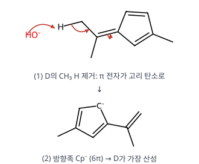

**왜 이 답인가.** "π계와 콘쥬게이션" 만으로는 부족하고(F), **고리의 다섯 탄소가 모두 sp²가 되어 6π가 완성**되어야 방향족 안정화(약 20 kcal/mol 이상)를 얻습니다. 그 조건을 만족하는 짝염기가 B와 D뿐입니다.

**검산.** Cp⁻ π전자 수: 5개 탄소 × 1 + 음전하 1 = 6 ✓

**채점 포인트·함정**

- 이유는 "짝염기가 방향족(4n+2 = 6π)이라 안정"으로 씁니다.

## A형 12번 · 요오드 적정으로 CO 정량 {#a12}

**정답** ① $\mathrm{I_2O_5(s) + 5CO(g) \to I_2 + 5CO_2}$, ② $\mathrm{I_2 + 2S_2O_3^{2-} \to S_4O_6^{2-} + 2I^-}$, CO **0.42 mg/L**, $K = 10^{2(b-c)/0.060} = 10^{(b-c)/0.030}$

**공식·핵심 개념**

- 역적정: 반응한 양 = 넣은 양 − 남은 양
- $\mathrm{I_2 + 2S_2O_3^{2-} \to S_4O_6^{2-} + 2I^-}$
- $\log K = \dfrac{nE^\circ}{0.0600}$

**2027 출제 가능성 ★★★★☆ 높음** — 요오드 적정과 표준 전위로 K 구하기는 분석화학 고빈도 소재입니다.

**주어진 것 / 구할 것**

- 기체 10 L, I₂O₅와 반응(CO → CO₂, I₂O₅ → I₂), I₂를 Na₂S₂O₃ 0.01 M × 10 mL에 흡수
- 과량 S₂O₃²⁻를 0.01 M I₂ 2.0 mL로 역적정, CO 몰질량 28
- 표준 전위: I₂(s)/I⁻ = a, I₂(aq)/I⁻ = b, I₃⁻/I⁻ = c, $2.303RT/F = 0.0600$ V
- 구할 것: 반응식 ①·②, CO 농도(mg/L), $\mathrm{I_2(aq) + I^- \rightleftharpoons I_3^-}$의 K

**풀이 전략.** ① 산화수 변화로 반응식을 맞추고, ② 역적정이므로 "넣은 S₂O₃²⁻ − 과량 = 시료 I₂와 반응한 양"을 구한 뒤 계수비를 두 번 거쳐 CO로 갑니다. K는 두 반쪽 반응을 빼서 만든 전체 반응의 $E^\circ$로 구합니다.

**단계별 풀이 ① 반응식(산화수법)**

- I: +5 → 0 (I 1개당 5e⁻ 얻음, I₂O₅ 1개당 10e⁻), C: +2 → +4 (CO 1개당 2e⁻ 잃음) → CO 5개

$$\mathrm{I_2O_5(s) + 5CO(g) \rightarrow I_2(g) + 5CO_2(g)}$$

- S: +2 → +2.5 (S₂O₃²⁻ 1개당 1e⁻ 잃음), I: 0 → −1 (I₂ 1개당 2e⁻ 얻음)

$$\mathrm{I_2 + 2S_2O_3^{2-} \rightarrow 2I^- + S_4O_6^{2-}}$$

**② CO 정량**

| 단계 | 계산 | 결과 |
|---|---|---|
| 넣은 S₂O₃²⁻ | $0.01\ \mathrm{mol/L} \times 10\ \mathrm{mL}$ | 0.10 mmol |
| 역적정 I₂ | $0.01 \times 2.0$ | 0.020 mmol |
| 그 I₂가 소비한 과량 S₂O₃²⁻ | $0.020 \times 2$ | 0.040 mmol |
| 시료 I₂와 반응한 S₂O₃²⁻ | $0.10 - 0.040$ | 0.060 mmol |
| 시료 I₂ | $0.060 \div 2$ | 0.030 mmol |
| CO | $0.030 \times 5$ | 0.15 mmol |
| CO 질량 | $0.15\ \mathrm{mmol} \times 28\ \mathrm{mg/mmol}$ | 4.2 mg |
| 농도 | $4.2\ \mathrm{mg} \div 10\ \mathrm{L}$ | **0.42 mg/L** |

**③ 평형 상수**

$$\begin{aligned}
&\mathrm{I_2(aq) + 2e^- \rightarrow 2I^-} && E^\circ = b \\
-&(\mathrm{I_3^- + 2e^- \rightarrow 3I^-}) && E^\circ = c \\
\hline
&\mathrm{I_2(aq) + I^- \rightarrow I_3^-} && E^\circ_{전체} = b - c,\ n = 2
\end{aligned}$$

$$\Delta G^\circ = -nFE^\circ = -RT\ln K \Rightarrow \log K = \frac{nE^\circ}{2.303RT/F} = \frac{2(b-c)}{0.0600}$$

$$K = 10^{\frac{2(b-c)}{0.0600}} = 10^{\frac{b-c}{0.0300}}$$

(a는 고체 I₂에 대한 값이라 이 수용액 반응에는 쓰지 않습니다.)

**검산.** 전자 수 보존: CO 0.15 mmol × 2e⁻ = 0.30 mmol e⁻ = I₂ 0.030 mmol을 만들기 위해 I(+5)가 받은 전자 0.030 × 10 = 0.30 mmol ✓

**채점 포인트·함정**

- CO 5분자당 I₂ 1분자, I₂ 1분자당 S₂O₃²⁻ 2개 — 계수비를 두 번 거칩니다.

# 전공 B

## B형 1번 · 피롤의 니트로화 위치 선택성 {#b1}

**정답** C **2-nitropyrrole**(주), D **3-nitropyrrole**(부). C2 공격 중간체 A는 공명구조 **3개**, C3 공격 중간체 B는 **2개**라 A가 더 안정하다.

**공식·핵심 개념**

- 친전자성 방향족 치환: σ 착물 안정성이 위치 결정
- 피롤: C2 공격 공명구조 3개 > C3 공격 2개
- 피리딘은 반대로 C3 선호

**2027 출제 가능성 ★★★★☆ 높음** — 헤테로고리 방향족 치환의 위치 선택성은 유기에서 자주 나옵니다.

**주어진 것 / 구할 것**

- 피롤 + HNO₃/H₂SO₄ → 중간체 A → C(주), 중간체 B → D(부)
- 구할 것: C, D 구조, A와 B의 공명구조로 이유 설명

**풀이 전략.** 친전자성 방향족 치환(SEAr)의 속도 결정 단계는 σ 착물(아레늄 이온) 생성입니다. Hammond 가설에 따라 **더 안정한 σ 착물 → 더 낮은 전이 상태 → 더 빠른 경로 → 주생성물**. σ 착물의 안정성은 **양전하를 나누는 공명구조의 수와 질(옥텟 만족 여부)**로 비교합니다.

**단계별 풀이**

**1)** 친전자체 생성: $\mathrm{HNO_3 + H_2SO_4 \rightleftharpoons H_2NO_3^+ + HSO_4^-}$, $\mathrm{H_2NO_3^+ \rightarrow NO_2^+ + H_2O}$

**2)** 피롤의 π전자(N 비공유 전자쌍 포함 6π)가 NO₂⁺를 공격 — C2 또는 C3.

**3)** σ 착물의 공명구조

| 중간체 | 공격 위치 | 양전하가 놓이는 원자 | 공명구조 수 | 특징 |
|---|---|---|---|---|
| **A** | C2 | C3, C5, **N** | **3** | N⁺ 구조는 모든 원자가 옥텟 → 가장 큰 기여 |
| B | C3 | C2, **N** | 2 | 비편재화 범위가 좁음 |

**4)** 탈양성자화(HSO₄⁻ 또는 H₂O가 sp³ C–H의 H⁺를 가져감) → 방향족성 회복.

→ **C = 2-nitropyrrole(주)**, **D = 3-nitropyrrole(부)**

**메커니즘 — 나이트로늄 이온 생성**

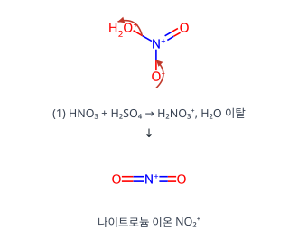

**메커니즘 — C2 공격 → C (주): 중간체 A의 공명구조 3개**

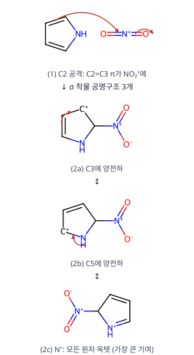

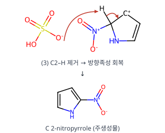

**메커니즘 — C3 공격 → D (부): 중간체 B의 공명구조 2개**

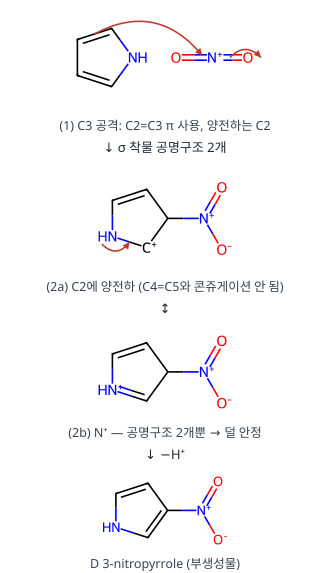

**왜 이 생성물인가.** C2 공격 중간체는 양전하가 고리를 따라 C3 → C5까지 이어지는 "선형 알릴" 비편재화에 N⁺ 구조까지 더해지고, C3 공격 중간체는 양전하가 C2와 N에만 갈 수 있습니다. 같은 이유로 퓨란·싸이오펜도 2-치환이 우세합니다. (피리딘은 N이 전자를 끌어당겨 반대로 C3 치환)

**검산.** C, D 모두 C₄H₄N₂O₂ (피롤 C₄H₅N에서 H 하나를 NO₂로) ✓

**채점 포인트·함정**

- 공명구조를 그릴 때 N의 비공유 전자쌍이 참여하는 구조를 빠뜨리지 않습니다.

## B형 2번 · 수산화물 선택적 침전 {#b2}

**정답** 분리 **가능**. $3.0\times10^{-12} \le [\mathrm{OH^-}] < 8.0\times10^{-6}$ M

**공식·핵심 개념**

- 선택적 침전: 먼저 침전되는 이온 99.9 % 제거 시점의 [OH⁻]
- 두 번째 이온의 Q < Ksp 확인
- 상한: 두 번째 이온 침전 시작 농도

**2027 출제 가능성 ★★★★☆ 높음** — Ksp를 이용한 분별 침전은 분석화학 기입형의 대표 소재입니다.

**주어진 것 / 구할 것**

- [Fe³⁺] = [Mg²⁺] = 0.10 M, $K_{sp}(\mathrm{Fe(OH)_3}) = 2.7\times10^{-39}$, $K_{sp}(\mathrm{Mg(OH)_2}) = 6.4\times10^{-12}$
- "정량적 분리" = 먼저 침전되는 이온이 처음의 1/1000만 남을 때까지 침전시키는 동안 다른 이온은 전혀 침전되지 않을 것
- 구할 것: 분리 가능 여부, 허용 [OH⁻] 범위

**풀이 전략.** 각 이온이 침전을 **시작**하는 [OH⁻]와 Fe³⁺가 **99.9 % 제거**되는 [OH⁻]를 구해 비교합니다. Fe가 다 빠질 때까지 Mg가 Q < Ksp이면 분리 가능.

**단계별 풀이**

**1)** 침전 시작 [OH⁻] (어느 쪽이 먼저인지 확인)

- Fe³⁺: $[\mathrm{OH^-}] = \left(\dfrac{2.7\times10^{-39}}{0.10}\right)^{1/3} = (2.7\times10^{-38})^{1/3} = 3.0\times10^{-13}$ M
- Mg²⁺: $[\mathrm{OH^-}] = \left(\dfrac{6.4\times10^{-12}}{0.10}\right)^{1/2} = (6.4\times10^{-11})^{1/2} = 8.0\times10^{-6}$ M

→ Fe(OH)₃가 훨씬 먼저 침전.

**2)** Fe³⁺ 99.9 % 제거 시점: 남은 $[\mathrm{Fe^{3+}}] = 0.10 \times \dfrac{1}{1000} = 1.0\times10^{-4}$ M

$$[\mathrm{OH^-}]^3 = \frac{2.7\times10^{-39}}{1.0\times10^{-4}} = 2.7\times10^{-35} \Rightarrow [\mathrm{OH^-}] = 3.0\times10^{-12}\ \mathrm{M}$$

**3)** 그때 Mg²⁺의 이온곱: $Q = (0.10)(3.0\times10^{-12})^2 = 9.0\times10^{-25} \ll 6.4\times10^{-12}$ → Mg(OH)₂ 침전 없음 → **분리 가능**.

**4)** 허용 범위: 하한 = Fe 99.9 % 제거($3.0\times10^{-12}$ M), 상한 = Mg 침전 시작($8.0\times10^{-6}$ M)

$$3.0\times10^{-12}\ \mathrm{M} \le [\mathrm{OH^-}] < 8.0\times10^{-6}\ \mathrm{M}$$

pH로 바꾸면 (pOH 11.52 ~ 5.10) **pH 2.48 ~ 8.90**.

**검산.** 하한/상한 비 ≈ 2.7×10⁶ — 범위가 매우 넓어 완충 용액(예: 아세트산 완충, pH ≈ 4~5)으로 쉽게 맞출 수 있습니다.

**채점 포인트·함정**

- "1/1000을 제외하고"는 **남은 농도가 처음의 1/1000**이라는 뜻입니다.

## B형 3번 · 오수벨의 상위적 학습과 선행조직자 {#b3}

**정답**

- ㉠ **상위적 학습**: 하위 개념(끓는점·밀도차·재결정·크로마토그래피를 이용한 분리)을 먼저 배운 뒤 더 포괄적인 상위 개념 '물질의 특성을 이용한 혼합물 분리'로 묶기 때문. 수업 원리: **통합적 조정**.
- ㉡ **비교 선행조직자**: 친숙한 내용(신선한·오래된 달걀이 소금물에 뜨는 영상)으로 달걀 신선도를 추리하게 해, 인지구조 속 관련 개념과 새 학습 과제를 잇는 인지적 다리 역할을 한다.

**공식·핵심 개념**

- 상위적 학습 ↔ 통합적 조정, 하위적 학습 ↔ 점진적 분화
- 선행조직자: 설명 / 비교

**2027 출제 가능성 ★★★★★ 매우 높음** — 오수벨 이론은 화학교육론 최빈출 소재입니다.

| 오수벨 개념 | 의미 |
|---|---|
| 하위적(포섭) 학습 | 새 개념이 더 포괄적인 기존 개념 아래로 — 점진적 분화 |
| 상위적 학습 | 기존 하위 개념들을 새 상위 개념으로 묶음 — 통합적 조정 |
| 설명 선행조직자 | 학습자가 모르는 새 내용의 개념 틀 제시 |
| 비교 선행조직자 | 친숙한 내용과 비교해 새 내용과의 유사·차이 제시 |

**채점 포인트·함정**

- 상위적 학습 ↔ 통합적 조정, 하위적 학습 ↔ 점진적 분화를 짝지어 기억합니다.

## B형 4번 · 드라이버 모형과 POE {#b4}

**정답**

- ②: 포스너의 **기존 개념에 대한 불만족**
- ④: 파인즈와 웨스트의 **일치 상황(조화 상황)**
- ㉠ 예상: 물을 기화시키는 실험에서 질량이 어떻게 변할지 예상하고 그 이유를 탐구 활동지에 쓰게 한다.
- ㉡ 설명: 질량이 변하지 않는 관찰 결과와 처음 예상을 비교하게 하고, 예상이 틀렸다면 이유를 생각해 토의하게 하여 상태가 변해도 질량이 보존됨을 이해하게 한다.

**공식·핵심 개념**

- 드라이버: 오리엔테이션 → 생각의 표현 → 재구성(명료화·교환, 상충 상황 노출, 새 생각 구성, 평가) → 적용 → 검토
- 포스너 4조건 / 파인즈·웨스트 4상황

**2027 출제 가능성 ★★★★★ 매우 높음** — 개념 변화 모형을 여러 학자와 묶는 문항은 매년 나옵니다.

**포스너의 개념 변화 조건**: 불만족 → 이해 가능성 → 그럴듯함 → 유용성. ②는 생각과 다른 결과에 의문을 갖는 단계입니다.

**파인즈·웨스트 포도덩굴 모형**: 자발적 지식(학생의 일상 개념)과 학교 지식이 만나는 4가지 상황 — **일치(조화)**, 갈등, 자발적 지식만 있음, 학교 지식만 있음. ④에서는 새로 구성한 생각과 학교에서 배운 과학 지식이 같아졌습니다.

## B형 5번 · Jigsaw 모형 {#b5}

**정답**

- ㉠ **기체의 압력**
- Jigsaw가 적합한 이유: 학습 내용을 4개 주제로 **나눌 수 있고**, 각자 맡은 부분을 완수하는 **개별적 책무성**과 과제 완수를 위한 **상호 의존성·협동심**을 높일 수 있기 때문.
- ㉢ 전문가 집단에서 학습한 학생이 원 소속 모둠으로 돌아와 **동료들을 가르치고**, 토의로 함께 과제를 해결한다.
- 비고츠키: 근접발달영역 안에서 전문가(동료)와의 **언어적·사회적 상호작용**으로 인지 발달을 촉진하고, 실제적 발달 수준을 잠재적 발달 수준으로 끌어올리는 의미가 있다.

**공식·핵심 개념**

- Jigsaw: 주제 분담 → 전문가 집단 → 원 모둠에서 가르치기 (II: 향상 점수·모둠 보상)
- 개별적 책무성, 긍정적 상호 의존성
- 비고츠키 ZPD

**2027 출제 가능성 ★★★★☆ 높음** — 협동 학습모형은 화학교육론에서 꾸준히 나옵니다.

**Jigsaw 절차**: 모둠 구성 → 주제 분담 → 전문가 집단 학습 → 원 모둠에서 가르치기 → 개별 평가 → (Jigsaw II) 개별 향상 점수·모둠 보상. 자료 2처럼 향상 점수와 모둠 보상이 있으면 **Jigsaw II**입니다.

## B형 6번 · Br₂ 해리 평형과 van't Hoff 식 {#b6}

**정답** $p_{Br} = \dfrac13$ bar (≈ 0.33), $K = \dfrac16$ (≈ 0.17), $\Delta_rH^\circ = 2000R\ln3 = 16\ln3 \approx 17.6$ kJ/mol (공식 답안 −11.2 kJ/mol — 검토 메모 1)

**공식·핵심 개념**

- $K_p = \dfrac{p_{Br}^2}{p_{Br_2}}$ (부분 압력 = 몰분율 × 전체 압력)
- van't Hoff: $\ln\dfrac{K_2}{K_1} = -\dfrac{\Delta H^\circ}{R}\left(\dfrac1{T_2} - \dfrac1{T_1}\right)$
- T↑ 때 K↑ → 흡열

**2027 출제 가능성 ★★★★☆ 높음** — 해리 평형과 van't Hoff 식은 물리화학 계산 단골입니다.

**주어진 것 / 구할 것**

- $\mathrm{Br_2(g) \rightleftharpoons 2Br(g)}$, 1000 K, 전체 압력 1.00 bar, 해리도 20 %
- 2000 K에서 $K = \tfrac12$, R = 8.0 J/(K·mol), ln2 = 0.7
- 구할 것: $p_{Br}$, 1000 K의 K, $\Delta_rH^\circ$(kJ/mol)

**풀이 전략.** ICE 표로 몰분율 → 부분 압력 → $K_p$(표준 압력 1 bar로 나눈 무차원 값). 두 온도의 K로 van't Hoff 식을 적용합니다.

**단계별 풀이**

**1)** ICE 표 (처음 Br₂ 1 mol 기준, 해리도 α = 0.20)

| | Br₂ | Br | 합 |
|---|---|---|---|
| 처음 | 1 | 0 | 1 |
| 변화 | −0.20 | +0.40 | |
| 평형 | 0.80 | 0.40 | **1.20** |

**2)** 부분 압력 = 몰분율 × 전체 압력

$$p_{Br} = \frac{0.40}{1.20}(1.00\ \mathrm{bar}) = \frac13\ \mathrm{bar} \approx 0.33\ \mathrm{bar}, \quad p_{Br_2} = \frac{0.80}{1.20}(1.00) = \frac23\ \mathrm{bar}$$

**3)** 평형 상수

$$K_{1000} = \frac{(p_{Br}/p^\circ)^2}{p_{Br_2}/p^\circ} = \frac{(1/3)^2}{2/3} = \frac19 \times \frac32 = \frac16 \approx 0.17$$

(일반식: $K = \dfrac{4\alpha^2}{1 - \alpha^2}\cdot\dfrac{p}{p^\circ} = \dfrac{4(0.04)}{0.96} = \dfrac16$ ✓)

**4)** van't Hoff 식

$$\ln\frac{K_2}{K_1} = -\frac{\Delta_rH^\circ}{R}\left(\frac1{T_2} - \frac1{T_1}\right)$$

- 좌변: $\ln\dfrac{1/2}{1/6} = \ln3$
- 괄호: $\dfrac1{2000} - \dfrac1{1000} = -\dfrac1{2000}\ \mathrm{K^{-1}}$

$$\ln3 = \frac{\Delta_rH^\circ}{8.0} \times \frac1{2000} \Rightarrow \Delta_rH^\circ = 16000\ln3\ \mathrm{J/mol} = 16\ln3\ \mathrm{kJ/mol} \approx 17.6\ \mathrm{kJ/mol}$$

**검산.** 온도를 올렸더니 K가 1/6 → 1/2로 커졌으므로 흡열($\Delta H > 0$)이어야 하고, Br–Br 결합을 끊는 반응이라는 점과도 맞습니다. 공식 답안 −11.2 kJ/mol $= 16 \times \ln\tfrac12$은 $K_1$을 반영하지 않고 $\ln K_2$만 넣은 값으로 보입니다(검토 메모 1). 실제 Br₂ 해리 엔탈피(약 190 kJ/mol)와는 다르지만 문제의 가상 데이터로는 17.6 kJ/mol입니다.

**채점 포인트·함정**

- 몰분율로 부분 압력을 구할 때 전체 몰수(1.2)로 나눕니다.

## B형 7번 · Au 4f XPS와 스핀-궤도 결합 {#b7}

**정답** A: $j = \dfrac52$, B: $j = \dfrac72$. $E_{j=5/2} = -2hc\tilde A$, $E_{j=7/2} = +\dfrac32hc\tilde A$. Au 바닥 상태 **²S₁/₂**

**공식·핵심 개념**

- $j = l \pm s$, 축퇴도 $2j + 1$
- $E = \tfrac12hc\tilde A\{j(j+1) - l(l+1) - s(s+1)\}$
- 항기호 $^{2S+1}L_J$

**2027 출제 가능성 ★★★☆☆ 보통** — 스핀-궤도 결합과 항기호는 가끔 나옵니다. XPS 맥락은 드문 편입니다.

**주어진 것 / 구할 것**

- Au 4f XPS: A 88.0 eV, B 84.3 eV (B 세기가 더 큼)
- $E_{l,s,j} = \tfrac12hc\tilde A\{j(j+1) - l(l+1) - s(s+1)\}$, Au = [Xe]4f¹⁴5d¹⁰6s¹
- 구할 것: A, B의 j, 각 $E_{l,s,j}$, 에너지 그림, Au 바닥 상태 항기호(J 포함)

**풀이 전략.** 4f 하나의 전자(또는 구멍)에 대해 $j = l \pm s$를 구하고 식에 넣습니다. 피크 세기는 축퇴도 $2j+1$에 비례하므로 세기로 배정을 확인합니다.

**단계별 풀이**

**1)** 양자수: f → $l = 3$, $s = \tfrac12$ → $j = 3 + \tfrac12 = \tfrac72$, $3 - \tfrac12 = \tfrac52$

**2)** 공통값: $l(l+1) = 12$, $s(s+1) = \tfrac34$

**3)** 에너지

| j | $j(j+1)$ | $\{\ \}$ | $E_{l,s,j}$ | 축퇴도 $2j+1$ |
|---|---|---|---|---|
| 7/2 | 63/4 = 15.75 | 15.75 − 12 − 0.75 = 3 | $+\tfrac32hc\tilde A$ | 8 |
| 5/2 | 35/4 = 8.75 | 8.75 − 12 − 0.75 = −4 | $-2hc\tilde A$ | 6 |

**4)** 피크 배정: 세기 비 8 : 6 = 4 : 3 → 큰 피크 **B = j 7/2**, 작은 피크 **A = j 5/2**.

**5)** 이유(에너지 순서): 광전자를 떼면 4f¹³(구멍 1개)가 남습니다. 반 이상 찬 껍질은 구멍의 스핀-궤도 갈라짐이 **역전**되어 j = 7/2 상태가 더 낮은 에너지 → 그 상태를 남기는 이온화가 결합 에너지가 작음(84.3 eV).

**6)** 갈라짐 크기로 결합 상수 추정: $\Delta E = \tfrac32 - (-2) = \tfrac72hc\tilde A = 88.0 - 84.3 = 3.7$ eV → $hc\tilde A \approx 1.06$ eV.

**7)** Au 바닥 상태: 4f¹⁴, 5d¹⁰ 닫힌 껍질(L = 0, S = 0), 6s¹ → $L = 0$(S), $S = \tfrac12$(2S+1 = 2), $J = L + S = \tfrac12$ → **²S₁/₂**

**에너지 그림**: 4f 준위 하나가 j = 7/2(+3/2 hcÃ, 8겹)와 j = 5/2(−2 hcÃ, 6겹)로 갈라짐 — 정답 상자 그림 참고. 무게중심 확인: $8(\tfrac32) + 6(-2) = 12 - 12 = 0$ ✓

## B형 8번 · d³ Cr³⁺ 스펙트럼과 수화 엔탈피 {#b8}

**정답** Δo = **⁴A₂g → ⁴T₂g**, 최대 흡수 파장 큰 순 **[CrF₆]³⁻ > [Cr(ox)₃]³⁻ > [Cr(en)₃]³⁺**, ν₃ = **48000 cm⁻¹**, [V(H₂O)₆]²⁺ Δo = **11600 cm⁻¹**

**공식·핵심 개념**

- d³: $\nu_1 = \Delta_o$, $\nu_2 = 1.8\Delta_o - x$, $\nu_3 = 1.2\Delta_o + 15B + x$
- 분광화학 계열 F⁻ < ox²⁻ < H₂O < NH₃ < en < CN⁻
- 수화 엔탈피 차 = LFSE

**2027 출제 가능성 ★★★★★ 매우 높음** — Tanabe–Sugano와 LFSE 계산은 무기 최빈출 소재입니다.

**주어진 것 / 구할 것**

- 자료 1: d³ Tanabe–Sugano 도표와 ⁴F·⁴P 갈라짐 모식도(⁴A₂g −1.2Δo, ⁴T₂g −0.2Δo, ⁴T₁g(F) +0.6Δo − x, ⁴T₁g(P) 15B + x)
- [Cr(en)₃]³⁺: ν₁ = 22000, ν₂ = 28000 cm⁻¹, 15B = 10000 cm⁻¹
- 자료 2: 수화 엔탈피 ΔH₁(실험), ΔH₂(d 갈라짐 무시), 1.0 kJ/mol = 80 cm⁻¹
- 구할 것: Δo에 해당하는 전이, 흡수 파장 순서, ν₃, [V(H₂O)₆]²⁺의 Δo

**풀이 전략.** 바닥 ⁴A₂g를 기준으로 각 들뜬 상태의 에너지를 빼서 전이 에너지 식을 세우고, 관측된 ν₁·ν₂로 Δo와 x를 정한 뒤 ν₃를 계산합니다. 수화 엔탈피의 차는 결정장 안정화 에너지(LFSE)입니다.

**단계별 풀이 ① 전이 에너지 식**

| 들뜬 상태 | 에너지(⁴F 무게중심 기준) | ⁴A₂g(−1.2Δo)에서의 전이 |
|---|---|---|
| ⁴T₂g | −0.2Δo | $\nu_1 = -0.2\Delta_o - (-1.2\Delta_o) = \Delta_o$ |
| ⁴T₁g(F) | +0.6Δo − x | $\nu_2 = 1.8\Delta_o - x$ |
| ⁴T₁g(P) | 15B + x | $\nu_3 = 1.2\Delta_o + 15B + x$ |

→ **Δo = ⁴A₂g → ⁴T₂g 전이** (모든 d³ 착물 공통, [Cr(CN)₆]³⁻도 같음)

**② 흡수 파장 순서.** 분광화학 계열 F⁻ < ox²⁻ < en → Δo 작을수록 ⁴A₂g → ⁴T₁g(F) 에너지도 작고 파장이 깁니다.

$$\lambda_{max}: [\mathrm{CrF_6}]^{3-} > [\mathrm{Cr(ox)_3}]^{3-} > [\mathrm{Cr(en)_3}]^{3+}$$

**③ ν₃ 계산**

**1)** $\Delta_o = \nu_1 = 22000\ \mathrm{cm^{-1}}$

**2)** $\nu_2 = 1.8(22000) - x = 39600 - x = 28000 \Rightarrow x = 11600\ \mathrm{cm^{-1}}$

**3)** $\nu_3 = 1.2(22000) + 10000 + 11600 = 26400 + 10000 + 11600 = 48000\ \mathrm{cm^{-1}}$

검산(합 규칙): 혼합은 두 ⁴T₁g 상태를 서로 밀어낼 뿐 합은 보존 → $\nu_2 + \nu_3 = 3\Delta_o + 15B = 66000 + 10000 = 76000$, $28000 + 48000 = 76000$ ✓. 2×2 혼합 행렬을 직접 풀어도(Dq = 2200, B = 667) ν₂ ≈ 29100, ν₃ ≈ 46900 cm⁻¹로 같은 범위입니다.

**④ [V(H₂O)₆]²⁺의 Δo**

**1)** LFSE가 0인 이온으로 확인: Mn²⁺(d⁵ 고스핀 t₂g³e_g², LFSE = 3(−0.4) + 2(0.6) = 0) → ΔH₁ = ΔH₂ = −2743 ✓, Zn²⁺(d¹⁰) → −2936 = −2936 ✓

**2)** V²⁺ = [Ar]3d³ → t₂g³: LFSE $= 3 \times (-0.4\Delta_o) = -1.2\Delta_o$

**3)** $\Delta H_1 - \Delta H_2 = -2814 - (-2640) = -174\ \mathrm{kJ/mol} = -1.2\Delta_o$

**4)** $\Delta_o = \dfrac{174}{1.2} = 145\ \mathrm{kJ/mol}$

**5)** $145\ \mathrm{kJ/mol} \times 80\ \mathrm{cm^{-1}/(kJ/mol)} = 11600\ \mathrm{cm^{-1}}$

**검산.** 실제 [V(H₂O)₆]²⁺의 Δo ≈ 12400 cm⁻¹와 가깝습니다. Co²⁺(d⁷ 고스핀): LFSE = 5(−0.4) + 2(0.6) = −0.8Δo → −88 = −0.8Δo → Δo = 110 kJ/mol = 8800 cm⁻¹ (실제 ≈ 9300)로 자료 전체가 일관됩니다.

## B형 9번 · [Cu(H₂O)₆]²⁺의 어깨 봉우리 {#b9}

**정답** Cu²⁺(d⁹)는 eg에 전자 3개(축퇴 오비탈에 불균등)라 **Jahn–Teller 일그러짐**(주로 z-out)이 일어나 eg와 t₂g가 갈라진다. 그래서 t₂g → eg 하나의 흡수 대신 가까운 두 전이 **b₂g → b₁g(xy → x²−y²)**와 **eg → b₁g(xz, yz → x²−y²)**가 겹쳐 어깨가 생긴다.

**공식·핵심 개념**

- Jahn–Teller: 축퇴 오비탈의 불균등 점유 → 일그러짐
- d⁹ z-out: b₁g(x²−y²) 맨 위, 홀전자 1개
- 전이 여러 개가 겹쳐 어깨

**2027 출제 가능성 ★★★★☆ 높음** — Jahn–Teller와 스펙트럼 해석은 무기에서 자주 나옵니다.

**주어진 것 / 구할 것**

- [Cu(H₂O)₆]²⁺ 흡수: 약 12500 cm⁻¹ 최대, 약 10500 cm⁻¹ 근처 어깨(shoulder)
- 구할 것: 단일 봉우리 대신 어깨가 생기는 이유와 그림

**풀이 전략.** Cu²⁺ = d⁹ → 정팔면체 e_g에 전자 3개(축퇴 오비탈의 불균등 점유) → **Jahn–Teller 정리**: 축퇴를 풀도록 일그러짐 → 오비탈이 더 갈라져 가까운 전이가 여러 개 생깁니다.

**단계별 풀이**

**1)** 정팔면체 배치: $t_{2g}^6e_g^3$ → $e_g$($d_{z^2}$, $d_{x^2-y^2}$) 두 오비탈에 전자 3개 → 바닥 상태 ²E_g(축퇴) → 불안정.

**2)** z-out(축 방향 두 결합이 늘어남, D₄h) 갈라짐 — 무게중심 유지:

| Oh | D₄h 오비탈 | 에너지 변화 | 전자 |
|---|---|---|---|
| e_g | b₁g ($d_{x^2-y^2}$) | +½δ₁ | 1 |
| e_g | a₁g ($d_{z^2}$) | −½δ₁ | 2 |
| t₂g | b₂g ($d_{xy}$) | +⅔δ₂ | 2 |
| t₂g | e_g ($d_{xz}, d_{yz}$) | −⅓δ₂ | 4 |

**3)** 안정화 에너지: $2(-\tfrac12\delta_1) + 1(+\tfrac12\delta_1) = -\tfrac12\delta_1$ (t₂g는 꽉 차서 $2(\tfrac23) + 4(-\tfrac13) = 0$) → 일그러짐이 유리.

**4)** 가능한 d–d 전이(구멍이 b₁g에 있으므로 모두 b₁g로):

| 전이 | 에너지 | 위치 |
|---|---|---|
| a₁g → b₁g | δ₁ | 근적외선(낮음) |
| b₂g → b₁g | $\Delta_o + \tfrac12\delta_1 - \tfrac23\delta_2$ | 가시광(어깨) |
| e_g → b₁g | $\Delta_o + \tfrac12\delta_1 + \tfrac13\delta_2$ | 가시광(최대) |

**5)** b₂g → b₁g와 e_g → b₁g는 δ₂만큼밖에 차이 나지 않아 넓은 띠가 겹쳐 **한 봉우리 + 어깨** 모양이 됩니다.

**그림 그리는 법**: 정답 상자의 갈라짐 그림에 b₂g → b₁g, e_g → b₁g 두 개의 위쪽 화살표를 표시하고, 오른쪽에 두 가우시안이 겹친 흡수 곡선을 그립니다.

**검산.** z-in(축이 짧아짐)도 1차 근사에서는 같은 ½δ₁ 안정화를 주지만, 실험적으로 Cu(II)는 대부분 z-out(축 결합이 길어짐)입니다.

**채점 포인트·함정**

- 그림에는 두 전이를 화살표로 표시합니다(a₁g → b₁g는 에너지가 작아 근적외선 쪽).

## B형 10번 · EDTA 가림·풀림 적정 {#b10}

**정답** ㉠ $\mathrm{Zn^{2+} + 4CN^- \to [Zn(CN)_4]^{2-}}$. 시료 1 g 속 **Pb 25 mg, Mg 21 mg, Zn 48 mg**

**공식·핵심 개념**

- 가림제: CN⁻(Zn), DMP(Pb), 풀림제: 폼알데하이드
- EDTA는 금속과 1 : 1
- 역적정·치환 적정

**2027 출제 가능성 ★★★★☆ 높음** — EDTA 적정과 가림제는 분석화학의 대표 소재입니다.

**주어진 것 / 구할 것**

- 시료 0.80 g (Zn, Mg, Pb), ② CN⁻로 Zn 가림 후 0.020 M EDTA 40 mL, ③ DMP로 Pb 가림 → 유리 EDTA를 0.010 M Mg²⁺ 10 mL로 적정, ④ 폼알데하이드로 Zn 풀림 후 0.020 M EDTA 30 mL
- 원자량 Pb 200, Mg 24, Zn 64 / 구할 것: ㉠ 반응식, 시료 1 g 속 질량(mg)

**풀이 전략.** EDTA는 모든 금속과 **1 : 1**로 결합합니다. 각 단계에서 EDTA와 반응한 금속이 무엇인지 정확히 구분합니다(가림 = 반응 못 하게 숨김, 풀림 = 다시 내보냄).

**단계별 풀이**

**1)** ㉠ 아연 가림: $\mathrm{Zn^{2+} + 4CN^- \rightarrow [Zn(CN)_4]^{2-}}$ (안정한 착물 → EDTA와 반응 안 함). 폼알데하이드는 $\mathrm{[Zn(CN)_4]^{2-} + 4HCHO + 4H_2O \rightarrow Zn^{2+} + 4HOCH_2CN + 4OH^-}$로 CN⁻를 없애 Zn²⁺를 풀어 줍니다.

**2)** ② EDTA = Mg + Pb: $0.020\ \mathrm{M} \times 40\ \mathrm{mL} = 0.80\ \mathrm{mmol}$

**3)** ③ DMP가 PbY²⁻의 Pb를 빼앗음 → 풀려난 EDTA 몰수 = Pb 몰수 = 적정한 Mg²⁺: $0.010 \times 10 = 0.10\ \mathrm{mmol}$ → **Pb = 0.10 mmol**

**4)** Mg = 0.80 − 0.10 = **0.70 mmol**

**5)** ④ Zn = $0.020 \times 30 = $ **0.60 mmol**

**6)** 질량(시료 0.80 g 속) → 1 g 기준(÷ 0.80 = ×1.25)

| 금속 | mmol | 0.80 g 속 질량 | 1 g 속 질량 |
|---|---|---|---|
| Pb | 0.10 | 0.10 × 200 = 20 mg | **25 mg** |
| Mg | 0.70 | 0.70 × 24 = 16.8 mg | **21 mg** |
| Zn | 0.60 | 0.60 × 64 = 38.4 mg | **48 mg** |

**검산.** 세 금속 합 = 94 mg/g(9.4 %) — 나머지는 음이온·기질. ③에서 Mg²⁺로 적정하는 것은 MgY²⁻가 PbY²⁻·ZnY²⁻보다 약해 다른 금속을 빼앗지 않기 때문입니다.

**채점 포인트·함정**

- 마지막에 시료 0.80 g을 **1 g 기준으로 환산**하는 것을 빼먹기 쉽습니다.

## B형 11번 · 벤즈알데하이드의 세 반응 {#b11}

**정답** A **benzaldehyde phenylhydrazone**(E/Z), B **1-phenyl-1,3-butadiene**, C **cinnamic acid**(C₉H₈O₂)

**공식·핵심 개념**

- 하이드라존: C=O + H₂N–NHR → C=N–NHR
- Wittig: 일라이드 + C=O → 알켄 + Ph₃P=O
- Knoevenagel: 활성 메틸렌 + 알데하이드 → 알켄, 이후 가수분해·탈카복실화

**2027 출제 가능성 ★★★★☆ 높음** — 카보닐 축합 반응의 메커니즘은 유기 서술형으로 자주 나옵니다.

**주어진 것 / 구할 것**

- PhCHO + PhNHNH₂, H₃O⁺ → A / PhCHO + Ph₃P⁺–CH⁻–CH=CH₂ → B / PhCHO + CH₂(CO₂Et)₂, NaOEt/EtOH → H₃O⁺(가열) → C(C₉H₈O₂) + CO₂ + 2EtOH
- 구할 것: A, B, C 구조와 C 생성 메커니즘

**풀이 전략.** 세 반응 모두 **카보닐 탄소에 대한 친핵성 첨가**로 시작하고, 이후 무엇이 빠지느냐(H₂O / Ph₃P=O / H₂O 후 CO₂·EtOH)에 따라 생성물이 갈립니다. C는 분자식과 부산물(CO₂, 2EtOH)에서 역추적합니다.

**단계별 풀이 ① A (하이드라존)**

**1)** 산 촉매로 C=O 산소 양성자화 → 탄소의 친전자성 증가

**2)** PhNHNH₂의 말단 NH₂(더 친핵성)가 C=O 탄소 공격 → 사면체 중간체(카비놀하이드라진)

**3)** OH 양성자화 → H₂O 이탈, N–H 탈양성자화 → C=N
→ **A = PhCH=N–NHPh** (E가 주, C₁₃H₁₂N₂)

**② B (Wittig)**

**1)** 일라이드의 탄소음이온이 C=O 탄소 공격 → 베타인

**2)** O⁻가 P⁺에 결합 → 옥사포스페테인(4원 고리)

**3)** 고리가 갈라지며 강한 P=O 생성(구동력) → C=C
→ **B = PhCH=CH–CH=CH₂** (1-phenyl-1,3-butadiene, C₁₀H₁₀). 알릴 일라이드는 반안정화 일라이드라 E/Z 혼합물이 생깁니다.

**③ C (Knoevenagel → 가수분해 → 탈카복실화)** — 분자식 역추적: C₉H₈O₂ = PhCH=CH–COOH. 탄소 수: PhCHO(7) + 말론산 에스터 골격 C3 − CO₂(1) = 9 ✓

**1)** EtO⁻가 말론산 다이에틸의 활성 메틸렌 H를 제거 → 엔올레이트(음전하가 두 C=O에 비편재화, pKa ≈ 13)

**2)** 엔올레이트 탄소가 PhCHO의 C=O 공격 → 알콕사이드

**3)** 알콕사이드가 EtOH에서 H⁺를 받아 β-하이드록시 다이에스터

**4)** 남은 산성 α-H 제거 → 엔올레이트가 OH⁻를 밀어내며 C=C 형성(E1cB 탈수) → PhCH=C(CO₂Et)₂

**5)** H₃O⁺, 가열: 두 에스터 가수분해(각각 EtOH 1분자 방출 → **2EtOH**) → PhCH=C(COOH)₂

**6)** 한쪽 COOH의 OH 수소가 다른 C=O 산소로 넘어가는 **6원 고리 전이 상태**에서 C–C가 끊어지며 **CO₂** 이탈 → 엔올(1,1-엔다이올)

**7)** 토토머화 → **C = trans-신남산 PhCH=CHCOOH**

**메커니즘 — C ① Knoevenagel 축합**

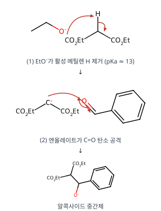

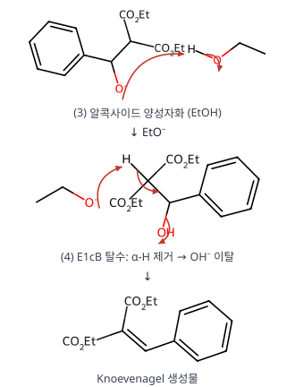

**메커니즘 — C ② 가수분해·탈카복실화**

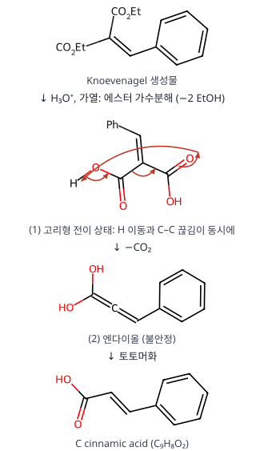

**메커니즘 — A 하이드라존 형성**

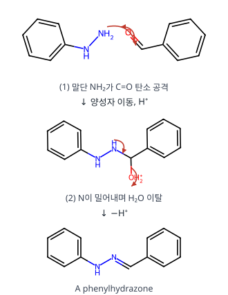

**메커니즘 — B Wittig 반응**

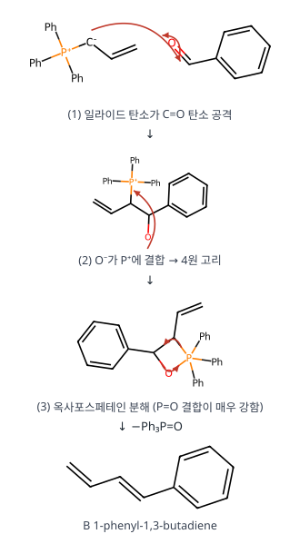

**왜 이 생성물인가.** C의 탈카복실화는 **β 위치에 C=O가 있는 카복실산**(말론산형)만 쉽게 일어납니다(6원 고리 전이 상태가 가능). 그래서 COOH 두 개 중 하나만 빠지고 신남산에서 멈춥니다. 콘쥬게이션된 trans 이중결합이 열역학적으로 안정해 E-신남산이 주생성물입니다.

**검산.** C₉H₈O₂: PhCH=C(CO₂Et)₂ (C₁₄H₁₆O₄) + 2H₂O → C₁₀H₈O₄(이산) + 2EtOH, 이산 − CO₂ = C₉H₈O₂ ✓ (문제의 + CO₂ + 2EtOH와 일치)

**채점 포인트·함정**

- 문제에 C 옆에 + CO₂ + 2EtOH가 적혀 있는 것이 탈카복실화의 힌트입니다.

---

원문: 2025학년도 대비 김지현 전공화학 모의고사 6회(지스쿨) 문제지·답안·강의 판서. 개인 학습용 정리입니다.

