# 2025학년도 대비 김지현 전공화학 모의고사 6회 — 상세해설

김지현 전공화학 모의고사 6회(전공 A 12문항 · 전공 B 11문항)의 문항별 해설입니다. 공식 「모의고사 6회 A형, B형 답안」과 강의 판서를 바탕으로 풀이 과정·개념·채점 포인트를 채웠고, 계산은 모두 다시 풀어 공식 답과 맞는지 확인했습니다. 구조식은 RDKit으로 분자식을 확인했습니다.

문항마다 새 쪽에서 시작하며 3단으로 **문제지 원문 → 정답 → 공식·핵심 개념 → 2027 출제 가능성 → 풀이 → 채점 포인트·함정** 순서로 읽으면 됩니다. 아래 표의 문항 번호를 누르면 해당 쪽으로 이동합니다.

**2027 출제 가능성**(★ 5개 만점)은 1997~2026 기출에서 그 소재가 얼마나 자주 나왔는지와 2022 개정 교육과정 적용 시점을 함께 고려한 추정치입니다.

## 정답 한눈에 보기 (목차) {#toc}

### 전공 A (12문항 40점)

| 번호 | 영역 | 정답 요약 | 2027 출제 가능성 |
|---|---|---|---|
| [1](#a1) | 물리화학 · 비가역 등온 팽창 | \|w\| = 400 J, ΔS = ln5 J/K | ★★★★☆ |
| [2](#a2) | 무기 · 18전자, CO 진동 | M = Fe, $A_1' + E'$ | ★★★★☆ |
| [3](#a3) | 유기 · 분광 분석 | 2,4,6-trimethyl-1,3,5-trioxane | ★★★★★ |
| [4](#a4) | 분석화학 · 양쪽성 염 | $[\mathrm{H_3O^+}] = \sqrt{\frac{K_{a1}K_{a2}F + K_{a1}K_w}{K_{a1} + F}}$ | ★★★★☆ |
| [5](#a5) | 화학교육 · POE | 설명 단계 수정, 질량 보존 가설 | ★★★★★ |
| [6](#a6) | 화학교육 · 2022 개정 내용 체계 | 화학반응의 규칙성, 물질의 변화, 입자수의 비 | ★★★★★ |
| [7](#a7) | 화학교육 · 비고츠키, 쿤 | 실제적·잠재적 발달 수준, 비계, 변칙 사례 | ★★★★★ |
| [8](#a8) | 물리화학 · 회전 분광 | 축퇴도 7, $2\sqrt3\hbar$, $\tilde B_0 = 6.42$, $\tilde B_1 = 6.26$ | ★★★★☆ |
| [9](#a9) | 무기 · CH₂ MO, Walsh 도표 | HOMO $p_x, p_y$, ⁻CH₂ 굽은형 | ★★★☆☆ |
| [10](#a10) | 유기 · 에폭사이드 개환 | A: ¹⁸O가 3차 탄소, B: ¹⁸O가 1차 탄소 | ★★★★★ |
| [11](#a11) | 유기 · 방향족성과 산도 | B, D | ★★★★☆ |
| [12](#a12) | 분석화학 · 요오드 적정 | 0.42 mg/L, $K = 10^{(b-c)/0.030}$ | ★★★★☆ |

### 전공 B (11문항 40점)

| 번호 | 영역 | 정답 요약 | 2027 출제 가능성 |
|---|---|---|---|
| [1](#b1) | 유기 · 피롤의 친전자성 치환 | C 2-nitropyrrole, D 3-nitropyrrole | ★★★★☆ |
| [2](#b2) | 분석화학 · 선택적 침전 | 분리 가능, $3.0\times10^{-12} \le [\mathrm{OH^-}] < 8.0\times10^{-6}$ | ★★★★☆ |
| [3](#b3) | 화학교육 · 오수벨 | 상위적 학습, 통합적 조정, 비교 선행조직자 | ★★★★★ |
| [4](#b4) | 화학교육 · 드라이버, 포스너, POE | 불만족, 일치(조화) 상황 | ★★★★★ |
| [5](#b5) | 화학교육 · Jigsaw | 기체의 압력, 전문가 집단, ZPD | ★★★★☆ |
| [6](#b6) | 물리화학 · 해리 평형, van't Hoff | p(Br) = 1/3, K = 1/6, ΔH (검토 메모 1) | ★★★★☆ |
| [7](#b7) | 물리화학 · XPS, 스핀-궤도 결합 | A j = 5/2, B j = 7/2, ²S₁/₂ | ★★★☆☆ |
| [8](#b8) | 무기 · d³ Tanabe–Sugano, LFSE | ν₃ = 48000 cm⁻¹, Δo = 11600 cm⁻¹ | ★★★★★ |
| [9](#b9) | 무기 · Jahn–Teller | z-out, 두 전이가 겹쳐 어깨 | ★★★★☆ |
| [10](#b10) | 분석화학 · EDTA 가림 적정 | Pb 25, Mg 21, Zn 48 mg | ★★★★☆ |
| [11](#b11) | 유기 · 하이드라존, Wittig, Knoevenagel | A, B, C(신남산) | ★★★★☆ |

**검토 메모**

1. **B형 6번 반응 엔탈피**: 공식 답안은 **−11.2 kJ/mol**이지만, 주어진 값으로 van't Hoff 식을 풀면 $\ln\dfrac{K_{2000}}{K_{1000}} = \ln\dfrac{1/2}{1/6} = \ln3$이므로 $\Delta_rH^\circ = 2000R\ln3 = 16\ln3 \approx$ **+17.6 kJ/mol**입니다. 온도를 올렸을 때 K가 커졌으므로(1/6 → 1/2) 흡열 반응이어야 하고, Br₂ 해리는 실제로도 흡열입니다. 답안 값은 $\ln\frac12 = -0.7$을 $\ln(K_2/K_1)$로 넣어 계산한 것으로 보입니다.
2. **B형 답안 머리말**: "기입형 1~4번 / 서술형 5~12번"으로 적혀 있지만 실제 B형은 기입형 1~2번(각 2점), 서술형 3~11번(각 4점)입니다.
3. **B형 1번**: 피롤은 진한 HNO₃/H₂SO₄에서 쉽게 고분자화되어, 실제 니트로화에는 보통 아세틸 나이트레이트(HNO₃/Ac₂O)를 씁니다. 답(2-니트로 주생성물)은 같습니다.
4. **A형 10번**: 답안의 "anti 입체화학"은 A(3차 탄소에서 반전)에만 의미가 있습니다. B는 입체중심이 아닌 CH₂가 공격받으므로 입체중심의 배열이 그대로 유지됩니다.

# 전공 A

## A형 1번 · 일정 외부 압력에 대한 등온 팽창 {#a1}

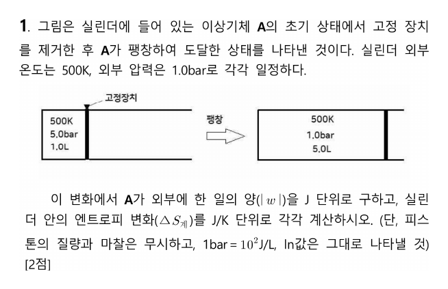

**정답** $|w| = 400$ J, $\Delta S_{계} = \ln5$ J/K (≈ 1.61 J/K)

**공식·핵심 개념**

- 비가역 팽창 일 $|w| = p_{ex}\Delta V$
- 등온 이상기체 $\Delta S = nR\ln(V_2/V_1)$ (상태함수 → 가역 경로로 계산)
- $nR = pV/T$, 1 L·bar = 100 J

**2027 출제 가능성 ★★★★☆ 높음** — 가역/비가역 경로의 일과 엔트로피 비교는 물리화학 기입형의 고정 소재입니다. 주위·우주의 ΔS까지 묻는 변형도 대비하세요.

**일.** 외부 압력 1.0 bar에 맞서 1.0 L → 5.0 L 팽창(비가역):

$$|w| = p_{ex}\Delta V = 1.0\ \mathrm{bar} \times 4.0\ \mathrm{L} = 4.0\ \mathrm{L\,bar} = 400\ \mathrm{J}$$

**엔트로피.** 처음과 끝 온도가 같으므로(500 K) 가역 등온 경로로 계산합니다.

$$\Delta S = nR\ln\frac{V_2}{V_1}, \quad nR = \frac{p_1V_1}{T} = \frac{5.0 \times 1.0}{500}\ \mathrm{L\,bar/K} = 0.010\ \mathrm{L\,bar/K} = 1.0\ \mathrm{J/K}$$

$$\Delta S_{계} = 1.0\ln5\ \mathrm{J/K}$$

**채점 포인트·함정**

- 일은 **실제 경로**(외부 압력)로, 엔트로피는 **가역 경로**로 계산합니다.
- $n$과 $R$을 따로 구할 필요 없이 $nR = pV/T$로 바로 구하면 단위 실수가 줄어듭니다.

## A형 2번 · M₂(CO)₃Cp₂의 18전자 규칙과 CO 진동 {#a2}

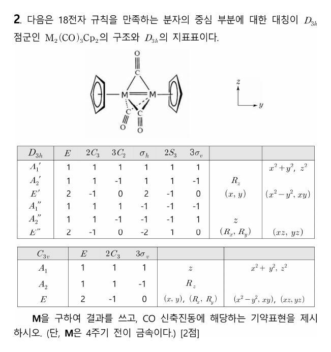

**정답** M = **Fe**(8족), CO 신축 진동 $\Gamma = A_1' + E'$ ($A_1'$ 라만 활성, $E'$ IR·라만 활성)

**공식·핵심 개념**

- 18전자: 금속 전자 + Cp 5 + CO 2 + M–M 결합(결합차 × 1, 금속당)
- 다리 CO도 2전자 리간드
- CO 신축: 움직이지 않는 CO 수로 Γ → 축소, IR(x,y,z)/Raman(이차 함수)

**2027 출제 가능성 ★★★★☆ 높음** — 금속 카보닐 전자 수 세기와 CO 진동 대칭은 무기에서 꾸준히 나옵니다.

**전자 수 세기(두 금속 합 36).** Cp 2개 × 5 = 10, 다리 CO 3개 × 2 = 6, M=M 이중결합(금속마다 2) = 4 → $2x + 20 = 36$ → $x = 8$ → 4주기 8족 **Fe**.

**CO 신축 진동.** 세 CO는 모두 σh 평면(M–M 축에 수직한 평면)에 있습니다.

| D₃h | E | 2C₃ | 3C₂ | σh | 2S₃ | 3σv |
|---|---|---|---|---|---|---|
| Γ_CO | 3 | 0 | 1 | 3 | 0 | 1 |

축소하면 $A_1' + E'$. $E'$는 $(x, y)$로 IR 활성, $A_1'$은 $x^2 + y^2, z^2$로 라만 활성입니다.

**채점 포인트·함정**

- 다리 CO도 전자 2개를 두 금속에 나눠 줍니다(합으로 세면 2개씩).

## A형 3번 · C₆H₁₂O₃의 구조 결정 {#a3}

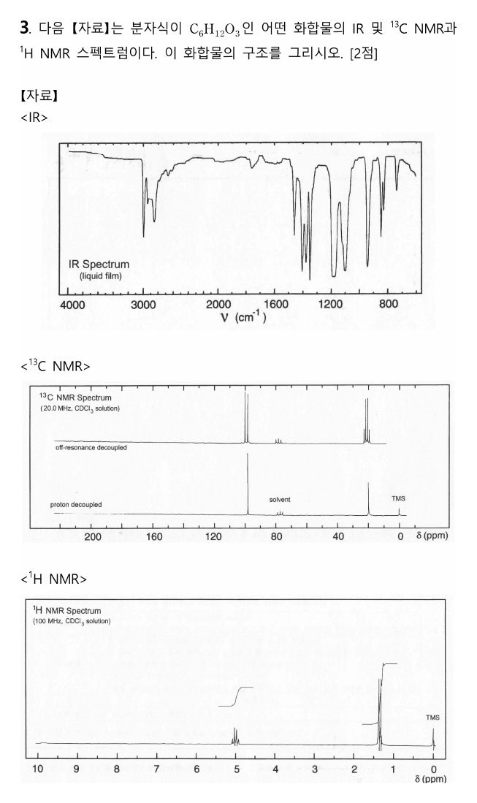

**정답** **2,4,6-trimethyl-1,3,5-trioxane** (paraldehyde, 아세트알데하이드 삼량체)

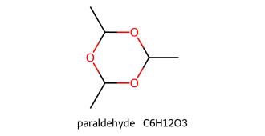

**공식·핵심 개념**

- 불포화도 $= \dfrac{2C + 2 + N - H - X}{2}$
- ¹³C 90~100 ppm: O–C–O 아세탈 탄소
- 신호 수가 탄소 수보다 적으면 대칭 구조

**2027 출제 가능성 ★★★★★ 매우 높음** — 스펙트럼으로 구조 결정은 해마다 나오는 유기 핵심 유형입니다.

| 자료 | 신호 | 해석 |
|---|---|---|
| 불포화도 | (2·6 + 2 − 12)/2 = 1 | 고리 1개 (C=O 없음) |
| IR | ~1700 없음, 1100–1200 강함 | C–O–C 에터(아세탈) |
| ¹³C | ~99 ppm (d), ~21 ppm (q) | O–CH–O, CH₃ 두 종류만 → 높은 대칭 |
| ¹H | δ 5.0 (q, 1H), 1.3 (d, 3H) | O₂C**H**–CH₃ 3세트가 모두 같음 |

탄소 6개인데 신호가 2개이므로 **CH(CH₃) 단위 3개가 대칭으로 반복**되고, 산소 3개가 사이에 낀 6원 고리 → paraldehyde.

**채점 포인트·함정**

- 99 ppm은 C=O(>170)가 아니라 **산소 두 개가 붙은 아세탈 탄소**입니다.

## A형 4번 · 양쪽성 염 NaHA의 pH {#a4}

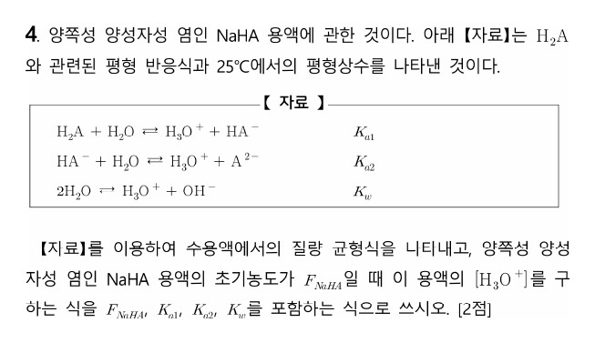

**정답** 질량 균형식 $F_{NaHA} = [\mathrm{H_2A}] + [\mathrm{HA^-}] + [\mathrm{A^{2-}}]$, $[\mathrm{H_3O^+}] = \sqrt{\dfrac{K_{a1}K_{a2}F_{NaHA} + K_{a1}K_w}{K_{a1} + F_{NaHA}}}$

**공식·핵심 개념**

- 질량 균형: $F = [H_2A] + [HA^-] + [A^{2-}]$
- 양성자 조건: $[H^+] + [H_2A] = [A^{2-}] + [OH^-]$
- 근사 $[H^+] \approx \sqrt{K_{a1}K_{a2}}$

**2027 출제 가능성 ★★★★☆ 높음** — 다양성자산과 양쪽성 화학종의 pH는 분석화학에서 자주 나옵니다.

**양성자 조건(전하 균형).** $[\mathrm{H_3O^+}] + [\mathrm{H_2A}] = [\mathrm{A^{2-}}] + [\mathrm{OH^-}]$에 $[\mathrm{H_2A}] = \dfrac{[\mathrm{H^+}][\mathrm{HA^-}]}{K_{a1}}$, $[\mathrm{A^{2-}}] = \dfrac{K_{a2}[\mathrm{HA^-}]}{[\mathrm{H^+}]}$, $[\mathrm{OH^-}] = \dfrac{K_w}{[\mathrm{H^+}]}$을 넣으면

$$[\mathrm{H^+}]^2\left(1 + \frac{[\mathrm{HA^-}]}{K_{a1}}\right) = K_{a2}[\mathrm{HA^-}] + K_w$$

$[\mathrm{HA^-}] \approx F$(대부분 HA⁻로 남음)로 놓고 정리하면 답의 식이 됩니다.

**근사.** $K_{a1} \ll F$, $K_{a1}K_w \ll K_{a1}K_{a2}F$이면 $[\mathrm{H^+}] \approx \sqrt{K_{a1}K_{a2}}$, $\mathrm{pH} \approx \tfrac12(\mathrm{p}K_{a1} + \mathrm{p}K_{a2})$.

**채점 포인트·함정**

- 가정 $[\mathrm{HA^-}] \approx F$를 밝혀 써야 합니다.

## A형 5번 · POE 모형과 질량 보존 {#a5}

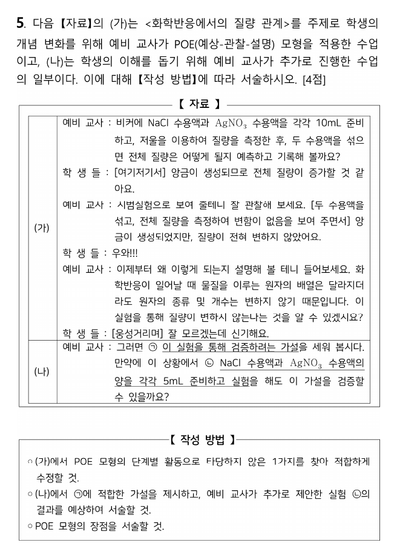

**정답**

- 타당하지 않은 것: 관찰 뒤 **곧바로 교사의 설명**이 이어진 부분. 수정안: 교사가 설명하기 전에 학생들이 **자신의 예상과 관찰 결과를 비교**해 의견을 교환하고 발표하게 한다.
- ㉠ 가설: **화학 반응이 일어날 때 물질의 총질량은 변하지 않는다.**
- ㉡ 결과: 부피(양)가 달라져도 **반응 전후 총질량은 변하지 않는다.**
- POE의 장점: 예측과 그 근거를 쓰는 과정에서 선개념이 드러나고, 예측과 다른 관찰 결과가 나올 때 흥미와 인지 갈등을 유발한다.

**공식·핵심 개념**

- POE: 예상(이유 포함) → 관찰 → 설명(예상과 관찰 비교, 학생이 먼저)
- 질량 보존: 원자의 종류·수 불변

**2027 출제 가능성 ★★★★★ 매우 높음** — POE·개념 변화 수업 모형은 1회·6회에 모두 나왔을 만큼 핵심입니다.

**POE의 설명(Explain) 단계**는 학생이 먼저 예상과 관찰의 차이를 스스로 설명해 보는 단계입니다. 교사가 바로 답을 주면 학생의 인지 갈등이 해소되지 않아 "잘 모르겠는데 신기해요"라는 반응이 나옵니다.

**과학 내용.** NaCl + AgNO₃ → AgCl(앙금) + NaNO₃. 원자는 재배열될 뿐 종류와 수가 보존되므로 총질량은 같습니다. 양을 5 mL로 줄여도 마찬가지입니다.

**채점 포인트·함정**

- 가설은 "~이면 ~이다" 형태의 검증 가능한 진술로 씁니다.

## A형 6번 · 2022 개정 「물질」 영역 내용 체계 {#a6}

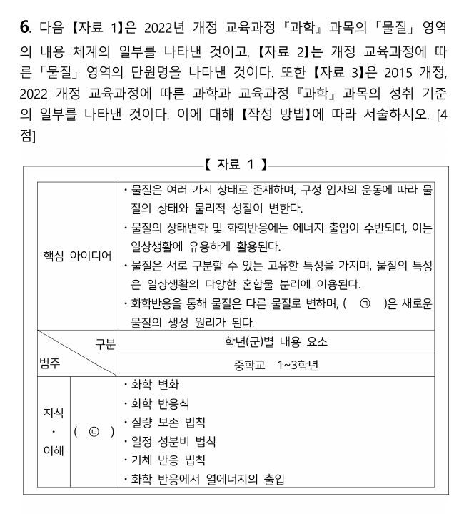

**정답** ㉠ **화학반응의 규칙성**, ㉡ **물질의 변화**, ㉢ **화학반응의 규칙성**(단원명), ㉣ **입자수의 비**

**공식·핵심 개념**

- 2022 개정 중학교 「물질」 영역 단원 구성
- 지식·이해 범주: 물질의 변화
- 계수비 = 입자수의 비(중학교)

**2027 출제 가능성 ★★★★★ 매우 높음** — 2015 ↔ 2022 개정 비교는 2027 교육과정 문항의 최우선 소재입니다.

**㉠·㉡.** 핵심 아이디어의 "화학반응을 통해 물질은 다른 물질로 변하며, (화학반응의 규칙성)은 새로운 물질의 생성 원리가 된다." 지식·이해의 범주는 화학 변화, 화학 반응식, 질량 보존·일정 성분비·기체 반응 법칙을 묶는 **물질의 변화**입니다.

**㉣.** 2015 개정은 화학 반응식 계수비를 "입자 수의 비"로 해석하며, 2022 개정도 같습니다(몰 개념은 고등학교).

**채점 포인트·함정**

- 중학교에서는 계수비를 **몰비가 아니라 입자수의 비**로 다룹니다.

## A형 7번 · 비고츠키의 ZPD와 쿤의 변칙 사례 {#a7}

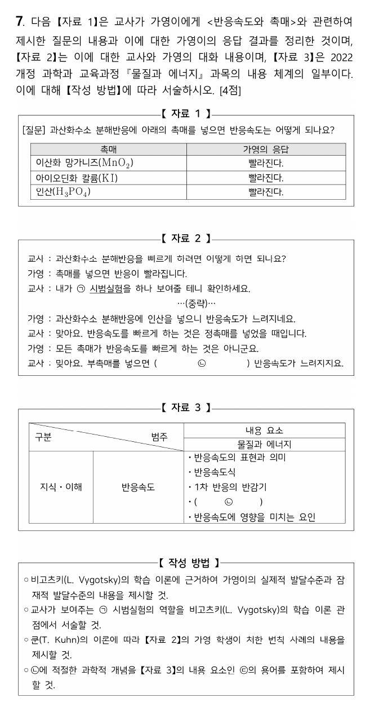

**정답**

- 실제적 발달 수준: 모든 촉매는 반응속도를 빠르게 한다. 잠재적 발달 수준: 정촉매는 반응속도를 빠르게, 부촉매는 느리게 한다.
- ㉠ 시범실험의 역할: **비계 설정**
- 변칙 사례: 부촉매(인산)를 넣었을 때 반응이 느려지는 실험 결과 — 가영이의 "모든 촉매는 반응을 빠르게 한다"는 생각으로 설명되지 않는 현상이다.
- ㉡ 부촉매는 반응의 **활성화 에너지를 높이기** 때문에 (㉢ 활성화 에너지)

**공식·핵심 개념**

- 비고츠키: 실제적·잠재적 발달 수준, ZPD, 비계
- 쿤: 정상과학, 변칙 사례, 위기, 패러다임 전환
- 부촉매: 활성화 에너지↑ → 속도↓

**2027 출제 가능성 ★★★★★ 매우 높음** — 비고츠키와 과학철학자를 엮는 문항은 화학교육론 단골입니다.

**비고츠키.** 실제적 발달 수준 = 혼자 해결할 수 있는 수준(자료 1의 응답), 잠재적 발달 수준 = 교사 도움으로 도달하는 수준(대화 끝의 깨달음). 그 사이가 ZPD이고, 시범실험은 이를 건너게 하는 비계입니다.

**쿤.** 정상과학의 패러다임으로 설명되지 않는 현상이 변칙 사례이고, 쌓이면 위기 → 과학 혁명(패러다임 전환)으로 이어집니다.

**채점 포인트·함정**

- ㉡에는 자료 3 내용 요소 **활성화 에너지**라는 용어를 꼭 넣습니다.

## A형 8번 · 구면 회전자와 진동-회전 스펙트럼 {#a8}

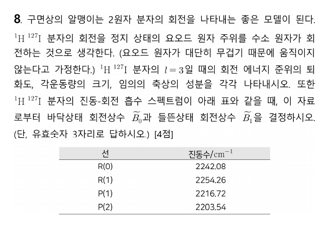

**정답** $l = 3$: 축퇴도 **7**, $|L| = \sqrt{12}\hbar = 2\sqrt3\hbar$, $L_z = 0, \pm\hbar, \pm2\hbar, \pm3\hbar$. $\tilde B_0 = 6.42\ \mathrm{cm^{-1}}$, $\tilde B_1 = 6.26\ \mathrm{cm^{-1}}$

**공식·핵심 개념**

- 구면 회전자: 축퇴도 $2l + 1$, $|L| = \sqrt{l(l+1)}\hbar$, $L_z = m_l\hbar$
- 결합차: $R(J-1) - P(J+1) = 4\tilde B_0(J + \tfrac12)$, $R(J) - P(J) = 4\tilde B_1(J + \tfrac12)$

**2027 출제 가능성 ★★★★☆ 높음** — 진동-회전 스펙트럼 해석은 물리화학 서술형으로 자주 나옵니다.

**구면 위 입자.** 축퇴도 $2l + 1 = 7$, $|L| = \sqrt{l(l+1)}\hbar$, $L_z = m_l\hbar$ ($m_l = -l, \dots, l$).

**결합차(combination difference).**

- 같은 위 준위(J′ = 1, v = 1)로 가는 R(0)와 P(2)의 차는 바닥 상태 간격만 반영: $\tilde\nu_R(J-1) - \tilde\nu_P(J+1) = 4\tilde B_0(J + \tfrac12)$, J = 1:

$$2242.08 - 2203.54 = 38.54 = 6\tilde B_0 \;\Rightarrow\; \tilde B_0 = 6.42\ \mathrm{cm^{-1}}$$

- 같은 아래 준위(J = 1, v = 0)에서 출발한 R(1)과 P(1)의 차는 들뜬 상태 간격: $\tilde\nu_R(J) - \tilde\nu_P(J) = 4\tilde B_1(J + \tfrac12)$:

$$2254.26 - 2216.72 = 37.54 = 6\tilde B_1 \;\Rightarrow\; \tilde B_1 = 6.26\ \mathrm{cm^{-1}}$$

$\tilde B_1 < \tilde B_0$: 들뜬 진동 상태에서 평균 결합 길이가 길어지기 때문입니다.

**채점 포인트·함정**

- 어느 차가 B₀, 어느 차가 B₁인지(공통 준위가 위냐 아래냐) 헷갈리기 쉽습니다.

## A형 9번 · 선형 CH₂의 MO와 Walsh 도표 {#a9}

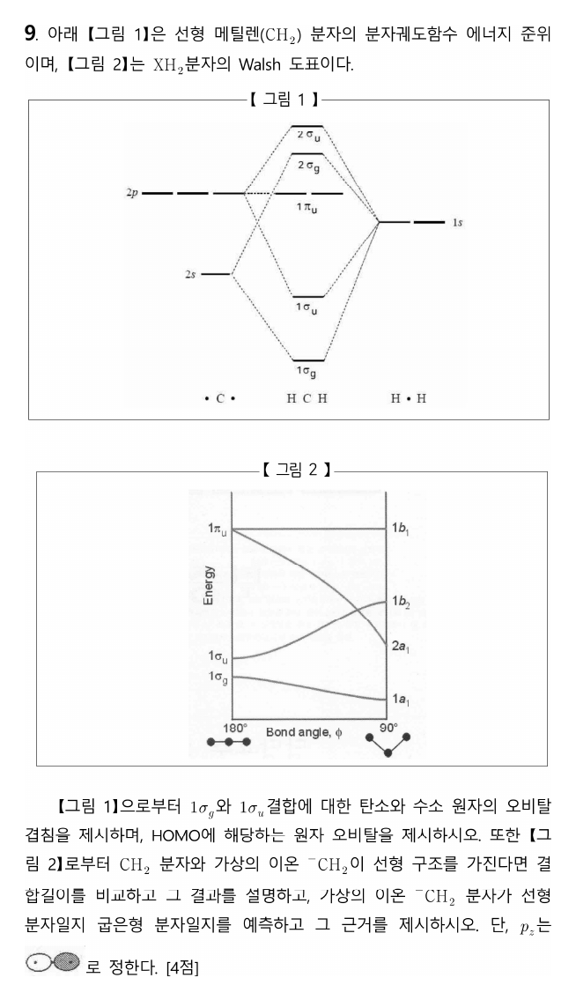

**정답**

- 1σg: C 2s + 두 H 1s(같은 부호), 1σu: C 2pz + 두 H 1s(반대 부호)
- HOMO: **1πu = C 2px, 2py**(비결합)
- 선형이라면 CH₂(1σg²1σu²1πu²)와 ⁻CH₂(1σg²1σu²1πu³)의 결합 길이는 **거의 같다** — 추가 전자가 비결합 1πu에 들어가 결합 차수가 변하지 않음.
- ⁻CH₂(원자가 전자 7개)는 **굽은형**: 굽으면 1πu에서 나온 2a₁이 크게 안정화되므로 1a₁²2a₁²1b₂²1b₁¹ 배치의 굽은 구조가 더 낮은 에너지.

**공식·핵심 개념**

- 선형 XH₂: 1σg, 1σu(결합), 1πu(비결합)
- Walsh: 굽힐수록 1πu → 2a₁ 크게 안정화
- 원자가 전자 4개 이하 선형, 5개 이상 굽은형

**2027 출제 가능성 ★★★☆☆ 보통** — Walsh 도표는 가끔 나오는 고급 소재입니다. H₂O·BeH₂ 비교 형태로 대비하세요.

**Walsh 도표 읽기.** 굽힘에 따라 1πu의 한 성분(분자 평면 안)이 H 1s와 겹치며 2a₁으로 크게 내려가고, 다른 성분(평면에 수직)은 1b₁으로 그대로 남습니다. 전자가 2a₁에 들어가면 굽은형이 유리합니다. 원자가 전자 4개(BeH₂) 이하는 선형, 5개 이상부터 굽은형이 됩니다.

**채점 포인트·함정**

- 1σg 그림은 세 원자 모두 같은 부호, 1σu는 C의 pz 로브 부호가 양쪽 H와 맞도록 그립니다.

## A형 10번 · 에폭사이드의 산·염기 개환 {#a10}

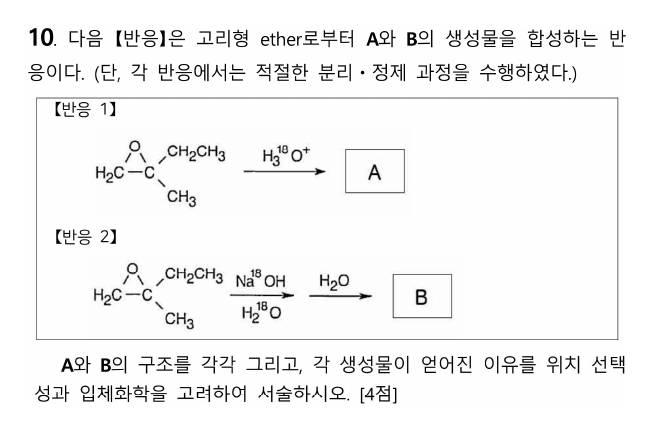

**정답** A: ¹⁸OH가 **3차 탄소**에, B: ¹⁸OH가 **1차 탄소(CH₂)**에 붙은 2-methylbutane-1,2-diol

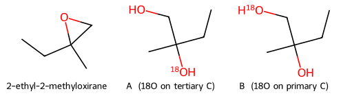

**공식·핵심 개념**

- 산 촉매 개환: 더 치환된 탄소 공격(SN1 성격), anti
- 염기 개환: 덜 치환된 탄소 공격(SN2)
- 동위원소 표지로 공격 위치 추적

**2027 출제 가능성 ★★★★★ 매우 높음** — 에폭사이드 개환의 위치·입체 선택성은 유기에서 매우 자주 나옵니다.

**산 촉매(A).** 에폭사이드 산소가 양성자화되면 C–O 결합이 늘어나며 양전하가 **더 치환된 3차 탄소**에 많이 모입니다(SN1 성격). H₂¹⁸O가 그 탄소를 뒤쪽에서 공격 → ¹⁸O가 3차 탄소, 3차 탄소의 배열은 **반전(anti 첨가)**.

**염기(B).** ¹⁸OH⁻가 강한 친핵체로 **입체 장애가 적은 CH₂**를 SN2 공격 → 알콕사이드 → H₂O로 양성자화. ¹⁸O는 1차 탄소에, 3차 입체중심의 배열은 유지.

**채점 포인트·함정**

- 위치 선택성의 근거(산: 탄소양이온 성격, 염기: 입체 장애)를 각각 씁니다.

## A형 11번 · 방향족 짝염기와 산도 {#a11}

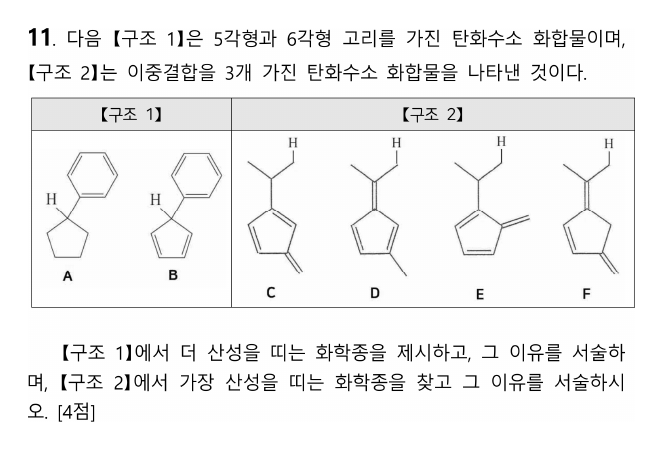

**정답** 구조 1: **B**가 더 산성, 구조 2: **D**가 가장 산성

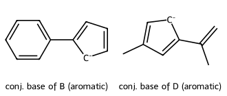

**공식·핵심 개념**

- 짝염기의 안정성 ↑ → 산도 ↑
- Cp⁻: 6π 방향족(Hückel 4n+2)
- 풀벤의 메틸 H 제거 → 방향족 음이온

**2027 출제 가능성 ★★★★☆ 높음** — 방향족성과 산도 비교는 유기 기입형의 단골입니다.

**구조 1.** B의 sp³ C–H를 떼면 **사이클로펜타다이엔일 음이온**(6π, 방향족)이 됩니다. A는 포화 고리라 짝염기가 국소화된 탄소음이온이어서 특별한 안정화가 없습니다.

**구조 2.** D는 고리 안에 C=C 두 개, 고리 밖 C=C 하나(풀벤)를 가집니다. 고리 밖 C=C에 붙은 CH₃의 H를 떼면 음전하가 고리로 비편재화되어 **방향족 사이클로펜타다이엔일 음이온**이 됩니다. C, E, F는 같은 방식으로 방향족 짝염기를 만들 수 없습니다.

**채점 포인트·함정**

- 이유는 "짝염기가 방향족(4n+2 = 6π)이라 안정"으로 씁니다.

## A형 12번 · 요오드 적정으로 CO 정량 {#a12}

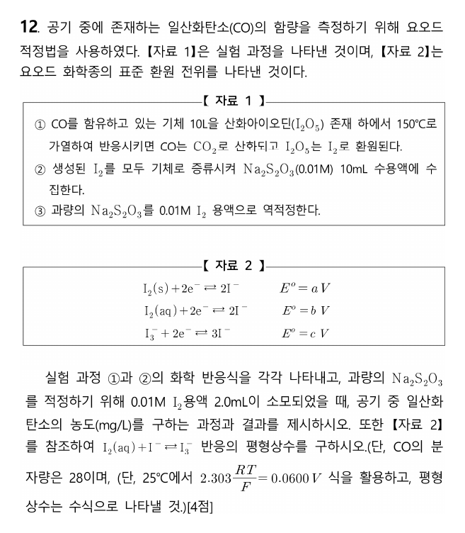

**정답** ① $\mathrm{I_2O_5(s) + 5CO(g) \to I_2 + 5CO_2}$, ② $\mathrm{I_2 + 2S_2O_3^{2-} \to S_4O_6^{2-} + 2I^-}$, CO **0.42 mg/L**, $K = 10^{2(b-c)/0.060} = 10^{(b-c)/0.030}$

**공식·핵심 개념**

- 역적정: 반응한 양 = 넣은 양 − 남은 양
- $\mathrm{I_2 + 2S_2O_3^{2-} \to S_4O_6^{2-} + 2I^-}$
- $\log K = \dfrac{nE^\circ}{0.0600}$

**2027 출제 가능성 ★★★★☆ 높음** — 요오드 적정과 표준 전위로 K 구하기는 분석화학 고빈도 소재입니다.

| 단계 | 계산 | 값 |
|---|---|---|
| 넣은 S₂O₃²⁻ | 0.01 M × 10 mL | 0.10 mmol |
| 역적정 I₂ | 0.01 M × 2.0 mL | 0.020 mmol → S₂O₃²⁻ 0.040 mmol 소비 |
| CO에서 온 I₂와 반응한 S₂O₃²⁻ | 0.10 − 0.040 | 0.060 mmol |
| I₂ | 0.060 / 2 | 0.030 mmol |
| CO | 5 × 0.030 | 0.15 mmol = 4.2 mg |
| 농도 | 4.2 mg / 10 L | **0.42 mg/L** |

**평형 상수.** $\mathrm{I_2(aq) + I^- \rightleftharpoons I_3^-}$ = (I₂(aq) + 2e⁻ → 2I⁻) − (I₃⁻ + 2e⁻ → 3I⁻), $E^\circ = b - c$, $n = 2$:

$$\log K = \frac{nE^\circ}{0.0600} = \frac{2(b-c)}{0.0600}$$

**채점 포인트·함정**

- CO 5분자당 I₂ 1분자, I₂ 1분자당 S₂O₃²⁻ 2개 — 계수비를 두 번 거칩니다.

# 전공 B

## B형 1번 · 피롤의 니트로화 위치 선택성 {#b1}

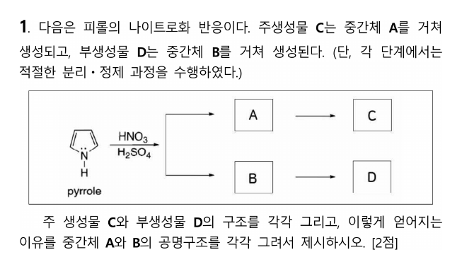

**정답** C **2-nitropyrrole**(주), D **3-nitropyrrole**(부). C2 공격 중간체 A는 공명구조 **3개**, C3 공격 중간체 B는 **2개**라 A가 더 안정하다.

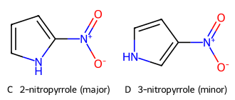

**공식·핵심 개념**

- 친전자성 방향족 치환: σ 착물 안정성이 위치 결정
- 피롤: C2 공격 공명구조 3개 > C3 공격 2개
- 피리딘은 반대로 C3 선호

**2027 출제 가능성 ★★★★☆ 높음** — 헤테로고리 방향족 치환의 위치 선택성은 유기에서 자주 나옵니다.

**중간체(σ 착물).**

- C2 공격(A): 양전하가 C3, C5, **N**(N의 비공유 전자쌍이 π 결합 형성)에 비편재화 → 공명구조 3개, 그중 N⁺ 구조는 모든 원자가 옥텟.
- C3 공격(B): 양전하가 C2와 N에만 → 공명구조 2개.

더 안정한 중간체를 거치는 경로의 활성화 에너지가 낮아 2-치환이 주생성물입니다.

**채점 포인트·함정**

- 공명구조를 그릴 때 N의 비공유 전자쌍이 참여하는 구조를 빠뜨리지 않습니다.

## B형 2번 · 수산화물 선택적 침전 {#b2}

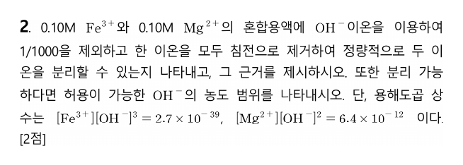

**정답** 분리 **가능**. $3.0\times10^{-12} \le [\mathrm{OH^-}] < 8.0\times10^{-6}$ M

**공식·핵심 개념**

- 선택적 침전: 먼저 침전되는 이온 99.9 % 제거 시점의 [OH⁻]
- 두 번째 이온의 Q < Ksp 확인
- 상한: 두 번째 이온 침전 시작 농도

**2027 출제 가능성 ★★★★☆ 높음** — Ksp를 이용한 분별 침전은 분석화학 기입형의 대표 소재입니다.

**Fe³⁺ 먼저 침전.** 99.9 % 제거 → 남은 $[\mathrm{Fe^{3+}}] = 1.0\times10^{-4}$ M:

$$[\mathrm{OH^-}]^3 = \frac{2.7\times10^{-39}}{1.0\times10^{-4}} = 2.7\times10^{-35} \;\Rightarrow\; [\mathrm{OH^-}] = 3.0\times10^{-12}\ \mathrm{M}$$

이때 $Q = 0.10 \times (3.0\times10^{-12})^2 = 9.0\times10^{-25} < K_{sp}(\mathrm{Mg(OH)_2})$ → Mg²⁺는 침전하지 않음.

**상한.** Mg(OH)₂가 막 생기기 시작하는 $[\mathrm{OH^-}] = \sqrt{6.4\times10^{-12}/0.10} = 8.0\times10^{-6}$ M.

**채점 포인트·함정**

- "1/1000을 제외하고"는 **남은 농도가 처음의 1/1000**이라는 뜻입니다.

## B형 3번 · 오수벨의 상위적 학습과 선행조직자 {#b3}

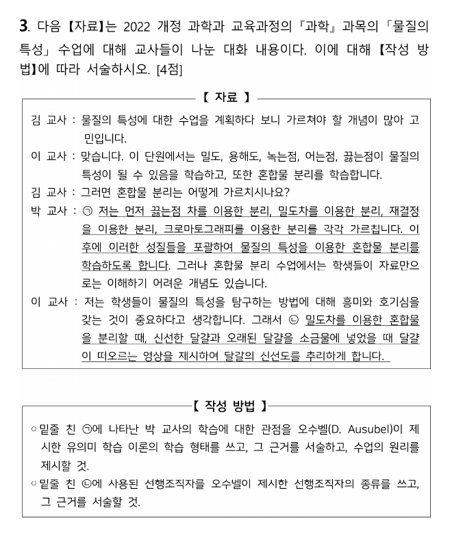

**정답**

- ㉠ **상위적 학습**: 하위 개념(끓는점·밀도차·재결정·크로마토그래피를 이용한 분리)을 먼저 배운 뒤 더 포괄적인 상위 개념 '물질의 특성을 이용한 혼합물 분리'로 묶기 때문. 수업 원리: **통합적 조정**.
- ㉡ **비교 선행조직자**: 친숙한 내용(신선한·오래된 달걀이 소금물에 뜨는 영상)으로 달걀 신선도를 추리하게 해, 인지구조 속 관련 개념과 새 학습 과제를 잇는 인지적 다리 역할을 한다.

**공식·핵심 개념**

- 상위적 학습 ↔ 통합적 조정, 하위적 학습 ↔ 점진적 분화
- 선행조직자: 설명 / 비교

**2027 출제 가능성 ★★★★★ 매우 높음** — 오수벨 이론은 화학교육론 최빈출 소재입니다.

| 오수벨 개념 | 의미 |
|---|---|
| 하위적(포섭) 학습 | 새 개념이 더 포괄적인 기존 개념 아래로 — 점진적 분화 |
| 상위적 학습 | 기존 하위 개념들을 새 상위 개념으로 묶음 — 통합적 조정 |
| 설명 선행조직자 | 학습자가 모르는 새 내용의 개념 틀 제시 |
| 비교 선행조직자 | 친숙한 내용과 비교해 새 내용과의 유사·차이 제시 |

**채점 포인트·함정**

- 상위적 학습 ↔ 통합적 조정, 하위적 학습 ↔ 점진적 분화를 짝지어 기억합니다.

## B형 4번 · 드라이버 모형과 POE {#b4}

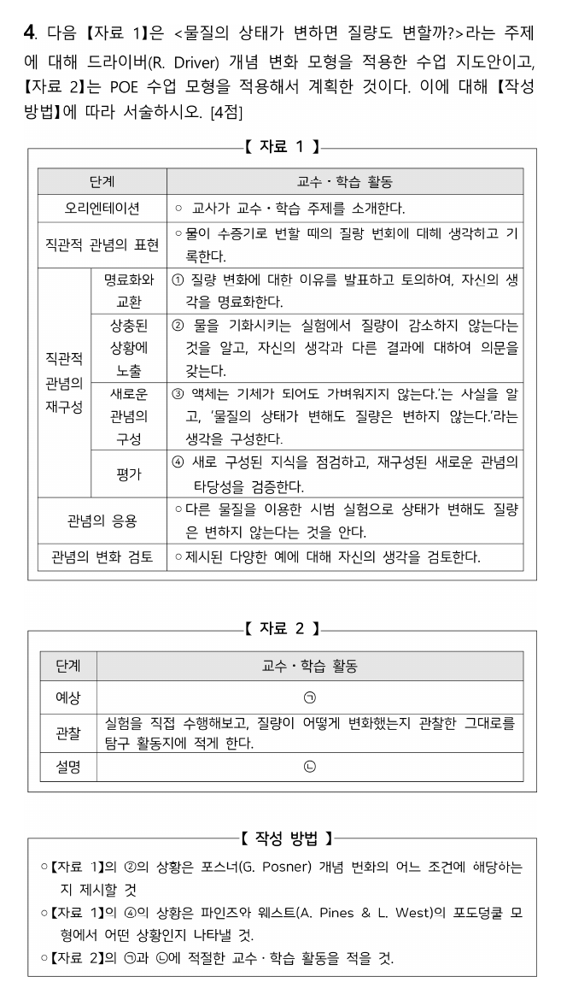

**정답**

- ②: 포스너의 **기존 개념에 대한 불만족**
- ④: 파인즈와 웨스트의 **일치 상황(조화 상황)**
- ㉠ 예상: 물을 기화시키는 실험에서 질량이 어떻게 변할지 예상하고 그 이유를 탐구 활동지에 쓰게 한다.
- ㉡ 설명: 질량이 변하지 않는 관찰 결과와 처음 예상을 비교하게 하고, 예상이 틀렸다면 이유를 생각해 토의하게 하여 상태가 변해도 질량이 보존됨을 이해하게 한다.

**공식·핵심 개념**

- 드라이버: 오리엔테이션 → 생각의 표현 → 재구성(명료화·교환, 상충 상황 노출, 새 생각 구성, 평가) → 적용 → 검토
- 포스너 4조건 / 파인즈·웨스트 4상황

**2027 출제 가능성 ★★★★★ 매우 높음** — 개념 변화 모형을 여러 학자와 묶는 문항은 매년 나옵니다.

**포스너의 개념 변화 조건**: 불만족 → 이해 가능성 → 그럴듯함 → 유용성. ②는 생각과 다른 결과에 의문을 갖는 단계입니다.

**파인즈·웨스트 포도덩굴 모형**: 자발적 지식(학생의 일상 개념)과 학교 지식이 만나는 4가지 상황 — **일치(조화)**, 갈등, 자발적 지식만 있음, 학교 지식만 있음. ④에서는 새로 구성한 생각과 학교에서 배운 과학 지식이 같아졌습니다.

## B형 5번 · Jigsaw 모형 {#b5}

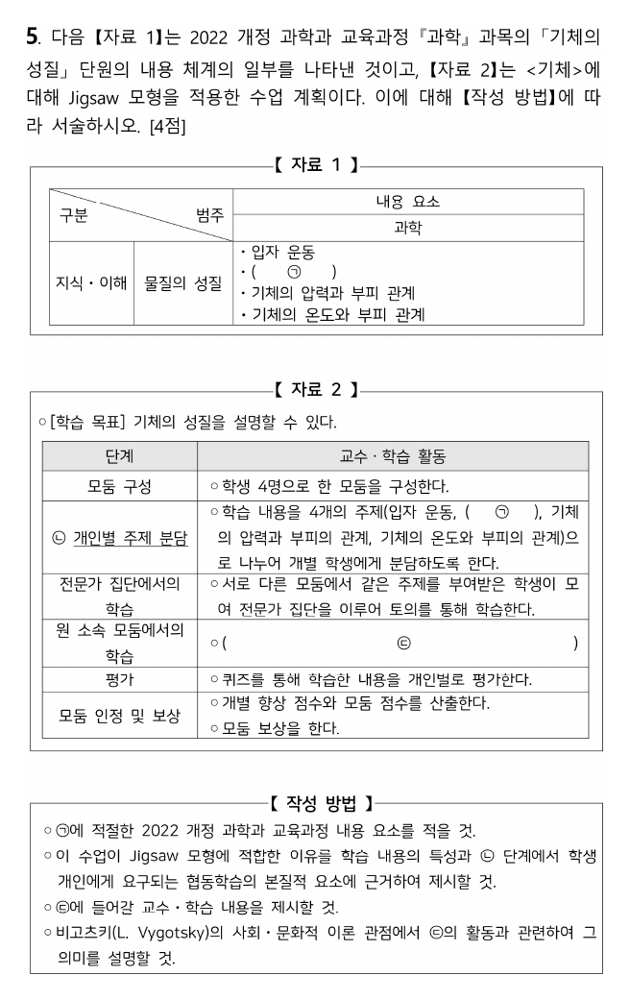

**정답**

- ㉠ **기체의 압력**
- Jigsaw가 적합한 이유: 학습 내용을 4개 주제로 **나눌 수 있고**, 각자 맡은 부분을 완수하는 **개별적 책무성**과 과제 완수를 위한 **상호 의존성·협동심**을 높일 수 있기 때문.
- ㉢ 전문가 집단에서 학습한 학생이 원 소속 모둠으로 돌아와 **동료들을 가르치고**, 토의로 함께 과제를 해결한다.
- 비고츠키: 근접발달영역 안에서 전문가(동료)와의 **언어적·사회적 상호작용**으로 인지 발달을 촉진하고, 실제적 발달 수준을 잠재적 발달 수준으로 끌어올리는 의미가 있다.

**공식·핵심 개념**

- Jigsaw: 주제 분담 → 전문가 집단 → 원 모둠에서 가르치기 (II: 향상 점수·모둠 보상)
- 개별적 책무성, 긍정적 상호 의존성
- 비고츠키 ZPD

**2027 출제 가능성 ★★★★☆ 높음** — 협동 학습모형은 화학교육론에서 꾸준히 나옵니다.

**Jigsaw 절차**: 모둠 구성 → 주제 분담 → 전문가 집단 학습 → 원 모둠에서 가르치기 → 개별 평가 → (Jigsaw II) 개별 향상 점수·모둠 보상. 자료 2처럼 향상 점수와 모둠 보상이 있으면 **Jigsaw II**입니다.

## B형 6번 · Br₂ 해리 평형과 van't Hoff 식 {#b6}

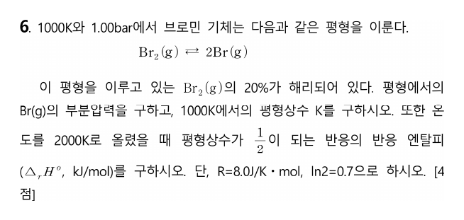

**정답** $p_{Br} = \dfrac13$ bar (≈ 0.33), $K = \dfrac16$ (≈ 0.17), $\Delta_rH^\circ = 2000R\ln3 = 16\ln3 \approx 17.6$ kJ/mol (공식 답안 −11.2 kJ/mol — 검토 메모 1)

**공식·핵심 개념**

- $K_p = \dfrac{p_{Br}^2}{p_{Br_2}}$ (부분 압력 = 몰분율 × 전체 압력)
- van't Hoff: $\ln\dfrac{K_2}{K_1} = -\dfrac{\Delta H^\circ}{R}\left(\dfrac1{T_2} - \dfrac1{T_1}\right)$
- T↑ 때 K↑ → 흡열

**2027 출제 가능성 ★★★★☆ 높음** — 해리 평형과 van't Hoff 식은 물리화학 계산 단골입니다.

**평형 조성.** Br₂ 1 mol 중 20 % 해리: Br₂ 0.8, Br 0.4, 합 1.2 mol, 전체 압력 1.00 bar.

$$p_{Br} = \frac{0.4}{1.2} = \frac13, \quad p_{Br_2} = \frac23, \quad K = \frac{(1/3)^2}{2/3} = \frac16$$

**van't Hoff.**

$$\ln\frac{K_2}{K_1} = -\frac{\Delta_rH^\circ}{R}\left(\frac{1}{T_2} - \frac{1}{T_1}\right) \;\Rightarrow\; \ln\frac{1/2}{1/6} = \ln3 = \frac{\Delta_rH^\circ}{8.0}\cdot\frac{1}{2000}$$

$$\Delta_rH^\circ = 16000\ln3\ \mathrm{J/mol} \approx 17.6\ \mathrm{kJ/mol}$$

K가 온도와 함께 커졌으므로 반드시 **흡열(+)**이어야 합니다.

**채점 포인트·함정**

- 몰분율로 부분 압력을 구할 때 전체 몰수(1.2)로 나눕니다.

## B형 7번 · Au 4f XPS와 스핀-궤도 결합 {#b7}

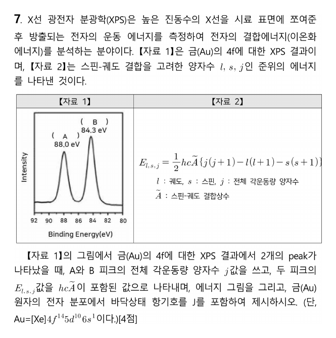

**정답** A: $j = \dfrac52$, B: $j = \dfrac72$. $E_{j=5/2} = -2hc\tilde A$, $E_{j=7/2} = +\dfrac32hc\tilde A$. Au 바닥 상태 **²S₁/₂**

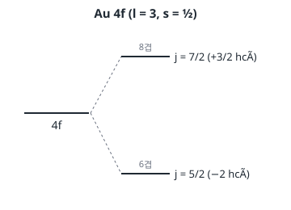

**공식·핵심 개념**

- $j = l \pm s$, 축퇴도 $2j + 1$
- $E = \tfrac12hc\tilde A\{j(j+1) - l(l+1) - s(s+1)\}$
- 항기호 $^{2S+1}L_J$

**2027 출제 가능성 ★★★☆☆ 보통** — 스핀-궤도 결합과 항기호는 가끔 나옵니다. XPS 맥락은 드문 편입니다.

**j 값.** 4f: $l = 3$, $s = \tfrac12$ → $j = l \pm s = \tfrac72, \tfrac52$.

**에너지.** $E = \tfrac12hc\tilde A\{j(j+1) - l(l+1) - s(s+1)\}$:

- $j = \tfrac72$: $\tfrac12(\tfrac{63}{4} - 12 - \tfrac34) = \tfrac32$
- $j = \tfrac52$: $\tfrac12(\tfrac{35}{4} - 12 - \tfrac34) = -2$

축퇴도 $2j + 1$ = 8, 6 → 피크 세기 비 4 : 3(B가 더 큼, 그림과 일치).

**피크 배정.** 광전자를 떼어 낸 뒤 남는 4f¹³(구멍 1개)은 **반 이상 찬 껍질이라 j가 큰 상태가 더 안정**(역전) → j = 7/2 상태를 남기는 이온화가 결합 에너지가 작음(B, 84.3 eV), j = 5/2가 큼(A, 88.0 eV).

**바닥 상태.** 4f¹⁴5d¹⁰ 닫힌 껍질 + 6s¹ → $L = 0$, $S = \tfrac12$, $J = \tfrac12$ → ²S₁/₂.

## B형 8번 · d³ Cr³⁺ 스펙트럼과 수화 엔탈피 {#b8}

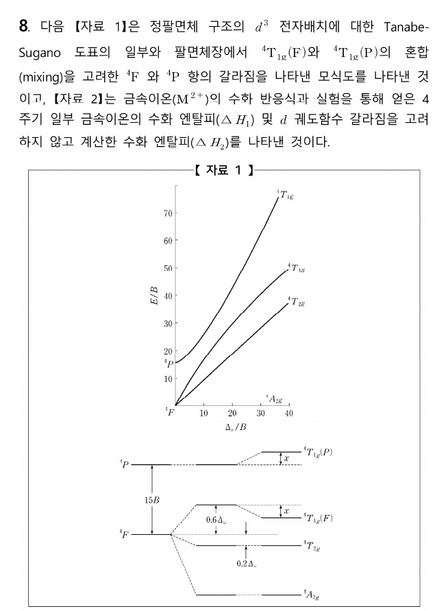

**정답** Δo = **⁴A₂g → ⁴T₂g**, 최대 흡수 파장 큰 순 **[CrF₆]³⁻ > [Cr(ox)₃]³⁻ > [Cr(en)₃]³⁺**, ν₃ = **48000 cm⁻¹**, [V(H₂O)₆]²⁺ Δo = **11600 cm⁻¹**

**공식·핵심 개념**

- d³: $\nu_1 = \Delta_o$, $\nu_2 = 1.8\Delta_o - x$, $\nu_3 = 1.2\Delta_o + 15B + x$
- 분광화학 계열 F⁻ < ox²⁻ < H₂O < NH₃ < en < CN⁻
- 수화 엔탈피 차 = LFSE

**2027 출제 가능성 ★★★★★ 매우 높음** — Tanabe–Sugano와 LFSE 계산은 무기 최빈출 소재입니다.

**전이 에너지(자료 1의 모식도).** 바닥 ⁴A₂g는 −1.2Δo, ⁴T₂g는 −0.2Δo, ⁴T₁g(F)는 +0.6Δo − x, ⁴T₁g(P)는 15B + x:

$$\nu_1 = \Delta_o, \quad \nu_2 = 1.8\Delta_o - x, \quad \nu_3 = 1.2\Delta_o + 15B + x$$

ν₁ = 22000 → Δo = 22000. ν₂ = 28000 = 39600 − x → x = 11600. ν₃ = 26400 + 10000 + 11600 = **48000 cm⁻¹**.

**분광화학 계열.** F⁻ < ox²⁻ < en → Δo 작을수록 흡수 파장이 깁니다.

**[V(H₂O)₆]²⁺.** V²⁺ d³: LFSE = −1.2Δo. Mn²⁺(d⁵ 고스핀)·Zn²⁺(d¹⁰)는 LFSE = 0이라 ΔH₁ = ΔH₂로 확인됩니다.

$$\Delta H_1 - \Delta H_2 = -2814 - (-2640) = -174\ \mathrm{kJ/mol}$$

$$-174 = -1.2\Delta_o \;\Rightarrow\; \Delta_o = 145\ \mathrm{kJ/mol}$$

$$145 \times 80 = 11600\ \mathrm{cm^{-1}}$$

## B형 9번 · [Cu(H₂O)₆]²⁺의 어깨 봉우리 {#b9}

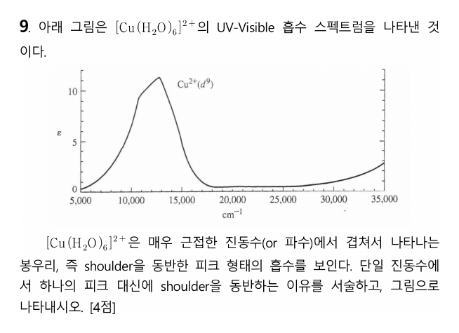

**정답** Cu²⁺(d⁹)는 eg에 전자 3개(축퇴 오비탈에 불균등)라 **Jahn–Teller 일그러짐**(주로 z-out)이 일어나 eg와 t₂g가 갈라진다. 그래서 t₂g → eg 하나의 흡수 대신 가까운 두 전이 **b₂g → b₁g(xy → x²−y²)**와 **eg → b₁g(xz, yz → x²−y²)**가 겹쳐 어깨가 생긴다.

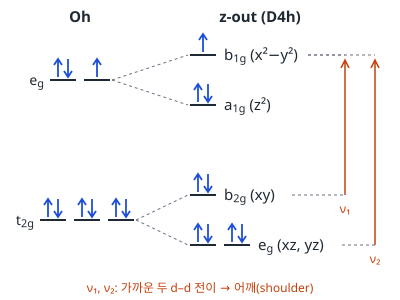

**공식·핵심 개념**

- Jahn–Teller: 축퇴 오비탈의 불균등 점유 → 일그러짐
- d⁹ z-out: b₁g(x²−y²) 맨 위, 홀전자 1개
- 전이 여러 개가 겹쳐 어깨

**2027 출제 가능성 ★★★★☆ 높음** — Jahn–Teller와 스펙트럼 해석은 무기에서 자주 나옵니다.

**z-out 갈라짐(D₄h).** eg → b₁g(x²−y², +½δ₁) / a₁g(z², −½δ₁), t₂g → b₂g(xy, +⅔δ₂) / eg(xz, yz, −⅓δ₂). d⁹은 b₁g에 홀전자 1개 → z-out이 ½δ₁만큼 안정.

**채점 포인트·함정**

- 그림에는 두 전이를 화살표로 표시합니다(a₁g → b₁g는 에너지가 작아 근적외선 쪽).

## B형 10번 · EDTA 가림·풀림 적정 {#b10}

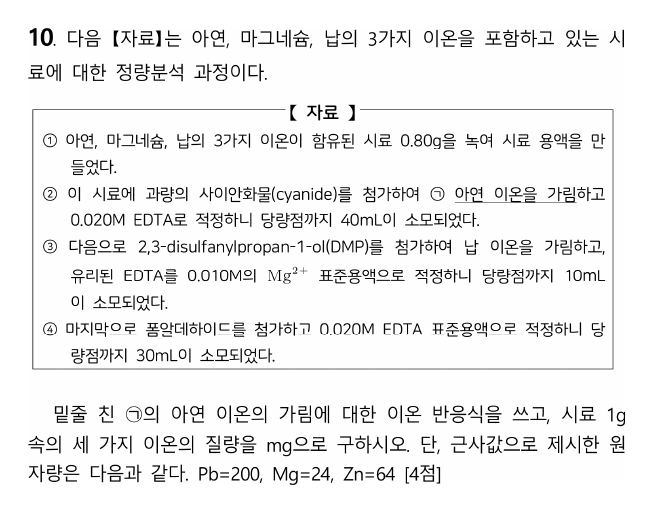

**정답** ㉠ $\mathrm{Zn^{2+} + 4CN^- \to [Zn(CN)_4]^{2-}}$. 시료 1 g 속 **Pb 25 mg, Mg 21 mg, Zn 48 mg**

**공식·핵심 개념**

- 가림제: CN⁻(Zn), DMP(Pb), 풀림제: 폼알데하이드
- EDTA는 금속과 1 : 1
- 역적정·치환 적정

**2027 출제 가능성 ★★★★☆ 높음** — EDTA 적정과 가림제는 분석화학의 대표 소재입니다.

| 단계 | 의미 | mmol |
|---|---|---|
| ② EDTA 40 mL × 0.020 | Mg + Pb (Zn은 가림) | 0.80 |
| ③ Mg²⁺ 10 mL × 0.010 | DMP가 Pb를 빼앗아 풀려난 EDTA = Pb | 0.10 |
| Mg | 0.80 − 0.10 | 0.70 |
| ④ EDTA 30 mL × 0.020 | 폼알데하이드가 Zn(CN)₄²⁻를 풀어 줌 = Zn | 0.60 |

시료 0.80 g → 1 g으로 환산(÷ 0.80): Pb 0.10 × 200 / 0.80 = **25 mg**, Mg 0.70 × 24 / 0.80 = **21 mg**, Zn 0.60 × 64 / 0.80 = **48 mg**.

**채점 포인트·함정**

- 마지막에 시료 0.80 g을 **1 g 기준으로 환산**하는 것을 빼먹기 쉽습니다.

## B형 11번 · 벤즈알데하이드의 세 반응 {#b11}

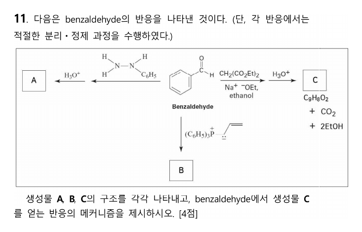

**정답** A **benzaldehyde phenylhydrazone**(E/Z), B **1-phenyl-1,3-butadiene**, C **cinnamic acid**(C₉H₈O₂)

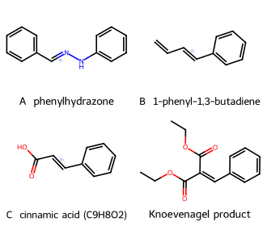

**공식·핵심 개념**

- 하이드라존: C=O + H₂N–NHR → C=N–NHR
- Wittig: 일라이드 + C=O → 알켄 + Ph₃P=O
- Knoevenagel: 활성 메틸렌 + 알데하이드 → 알켄, 이후 가수분해·탈카복실화

**2027 출제 가능성 ★★★★☆ 높음** — 카보닐 축합 반응의 메커니즘은 유기 서술형으로 자주 나옵니다.

**C의 메커니즘(Knoevenagel 축합 → 가수분해·탈카복실화).**

1. EtO⁻가 말론산 다이에틸의 활성 메틸렌 H(pKa ≈ 13)를 떼어 엔올레이트.
2. 엔올레이트가 PhCHO의 C=O를 공격 → 알콕사이드 → 양성자화.
3. 가열하면 물이 빠져 PhCH=C(CO₂Et)₂.
4. H₃O⁺, 가열: 에스터 가수분해 → 말론산 유도체 → 탈카복실화(−CO₂) → 신남산 + 2EtOH + CO₂.

**A.** 페닐하이드라진의 NH₂가 C=O에 첨가한 뒤 물이 빠지는 축합(산 촉매) → C=N–NHPh.

**B.** 알릴 일라이드의 Wittig 반응 → C=C 형성, Ph₃P=O 이탈.

**채점 포인트·함정**

- 문제에 C 옆에 + CO₂ + 2EtOH가 적혀 있는 것이 탈카복실화의 힌트입니다.

---

원문: 2025학년도 대비 김지현 전공화학 모의고사 6회(지스쿨) 문제지·답안·강의 판서. 개인 학습용 정리입니다.

