# 2025학년도 대비 전공화학 모의고사 1회 — 상세해설

김지현 전공화학 모의고사 1회(전공 A 12문항 · 전공 B 11문항)의 문항별 해설입니다. 공식 답안(「모의고사 1회 A형, B형 답안」)과 1주차 강의 안내문의 출제 의도를 바탕으로, 답안에 빠진 풀이 과정·개념·채점 포인트를 채웠습니다. 모든 계산은 다시 검산했고, 답안과 다르게 볼 여지가 있는 곳은 **검토 메모**로 따로 표시했습니다.

**문항마다 이렇게 구성했습니다**

- **문항**: 문제지 원문 이미지
- **정답**: 공식 답안 기준 (답안에 그대로 쓸 수 있는 형태)
- **핵심 개념 → 풀이 → 채점 포인트·함정**

## 정답 한눈에 보기

### 전공 A (12문항 40점)

| 번호 | 영역 | 정답 요약 |
|---|---|---|
| [1](#a1) | 물리화학 · Carnot 순환 | ㉠ $\eta = 0.250$, ㉡ $1+\dfrac{R}{C_{V,m}}$ |
| [2](#a2) | 분석화학 · 산화환원 적정, 전기량 적정 | $\mathrm{I_2 + 2S_2O_3^{2-} \to S_4O_6^{2-} + 2I^-}$, 512 s |
| [3](#a3) | 유기 · 분광 분석 | ethyl *p*-ethoxybenzoate |
| [4](#a4) | 무기 · 2차원 이온 결정 | XY, $\dfrac{4-2\sqrt2}{4}\pi$ |
| [5](#a5) | 화학교육 · POE, 하슈웨 인지갈등 | 질량 증가/감소 예상, ㉡A ㉢D ㉣B, 갈등 1 |
| [6](#a6) | 화학교육 · 교육과정, 브루너, 피아제 | 자료 수집·분석 및 해석, 영상적 표현, 입자 모형 그리기 |
| [7](#a7) | 화학교육 · 2022 개정 교육과정 | 과학과 사회, (가)~(다), 몰비 = 계수비, 화학의 언어 |
| [8](#a8) | 물리화학 · 엔탈피, J–T 계수 | $\Delta H_1 = 300\ \mathrm{J}$, $\mu_{JT} = -nb/C_p < 0$ → 온도 상승 |
| [9](#a9) | 물리화학 · 고리 위 입자 | $m_l = 0, \pm1, \dots$, $m_l\hbar$, $\langle\phi\rangle = \pi$, $\tilde\nu$ 차 $= \dfrac{h}{\pi^2 c I}$ |
| [10](#a10) | 유기 · 1,3-다이카보닐, Robinson 고리화 | A, B(MVK), C, D, E 구조, ② < ③ < ④ < ① |
| [11](#a11) | 유기 · 이민/엔아민, 환원성 아미노화 | 이민, 엔아민, *N*-propyl-3-pentanamine |
| [12](#a12) | 무기 · 군론, 19F NMR | $3A_1+B_1+2B_2$ (6개), $5A_1+3B_1+3B_2$, $D_{3h}$·$C_s$, Berry 유사회전 |

### 전공 B (11문항 40점)

| 번호 | 영역 | 정답 요약 |
|---|---|---|
| [1](#b1) | 분석화학 · 산염기 적정, 이온교환 | [HCl] = 0.0240 M, [MgCl₂] = 0.0480 M |
| [2](#b2) | 유기 · 나이트릴 환원, 이민, 사이아노하이드린 | C: PhCH=NCH₂Ph, D: PhCH(OH)CN |
| [3](#b3) | 화학교육 · 귀추, 라카토스 | 모형으로 설명·예측하기, 귀추적 사고, A·B 모두 부정적 발견법 |
| [4](#b4) | 화학교육 · 드라이버, 비고츠키, 포스너, 피아제 | 명료화와 교환, 상충된 상황에 노출, ZPD, 불만족, 동화–조절–평형 |
| [5](#b5) | 화학교육 · 과학의 본성, 포퍼, 포스너 | 잠정성, ㉢ 루이스, 불만족, 이온화 정도 |
| [6](#b6) | 물리화학 · 진동 분광 | $\mu = \dfrac{k}{4\pi^2c^2\tilde\nu^2}$, $A(1-2B)$, $v_{\text{해리}} = \dfrac{1}{2x}-1$ |
| [7](#b7) | 유기 · SNAr, Birch, benzyne | 2-methoxypyridine, Birch 생성물, 오존 분해, 톨루이딘 3종 |
| [8](#b8) | 무기 · 결정장, Jahn–Teller | ⁵D, $0.4\Delta_t$, 둘 다 z-out |
| [9](#b9) | 무기 · 5배위 결정장 | TBP $2\sqrt2$ BM·12.52 Dq, SP 0·20.00 Dq → 사각뿔 |
| [10](#b10) | 분석화학 · 다양성자산, 흡광도 | 0.0990 / 1.00×10⁻³ / 1.00×10⁻⁹ M, pH 5.30, A = 0.875 |
| [11](#b11) | 분석화학 · 혼합물 분광 정량 | ε 4개, 1.0×10⁻⁴ / 5.0×10⁻⁵ M, pH 6.7 |

**검토 메모 (공식 답안과 함께 볼 것)**

1. **A형 9번**: 답안의 포르피린 $\Delta E = \dfrac{11h^2}{8\pi^2 I}$는 고리의 π전자를 **22개**로 본 값입니다(HOMO $m_l=\pm5$ → LUMO $\pm6$). 흔히 쓰는 [18]annulene 모형(18π)으로 보면 $\dfrac{9h^2}{8\pi^2 I}$가 됩니다. 아래 해설에 두 경우를 함께 정리했습니다.
2. **B형 6번**: 문제는 $\tilde\nu$를 "진동수($\mathrm{s^{-1}}$)"라고 했지만 답안은 $\lambda = 1/\tilde\nu$(파수)로 계산했습니다. 진동수로 읽으면 $\lambda = c/\nu$이므로 답에 $c$가 곱해집니다.
3. **B형 답안 표**: 답안지 머리말은 "기입형 1~4번 / 서술형 5~12번"이지만 실제 B형은 기입형 1~2번(각 2점), 서술형 3~11번(각 4점)입니다(2×2 + 9×4 = 40점).
4. **B형 5번**: 문제지의 첫 자료 제목이 「자료 2」로 인쇄되어 있습니다. 작성 방법에 맞춰 첫 자료를 【자료 1】로 읽으면 됩니다.

# 전공 A

## A형 1번 · Carnot 순환의 효율과 단열 과정 {#a1}

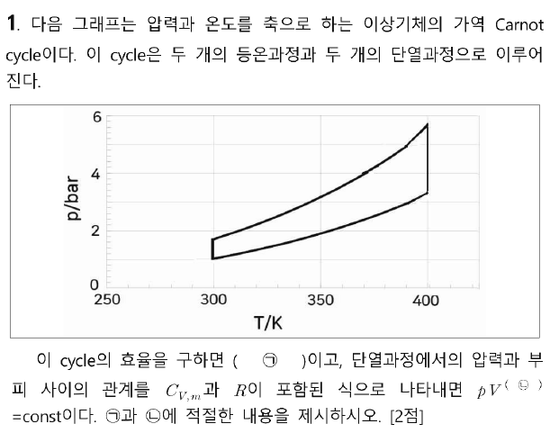

**정답** ㉠ $\eta = \dfrac{T_h - T_c}{T_h} = \dfrac{400-300}{400} = 0.250$  ㉡ $1 + \dfrac{R}{C_{V,m}}$ (즉 $pV^{\gamma}$, $\gamma = C_{p,m}/C_{V,m}$)

**그래프 읽기.** 가로축이 온도, 세로축이 압력인 $p$–$T$ 그래프입니다. 수직선 두 개(T = 300 K, 400 K)가 **등온 과정**, 이를 잇는 두 곡선이 **단열 과정**입니다. 따라서 고온 열원 $T_h = 400\ \mathrm{K}$, 저온 열원 $T_c = 300\ \mathrm{K}$입니다.

**㉠ 효율.** 가역 Carnot 기관의 효율은 작동 물질과 상관없이 두 열원의 온도로만 정해집니다.

$$\eta = 1 - \frac{T_c}{T_h} = 1 - \frac{300}{400} = 0.250$$

**㉡ 단열 과정의 $p$–$V$ 관계 유도.** 가역 단열($dq = 0$)이면 $dU = dw$이고, 이상기체 1 mol에서

$$C_{V,m}\,dT = -p\,dV = -\frac{RT}{V}dV \;\;\Rightarrow\;\; \frac{C_{V,m}}{R}\ln\frac{T_f}{T_i} = -\ln\frac{V_f}{V_i}$$

이므로 $TV^{R/C_{V,m}} = \text{const}$입니다. 여기에 $T = pV/R$를 넣으면

$$pV\cdot V^{R/C_{V,m}} = pV^{\,1+R/C_{V,m}} = \text{const}$$

이고, $C_{p,m} - C_{V,m} = R$이므로 지수는 $\gamma = C_{p,m}/C_{V,m}$와 같습니다.

**채점 포인트·함정**

- ㉠은 0.25(유효숫자 3자리면 0.250). 온도를 섭씨로 넣으면 틀립니다.
- ㉡은 "$C_{V,m}$과 $R$이 포함된 식"으로 쓰라고 했으므로 $\gamma$만 쓰면 감점 소지가 있습니다. $1 + R/C_{V,m}$ 형태로 씁니다.

## A형 2번 · 에틸 머르캅탄의 요오드 역적정과 전기량 적정 {#a2}

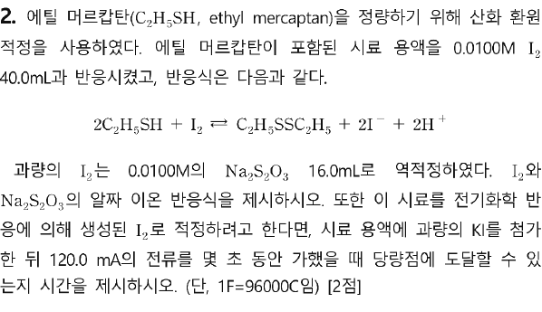

**정답** (1) $\mathrm{I_2 + 2S_2O_3^{2-} \rightarrow S_4O_6^{2-} + 2I^-}$  (2) **512 s**

**핵심 개념.** 역적정(back titration): 시료와 반응하고 **남은** I₂를 싸이오황산 이온으로 적정해서, 반응에 쓰인 I₂를 거꾸로 구합니다. 전기량 적정에서는 과량의 I⁻를 전기분해해 I₂를 만들고($\mathrm{2I^- \to I_2 + 2e^-}$), 흘린 전하량으로 생성된 I₂의 양을 셉니다.

**풀이**

| 단계 | 계산 | 결과 |
|---|---|---|
| 넣은 I₂ | $0.0100\ \mathrm{M} \times 40.0\ \mathrm{mL}$ | 0.400 mmol |
| 남은 I₂ | $\tfrac12 \times 0.0100\ \mathrm{M} \times 16.0\ \mathrm{mL}$ (I₂ : S₂O₃²⁻ = 1 : 2) | 0.0800 mmol |
| 시료와 반응한 I₂ | $0.400 - 0.0800$ | 0.320 mmol |
| C₂H₅SH | $2 \times 0.320$ (반응식 2 : 1) | 0.640 mmol |

전기량 적정에서 당량점은 **시료와 반응하는 I₂ 0.320 mmol**이 생성된 순간입니다. I₂ 1 mol에 전자 2 mol이 필요하므로

$$Q = 2 \times 0.320\times10^{-3}\ \mathrm{mol} \times 96000\ \mathrm{C\,mol^{-1}} = 61.44\ \mathrm{C}$$

$$t = \frac{Q}{I} = \frac{61.44\ \mathrm{C}}{0.1200\ \mathrm{A}} = 512\ \mathrm{s}$$

**채점 포인트·함정**

- 싸이오황산 적정에서 생성물은 사싸이온산 이온 $\mathrm{S_4O_6^{2-}}$입니다. 전하·원자 수를 맞춰 씁니다.
- 흔한 실수: 처음 넣은 I₂ 전체(0.400 mmol)로 계산하면 640 s가 나옵니다. 전기량 적정에서는 과량 I₂를 넣지 않으므로 **시료가 소비하는 I₂만큼만** 만들면 됩니다.
- 전류 단위 mA → A 환산(120.0 mA = 0.1200 A).

## A형 3번 · IR·NMR·MS로 구조 결정 {#a3}

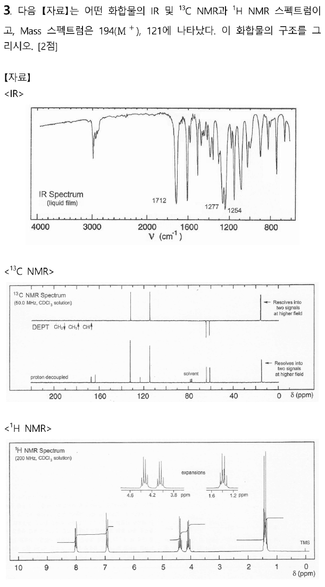

**정답** ethyl *p*-ethoxybenzoate (4-ethoxybenzoic acid ethyl ester), $\mathrm{C_{11}H_{14}O_3}$

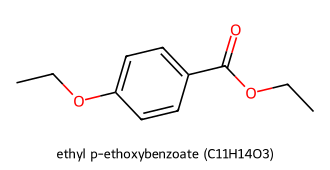

**1단계 · 분자식과 불포화도.** M⁺ = 194. 방향족(¹H 7–8 ppm) + 에스터 C=O(1712 cm⁻¹)를 가정하고 $\mathrm{C_{11}H_{14}O_3}$ (132 + 14 + 48 = 194)를 세우면 불포화도 $= \dfrac{2(11)+2-14}{2} = 5$ (벤젠 고리 4 + C=O 1)로 맞습니다.

**2단계 · 스펙트럼 해석**

| 자료 | 신호 | 해석 |
|---|---|---|
| IR | 1712 cm⁻¹ (강) | 방향족과 콘쥬게이션된 에스터 C=O (일반 에스터 1735보다 낮음) |
| IR | 1277, 1254 cm⁻¹ | C–O 신축 (에스터 C(=O)–O, 아릴 에터 Ar–O) |
| IR | ~3000 cm⁻¹ 아래만 | sp³ C–H, O–H·N–H 없음 |
| ¹H | δ 8.0 (d, 2H), 6.9 (d, 2H) | *para* 이치환 벤젠(AA′BB′). 8.0은 C=O 쪽, 6.9는 OEt 쪽 H |
| ¹H | δ 4.35 (q, 2H), 4.08 (q, 2H) | O–CH₂ 두 종류: CO₂**CH₂**(4.35), ArO**CH₂**(4.08) |
| ¹H | δ 1.4 (겹친 t 두 개, 6H) | CH₃ 두 개 (확대 그림에서 삼중선 두 개가 겹침) |
| ¹³C | ~166, ~163 | 에스터 C=O, 산소가 붙은 방향족 C |
| ¹³C (DEPT CH ↑) | ~131, ~114 | 방향족 CH 두 종류 (대칭 → 2개 신호) |
| ¹³C | ~123 | C=O가 붙은 방향족 C (DEPT에서 사라짐) |
| ¹³C (DEPT CH₂ ↓) | ~64, ~61 | O–CH₂ 두 개 |
| ¹³C (DEPT CH₃ ↑) | ~14 (두 신호로 분리) | CH₃ 두 개 |

**3단계 · MS로 확인.** m/z 194(M⁺) → 에톡시 라디칼(·OC₂H₅, 45)을 잃으면 아실륨 이온 $\mathrm{EtO{-}C_6H_4{-}C{\equiv}O^+}$ (149), 다시 에틸렌(C₂H₄, 28)이 빠지면 $\mathrm{HO{-}C_6H_4{-}C{\equiv}O^+}$ **121**입니다.

**채점 포인트·함정**

- 탄소 신호는 9개뿐이지만 *para* 대칭 때문에 방향족 CH가 2개씩 겹친 것입니다(11개 탄소 = 9개 환경).
- 두 OCH₂를 구별해야 합니다. 에스터 쪽(CO₂CH₂)이 더 낮은 장(4.35)입니다.
- ethyl 4-ethoxybenzoate를 메틸·프로필 조합(예: propyl 4-methoxybenzoate)과 혼동하지 않도록, 사중선 2개 + 삼중선 2개 패턴으로 에틸 2개를 확정합니다.

## A형 4번 · 가상의 2차원 이온 결정 {#a4}

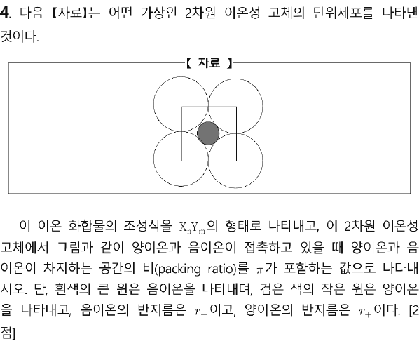

**정답** (1) 조성식 **XY**  (2) 점유 비율 $= \dfrac{4-2\sqrt2}{4}\pi = \dfrac{2-\sqrt2}{2}\pi \approx 0.920$

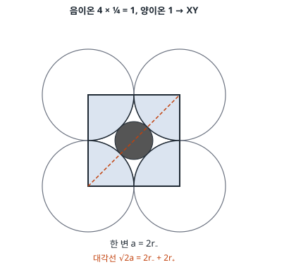

**조성식.** 2차원 단위세포(정사각형)에서 꼭짓점의 음이온은 4개의 세포가 나누어 가지므로 $4 \times \tfrac14 = 1$개, 중심의 양이온은 1개입니다. 따라서 양이온 : 음이온 = 1 : 1 → **XY**.

**점유 비율.** 그림에서 큰 원(음이온)끼리 변을 따라 서로 닿아 있고, 양이온은 대각선 방향으로 음이온과 접촉합니다.

- 변: $a = 2r_-$
- 대각선: $\sqrt2 a = 2r_- + 2r_+ \Rightarrow r_+ = (\sqrt2 - 1)r_-$

$$\text{점유 비율} = \frac{\pi r_-^2 + \pi r_+^2}{a^2} = \frac{\pi r_-^2\left[1 + (\sqrt2-1)^2\right]}{4r_-^2} = \frac{\pi(4 - 2\sqrt2)}{4}$$

**채점 포인트·함정**

- 2차원이므로 "공간"은 **넓이**입니다. 부피($\tfrac43\pi r^3$)를 쓰면 틀립니다.
- $r_+/r_- = \sqrt2 - 1 \approx 0.414$는 사각형(4배위) 배치의 임계 반지름 비와 같은 값입니다.
- 답을 $r_+$, $r_-$로 남기지 말고, 접촉 조건으로 소거해 $\pi$만 남깁니다.

## A형 5번 · POE 수업 모형과 하슈웨의 인지갈등 모형 {#a5}

**정답**

- ㉠ 예상 결과: (학생의 선개념대로) 화학 반응이 일어나면 질량이 변한다. **[실험 1]은 앙금이 생겨 질량이 증가**하고, **[실험 2]는 기체가 생겨 질량이 감소**할 것이다.
- ㉡ → **A**, ㉢ → **D**, ㉣ → **B**
- 갈등 유형: **갈등 (1)**. 학생의 선개념(A) '물질의 상태가 변하면 질량도 변한다'로는 ㉢에서 관찰한 결과(D) '앙금 생성 반응과 기체 발생 반응에서도 총질량이 변하지 않는다'를 설명할 수 없기 때문이다.

**핵심 개념 · POE**: 예상(Predict) → 관찰(Observe) → 설명(Explain). 학생이 이유와 함께 결과를 예상하게 한 뒤(가), 실험으로 예상과 다른 결과를 보게 하고(나), 그 차이를 설명하며 과학 개념을 정리합니다(다).

**하슈웨(Hashweh)의 인지갈등 모형**

| 기호 | 세계 | 의미 | 이 문항 |
|---|---|---|---|
| A | 사고의 세계 | 학생의 선개념 | ㉡ 그렇게 예상한 이유 (상태가 변하면 질량이 변함) |
| B | 사고의 세계 | 과학적 개념 | ㉣ 과학 개념 (질량 보존 법칙) |
| C | 현실 세계 | 선개념으로 설명되는 현상 | — |
| D | 현실 세계 | 선개념으로 설명되지 않는 현상 | ㉢ 관찰한 결과 (총질량 일정) |

- **갈등 (1)**: 선개념(A) ↔ 그것으로 설명할 수 없는 실제 현상(D). 실험·관찰로 유발됩니다.
- **갈등 (2)**: 선개념(A) ↔ 과학 개념(B). 교사의 설명 등으로 유발됩니다.

(나) 단계는 학생이 **실험을 하며** 인지적 갈등을 겪는 단계이므로 갈등 (1)입니다.

**채점 포인트·함정**

- ㉠은 **과학적으로 옳은 결과가 아니라 학생이 예상할 결과**를 묻습니다. "질량 변화 없음"이라고 쓰면 틀립니다.
- 실제로는 두 실험 모두 물질이 계 밖으로 나가지 않으므로(실험 2는 뚜껑을 닫은 닫힌 계) 반응 전후 총질량이 같습니다.
- 갈등 이유를 쓸 때 ㉢의 관찰 내용(질량 변화 없음)을 반드시 포함합니다.

## A형 6번 · 성취기준, 브루너의 표현양식, 피아제 {#a6}

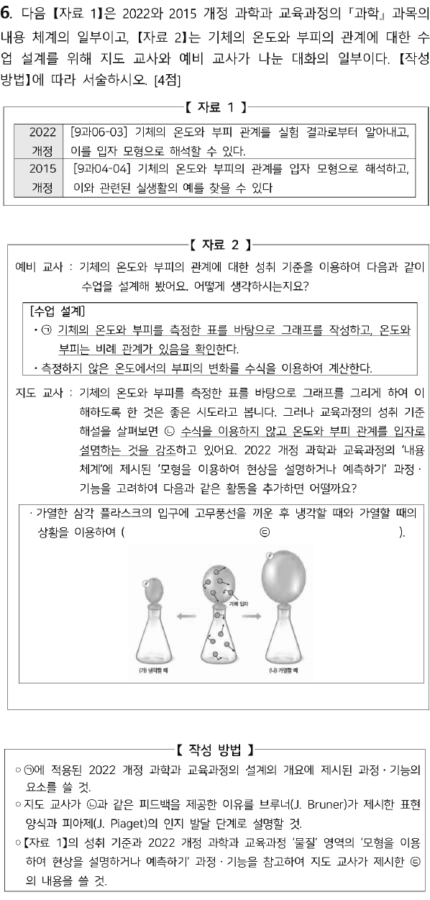

**정답**

- ㉠ 과정·기능 요소: **자료 수집·분석 및 해석**
- ㉡ 이유: 수식과 같은 **상징적 표현**은 형식적 조작 단계의 학생이 이해할 수 있지만 **구체적 조작 단계** 학생에게는 어렵다. 그래서 학생의 인지 발달 단계에 맞추어 입자 모형과 같은 **영상적 표현**으로 이해하기 쉽게 하려는 것이다.
- ㉢ 활동: 풍선 속 기체 입자를 모형(입자와 화살표)으로 나타내되 **입자의 개수와 크기는 같게** 하고, 냉각한 (가)에서는 입자 운동이 느려지므로 화살표를 짧게, 가열한 (나)에서는 빨라지므로 화살표를 길게 그려, 온도에 따라 기체의 부피가 달라지는 것을 **입자 모형으로 설명**하게 한다.

**㉠** 측정한 표를 바탕으로 그래프를 그리고 비례 관계를 찾는 활동은 2022 개정 과학과 '탐구 과정·기능' 중 **자료 수집·분석 및 해석**에 해당합니다.

**㉡ 브루너의 표현양식 × 피아제의 인지 발달 단계**

| 브루너 | 예 | 대응하는 피아제 단계 |
|---|---|---|
| 작동적(enactive) | 직접 조작, 실험 | 전조작기~구체적 조작기 |
| 영상적(iconic) | 그림, 입자 모형, 도식 | 구체적 조작기 |
| 상징적(symbolic) | 수식($V_1/T_1 = V_2/T_2$), 기호 | 형식적 조작기 |

중학생은 상당수가 구체적 조작기~과도기에 있으므로, 수식(상징)보다 입자 모형(영상)으로 설명하라는 것이 성취기준 해설의 취지입니다.

**㉢** 자료 1의 성취기준이 "입자 모형으로 해석"이고, 과정·기능이 "모형을 이용하여 현상을 설명하거나 예측하기"이므로, 그림 속 플라스크 상황을 **입자 모형으로 그려 설명하는 활동**이 들어가야 합니다.

**채점 포인트·함정**

- ㉢에서 꼭 들어갈 요소: (i) 입자의 **수·크기는 변하지 않음**, (ii) 온도에 따라 **운동 속도(화살표 길이)** 가 변함, (iii) 그 결과 **부피(입자 사이 거리)** 가 변함.
- "입자 크기가 커져서 부피가 커진다"는 대표적 오개념이므로 쓰면 안 됩니다.

## A형 7번 · 2022 개정 교육과정 설계의 개요와 탐구 과정 {#a7}

**정답**

- (가) **과학과 사회**
- '탐구 설계 및 수행'에 해당하는 과정: **(가)~(다)**
- 결론 도출: **반응한 탄산칼슘과 발생한 이산화탄소의 몰비는 1 : 1이며, 화학 반응에 관여한 물질의 몰비는 화학 반응식의 계수비와 같다.**
- 단원명: **화학의 언어**

**(가)** 2022 개정 과학과의 지식·이해 영역은 운동과 에너지 · 물질 · 생명 · 지구와 우주 · **과학과 사회**의 다섯 개입니다.

**과정·기능 5요소와 탐구 과정의 대응**

| 과정·기능 요소 | 자료 2의 과정 |
|---|---|
| 문제 인식 및 가설 설정 | [탐구 목표] 제시 |
| **탐구 설계 및 수행** | (가) 반응식 완성 → (나) 실험 계획 → (다) 실험 수행 |
| 자료 수집·분석 및 해석 | (라) 결과를 표로 정리하고 몰수 계산 |
| 결론 도출 및 일반화 | (마) 관계 토의, [결론 도출] |
| 의사소통과 협업 | (마) 모둠 토의·발표 |

**결론의 근거.** $\mathrm{CaCO_3(s) + 2HCl(aq) \rightarrow CaCl_2(aq) + H_2O(l) + CO_2(g)}$에서 CaCO₃ 1 g, 2 g, 3 g(0.01, 0.02, 0.03 mol)을 반응시키면 질량 감소(빠져나간 CO₂)도 0.44 g, 0.88 g, 1.32 g으로 같은 몰수(0.01, 0.02, 0.03 mol)가 됩니다. 즉 몰비가 반응식의 계수비(1 : 1)와 같습니다.

**채점 포인트·함정**

- 결론은 이 실험의 결과(CaCO₃ : CO₂ = 1 : 1)와 일반화(몰비 = 계수비)를 함께 쓰는 것이 안전합니다.
- 공식 답안은 (가)~(다)를 '탐구 설계 및 수행'으로 봅니다. (가)의 반응식 완성은 실험을 설계하기 위한 준비로 보는 것입니다.

## A형 8번 · 이상기체의 엔탈피 변화와 Joule–Thomson 계수 {#a8}

**정답** (1) $\Delta H_1 = 300\ \mathrm{J}$  (2) $\mu_{JT} = -\dfrac{nb}{C_p}$. $b>0$, $C_p>0$이므로 $\mu_{JT}<0$이고, Joule–Thomson 팽창(압력 감소, $dp<0$)에서 $dT = \mu_{JT}\,dp > 0$ → **온도가 올라간다.**

**(1) 이상기체.** 이상기체의 엔탈피는 온도만의 함수이므로 압력이 1 atm → 2 atm으로 바뀌어도 영향이 없습니다.

$$\Delta H_1 = nC_{p,m}\Delta T = 1 \times 30 \times (310-300) = 300\ \mathrm{J}$$

**(2) 실제기체 $p = \dfrac{nRT}{V-nb}$.** 상태식을 $V$에 대해 풀면 $V = \dfrac{nRT}{p} + nb$입니다. 열역학 관계식 $\left(\dfrac{\partial H}{\partial p}\right)_T = V - T\left(\dfrac{\partial V}{\partial T}\right)_p$에 넣으면

$$\left(\frac{\partial V}{\partial T}\right)_p = \frac{nR}{p} \;\Rightarrow\; \left(\frac{\partial H}{\partial p}\right)_T = \frac{nRT}{p} + nb - \frac{nRT}{p} = nb$$

$$\mu_{JT} = -\frac{1}{C_p}\left(\frac{\partial H}{\partial p}\right)_T = -\frac{nb}{C_p} < 0$$

**해석.** $b$는 분자의 크기(반발력)만 반영한 항이고 인력 항($a$)이 없습니다. 반발력만 있는 기체는 팽창할 때 온도가 올라갑니다(역전 온도보다 높은 온도의 H₂·He와 같은 거동).

**채점 포인트·함정**

- (1)에서 압력 변화가 있다고 $V\Delta p$ 같은 항을 더하면 틀립니다(이상기체는 $(\partial H/\partial p)_T = 0$).
- (2)는 $\mu_{JT}$ 식, 부호 판단, **"압력이 감소하므로"** 라는 근거까지 써야 만점입니다.

## A형 9번 · 고리 위의 입자(2차원 회전) {#a9}

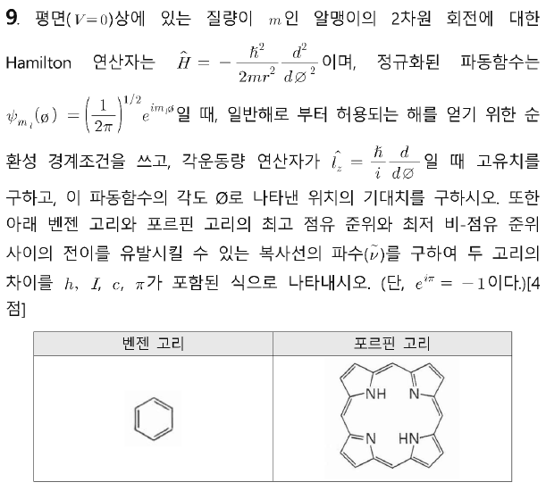

**정답**

1. 순환 경계조건 $\psi(\phi + 2\pi) = \psi(\phi)$ → $e^{2\pi i m_l} = (-1)^{2m_l} = 1$ → $m_l = 0, \pm1, \pm2, \dots$
2. 고유치 $m_l\hbar$
3. $\langle\phi\rangle = \pi$
4. $\Delta E_{\text{벤젠}} = \dfrac{3h^2}{8\pi^2 I}$, $\Delta E_{\text{포르핀}} = \dfrac{11h^2}{8\pi^2 I}$ → $\Delta E_{\text{포르핀}} - \Delta E_{\text{벤젠}} = \dfrac{h^2}{\pi^2 I} = hc\Delta\tilde\nu$ → $\Delta\tilde\nu = \dfrac{h}{\pi^2 c I}$

**(1) 순환 경계조건.** 고리를 한 바퀴 돌면 같은 점이므로 파동함수가 한 값이어야 합니다.

$$\psi_{m_l}(\phi+2\pi) = \frac{e^{im_l\phi}e^{2\pi i m_l}}{(2\pi)^{1/2}} = \psi_{m_l}(\phi)\,e^{2\pi i m_l}, \quad e^{2\pi i m_l} = (e^{i\pi})^{2m_l} = (-1)^{2m_l} = 1$$

$2m_l$이 짝수 정수여야 하므로 $m_l$은 정수(0 포함)입니다.

**(2) 각운동량 고유치.**

$$\hat l_z\psi = \frac{\hbar}{i}\frac{d}{d\phi}\left[\frac{e^{im_l\phi}}{(2\pi)^{1/2}}\right] = \frac{\hbar}{i}(im_l)\psi = m_l\hbar\,\psi$$

**(3) 각도의 기대치.** $\psi^*\psi = \dfrac{1}{2\pi}$ (모든 각도에서 확률이 같음)이므로

$$\langle\phi\rangle = \int_0^{2\pi}\psi^*\phi\,\psi\,d\phi = \frac{1}{2\pi}\left[\frac{\phi^2}{2}\right]_0^{2\pi} = \pi$$

**(4) HOMO–LUMO 전이.** 에너지는 $E = \dfrac{m_l^2\hbar^2}{2I} = \dfrac{m_l^2 h^2}{8\pi^2 I}$이고, $m_l = 0$은 한 준위(전자 2개), $m_l \neq 0$은 $\pm m_l$ 이중 축퇴(전자 4개)입니다.

| 고리 | π전자 | 채워진 준위 | HOMO → LUMO | $\Delta E$ |
|---|---|---|---|---|
| 벤젠 | 6 | $m_l = 0$(2), $\pm1$(4) | $1 \to 2$ | $(4-1)\dfrac{h^2}{8\pi^2 I} = \dfrac{3h^2}{8\pi^2 I}$ |
| 포르핀 (답안 가정) | 22 | $0, \pm1, \dots, \pm5$ | $5 \to 6$ | $(36-25)\dfrac{h^2}{8\pi^2 I} = \dfrac{11h^2}{8\pi^2 I}$ |
| 포르핀 ([18]annulene 모형) | 18 | $0, \pm1, \dots, \pm4$ | $4 \to 5$ | $(25-16)\dfrac{h^2}{8\pi^2 I} = \dfrac{9h^2}{8\pi^2 I}$ |

$\Delta E = hc\tilde\nu$이므로 공식 답안 기준

$$\tilde\nu_{\text{포르핀}} - \tilde\nu_{\text{벤젠}} = \frac{(11-3)h^2}{8\pi^2 I\,hc} = \frac{h}{\pi^2 c I}$$

**검토 메모.** 18π 모형을 쓰면 차이는 $\dfrac{(9-3)h}{8\pi^2 cI} = \dfrac{3h}{4\pi^2 cI}$입니다. 시험에서는 문제가 π전자 수를 주지 않으면 **몇 개로 셌는지 답안에 밝혀 두는 것**이 안전합니다. 또 실제로는 두 고리의 반지름이 달라 $I$도 다르지만, 문제는 같은 $I$로 놓고 식을 세우도록 했습니다.

**채점 포인트·함정**

- (1)은 $e^{i\pi} = -1$을 써서 $(-1)^{2m_l} = 1$로 연결하는 과정이 핵심입니다.
- (3)에서 $e^{-im\phi}e^{im\phi} = 1$로 지수 부분이 사라지는 것을 보여 줍니다.
- (4)에서 $\hbar = h/2\pi$ 변환 실수가 잦습니다: $\dfrac{\hbar^2}{2I} = \dfrac{h^2}{8\pi^2 I}$.

## A형 10번 · 2,4-pentanedione의 반응과 Robinson 고리화 {#a10}

**정답** A, B, C, D, E 구조는 아래와 같고, $pK_a$가 작은 순서는 **② < ③ < ④ < ①**.

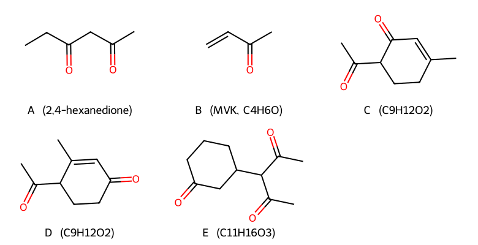

**A — 다이음이온의 알킬화.** 염기 1당량은 가장 산성인 가운데 CH₂(pKa ≈ 9)를 떼고, **2당량째** 염기가 말단 CH₃의 양성자를 떼어 다이음이온을 만듭니다. 이때 **덜 안정한(반응성이 큰) 말단 탄소음이온**이 CH₃I와 먼저 반응하므로, 물로 처리하면 말단이 메틸화된 **2,4-hexanedione**(CH₃COCH₂COCH₂CH₃)이 됩니다.

**B, C, D — Robinson 고리화.** C(C₉H₁₂O₂) − 2,4-pentanedione(C₅H₈O₂) = C₄H₄이고, 고리화(aldol 축합)에서 물 한 분자가 빠지므로 B = C₄H₄ + H₂O = **C₄H₆O, methyl vinyl ketone(MVK)** 입니다.

1. **Michael 첨가**: 2,4-pentanedione 엔올레이트가 MVK의 β-탄소에 1,4-첨가 → 3-acetyl-heptane-2,6-dione 형태의 1,5-다이카보닐.
2. **분자 내 aldol 축합 + 탈수**: 어느 메틸 케톤의 α-탄소가 어느 카보닐을 공격하느냐에 따라 6원 고리 두 가지가 생깁니다.
   - **C**: MVK에서 온 CH₃의 엔올레이트가 아세틸 C=O를 공격 → 6-acetyl-3-methylcyclohex-2-enone
   - **D**: 아세틸의 CH₃ 엔올레이트가 MVK에서 온 C=O를 공격 → 4-acetyl-3-methylcyclohex-2-enone

**E — Michael 첨가.** 2,4-pentanedione 엔올레이트가 cyclohexenone의 β-탄소에 1,4-첨가 → 3-(diacetylmethyl)cyclohexanone, $\mathrm{C_5H_7O_2 + C_6H_8O + H = C_{11}H_{16}O_3}$. 안정화된 엔올레이트(연한 친핵체)는 C=O(1,2)보다 β-탄소(1,4)를 공격합니다.

**pKa 비교 (밑줄 친 H)**

| 화합물 | 근거 | pKa(대략) |
|---|---|---|
| ② 2,4-pentanedione | 케톤 C=O 두 개로 음전하 비편재화 | ≈ 9 |
| ③ ethyl acetoacetate | C=O 두 개 중 하나가 에스터(OEt의 공명 주개 효과로 안정화 약함) | ≈ 11 |
| ④ diethyl malonate | 에스터 두 개 | ≈ 13 |
| ① acetaldehyde α-H | C=O 하나 | ≈ 17 |

**채점 포인트·함정**

- A를 가운데 탄소가 메틸화된 3-methyl-2,4-pentanedione으로 쓰면 틀립니다. 2당량 염기 → 말단 알킬화가 핵심입니다.
- C와 D는 같은 분자식(C₉H₁₂O₂)의 위치 이성질체임을 확인합니다.

## A형 11번 · 이민·엔아민 형성과 환원성 아미노화 {#a11}

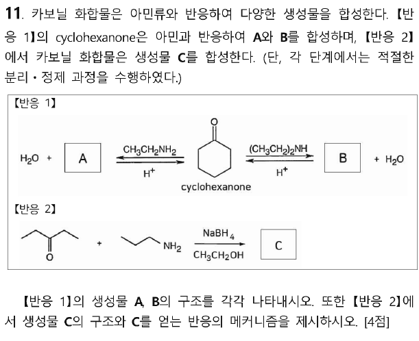

**정답** A: *N*-ethylcyclohexanimine (이민), B: 1-(diethylamino)cyclohexene (엔아민), C: *N*-propylpentan-3-amine

**A, B.** 1차 아민(CH₃CH₂NH₂)은 카보닐과 축합해 **이민(C=N–R)** 을 만들고, 2차 아민((CH₃CH₂)₂NH)은 N에 떼어 낼 H가 없어 **α-탄소의 H가 빠지며 엔아민(C=C–NR₂)** 이 됩니다. 두 반응 모두 산 촉매·가역 반응이며 물이 빠집니다(물을 제거해 평형을 이동).

**C의 메커니즘 (환원성 아미노화)**

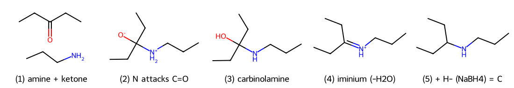

1. propylamine의 N 비공유 전자쌍이 3-pentanone의 카보닐 C를 친핵성 공격 → 쌍극 이온 사면체 중간체
2. 양성자 이동 → **카비놀아민**(hemiaminal)
3. OH가 양성자화되어 물로 이탈 → **이미늄 이온**(C=N⁺H–R) (중성 이민과 평형)
4. NaBH₄의 수소화 이온(H⁻)이 이미늄 탄소를 공격 → **2차 아민 C** (CH₃CH₂)₂CH–NH–CH₂CH₂CH₃

**채점 포인트·함정**

- 메커니즘에서 화살표의 출발점(비공유 전자쌍·결합)과 양성자 이동 단계를 빠뜨리지 않습니다.
- 생성물은 이민이 아니라 **환원된 아민**입니다. NaBH₄가 이민(이미늄)의 C=N을 환원합니다.

## A형 12번 · ClF₃·PCl₂F₃의 진동 기약표현과 ¹⁹F NMR {#a12}

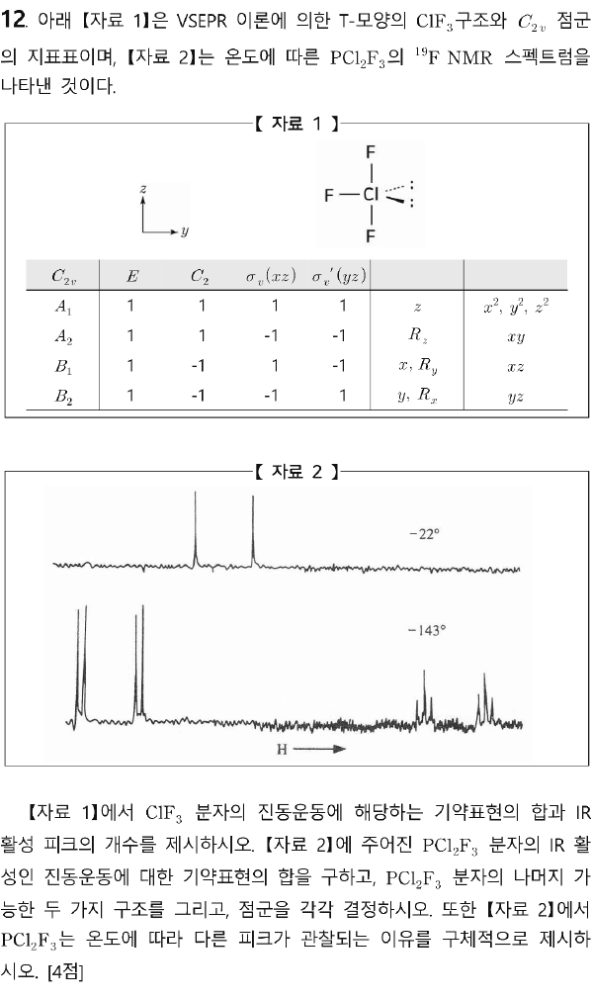

**정답**

1. ClF₃: $\Gamma_{\text{vib}} = 3A_1 + B_1 + 2B_2$, IR 활성 피크 **6개**
2. PCl₂F₃ (축 F 2개, $C_{2v}$): IR 활성 $\Gamma = 5A_1 + 3B_1 + 3B_2$
3. 나머지 구조: 축에 Cl 2개 → $D_{3h}$, 축에 F·Cl 하나씩 → $C_s$
4. NMR: −22 °C에서는 Berry 유사회전으로 축·적도 F가 빠르게 자리를 바꿔 구별되지 않고 P–F 짝지음에 의한 이중선 하나만 보인다. −143 °C에서는 교환이 멈춰 축 F 2개(F–F 짝지음으로 이중선, 다시 P–F로 이중선)와 적도 F 1개(축 F 2개에 의해 삼중선, 다시 P–F로 두 개)가 따로 관측된다.

**(1) ClF₃의 진동 기약표현.** 4원자 → $3N = 12$. 각 연산에서 움직이지 않는 원자 수 × 원자당 기여도:

| $C_{2v}$ | $E$ | $C_2$ | $\sigma_v(xz)$ | $\sigma_v'(yz)$ |
|---|---|---|---|---|
| 움직이지 않는 원자 | 4 | 2 | 2 | 4 (분자 평면) |
| 원자당 기여 | 3 | −1 | 1 | 1 |
| $\Gamma_{3N}$ | 12 | −2 | 2 | 4 |

축소하면 $\Gamma_{3N} = 4A_1 + A_2 + 3B_1 + 4B_2$ (자료 1의 축처럼 분자 평면이 $yz$). 병진($A_1+B_1+B_2$)과 회전($A_2+B_1+B_2$)을 빼면

$$\Gamma_{\text{vib}} = 3A_1 + B_1 + 2B_2 \quad(6\text{개})$$

$A_1$($z$), $B_1$($x$), $B_2$($y$) 모두 IR 활성이므로 **6개 모두 IR 활성**입니다. (분자 평면을 $xz$로 두면 $3A_1 + 2B_1 + B_2$로 B₁·B₂가 바뀌어 나오지만 개수는 같습니다.)

**(2) PCl₂F₃ ($C_{2v}$, 축 F 2개 · 적도 F 1개 + Cl 2개).** 6원자 → $3N = 18$.

| $C_{2v}$ | $E$ | $C_2$ | $\sigma_v$ (F 축 평면) | $\sigma_v'$ (Cl 평면) |
|---|---|---|---|---|
| 움직이지 않는 원자 | 6 | 2 (P, F적도) | 4 (P, F 3개) | 4 (P, F적도, Cl 2개) |
| $\Gamma_{3N}$ | 18 | −2 | 4 | 4 |

$\Gamma_{3N} = 6A_1 + 2A_2 + 5B_1 + 5B_2$ → 병진·회전 제외 $\Gamma_{\text{vib}} = 5A_1 + A_2 + 3B_1 + 3B_2$ (12개). $A_2$는 IR 비활성이므로

$$\Gamma_{\text{IR}} = 5A_1 + 3B_1 + 3B_2 \quad(11\text{개})$$

**(3) 가능한 나머지 두 구조**

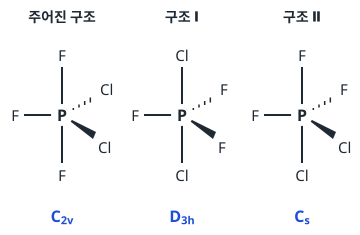

전기음성도가 큰 F가 축 자리를 선호하므로(축 결합은 3중심-4전자 성격으로 전자 밀도를 더 많이 가짐) 실제 안정 구조는 축에 F 두 개인 $C_{2v}$ 구조입니다.

**(4) 온도에 따른 ¹⁹F NMR**

- **−22 °C (빠른 교환)**: Berry 유사회전(축 2개 ↔ 적도 2개를 맞바꾸는 운동)이 NMR 시간 척도보다 빨라, F 세 개가 평균된 한 환경으로 보입니다. ³¹P(I = ½)와의 짝지음으로 **이중선 1개**.
- **−143 °C (느린 교환)**: 교환이 얼어붙어 두 환경이 따로 보입니다.
  - 축 F 2개(세기 2): 적도 F 1개와 짝지어 이중선 → P–F 짝지음으로 다시 이중선 = **이중선의 이중선** (낮은 장)
  - 적도 F 1개(세기 1): 축 F 2개와 짝지어 삼중선 → P–F 짝지음으로 **삼중선 두 개** (높은 장)

**채점 포인트·함정**

- (2)는 "IR 활성인" 기약표현만 묻습니다. $A_2$를 넣으면 틀립니다.
- (4)는 '유사회전 → 평균화(고온)', '교환 정지 → 축/적도 구별(저온)', '갈라짐 패턴의 원인(F–F, P–F)'이 모두 있어야 합니다.

# 전공 B

## B형 1번 · 산염기 적정과 이온교환 {#b1}

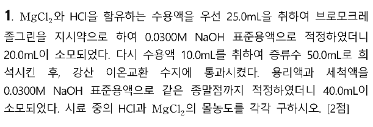

**정답** [HCl] = **0.0240 M**, [MgCl₂] = **0.0480 M**

**1단계 · HCl만 적정.** 브로모크레졸 그린(변색 pH ≈ 3.8~5.4)은 강산 HCl의 당량점에서 변색하며, 이 pH에서 Mg²⁺는 NaOH와 반응하지 않습니다(Mg(OH)₂ 침전은 pH ≈ 10 이상).

$$n_{\mathrm{HCl}} = 0.0300 \times 20.0 = 0.600\ \mathrm{mmol} \;\Rightarrow\; [\mathrm{HCl}] = \frac{0.600}{25.0} = 0.0240\ \mathrm{M}$$

**2단계 · 강산 양이온교환 수지.** H⁺형 수지에 통과시키면 양이온이 모두 H⁺로 바뀝니다: Mg²⁺ 1개 → H⁺ **2개**, HCl의 H⁺는 그대로.

| 시료 10.0 mL 속 | 양 |
|---|---|
| 용리액의 전체 H⁺ | $0.0300 \times 40.0 = 1.20\ \mathrm{mmol}$ |
| HCl에서 온 H⁺ | $0.0240 \times 10.0 = 0.240\ \mathrm{mmol}$ |
| Mg²⁺에서 온 H⁺ | $1.20 - 0.240 = 0.96\ \mathrm{mmol}$ |
| Mg²⁺ | $0.96 / 2 = 0.48\ \mathrm{mmol}$ |

$$[\mathrm{MgCl_2}] = \frac{0.48\ \mathrm{mmol}}{10.0\ \mathrm{mL}} = 0.0480\ \mathrm{M}$$

**채점 포인트·함정**

- 희석에 쓴 증류수 50.0 mL는 몰수에 영향이 없습니다(원래 시료 10.0 mL로 나눕니다).
- 두 번째 적정에서 첫 번째와 시료 부피(25.0 vs 10.0 mL)가 다른 점에 주의합니다.
- Mg²⁺ 하나가 H⁺ **두 개**와 교환되는 것을 놓치면 0.0960 M이 나옵니다.

## B형 2번 · 벤조나이트릴의 환원과 이민·사이아노하이드린 {#b2}

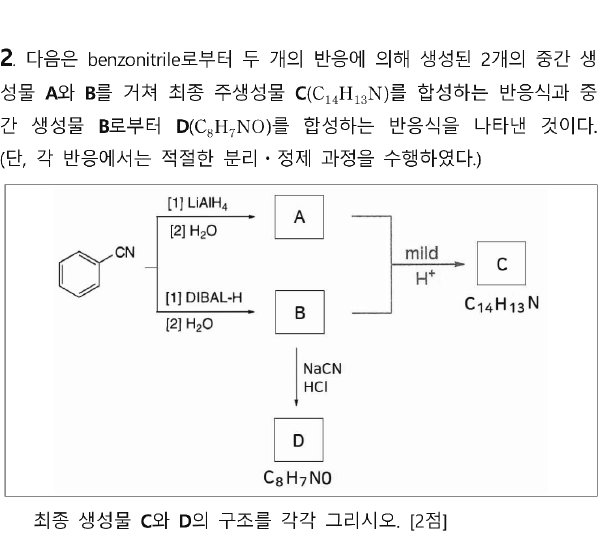

**정답** C: *N*-benzylidenebenzylamine (PhCH=N–CH₂Ph), D: mandelonitrile (PhCH(OH)CN)

| 단계 | 시약 | 반응 | 생성물 |
|---|---|---|---|
| A | LiAlH₄ → H₂O | 나이트릴 C≡N에 H⁻ 두 번 첨가 → 1차 아민 | PhCH₂NH₂ |
| B | DIBAL-H → H₂O | H⁻ 한 번 첨가(이민 알루미늄염에서 멈춤) → 가수분해 | PhCHO |
| C | A + B, 약산 | 1차 아민 + 알데하이드 → 이민(−H₂O) | PhCH=NCH₂Ph (C₁₄H₁₃N) |
| D | NaCN, HCl | CN⁻의 카보닐 친핵성 첨가 → 양성자화 | PhCH(OH)CN (C₈H₇NO) |

**채점 포인트·함정**

- DIBAL-H는 저온에서 H⁻를 **한 번만** 주어 알데하이드에서 멈춥니다. LiAlH₄와 구별이 핵심입니다.
- C의 분자식 확인: C₇H₉N + C₇H₆O − H₂O = C₁₄H₁₃N.
- 이민 형성은 pH ≈ 4~5의 약산(mild H⁺)에서 가장 빠릅니다(너무 강한 산이면 아민이 양성자화되어 친핵성을 잃음).

## B형 3번 · 모형, 귀추적 사고, 라카토스의 발견법 {#b3}

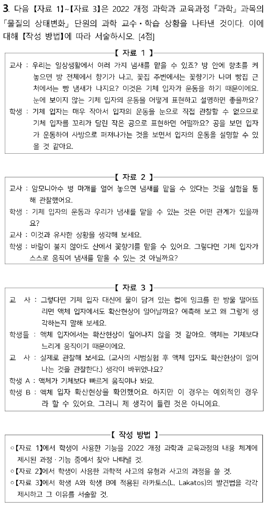

**정답**

- 자료 1의 기능: **모형을 이용하여 현상을 설명하거나 예측하기**
- 자료 2의 사고: **귀추적 사고**. 관찰한 사실(암모니아 냄새)에 대해 유사한 경험(바람이 없어도 꽃향기를 맡음)을 토대로 현재의 의문을 해결하는 설명(기체 입자가 스스로 움직인다)을 만들어 내는 사고.
- 학생 A: **부정적 발견법**. 핵심 가설(액체 입자에서는 확산이 일어나지 않는다)에 대한 반증 사례가 나타나자 보조 가설 '액체 입자는 기체보다 느리게 움직인다'를 '액체가 기체보다 빠르게 움직인다'로 바꾸어 핵을 보호하였다.
- 학생 B: **부정적 발견법**. 반증 사례를 설명할 수 없는 예외로 보고 무시하여, 보호대를 고치지도 않은 채 핵을 지켰다.

**자료 1 — 모형.** 눈에 보이지 않는 기체 입자를 '꼬리 달린 공'으로 표현해 확산을 설명하려는 것은 2022 개정 과학과 과정·기능의 **모형을 이용하여 현상을 설명하거나 예측하기**입니다.

**자료 2 — 귀추적 사고의 과정**

1. 의문 상황 인식: 마개를 연 암모니아수의 냄새를 맡는다 → 왜일까?
2. 유사 경험(원천) 탐색: 바람이 없어도 산에서 꽃향기를 맡는다.
3. 설명 가설 차용·생성: "기체 입자가 스스로 움직여 냄새가 퍼진다."

관찰된 결과로부터 그것을 가장 잘 설명하는 원인(가설)을 만들어 내는 추론이므로 연역·귀납과 구별됩니다.

**자료 3 — 라카토스의 연구 프로그램**

| 개념 | 의미 |
|---|---|
| 견고한 핵(hard core) | 반증으로부터 보호되는 핵심 가설 |
| 보호대(protective belt) | 핵을 둘러싼 보조 가설들 |
| 부정적 발견법 | 반증의 화살이 핵으로 향하지 않게 하고, 보호대를 고치거나 반례를 무시해 **핵을 보호**하는 규칙 |
| 긍정적 발견법 | 보호대를 수정·발전시켜 연구 프로그램을 **확장**하는 지침 |

두 학생 모두 반증 사례 앞에서 핵심 생각을 버리지 않고 지켰다는 점에서 부정적 발견법에 해당합니다. A는 보조 가설을 바꾸는 방식, B는 반례를 예외로 무시하는 방식입니다.

**채점 포인트·함정**

- 이유를 쓸 때 "핵을 보호했다"는 말과 함께 **무엇을 바꿨는지(A)**, **무엇을 무시했는지(B)** 를 구체적으로 씁니다.

## B형 4번 · 드라이버의 개념 변화 모형 {#b4}

**정답**

- (다) 단계의 역할: **명료화와 교환** — 학생이 자신의 생각을 분명히 알도록 한다. 자신의 표현에 대해 왜 그렇게 생각했는지 말하고 친구들과 의견을 교환하며, 다른 학생의 견해에 비추어 자신의 관념을 명료화한다.
- (라) 단계명: **상충된 상황에 노출**
- 시범실험의 목적 — 비고츠키: 학생이 생각하지 못한 상황을 제시해 **근접 발달 영역(ZPD)** 안에서 학습이 일어나 잠재적 발달 수준에 도달하게 하기 위함. 포스너: 학생의 생각과 상충되는 상황을 보여 주어 **자신의 생각에 불만족**을 느끼게 하기 위함.
- 피아제: (다)에서 학생이 선개념을 명료화하는 **동화**, (라)에서 상충된 상황에 노출되어 **인지적 갈등(비평형)**, (마)에서 교사의 과학 개념 도입으로 **조절**, (바)의 동화와 조절을 거쳐 (사)에서 **새로운 평형**에 도달하였다.

**드라이버(Driver) 모형의 단계와 자료의 대응**

| 단계 | 자료 |
|---|---|
| 1. 오리엔테이션 | (가) 학습 목표·흥미 유발 |
| 2. 생각의 표현(유도) | (나) 예상을 그림으로 그림 |
| 3. 생각의 재구성 ① 명료화와 교환 | (다) 발표, 의견 교환 |
| ② 상충된 상황에 노출 | (라) 시범실험 |
| ③ 새로운 생각의 구성 | (마) 실제 가열 곡선 제시·설명 |
| ④ 새로운 생각의 평가 | — |
| 4. 생각의 적용 | (바) 다양한 순물질·혼합물로 확인 |
| 5. 생각 변화의 검토 | (사) 개념 변화 발표 |

**과학 내용.** 순물질(물)은 끓는 동안 온도가 일정한 구간이 있지만, 혼합물(소금물)은 물이 증발하며 농도가 진해져 끓는점이 계속 올라가므로 일정한 구간이 나타나지 않습니다. 학생 A의 예상이 옳았고, 학생 B가 개념 변화를 겪은 학생입니다.

**채점 포인트·함정**

- 비고츠키와 포스너의 목적을 **각각** 써야 합니다(ZPD / 불만족).
- 피아제 설명에는 동화 → 비평형(인지 갈등) → 조절 → 평형의 흐름과 단계 근거를 함께 씁니다.

## B형 5번 · 산·염기 정의의 역사와 산의 세기 {#b5}

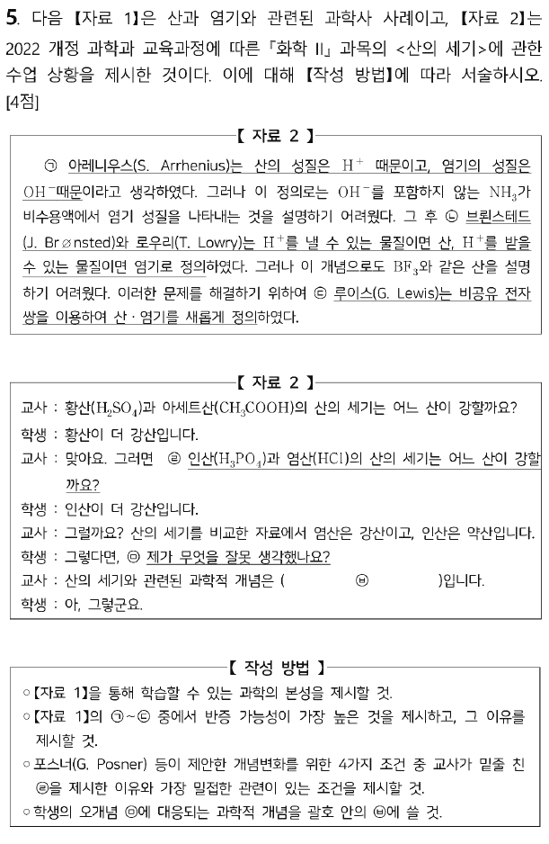

**정답**

- 과학의 본성: **과학 지식은 변할 수 있다(잠정성, 가변성).**
- 반증 가능성이 가장 높은 것: **㉢ 루이스의 정의**. ㉢의 정의는 ㉠과 ㉡을 모두 포함할 만큼 더 포괄적이어서 설명하는 범위(정보량)가 넓고, 그만큼 반증될 가능성이 높다.
- ㉣과 관련된 포스너의 조건: 교사가 학생의 생각과 **상충되는 상황**을 제시하여 학생이 **자신의 생각에 불만족**을 느끼게 하려는 것이다.
- ㉥: **산의 세기는 수소의 개수가 아니라 산의 이온화 정도(이온화 상수 $K_a$)에 의해 결정된다.**

**과학의 본성.** 아레니우스 → 브뢴스테드–로우리 → 루이스로 정의가 새 현상(NH₃의 염기성, BF₃의 산성)을 설명하기 위해 바뀌어 왔습니다. 과학 지식은 새로운 증거에 따라 수정될 수 있는 잠정적인 지식입니다.

**포퍼의 반증 가능성.** 더 많은 것을 말하는(보편적이고 대담한) 이론일수록 틀릴 수 있는 경우가 많아 반증 가능성이 높고, 포퍼는 이런 이론을 더 좋은 이론으로 봅니다. 루이스 정의는 H⁺가 없는 반응까지 다루므로 가장 포괄적입니다.

**포스너(Posner)의 개념 변화 조건 4가지**

1. 기존 개념에 대한 **불만족** ← ㉣ (H₃PO₄는 H가 3개인데 약산이라는 상충 사례)
2. 새 개념의 **이해 가능성**
3. 새 개념의 **그럴듯함**
4. 새 개념의 **유용성(생산성)**

**오개념 ㉤.** 학생은 "H가 많을수록 강산"(H₃PO₄ > HCl)이라고 생각했습니다. 실제로 산의 세기는 물속에서 H⁺를 얼마나 잘 내놓는지, 즉 **이온화도(Ka)** 로 정해집니다. HCl은 거의 완전히 이온화하고(강산), H₃PO₄는 $K_{a1} \approx 7\times10^{-3}$으로 일부만 이온화합니다(약산).

## B형 6번 · 조화·비조화 진동자 {#b6}

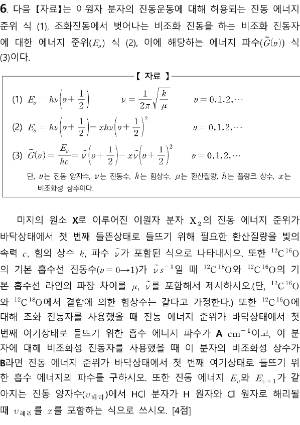

**정답**

1. $\mu = \dfrac{k}{4\pi^2c^2\tilde\nu^2}$
2. $\lambda(^{12}\mathrm{C}^{18}\mathrm{O}) - \lambda(^{12}\mathrm{C}^{16}\mathrm{O}) = \dfrac{1}{\tilde\nu}\left(\sqrt{\dfrac{\mu(^{12}\mathrm{C}^{18}\mathrm{O})}{\mu(^{12}\mathrm{C}^{16}\mathrm{O})}} - 1\right)$
3. $\tilde G(1) - \tilde G(0) = \tilde\nu - 2x\tilde\nu = A(1-2B)\ \mathrm{cm^{-1}}$
4. $v_{\text{해리}} = \dfrac{1}{2x} - 1$

**(1) 환산질량.** 조화 진동자에서 0 → 1 전이 에너지는 $\Delta E = h\nu = hc\tilde\nu$이고 $\tilde\nu = \dfrac{1}{2\pi c}\sqrt{\dfrac{k}{\mu}}$이므로 $\mu$에 대해 풀면

$$\mu = \frac{k}{4\pi^2c^2\tilde\nu^2}$$

**(2) 동위원소 효과.** 힘상수가 같으면 $\nu \propto 1/\sqrt{\mu}$, 파장은 $\lambda \propto \sqrt{\mu}$입니다.

$$\lambda(^{12}\mathrm{C}^{18}\mathrm{O}) = \lambda(^{12}\mathrm{C}^{16}\mathrm{O})\sqrt{\frac{\mu_{18}}{\mu_{16}}} \;\Rightarrow\; \Delta\lambda = \lambda_{16}\left(\sqrt{\frac{\mu_{18}}{\mu_{16}}}-1\right)$$

수치로 보면 $\mu_{16} = \dfrac{12\times16}{28} = 6.857$, $\mu_{18} = \dfrac{12\times18}{30} = 7.200$ (amu), $\sqrt{\mu_{18}/\mu_{16}} = 1.0247$이므로 무거운 동위원소의 흡수선이 약 2.5% 긴 파장 쪽에 있습니다.

**검토 메모.** $\tilde\nu$를 파수(cm⁻¹)로 읽으면 $\lambda_{16} = 1/\tilde\nu$ (공식 답안), 문제 표현대로 진동수(s⁻¹)로 읽으면 $\lambda_{16} = c/\tilde\nu$이고 답은 $\dfrac{c}{\tilde\nu}\left(\sqrt{\mu_{18}/\mu_{16}}-1\right)$입니다. 답안에 어느 쪽으로 해석했는지 한 줄 밝혀 두면 안전합니다.

**(3) 비조화 진동자의 기본 흡수.**

$$\tilde G(1) - \tilde G(0) = \left[\tfrac32\tilde\nu - \tfrac94x\tilde\nu\right] - \left[\tfrac12\tilde\nu - \tfrac14x\tilde\nu\right] = \tilde\nu(1 - 2x)$$

조화 진동자 값 $\tilde\nu = A$, $x = B$를 넣으면 $A(1-2B)\ \mathrm{cm^{-1}}$입니다.

**(4) 해리 양자수.** 이웃 준위 간격 $\Delta\tilde G = \tilde G(v+1) - \tilde G(v) = \tilde\nu\left[1 - 2x(v+1)\right]$가 0이 되는 곳에서 준위가 수렴(해리)합니다.

$$1 - 2x(v+1) = 0 \;\Rightarrow\; v_{\text{해리}} = \frac{1}{2x} - 1$$

**채점 포인트·함정**

- (3)에서 비조화 진동자의 간격은 $v$가 커질수록 좁아집니다($-2x\tilde\nu(v+1)$).
- (2)는 $\lambda \propto \sqrt\mu$(진동수와 반대)를 정확히 써야 합니다.

## B형 7번 · SNAr, Birch 환원, benzyne {#b7}

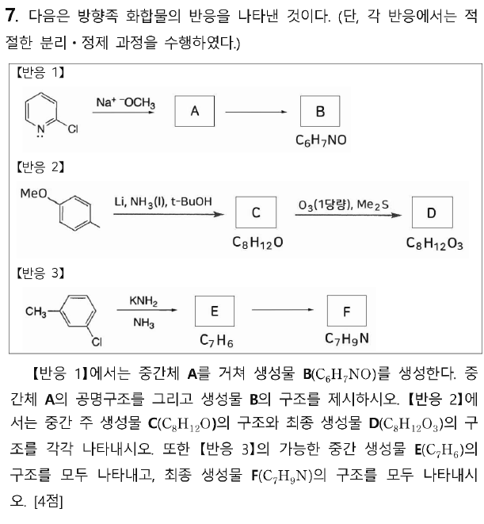

**정답**

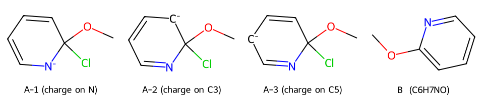
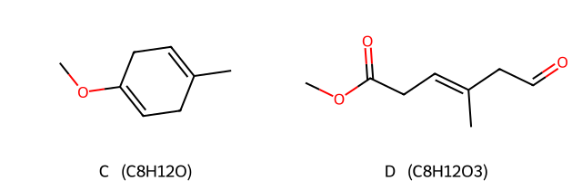
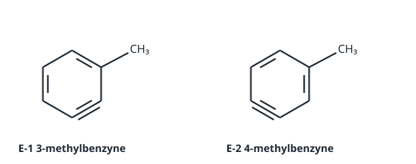
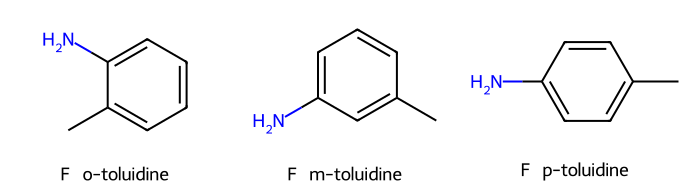

**[반응 1] 피리딘의 친핵성 방향족 치환(SNAr, 첨가–제거).** CH₃O⁻가 C–Cl 탄소(C2)를 공격해 고리의 방향족성이 깨진 음이온 중간체 **A**(Meisenheimer형)를 만듭니다. 음전하는 N, C3, C5에 비편재화되며, 특히 **전기음성도가 큰 N에 음전하가 놓이는 공명구조**가 있어 2-, 4-위치 치환이 유리합니다. 이어 Cl⁻가 떠나며 방향족성을 회복 → **B: 2-methoxypyridine** (C₆H₇NO).

**[반응 2] Birch 환원 → 선택적 오존 분해.**

- Li/NH₃(l)/t-BuOH: 전자 주개(OMe, CH₃)가 붙은 탄소는 **sp² 이중결합에 남는** 1,4-다이엔이 됩니다 → **C: 1-methoxy-4-methylcyclohexa-1,4-diene** (C₈H₁₂O).
- O₃ 1당량: 두 이중결합 중 **전자가 더 풍부한 엔올 에터(OMe가 붙은 C=C)** 가 먼저 오존과 반응합니다. 고리가 열리며 OMe가 붙은 탄소는 메틸 에스터, 다른 쪽은 알데하이드가 됩니다(Me₂S 환원성 처리) → **D: MeO₂C–CH₂–CH=C(CH₃)–CH₂–CHO** (C₈H₁₂O₃).

**[반응 3] benzyne (제거–첨가).** 3-chlorotoluene에서 NH₂⁻가 Cl의 오르토 H를 떼고 Cl⁻가 빠지며 benzyne이 생깁니다. Cl의 오르토 H가 두 곳(C2, C4)이므로

- C2–H 제거 → **3-methylbenzyne** (메틸이 삼중결합 탄소에 이웃): NH₂⁻ 첨가 위치에 따라 *o*-, *m*-toluidine
- C4–H 제거 → **4-methylbenzyne**: *m*-, *p*-toluidine

따라서 **F는 *o*-, *m*-, *p*-toluidine 세 가지** (C₇H₉N)입니다.

**채점 포인트·함정**

- A의 공명구조 중 **N에 음전하가 있는 구조**를 꼭 포함합니다.
- Birch 환원: 전자 주개는 이중결합에 남고, 전자 끄개(CO₂H 등)는 sp³ 탄소에 위치합니다.
- benzyne은 중간체 두 개, 생성물은 세 개(*m*-은 양쪽에서 모두 생김)입니다.

## B형 8번 · [FeO₄]⁴⁻·[Cr(CN)₆]⁴⁻의 결정장과 Jahn–Teller 효과 {#b8}

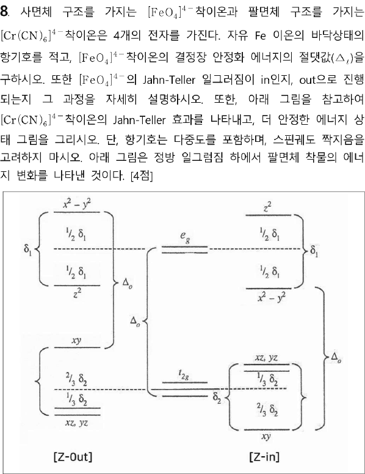

**정답**

1. 자유 Fe⁴⁺(d⁴) 이온의 바닥상태 항기호: **⁵D**
2. [FeO₄]⁴⁻의 CFSE 절댓값: **0.4Δt**
3. [FeO₄]⁴⁻: **z-out**으로 일그러진다. z-out은 t₂의 두 전자가 아래로 내려간 e(dxz, dyz)에 대칭적으로 들어가 z-in보다 $\tfrac13\delta$만큼 더 안정하다. z-in은 e 오비탈(dxz, dyz)에 전자가 하나만 들어가 비대칭이다.
4. [Cr(CN)₆]⁴⁻: t₂g⁴ 저스핀. **z-out**일 때 z-in보다 $\tfrac23\delta_2$만큼 더 안정하다.

**(1) 산화수와 항기호.** [FeO₄]⁴⁻: $x + 4(-2) = -4 \Rightarrow$ Fe(IV), d⁴. d⁴ 자유 이온은 $m_l = +2, +1, 0, -1$에 전자 하나씩 → $L = 2$(D), $S = 2$ → $2S+1 = 5$ → **⁵D** (J까지 쓰면 ⁵D₀, 반 이하로 찬 껍질이라 $J = |L-S|$).

**(2) CFSE (사면체, 고스핀).** 사면체는 $\Delta_t$가 작아 항상 고스핀: $e^2t_2^2$.

$$\mathrm{CFSE} = 2(-0.6\Delta_t) + 2(+0.4\Delta_t) = -0.4\Delta_t \;\Rightarrow\; |0.4|\Delta_t$$

**(3) 사면체 Jahn–Teller.** $t_2^2$ (세 오비탈에 전자 둘)은 축퇴된 바닥상태이므로 일그러집니다. $t_2$의 갈라짐을 $\delta$라 하고 무게중심을 유지하면(2 : 1 분할):

| | t₂ 전자의 에너지 | e 전자의 에너지 | 합 |
|---|---|---|---|
| z-out | e(xz, yz) $-\tfrac13\delta$ × 2 = $-\tfrac23\delta$ | $a_1$ −, $b_1$ + 하나씩 → 0 | $-\tfrac23\delta$ |
| z-in | $b_2(xy)$ $-\tfrac23\delta$ + e $+\tfrac13\delta$ = $-\tfrac13\delta$ | 0 | $-\tfrac13\delta$ |

z-out이 $\tfrac13\delta$ 더 안정하고, 축퇴된 오비탈 쌍에 전자가 고르게 들어가 대칭적입니다 → **z-out**.

**(4) [Cr(CN)₆]⁴⁻.** Cr(II), d⁴, CN⁻은 강한 장 리간드 → 저스핀 $t_{2g}^4$. 주어진 그림 기준:

- z-out: dxz, dyz가 $-\tfrac13\delta_2$씩 내려감 → 전자 4개 모두 여기에: $4 \times (-\tfrac13\delta_2) = -\tfrac43\delta_2$
- z-in: dxy가 $-\tfrac23\delta_2$ 내려감(2개), dxz·dyz가 $+\tfrac13\delta_2$(2개): $-\tfrac43\delta_2 + \tfrac23\delta_2 = -\tfrac23\delta_2$

z-out이 $\tfrac23\delta_2$ 더 안정 → **z-out으로 일그러짐**.

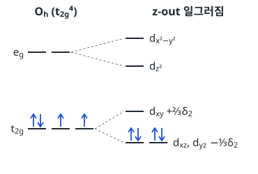

**채점 포인트·함정**

- Fe의 산화수를 +2로 잡으면 d⁶이 되어 모두 틀립니다. 문제의 "4개의 전자"와 일치하는 Fe(IV)를 확인합니다.
- 문제에서 짝지음 에너지를 고려하지 말라고 했으므로 CFSE에 P를 넣지 않습니다.

## B형 9번 · [ML₅]⁺ 전이상태의 결정장 {#b9}

**정답**

| | 삼각쌍뿔(TBP, $D_{3h}$) | 사각뿔(SP, $C_{4v}$) |
|---|---|---|
| d 오비탈 준위 | $a_1'(z^2)$ > $e'(x^2-y^2, xy)$ > $e''(xz, yz)$ | $b_1(x^2-y^2)$ > $a_1(z^2)$ > $b_2(xy)$ > $e(xz, yz)$ |
| d⁶ 저스핀 배치 | $e''^4e'^2$ (홀전자 2) | $e^4b_2^2$ (홀전자 0) |
| 자기 모멘트 | $\sqrt{2(2+2)} = 2\sqrt2 \approx 2.83$ BM | 0 |
| \|결정장 에너지\| | 12.52 Dq | 20.00 Dq |

해리 메커니즘에서는 **사각뿔**을 선호한다. 정팔면체(d⁶ 저스핀, $t_{2g}^6$ = −24.00 Dq)에서 사각뿔로 갈 때 잃는 에너지는 4.00 Dq로, 삼각쌍뿔(11.48 Dq)보다 훨씬 작아 활성화 에너지가 작기 때문이다.

**구조와 오비탈 이름.** 지표표에서 각 d 오비탈이 속한 기약표현을 읽습니다($D_{3h}$: $z^2 \to a_1'$, $(x^2-y^2, xy) \to e'$, $(xz, yz) \to e''$ / $C_{4v}$: $z^2 \to a_1$, $x^2-y^2 \to b_1$, $xy \to b_2$, $(xz, yz) \to e$).

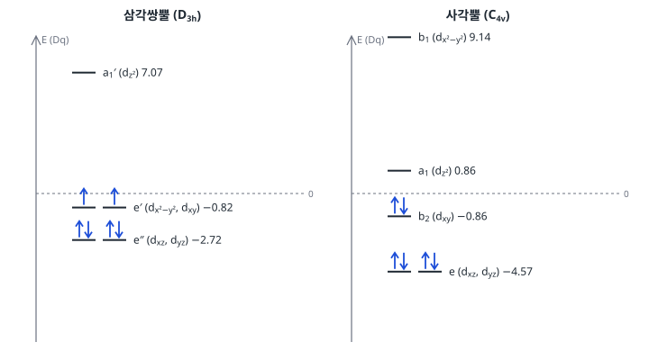

**결정장 에너지 계산**

- TBP: $4(-2.72) + 2(-0.82) = -10.88 - 1.64 = -12.52\ \mathrm{Dq}$
- SP: $4(-4.57) + 2(-0.86) = -18.28 - 1.72 = -20.00\ \mathrm{Dq}$
- 팔면체: $6(-4.00) = -24.00\ \mathrm{Dq}$

**자기 모멘트.** TBP에서 6번째 전자까지 채우면 축퇴된 $e'$ 두 오비탈에 전자 2개가 남습니다. 저스핀이라도 이 둘은 같은 에너지이므로 훈트 규칙에 따라 홀전자 2개 → $\mu_{so} = \sqrt{n(n+2)} = \sqrt8 = 2\sqrt2$ BM. SP는 모두 짝지어져 반자성입니다.

**채점 포인트·함정**

- 결론의 근거는 "결정장 에너지 손실(LFAE) = 활성화 에너지에 대한 결정장 기여"입니다: SP 24.00 − 20.00 = **4.00 Dq**, TBP 24.00 − 12.52 = **11.48 Dq**.
- 오비탈 이름(기약표현 기호)까지 쓰라고 했으므로 $a_1'$, $e'$, $e''$ / $b_1$, $a_1$, $b_2$, $e$를 빠뜨리지 않습니다.

## B형 10번 · 이양성자산 H₂A의 평형과 흡광도 {#b10}

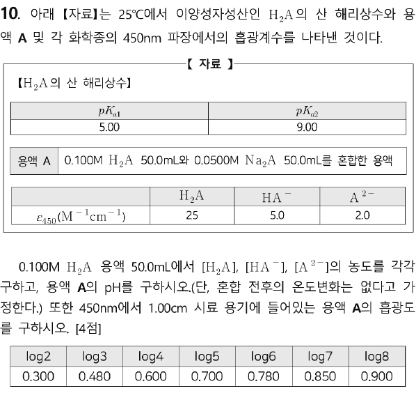

**정답** (1) [H₂A] = **0.0990 M**, [HA⁻] = **1.00×10⁻³ M**, [A²⁻] = **1.00×10⁻⁹ M**  (2) 용액 A의 pH = **5.30**  (3) 흡광도 = **0.875**

**(1) 0.100 M H₂A.** $K_{a2} \ll K_{a1}$이므로 1단계만 고려합니다.

$$\frac{x^2}{0.100 - x} = 1.0\times10^{-5} \;\Rightarrow\; x \approx \sqrt{1.0\times10^{-6}} = 1.00\times10^{-3}\ \mathrm{M}$$

- $[\mathrm{H^+}] = [\mathrm{HA^-}] = 1.00\times10^{-3}\ \mathrm{M}$
- $[\mathrm{H_2A}] = 0.100 - 0.001 = 0.0990\ \mathrm{M}$
- $[\mathrm{A^{2-}}] = K_{a2}\dfrac{[\mathrm{HA^-}]}{[\mathrm{H^+}]} = K_{a2} = 1.00\times10^{-9}\ \mathrm{M}$

**(2) 용액 A (혼합).** H₂A 5.00 mmol, A²⁻ 2.50 mmol은 $\mathrm{H_2A + A^{2-} \rightarrow 2HA^-}$로 반응합니다.

| | H₂A | A²⁻ | HA⁻ |
|---|---|---|---|
| 처음 (mmol) | 5.00 | 2.50 | 0 |
| 반응 후 (mmol) | 2.50 | 0 | 5.00 |
| 농도 (100 mL) | 0.0250 M | ≈ 0 | 0.0500 M |

H₂A/HA⁻ 완충 용액이므로

$$\mathrm{pH} = pK_{a1} + \log\frac{[\mathrm{HA^-}]}{[\mathrm{H_2A}]} = 5.00 + \log 2 = 5.30$$

**(3) 흡광도 (450 nm, b = 1.00 cm).** 흡광도는 각 화학종 기여의 합입니다.

$$A = \varepsilon_{\mathrm{H_2A}}b[\mathrm{H_2A}] + \varepsilon_{\mathrm{HA^-}}b[\mathrm{HA^-}] = 25(0.0250) + 5.0(0.0500) = 0.625 + 0.250 = 0.875$$

A²⁻는 $[\mathrm{A^{2-}}] = K_{a2}[\mathrm{HA^-}]/[\mathrm{H^+}] = 10^{-9}(0.05)/(5\times10^{-6}) = 1\times10^{-5}\ \mathrm{M}$로 기여가 $2\times10^{-5}$ 수준이라 무시합니다.

**채점 포인트·함정**

- 혼합 후 부피는 100 mL입니다(50 + 50). 다만 완충 pH는 몰수비만으로도 같습니다.
- 처음부터 Henderson–Hasselbalch에 H₂A 5.00, A²⁻ 2.50을 넣으면 틀립니다. 먼저 **중화(비례화) 반응**을 처리합니다.

## B형 11번 · 지시약 BTB의 몰흡광계수와 혼합물 정량 {#b11}

**정답**

| ε (M⁻¹cm⁻¹) | 산 형태(HIn) | 염기 형태(In⁻) |
|---|---|---|
| 400 nm | 9.0×10³ | 3.0×10³ |
| 530 nm | 2.0×10³ | 5.0×10³ |

미지 용액: [HIn] = **1.0×10⁻⁴ M**, [In⁻] = **5.0×10⁻⁵ M**, pH = **6.7**

**(1) 몰흡광계수.** pH 2.0에서는 모두 산 형태, pH 12에서는 모두 염기 형태이므로 $\varepsilon = A/(bc)$, $c = 1.00\times10^{-4}\ \mathrm{M}$, $b = 1\ \mathrm{cm}$:

- 400 nm: $\varepsilon_{\mathrm{HIn}} = 0.90/10^{-4} = 9.0\times10^3$, $\varepsilon_{\mathrm{In^-}} = 0.30/10^{-4} = 3.0\times10^3$
- 530 nm: $\varepsilon_{\mathrm{HIn}} = 0.20/10^{-4} = 2.0\times10^3$, $\varepsilon_{\mathrm{In^-}} = 0.50/10^{-4} = 5.0\times10^3$

**(2) 두 파장 연립방정식.** $a = [\mathrm{HIn}]$, $c = [\mathrm{In^-}]$라 하면

$$\begin{cases} 9000a + 3000c = 1.05 \\ 2000a + 5000c = 0.45 \end{cases}$$

첫 식에서 $c = 3.5\times10^{-4} - 3a$, 둘째 식에 대입하면 $2000a + 1.75 - 15000a = 0.45 \Rightarrow a = 1.0\times10^{-4}\ \mathrm{M}$, $c = 5.0\times10^{-5}\ \mathrm{M}$.

**(3) pH.**

$$\mathrm{pH} = pK_a + \log\frac{[\mathrm{In^-}]}{[\mathrm{HIn}]} = 7.0 + \log\frac{5.0\times10^{-5}}{1.0\times10^{-4}} = 7.0 - \log 2 = 6.7$$

**채점 포인트·함정**

- 미지 용액의 전체 지시약 농도는 $1.5\times10^{-4}$ M로 처음 용액(100 μM)과 달라도 됩니다. 별도로 만든 용액이므로 합이 100 μM이라고 가정하지 않습니다.
- 흡광도 가산성(Beer 법칙의 합)이 핵심이며, 두 파장에서 두 미지수를 푸는 전형적인 혼합물 분석입니다.

---

원문: 2025학년도 대비 전공화학 모의고사 1회(김지현, 지스쿨) 문제지·답안·1주 강의 안내. 이 해설은 개인 학습용으로 정리한 것입니다.

