# v7 정답 및 해설 (메커니즘·구조 그림 보완판)

# 유기화학 기출변형 모의고사 — 정답 및 해설

변형 기출 · 소스 논문(Klein 유기화학 인용 문헌) · 노벨상 연계 · 상세 해설

## 문항 색인

| 문항 | 배점 | 중요도 | 영역 | 변형 기출 | 소스 논문 |
| --- | --- | --- | --- | --- | --- |
| 1회 1번 | 2점 | ★★★ | 분광학적 구조 결정(IR·NMR·MS) | 2026학년도 B형 1번 | J. Agric. Food Chem. 2009, 57, 3818–3830 |
| 1회 2번 | 2점 | ★★★ | 분광학적 구조 결정(IR·NMR·MS) | 2025학년도 B형 1번 | J. Agric. Food Chem. 2003, 51, 4344–4348 |
| 1회 3번 | 2점 | ★★★ | 분광학적 구조 결정(IR·NMR·MS) | 2024학년도 A형 3번 | J. Agric. Food Chem. 2005, 53, 7204–7211 |
| 1회 4번 | 2점 | ★★★ | 입체화학·형태 분석 | 2026학년도 A형 1번 | Org. Proc. Res. & Devel. 2007, 11, 354–358 |
| 1회 5번 | 2점 | ★★★ | 입체화학·형태 분석 | 2025학년도 B형 2번 | J. Am. Chem. Soc. 1990, 112, 893–894 |
| 1회 6번 | 4점 | ★★★ | 방향족 치환·다이아조늄 화학 | 2026학년도 A형 10번 | Org. Lett. 1999, 1, 985–988 |
| 1회 7번 | 4점 | ★★★ | 방향족 치환·다이아조늄 화학 | 2025학년도 A형 10번 | Bioorg. Med. Chem. Lett. 2006, 16, 2013–2016 |
| 1회 8번 | 4점 | ★★★ | 방향족 치환·다이아조늄 화학 | 2024학년도 A형 10번 | Org. Lett. 2007, 9, 2741–2743 |
| 1회 9번 | 4점 | ★★★ | 방향족 치환·다이아조늄 화학 | 2024학년도 A형 11번 | Tetrahedron Lett. 2010, 51, 4494–4496 |
| 1회 10번 | 4점 | ★★★ | 카보닐 α-탄소·축합 반응 | 2026학년도 A형 11번 | Klein 22장 반응의 복습(Robinson 고리화) |
| 1회 11번 | 4점 | ★★★ | 카보닐 α-탄소·축합 반응 | 2025학년도 A형 11번 | Org. Lett. 2000, 2, 791–794 |
| 2회 1번 | 2점 | ★★★ | 분광학적 구조 결정(IR·NMR·MS) | 2023학년도 A형 3번 | J. Chem. Ed. 2008, 85, 832–833 |
| 2회 2번 | 2점 | ★★★ | 분광학적 구조 결정(IR·NMR·MS) | 2022학년도 A형 3번 유형 | J. Am. Chem. Soc. 1952, 74, 4070–4073 |
| 2회 3번 | 2점 | ★★★ | 입체화학·형태 분석 | 2024학년도 B형 2번 | J. Am. Chem. Soc. 2012, 134, 8054–8057 |
| 2회 4번 | 2점 | ★★★ | 입체화학·형태 분석 | 2023학년도 B형 2번 | J. Org. Chem. 1991, 56, 2582–2584 |
| 2회 5번 | 2점 | ★★★ | 방향족 치환·다이아조늄 화학 | 2023학년도 A형 2번 | Anal. Chem. 2013, 85, 831–836 |
| 2회 6번 | 4점 | ★★★ | 방향족 치환·다이아조늄 화학 | 2022학년도 B형 8번 | J. Org. Chem. 2012, 77, 5503–5514 |
| 2회 7번 | 4점 | ★★★ | 카보닐 α-탄소·축합 반응 | 2024학년도 B형 7번 | J. Org. Chem. 2003, 68, 6455–6458 |
| 2회 8번 | 4점 | ★★★ | 카보닐 α-탄소·축합 반응 | 2023학년도 A형 10번 | J. Org. Chem. 2012, 77, 6371–6376 |
| 2회 9번 | 4점 | ★★★ | 카보닐 α-탄소·축합 반응 | 2023학년도 B형 7번 | J. Chem. Ed. 2006, 83, 287–289 |
| 2회 10번 | 4점 | ★★★ | 카보닐 α-탄소·축합 반응 | 2022학년도 A형 9번 | J. Am. Chem. Soc. 1954, 76, 2029–2030 |
| 2회 11번 | 4점 | ★★★ | 카보닐 α-탄소·축합 반응 | 2022학년도 B형 9번 | J. Am. Chem. Soc. 2012, 134, 920–923 |
| 3회 1번 | 2점 | ★★★ | 분광학적 구조 결정(IR·NMR·MS) | 2021학년도 A형 2번 | J. Agric. Food Chem. 2009, 57, 3818–3830 |
| 3회 2번 | 2점 | ★★★ | 분광학적 구조 결정(IR·NMR·MS) | 2020학년도 A형 3번 | Tetrahedron Lett. 2010, 51, 6542–6544 |
| 3회 3번 | 2점 | ★★★ | 분광학적 구조 결정(IR·NMR·MS) | 2019학년도 A형 6번 | J. Chem. Ed. 2003, 80, 1439–1443 |
| 3회 4번 | 2점 | ★★★ | 분광학적 구조 결정(IR·NMR·MS) | 2018학년도 A형 6번 | Angew. Chem. Int. Ed. 2011, 50, 8387–8390 |
| 3회 5번 | 2점 | ★★★ | 입체화학·형태 분석 | 2018학년도 A형 4번 | J. Org. Chem. 1984, 49, 945–947 |
| 3회 6번 | 2점 | ★★★ | 방향족 치환·다이아조늄 화학 | 2020학년도 A형 4번 | J. Nat. Prod. 2011, 74, 1972–1979 |
| 3회 7번 | 4점 | ★★★ | 입체화학·형태 분석 | 2021학년도 B형 8번 | Tetrahedron Lett. 2010, 51, 6948–6950 |
| 3회 8번 | 4점 | ★★★ | 방향족 치환·다이아조늄 화학 | 2018학년도 A형 12번 | J. Am. Chem. Soc. 1967, 89, 4418–4424 |
| 3회 9번 | 4점 | ★★★ | 카보닐 α-탄소·축합 반응 | 2021학년도 A형 9번 유형 | Klein 22장 반응의 복습(교차 Claisen 축합: ethyl benzoate + ethyl acetate; Claisen 축합의 구동력) |
| 3회 10번 | 4점 | ★★★ | 카보닐 α-탄소·축합 반응 | 2020학년도 A형 9번 유형 | J. Am. Chem. Soc. 1945, 67, 860–874 |
| 3회 11번 | 4점 | ★★★ | 카보닐 α-탄소·축합 반응 | 2019학년도 A형 12번 | Klein 22장 반응의 복습(Dieckmann 축합: diethyl adipate → 2-carbethoxycyclopentanone; β-케토산 탈카복실화) |
| 4회 1번 | 2점 | ★★★ | 분광학적 구조 결정(IR·NMR·MS) | 2017학년도 A형 6번 | J. Org. Chem. 2012, 77, 5503–5514 |
| 4회 2번 | 2점 | ★★★ | 분광학적 구조 결정(IR·NMR·MS) | 2016학년도 A형 6번 | J. Chem. Ed. 2006, 83, 287–289 |
| 4회 3번 | 2점 | ★★★ | 분광학적 구조 결정(IR·NMR·MS) | 2015학년도 A형 기입형 10번 유형 | J. Nat. Prod. 2012, 75, 1765–1776 |
| 4회 4번 | 2점 | ★★★ | 입체화학·형태 분석 | 2015학년도 A형 기입형 8번 유형 | J. Phys. Chem. A 2002, 106, 1642–1646 |
| 4회 5번 | 2점 | ★★★ | 방향족 치환·다이아조늄 화학 | 2017학년도 A형 5번 | J. Org. Chem. 2012, 77, 5503–5514 |
| 4회 6번 | 2점 | ★★★ | 카보닐 α-탄소·축합 반응 | 2016학년도 A형 4번 유형 | Klein 22장 반응의 복습(할로폼 반응: NaOH, Br2; H3O+ / Hell–Volhard–Zelinsky: Br2, PBr3; H2O) |
| 4회 7번 | 2점 | ★★★ | 카보닐 α-탄소·축합 반응 | 2016학년도 A형 5번 | Aust. J. Chem. 1987, 40, 1321–1325 |
| 4회 8번 | 4점 | ★★★ | 입체화학·형태 분석 | 2017학년도 A형 13번 | J. Org. Chem. 2002, 67, 4856–4859 |
| 4회 9번 | 4점 | ★★★ | 입체화학·형태 분석 | 2016학년도 A형 13번 | J. Am. Chem. Soc. 1961, 83, 606–614 |
| 4회 10번 | 4점 | ★★★ | 방향족 치환·다이아조늄 화학 | 2018학년도 B형 4번 | J. Org. Chem. 1999, 64, 6702–6705 |
| 4회 11번 | 4점 | ★★★ | 방향족 치환·다이아조늄 화학 | 2016학년도 B형 4번 | J. Org. Chem. 2011, 76, 1605–1613 |
| 5회 1번 | 2점 | ★★★ | 분광학적 구조 결정(IR·NMR·MS) | 2014학년도 A형 기입형 8번 | Nat. Prod. Rep. 2012, 29, 1288–1303 |
| 5회 2번 | 2점 | ★★ | 고리화 첨가·자리옮김·방향족성 | 2022학년도 A형 2번 | J. Am. Chem. Soc. 1973, 95, 3437–3438 |
| 5회 3번 | 2점 | ★★ | 작용기 변환·친핵성 반응 메커니즘 | 2021학년도 A형 3번 유형 | J. Am. Chem. Soc. 1976, 98, 3295–3300 |
| 5회 4번 | 2점 | ★★★ | 카보닐 α-탄소·축합 반응 | 2015학년도 A형 기입형 9번 유형 | Klein 22장 반응의 복습(엔올레이트 알킬화: LDA, −78 ℃ 동역학적 vs NaH, 25 ℃ 열역학적) |
| 5회 5번 | 4점 | ★★★ | 입체화학·형태 분석 | 2015학년도 A형 서술형 3번 | Angew. Chem. Int. Ed. 1994, 33, 2187–2190 |
| 5회 6번 | 4점 | ★★ | 고리화 첨가·자리옮김·방향족성 | 2025학년도 B형 7번 | J. Org. Chem. 1997, 62, 3200–3207 |
| 5회 7번 | 4점 | ★★ | 고리화 첨가·자리옮김·방향족성 | 2020학년도 B형 7번 | J. Am. Chem. Soc. 2011, 133, 14892–14895 |
| 5회 8번 | 4점 | ★★ | 작용기 변환·친핵성 반응 메커니즘 | 2026학년도 B형 7번 유형 | J. Am. Chem. Soc. 2007, 129, 8968–8969 |
| 5회 9번 | 4점 | ★★ | 작용기 변환·친핵성 반응 메커니즘 | 2021학년도 B형 9번 유형 | J. Am. Chem. Soc. 2012, 134, 6916–6919 |
| 5회 10번 | 4점 | ★★★ | 방향족 치환·다이아조늄 화학 | 2014학년도 B형 논술형 2번(유기 부분) | Prog. Stereochem. 1958, 2, 125 |
| 5회 11번 | 4점 | ★★★ | 카보닐 α-탄소·축합 반응 | 2014학년도 A형 서술형 4번 | Chem. Ber. 1962, 95, 2514–2525 |
| 6회 1번 | 2점 | ★ | 유기 산·염기 | 2023학년도 B형 1번 | J. Org. Chem. 1981, 46, 4327–4331 |
| 6회 2번 | 2점 | ★ | 유기 산·염기 | 2019학년도 A형 5번 | J. Am. Chem. Soc. 2009, 131, 8720–8721 |
| 6회 3번 | 2점 | ★★ | 고리화 첨가·자리옮김·방향족성 | 2014학년도 A형 기입형 7번 · 2024학년도 A형 11번 유형 | J. Am. Chem. Soc. 2000, 122, 190–191 |
| 6회 4번 | 2점 | ★★ | 작용기 변환·친핵성 반응 메커니즘 | 2019학년도 A형 4번 유형 | Nat. Prod. Rep. 2012, 29, 1288–1303 |
| 6회 5번 | 2점 | ★★ | 작용기 변환·친핵성 반응 메커니즘 | 2018학년도 A형 5번 유형 | Synth. Commun. 2003, 33, 2135–2143 |
| 6회 6번 | 2점 | ★★ | 작용기 변환·친핵성 반응 메커니즘 | 2017학년도 A형 4번 유형 | Tetrahedron Lett. 2010, 51, 5291–5293 |
| 6회 7번 | 2점 | ★★ | 작용기 변환·친핵성 반응 메커니즘 | 2014학년도 A형 기입형 6번 유형 | J. Am. Chem. Soc. 1965, 87, 287–291; J. Am. Chem. Soc. 1965, 87, 5517–5518 |
| 6회 8번 | 4점 | ★★ | 고리화 첨가·자리옮김·방향족성 | 2019학년도 B형 4번 | Org. Lett. 2001, 3, 723–726 |
| 6회 9번 | 4점 | ★★ | 고리화 첨가·자리옮김·방향족성 | 2015학년도 B형 논술형 2번(방향족성) · 2019학년도 B형 4번(고리 첨가) 유형 | J. Am. Chem. Soc. 2012, 134, 9199–9208 |
| 6회 10번 | 4점 | ★★ | 작용기 변환·친핵성 반응 메커니즘 | 2020학년도 B형 8번 유형 | J. Am. Chem. Soc. 1970, 92, 397–398 |
| 6회 11번 | 4점 | ★★ | 작용기 변환·친핵성 반응 메커니즘 | 2017학년도 B형 4번 유형 | J. Am. Chem. Soc. 1951, 73, 22–23; J. Am. Chem. Soc. 1982, 104, 6460–6462 |

## 1회 정답 및 해설

1회 1번 (기입형 2점) · 분광학적 구조 결정(IR·NMR·MS)중요도 ★★★

|  |  |
| --- | --- |
| 변형 기출 | 2026학년도 B형 1번 — C₉H₁₀O₃(3,5-dimethoxybenzaldehyde)의 IR·¹H NMR — 알데하이드 C=O·C–H, 대칭과 짝지음 양상으로 구조 결정 |
| 변형 포인트 | 방향족 알데하이드 대신 α,β-불포화 지방족 알데하이드를 써서 ① 콘쥬게이션에 의한 C=O 진동수 감소, ② Fermi 이중선, ③ 알켄 ³J(trans ≈ 16 Hz)로 기하 이성질체 판정, ④ 공명에 의한 β-수소 탈가림을 한 문항에서 묻도록 변형. 요구도 “구조 + 기하 + 특정 피크 수소 표시”로 강화 |
| 소스 논문 | J. Agric. Food Chem. 2009, 57, 3818–3830 (Klein 12.40) — Cabernet Sauvignon 포도 휘발 성분 (E)-2-hexenal — 1,1-dibromopentane → 펜타인화 이온 + HCHO → 2-hexyn-1-ol → Na/NH₃(l) → (E)-2-hexen-1-ol → 산화 |

**정답**

(E)-hex-2-enal

㉡(δ 6.85)은 C3–H(β-수소, CH2와 이웃한 비닐 수소)이다. 즉 CH3CH2CH2–C**H**=CH–CHO의 밑줄 수소에 동그라미.

**메커니즘·구조 그림**

[그림 1] 1H NMR 신호 배정 — ㉡ = C3–H(β, 점선 원)

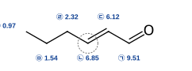

(*E*)-2-hexenal, 3*J*H2–H3 = 15.6 Hz (*trans*)

[그림 2] α,β-불포화 알데하이드의 공명 — β-H(㉡ 6.85)가 α-H(㉢ 6.12)보다 낮은 장

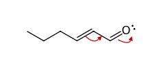

콘쥬게이션된 C=C–C=O

C3(β)에 δ+ → β-H 탈가림

**해설**

① 불포화도 = (2×6+2−10)/2 = 2. IR 1692 cm−1의 강한 띠(C=O)와 2815·2730 cm−1의 약한 쌍(알데하이드 C–H 신축과 C–H 굽힘 배음의 Fermi 공명)은 알데하이드를 뜻한다. 포화 지방족 알데하이드(≈1730)보다 약 40 cm−1 낮으므로 C=O가 C=C와 콘쥬게이션되어 있다(단일 결합성 증가). 1640 cm−1은 콘쥬게이션된 C=C, 975 cm−1은 *trans*-이치환 알켄의 =C–H 면외 굽힘이다. ⇒ C=C 1개 + C=O 1개.

② ¹H NMR: ㉠ 9.51(d, 1H) = CHO. 이중선이므로 CHO 탄소 옆에 H가 1개(C2–H)뿐이다. ㉢ 6.12(dd, *J* = 15.6, 7.9) = C2–H(α): CHO 수소(7.9 Hz)와 C3–H(15.6 Hz)에 의해 갈라진다. ㉡ 6.85(dt, *J* = 15.6, 6.8) = C3–H(β): C2–H(15.6)와 C4의 CH2 2개(6.8)에 의해 이중선의 삼중선([그림 1]).

③ β-수소가 α-수소보다 0.7 ppm이나 낮은 장에 나타나는 이유: 공명 구조 +CH–CH=CH–O−에서 C3(β)가 부분 양전하를 띠어 탈가림되기 때문이다(α,β-불포화 카보닐의 공통 특징, [그림 2]).

④ ³*J*(H2–H3) = 15.6 Hz는 *trans*(12~18 Hz) 범위이므로 (*E*)-이성질체이다. (*Z*)-2-hexenal이라면 ³*J* ≈ 11 Hz이고 975 cm−1 띠가 없다.

⑤ 나머지: ㉣ 2.32(2H) = 알릴 CH2(C4); C3–H와 C5–H2에 대한 *J*가 거의 같아(≈7 Hz) 이웃 수소 3개 → 사중선 모양. ㉤ 1.54(sextet, 2H) = C5 CH2(이웃 H 5개 → 6중선). ㉥ 0.97(t, 3H) = CH3. 적분 1:1:1:2:2:3 = 10H 일치.

⑥ 함정: 3-hexenal(비콘쥬게이션: C=O ≈1725, CHO는 t, C2–H₂는 δ 3.1 d), 2-methyl-2-pentenal(CHO 단일선, CH3 단일선), 케톤 이성질체(9.5 ppm 피크 없음, Fermi 쌍 없음)는 자료와 맞지 않는다. 논문 경로에서 2-hexyn-1-ol의 Na/NH3(l) 용해 금속 환원이 *anti* 첨가로 (*E*)-알켄을 주므로 J = 15.6 Hz와 일치한다(Lindlar 환원이면 *Z*).

1회 2번 (기입형 2점) · 분광학적 구조 결정(IR·NMR·MS)중요도 ★★★

|  |  |
| --- | --- |
| 변형 기출 | 2025학년도 B형 1번 — C₈H₈O(styrene oxide)의 ¹H NMR — 적분 비와 dd 갈라짐으로 구조 결정, 특정 피크 수소 표시 |
| 변형 포인트 | 고리 화합물의 부분입체 위치 양성자(dd) 대신, 사슬형 에스터에서 n+1 규칙(t·t·quintet)과 적분 비, CH₃ 단일선의 위치(아세틸 2.0 vs 메톡시 3.7)로 이성질체(2-phenylethyl propanoate, propyl phenylacetate, methyl 4-phenylbutanoate 등)를 가려내도록 변형. 분자식 + ¹H NMR + IR 한 줄 정보만으로 유일하게 결정 |
| 소스 논문 | J. Agric. Food Chem. 2003, 51, 4344–4348 (Klein 12.32) — 스리랑카 고유종 계피의 휘발 성분 27종 중 하나인 3-phenylpropyl acetate(톨루엔 → benzyl bromide → 알카인화 → Lindlar → HBr/ROOR → CH₃CO₂⁻ SN2) |

**정답**

3-phenylpropyl acetate

㉤(δ 1.96, quintet) = Ph–CH2–**CH2**–CH2–O의 가운데 CH2 수소 2개에 동그라미.

**메커니즘·구조 그림**

[그림 1] 1H NMR 신호 배정 — ㉤ = 가운데 CH2(점선 원)

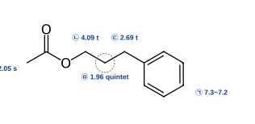

3-phenylpropyl acetate (㉤: 이웃 H 4개 → quintet)

**해설**

① 불포화도 = (2×11+2−14)/2 = 5 → 벤젠 고리(4) + C=O(1). IR 1740 cm−1(포화 에스터 C=O), O–H 없음 → 에스터. ㉠ 7.3~7.2(5H)는 일치환 벤젠(C6H5–).

② ㉣ 2.05(s, 3H): 이웃 수소가 없는 CH3. 2.0~2.1 ppm은 CH3–C(=O)–O(아세틸)의 전형적 위치이다. 만약 에스터의 O–CH3였다면 3.6~3.7 ppm에 나타났을 것이다. ⇒ 아세테이트(CH3CO2–R).

③ 남은 조각 C3H6: CH2 3개. ㉡ 4.09(t, 2H) = O–CH2(에스터 산소에 결합, 약 +3 ppm 보정), ㉢ 2.69(t, 2H) = Ph–CH2(벤질 위치). 두 삼중선은 각각 이웃 CH2 2H와 짝지음 → 가운데에 CH2가 있다. ㉤ 1.96: 양쪽 CH2의 수소 4개와 짝지음(*J* ≈ 6.6, 7.7 Hz로 비슷) → n+1 = 5, 오중선(quintet).

④ 따라서 PhCH2CH2CH2OC(=O)CH3 (3-phenylpropyl acetate). 적분 5:2:2:3:2 = 14H 일치. 신호 배정은 [그림 1].

⑤ 함정 이성질체(모두 C11H14O2): 2-phenylethyl propanoate는 4.29(t)·2.93(t)·2.31(q)·1.12(t)로 CH3가 삼중선이고 단일선이 없다. propyl phenylacetate는 3.60(s, 2H)·4.03(t)·1.62(sext)·0.90(t). methyl 4-phenylbutanoate는 CH3 단일선이 3.66(OCH3)에 있다. benzyl butanoate는 5.11(s, 2H)이 있다. 모두 자료와 다르다.

⑥ 논문 연계: 계피 휘발 성분인 이 에스터는 allylbenzene에 HBr/ROOR(반 Markovnikov 라디칼 첨가)로 1-bromo-3-phenylpropane을 만든 뒤 CH3CO2−의 SN2로 얻을 수 있다.

1회 3번 (기입형 2점) · 분광학적 구조 결정(IR·NMR·MS)중요도 ★★★

|  |  |
| --- | --- |
| 변형 기출 | 2024학년도 A형 3번 — C₉H₁₂O₂(4-ethoxybenzyl alcohol): H₂CrO₄ 산화로 카복실산 생성, IR O–H 띠 ㉮에 해당하는 ¹H 피크 찾기 |
| 변형 포인트 | 1차 알코올(→카복실산) 대신 산화하면 케톤이 되는 2차 알릴 알코올을 사용. 화학 반응 단서(1°/2°/3° 구별) + IR(O–H, =C–H, 비닐 면외 굽힘) + 말단 비닐기의 세 가지 ³J/²J(trans 17 > cis 10 > gem ≈ 1.5 Hz) 해석을 결합하여, 특정 수소와 trans 관계인 수소의 피크를 고르게 함 |
| 소스 논문 | J. Agric. Food Chem. 2005, 53, 7204–7211 (Klein 12.34) — 메추리 사료의 휘발 성분 1-penten-3-ol — 아세틸렌화 이온 + propanal → 1-pentyn-3-ol → H₂/Lindlar |

**정답**

A: pent-1-en-3-ol

㉠과 *trans* 관계인 수소의 피크: **㉡** (δ 5.23, 3*J*trans = 17.2 Hz)

**메커니즘·구조 그림**

[그림 1] 1H NMR 신호 배정 — 비닐 수소 3개의 관계

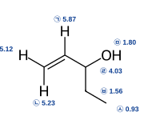

3*J*(㉠–㉡) = 17.2 Hz → *trans*  
3*J*(㉠–㉢) = 10.4 Hz → *cis*

[그림 2] H2CrO4 산화 — 카비놀 C–H가 있어야 C=O가 생긴다(3차 알코올은 산화 안 됨)

**A** (2차 알코올)

H2CrO4

−H2O

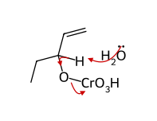

크로뮴산 에스터: H2O가 카비놀 H 제거,  
O–Cr 결합 전자쌍은 Cr로(Cr(VI) → Cr(IV))

pent-1-en-3-one (C5H8O) + H3O+ + HCrO3−

**해설**

① 불포화도 = (12−10)/2 = 1. IR ㉮(3360 cm−1, 넓고 강함) = 수소 결합한 O–H → 알코올. 3085(=C–H, sp2), 1645(약한 C=C), 990·920 cm−1(일치환 비닐 RCH=CH2의 면외 굽힘) → 말단 알켄. 불포화도 1을 C=C가 차지하므로 C=O나 고리는 없다.

② 화학 단서: H2CrO4로 산화하여 H가 2개 적은 **케톤**(C5H8O)이 생기므로 2차 알코올이다(1차면 카복실산, 3차면 반응하지 않음). 크로뮴산 에스터에서 카비놀 C–H가 제거되면서 C=O가 생기므로([그림 2]) 이 C–H가 없는 3차 알코올은 산화되지 않는다.

③ 비닐 영역: ㉠ 5.87(ddd, 1H)은 –CH= 수소로 =CH2의 두 수소(17.2, 10.4 Hz)와 CH–O의 수소(6.2 Hz)에 의해 갈라진다. ㉡ 5.23(d, 17.2) 과 ㉢ 5.12(d, 10.4)는 말단 =CH2의 두 수소이다. ³*J*trans(12~18 Hz) > ³*J*cis(6~12 Hz)이므로 17.2 Hz로 짝지은 ㉡이 ㉠과 *trans*, 10.4 Hz인 ㉢이 *cis*이다(제미널 ²*J* ≈ 1.5 Hz는 생략, [그림 1]).

④ ㉣ 4.03(1H) = CH–OH(카비놀 수소, 산소에 의한 탈가림). 비닐 H(6.2 Hz)와 CH2의 2H(≈6.5 Hz)에 거의 같은 *J*로 짝지어 사중선 모양. ㉤ 1.80(br s) = O–H(빠른 양성자 교환으로 짝지음 없음; D2O를 가하면 사라짐) → IR ㉮와 같은 작용기. ㉥ 1.56(2H) = CH2(CH 1H + CH3 3H → 4개, 오중선 모양), ㉦ 0.93(t, 3H) = CH3.

⑤ 따라서 A = CH2=CH–CH(OH)–CH2CH3, 산화 생성물은 pent-1-en-3-one(ethyl vinyl ketone). 함정: 4-penten-2-ol(2차·말단 비닐이지만 CH3가 이중선 1.2 ppm), 2-methyl-3-buten-2-ol(3차, 산화 안 됨, 6H 단일선), (*E*)-2-penten-1-ol(1차 → 카복실산, 내부 알켄), cyclopentanol(비닐 H 없음).

⑥ 논문 연계: 1-pentyn-3-ol(HC≡C− + propanal)을 Lindlar 촉매로 부분 수소화하여 말단 알켄을 만든다.

1회 4번 (기입형 2점) · 입체화학·형태 분석중요도 ★★★

|  |  |
| --- | --- |
| 변형 기출 | 2026학년도 A형 1번 — benzaldehyde의 Wittig 반응(oxaphosphetane) → (Z)-stilbene → m-CPBA 입체특이적 에폭시화 |
| 변형 포인트 | 불안정화 일라이드(Z) 대신 안정화 일라이드(E-선택성)를 사용하고, m-CPBA 대신 Sharpless 비대칭 에폭시화로 바꾸어 “입체특이성 + 거울상선택성”을 동시에 묻도록 변형 |
| 소스 논문 | Org. Proc. Res. & Devel. 2007, 11, 354–358 (Klein 14.63) — (E)-cinnamyl alcohol류의 Sharpless 비대칭 에폭시화로 3-phenylglycidol을 얻고 이를 (S,S)-reboxetine으로 전환 |
| 노벨상 연계 | 2001 노벨 화학상(K. B. Sharpless — 키랄 촉매 산화반응), 1979 노벨 화학상(G. Wittig) |

**정답**

A: ethyl (E)-cinnamate

C: (2S,3S)-3-phenylglycidol

C의 두 카이랄 중심: C2 = *S*, C3 = *S* (B = (*E*)-cinnamyl alcohol)

**메커니즘·구조 그림**

[그림 1] Wittig 반응 — 안정화 일라이드의 oxaphosphetane 경로(E 선택)

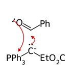

① 일라이드 C− → 카보닐 C, 카보닐 O → P+

가역

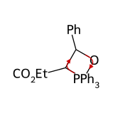

② trans-oxaphosphetane의 역 [2+2] 분해

(*E*)-알켄 **A** + Ph3P=O

[그림 2] Sharpless 비대칭 에폭시화 — 알켄 기하 유지(입체특이적) + 한쪽 면 선택(거울상선택적)

**B** (*E*)-cinnamyl alcohol: Ti–OR 배위

Ti(O*i*-Pr)4, L-(+)-DET

*t*-BuOOH (O 전달: 아래쪽 면)

**C** (2*S*,3*S*)-3-phenylglycidol

**해설**

① 안정화 일라이드(Ph3P=CHCO2Et)는 oxaphosphetane 형성이 가역적이어서 열역학적으로 유리한 *trans*-oxaphosphetane을 거쳐 (*E*)-알켄을 준다(cf. 기출의 비안정화 일라이드 PhCH=PPh3는 *Z* 선택적).

② DIBAL-H 2당량은 에스터를 1차 알코올로 환원하며 C=C는 보존된다 → B = (*E*)-cinnamyl alcohol.

③ Sharpless 비대칭 에폭시화: Ti–tartrate 촉매가 알릴 알코올의 OH에 배위하여 한쪽 면에만 산소를 전달한다. C=C를 지면에 세로 방향으로 놓고 CH2OH가 아래쪽 알켄 탄소의 오른쪽 아래에 오도록 그리면 L-(+)-DET는 아래쪽 면, D-(−)-DET는 위쪽 면에서 산소를 전달한다. (*E*)-알켄의 기하가 그대로 유지(입체특이적)되므로 *trans*-에폭사이드, 즉 (2*S*,3*S*)-3-phenylglycidol이 생성된다.

④ CIP: C2(–O–, –C3, –CH2OH, H), C3(–O–, –C2, –Ph, H) 모두 *S*. 기출(m-CPBA)은 라셈 *cis*-에폭사이드이므로 광학 비활성이지만, 이 문항의 C는 광학 활성이다.

1회 5번 (기입형 2점) · 입체화학·형태 분석중요도 ★★★

|  |  |
| --- | --- |
| 변형 기출 | 2025학년도 B형 2번 — 사이클로헥세인 고리 뒤집힘 에너지 도표에서 의자·반쪽의자·보트·꼬인보트 형태 찾기, 의자 형태의 점군 |
| 변형 포인트 | 도표의 기호 배치를 바꾸어(최저=C, 최고=A) 단순 암기를 막고, 묻는 형태를 보트·꼬인보트와 꼬인보트의 점군(D2)으로 바꿈. 여기에 JACS 1990 논문의 all-trans-hexaisopropylcyclohexane(모든 치환기가 축 방향인 의자 형태가 더 안정)을 붙여, “치환기는 적도가 유리하다”는 규칙이 언제 깨지는지를 이면각(Karplus식 사고) 단서로 판단하게 함 |
| 소스 논문 | J. Am. Chem. Soc. 1990, 112, 893–894 (Klein 4.72) — all-trans-1,2,3,4,5,6-hexaethylcyclohexane은 모두 적도인 의자 형태, hexaisopropyl 유도체는 모두 축 방향인 의자 형태를 선호 |
| 노벨상 연계 | 1969 노벨 화학상(D. H. R. Barton·O. Hassel — 형태 분석의 개념 확립) |

**정답****B** = 보트 형태, **D** = 꼬인보트 형태, **D**의 점군 = **D2**  
**X**: 6개의 아이소프로필기가 모두 **축 방향**(고리 수소는 모두 적도 방향)

**메커니즘·구조 그림**

[그림 1] X(all-trans)의 두 의자 형태 — 이웃 치환기가 위·아래로 교대하므로 “모두 적도” 또는 “모두 축”

모두 적도 (iPr–iPr 기어 충돌)

고리 뒤집힘

모두 축 (더 안정; 고리 H는 모두 적도)

[그림 2] 이웃한 고리 H의 이면각으로 형태 판정

iPr 적도: H/H 180°

iPr 축: H/H ≈ 60° ✔

C1(앞)–C2(뒤) 결합을 따라 본 Newman 투영.  
iPr이 적도이면 두 고리 H는 축(*trans*-이축) → 이면각 180°, iPr이 축이면 두 고리 H는 적도 → 이면각 ≈ 60°.  
⇒ 자료(모두 약 60°)와 맞는 것은 **모두 축** 형태

**해설**

**핵심 반응·개념:** 사이클로헥세인의 형태 에너지 지형(의자 ⇄ 반쪽의자 ⇄ 꼬인보트 ⇄ 보트), 점군, 이웃 치환기의 기어(gear) 충돌.

① 양 끝의 최저점 **C**는 각 변형·비틀림 변형이 모두 없는 **의자 형태**(0 kJ/mol, 점군 D3d)이다. 가장 높은 봉우리 **A**는 고리 탄소 5개(4개 이상)가 거의 한 평면에 놓여 가림이 심한 **반쪽의자**(≈45 kJ/mol, C2)로, 고리 뒤집힘의 전이 상태이다.

② 두 개의 국소 최저점 **D**(≈23 kJ/mol)는 실제로 존재하는 중간체인 **꼬인보트**이다. 보트의 깃대(flagpole) 수소 반발과 C2–C3·C5–C6 결합의 가림을 비틀어서 줄인 형태다. 서로 수직인 C2 축 3개를 가지며 거울면이 없으므로 점군은 **D2**이다(카이랄한 형태로, 두 **D**는 서로 거울상 관계다).

③ 두 꼬인보트 사이의 작은 봉우리 **B**(≈29 kJ/mol)가 **보트**(C2v)다. 보트는 에너지 최저점이 아니라 두 꼬인보트를 잇는 전이 상태라는 점이 흔한 오답 포인트다(“보트=중간체”로 답하면 틀림).

④ 25 ℃에서 꼬인보트의 비율은 대략 e−23000/(8.314×298) ≈ 1×10−4로 매우 적다. 따라서 상온의 사이클로헥세인 유도체는 거의 전부 의자 형태로 존재한다.

⑤ **X**(all-*trans*): 이웃 치환기가 모두 *trans*이므로 위·아래가 번갈아 놓이고, 의자 형태는 “6개 모두 적도” 아니면 “6개 모두 축” 둘 중 하나다. *trans*-1,2 관계인 이웃 수소의 이면각은 둘 다 축이면 ≈180°, 둘 다 적도이면 ≈60°이다. 자료에서 이면각이 모두 약 60°이므로 **고리 수소가 모두 적도 → 아이소프로필기는 모두 축 방향**이다. 「[그림 1]」의 두 의자 형태와 「[그림 2]」의 Newman 투영을 비교하면 이면각 단서가 바로 읽힌다.

⑥ 이유(논문): 모두 적도인 형태에서는 각 iPr이 양쪽 이웃 iPr 사이에 끼인다. iPr은 CH3가 2개라서 C(고리)–CH 결합을 어떻게 회전해도 메틸 하나가 이웃 iPr과 gauche·가림 반발을 일으킨다(기어 충돌). 에틸기(CH3 1개)는 메틸을 바깥으로 돌려 피할 수 있어서 hexaethyl 유도체는 모두 적도 형태를 택한다. 모두 축인 형태에서는 1,3-이축 상대가 수소가 아니라 다른 iPr이다. 그러나 각 iPr이 메타인 H를 고리 안쪽으로 향하게 맞물리면 이웃 간 반발이 크게 줄어든다. A값(iPr ≈ 9.2 kJ/mol)을 단순히 더해서 예측하면 틀리는 대표적인 예다.

1회 6번 (서술형 4점) · 방향족 치환·다이아조늄 화학중요도 ★★★

|  |  |
| --- | --- |
| 변형 기출 | 2026학년도 A형 10번 — p-bromotoluene의 벤자인(제거–첨가) 아미노화 → 다이아조화 → Sandmeyer(CuCN) |
| 변형 포인트 | 위치 선택성이 갈리지 않는 p-치환 벤자인 대신 2-bromoanisole에서 생기는 3-methoxybenzyne을 사용해 “친핵체가 어느 탄소에 첨가하는가(유발 효과에 의한 카브음이온 안정화)”를 이유로 서술하게 하고, Sandmeyer 대신 다이아조늄 염의 Pd 촉매 Suzuki 짝지음(2010 노벨상)으로 마무리하도록 변형 |
| 소스 논문 | Org. Lett. 1999, 1, 985–988 (Klein 19.88) — 7-hydroxynitidine 합성: 아릴 브로마이드 + NaNH₂(2 당량) → 벤자인 생성 후 분자 내 탄소 친핵체 첨가(아라인 고리화). 메톡시기에 인접한 벤자인에서 친핵체가 OMe에서 먼 탄소에 첨가하는 위치 선택성을 단순 모델(2-bromoanisole)로 변환 |
| 노벨상 연계 | 2010 노벨 화학상(R. F. Heck·E. Negishi·A. Suzuki — Pd 촉매 교차 짝지음) |

**정답**

중간체: 3-methoxybenzyne

A: 3-methoxyaniline

C: 3-methoxybiphenyl

B = 3-methoxybenzenediazonium tetrafluoroborate. 이유: NH2−가 OMe에서 먼 벤자인 탄소(C3)에 첨가해야 생기는 아릴 음이온(sp2 카브음이온)이 전기음성도가 큰 O에 인접(C2)하여 유발 효과로 안정화되므로, 이 방향의 첨가만 일어나 *m*-이성질체가 생긴다.

**메커니즘·구조 그림**

[그림 1] 제거 단계 — 벤자인(3-methoxybenzyne) 형성

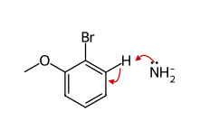

① NH2−가 Br 오쏘의 C3–H를 떼어 냄

+ NH3

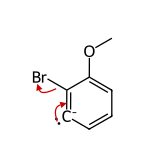

② 아릴 음이온(sp2)이 Br−를 밀어냄

− Br−

3-methoxybenzyne (C7H6O)

[그림 2] 첨가 단계 — 위치 선택성: C2의 음전하가 OMe의 −I 효과로 안정화

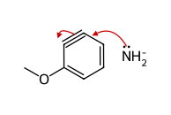

③ NH2−가 OMe에서 먼 C3에 첨가

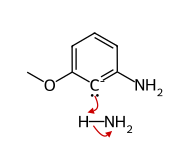

음전하가 O 옆 C2(sp2, 유발 효과로 안정화) → ④ NH3가 양성자화

− NH2−

**A** 3-methoxyaniline

[그림 3] 아릴다이아조늄 염의 Suzuki 짝지음 촉매 순환 (Ar = 3-MeOC6H4) — 염기 없이 진행

↖

**환원성 제거 (+2 → 0)**  
Ar–Ph (**C**) 방출

Pd0Ln

↘

**산화성 첨가 (Pd 0 → +2)**  
+ Ar–N2+, − N2

*cis*-Ar–Pd(II)–Ph

⟵

**금속 교환 (+2 유지)**  
+ PhB(OH)2 (CH3OH가 B를 활성화)

Ar–Pd(II)+ (양이온성)

**해설**

**핵심 반응: 제거–첨가(벤자인) 메커니즘의 위치 선택성 + 아릴다이아조늄 염의 Suzuki–Miyaura 짝지음**

① 2-bromoanisole에서 Br의 오쏘 수소는 C3–H 하나뿐이다(C1에는 OMe). NH2−가 C3–H를 떼어 내고(Br의 유발 효과로 산성도 증가), 생긴 아릴 음이온이 Br−를 내보내 C2≡C3 벤자인, 즉 **3-methoxybenzyne**(C7H6O)이 생성된다. 벤자인의 “삼중 결합”의 두 번째 π 결합은 고리 평면 안의 sp2 오비탈끼리의 약한 겹침이므로 반응성이 매우 크다(「[그림 1]」).

② NH2−가 C2에 첨가하면 음전하가 C3에, C3에 첨가하면 음전하가 C2(OMe 바로 옆)에 놓인다. 생성되는 카브음이온의 비공유 전자쌍은 고리 평면 안의 sp2 오비탈에 있어 π계와 공명하지 못하므로, 공명 효과가 아니라 **유발 효과**가 결정적이다. 전기음성도가 큰 O가 붙은 탄소에 인접한 음전하(C2)가 더 안정하므로 첨가는 C3에서 일어나고, NH3가 C2를 양성자화하여 **3-methoxyaniline(*m*-anisidine)**만 얻는다(「[그림 2]」). (흔한 오답: Br이 있던 자리에 NH2가 들어간 *o*-anisidine — 직접 치환으로 착각한 경우. 이 반응은 *cine* 치환이다.)

③ 논문(Klein 19.88) 연결: 7-hydroxynitidine 합성에서도 NaNH2가 C5–Br의 오쏘 C6–H를 떼어 C5≡C6 아라인을 만들고, 나프틸 카브음이온이 OMe(C4)에서 먼 C6에 첨가하여 음전하가 OMe 옆 C5에 놓인다 — 같은 규칙이다.

④ NaNO2/HBF4: HNO2 → NO+, 아민 N이 NO+를 공격 → N-나이트로소아민 → 토토머화·탈수 → ArN2+. 짝음이온이 BF4−이면 다이아조늄 염이 비교적 안정한 고체로 분리된다(**B** = 3-MeOC6H4N2+ BF4−).

⑤ Suzuki 짝지음(「[그림 3]」): Pd(0)가 Ar–N2+ 결합에 **산화성 첨가**(N2 방출, Ar–Pd(II)+) → PhB(OH)2와 **금속 교환**(Ar–Pd–Ph) → **환원성 제거**로 Ar–Ph 결합 형성, Pd(0) 재생. N2가 매우 좋은 이탈기이므로 아릴 할라이드보다 산화성 첨가가 쉽고, 양이온성 Pd 중간체가 금속 교환을 쉽게 하므로 염기 없이 실온에서 진행된다. **C** = 3-methoxybiphenyl(C13H12O).

⑥ 벤자인 존재의 증거: 같은 조건에서 furan을 넣으면 벤자인이 친다이엔체로 [4+2] Diels–Alder 고리화 첨가하여 5-methoxy-1,4-dihydro-1,4-epoxynaphthalene(C11H10O2)이 포획된다.

1회 7번 (서술형 4점) · 방향족 치환·다이아조늄 화학중요도 ★★★

|  |  |
| --- | --- |
| 변형 기출 | 2025학년도 A형 10번 — 톨루엔 염소화 → KMnO₄ 산화 → 아마이드 → Hofmann 자리옮김(아이소사이아네이트 중간체) |
| 변형 포인트 | 벤젠 고리 대신 피리딘 고리(2-chloro-5-methylpyridine)에서 곁사슬 산화 → 아마이드 → Hofmann 자리옮김을 수행하고, 같은 산에서 논문 경로(아마이드 → LiAlH₄ 환원)로 2차 아민을 만드는 경로를 병치하여 “탄소 1개를 잃는 아민 합성(Hofmann)”과 “탄소 수를 유지하는 아민 합성(아마이드 환원)”을 비교하도록 변형 |
| 소스 논문 | Bioorg. Med. Chem. Lett. 2006, 16, 2013–2016 (Klein 23.90) — 니코틴 유사 진통제 후보: 6-chloronicotinic acid → SOCl₂ → cyclopentylamine → 과량 LiAlH₄ → N-[(6-chloropyridin-3-yl)methyl]cyclopentanamine |

**정답**

A: 6-chloronicotinic acid

중간체: 아이소사이아네이트

D: 6-chloropyridin-3-amine

E

(C = 6-chloronicotinamide, F = 6-chloro-N-cyclopentylnicotinamide C11H13ClN2O, E = N-[(6-chloropyridin-3-yl)methyl]cyclopentanamine)

**메커니즘·구조 그림**

[그림 1] Hofmann 자리옮김 (1) — N-브로민화 (Ar = 6-chloropyridin-3-yl)

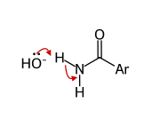

① N–H 탈양성자화

− H2O

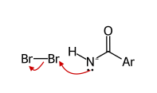

② N이 Br2를 공격

− Br−

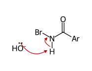

③ N-브로모아마이드의 두 번째 탈양성자화

− H2O

N-브로모아마이드 음이온

[그림 2] Hofmann 자리옮김 (2) — 협동적 1,2-아릴 이동으로 아이소사이아네이트 생성

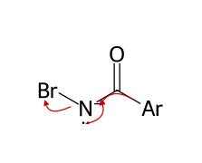

④ Ar이 결합 전자쌍과 함께 C → N 1,2-이동, Br− 동시 이탈

− Br−

아이소사이아네이트 (C6H3ClN2O)

[그림 3] 아이소사이아네이트의 가수분해·탈카복실화 → 1차 아민

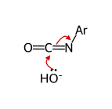

⑤ OH−가 N=C=O 탄소에 첨가

양성자 이동

(카밤산 경유)

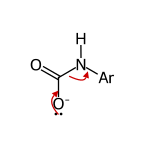

⑥ 카바메이트의 탈카복실화

− CO2

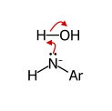

⑦ 양성자화

**D** (C5H5ClN2, 탄소 1개 감소)

**해설**

**핵심 반응: Hofmann 자리옮김(아이소사이아네이트 경유, 탄소 1개 손실) vs 아마이드의 LiAlH4 환원(탄소 수 유지)**

① KMnO4는 벤질(여기서는 피리딜메틸) 위치에 C–H가 있는 알킬기를 COOH로 산화한다. 피리딘 고리 자체는 전자가 부족해 산화에 강하다. 산 처리 후 **A** = 6-chloronicotinic acid(C6H4ClNO2).

② [경로 1] SOCl2 → 산 염화물, 과량 NH3 → 1차 아마이드 **C**(C6H5ClN2O). Br2/NaOH: N–H 탈양성자화 → N-브로민화(RCONHBr) → 두 번째 N–H 탈양성자화 → 피리딜기가 C에서 N으로 1,2-이동하면서 Br−가 동시에 떨어져 **아이소사이아네이트**(Ar–N=C=O, C6H3ClN2O) 생성(「[그림 1]」, 「[그림 2]」). 이동기는 결합 전자쌍과 함께 이동하며 이동 탄소의 배열은 유지된다.

③ 「[그림 3]」 물/OH−가 N=C=O 탄소에 첨가 → 카밤산(ArNHCOOH) → 탈카복실화(CO2 손실) → **D** = 6-chloropyridin-3-amine. 카보닐 탄소가 CO2로 빠지므로 **탄소 수가 1 감소**(C6 → C5)하고 NH2는 원래 카복실기가 붙어 있던 고리 탄소에 직접 결합한다.

④ [경로 2](논문) 산 염화물 + cyclopentylamine(2 당량: 1 당량은 HCl 포착) → 2차 아마이드 **F** → LiAlH4: 하이드라이드 첨가 → 알루미늄 알콕사이드가 이탈하면서 이미늄 이온 형성 → 두 번째 하이드라이드 첨가 → C=O가 CH2로 바뀐 2차 아민 **E**(C11H15ClN2). 탄소 수 유지, 아미노기는 CH2를 사이에 두고 고리에 연결.

⑤ 피리딘 C2의 Cl은 LiAlH4, Br2/NaOH 조건에서 보존된다. 흔한 오답: D를 Ar–CH2NH2(탄소 보존)로 그리거나, 중간체를 카밤산(C6H5ClN2O2)으로 그리는 것 — 분자식 C6H3ClN2O는 아이소사이아네이트만 만족한다.

1회 8번 (서술형 4점) · 방향족 치환·다이아조늄 화학중요도 ★★★

|  |  |
| --- | --- |
| 변형 기출 | 2024학년도 A형 10번 — p-X-chlorobenzene + NaOCH₃ SNAr 속도(NO₂ > CF₃ > H), Meisenheimer 착물, 이어지는 FC 알킬화 위치 선택성 |
| 변형 포인트 | 두 할로젠(F, Cl)이 모두 NO₂의 오쏘 자리에 있는 기질을 사용해, 이탈기 능력(Cl > F)과 반대로 F가 치환되는 사실로부터 “첨가 단계가 속도 결정 단계”임을 논증하게 하고, 친핵체를 탄소 친핵체(아세틸라이드)로 바꿈 |
| 소스 논문 | Org. Lett. 2007, 9, 2741–2743 (Klein 19.85) — 1-chloro-3-fluoro-2-nitrobenzene + sodium (4-methoxyphenyl)acetylide → F만 치환된 아릴알카인(전이 금속 없는 SNAr 알카인화) |

**정답**

A

중간체(Meisenheimer 착물)

이유: SNAr은 첨가–제거 메커니즘이며 친핵체가 고리에 첨가해 Meisenheimer 착물을 만드는 단계가 속도 결정 단계이다. C–X 결합 절단은 그 뒤의 빠른 단계이므로 이탈기 능력은 속도에 거의 영향을 주지 않는다. 전기음성도가 가장 큰 F는 붙은 탄소(ipso)를 더 δ+로 만들고, 유발 효과로 음이온성 전이 상태·중간체를 안정화하므로 C–F 탄소에 대한 첨가가 더 빠르다.

**메커니즘·구조 그림**

[그림 1] SNAr 첨가–제거 — C–F 결합은 속도 결정 단계 이후에 끊어진다

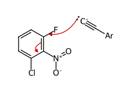

① 아세틸라이드가 C–F 탄소(ipso)에 첨가

속도 결정 단계

(방향족성 상실)

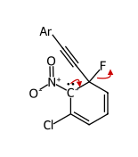

Meisenheimer 착물 → ② F− 이탈

빠름

− F−

**A** (Ar = 4-MeOC6H4)

[그림 2] Meisenheimer 착물의 공명 — 음전하는 ipso의 오쏘·파라 탄소(C2·C4·C6)와 NO2 산소로 비편재화

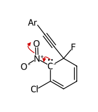

C2 음이온

음전하가 NO2의 O에 있는 구조 (문제 요구)

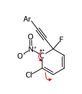

C2 음이온

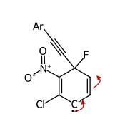

C4(파라) 음이온

C6(오쏘) 음이온

**해설**

**핵심 반응: 친핵성 방향족 치환(SNAr, 첨가–제거)과 Meisenheimer 착물**

① SNAr의 3조건: 강한 전자 끄는 기(NO2), 이탈기, 그리고 EWG가 이탈기의 오쏘/파라에 위치. 이 기질은 F와 Cl이 **모두** NO2의 오쏘 자리에 있으므로 활성화 정도(공명)는 같고, 차이는 할로젠 자체의 효과뿐이다.

② 메커니즘(「[그림 1]」, 공명 구조는 「[그림 2]」): 아세틸라이드 탄소가 C–F 탄소(ipso)를 공격 → sp3 탄소를 가진 사이클로헥사다이엔일 음이온(Meisenheimer 착물). 음전하는 NO2가 붙은 탄소(오쏘)와 파라 탄소로 비편재화되고, NO2의 공명(−M)으로 산소까지 퍼진다(문제에서 요구한 구조: C=N+(O−)O−). 이어 F−가 떨어지며 방향족성이 회복된다.

③ 속도 결정 단계는 방향족성이 깨지는 ②의 첨가 단계(흡열적)이다. 이 단계의 전이 상태에서는 C–X 결합이 아직 끊어지지 않으므로, 이탈기 능력(I > Br > Cl > F)이 아니라 ipso 탄소의 친전자성과 음전하 안정화가 속도를 좌우한다. 따라서 SNAr의 할로젠 반응성은 **F ≫ Cl ≈ Br > I**로 SN2와 반대이다. 만약 C–X 절단이 속도 결정 단계라면 Cl이 치환된 생성물(C15H10FNO3)이 얻어졌을 것이다 — 이 생성물의 부재가 메커니즘의 증거이다.

④ **A** = 1-chloro-3-[(4-methoxyphenyl)ethynyl]-2-nitrobenzene(C15H10ClNO3). 남은 Cl은 이후 다른 변환(예: Pd 짝지음)에 쓸 수 있는 손잡이가 된다. 이 반응은 Pd/Cu를 쓰는 Sonogashira 짝지음 없이 아릴알카인을 만드는 대안이다.

⑤ 흔한 오답: Cl이 치환된 구조, 또는 NO2가 치환된 구조. 또 중간체의 음전하를 NO2와 메타 관계인 탄소에 두는 것(불가능한 공명)도 틀린다.

1회 9번 (서술형 4점) · 방향족 치환·다이아조늄 화학중요도 ★★★

|  |  |
| --- | --- |
| 변형 기출 | 2024학년도 A형 11번 — 다이아조늄 → 페놀, Williamson 알릴 에터, 방향족 Claisen 자리옮김, 산 촉매 고리화(dihydrobenzofuran) |
| 변형 포인트 | 두 오쏘 자리가 모두 메틸로 막힌 페놀(2,6-dimethylphenol)과 (E)-크로틸 에터를 사용하여, 오쏘 Claisen 후 Cope 자리옮김이 이어지는 “파라-Claisen 자리옮김”을 묻고, 곁사슬이 두 번 뒤집혀(이중 알릴 전위) 가지 없는 사슬로 돌아오는 것을 NMR 단서로 판단하게 함 |
| 소스 논문 | Tetrahedron Lett. 2010, 51, 4494–4496 (Klein 20.88) — furo[2,3-b]indole 합성: 2-nitrobenzaldehyde의 알릴옥시메틸렌 Wittig → 알릴 바이닐 에터 → 가열 [3,3] Claisen 자리옮김 |

**정답**

C

중간체

D

B = 2,6-dimethylphenol, C = 2-[(*E*)-but-2-enyloxy]-1,3-dimethylbenzene, 중간체 = 6-(but-3-en-2-yl)-2,6-dimethylcyclohexa-2,4-dien-1-one, D = 4-[(*E*)-but-2-enyl]-2,6-dimethylphenol.  
이유: 첫 [3,3] Claisen 자리옮김은 오쏘 탄소로 일어나며 알릴 말단이 뒤집혀(1-methylallyl) 붙지만, 오쏘 탄소에 CH3가 있어 토토머화로 방향족성을 회복할 수 없다. 이 다이엔온이 두 번째 [3,3] 자리옮김(Cope)을 하여 곁사슬을 파라 탄소로 옮기면서 다시 한번 뒤집으므로 원래의 크로틸(가지 없는 but-2-enyl) 형태로 파라에 붙고, 파라 C–H의 토토머화로 방향족 페놀이 된다.

**메커니즘·구조 그림**

[그림 1] 다이아조늄 가수분해(SN1형, 아릴 양이온) → 페놀 **B** → Williamson 에터 **C**

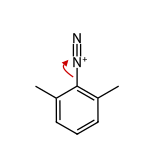

① C–N2+ 이종 분해

가열

− N2

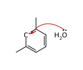

아릴 양이온 ← ② H2O 포착

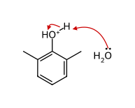

③ 탈양성자화

**B** 2,6-dimethylphenol

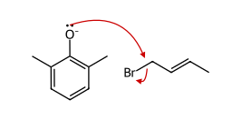

④ 페녹사이드의 SN2 (Williamson)

− Br−

**C**

[그림 2] 첫 번째 [3,3] 자리옮김(Claisen) — 크로틸기가 뒤집혀 오쏘 탄소에 결합

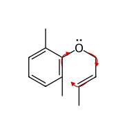

⑤ 6원 고리 전이 상태: 고리형 6전자 이동 (화살표 3개)

200 ℃

[3,3] Claisen

중간체(C12H16O): 오쏘 C에 CH3 → 토토머화 불가

[그림 3] 두 번째 [3,3] 자리옮김(Cope) → 토토머화: 파라-Claisen 자리옮김

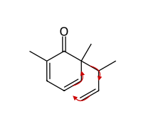

⑥ 1,5-다이엔의 Cope [3,3]: 곁사슬 말단 CH2가 파라 탄소로

[3,3] Cope

cyclohexa-2,5-dienone (파라 C에 H 있음)

토토머화

(방향족성 회복)

**D** (곁사슬 두 번 뒤집힘 → 가지 없는 크로틸)

**해설**

**핵심 반응: 다이아조늄 가수분해 → Williamson 에터 합성 → 방향족 Claisen 자리옮김(파라-Claisen = Claisen + Cope)**

① 2,6-dimethylaniline → ArN2+ → 가열 수용액에서 N2가 떨어진 아릴 양이온을 물이 포착 → **B** = 2,6-dimethylphenol(O–H, 3400 cm−1). 「[그림 1]」

② K2CO3가 페놀(p*K*a ≈ 10)을 페녹사이드로 만들고 1차 알릴 브로마이드에 SN2 → **C** = 크로틸 아릴 에터(O–H 없음). C=C 기하는 유지(*E*).

③ 200 ℃(「[그림 2]」): 의자형 6원 고리 전이 상태의 협동 [3,3] 시그마 결합 자리옮김. O–CH2 결합이 끊어지고 크로틸의 CH(CH3) 말단(γ 탄소)이 오쏘 탄소와 결합 → 알릴기가 **뒤집혀** 1-methylallyl(but-3-en-2-yl)로 붙은 cyclohexa-2,4-dienone(중간체, C12H16O, 방향족 아님, C=O). 오쏘 탄소에 이미 CH3가 있어 H가 없으므로 토토머화할 수 없다.

④ 이 다이엔온에서 C6(사차 탄소)–C(H)(CH3) 결합, 고리 C=C, 곁사슬 C=C가 1,5-다이엔을 이루므로 두 번째 [3,3](Cope) 자리옮김(「[그림 3]」)이 일어나 곁사슬 말단 CH2가 파라 탄소(C4)와 결합하고 사슬은 다시 뒤집혀 –CH2CH=CHCH3가 된다. 의자형 전이 상태에서 CH3가 적도 방향(equatorial) 자리를 차지하므로 (*E*)-알켄이 주로 생긴다. 파라 C–H가 토토머화되며 방향족 페놀 **D**로 회복 — 이것이 반응의 열역학적 구동력이다.

⑤ NMR 단서: 방향족 H 1종(2H, s) → 3,5-H가 동등한 2,4,6-삼치환 페놀(파라 생성물). 1.0~1.5 ppm 이중선 없음 → –CH(CH3)CH=CH2(가지 사슬)가 아니라 CH3CH= (≈1.7 ppm, d이지만 알릴 위치) 형태의 가지 없는 사슬. 흔한 오답: 오쏘 생성물(오쏘가 막혀 불가), 또는 파라에 1-methylallyl이 붙은 구조(한 번만 뒤집힌 것으로 착각).

1회 10번 (서술형 4점) · 카보닐 α-탄소·축합 반응중요도 ★★★

|  |  |
| --- | --- |
| 변형 기출 | 2026학년도 A형 11번 — β-keto ester + MVK의 Robinson 고리화(Michael + 분자 내 알돌), 싸이오아세탈/Raney Ni, LiAlH₄, 하이드로보레이션, Jones 산화 |
| 변형 포인트 | 염기(NaOEt) 대신 (S)-proline 유기촉매를 쓰는 Hajos–Parrish 비대칭 Robinson 고리화로 바꾸어, “고리 형성 단계 메커니즘”을 엔아민 촉매 메커니즘으로, “작용기 변환”을 NaBH₄의 화학선택적·부분입체선택적 환원으로 묻도록 변형. 알돌 첨가물(케톨)과 탈수 엔온을 분리하여 단계별 사고를 요구하고, 거울상 선택성(절대 배열)까지 평가한다. |
| 소스 논문 | Klein 22장 반응의 복습(Robinson 고리화) (Klein 22 (pp. 1057–1058)) — 2-methyl-1,3-dione + MVK의 Michael 첨가와 분자 내 알돌 축합(Robinson 고리화). 본 문항은 이를 (S)-proline 촉매 Hajos–Parrish 반응(스테로이드 CD 고리 합성 단위)으로 확장 |
| 노벨상 연계 | 2021 노벨 화학상(B. List·D. W. C. MacMillan — 비대칭 유기촉매). List의 프롤린 엔아민 촉매 연구의 출발점이 Hajos–Parrish 반응이다. |

**정답**

A

B: (3aS,7aS)-케톨

C: (S)-Hajos–Parrish 케톤

D: (1S,7aS)

A = 2-methyl-2-(3-oxobutyl)cyclopentane-1,3-dione (Michael 첨가물). B = (3a*S*,7a*S*)-3a-hydroxy-7a-methylhexahydro-1*H*-indene-1,5(4*H*)-dione (*cis* 접합, OH와 CH3가 같은 쪽).
D = (1*S*,7a*S*)-1-hydroxy-7a-methyl-1,2,3,6,7,7a-hexahydro-5*H*-inden-5-one (OH와 각진 CH3가 *cis*).  
메커니즘: ① proline의 N이 A의 곁사슬 메틸 케톤 C=O에 첨가 → 카비놀아민 → 탈수하여 이미늄 → α-H(말단 CH3) 제거로 엔아민. ② 엔아민의 β-탄소가 고리의 두 카보닐(거울상 위치 관계) 중 하나를 공격하여 6원 고리 형성(proline의 CO2H가 생성되는 알콕사이드 O에 양성자를 전달하며 한쪽 면을 지정). ③ 생성된 이미늄이 가수분해되어 B와 proline 재생.  
이유: C의 고리 접합부에 있는 오각 고리 케톤은 짝지어지지 않은 포화 케톤이지만 육각 고리 케톤은 C=C와 짝지어진 엔온이다. 짝지음(공명 C=C–C=O ↔ +C–C=C–O−)으로 엔온 카보닐 탄소의 친전자성이 낮아지므로, 저온에서 소량의 NaBH4는 포화 케톤(C1)만 환원한다.

**메커니즘·구조 그림**

[그림 1] **A** 생성 — 1,3-다이온 엔올레이트의 Michael 첨가

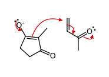

① 엔올레이트(Et3N이 C2–H 제거)의  
C2 → MVK β-탄소 (1,4-첨가)

② 새 엔올레이트

Et3NH+

C-양성자화

**A** (비카이랄 트라이케톤)

[그림 2] (*S*)-proline 엔아민–이미늄 촉매 순환 — 엔아민 형성과 고리 형성(C–C) 단계 (R = 고리 다이온–CH2CH2–)

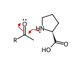

① proline N → 곁사슬 C=O

H+ 이동

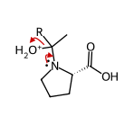

② 카비놀아민 → −H2O

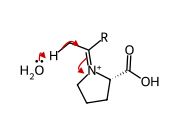

③ 이미늄 → 말단 CH3의 α-H 제거

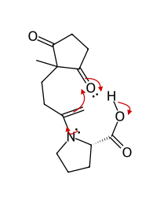

④ 엔아민 β-C → 고리 C=O (6원 고리 C–C 형성),  
동시에 CO2H가 O−에 H+ 전달 (Houk–List)

⑤ 이미늄–카복실레이트

H2O

가수분해

**B** + (*S*)-proline 재생

[그림 3] **C**·**D** 생성 — 엔올 경유 탈수와 화학선택적 NaBH4 환원

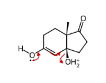

① 엔올(TsOH) 경유 탈수: OH2+ 이탈

−H+

② **C**: H−는 포화 C=O(C1)에만,  
각진 CH3 반대쪽(α면)에서 접근

EtOH

**D** (OH와 CH3 *cis*)

**해설**

핵심 반응: **Robinson 고리화(Michael 첨가 + 분자 내 알돌 축합)와 프롤린 엔아민 촉매(Hajos–Parrish 반응)**.

① **A 생성(Michael 첨가)**: 2-methylcyclopentane-1,3-dione의 C2–H는 두 카보닐 사이에 있어 매우 산성이다(고리형 1,3-다이온은 대부분 엔올로 존재하며 p*K*a ≈ 5 수준). Et3N이 만든 엔올레이트가 MVK의 β-탄소에 1,4-첨가 → 엔올레이트 양성자화 → A(C10H14O3, 4차 탄소에 CH3와 3-oxobutyl) 「[그림 1]」. A는 대칭면을 가지는 비카이랄(prochiral) 트라이케톤이며 두 고리 카보닐은 거울상 위치(enantiotopic)이다.

② **B 생성(엔아민 알돌)**: proline(2차 아민)이 곁사슬 메틸 케톤과 이미늄을 거쳐 엔아민을 만든다(고리 케톤은 4차 탄소에 인접해 입체 장애가 크다). 엔아민의 말단 탄소가 고리 C=O를 공격하면 6원 고리가 생긴다(6-enolendo). 이때 proline의 카복실산이 알콕사이드가 되는 산소와 수소 결합하여 양성자를 주는 고리형(의자형) 전이 상태(Houk–List 모델)를 이루므로, 두 거울상 위치의 카보닐 중 한쪽, 한쪽 면에서만 반응한다 → **탈대칭화(desymmetrization)**. 이미늄 가수분해로 케톨 B와 proline이 재생된다(촉매) 「[그림 2]」. 엔아민은 덜 붐비는 말단 CH3 쪽으로 생기며, 새 C–C 결합과 O–H 결합이 한 전이 상태에서 함께 만들어진다는 점이 핵심이다. B의 분자식이 A와 같은 것(C10H14O3)은 알돌 첨가 단계에서 멈추었음을 뜻한다. 5–6 접합 고리에서 OH와 각진 CH3는 *cis*(3a*S*,7a*S*)이다.

③ **C 생성(탈수)**: TsOH/가열에서 3차 β-하이드록시 케톤이 탈수(엔올 경유 E1)하여 짝지어진 엔온 C, 즉 (*S*)-7a-methyl-2,3,7,7a-tetrahydro-1*H*-indene-1,5(6*H*)-dione(Hajos–Parrish 케톤)이 된다. 7a의 배열은 그대로 유지된다(입체 중심은 반응에 참여하지 않음) 「[그림 3]」.

④ **D 생성(화학선택적·입체선택적 환원)**: 엔온 카보닐은 C=C와의 공명으로 친전자성이 낮고 1,2-첨가 시 짝지음 안정화를 잃으므로, NaBH4(소량, 0 ℃)는 오각 고리의 포화 케톤만 환원한다. 하이드라이드는 각진 메틸이 막고 있는 면의 반대쪽(α면)에서 접근하므로 생성된 OH는 메틸과 같은 쪽(β, *cis*)에 놓인다 → (1*S*,7a*S*)-D 「[그림 3]」 (스테로이드의 17β-OH·18-CH3 관계와 같다).

⑤ **흔한 오답**: (가) B를 탈수된 엔온으로 그리는 것 — B의 분자식은 A와 같으므로 H2O가 빠지지 않았다. (나) 곁사슬의 안쪽 CH2(C3′)로부터 엔아민/엔올레이트가 고리를 공격한다고 보는 것 — 4원 고리가 되어 불가능하다. (다) D에서 엔온을 환원하거나(알릴 알코올) OH를 메틸과 *trans*로 그리는 것. (라) 라셈체로 답하는 것 — 키랄 촉매 (*S*)-proline이 한쪽 거울상 이성질체를 우세하게 만든다(문헌상 93% ee 수준). 같은 반응을 2-methylcyclohexane-1,3-dione으로 하면 Wieland–Miescher 케톤이 얻어진다.

1회 11번 (서술형 4점) · 카보닐 α-탄소·축합 반응중요도 ★★★

|  |  |
| --- | --- |
| 변형 기출 | 2025학년도 A형 11번 — 말론산 에스터 합성(알킬화–가수분해–탈카복실화)과 알카인 알킬화 + Na/NH₃(l) trans 환원의 두 경로로 같은 카복실산 합성 |
| 변형 포인트 | 말론산 에스터 합성을 유지하되 이중 알킬화(다이알릴화) 후 Grubbs 촉매 고리 닫기 복분해(RCM)로 고리를 만드는 경로로 바꾸고, “반응 조건 쓰기” 대신 β-다이카복실산 탈카복실화의 고리형 메커니즘(굽은 화살표)을 요구하도록 변형. |
| 소스 논문 | Org. Lett. 2000, 2, 791–794 (Klein 21.81) — Grubbs 촉매를 이용한 다이엔의 고리 닫기 복분해(RCM)로 고리 알켄과 에틸렌 생성 — 본 문항은 말론산 에스터 다이알릴화 기질(복분해의 표준 기질)로 모델화 |
| 노벨상 연계 | 2005 노벨 화학상(Y. Chauvin·R. H. Grubbs·R. R. Schrock — 올레핀 복분해) |

**정답**

A

B

C

A = diethyl 2,2-diallylmalonate, B = diethyl cyclopent-3-ene-1,1-dicarboxylate(+ CH2=CH2↑), C = cyclopent-3-ene-1-carboxylic acid.  
탈카복실화: 다이카복실산의 한 COOH의 O–H 수소가 다른 C=O 산소로 옮겨 가는 6원 고리 전이 상태에서 ① 카보닐 O가 산성 H를 받고 ② O–H 결합 전자가 C=O로 가서 CO2가 형성되며 ③ C1–COOH 결합 전자가 C1=C(OH)2 π 결합이 된다(협동, 페리고리 반응) → CO2 + 엔올(1,1-다이하이드록시알켄) → 토토머화(엔올 C=C가 양성자를 받고 O–H가 C=O로) → C.

**메커니즘·구조 그림**

[그림 1] **A** 생성 — 말론산 에스터 엔올레이트의 이중 알킬화 (E = CO2Et)

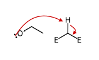

① EtO−가 두 C=O 사이 α-H 제거  
(p*K*a ≈ 13)

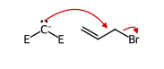

② 엔올레이트 탄소의 SN2 (알릴 Br)

③ NaOEt

④ CH2=CHCH2Br

**A** (4차 탄소)

[그림 2] 고리 닫기 복분해(RCM) — 메탈라사이클로뷰테인을 거친 [2+2]/역 [2+2] ([Ru] = Cl2(Cy3P)2Ru)

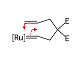

① Ru 알킬리덴(개시: Ru=CHPh와 한쪽  
알릴의 교환) + 다른 알릴 C=C: [2+2]

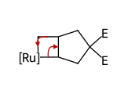

② 메탈라사이클로뷰테인 → 역 [2+2]

③ **B** + [Ru]=CH2

+ **A**

(같은 순환)

CH2=CH2↑ 기체 이탈  
→ 평형 이동

[그림 3] 말론산(β-다이카복실산)의 탈카복실화 — 고리형 전이 상태 → 엔올 → 토토머화

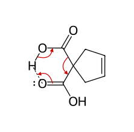

① 6원 고리 전이 상태: 3개 화살표(6전자)  
협동적 탈카복실화

가열

−CO2

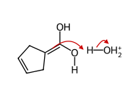

② 엔올(1,1-다이올 알켄)의 C-양성자화  
(생긴 양이온은 OH의 전자쌍으로 안정화)

−H+

**C** (고리 C=C 위치 보존)

**해설**

핵심 반응: **말론산 에스터 합성(엔올레이트 알킬화 → 가수분해 → 탈카복실화)** + **고리 닫기 복분해(RCM)**.

① diethyl malonate의 CH2(p*K*a ≈ 13)는 EtO−로 완전히 엔올레이트가 되며, 알릴 브로마이드(활성화된 1차 할라이드)에 SN2 → 모노알릴 말로네이트. 남은 α-H 한 개도 여전히 산성이므로 NaOEt/알릴 브로마이드를 한 번 더 반복하면 4차 탄소의 다이알릴 말로네이트 A(C13H20O4)가 된다. 염기로 NaOEt를 쓰는 것은 에스터 교환으로 섞인 에스터가 생기는 것을 막기 위해서이다 「[그림 1]」.

② Grubbs 촉매(Ru 카벤)는 [2+2] 고리 첨가/역고리 첨가(메탈라사이클로뷰테인)를 반복하여 두 말단 알켄을 연결한다. 분자 내 반응으로 5원 고리 알켄 B가 생기고 CH2=CH2가 기체로 빠져나가 평형이 생성물 쪽으로 이동한다(엔트로피 + Le Chatelier). B의 분자식 C11H16O4 = A − C2H4로 확인된다 「[그림 2]」.

③ KOH로 두 에스터를 비누화하고 산성화하면 cyclopent-3-ene-1,1-dicarboxylic acid(C7H8O4)가 된다. 같은 탄소에 COOH가 두 개 있는 말론산(β-다이카복실산)은 6원 고리 전이 상태를 통해 가열만으로 CO2를 잃어 엔올을 주고, 이것이 토토머화하여 C(C6H8O2)가 된다. 고리 안의 C=C는 이 과정에서 변하지 않는다 「[그림 3]」. 전이 상태에서 O–H 수소가 다른 카보닐 O로 옮겨 가므로, 이온화되지 않은 COOH(산성화 후)여야 반응이 일어난다.

④ **흔한 오답**: (가) RCM 생성물을 6원 고리로 그리는 것 — 두 알릴의 내부 탄소 사이에 새 C=C가 생기므로 고리 원자는 C1, CH2, CH=, =CH, CH2의 5개이다. (나) 탈카복실화를 음이온 메커니즘(카복실레이트에서 CO2 이탈)으로 그리는 것 — 산성 조건에서는 고리형 협동 메커니즘이며 엔올 중간체를 반드시 거친다. (다) C에서 알켄이 짝지음 위치(C1=C2)로 이동했다고 보는 것 — 산 촉매 토토머화는 C1에만 양성자를 주므로 고리 C=C 위치는 보존된다.

## 2회 정답 및 해설

2회 1번 (기입형 2점) · 분광학적 구조 결정(IR·NMR·MS)중요도 ★★★

|  |  |
| --- | --- |
| 변형 기출 | 2023학년도 A형 3번 — C₉H₉ClO(3-chloropropiophenone)의 IR·¹H NMR·MS — Cl 동위원소(3:1), α-절단 아실륨 이온(m/z 105) |
| 변형 포인트 | Cl(3:1) 대신 Br(1:1) 동위원소 쌍을 쓰고, 케톤의 아실륨 대신 알코올의 α-절단으로 생기는 산소 안정화 양이온(옥소늄)을 묻는다. 위치 이성질체 2-(4-bromophenyl)ethanol(α-절단 시 •CH₂OH 손실 → m/z 169/171)과의 구별이 MS 단서의 핵심 |
| 소스 논문 | J. Chem. Ed. 2008, 85, 832–833 (Klein 15.71) — 1-(4-bromophenyl)ethanol과 2-(4-bromophenyl)ethanol의 EI 질량 스펙트럼(m/z 202/200, 187/185, 159/157, 121 대 171/169) 구별 |

**정답**

A: 1-(4-bromophenyl)ethan-1-ol

m/z 185 (⁷⁹Br)

m/z 185 = [M − CH3]+ = 4-79BrC6H4–CH=O+H (⁸¹Br이면 m/z 187)

**메커니즘·구조 그림**

[그림 1] 1H NMR 신호 배정 (δ, ppm)

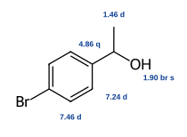

**A**: 1-(4-bromophenyl)ethan-1-ol

[그림 2] 알코올 라디칼 양이온의 α-절단 → m/z 185/187 (반쪽 화살표: 전자 1개 이동)

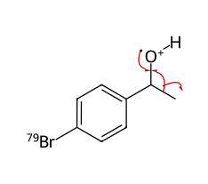

M+• m/z 200 (81Br: 202)

α-절단

−•CH3 (15)

m/z 185 (81Br: 187), 기준 피크  
C7H6BrO+ 옥소늄 이온

+

**해설**

① MS: m/z 200과 202가 거의 1:1 → Br 원자 1개(⁷⁹Br : ⁸¹Br ≈ 51 : 49). M = 200(C8H979BrO). 불포화도 = (2×8+2−9−1)/2 = 4 → 벤젠 고리.

② IR 3350 cm−1(넓음) = O–H, C=O 띠 없음 → 알코올. 825 cm−1은 *para*-이치환 벤젠의 C–H 면외 굽힘. ¹H NMR 7.46(d, 2H)·7.24(d, 2H), *J* = 8.4 Hz의 AA′BB′ 두 이중선 → *para*-이치환(Br과 탄소 곁사슬).

③ 곁사슬 C2H5O: 4.86(q, *J* = 6.5, 1H) = Ar–CH(OH)–(벤질 + 산소, 이웃 CH3 → 사중선), 1.46(d, 3H) = CH–CH3, 1.90(br s, 1H) = OH. ⇒ A = 4-BrC6H4CH(OH)CH3([그림 1]).

④ 조각 이온: 알코올 분자 이온(산소의 비공유 전자 하나가 떨어진 라디칼 양이온)은 C–O에 이웃한 C–C 결합이 끊어지는 **α-절단**을 한다. Cα–CH3 결합이 균일 분해되어 •CH3(15)가 떨어지고, 산소의 전자쌍이 C=O+ π 결합을 만들어 공명 안정화된 옥소늄 이온 ArCH=OH+(m/z 185/187, 기준 피크)이 된다. 이 이온은 벤젠 고리와도 콘쥬게이션되어 특히 안정하다([그림 2]: 반쪽 화살표 3개).

⑤ 나머지: 157/159 = 185/187 − CO(28) → C6H6Br+(1-phenylethanol의 107 → 79와 같은 경로), 121 = [M − Br]+(C8H9O+, Br 없음 → 단일 피크), 77 = C6H5+.

⑥ 함정: 위치 이성질체 2-(4-bromophenyl)ethanol은 α-절단으로 •CH2OH(31)를 잃어 m/z 169/171(브로모벤질/트로필륨 이온)이 크게 나타나고 m/z 185/187은 거의 없다. ¹H NMR에서도 3.84(t)·2.82(t) 두 삼중선을 보인다. 4-bromobenzyl methyl ether는 O–H 띠가 없고 4.40(s)·3.38(s) 두 단일선을 보인다.

2회 2번 (기입형 2점) · 분광학적 구조 결정(IR·NMR·MS)중요도 ★★★

|  |  |
| --- | --- |
| 변형 기출 | 2022학년도 A형 3번 유형 — C₅H₈O₂(vinyl propanoate)의 IR(1760, 비닐 에스터)·¹H NMR — C=O 진동수에 영향을 주는 요인과 알켄 J |
| 변형 포인트 | “구조에 따라 C=O 신축 진동수가 달라지는 이유”라는 평가 요소를 유지하면서, Dieckmann 축합 생성물(β-케토 에스터)의 케토–엔올 호변 이성 평형을 IR 4개 띠(1740·1718·1658·1618)로 해석하도록 변형. 콘쥬게이션과 분자 내 수소 결합에 의한 진동수 감소, 킬레이트 O–H의 ¹H 신호(δ 12.2)를 함께 다룸. 기출의 단순 구조 결정을 반응 생성물 + 호변 이성질체 판단으로 확장 |
| 소스 논문 | J. Am. Chem. Soc. 1952, 74, 4070–4073 (Klein 15.70) — ethyl 2-oxocyclohexanecarboxylate의 케토형·엔올형 평형 혼합물 IR(1600~1850 cm⁻¹의 1620, 1660, 1720, 1740 cm⁻¹) 귀속 |

**정답**

A: ethyl 2-oxocyclohexane-1-carboxylate

엔올형 (㉢ 1657: C=O, ㉣ 1617: C=C)

㉢·㉣은 엔올형 ethyl 2-hydroxycyclohex-1-ene-1-carboxylate의 에스터 C=O(㉢)와 C=C(㉣) 신축 띠이다(O–H…O=C 분자 내 수소 결합).

**메커니즘·구조 그림**

[그림 1] 케토–엔올 호변 이성질체와 IR 띠(cm−1)·1H 신호 배정

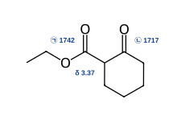

케토형 (에스터 C=O, 고리 케톤 C=O)

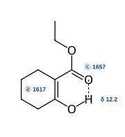

엔올형: 콘쥬게이션 + 분자 내 O–H⋯O=C(점선)

[그림 2] 케토–엔올 호변 이성화 — 공통 엔올레이트를 거치는 평형(염기 촉매; 산 촉매도 가능)

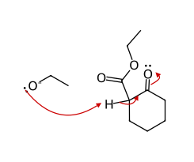

① 두 C=O 사이 C–H 탈양성자화

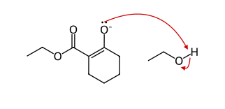

② 엔올레이트 O의 양성자화

엔올형 (+ EtO−)

**해설**

① 반응: NaOEt가 에스터 α-탄소를 탈양성자화 → 엔올레이트가 같은 분자의 다른 에스터 C=O를 공격(분자 내 Claisen = **Dieckmann 축합**) → 사면체 중간체에서 EtO− 이탈 → 6원 고리 β-케토 에스터. 생성물의 두 카보닐 사이 C–H(pKa ≈ 11)가 EtO−에 의해 탈양성자화되어 평형이 생성물 쪽으로 끌려가며, H3O+ 처리로 중성 β-케토 에스터 A를 얻는다. C11H20O4 − EtOH = C9H14O3 ✓.

② IR 귀속(케토형): ㉠ 1742 cm−1 = 포화 에스터 C=O, ㉡ 1717 cm−1 = 고리 케톤(사이클로헥산온형) C=O([그림 1] 왼쪽).

③ IR 귀속(엔올형): ㉢ 1657 cm−1 = 엔올형의 에스터 C=O. C=C와 콘쥬게이션되어 C=O 결합 차수가 낮아지고, 엔올 O–H와 6원 고리 모양의 분자 내 수소 결합(O–H⋯O=C)을 이루어 결합이 더 약해지므로 일반 에스터보다 약 85 cm−1 낮다. ㉣ 1617 cm−1 = 엔올 C=C. 보통 C=C는 약하지만, 여기서는 전자 주개(OH)와 받개(CO2Et)가 양 끝에 붙은 밀고–당기는(push–pull) 분극 이중 결합이어서 쌍극자 변화가 커 강하게 나타난다([그림 1] 오른쪽).

④ 보조 단서: 날카로운 자유 O–H(≈3600)가 없고 2500~3200의 넓은 흡수만 있는 것은 강한 분자 내 수소 결합 O–H의 특징이다. δ 12.2(s)는 킬레이트된 엔올 OH, δ 3.37은 케토형의 C1–H(두 C=O 사이 메타인)이며, 이 피크가 1H보다 작게 적분되는 것은 두 호변 이성질체가 함께 존재한다는 뜻이다.

⑤ 단순 케톤은 엔올 함량이 무시할 만하지만 β-케토 에스터는 (i) C=C–C=O 콘쥬게이션, (ii) 6원 킬레이트 수소 결합, (iii) 고리 안 사치환 C=C의 안정성 때문에 엔올형이 상당량 존재한다. 두 호변 이성질체는 두 C=O 사이 C–H가 떨어진 공통 엔올레이트를 거쳐 서로 바뀐다([그림 2]). 함정: ㉡을 에스터로, ㉢을 케톤으로 귀속하는 것(콘쥬게이션·수소 결합은 진동수를 *낮춘다*).

2회 3번 (기입형 2점) · 입체화학·형태 분석중요도 ★★★

|  |  |
| --- | --- |
| 변형 기출 | 2024학년도 B형 2번 — 리파제 동역학적 분할 후 카이랄 HPLC 크로마토그램에서 피크의 R/S 배열과 거울상 초과도(ee) 구하기 |
| 변형 포인트 | 효소 동역학적 분할 대신, 산화 상태에 따라 선택성이 뒤바뀌는 카이랄 Cu 촉매의 비대칭 Michael 첨가(JACS 2012)를 소재로 바꿈. 그려 준 생성물 P의 CIP 판정에서 –CH2NO2 > –C6H5 > –CH(CO2Et)2 순위(산소 수에 속기 쉬운 함정)를 묻고, 피크 면적비 → ee → 실험 조건(용매)을 역추적하게 하여 사고 단계를 늘림 |
| 소스 논문 | J. Am. Chem. Soc. 2012, 134, 8054–8057 (Klein 5.65) — 산화·환원으로 전환되는 카이랄 Cu 촉매: Cu(I)형은 (S), Cu(II)형은 (R) Michael 부가물(diethyl malonate + trans-β-nitrostyrene)을 주로 생성; 용매별 ee 자료 |
| 노벨상 연계 | 2001 노벨 화학상(Knowles·Noyori — 카이랄 촉매 비대칭 반응); 2021(List·MacMillan — 같은 반응형의 비대칭 유기촉매) |

**정답**

㉠: (R)-거울상이성질체

㉠ = ***R*** (P는 *S*) · ee = (43 − 7)/(43 + 7) × 100 = 72 % → 용매 *X* = **CH3CN**

**메커니즘·구조 그림**

[그림 1] Cu 촉매 비대칭 Michael 첨가 — 말론산 엔올레이트 → 나이트로네이트 → P(*S*)

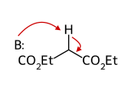

① 말론산 에스터의 산성 α-H 제거  
(Cu에 배위한 엔올레이트)

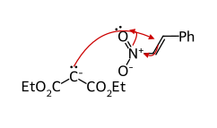

② β-탄소(Ph 쪽) 공격 — 카이랄 Cu 착물이  
nitroalkene의 한쪽 면만 열어 둠

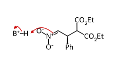

③ 나이트로네이트의 탄소 양성자화

**P** = (*S*) — CIP 순위(숫자): 1 CH2NO2 (N,H,H)  
> 2 Ph (C,C,C) > 3 CH(CO2Et)2 (C,C,H) > H

**해설**

**핵심 반응·개념:** 카이랄 촉매에 의한 거울상선택적 Michael 첨가, CIP 우선순위, 카이랄 크로마토그래피와 ee 계산.

① 메커니즘: 염기와 Cu 촉매가 diethyl malonate의 산성 α-H(pKa ≈ 13)를 떼어 Cu에 배위한 엔올레이트를 만든다. 이 엔올레이트가 nitroalkene의 β-탄소(Ph가 붙은 탄소)를 공격하고, 생긴 나이트로네이트가 양성자화되어 P가 된다. 카이랄 리간드가 nitroalkene의 한쪽 거울상 면(enantiotopic face)만 열어 두므로 한 거울상이성질체가 우세해진다. 생성물에서 새로 생긴 카이랄 중심은 Ph가 붙은 벤질 탄소 하나뿐이다. 「[그림 1]」①–③: 탄소 음이온(엔올레이트)이 Ph가 붙은 β-탄소를 공격하면 음전하가 나이트로기로 옮겨 나이트로네이트가 되고, 그 α-탄소가 양성자화된다.

② CIP: 카이랄 중심에 붙은 원자는 C(H2NO2) = (N, H, H), C6H5 = (C, C, C), CH(CO2Et)2 = (C, C, H), H이다. 첫 번째 차이점에서 원자 번호가 가장 큰 N을 가진 **CH2NO2 > Ph > CH(CO2Et)2 > H**이다. “산소가 4개 있는 malonate 쪽이 1순위”라고 판단하는 것은 흔한 오답이다. 순위는 바로 붙은 원자 집합을 먼저 비교한다. 그려진 P는 ***S***이다(RDKit로 확인). 「[그림 1]」의 P에 붙인 숫자 1–3이 CIP 순위이다.

③ Cu(I) 촉매가 P(*S*)를 주로 주므로 큰 피크 ㉡ = (*S*)-P, 작은 피크 ㉠ = **(*R*)-거울상이성질체**이다. 카이랄 칼럼에서 두 거울상이성질체는 정지상의 카이랄 선택자와 부분입체이성질체 관계의 일시적 착물을 만들기 때문에 머무름 시간이 달라진다.

④ ee = (43 − 7)/(43 + 7) × 100 = **72 %**, 즉 *S* : *R* = 86 : 14이다. 표에서 ee 72 %인 용매는 **CH3CN**이다(논문에서도 ee가 가장 높고 수득률 55 %로 최적 조건이었다).

⑤ 같은 반응을 Cu(II) 형태로 하면 ㉠(*R*)이 큰 피크가 된다. “촉매의 산화 상태만 바꿔 같은 리간드로 두 거울상이성질체를 모두 얻는” 산화·환원 전환형 촉매라는 점이 논문의 요지다. 라세믹 표준 시료(1 : 1)로 피크 위치를 먼저 확인하는 이유도 함께 기억해 두자.

2회 4번 (기입형 2점) · 입체화학·형태 분석중요도 ★★★

|  |  |
| --- | --- |
| 변형 기출 | 2023학년도 B형 2번 — trans-2-butene의 Br2 안티 첨가(메조), 과산 에폭시화 후 산 촉매 개환으로 메조 다이올 형성, 메조 화합물 고르기 |
| 변형 포인트 | 기질을 (E)-stilbene으로 바꾸고, 에폭사이드를 과산 대신 브로모하이드린 → 분자 내 SN2(NaOH) 경로로 만들게 함. 중간체 C(브로모하이드린)는 두 입체 중심을 가져도 메조가 아님을 판별하게 하여 메조 판정 함정을 하나 더 둠 |
| 소스 논문 | J. Org. Chem. 1991, 56, 2582–2584 (Klein 8.92) — meso-1,2-dibromo-1,2-diphenylethane을 DMF 속에서 가열하면 탈브로민화되어 (E)-stilbene만 생성됨(입체특이성 vs 입체선택성 논의) |

**정답**

D: trans-stilbene oxide (라셈)

**D** = *trans*-2,3-diphenyloxirane((2*R*,3*R*)와 (2*S*,3*S*)의 라셈 혼합물, 한쪽만 그려도 됨)  
메조 화합물: **B**, **E**

**메커니즘·구조 그림**

[그림 1] (*E*)-stilbene의 Br2 첨가 — 브로모늄 이온의 뒷면 개환(anti) → 메조

① π 전자 → Br, Br–Br 이종 분해

② 브로모늄 이온: Br−가 Br+의 반대쪽(뒷면)에서 SN2

**B**: meso-(1*R*,2*S*) — 안티 첨가

[그림 2] 브로모하이드린 형성(anti) → 분자 내 SN2 고리 닫힘

③ H2O가 뒷면 공격

−H+

**C** (1*S*,2*R*) 브로모하이드린  
(+ 거울상, 메조 아님)

NaOH

④ O−와 Br이 anti일 때  
분자 내 SN2 (C–Br 탄소 반전)

**D** *trans*-stilbene oxide  
(2*S*,3*S*) + 거울상

[그림 3] 산 촉매 에폭사이드 개환 — 한 탄소만 반전 → 순 anti 다이하이드록시화 → 메조

⑤ 에폭사이드 O 양성자화

⑥ H2O가 C–O 반대쪽에서 공격

−H+

**E** meso-hydrobenzoin (1*R*,2*S*)

**해설**

**핵심 반응:** 브로모늄 이온을 거치는 안티 첨가, 할로하이드린 형성, 분자 내 SN2 에폭사이드 고리 닫힘, 산 촉매 에폭사이드 안티 개환 → *trans* 알켄 + 순(net) 안티 다이하이드록시화 = 메조.

① **B**는 그림에서 (1*R*,2*S*)이고 대칭면을 가지는 meso-1,2-dibromo-1,2-diphenylethane이다. Br2 첨가는 브로모늄 이온을 거친 **안티 첨가**이고, 대칭 알켄에 안티 첨가하여 메조가 생기려면 알켄이 *trans*여야 한다. 따라서 **A** = (*E*)-stilbene이다(*cis*-stilbene이면 (*R,R*)/(*S,S*) 라셈 다이브로마이드). 「[그림 1]」: Br−는 브로모늄 고리의 Br+ 반대쪽에서만 들어갈 수 있다.

A: (E)-stilbene

C: 브로모하이드린 (라셈)

E: meso-hydrobenzoin

② Br2/H2O: 브로모늄 이온을 용매인 물이 뒤쪽에서 연다(안티). 두 탄소가 모두 벤질 탄소라 위치 문제는 없다. **C** = (1*S*,2*R*)-2-bromo-1,2-diphenylethanol과 그 거울상이성질체(라셈)이다. **입체 중심이 2개여도 두 중심의 치환기(OH와 Br)가 다르므로 내부 대칭면이 없어 메조가 아니다.** 이것이 이 문항의 함정이다.

③ NaOH가 OH를 알콕사이드로 만들고, O−가 Br이 붙은 탄소를 뒤쪽에서 공격하는 분자 내 SN2가 일어난다. 이 반응은 O−와 Br이 anti-periplanar한 형태에서만 진행된다. 그 형태에서 두 Ph는 서로 anti이므로 **D** = *trans*-stilbene oxide이다. 브로민 탄소는 반전되고 OH 탄소는 유지된다. **D**는 C2 축만 있고 대칭면이 없는 카이랄 분자이며 라셈으로 얻어진다. 「[그림 2]」 ④에서 O−와 Br이 anti가 되도록 회전한 형태가 반응한다.

④ H3O+: 양성자화된 에폭사이드를 물이 뒤쪽에서 공격한다(한 탄소만 반전). *trans*-에폭사이드에 안티 개환이 일어나므로 **E** = meso-hydrobenzoin((1*R*,2*S*)-1,2-diphenylethane-1,2-diol)이다. (*E*)-알켄에서 시작한 경로 전체를 보면 “할로하이드린 형성(안티) → 고리 닫힘(반전) → 개환(반전)”으로 순 안티 다이하이드록시화가 된다. 기출의 과산 경로와 결과가 같다. 「[그림 3]」

⑤ 메조 판정: **A**는 비카이랄이지만 입체 중심이 없으므로 메조가 아니다. **C**, **D**는 카이랄이다. 따라서 메조는 **B**와 **E**뿐이다.

⑥ 논문 연계: **B**를 DMF에서 가열하면 (*E*)-stilbene만 생긴다. 그런데 (*R,R*)-다이브로마이드에서도 *E*만 생기므로, 협동적 anti 제거(입체특이적)가 아니라 회전이 자유로운 중간체를 거치는 **입체선택적** 반응임이 밝혀졌다. 입체특이성(출발물의 입체가 생성물의 입체를 결정)과 입체선택성(더 안정한 생성물이 우세)을 구분하는 좋은 예다.

2회 5번 (기입형 2점) · 방향족 치환·다이아조늄 화학중요도 ★★★

|  |  |
| --- | --- |
| 변형 기출 | 2023학년도 A형 2번 — 아세트아닐라이드 나이트로화·탈보호 → 다이아조늄 → 살리실산과 아조 짝지음(alizarin yellow R) |
| 변형 포인트 | 아닐린의 술폰화(파라, 열역학 조절)로 술파닐산을 만든 뒤 다이아조화하고, 짝지음 상대를 2-naphthol로 바꾸어 “나프톨의 C1(α) 위치 선택성”을 묻는 산성 아조 염료(Orange II) 합성으로 변형 |
| 소스 논문 | Anal. Chem. 2013, 85, 831–836 (Klein 15.69) — 섬유 산성 염료(술폰산염 발색단을 가진 안트라퀴논 염료)의 질량 분석 확인 — 본 문항은 같은 “술폰산염 산성 염료” 계열의 아조 염료 합성으로 모델화 |

**정답**

A: sulfanilic acid

B: Orange II

(A는 실제로 쯔비터이온 H3N+–C6H4–SO3−로 존재. B = sodium 4-[(2-hydroxynaphthalen-1-yl)diazenyl]benzenesulfonate)

**메커니즘·구조 그림**

[그림 1] 아조 짝지음 — 2-나프톡사이드의 C1 공격 (Ar = 4-−O3S–C6H4)

① 나프톡사이드 C1이 말단 N을 공격 (O−가 전자 공여)

σ-착물: 옆 벤젠 고리의 방향족 6전자 유지 → ② C1–H 탈양성자화

H3O+ 후처리

**B** (소듐 염)

**해설**

**핵심 반응: 방향족 술폰화(열역학 조절) → 다이아조화 → 아조 짝지음(나프톨 C1 위치 선택성)**

① 아닐린 + 진한 H2SO4 → 아닐리늄 황산수소염 → 고온(180 ℃)에서 술폰화. 술폰화는 가역적이므로 고온에서는 입체 장애가 작고 열역학적으로 가장 안정한 **파라** 생성물이 축적된다. **A** = 4-aminobenzenesulfonic acid(C6H7NO3S).

② NaNO2/HCl, 0~5 ℃: NO+에 의한 N-나이트로소화 → 탈수 → ArN2+(술포네이트와 함께 쯔비터이온 −O3S–C6H4–N2+). 저온 유지는 N2 손실(페놀 생성)을 막기 위함이다.

③ 「[그림 1]」 다이아조늄 이온은 약한 친전자체이므로 매우 활성화된 고리(나프톡사이드)와만 반응한다. NaOH는 2-naphthol(p*K*a ≈ 9.5)을 나프톡사이드로 바꿔 친핵성을 높인다. 2-나프톡사이드는 **C1**에서 공격하는데, C1 공격 σ-착물은 다른 벤젠 고리의 방향족 6전자를 그대로 유지한 공명 구조를 가지면서 O−의 공여로 안정화된다(C3 공격은 옆 고리의 방향족성을 깨야 O의 공명 안정화를 받음). 탈양성자화로 방향족성 회복 → 아조 화합물.

④ **B** = Orange II(Acid Orange 7). 술폰산염기는 물 용해도와 섬유(양모·나일론의 양이온 자리)와의 이온 결합을 제공하는 “산성 염료”의 특징이다. 아조 결합으로 두 방향족계가 콘쥬게이션되어 가시광(주황)을 흡수한다.

⑤ 흔한 오답: C3 또는 C6에 짝지음한 구조, 술폰산기를 메타에 둔 A(아닐리늄의 메타 지향과 혼동 — 고온 가역 조건에서는 파라가 주생성물).

2회 6번 (서술형 4점) · 방향족 치환·다이아조늄 화학중요도 ★★★

|  |  |
| --- | --- |
| 변형 기출 | 2022학년도 B형 8번 — 다이아조늄→페놀; SNAr 위치 활성화; FC 알킬화의 탄소 양이온 재배열 vs FC 아실화–Clemmensen |
| 변형 포인트 | 분자 간 FC 알킬화의 재배열(1-chloro-2-methylpropane → tert-butylbenzene)과 아실화–환원에 의한 isobutylbenzene(이부프로펜 원료) 합성을 묻고, 논문의 “에틸렌 + 아실륨 → 분자 내 FC 알킬화” 2-tetralone 합성을 추가하여 아실륨·탄소 양이온의 운명을 종합적으로 판단하게 함 |
| 소스 논문 | J. Org. Chem. 2012, 77, 5503–5514 (Klein 19.84) — 아미노테트랄린(항우울제 후보) 합성: 2-(2-bromo-5-methylphenyl)acetyl chloride + 에틸렌/AlCl₃ → 8-bromo-5-methyl-2-tetralone |

**정답**

A: 8-bromo-5-methyl-2-tetralone

B: tert-butylbenzene

이유: AlCl3와 1차 할로젠화 알킬의 착물에서 C–Cl이 이온화되는 동시에 이웃 C–H의 하이드라이드가 1,2-이동하여 안정한 3차 탄소 양이온((CH3)3C+)이 생성되고, 이것이 벤젠을 공격하기 때문이다.  
합성: ① 벤젠 + (CH3)2CHCOCl, AlCl3 → PhCOCH(CH3)2 (아실륨은 재배열하지 않음) ② Zn(Hg)/HCl(Clemmensen 환원) → PhCH2CH(CH3)2

**메커니즘·구조 그림**

[그림 1] [반응 2] FC 알킬화 — 1차 → 3차 탄소 양이온 재배열(1,2-H− 이동)

① AlCl3 착물: C–Cl 이온화와 동시에 1,2-하이드라이드 이동

− AlCl4−

3차 양이온 ← ② 벤젠 π 전자의 공격

아레늄 이온 → ③ 탈양성자화

− HCl, AlCl3

**B** *tert*-butylbenzene

[그림 2] FC 아실화(아실륨은 재배열하지 않음) → Clemmensen 환원

① 아실륨 이온 생성

− AlCl4−

모든 원자 옥텟 → 재배열 없음

② 벤젠의 공격

③ 탈양성자화

isobutyrophenone

Zn(Hg), HCl

Clemmensen

isobutylbenzene

[그림 3] [반응 1] 지방족 아실화 → 분자 내 FC 알킬화 (CH3의 오쏘에서 고리화)

① 에틸렌 π 전자가 아실륨을 공격

1차 양이온 등가체(재배열하면 α-카보닐 양이온 → 불리) → ② 분자 내 FC 알킬화(6원 고리)

아레늄 이온(+가 CH3 붙은 3차 탄소) → ③ 탈양성자화

**A** 8-bromo-5-methyl-2-tetralone

**해설**

**핵심 반응: Friedel–Crafts 아실화(아실륨, 재배열 없음) vs 알킬화(탄소 양이온 재배열) + Clemmensen 환원**

① [반응 1](「[그림 3]」) AlCl3가 산 염화물의 Cl을 떼어 공명 안정화된 아실륨 이온(R–C≡O+)을 만든다. 아실륨이 자기 고리를 공격하면 4원 고리가 되어 불가능하고, 다른 분자의 고리(Br으로 불활성화)보다 과량 존재하는 에틸렌의 π 전자가 아실륨을 공격하는 지방족 아실화가 먼저 일어나 ArCH2C(=O)CH2CH2+(또는 Cl−가 포착한 β-클로로케톤, AlCl3로 재이온화)가 생긴다.

② 이 1차 양이온 등가체는 하이드라이드 이동을 해도 카보닐 옆(α) 양이온이 되어 오히려 불안정하므로 재배열하지 않고, 6원 고리를 닫을 수 있는 방향족 탄소(CH2의 오쏘, Br이 없는 쪽 = CH3의 오쏘로 활성화)를 분자 내 FC 알킬화로 공격 → 아레늄 이온 → 탈양성자화 → **A** = 8-bromo-5-methyl-3,4-dihydronaphthalen-2(1*H*)-one(C11H11BrO). CH2의 다른 오쏘(C–Br)는 치환 불가.

③ [반응 2](「[그림 1]」) 1-chloro-2-methylpropane은 1차 할로젠화물이라 자유 1차 양이온을 만들지 않지만, AlCl3 착물의 이온화와 2번 탄소 H의 1,2-하이드라이드 이동이 함께 일어나 3차 양이온이 되고, 이 친전자체가 벤젠과 반응하므로 isobutylbenzene 대신 **tert-butylbenzene**이 주생성물이다. (보기의 (CH3)2C=CH2/H3PO4도 Markovnikov 양성자화로 같은 t-Bu+를 주므로 오답.)

④ 재배열 없는 직쇄 알킬 도입(「[그림 2]」): 아실륨 이온은 C≡O+ 공명으로 안정하여 재배열하지 않고, 생성된 아릴 케톤은 고리를 불활성화하므로 다중 치환도 없다. 이어서 Zn(Hg)/HCl(Clemmensen)으로 C=O → CH2. NaBH4는 알코올까지만 환원하므로 부적절하다.

⑤ 이부프로펜 공정(BHC)은 isobutylbenzene의 FC 아세틸화로 시작한다 — 순서상 isobutyl기를 먼저 정확히 만들어야 하므로 ④의 아실화–환원이 산업적으로도 핵심이다.

2회 7번 (서술형 4점) · 카보닐 α-탄소·축합 반응중요도 ★★★

|  |  |
| --- | --- |
| 변형 기출 | 2024학년도 B형 7번 — cyclopentanone → Grignard/탈수 → 오존 분해 → 분자 내 알돌 축합 vs α-브로민화–탈리로 2-cyclohexenone 합성 |
| 변형 포인트 | CH₃MgBr 대신 EtMgBr를 써서 케토알데하이드의 알돌 위치 선택성(6원 고리만 가능한 경로 판별)을 요구하고, 두 번째 경로는 비대칭 케톤(2-methylcyclohexanone)의 산 촉매 α-브로민화 위치 선택성(더 치환된 엔올)까지 묻도록 변형. |
| 소스 논문 | J. Org. Chem. 2003, 68, 6455–6458 (Klein 20.87) — 고리 케톤에 Grignard 첨가 → H₂SO₄ 가열 탈수 → 오존 분해로 곁사슬 카보닐을 도입하는 서열의 화학선택성 분석 — 본 문항 1·2단계의 모델 |

**정답**

A

C

D

중간체

A = 1-ethylcyclopentene, (B = 5-oxoheptanal), C = 2-methylcyclohex-2-en-1-one, D = 2-methylcyclohexan-1-one, 중간체 = 3-hydroxy-2-methylcyclohexan-1-one.  
Br 위치: 메틸이 붙은 C2(더 치환된 α-탄소). 산 촉매 할로젠화는 엔올을 거치며, 더 치환된(사치환) C1=C2 엔올이 열역학적으로 더 안정하여 주로 생성되므로 Br2가 C2를 공격한다 → 2-bromo-2-methylcyclohexanone → 염기에 의한 E2(C3–H 제거)로 짝지어진 엔온 C.

**메커니즘·구조 그림**

[그림 1] **B** → **C** — 분자 내 알돌 첨가(6원 고리)와 E1cB 탈수

① C6(에틸 CH2)의 α-H 제거

② 엔올레이트 C6 → 알데하이드 C1  
(6원 고리; 다른 조합은 4원 고리)

H2O

−OH−

③ 알돌(중간체 C7H12O2)의 α-H 제거

④ E1cB: OH− 이탈

−OH−

**C**

[그림 2] **D** → **C** — 산 촉매 α-브로민화(더 치환된 엔올)와 E2 탈브로민화수소

① 양성자화된 C=O에서 C2–H 제거  
→ 더 치환된(사치환) 엔올

② 엔올의 C2가 Br2 공격

−H+

−Br−

③ 2-bromo-2-methylcyclohexanone:  
C3–H 제거 + Br− 이탈(E2)

**C**

**해설**

핵심 반응: **분자 내 알돌 축합(고리 크기 선택)**과 **산 촉매 α-할로젠화–탈할로젠화수소**.

① EtMgBr 첨가 → 1-ethylcyclopentanol(3차 알코올). H2SO4/가열에서 E1 탈수: 고리 안 삼치환 알켄 A(1-ethylcyclopentene)가 주생성물이다(5원 고리에서는 고리 내 이중 결합이 고리 밖 ethylidene보다 안정). 고리 밖 알켄이었다면 오존 분해로 cyclopentanone + CH3CHO가 생겨 B의 분자식(C7H12O2)과 맞지 않는다.

② 환원성 오존 분해는 고리를 열어 C1→케톤(에틸 케톤), C2→알데하이드인 B = CH3CH2C(O)CH2CH2CH2CHO(5-oxoheptanal)를 준다.

③ B의 α-탄소는 C2(알데하이드 α), C4·C6(케톤 α) 세 곳이다. C2→C5 공격과 C4→C1 공격은 4원 고리, **C6(에틸의 CH2) 엔올레이트 → C1 알데하이드** 공격만 6원 고리를 만든다. 알데하이드는 케톤보다 친전자성이 커서 이 경로가 빠르다. 알콕사이드가 양성자화되어 β-하이드록시 케톤(3-hydroxy-2-methylcyclohexanone, C7H12O2)이 되고, 가열 시 E1cB(엔올레이트 형성 후 OH− 이탈)로 탈수되어 C(2-methylcyclohex-2-enone)가 된다 「[그림 1]」.

④ D 경로: 산 촉매 할로젠화의 속도 결정 단계는 엔올 형성이며, 더 치환된 엔올이 주로 생기므로 Br은 C2(3차 α-탄소)에 들어간다(염기성 조건/LDA의 덜 치환된 쪽 선택과 대비). Li2CO3/LiBr, DMF는 약하고 비친핵성인 염기 조건으로 C3–H를 제거하는 E2를 일으켜 짝지어진 엔온을 준다. 고리 밖 메틸의 H를 떼면 2-methylenecyclohexanone(이치환, 덜 안정)이 되므로 부생성물이다 「[그림 2]」.

⑤ **흔한 오답**: C를 3-methylcyclohex-2-enone(원 기출의 답과 혼동)이나 1-acetylcyclopentene(5원 고리)으로 그리는 것 — 원자 번호를 따라가면 CH3는 C2, 즉 카보닐 옆 알켄 탄소에 위치한다. D를 3-methylcyclohexanone으로 쓰면 브로민화가 C2/C6에서 섞여 C가 단일하게 나오지 않는다.

2회 8번 (서술형 4점) · 카보닐 α-탄소·축합 반응중요도 ★★★

|  |  |
| --- | --- |
| 변형 기출 | 2023학년도 A형 10번 — 2,6-octanedione의 분자 내 알돌(구조 이성질체 B/C, 열역학 조절), LDA 동역학적 엔올레이트 + MVK Robinson 고리화 |
| 변형 포인트 | 1,5-다이케톤(6원 고리) 대신 1,4-다이케톤(5원 고리, 논문의 fulvene 전구체 합성 단계)을 쓰고, 한쪽 α-탄소를 벤질 위치로 바꾸어 알돌 위치 선택성을 공액·치환도로 판단하게 하였다. 마지막 단계는 엔온의 동역학적 α′-탈양성자화(LDA)와 알킬화로 바꾸어 γ-탈양성자화(확장 엔올레이트)와 대비시켰다. |
| 소스 논문 | J. Org. Chem. 2012, 77, 6371–6376 (Klein 22.112) — 1-phenylpentane-1,4-dione의 NaOH 분자 내 알돌 축합으로 3-phenylcyclopent-2-enone을 얻고 Grignard·탈수로 fulvene 전구체 합성 — 1,4-다이케톤 고리화를 모델화 |

**정답**

B

C

D

B = 3-methyl-2-phenylcyclopent-2-en-1-one, C = 3-benzylcyclopent-2-en-1-one, D = 5-allyl-3-methyl-2-phenylcyclopent-2-en-1-one(라셈).  
메커니즘(A→B): ① OH−가 C1(PhCH2, C2=O의 α이며 벤질 위치)의 H를 떼어 엔올레이트 형성 → ② 엔올레이트 C1이 C5 카보닐 탄소를 공격하여 5원 고리 알콕사이드 → ③ H2O가 양성자를 주어 β-하이드록시 케톤(3-hydroxy-3-methyl-2-phenylcyclopentanone) → ④ OH−가 C1–H(이제 고리의 C2–H)를 다시 떼어 엔올레이트 → ⑤ E1cB로 OH−가 떨어지며 C=C 형성 → B.  
이유: NaOH/가열 조건에서 알돌 첨가와 탈수는 가역적이어서 열역학적으로 더 안정한 엔온이 쌓인다. B의 C=C는 사치환이고 C=O뿐 아니라 페닐 고리와도 짝지어져 있어, 삼치환이며 페닐과 짝지어지지 않은 C보다 안정하다(또한 벤질 위치 α-H가 더 산성이어서 B로 가는 엔올레이트가 더 쉽게 생긴다).

**메커니즘·구조 그림**

[그림 1] **A** → **B** — 분자 내 알돌 축합(벤질 엔올레이트, 5원 고리)과 E1cB 탈수

① 벤질 위치 C1–H 제거  
(두 C=O 중 C2=O의 α, 가장 산성)

② 엔올레이트 C1 → C5=O  
(5원 고리)

H2O

−OH−

③ β-하이드록시 케톤의 α-H 제거

④ E1cB: OH− 이탈

**B** (사치환 C=C, Ph와 짝지음)

[그림 2] **B** → **D** — LDA 동역학적 α′-엔올레이트와 알킬화

① LDA(−78 ℃)가 C=O 바로 옆 α′-H(C5) 제거  
(동역학적, 비가역; γ-H 제거 안 함)

② 리튬 엔올레이트 C5의 SN2 (알릴 Br)

**D** (라셈)

**해설**

핵심 반응: **분자 내 알돌 축합(위치 선택성, 열역학 조절)**과 **LDA에 의한 동역학적 엔올레이트 알킬화**.

① A = PhCH2–C(O)–CH2CH2–C(O)–CH3 (C1~C6). α-탄소는 C1, C3, C4, C6이다. 5원 고리를 만드는 경로는 두 가지뿐이다: (가) C1 엔올레이트 → C5 공격 → B, (나) C6(CH3) 엔올레이트 → C2 공격 → C. C3→C5, C4→C2 공격은 3원 고리라 불가능하다. 경로 (가)의 단계별 메커니즘은 「[그림 1]」과 같다.

② C의 NMR: δ 5.92(s, 1H)는 엔온의 비닐 H(C2–H, 이웃 H 없음), 3.68(s, 2H)는 이웃 H가 없는 PhCH2–C=, 2.4–2.6의 두 m(각 2H)은 고리의 C4·C5 CH2, 7.15–7.40(5H)은 일치환 벤젠이다. 이는 3-benzylcyclopent-2-enone과 일치한다. B였다면 비닐 H가 없고 δ ≈ 2.1의 CH3 단일선이 보여야 한다.

③ 주생성물 판단: 알돌은 가역적이며 가열·수산화 나트륨 조건은 열역학 조절이다(원 기출 2,3-dimethylcyclohex-2-enone과 같은 논리). B는 (i) 이중 결합의 치환도가 더 높고(사치환 > 삼치환), (ii) 페닐–C=C–C=O의 확장된 짝지음을 가진다. 논문(1-phenylpentane-1,4-dione → 3-phenylcyclopent-2-enone)에서도 아릴과 짝지어진 사이클로펜텐온이 얻어진다.

④ D: LDA(부피 큰 강염기, −78 ℃, 비가역)는 엔온에서 카보닐 바로 옆 α′-탄소(C5)의 H를 가장 빨리 뗀다(동역학적 엔올레이트, Li+가 카보닐 O에 배위한 상태에서 가까운 H 제거). 열역학적 조건(예: NaOEt, 실온)에서는 γ-H(C4 또는 3-CH3) 제거로 더 비편재화된 확장(다이엔) 엔올레이트가 생겨 α-알킬화(탈짝지음 생성물)가 섞일 수 있다. 엔올레이트 C5가 알릴 브로마이드에 SN2하여 D(C15H16O)가 된다. C5는 새 입체 중심이지만 비카이랄 조건이므로 라셈체이다 「[그림 2]」.

⑤ **흔한 오답**: B를 2-benzyl… 또는 3-phenyl…로 잘못 번호 매기는 것, D에서 알릴이 C4(γ)나 메틸에 붙는다고 보는 것, B가 “동역학적 생성물”이라고만 쓰는 것(가역 반응이므로 근거는 열역학적 안정성).

2회 9번 (서술형 4점) · 카보닐 α-탄소·축합 반응중요도 ★★★

|  |  |
| --- | --- |
| 변형 기출 | 2023학년도 B형 7번 — ethyl acetate의 Claisen 축합으로 acetoacetate를 얻고, Michael–알돌 고리화·케탈 보호–Grignard에 활용; 1,3-다이카보닐 음이온 공명 |
| 변형 포인트 | Claisen 축합 생성물(ethyl acetoacetate)의 활용을 Knoevenagel 축합–락톤화(쿠마린 형광 염료 합성)와 아세토아세트산 에스터 합성(알킬화–가수분해–탈카복실화)으로 바꾸어, 같은 1,3-다이카보닐 화합물의 두 가지 친핵성 반응을 비교하도록 변형. 음이온 공명 구조 요구는 유지. |
| 소스 논문 | J. Chem. Ed. 2006, 83, 287–289 (Klein 2.74) — 4-(diethylamino)salicylaldehyde와 ethyl acetoacetate의 piperidine 촉매 Knoevenagel 축합–고리화로 3-acetyl-7-(diethylamino)coumarin 합성(IR로 확인) |
| 노벨상 연계 | 2021 노벨 화학상(B. List·D. W. C. MacMillan) — piperidine의 이미늄 형성에 의한 Knoevenagel 축합은 아민 유기촉매(이미늄/엔아민 촉매)의 원형으로 꼽힌다. |

**정답**

A

D

E

↔

↔

A = ethyl acetate, D = 3-acetyl-7-(diethylamino)-2*H*-chromen-2-one(쿠마린), E = 4-phenylbutan-2-one.  
이유: Claisen 축합의 첨가–제거 단계는 모두 가역적이고 평형이 불리하다(에스터 엔올레이트 + 에스터 → β-케토 에스터 + EtO−). 생성된 β-케토 에스터의 C2–H(p*K*a ≈ 11)는 EtOH(p*K*a ≈ 16)보다 훨씬 산성이므로 EtO−가 이를 비가역적으로 떼어 위의 공명 안정화 음이온을 만든다. 이 마지막 산–염기 단계가 평형을 생성물 쪽으로 끌어당기므로 염기가 1당량 이상 소모되며, 반응 후 H3O+로 중화해야 B를 얻는다.

**메커니즘·구조 그림**

[그림 1] Claisen 축합 — 친핵성 아실 치환(첨가–제거)과 생성물 탈양성자화

① 에스터 α-H 제거 → 엔올레이트

② 친핵성 첨가

③ 사면체 중간체 붕괴  
(EtO− 이탈)

④ β-케토 에스터 C2–H(p*K*a ≈ 11) 제거  
→ 공명 안정화 음이온(비가역, 구동력)

H3O+

**B**

[그림 2] **D** 생성 — Knoevenagel 축합(이미늄 활성화, E1cB)과 락톤화 (Ar = 4-Et2N-2-HO-C6H3)

① piperidine N → ArCHO

카비놀아민

−H2O

② **B**의 엔올레이트 → 이미늄 C

H+ 이동

③ E1cB: 엔올레이트가 아민을 밀어냄 → C=C

④ 오쏘 페놀 O → 에스터 C=O (분자 내)

H+ 이동

⑤ 사면체 중간체 → EtO− 이탈

**D** (쿠마린 락톤)

[그림 3] 아세토아세트산 에스터 합성 — 알킬화 → 가수분해 → 탈카복실화(고리형 전이 상태)

① 엔올레이트(NaOEt)의 SN2

1) NaOH(aq)

2) H3O+

② β-케토산: 6원 고리 전이 상태 탈카복실화

−CO2

③ 엔올

토토머화

**E**

**해설**

핵심 반응: **Claisen 축합**, **Knoevenagel 축합**, **아세토아세트산 에스터 합성**.

① A(C4H8O2) = CH3CO2Et. EtO−가 α-H를 떼어 에스터 엔올레이트 → 다른 에스터 C=O에 친핵성 아실 치환(사면체 중간체 → EtO− 이탈) → ethyl acetoacetate B. 생성물의 탈양성자화가 구동력이다(정답 참조, 「[그림 1]」 ④).

② B의 음이온은 C2 탄소 음이온, 케톤 산소 엔올레이트, 에스터 산소 엔올레이트의 세 공명 구조로 비편재화된다. 음전하가 전기음성도가 큰 산소에 있는 두 구조(특히 케톤 O−)의 기여가 크다. 말단 CH3나 OCH2의 H를 뗀 음이온은 한 카보닐에만 비편재화되어 덜 안정하다.

③ D(Knoevenagel–락톤화): piperidine이 알데하이드와 **이미늄 이온**을 만들어 친전자성을 높이고, 동시에 B의 활성 메틸렌을 탈양성자화한다. B의 엔올(레이트)이 이미늄 탄소를 공격 → 아민 제거(E1cB) → 벤질리덴 아세토아세테이트(C=C 형성). 이어 오쏘 위치의 페놀 OH가 에스터 C=O를 분자 내 공격(에스터 교환)하여 EtOH를 내보내고 6원 고리 락톤(쿠마린)이 닫힌다 「[그림 2]」. 락톤화가 가능하려면 Knoevenagel 생성물에서 에스터기가 아릴 고리와 같은 쪽(*Z*)에 있어야 한다. 분자식 확인: C11H15NO2 + C6H10O3 − H2O − C2H5OH = C15H17NO3. 논문에서는 IR에서 페놀 O–H, 알데하이드 C–H(2720/2820 cm−1) 띠가 사라지고 락톤 C=O(≈1720 cm−1)가 나타나는 것으로 확인한다. 7-다이에틸아미노기(주개)와 3-아세틸(받개)의 push–pull 구조로 강한 형광을 낸다.

④ E(아세토아세트산 에스터 합성): NaOEt로 만든 엔올레이트가 PhCH2Br에 SN2 → ethyl 2-benzylacetoacetate → NaOH 비누화 → 산성화하여 β-케토산 → 가열 시 6원 고리 전이 상태로 탈카복실화 → 엔올 → 토토머화 → PhCH2CH2COCH3(C10H12O) 「[그림 3]」. 즉 B는 “CH3COCH2−” 등가체이다.

⑤ **흔한 오답**: D를 락톤화 전의 Knoevenagel 생성물(C17H23NO4)로 그리는 것(분자식 불일치), E를 4-phenylbutanoic acid(말론산 에스터 합성과 혼동)나 탈카복실화 전의 β-케토산으로 그리는 것, 음이온 공명 구조에서 에스터 쪽 O− 구조를 빠뜨리는 것.

2회 10번 (서술형 4점) · 카보닐 α-탄소·축합 반응중요도 ★★★

|  |  |
| --- | --- |
| 변형 기출 | 2022학년도 A형 9번 — 엔아민 형성의 위치 선택성(짝지음), Stork 엔아민 알킬화, FC 아실화 고리화로 2-tetralone, 환원성 아민화 |
| 변형 포인트 | 엔아민 위치 선택성을 짝지음이 아닌 A(1,3) 변형(알릴 변형)으로 판단하게 하여(2-methylcyclohexanone: 엔아민은 덜 치환된 쪽, 엔올레이트(열역학)는 더 치환된 쪽) “엔아민 경로 vs 염기 경로”로 서로 구조 이성질체인 Robinson 고리화 생성물이 얻어짐을 묻도록 변형. Stork 엔아민 Michael 첨가 → 분자 내 알돌이 핵심. |
| 소스 논문 | J. Am. Chem. Soc. 1954, 76, 2029–2030 (Klein 22.110) — Stork 엔아민 반응: cyclohexanone의 pyrrolidine 엔아민이 탄소 친핵체로 알킬화·Michael 첨가된 뒤 가수분해되어 α-치환 케톤을 준다 |
| 노벨상 연계 | 2021 노벨 화학상(B. List·D. W. C. MacMillan) — Stork 엔아민의 화학량론적 반응을 2차 아민(프롤린 등) 촉매 엔아민 반응으로 확장한 것이 유기촉매의 한 축이다. |

**정답**주생성물: **A**(덜 치환된 엔아민).  
이유: 엔아민에서는 N의 비공유 전자쌍이 C=C와 짝지어지기 위해 N이 sp2가 되고 피롤리딘 고리가 C=C와 같은 평면에 놓인다. B처럼 메틸이 붙은 탄소에 이중 결합이 생기면 메틸과 피롤리딘 α-CH2가 같은 평면에서 심하게 부딪친다(A1,3 변형). A에서는 메틸이 sp3 탄소에 있으며 축 방향으로 놓여 이 반발을 피하므로, 이중 결합이 덜 치환된 쪽에 생긴 A가 더 안정하다.

C

D

E

C = 2-methyl-6-(3-oxobutyl)cyclohexan-1-one, D = 8-methyl-4,4a,5,6,7,8-hexahydronaphthalen-2(3*H*)-one, E = 4a-methyl-4,4a,5,6,7,8-hexahydronaphthalen-2(3*H*)-one.

**메커니즘·구조 그림**

[그림 1] 엔아민 형성 — 이미늄의 α-H 제거 위치와 A1,3 변형

① 2차 아민 N → C=O

카비놀아민

(H+, −H2O)

② 이미늄 → 덜 치환된 C6–H 제거

**A** (주생성물, Δ1,6)

(C2–H 제거)

**B**: N 고리 α-CH2와 C2–CH3가 한 평면에서  
충돌(A1,3 변형) → 불리

[그림 2] Stork 엔아민 Michael 첨가 → 가수분해

① 엔아민 β-탄소(C6) → MVK β-탄소 (Michael)

② 이미늄–엔올레이트 쯔비터이온

양성자 이동

H3O+ 가수분해

**C** (2,6-이치환 1,5-다이케톤)

[그림 3] **C** → **D** — 분자 내 알돌 축합(Robinson 고리화의 고리 닫기)

① 곁사슬 CH3의 α-H 제거

② 엔올레이트 → 고리 C1=O (6원 고리)

H2O

OH−

③ 알돌의 엔올레이트 → E1cB (OH− 이탈)

**D** (C8-CH3)

**해설**

핵심 반응: **Stork 엔아민 반응(Michael 첨가)**과 **Robinson 고리화**, 그리고 **엔아민 vs 엔올레이트의 위치 선택성**.

① 엔아민 형성: 케톤 + 2차 아민 → 카비놀아민 → (H+, −H2O) 이미늄 → α-H 제거 → 엔아민. 2-methylcyclohexanone에서는 두 α-탄소 중 어느 쪽 H를 떼느냐에 따라 A(Δ1,6)와 B(Δ1,2)가 생기고, 산 촉매 조건에서 서로 평형을 이룬다. 엔올(레이트)이라면 더 치환된 B형이 열역학적으로 유리하지만, 엔아민은 N-치환기와 C2-치환기 사이의 A1,3 변형 때문에 A가 주생성물(약 9:1)이 된다. 이것이 Stork 엔아민 반응이 비대칭 케톤의 덜 치환된 α-탄소에서 일어나는 이유이다 「[그림 1]」.

② [반응 2] Stork Michael 첨가: A의 β-탄소(C6)가 MVK의 β-탄소에 1,4-첨가 → 이미늄/엔올레이트 → 양성자 이동 → 가수분해(H3O+)로 피롤리딘이 떨어지고 1,5-다이케톤 C(2,6-이치환)가 된다. 엔아민은 중성 친핵체여서 MVK의 중합이나 다중 알킬화가 적다 「[그림 2]」.

③ C → D(분자 내 알돌 축합): KOH가 곁사슬 메틸 케톤의 CH3를 탈양성자화 → 고리 C=O(C1) 공격(6원 고리) → β-하이드록시 케톤 → E1cB 탈수 → 짝지어진 엔온 D. 메틸은 고리 접합 sp2 탄소(C8a) 옆 C8에 놓인다 「[그림 3]」. (곁사슬 안쪽 CH2가 공격하면 4원 고리, 고리 C2′가 곁사슬 C=O를 공격하면 다리걸친 고리가 되어 탈수로 짝지어진 엔온을 만들 수 없으므로 가역 조건에서 D로 수렴한다.)

④ [반응 3]: NaOEt 조건(열역학적 엔올레이트)에서는 더 치환된 C2 엔올레이트가 MVK에 Michael 첨가하여 4차 탄소가 생기고, 이어 Robinson 고리화하면 각진(angular) 메틸을 가진 E가 된다. D와 E는 서로 구조 이성질체(C11H16O)이며, **같은 출발 물질에서 엔아민 경로와 엔올레이트 경로가 상보적인 위치 선택성**을 보인다는 것이 이 문항의 요점이다.

⑤ **흔한 오답**: 원 기출의 “짝지음” 논리를 그대로 적용해 B를 고르는 것(여기에는 짝지을 방향족 고리가 없다), C를 2,2-이치환(4차 탄소) 다이케톤으로 그리는 것, D와 E를 같은 화합물로 그리는 것. 참고로 프롤린 같은 키랄 2차 아민을 쓰면 엔아민의 한쪽 면을 가려 거울상 선택적 반응이 가능하며(Klein 22.111, 22.116), 이것이 2021년 노벨상 주제인 엔아민 유기촉매로 이어진다.

2회 11번 (서술형 4점) · 카보닐 α-탄소·축합 반응중요도 ★★★

|  |  |
| --- | --- |
| 변형 기출 | 2022학년도 B형 9번 — ethyl prolinate의 aza-Michael → Dieckmann 축합 → 가수분해·탈카복실화로 pyrrolizidinone; Dieckmann 메커니즘 |
| 변형 포인트 | aza-Michael 대신 아민의 N-아실화(ethyl malonyl chloride)로 다이에스터를 만들고, Dieckmann 고리화로 천연물(equisetin·fusarisetin·tenuazonic acid)의 핵심 골격인 tetramic acid(pyrrolidine-2,4-dione)를 만드는 경로로 변형. 두 가지 가능한 엔올레이트 중 어느 것이 반응하는지(산도 비교)와 생성물 탈양성자화의 구동력을 함께 묻는다. |
| 소스 논문 | J. Am. Chem. Soc. 2012, 134, 920–923 (Klein 22.118) — fusarisetin A 합성에서 β-케토 아마이드의 엔올레이트가 N-methylserine 메틸 에스터를 공격하는 NaOMe Dieckmann 고리화로 tetramic acid 고리 형성 — 단순 모델(sarcosine 유도체)로 바꿈 |

**정답**

A

B

C

A = ethyl *N*-(3-ethoxy-3-oxopropanoyl)-*N*-methylglycinate, B = ethyl 1-methyl-2,4-dioxopyrrolidine-3-carboxylate, C = 1-methylpyrrolidine-2,4-dione(*N*-methyltetramic acid).  
메커니즘: ① EtO−가 말로닐 CH2(아마이드 C=O와 에스터 C=O 사이)의 H를 떼어 엔올레이트 형성 → ② 엔올레이트 탄소가 글리신 쪽 에스터 C=O를 분자 내 공격(5원 고리) → 사면체 알콕사이드 중간체 → ③ C=O가 다시 형성되며 EtO− 이탈 → B(케토 형) → ④ 세 카보닐 사이의 C3–H가 EtO−에 의해 제거되어 안정한 음이온(비가역, 구동력) → ⑤ H3O+ 처리로 양성자화되어 B.

**메커니즘·구조 그림**

[그림 1] **A** 생성 — 산 염화물의 친핵성 아실 치환(N-아실화)

① 2차 아민 N → 산 염화물 C=O

② 사면체 중간체 → Cl− 이탈

Et3N

−Et3NH+Cl−

**A** (3차 아마이드 다이에스터)

[그림 2] **A** → **B** — Dieckmann 축합(분자 내 Claisen) 메커니즘

① 말로닐 CH2(두 C=O 사이, p*K*a ≈ 13) 탈양성자화

② 엔올레이트 C → 글리신 에스터 C=O  
(5원 고리, 분자 내 Claisen)

③ 사면체 알콕사이드 → EtO− 이탈

④ 세 C=O 사이 C3–H 제거  
(비가역, 구동력) → H3O+로 **B**

[그림 3] **B** → **C** — 가수분해 후 β-케토산의 고리형 탈카복실화

① β-케토산(비누화·산성화 후): 6원 고리 전이 상태

가열

−CO2

② 엔올

토토머화

**C** (*N*-methyltetramic acid)

**해설**

핵심 반응: **Dieckmann 축합(분자 내 Claisen)**과 **β-케토 에스터의 가수분해·탈카복실화**.

① A: 2차 아민(sarcosine)이 산 염화물(ethyl malonyl chloride)에 친핵성 아실 치환하여 3차 아마이드 A를 만든다(Et3N은 HCl 제거). A는 에스터 두 개를 가진 다이에스터이다 「[그림 1]」.

② 엔올레이트 선택: A에서 탈양성자화될 수 있는 α-탄소는 (가) 말로닐 CH2(두 카보닐 사이, p*K*a ≈ 13)와 (나) 글리신 CH2(에스터 하나의 α, p*K*a ≈ 25)이다. EtO−는 (가)를 거의 정량적으로 엔올레이트로 만든다. (가) 탄소가 글리신 에스터를 공격하면 C3–C4 결합이 생기며 5원 고리(N1, C2=O, C3, C4=O, C5) — pyrrolidine-2,4-dione이 된다. (나)가 말로닐 에스터를 공격하는 경로(3,5-dioxopyrrolidine-2-carboxylate)는 훨씬 적은 엔올레이트에서 출발하므로 무시된다.

③ 구동력: 생성된 B의 C3–H는 세 개의 카보닐(아마이드, 케톤, 에스터)에 둘러싸여 매우 산성이므로 EtO−가 즉시 떼어 낸다. 이 비가역적 산–염기 반응이 가역적인 Claisen 단계의 평형을 끌어당긴다(원 기출에서 β-케토 에스터 α-H 제거가 구동력인 것과 같다). 따라서 반응 후 반드시 산 처리가 필요하다 「[그림 2]」.

④ C: NaOH로 에스터를 비누화 → 산성화하면 β-케토산(3-카복실산) → 가열 시 6원 고리 전이 상태로 CO2를 잃고 엔올 → 토토머화 → 1-methylpyrrolidine-2,4-dione(C5H7NO2) 「[그림 3]」. 이 tetramic acid는 CDCl3에서는 주로 다이케토 형이지만 C3–H가 산성(p*K*a ≈ 6)이어서 극성 용매에서는 4-하이드록시-3-피롤린-2-온(엔올) 형도 존재한다. 3-아실 유도체가 equisetin, tenuazonic acid 같은 천연물의 골격이며, 논문(fusarisetin A)도 같은 Dieckmann으로 이 고리를 만든다.

⑤ **흔한 오답**: 아마이드 C=O를 친전자체로 보아 고리를 그리는 것(아마이드는 에스터보다 훨씬 약한 친전자체이고 아민 음이온은 이탈기가 되지 못한다), B를 6원 고리로 그리는 것, C에서 고리 N–C(=O) 아마이드까지 가수분해된다고 보는 것.

## 3회 정답 및 해설

3회 1번 (기입형 2점) · 분광학적 구조 결정(IR·NMR·MS)중요도 ★★★

|  |  |
| --- | --- |
| 변형 기출 | 2021학년도 A형 2번 — 할로젠 2개를 포함한 화합물(1,3-dibromobenzene)의 MS(1:2:1)·¹H NMR로 구조 결정 |
| 변형 포인트 | 방향족 대칭 판단 대신 지방족 다이할라이드의 위치 이성질체(1,1-/1,2-/1,5-/2,2-dibromopentane)를 ¹H NMR의 δ·갈라짐으로 구별하고, Br₂ 동위원소 1:2:1, [M−Br]⁺의 1:1 쌍, 할로젠 비공유 전자쌍에 의한 양이온 안정화(조각 이온 구조)를 함께 묻도록 변형. 이중 E2로 말단 알카인을 주는 반응 단서도 추가 |
| 소스 논문 | J. Agric. Food Chem. 2009, 57, 3818–3830 (Klein 12.40) — (E)-2-hexenal 합성의 출발 물질 1,1-dibromopentane — 과량의 NaNH₂로 이중 E2 → 1-pentyne(펜타인화 이온) |

**정답**

A: 1,1-dibromopentane

m/z 149 (⁷⁹Br)

m/z 149 = [M − Br]+ = CH3(CH2)3CH+–79Br ⟷ CH3(CH2)3CH=79Br+ (⁸¹Br이면 151)

**메커니즘·구조 그림**

[그림 1] 1H NMR 신호 배정

**A**: 1,1-dibromopentane

[그림 2] [M − Br]+ 조각 이온 — 남은 Br의 비공유 전자쌍이 탄소 양이온을 안정화(이후 −HBr → m/z 69)

M+• m/z 228/230/232  
(Br 비공유 전자 1개 제거)

−Br•

C–Br 이종 분해

m/z 149 (81Br: 151) 1 : 1  
C5H10Br+, Br 공명 안정화

**해설**

① MS: m/z 228·230·232가 약 1:2:1 → Br 2개(⁷⁹Br⁷⁹Br : ⁷⁹Br⁸¹Br : ⁸¹Br⁸¹Br ≈ 1:2:1). M = 228 → 228 − 158(⁷⁹Br2) = 70 = C5H10. 분자식 C5H10Br2, 불포화도 0. m/z 149/151(1:1)은 Br 하나를 잃은 [M − Br]+(Br 1개 남음), 69는 여기서 HBr을 더 잃은 C5H9+(Br 없음 → 짝 피크 없음).

② ¹H NMR: ㉠ 5.70(t, 1H)은 Br 두 개가 붙은 CHBr2 수소이다(전기음성 원자 두 개의 탈가림 누적; 이웃 CH2 → 삼중선). ㉡ 2.40(2H) = CHBr2 옆 CH2(CH 1H + CH2 2H → 사중선 모양), ㉢ 1.50·㉣ 1.36 = 사슬 CH2, ㉤ 0.93(t, 3H) = 말단 CH3. 적분 1:2:2:2:3 = 10H([그림 1]).

③ 반응 단서: 제미널(1,1-) 또는 비시널(1,2-) 다이브로마이드는 강염기 NaNH2로 E2가 두 번 일어나 알카인이 되고, 말단 알카인은 과량의 NH2−에 의해 알카인화 이온이 되었다가 물 처리로 1-pentyne이 된다. 1-pentyne이 생기려면 Br이 C1(또는 C1·C2)에 있어야 한다.

④ 위치 이성질체 구별: 1,2-dibromopentane은 CHBr(δ ≈ 4.15, m)과 부분입체 위치 CH2Br(δ ≈ 3.85, 3.63; 각 dd)를 보여 5.7 ppm 신호가 없다. 1,5-dibromopentane(3.41 t, 4H)은 알카인을 주지 않고, 2,2-dibromopentane은 2.57(s, 3H)의 CH3 단일선을 보이며 5.7 ppm 신호가 없다. ⇒ A = 1,1-dibromopentane.

⑤ 조각 이온: 분자 이온에서 C–Br 결합이 끊어져 Br•가 떨어지면 남은 탄소 양이온은 이웃한 Br의 비공유 전자쌍이 빈 p 오비탈로 주개 작용(공명)하여 안정화된다(브로모늄형 C=Br+, [그림 2]). 이 이온은 Br 1개를 포함하므로 149/151이 1:1로 나타난다. 함정: 149를 C5H10Br의 라디칼이나 Br 없는 이온으로 그리는 것.

3회 2번 (기입형 2점) · 분광학적 구조 결정(IR·NMR·MS)중요도 ★★★

|  |  |
| --- | --- |
| 변형 기출 | 2020학년도 A형 3번 — C₁₀H₉NO₂ 방향족 화합물(ethyl 4-cyanobenzoate)의 IR(C≡N, C=O)·¹H·¹³C NMR로 구조 결정 |
| 변형 포인트 | 같은 분자식 C₁₀H₉NO₂의 다른 이성질체(벤질 아세테이트형)를 정답으로 하여, 원 기출 정답(ethyl 4-cyanobenzoate)과 methyl 4-cyanophenylacetate·4-(cyanomethyl)phenyl acetate 등을 δH·δC로 가려내게 함. 구조에 더해 ¹³C에서 나이트릴 탄소(≈118)와 C–CN ipso 탄소(≈112)를 구별하는 귀속을 요구 |
| 소스 논문 | Tetrahedron Lett. 2010, 51, 6542–6544 (Klein 21.85) — γ-secretase 저해제 BMS-708163 중간체: 4-(bromomethyl)-3-fluorobenzonitrile + KOAc → 4-(acetoxymethyl)-3-fluorobenzonitrile → NaOMe/MeOH 에스터 교환. 본 문항은 F를 뺀 모델 화합물 |

**정답**

B: 4-(acetoxymethyl)benzonitrile (4-cyanobenzyl acetate)

C≡N 탄소: **㉣** (δ 118.6) (㉤ 112.0은 CN이 붙은 고리 탄소)

**메커니즘·구조 그림**

[그림 1] 1H·13C NMR 신호 배정 — C≡N 탄소 = ㉣ 118.6, ipso C–CN = ㉤ 112.0

표기: δH / δC (ppm); 점선 원 = C≡N 탄소

**해설**

① 불포화도 = (2×10+2+1−9)/2 = 7 → 벤젠(4) + C≡N(2) + C=O(1). IR 2229 cm−1(날카로움) = 방향족 나이트릴 C≡N, 1741 cm−1 = **콘쥬게이션되지 않은** 에스터 C=O, 1228 cm−1 = 아세테이트 C–O. 콘쥬게이션된 벤조에이트 에스터라면 ≈1720 cm−1이었을 것이다.

② ¹H NMR: 7.65·7.45(각 d, *J* = 8.3, 2H) → *para*-이치환 벤젠. 5.15(s, 2H) = Ar–CH2–O–C(=O)(벤질 + 에스터 산소, 이웃 H 없음), 2.13(s, 3H) = CH3C(=O)O. ⇒ NC–C6H4–CH2OC(=O)CH3.

③ ¹³C NMR: 신호 8개(대칭으로 방향족 탄소 4종). 170.5 = C=O, ㉠ 141.2 = CH2가 붙은 고리 C(4차), ㉡ 132.3 = CN 쪽 오쏘 CH, ㉢ 128.2 = CH2 쪽 오쏘 CH(두 CH는 세기가 크다), **㉣ 118.6 = C≡N**(나이트릴 탄소는 115~125), ㉤ 112.0 = CN이 붙은 ipso 탄소(C≡N의 반자기 이방성으로 가려짐; 4차라 약함), 65.0 = OCH2, 20.8 = CH3([그림 1]).

④ 같은 분자식의 함정: ethyl 4-cyanobenzoate(원 기출 정답)는 4.4(q)·1.4(t)와 C=O 1724를 보인다. methyl 4-cyanophenylacetate는 3.70(s, OCH3)·3.68(s, CH2)과 δC 52, 41을 보인다. 4-(cyanomethyl)phenyl acetate는 페닐 에스터라 C=O ≈1760, CH3 2.30, CH2CN 3.75를 보인다. 5.15(s)/65.0과 2.13(s)/20.8의 조합은 벤질 아세테이트에만 맞는다.

⑤ 논문 연계: 벤질 브로마이드에 아세테이트 이온이 SN2로 치환하여 이 에스터가 생기고, NaOMe/MeOH의 에스터 교환으로 벤질 알코올을 얻는다. NaOH 수용액으로 바로 가수분해하지 않는 것은 C≡N이 함께 가수분해(아마이드/카복실산)될 수 있기 때문이다.

3회 3번 (기입형 2점) · 분광학적 구조 결정(IR·NMR·MS)중요도 ★★★

|  |  |
| --- | --- |
| 변형 기출 | 2019학년도 A형 6번 — C₉H₉BrO₂(ethyl 3-bromobenzoate)의 IR·¹H NMR — 방향족 갈라짐 양상으로 치환 위치 판정, 특정 피크 수소 표시 |
| 변형 포인트 | meta-이치환 대신 1,2,4-삼치환 벤젠(오쏘 J ≈ 9, 메타 J ≈ 2 Hz)의 d/d/dd 양상을 해석하게 하고, 전립선암 치료제 flutamide 합성(아마이드화) 반응의 생성물로 출제. 2차 아마이드 IR(N–H 1개 띠), NO₂ 띠, 아이소프로필 septet/doublet를 함께 다룸 |
| 소스 논문 | J. Chem. Ed. 2003, 80, 1439–1443 (Klein 16.74) — 4-nitro-3-(trifluoromethyl)aniline + isobutyryl chloride(피리딘) → flutamide; 아마이드화에 따른 방향족 ¹H 화학적 이동 변화 |

**정답**

B: flutamide

㉡(δ 7.97, d, *J* = 8.9 Hz) = NO2의 오쏘 위치 고리 수소(C5–H; 아마이드 N 기준 메타)에 동그라미.

**메커니즘·구조 그림**

[그림 1] 1H NMR 신호 배정

**B**: flutamide (㉡ = NO2 오쏘 C5–H, 점선 원)

[그림 2] 친핵성 아실 치환(첨가–제거) — 2차 아마이드 형성

① N 비공유 전자쌍이 C=O 탄소 공격

② 사면체 중간체 → Cl− 이탈

피리딘

−H+

**B** (Ar = 4-NO2-3-CF3C6H3)

**해설**

① 반응: 아닐린 N의 비공유 전자쌍이 산 염화물 C=O를 공격 → 사면체 중간체 → Cl− 이탈(친핵성 아실 치환), 피리딘이 HCl을 중화([그림 2]). B = *N*-[4-nitro-3-(trifluoromethyl)phenyl]-2-methylpropanamide(flutamide). C7H5F3N2O2 + C4H7ClO − HCl ✓.

② IR: 3355 cm−1 띠 **1개** = 2차 아마이드 N–H(출발 물질의 1차 아민 NH2는 대칭·비대칭 신축 2개 띠), 1712 = 아마이드 C=O(전자 끄는 고리에 붙어 N의 공명 주개 능력이 약해져 일반 아닐라이드보다 높다), 1535·1345 = NO2 비대칭·대칭 신축, 1320~1140 = C–F 신축.

③ 곁사슬: ㉤ 2.61(septet, 1H)과 ㉥ 1.29(d, 6H), 같은 *J* 6.9 Hz → 아이소프로필 (CH3)2CH–C(=O). ㉣ 7.65(br s) = N–H.

④ 방향족(1,2,4-삼치환; C1 = NHCOR, C3 = CF3, C4 = NO2): 남은 H는 C2, C5, C6. 오쏘 짝지음 ≈ 8~9 Hz, 메타 ≈ 2 Hz, 파라 ≈ 0. C2–H는 오쏘 이웃 H가 없고 C6–H와 메타 → **d, 2.2 Hz = ㉠**. C5–H는 C6–H와 오쏘, C2–H와 파라 → **d, 8.9 Hz = ㉡**. C6–H는 C5–H(오쏘)·C2–H(메타) → **dd = ㉢**([그림 1]).

⑤ 출발 아닐린에서는 NH2의 강한 공명 주개 효과로 오쏘 H(C2, C6)가 6.98, 6.78 ppm으로 가려지고 NO2 오쏘의 C5–H만 7.95 ppm이다. 아마이드화하면 N 비공유 전자쌍이 C=O 쪽으로도 비편재되어 주개 효과가 약해지므로 C2–H, C6–H는 1 ppm 이상 낮은 장으로 이동(+ C=O의 이방성)하지만, N의 메타 위치인 C5–H(㉡)는 거의 변하지 않는다. 함정: 가장 낮은 장 피크 ㉠을 NO2 오쏘 H로 고르는 것 — 갈라짐(*J*)이 결정적 근거이다.

3회 4번 (기입형 2점) · 분광학적 구조 결정(IR·NMR·MS)중요도 ★★★

|  |  |
| --- | --- |
| 변형 기출 | 2018학년도 A형 6번 — ethyl propionate의 IR·¹H·¹³C NMR에서 C=O 결합, OCH₂·C(=O)CH₂ 수소, OCH₂ 탄소를 구조의 (ㄱ)~(ㅇ)에서 찾기 |
| 변형 포인트 | 구조를 주고 귀속만 묻던 기출을, 분자식 C₆H₁₀O₄의 미지 화합물(에스터 2개)을 IR·¹H·¹³C로 먼저 결정한 뒤 ¹³C 피크와 ¹H 피크를 귀속하도록 강화. 같은 분자식의 dimethyl methylmalonate·dimethyl succinate·ethylene glycol diacetate와 δ로 구별 |
| 소스 논문 | Angew. Chem. Int. Ed. 2011, 50, 8387–8390 (Klein 16.66) — C₆H₁₀O₄의 IR(1747), ¹H(5.1 q, 3.75 s, 2.1 s, 1.5 d), ¹³C(≈171, 170, 69, 52, 21, 17)로 methyl 2-acetoxypropanoate(O-acetyl methyl lactate) 결정 |

**정답**

methyl 2-acetoxypropanoate

㉠(δC 68.6) = O에 결합한 메타인 탄소 CH3–CH(OAc)–CO2CH3에 \*. ㉣(δH 2.13, s) = 아세틸기 CH3–C(=O)–O의 CH3 수소에 동그라미.

**메커니즘·구조 그림**

[그림 1] 1H·13C NMR 신호 배정

표기: δH / δC (ppm)  
점선 원: ㉠ 탄소(\*), ㉣ 수소가 붙은 탄소

**해설**

① 불포화도 = (14−10)/2 = 2. IR 1747 cm−1(매우 강함, 폭이 약간 넓음) + 1240·1210 cm−1(C–O), O–H 없음 → 에스터. ¹³C에서 C=O가 171.0·170.4로 **두 개** → 에스터기 2개가 불포화도 2를 모두 차지한다(C=C·고리 없음).

② ¹H: ㉢ 3.75(s, 3H) = 에스터 O–CH3(δC 52.3), ㉣ 2.13(s, 3H) = CH3–C(=O)O 아세틸(δC 20.6). ㉡ 5.09(q, 1H)와 ㉤ 1.48(d, 3H)는 *J*가 같은 CH–CH3 조각(δC 68.6, 16.9).

③ 메타인 수소가 5.09 ppm까지 낮은 장에 나타나는 것은 (i) 아실옥시 산소(–O–C(=O)R, 약 +3 ppm)와 (ii) 카보닐(CO2Me, +1 ppm)에 동시에 결합해 있기 때문이다. ⇒ CH3CH(OC(=O)CH3)CO2CH3 — 젖산 메틸의 O-아세틸 유도체.

④ 귀속: ㉠ 68.6 = sp3 탄소 중 산소 결합 + 카보닐 α 위치라 가장 탈가림된 C2(CH)([그림 1]). 2018 기출의 OCH2(≈60)보다 더 높은 δ인 이유도 같다(α-카보닐 + 2차 탄소).

⑤ 같은 분자식의 함정: dimethyl methylmalonate CH3CH(CO2Me)2는 3.74(s, **6H**)·3.46(q)·1.42(d)이고 C=O 신호 1개, CH δC ≈ 46이다. dimethyl succinate(3.69 s 6H, 2.63 s 4H)와 ethylene glycol diacetate(4.28 s 4H, 2.08 s 6H)는 신호가 2개뿐이다. 5.09(q)와 68.6은 O–CH(CH3)–C=O만 설명한다.

3회 5번 (기입형 2점) · 입체화학·형태 분석중요도 ★★★

|  |  |
| --- | --- |
| 변형 기출 | 2018학년도 A형 4번 — 2-bromobutane의 E2(Zaitsev) → 수소화붕소 첨가–산화로 라세미 2-butanol; 생성물로부터 출발물 역추론 |
| 변형 포인트 | 기출의 [E2 → BH3] 경로(라세미)에 [알카인 Lindlar 환원 → 카이랄 보레인 Ipc2BH] 경로(광학 활성)를 나란히 놓아, 두 출발물(A, D)을 분자식과 생성물의 입체화학으로 역추론하고 “비카이랄 시약 → 라세미, 카이랄 시약 → 광학 활성”의 원리를 서술하게 함 |
| 소스 논문 | J. Org. Chem. 1984, 49, 945–947 (Klein 9.84) — (+)-α-pinene과 BH3(0.5 당량)로부터 단일 입체이성질체 diisopinocampheylborane(Ipc2BH)을 얻는 방법; 비대칭 수소화붕소 첨가 시약 |
| 노벨상 연계 | 1979 노벨 화학상(H. C. Brown — 유기 붕소 화합물, 수소화붕소 첨가 반응) |

**정답**

A: 2-bromobutane

D: 2-butyne

**B**·**E**의 두 면(re/si)은 거울상 관계(enantiotopic)이다. 비카이랄 BH3는 두 면에 같은 속도로 첨가되므로(거울상 전이 상태, 에너지 같음) C는 1 : 1 라세미가 된다. 카이랄 Ipc2BH는 두 면에서 부분입체이성질체 관계의 전이 상태를 만들고 그 에너지가 서로 달라 한 면으로 우선 첨가된다. 그래서 F는 한 거울상이성질체가 과량인 광학 활성 2-butanol이 된다.

**메커니즘·구조 그림**

[그림 1] 2-bromobutane의 E2 — Zaitsev, 두 CH3가 anti인 형태에서 (*E*)

C2(앞)–C3(뒤)

H와 Br anti-periplanar, 두 CH3도 anti

**B** (*E*)-2-butene (주)

[그림 2] 비카이랄 BH3의 수소화붕소 첨가 — 두 거울상 면을 구별하지 못함

① 4중심 협동 syn 첨가  
(B는 C, H는 옆 C로 — 같은 면)

위 면 : 아래 면

= 1 : 1

(*R*) + (*S*) 알킬보레인  
(거울상 전이 상태 → 같은 속도)

H2O2, NaOH

배열 유지

**C** (*R*)/(*S*)-2-butanol 1 : 1 (라세미)

[그림 3] 카이랄 Ipc2BH와 산화 단계 — 면 선택으로 정해진 입체가 그대로 유지

**E** *cis*-2-butene

Ipc2BH

한 면 우선(부분입체 TS)

② HOO−가 B의 빈 p 오비탈 공격

③ 1,2-알킬 이동(O–O 끊김) — C 배열 유지

H2O

(B–O 가수분해)

**F** (*R*)-2-butanol (과량)

**해설**

**핵심 반응:** E2(Zaitsev) · Lindlar 환원(syn, *cis*-알켄) · 수소화붕소 첨가–산화(anti-Markovnikov, syn, 배열 유지) · 카이랄 보레인에 의한 비대칭 수소화붕소 첨가.

① 역추론: 최종 생성물 C4H10O가 라세미 또는 광학 활성이므로 OH가 입체 중심에 있어야 하고, 이 조건을 만족하는 것은 2-butanol뿐이다. 수소화붕소 첨가로 2-butanol을 주려면 알켄이 2-butene이어야 한다. 1-butene은 anti-Markovnikov 첨가로 비카이랄 1-butanol을 주고, 2-methylpropene은 비카이랄 2-methyl-1-propanol을 준다.

② [반응 1]: **A**(C4H9Br) + NaOEt → 2-butene(주)이 되려면 **A** = **2-bromobutane**이다. Zaitsev 규칙에 따라 더 치환된 2-butene(*trans* > *cis*)이 1-butene보다 많다. 1-bromobutane은 SN2가 우세하고 E2를 해도 1-butene만 준다. **B** = (*E*)-2-butene(주)이다. 「[그림 1]」: 두 CH3가 anti인 형태에서 H–C–C–Br이 anti-periplanar가 되면 (*E*)가 생긴다.

③ [반응 2]: **D**(C4H6)를 Lindlar 촉매로 수소화(syn 첨가 1당량)하여 2-butene을 얻으려면 **D** = **2-butyne**이다(1-butyne → 1-butene → 1-butanol은 비카이랄이고, 1,3-butadiene은 Lindlar로 2-butene을 주지 않는다). **E** = *cis*-2-butene이다.

B: (E)-2-butene

E: (Z)-2-butene

F: (R)-2-butanol (주)

④ Ipc2BH: (+)-α-pinene에 BH3가 gem-다이메틸 다리의 반대쪽 면으로만 syn 첨가하고, B는 덜 치환된 탄소에 붙는다. 두 pinene이 똑같은 방식으로 붙으므로 단일 입체이성질체가 생긴다(논문의 요지). 이 부피 큰 카이랄 보레인은 *cis*-2-butene과 특히 잘 맞물려, Brown의 실험에서 (*R*)-2-butanol이 높은 거울상 초과율로 얻어졌다. 산화(H2O2, NaOH) 단계는 B를 OH로 바꿀 때 배열을 유지하므로(1,2-이동이 배열 유지), 수소화붕소 첨가에서 정해진 입체가 그대로 남는다. 「[그림 3]」: HOO−가 B에 붙은 뒤 알킬기가 B에서 O로 1,2-이동하면서 O–O가 끊기므로 탄소의 배열이 유지된다.

⑤ 오답 주의: “BH3의 syn 첨가는 입체특이적이니 C도 한 입체이성질체”라고 쓰면 틀린다. syn 첨가는 두 원자가 **같은 면**으로 들어온다는 뜻이다. 비카이랄 시약은 두 거울상 면을 구별하지 못하므로 결국 라세미가 된다. 거울상선택성은 카이랄 시약·촉매가 있어야만 생긴다(Brown 1979 노벨상: 유기 붕소 화학). 「[그림 2]」에서 위 면과 아래 면 첨가가 거울상 알킬보레인을 같은 양으로 준다.

3회 6번 (기입형 2점) · 방향족 치환·다이아조늄 화학중요도 ★★★

|  |  |
| --- | --- |
| 변형 기출 | 2020학년도 A형 4번 — 아닐리늄 + 아세트산 무수물/NaOAc(완충) → 아세트아닐라이드; N–H⁺, O–H, sp C–H 산도 비교 |
| 변형 포인트 | 아민 질소의 염기도(=짝산의 p*K*a)를 판단하는 핵심 개념을 유지하되, 한 분자 안에 성질이 다른 세 질소(구아니딘, 피리딘형, 피롤/인돌형)를 가진 천연물 β-carboline에 HCl을 가해 어느 질소가 양성자화되는지 판단하도록 변형 |
| 소스 논문 | J. Nat. Prod. 2011, 74, 1972–1979 (Klein 18.72) — 뉴질랜드 멍게(ascidian)에서 분리한 항말라리아 7-bromo-1-(4-guanidinobutyl)-β-carboline의 질소 염기도와 2 HCl 염 |

**정답**

B (이염산염)

p*K*a(짝산): ㉢ < ㉡ < ㉠

**메커니즘·구조 그림**

[그림 1] 세 질소의 염기도 비교 — 양성자를 받는 자리

**X**: (a) = ㉠, (b) = ㉡, (c) = ㉢의 짝산 p*K*a. ㉢의 비공유 전자쌍은 방향족 π계에 포함

HCl (2 당량)

㉠ → ㉡ 순서로 양성자화

**B** (이염산염)

[그림 2] 구아니디늄 이온의 Y자형 공명 — 양전하가 세 N에 고르게 분산 (짝산이 가장 안정 → 가장 강한 염기)

① sp2 N(㉠)의 양성자화

− Cl−

**해설**

**핵심 개념: 질소 비공유 전자쌍의 위치(방향족 π계 참여 여부, 혼성)와 짝산의 공명 안정화로 결정되는 아민 염기도**

① ㉠ 구아니딘(「[그림 2]」): 양성자화된 구아니디늄 이온은 양전하가 세 질소에 고르게 비편재화되는 공명(Y자형 공명)으로 크게 안정화되어 짝산 p*K*a ≈ 13으로 가장 강한 염기이다.

② ㉡ 피리딘형 N: 비공유 전자쌍이 고리 평면의 sp2 오비탈에 있고 방향족 6π계에 참여하지 않으므로 양성자를 받을 수 있다(피리디늄 p*K*a ≈ 5; β-carboline은 인돌 N의 전자 공여로 약 7 정도). sp2는 s 성질이 커 sp3 아민보다 약한 염기이다.

③ ㉢ 인돌(피롤형) N–H: 비공유 전자쌍이 p 오비탈에서 방향족 π계(4n+2)의 일부이므로 양성자화하면 방향족성이 깨진다. 짝산 p*K*a ≈ −3 수준으로 사실상 염기가 아니다.

④ 따라서(「[그림 1]」) HCl 2 당량은 가장 염기성이 큰 ㉠과 그 다음 ㉡을 차례로 양성자화하여 **B** = 이염산염(구아니디늄 + β-carbolinium, Cl− 2개)이 된다. 인돌 N–H는 그대로이다.

⑤ 기출(2020A-4)과의 연결: 아닐리늄(p*K*a 4.6)이 아세트산 소듐(아세트산 p*K*a 4.8)으로 일부 탈양성자화되어 아실화되는 것처럼, 산–염기 평형의 방향은 언제나 “짝산의 p*K*a가 큰 쪽으로” 양성자가 이동한다. 흔한 오답: 인돌 N을 양성자화하거나, 피리딘 N과 구아니딘의 순서를 바꾸는 것.

3회 7번 (서술형 4점) · 입체화학·형태 분석중요도 ★★★

|  |  |
| --- | --- |
| 변형 기출 | 2021학년도 B형 8번 — menthyl·neomenthyl chloride의 E2(이축 anti-periplanar 요구)와 의자 형태, 반응 속도 비교, Hofmann 제거의 Newman 투영도 |
| 변형 포인트 | 기질을 trans-/cis-2-methylcyclohexyl bromide로 바꾸고, Hofmann 제거 대신 스테로이드 중수소 표지 실험(Tetrahedron Lett. 2010)을 모델화한 “D 표지 기질의 E2”를 넣었다. 어느 수소(중수소)가 제거되는지를 Newman 투영도로 직접 판정하게 하여 anti-periplanar 요구 조건을 가장 엄밀하게 확인하도록 함 |
| 소스 논문 | Tetrahedron Lett. 2010, 51, 6948–6950 (Klein 8.90) — cholic acid형 스테로이드의 12α-OTs(축)를 NaOAc로 E2 제거할 때, C11의 축 방향(11β) 수소만 제거되므로 적도 방향에 D를 표지한 기질만 생성물에 D가 남음 |
| 노벨상 연계 | 1969 노벨 화학상(D. H. R. Barton — 스테로이드의 축·적도 형태와 반응성의 상관관계) |

**정답**

B: (R)-3-methylcyclohexene

D: 1-methylcyclohexene

반응 속도: **C** > **A**. **C**의 가장 안정한 의자 형태(Br 축, CH3 적도):

C (Br 축 · CH₃ 적도)

E: (R)-1-deuterio-3-methylcyclohexene

A′ 반응성 형태 (C1 앞, C6 뒤)

**메커니즘·구조 그림**

[그림 1] **A**(*trans*)의 E2 — C2의 축 자리는 CH3가 차지하므로 C6–H만 anti-periplanar

A 이적도 (안정, E2 불가)

고리 뒤집힘

A 이축 (반응성 형태)

C6의 축 H(쐐기)와 Br(점선)이 *trans*-이축 → E2

**B** (*R*)-3-methylcyclohexene

[그림 2] **C**(*cis*)의 E2 — Br 축 형태가 바닥 상태이므로 빠르고, C2–H 제거가 가능

C (가장 안정한 형태 = 반응성 형태)

C2의 축 H와 Br이 *trans*-이축 → 더 치환된 C=C

**D** 1-methylcyclohexene (Zaitsev)

[그림 3] **A′**의 E2 — anti-periplanar H만 떨어지고 D는 남음

A′ C1(앞)–C6(뒤)

Br(아래)과 180°인 뒤 탄소 원자는 H  
D는 Br과 gauche(60°) → 제거 불가

D는 Br과 *cis*(적도), H는 *trans*(축)

**E** (*R*)-1-deuterio-  
3-methylcyclohexene

**해설**

**핵심 반응:** E2 제거 — 이탈기와 β-H가 anti-periplanar(고리에서는 **trans-이축**)여야 한다. 그 결과 위치선택성(Zaitsev 여부)과 속도가 형태로 결정된다.

① **A** = (1*R*,2*R*)-*trans*-1-bromo-2-methylcyclohexane. 안정한 형태는 Br·CH3가 모두 적도인 형태인데, 이때 Br과 anti인 β-H가 없다. 고리가 뒤집혀 Br·CH3가 모두 축이 되어야 E2가 가능하다. 그 형태에서 C2의 축 자리는 CH3가 차지하므로 C2–H는 적도이고 제거될 수 없다. 남은 것은 C6의 축 H뿐이다. 그래서 Zaitsev 규칙에 어긋나는 **B** = 3-methylcyclohexene만 생긴다. C2는 반응에 참여하지 않으므로 배열이 유지된다 → (*R*)-3-methylcyclohexene. 「[그림 1]」

② **C** = (1*S*,2*R*)-*cis*-이성질체. 두 의자 형태 중 (Br 축, CH3 적도)가 (Br 적도, CH3 축)보다 A값 차이(CH3 7.3 vs Br ≈ 2 kJ/mol)만큼 안정하다. 바로 이 **가장 안정한 형태가 반응성 형태**다. Br(축)과 anti인 축 H가 C2와 C6에 모두 있으므로 더 치환된 **D** = 1-methylcyclohexene(Zaitsev)이 주생성물이다(3-methylcyclohexene은 소량). 「[그림 2]」

③ 속도: **A**는 평형 분율이 매우 작은 불리한 이축 형태(이적도 형태보다 대략 CH3 7.3 + Br ≈ 2 kJ/mol에서 이적도의 CH3/Br gauche 반발만큼을 뺀 수 kJ/mol 불안정)를 거쳐야 하므로 느리다. **C**는 바닥 상태 형태 그대로 반응하므로 빠르다(neomenthyl > menthyl과 같은 원리). **반응 가능한(이탈기가 축인) 형태의 몰분율**이 속도를 결정한다는 점이 핵심이다.

④ [반응 2] **A′**(1*R*,2*R*,6*R*)에서 D는 Br과 *cis*이다. 반응성 형태(Br 축)에서 C6의 축 자리는 Br과 *trans*인 쪽이므로 **축에는 H, 적도에는 D**가 놓인다. C1–C6 결합을 따라 본 Newman 투영도에서 앞 탄소(C1)의 Br(아래)과 정확히 180°인 뒤 탄소(C6)의 원자는 H이다. D는 Br과 gauche(약 60°)라 제거될 수 없다. EtO−가 anti인 H를 떼고, C–H σ 전자쌍이 새 π 결합을 이루면서 Br−가 동시에 떠난다. 그 결과 D는 새 C=C의 탄소(C6 → 생성물 C1)에 남아 **E** = (*R*)-1-deuterio-3-methylcyclohexene(C7H11D)이 된다. 「[그림 3]」에서 EtO−가 떼는 것은 쐐기·점선으로 Br과 *trans*인 H이고, Br과 *cis*인 D는 그대로 남는다.

⑤ 만약 D가 Br과 *trans*인 이성질체였다면 D가 축(anti) 자리에 놓여 제거되므로 생성물에 D가 남지 않는다(C–D 절단이므로 1차 동위원소 효과로 더 느리다). 논문(스테로이드 12α-OTs → Δ11)에서도 축 방향 11β에 D를 표지한 기질은 D를 잃고, 적도 방향에 표지한 기질만 D를 보존했다. Barton이 정립한 “축 이탈기의 trans-이축 제거”를 그대로 보여 준 실험이다.

3회 8번 (서술형 4점) · 방향족 치환·다이아조늄 화학중요도 ★★★

|  |  |
| --- | --- |
| 변형 기출 | 2018학년도 A형 12번 — tert-butylbenzene 나이트로화(입체 효과로 para 주) / SO₃H 차단기(술폰화–나이트로화–탈술폰화)로 오쏘 생성물 합성 |
| 변형 포인트 | anisole의 브로민화에서 소량만 생기는 2-bromoanisole(벤자인 문항의 출발물)을 술폰산 차단기로 선택적으로 합성하게 하고, 탈술폰화 단계를 ipso 양성자화 메커니즘(논문의 산 촉매 수소 교환과 같은 원리)으로 굽은 화살표로 제시하게 함 |
| 소스 논문 | J. Am. Chem. Soc. 1967, 89, 4418–4424 (Klein 19.86) — 2,4-dimethoxy-/2,4,6-trimethoxy-1-tritiobenzene의 산 촉매 탈삼중수소화: ipso 탄소 양성자화 → OMe로 안정화된 아레늄 이온 → T⁺ 이탈 (술폰화의 역반응과 같은 ipso 치환) |
| 노벨상 연계 | 1994 노벨 화학상(G. A. Olah — 탄소 양이온/아레늄 이온의 직접 관찰) |

**정답**(1) ㉡, (2) ㉢, (3) ㉣

C: 4-methoxybenzenesulfonic acid

D: 3-bromo-4-methoxybenzenesulfonic acid

메커니즘: H3O+가 SO3H가 붙은 고리 탄소(ipso, OMe의 파라)를 양성자화 → 아레늄 이온(양전하가 OMe의 산소까지 비편재화된 옥소늄 공명 구조로 안정화) → C–S 결합의 전자쌍이 고리로 돌아오며 SO3(+H+)가 떨어져 방향족성 회복 → B.

**메커니즘·구조 그림**

[그림 1] 탈술폰화 (1) — ipso 양성자화와 OMe에 의한 아레늄 이온 안정화

① H3O+가 ipso 탄소를 양성자화 (속도 결정 단계)

− H2O

아레늄 이온

옥소카베늄 공명 구조 (모든 원자 옥텟) — OMe의 파라 ipso 공격이라 가능

[그림 2] 탈술폰화 (2) — 방향족성 회복 (술폰화의 역반응, ipso 치환)

② C–S 결합 전자쌍이 고리로 돌아가며 SO3 이탈

− H3O+

**B** 2-bromoanisole + SO3 (→ H2SO4)

**해설**

**핵심 반응: 가역적 술폰화를 이용한 차단기(blocking group) 전략과 ipso 양성자화에 의한 탈술폰화**

① [반응 1] OMe는 비공유 전자쌍의 공명 공여로 강하게 활성화하는 o,p-지향기이다. 오쏘 공격은 OMe와의 입체 반발이 있고 통계적 이점(오쏘 2자리)을 상쇄하므로 파라 생성물 **A**가 주생성물이다.

② (1) 진한 H2SO4(SO3): 부피 큰 SO3H가 파라 자리에 들어가 이를 막는다 → **C**. (2) Br2/FeBr3: OMe(오쏘 지향, 강한 활성화)와 SO3H(메타 지향)가 **모두** OMe의 오쏘(= SO3H의 메타) 자리를 가리키는 협동 배향 → **D**. (3) 묽은 산·가열(수증기): 술폰화의 역반응으로 SO3H 제거 → **B** = 2-bromoanisole.

③ (3) 메커니즘 상세(「[그림 1]」, 「[그림 2]」): 고농도의 물과 열이 평형을 탈술폰화 쪽으로 이동시킨다(르샤틀리에). H+가 ipso 탄소에 첨가하는 것이 속도 결정 단계이며, 이 탄소는 OMe의 파라이므로 생성되는 아레늄 이온의 공명 구조 중 하나가 CH3O+=C(모든 원자가 옥텟)로 특히 안정하다. 이어 C–SO3H 결합이 끊어지며 SO3(→ H2SO4)가 이탈한다. 논문(Klein 19.86)의 탈삼중수소화도 ipso 양성자화 → 아레늄 이온 → T+ 이탈로, 같은 친전자성 ipso 치환이며 OMe가 오쏘/파라에 많을수록 빠르다.

④ 오답 함정: ㉠(나이트로화)을 넣으면 Br이 아닌 NO2가 들어가고, ㉤은 아민이 없어 의미가 없다. 순서를 (2)→(1)로 하면 파라 브로민화가 먼저 일어난다. 또 탈술폰화 조건(㉣)과 술폰화 조건(㉡)은 같은 평형의 양 방향 — 농도(SO3/물)로 방향을 정한다.

⑤ 생성된 **B**(2-bromoanisole)는 NaNH2와의 벤자인 반응으로 *m*-anisidine을 주는 출발물로 쓰인다.

3회 9번 (서술형 4점) · 카보닐 α-탄소·축합 반응중요도 ★★★

|  |  |
| --- | --- |
| 변형 기출 | 2021학년도 A형 9번 유형 — tetronic acid의 토토머·방향족성, 2-아세톡시 에스터의 LDA 분자 내 Claisen(Dieckmann형) 고리 형성 |
| 변형 포인트 | 원 기출의 평가 요소(케토–엔올 토토머, 방향족 토토머, Claisen형 C–C 결합 형성 메커니즘)를 유지하되, 분자 내 Claisen 대신 **교차 Claisen 축합(ethyl formate에 의한 α-포밀화)**을 핵심 반응으로 삼았다. 생성된 1,3-다이카보닐의 가장 안정한 토토머(분자 내 수소 결합 엔올)와 산성도, 그리고 hydrazine 고리 축합으로 생기는 방향족 피라졸(tetrahydroindazole)의 6π 방향족성과 고리 토토머(1H/2H)를 묻는다. |
| 소스 논문 | Klein 22장 반응의 복습(교차 Claisen 축합: ethyl benzoate + ethyl acetate; Claisen 축합의 구동력) (Klein 22 Key reactions (pp. 1057–1058)) — α-H가 없는 에스터(포메이트·벤조에이트)를 친전자체로 쓰는 교차 Claisen 축합으로 1,3-다이카보닐을 만들고, 생성물의 산성 C–H 탈양성자화가 평형을 끄는 원리 |

**정답**

A (다이카보닐형): 2-oxocyclohexane-1-carbaldehyde

A (주된 엔올형): (Z)-2-(hydroxymethylene)cyclohexanone

B: 4,5,6,7-tetrahydro-1H-indazole

메커니즘: EtO−가 cyclohexanone α-H를 떼어 엔올레이트 → 엔올레이트 탄소가 HCO2Et의 C=O 탄소 공격(사면체 알콕사이드) → C=O 재형성하며 EtO− 이탈 → 2-oxocyclohexane-1-carbaldehyde.  
(이어서 두 C=O 사이 C–H가 EtO−에 의해 즉시 탈양성자화되어 안정한 엔올레이트로 고정되고, H3O+ 처리로 A가 된다.)  
B의 방향족성: 피라졸 고리는 평면이고 순환 콘쥬게이트되어 있으며, C=C(2) + C=N(2) + N–H 질소의 비공유 전자쌍(2) = 6π 전자(4*n*+2, *n*=1)이므로 Hückel 규칙을 만족한다(피리딘형 N의 비공유 전자쌍은 고리 평면의 sp2 궤도함수에 있어 π계에 포함되지 않는다).

**메커니즘·구조 그림**

[그림 1] 교차 Claisen 축합 — 엔올레이트의 포메이트 공격, 친핵성 아실 치환, 탈양성자화

① EtO−가 α-H 제거

② 엔올레이트 C → HCO2Et의 C=O 탄소

③ 사면체 중간체: C=O 재형성, EtO− 이탈

−EtO−

④ 두 C=O 사이 C–H(p*K*a ≈ 6–9) 제거: 평형을 끄는 단계

안정한 엔올레이트  
(H3O+ 처리 → **A**)

[그림 2] **A**의 토토머 — 킬레이트 엔올이 우세

다이카보닐(케토–알데하이드)형

토토머화

(*Z*)-하이드록시메틸렌형 **A**: C=C–C=O 콘쥬게이션 + 6원 고리 분자 내 수소 결합(점선)  
¹H NMR: O–H δ 14, =CH–O δ 8.6

[그림 3] hydrazine 고리 축합 — 두 번의 축합·탈수로 방향족 피라졸 형성

① NH2 → 알데하이드 C (더 친전자적)

H+ 이동, −H2O

(카비놀아민 경유)

② 하이드라존의 NH2 → 고리 C=O (분자 내)

H+ 이동

③ 탈수(−H2O, −H+)

**B**: 6π 방향족  
(C=C 2 + C=N 2 + N–H 질소 비공유쌍 2)

**해설**

핵심 반응: **교차 Claisen 축합**(α-H가 없는 에스터를 친전자체로 사용) → 1,3-다이카보닐의 **케토–엔올 토토머** → hydrazine과의 **고리 축합(Knorr형 피라졸 합성)**.

① 교차 Claisen의 설계: ethyl formate는 α-H가 없어 엔올레이트를 만들 수 없으므로 친전자체로만 작용하고, 포밀기(H–C=O)는 매우 친전자성이 커서 케톤 엔올레이트가 우선적으로 공격한다. 케톤끼리의 자기 알돌은 가역적이며, 반응은 생성물 쪽으로 끌려간다.

② 메커니즘(굽은 화살표, 「[그림 1]」): (i) EtO− 비공유 전자쌍 → α-H, C–H 결합 전자 → C=C(엔올레이트, 음전하는 산소에 비편재화). (ii) 엔올레이트 C=C π 전자 → HCO2Et의 카보닐 탄소, C=O π 전자 → 산소(사면체 중간체). (iii) O− 전자쌍이 C=O를 다시 만들면서 C–OEt 결합 전자가 EtO−로 이탈(친핵성 아실 치환). (iv) 생성된 1,3-다이카보닐의 C–H(p*K*a ≈ 6–9)를 EtO−(EtOH p*K*a ≈ 16)가 제거 — 이 비가역적 탈양성자화가 전체 평형의 구동력이므로 염기는 **1당량** 이상 필요하다.

③ **A**의 토토머(「[그림 2]」): 다이카보닐형(케토–알데하이드)보다 하이드록시메틸렌형 엔올이 압도적이다. 이유: (a) C=C가 C=O와 콘쥬게이트(비닐로가스 카복실산 구조), (b) OH와 C=O가 *cis*(*Z*)로 놓여 6원 고리형 분자 내 수소 결합(O–H···O=C) 형성. 이 수소 결합 때문에 엔올 OH가 δ ≈ 14로 매우 낮은 장으로 이동하고, =CH–O 비닐 수소가 δ ≈ 8.6에 나타나며 알데하이드 CHO(δ 9.5–10, d) 신호는 거의 없다. 다른 엔올(고리 안 C=C, 알데하이드 보존형)도 콘쥬게이션·킬레이트가 가능하지만, 제시된 ¹H NMR(δ 8.6 s의 =CH–O, CHO 신호 부재)은 하이드록시메틸렌형과만 일치한다. FeCl3 양성도 엔올 OH의 증거.

④ **B**(「[그림 3]」): hydrazine의 NH2가 더 친전자성인 알데하이드(엔올형에서는 비닐로가스 위치)에 먼저 축합하여 하이드라존을 만들고, 남은 NH2가 고리 케톤 C=O를 분자 내 공격 → 카비놀아민 → 탈수 → 방향족 피라졸 4,5,6,7-tetrahydro-1*H*-indazole(C7H10N2 = C7H10O2 + N2H4 − 2H2O). 두 번의 탈수가 모두 일어나는 구동력이 방향족성 획득이다. 그림 3의 마지막 탈수에서 빠지는 H는 고리 접합 탄소의 C–H이며, 이때 생기는 C=C가 고리를 곧바로 방향족 6π계로 완성한다.

⑤ 고리 토토머: N–H 수소는 N1과 N2 사이를 빠르게 이동(1*H*-/2*H*-indazole형 고리 토토머)하며, 두 형태 모두 6π 방향족이므로 어느 것으로 그려도 정답이다. 피롤형 N(N–H)의 비공유 전자쌍은 p 궤도함수에 있어 방향족 6π에 기여하고, 피리딘형 N(=N–)의 비공유 전자쌍은 sp2 궤도함수에 있어 염기성을 띤다.

⑥ 흔한 오답: (i) Claisen 생성물을 에스터가 남은 β-케토 에스터로 그림(포메이트에는 남을 알콕시 탄소가 없음), (ii) A의 엔올을 OH와 C=O가 *trans*인 (*E*)형으로 그림(수소 결합 불가), (iii) B를 비방향족 다이하이드로피라졸(피라졸린)로 그림(분자식 C7H12N2로 불일치).

3회 10번 (서술형 4점) · 카보닐 α-탄소·축합 반응중요도 ★★★

|  |  |
| --- | --- |
| 변형 기출 | 2020학년도 A형 9번 유형 — β-케토에스터 아실화 → MVK Michael 첨가 → 가수분해·탈카복실화 → 분자 내 알돌(다리걸친 고리) |
| 변형 포인트 | 원 기출의 “엔올(엔올레이트)의 C–C 결합 형성 → Michael 첨가 → 메커니즘 서술” 흐름을 유지하되, 핵심 반응을 **Mannich 반응**(산성 조건의 엔올 + 이미늄)과 **Mannich 염기의 완전 메틸화–E1cB 탈리**로 바꾸었다. 이렇게 생긴 반응성 큰 α-메틸렌 케톤(Michael 받개)을 제자리에서 말론산 에스터로 포획하게 하여, “이미늄 친전자체”와 “Michael 받개의 마스킹(masked enone)”을 함께 평가. |
| 소스 논문 | J. Am. Chem. Soc. 1945, 67, 860–874 (Klein 23.92 · 22장 반응의 복습(Michael 첨가)) — Woodward–Doering 퀴닌 형식 합성: 1차 아민을 과량 CH3I로 완전 메틸화한 뒤 염기·가열로 Hofmann 탈리하여 바이닐기를 만드는 단계(본 문항은 이 완전 메틸화–탈리를 β-아미노 케톤(Mannich 염기)에 적용) |
| 노벨상 연계 | 1965 노벨 화학상(R. B. Woodward — 유기 합성 기술; 퀴닌 합성) |

**정답**

A: 2-[(dimethylamino)methyl]cyclohexanone

C: 2-methylenecyclohexanone

D: diethyl 2-[(2-oxocyclohexyl)methyl]malonate

(B = 2-oxocyclohexylmethyl-trimethylammonium iodide)  
메커니즘: (CH3)2NH가 HCHO에 첨가 → 카비놀아민 → OH 양성자화·H2O 이탈 → 이미늄 이온 CH2=N+(CH3)2. 산 촉매로 생긴 cyclohexanone의 엔올 C=C가 이미늄 탄소를 공격(C–C 결합) → 양성자화된 카보닐 → 탈양성자화 → A(염산염, 중화하여 A).  
탈리가 쉬운 이유: B에서 NMe3+는 카보닐의 β-위치에 있고 α-H는 카보닐에 의해 산성(p*K*a ≈ 19)이므로, 염기가 α-H를 떼어 엔올레이트를 만든 뒤 좋은 중성 이탈기 N(CH3)3를 밀어내는 E1cB 탈리가 일어나고, 생성된 C=C는 C=O와 콘쥬게이트된다.

**메커니즘·구조 그림**

[그림 1] Mannich 반응 (1) — 이미늄 친전자체 생성

① 아민 N → HCHO의 C

H+ 이동

카비놀아민

H+

② N 전자쌍이 H2O를 밀어냄

−H2O

이미늄 이온 CH2=N+Me2  
(강한 친전자체)

[그림 2] Mannich 반응 (2) — 산성 조건의 친핵체는 엔올

① 산 촉매 엔올화

② 엔올 C=C → 이미늄 C (C–C 결합 형성)

③ 탈양성자화

NaHCO3

(염 → 자유 아민)

**A** (Mannich 염기)

[그림 3] **B** → **C** → **D** — SN2 메틸화, E1cB 탈리(가려진 엔온), Michael 첨가

① SN2 완전 메틸화 → **B**

② 산성 α-H 제거 (E1cB 1단계)

③ 엔올레이트가 β-NMe3+를 밀어냄

−N(CH3)3

④ **C**(제자리)에 말론산 에스터 엔올레이트 1,4-첨가

⑤ 엔올레이트 α-C 양성자화 → **D**

**해설**

핵심 반응: **Mannich 반응**(엔올 + 이미늄 → β-아미노 카보닐), **완전 메틸화–E1cB(Hofmann형) 탈리**, **Michael 첨가**.

① 친전자체 생성(「[그림 1]」): 2차 아민과 폼알데하이드는 산성 조건(아민 염산염)에서 카비놀아민을 거쳐 이미늄 CH2=N+Me2(Eschenmoser 염과 같은 종)을 만든다. 이미늄 탄소는 알데하이드 탄소보다 훨씬 친전자성이 크다.

② C–C 결합 형성(「[그림 2]」): 산성 조건이므로 친핵체는 엔올레이트가 아니라 **엔올**이다. 엔올 O의 비공유 전자쌍이 C=C를 밀어 C=C π 전자가 이미늄 탄소를 공격하고, C=N π 전자는 질소로 간다 → 옥소카베늄(양성자화된 케톤) → 탈양성자화. 생성물은 염산염으로 침전하며 NaHCO3로 중화하면 자유 아민 **A**(C9H17NO). 아민 염 형태라 두 번째 Mannich(2,6-이치환)는 억제된다.

③ **B**(「[그림 3]」 ①): 3차 아민 질소가 CH3I에 SN2 → 4차 암모늄 염(완전 메틸화, 퀴닌 합성의 Hofmann 탈리 전 단계와 동일).

④ **B → C**(「[그림 3]」 ②–③): 일반 Hofmann 탈리(E2, Ag2O/가열)는 강한 가열이 필요하지만, 여기서는 이탈기가 카보닐의 β-위치에 있어 α-H가 산성이므로 약한 조건에서 E1cB로 빠르게 빠진다: α-H 제거 → 엔올레이트 → 엔올레이트 전자쌍이 C=C를 만들며 NMe3 이탈 → 2-methylenecyclohexanone(C7H10O). 이 엑소-메틸렌 엔온은 β-탄소가 치환되지 않은 매우 반응성 큰 Michael 받개로, 그대로 두면 이합체화(헤테로 Diels–Alder)·중합하므로 제자리에서 포획한다. 즉 Mannich 염기는 “가려진(masked) 엔온”이다.

⑤ **D**(「[그림 3]」 ④–⑤): 말론산 에스터 엔올레이트(안정화된 무른 친핵체)가 C의 말단 CH2(β-탄소)에 1,4-첨가 → 케톤 엔올레이트 → 양성자화 → diethyl 2-[(2-oxocyclohexyl)methyl]malonate(C14H22O5 = C7H10O + C7H12O4). 1,2-첨가는 가역적이고 무른 친핵체는 1,4-첨가가 유리하다.

⑥ 흔한 오답: (i) Mannich에서 아민 N이 고리 탄소에 직접 붙은 엔아민/이민을 그림, (ii) C를 고리 안 C=C 엔온(2-methylcyclohex-2-enone, 같은 C7H10O)으로 그림 — 탈리는 CH2–N 결합이 끊어지므로 C=C는 고리 밖 CH2= 이다, (iii) D를 말론산 에스터가 카보닐 탄소에 붙은 1,2-첨가물로 그림.

3회 11번 (서술형 4점) · 카보닐 α-탄소·축합 반응중요도 ★★★

|  |  |
| --- | --- |
| 변형 기출 | 2019학년도 A형 12번 — diethyl adipate의 Dieckmann 축합 → C-알킬화 → 가수분해·탈카복실화(β-케토산의 고리형 전이 상태) |
| 변형 포인트 | 대칭 다이에스터 대신 비대칭 diethyl 2-methylhexanedioate를 사용하여 Dieckmann 축합의 **위치 선택성**(생성물에 산성 C–H가 남아야 평형이 고정됨)을 추가로 묻고, 알킬화제를 알릴 브로마이드로 바꾸었다. “Dieckmann–알킬화–탈카복실화”라는 고빈도 연속 반응을 한 문항에서 모두 다룬다. |
| 소스 논문 | Klein 22장 반응의 복습(Dieckmann 축합: diethyl adipate → 2-carbethoxycyclopentanone; β-케토산 탈카복실화) (Klein 22 Key reactions) — Dieckmann 축합으로 고리 β-케토 에스터를 만들고 엔올레이트 알킬화 후 가수분해·탈카복실화하는 아세토아세트산 에스터형 합성 |

**정답**

A: ethyl 3-methyl-2-oxocyclopentane-1-carboxylate

D: 2-allyl-5-methylcyclopentanone

이유: 다른 이성질체 ethyl 1-methyl-2-oxocyclopentane-1-carboxylate는 두 카보닐 사이 탄소가 사급이라 산성 H가 없어, 마지막 탈양성자화(평형을 끄는 단계)가 불가능하므로 역-Claisen으로 되돌아간다. A는 산성 C–H(p*K*a ≈ 11)가 EtO−에 의해 엔올레이트로 고정된다.  
C → D: β-케토산 C(1-allyl-3-methyl-2-oxocyclopentane-1-carboxylic acid)가 6원자 고리형 전이 상태에서 COOH의 H를 케톤 O로 전달, C–COOH σ결합이 C=C(엔올)로, CO2 이탈 → 엔올 → 케토 토토머화하여 D.

**메커니즘·구조 그림**

[그림 1] Dieckmann 축합 — 생성물에 산성 C–H가 남는 경로(a)

① 비치환 쪽 CH2(C5)의 α-H 제거

② 엔올레이트 C5 → C1 에스터 C=O (5원 고리)

③ 사면체 중간체 → EtO− 이탈

④ 산성 C–H(p*K*a ≈ 11) 제거 — 평형 고정

H3O+

**A**

[그림 2] 위치 선택성 — 사급 β-케토 에스터는 역-Claisen으로 되돌아감(열역학적 조절)

경로 (b) 생성물: 원 표시한 탄소에 H 없음 → 탈양성자화 불가, EtO−가 C=O 공격

역-Claisen: 고리 C–C 절단

열린 사슬 엔올레이트 → 다시 경로 (a)로 흘러감

[그림 3] C-알킬화와 β-케토산의 탈카복실화

① 안정화 엔올레이트(NaOEt)의 SN2 → **B**

H3O+, 가열

에스터 가수분해

② **C**(β-케토산): 6원자 고리 전이 상태, 화살표 3개(6전자)

−CO2

엔올 + CO2

토토머화

**D**

**해설**

핵심 반응: **Dieckmann 축합 → β-케토 에스터 엔올레이트의 C-알킬화 → 가수분해·탈카복실화**(아세토아세트산 에스터 합성의 고리판).

① 가능한 엔올레이트 두 가지(「[그림 1]」은 경로 (a)): (a) 비치환 쪽 C5(CH2, 에스터 α)의 엔올레이트가 C1 에스터(CHCH3 쪽)를 공격 → 5원 고리, 생성물 C=O가 CH(CH3)와 CH(CO2Et) 사이에 위치 = **A**. (b) 메틸 치환 C2(CH)의 엔올레이트가 C6 에스터를 공격 → ethyl 1-methyl-2-oxocyclopentane-1-carboxylate.

② (「[그림 2]」) Claisen/Dieckmann의 각 단계(엔올레이트 형성, 첨가, EtO− 이탈)는 모두 가역적이고, 생성물 β-케토 에스터의 산성 C–H(p*K*a ≈ 11)를 EtO−(EtOH p*K*a ≈ 16)가 떼는 마지막 단계만이 크게 내리막이다. (b)는 이 H가 없으므로 EtO−가 케톤 C=O를 공격하는 역-Claisen으로 열려 다시 (a) 경로로 흘러간다(열역학적 조절). 따라서 **A** = ethyl 3-methyl-2-oxocyclopentane-1-carboxylate (C9H14O3).

③ **B**(「[그림 3]」 ①): NaOEt가 다시 C1–H(두 C=O 사이)를 떼어 안정한 엔올레이트를 만들고 알릴 브로마이드와 SN2 → C1에 알릴과 CO2Et가 붙은 사급 탄소, ethyl 1-allyl-3-methyl-2-oxocyclopentane-1-carboxylate (C12H18O3). C3(CH3 쪽) α-H는 단일 카보닐 α-H(p*K*a ≈ 20)라 경쟁하지 못한다.

④ **C**: H3O+/가열로 에스터가 가수분해되어 β-케토산(C10H14O3).

⑤ **C → D** 메커니즘(「[그림 3]」 ②, 협동적, 6원자 고리 전이 상태 — 케톤 O, C2, C1, 카복실 C, 카복실 O, H): (i) 케톤 C=O 산소의 전자쌍 → 카복실 H (O–H 형성), (ii) 카복실 O–H 결합 전자 → 카복실 C=O 쪽으로 이동하여 CO2의 C=O 형성, (iii) C1–C(OOH) σ 결합 전자 → C1=C2 π 결합, 케톤 C=O π 전자 → 산소. 결과: CO2 + 엔올(2-allyl-5-methylcyclopent-1-en-1-ol) → 케토–엔올 토토머화로 **D**(C9H14O, 2-allyl-5-methylcyclopentanone, cis/trans 혼합). 알릴의 C=C는 이 조건에서 그대로 남는다.

⑥ 흔한 오답: (i) 메틸이 붙은 탄소에서 고리가 닫힌 사급 β-케토 에스터를 A로 고르는 것, (ii) 탈카복실화를 단순 C–C 이종 분해(카복실 음이온 → 탄소 음이온)로 그리는 것 — 산성 조건에서는 고리형 전이 상태로 엔올을 거친다. 쉽게 탈카복실화되려면 카복실기의 β-위치에 C=O가 반드시 있어야 한다는 점도 확인할 것.

## 4회 정답 및 해설

4회 1번 (기입형 2점) · 분광학적 구조 결정(IR·NMR·MS)중요도 ★★★

|  |  |
| --- | --- |
| 변형 기출 | 2017학년도 A형 6번 — C₉H₈O₂ 고리 화합물(4-chromanone): NaBH₄ → 2차 알코올, IR(아릴 케톤)·¹H NMR(짝지은 두 CH₂ 삼중선)로 구조 결정 |
| 변형 포인트 | 아릴 케톤(콘쥬게이션, ≈1690) 대신 비콘쥬게이션 고리 케톤인 2-tetralone 골격(≈1718)을 써서 C=O 진동수로 1-/2-tetralone을 구별하게 함. 이웃 H가 없는 ArCH₂C=O 단일선, Br 동위원소(1:1), 오쏘 이중선 쌍을 함께 해석. 분자식이 같은 비닐 케톤(사슬형) 함정 포함. AlCl₃/에틸렌 Friedel–Crafts 고리 형성 생성물로 출제 |
| 소스 논문 | J. Org. Chem. 2012, 77, 5503–5514 (Klein 19.84) — aminotetralin 항우울제 후보 합성: 2-(2-bromo-5-methylphenyl)acetyl chloride + 에틸렌/AlCl₃ → 8-bromo-5-methyl-2-tetralone(지방족 Friedel–Crafts 아실화 + 분자 내 알킬화) |

**정답**

B: 8-bromo-5-methyl-3,4-dihydronaphthalen-2(1H)-one

㉢(δ 3.62, s, 2H) = 고리 C1의 CH2(벤젠 고리와 C=O 사이, Br 쪽) 수소 2개에 동그라미.

**메커니즘·구조 그림**

[그림 1] 1H NMR 신호 배정 — 이웃 H가 없는 ArCH2C=O 단일선

**B**: 8-bromo-5-methyl-2-tetralone  
(㉢ = C1–H2, 점선 원)

**해설**

① 반응: AlCl3가 산 염화물에서 Cl−를 떼어 아실륨 이온 ArCH2C≡O+를 만든다 → 에틸렌의 π 전자가 아실륨을 공격(지방족 Friedel–Crafts 아실화) → ArCH2C(=O)CH2CH2+(또는 Cl−가 붙은 β-클로로케톤이 AlCl3로 다시 이온화) → 같은 분자 안 벤젠 고리의 비어 있는 오쏘 탄소(CH3의 오쏘, 활성화됨)가 공격하여 6원 고리를 만드는 분자 내 Friedel–Crafts 알킬화(아레늄 이온) → 탈양성자화로 방향족성 회복.

② 분자식·MS: M = 238/240(1:1) → Br 1개. 불포화도 = (2×11+2−11−1)/2 = 6 → 벤젠(4) + 고리(1) + C=O(1). NaBH4로 2차 알코올 → 케톤(알데하이드 아님).

③ IR 1718 cm−1: 벤젠 고리와 **콘쥬게이션되지 않은** 6원 고리 케톤(사이클로헥산온 ≈1715). 1-tetralone처럼 C=O가 고리에 직접 붙은 아릴 케톤이었다면 ≈1685 cm−1이고, 오쏘 H가 ≈8.0 ppm에 나타났을 것이다.

④ ¹H: ㉢ 3.62(s, 2H) = 벤젠 고리와 C=O 사이에 낀 CH2(벤질 + α-카보닐로 이중 탈가림, 이웃 H 없음 → 단일선): 2-tetralone의 C1–H2. ㉣ 2.98(t, 2H) = Ar–CH2(C4), ㉤ 2.55(t, 2H) = CH2–C=O(C3); 서로만 짝지은 두 삼중선 → –CH2CH2– 단위. ㉥ 2.24(s, 3H) = Ar–CH3. ㉠ 7.38·㉡ 6.98(각 d, *J* = 8.2 Hz) → 서로 오쏘인 방향족 H 2개만 남은 사치환 벤젠(㉠은 Br의 오쏘 C7–H, ㉡은 CH3의 오쏘 C6–H). 810 cm−1 = 이웃한 방향족 C–H 2개의 면외 굽힘. 전체 배정은 [그림 1].

⑤ 함정: 분자식이 같은 사슬형 비닐 케톤 ArCH2C(=O)CH=CH2(아실화 후 HCl 제거 생성물)은 5.8~6.4 ppm의 비닐 H 3개와 콘쥬게이션 C=O(≈1690)를 보여야 하므로 아니다. 1-tetralone 골격은 단일선 CH2가 없고 C3–H2가 오중선(≈2.1)으로 나타난다.

4회 2번 (기입형 2점) · 분광학적 구조 결정(IR·NMR·MS)중요도 ★★★

|  |  |
| --- | --- |
| 변형 기출 | 2016학년도 A형 6번 — C₁₂H₁₄O₃(ethyl (E)-4-methoxycinnamate)의 IR·¹H NMR — 콘쥬게이션 에스터, trans J = 16 Hz, para AA′BB′ |
| 변형 포인트 | 신남산 에스터(열린 사슬 α,β-불포화 에스터) 대신, Knoevenagel 축합–락톤화로 생기는 쿠마린(고리 안 α,β-불포화 락톤)을 다룸. 이웃 H가 없는 H4 단일선이 두 카보닐의 β-위치 + 공명으로 8.4 ppm까지 탈가림되는 이유, 7-NEt₂의 공명 주개에 의한 H6·H8 가림, 1,2,4-삼치환 고리의 d/dd/d 양상, 락톤·케톤 C=O 두 띠를 해석하게 함 |
| 소스 논문 | J. Chem. Ed. 2006, 83, 287–289 (Klein 16.75 (2.74)) — 4-(diethylamino)salicylaldehyde + ethyl acetoacetate(piperidine) → 형광 색소 3-acetyl-7-(diethylamino)coumarin; ¹H 8.42(H4)·7.38(H5) 귀속 |

**정답**

B: 3-acetyl-7-(diethylamino)-2H-chromen-2-one

㉠(δ 8.43, s) = 쿠마린 고리의 H4(아세틸기가 붙은 C3 옆, 벤젠 고리 쪽 C=C의 수소)에 동그라미.

**메커니즘·구조 그림**

[그림 1] 1H NMR 신호 배정

**B**: 3-acetyl-7-(diethylamino)coumarin  
(㉠ = H4, 점선 원)

[그림 2] 두 C=O의 β-위치인 C4의 공명 — H4(㉠ 8.43)의 강한 탈가림

C4에 δ+ (락톤 C=O 쪽으로도 같은 공명)

**해설**

① 반응: piperidine이 ethyl acetoacetate의 활성 메틸렌을 탈양성자화(또는 알데하이드와 이미늄 이온 형성)하여 Knoevenagel 축합 → C=C 형성(−H2O). 이어서 오쏘 위치 페놀 OH가 에틸 에스터 C=O를 분자 내 공격하여 EtOH가 빠지며 6원 락톤(쿠마린)이 닫힌다. C11H15NO2 + C6H10O3 − H2O − C2H5OH = C15H17NO3 ✓ (불포화도 8).

② IR: 페놀 O–H(3200~3600)와 알데하이드 C–H(2720·2820)가 사라짐 → 두 작용기가 모두 반응. 1720 cm−1 = α,β-불포화 락톤 C=O, 1672 cm−1 = 콘쥬게이션된 아세틸 케톤 C=O. 에틸 에스터(4.2 q/1.3 t)가 남아 있지 않다는 점도 ¹H에서 확인된다.

③ ¹H: ㉤ 3.45(q, 4H)·㉦ 1.24(t, 6H) = N(CH2CH3)2(N–CH2는 O–CH2보다 높은 장), ㉥ 2.68(s, 3H) = C(=O)CH3.

④ 벤젠 고리(1,2,4-삼치환): ㉡ 7.38(d, 9.0) = H5(오쏘 H6만), ㉢ 6.62(dd, 9.0, 2.5) = H6(오쏘 H5·메타 H8), ㉣ 6.47(d, 2.5) = H8(메타 H6만). H6·H8은 강한 공명 주개 NEt2의 오쏘 위치라 6.5~6.6 ppm으로 크게 가려진다. H5는 NEt2의 메타라 상대적으로 낮은 장([그림 1]).

⑤ ㉠ 8.43(s, 1H) = H4. 짝지을 이웃 H가 없어 단일선이고, 락톤 C=O와 아세틸 C=O 두 개 모두의 β-위치여서 공명 구조에서 C4가 δ+를 띠며(C4=C3–C=O ↔ +C4–C3=C–O−) 두 C=O의 반자기 이방성 영역에도 놓여 강하게 탈가림된다([그림 2]). 함정: 가장 낮은 장 피크를 방향족 H나 알데하이드 H로 생각하는 것 — 알데하이드 C–H 띠가 없고 9.5~10 ppm 신호도 없다.

4회 3번 (기입형 2점) · 분광학적 구조 결정(IR·NMR·MS)중요도 ★★★

|  |  |
| --- | --- |
| 변형 기출 | 2015학년도 A형 기입형 10번 유형 — 할로젠 1개 화합물(2-bromoanisole)의 MS(M/M+2 1:1)·¹H·¹³C NMR — 동위원소 패턴과 ¹³C 신호 수로 구조 결정 |
| 변형 포인트 | 할로젠 동위원소 해석은 2021A-2·2023A-3 변형에서 다루므로, 이 자리에서는 MS 고빈출 개념인 McLafferty 자리옮김(γ-H 전이 + β-절단)과 α-절단(아실륨 m/z 43)을 ¹H NMR 적분·갈라짐과 결합하여 위치 이성질체 케톤·알데하이드(3-decanone, decanal 등)를 구별하도록 대체. “MS 피크의 조각 이온 구조”를 그리게 하는 요구는 기출(2023A-3)과 같은 형식 |
| 소스 논문 | J. Nat. Prod. 2012, 75, 1765–1776 (Klein 12.36) — 미생물 휘발 성분 254종 중 구조 이성질체 2-decanone과 decanal — 1-decyne의 Markovnikov 수화(H₂SO₄/HgSO₄) vs 수소화붕소화–산화 |

**정답**

A: decan-2-one

m/z 58: [CH₂=C(OH)CH₃]⁺•

m/z 58 = McLafferty 자리옮김으로 생긴 프로펜-2-올(아세톤 엔올) 라디칼 양이온 C3H6O+•

**메커니즘·구조 그림**

[그림 1] 1H NMR 신호 배정

**A**: decan-2-one

[그림 2] McLafferty 자리옮김 — γ-H 전이(6원 고리) + β-절단 (반쪽 화살표)

M+• m/z 156: 6원 고리 전이 상태  
γ-H가 카보닐 O로 이동

γ-탄소 라디칼 →  
β-결합(C3–C4) 절단

m/z 58 C3H6O+•  
≡ [CH2=C(OH)CH3]+•  
+ 1-heptene (98)

[그림 3] α-절단 → 아실륨 이온 m/z 43 (C1–C2가 끊기면 •CH3 손실 → C8H17CO+ m/z 141)

M+• m/z 156

α-절단

m/z 43 (기준 피크)  
CH3C≡O+

+

•C8H17 (113)

**해설**

① 불포화도 1, IR 1718 cm−1(포화 C=O)이고 알데하이드 Fermi 쌍(2720·2820)이 없으므로 케톤. ¹H에 9~10 ppm 신호도 없다.

② ¹H: ㉡ 2.13(s, 3H) = CH3–C(=O) → 메틸 케톤. ㉠ 2.42(t, 2H) = C(=O)–CH2(이웃 CH2), ㉢ 1.57(quintet, 2H) = 그 다음 CH2, ㉣ 1.27(10H) = (CH2)5, ㉤ 0.88(t, 3H) = 말단 CH3. 가지(이중선 CH3)가 없으므로 곧은 사슬 → CH3CO(CH2)7CH3 = 2-decanone. 2+3+2+10+3 = 20H ✓([그림 1]).

③ MS: M+• = 156(C10H20O, 질소 없음 → 짝수). **McLafferty 자리옮김**: 카보닐 산소 라디칼 양이온이 6원 고리 전이 상태를 거쳐 γ-탄소(C5)의 수소를 끌어오고, β-결합(C3–C4)이 끊어져 중성 1-heptene(C7H14, 98)이 떨어진다. 남는 이온은 CH2=C(OH)CH3+•, m/z 156 − 98 = 58(짝수 질량 = 홀전자 이온). [그림 2]처럼 먼저 γ-H가 O로 옮겨 γ-탄소 라디칼이 생기고, 이어서 β-결합이 균일 분해된다. 59는 수소가 하나 더 옮겨진 이온과 ¹³C 동위원소 기여.

④ α-절단: C2–C3 사이가 끊기면(•C8H17 손실) CH3–C≡O+(m/z 43, 기준 피크), C1–C2 사이가 끊기면(•CH3 손실) C8H17C≡O+(m/z 141)([그림 3]). 71·57·43·29 등은 알킬 사슬 조각.

⑤ 함정: 3-decanone은 2.40(q)·1.05(t)를 보이고 McLafferty 피크가 m/z 72, α-절단 피크가 57이다. decanal은 9.76(t) 신호, McLafferty m/z 44, IR 2720·2820을 보인다. 논문 연계: 1-decyne에 H2SO4/HgSO4(Markovnikov 수화 → 엔올 → 케톤 호변 이성)를 쓰면 2-decanone, 수소화붕소화–산화(반 Markovnikov)를 쓰면 decanal이 된다.

4회 4번 (기입형 2점) · 입체화학·형태 분석중요도 ★★★

|  |  |
| --- | --- |
| 변형 기출 | 2015학년도 A형 기입형 8번 유형 — 에테인·뷰테인의 회전 장벽으로부터 가림 상호작용 에너지를 구해 의자–보트 에너지 차(6.8 kcal/mol)를 계산 |
| 변형 포인트 | 저빈도 소재(보트의 깃대 상호작용)를 대신하여 같은 “상호작용 에너지의 가산성” 사고를 (1) 메탄올의 C–O 회전 장벽(J. Phys. Chem. A 2002)으로 비공유 전자쌍/C–H 가림 에너지를 구하는 문제와, (2) 더 중요한 cis-/trans-decalin의 gauche-뷰테인 상호작용 개수 세기로 재구성 |
| 소스 논문 | J. Phys. Chem. A 2002, 106, 1642–1646 (Klein 4.70) — 메탄올의 C–O 결합 회전 장벽 ≈ 4.2 kJ/mol; 가려진 형태 = H/H 가림 1개 + C–H/비공유 전자쌍 가림 2개 |
| 노벨상 연계 | 1969 노벨 화학상(D. H. R. Barton·O. Hassel — 형태 분석; Hassel은 decalin·사이클로헥세인의 형태를 전자 회절로 규명) |

**정답**㉠ 0.1　㉡ 3　㉢ 11.4 (≈ 11 kJ/mol, Y가 더 불안정)

**메커니즘·구조 그림**

[그림 1] 가림 상호작용의 가산성 — 에테인(H/H 1개 = 4.0 kJ/mol)과 메탄올

에테인: 12 = 3 × 4.0

메탄올 (C 앞, O 뒤)

가림 형태(뒤 결합을 약간 비켜 그림).  
에테인: H/H 가림 3개.  
메탄올: H/H 1개 + C–H/비공유 전자쌍 2개  
4.2 = 4.0 + 2*x* → *x* = 0.1 kJ/mol (㉠)

[그림 2] decalin 접합 결합의 Newman 투영 — *cis*에서 추가되는 gauche-뷰테인 상호작용

X (trans): C8/C4 anti

Y (cis): C8/C4 gauche

C8a(앞)–C4a(뒤) Newman 투영. 고리 안의 C1/C4, C8/C5 gauche는 둘 다 공통.  
**Y**에서만 C4–C4a–C8a–C8 gauche(iii)가 추가되고, 같은 이유로 C8–C8a–C1–C2(i), C4–C4a–C5–C6(ii)도 gauche → 3 × 3.8 = 11.4 kJ/mol (㉡·㉢)

**해설**

**핵심 개념:** 비틀림·입체 상호작용의 가산성, gauche-뷰테인 단위 세기, *cis*-/*trans*-decalin의 상대 안정성.

① 에테인의 가려진 형태에는 H/H 가림이 3쌍 있으므로 1쌍 = 12/3 = 4.0 kJ/mol이다.

② 메탄올의 가려진 형태에서 C의 세 C–H는 O의 세 “치환기”(O–H 1개, 비공유 전자쌍 2개)와 각각 가려진다. 따라서 4.2 = 4.0(H/H) + 2x에서 x = **0.1 kJ/mol**로, 비공유 전자쌍의 가림은 거의 무시할 만하다. 비공유 전자쌍은 전자 밀도가 핵에 가깝게 모여 있어 결합 전자쌍보다 공간을 덜 차지하기 때문이다(논문의 결론). 같은 논리로 메틸아민(가림 H/H 2쌍 + C–H/n 1쌍)의 장벽이 약 8 kJ/mol로 추정된다. 「[그림 1]」

③ **X** = *trans*-decalin(접합 수소가 서로 반대 면), **Y** = *cis*-decalin이다. **X**에서는 각 고리가 상대 고리를 1,2-이적도 치환기로 가지므로, 고리 자체에 원래 있는 gauche 외에 추가 gauche가 없다. 고리를 이루는 C4–C4a–C8a–C8 이면각도 180°(anti)이다.

④ **Y**에서는 각 접합 탄소에서 한 고리 결합이 다른 고리에 대해 **축 방향**이다. 그 결과 (i) C8–C8a–C1–C2, (ii) C4–C4a–C5–C6, (iii) C4–C4a–C8a–C8의 세 단위가 gauche-뷰테인 관계가 된다. (iii)은 두 고리 관점에서 각각 한 번씩 세면 중복되므로 한 번만 센다. 따라서 ㉡ = **3**, ㉢ = 3 × 3.8 = **11.4 kJ/mol**이다. 실험 연소열 차(≈ 11 kJ/mol, 2.7 kcal/mol)와 잘 맞는다. 이것이 형태 분석이 정량적으로 성공한 고전적 예다. 「[그림 2]」: 접합 결합(C4a–C8a)을 따라 보면 *cis*에서만 C4와 C8이 gauche이다.

⑤ 덧붙여 **Y**(*cis*)는 고리 뒤집기가 가능해 두 의자–의자 형태가 빠르게 바뀐다(두 형태는 거울상이므로 광학 비활성). **X**(*trans*)는 고리를 뒤집으면 두 결합이 이축이 되어야 하므로 뒤집을 수 없는 “고정된” 골격이다. 스테로이드의 A/B·B/C·C/D *trans* 접합이 단단한 이유이며, Barton 형태 분석의 출발점이다.

4회 5번 (기입형 2점) · 방향족 치환·다이아조늄 화학중요도 ★★★

|  |  |
| --- | --- |
| 변형 기출 | 2017학년도 A형 5번 — o-톨루이딘 → 다이아조늄 → CuCN(Sandmeyer) → 나이트릴 가수분해 → 협동 배향 브로민화 |
| 변형 포인트 | Sandmeyer 대신 “아미노기를 임시 배향기로 쓰고 H₃PO₂로 제거(탈아미노화)”하는 전략으로 바꾸어, 직접 브로민화로는 얻을 수 없는 메타-브로모톨루엔을 합성하게 함(아세틸 보호로 다중 브로민화 억제 포함) |
| 소스 논문 | J. Org. Chem. 2012, 77, 5503–5514 (Klein 21.82) — 아미노테트랄린 합성의 출발물인 메타-브로모 메틸아렌 1-bromo-3,5-dimethylbenzene → NBS → NaCN → H₃O⁺로 아릴아세트산 합성. 본 문항은 이러한 메타-브로모 메틸벤젠을 아미노기 배향–탈아미노화로 만드는 단계를 모델화 |

**정답**

A: 2-bromo-4-methylaniline

B: 3-bromotoluene

**메커니즘·구조 그림**

[그림 1] NHAc 오쏘 브로민화 — σ-착물의 양전하를 N이 받아 주므로 NHAc(＞CH3)가 배향을 결정

① NHAc의 오쏘 탄소가 Br2를 공격

σ-착물

N 공여 공명 구조(모든 원자 옥텟) → ② 탈양성자화

− HBr

H3O+, 가열

아마이드 가수분해

**A**

[그림 2] 다이아조화 (NaNO2, HCl, 0 ℃) — Ar = 2-bromo-4-methylphenyl

① NO+(HNO2 + H+ → − H2O) 공격

− H+

N-나이트로소아민

토토머화

+ H+

② H2O 이탈

− H2O

아릴다이아조늄 이온

[그림 3] H3PO2 탈아미노화 — 라디칼 연쇄 (반쪽 화살표 = 전자 1개)

① ArN=N• (ArN2+ + e−) → N2 방출

− N2

② 아릴 라디칼이 H3PO2의 P–H에서 H• 추출

**B** 3-bromotoluene + •P(O)(H)OH (→ ArN2+에 전자 전달: 연쇄)

**해설**

**핵심 반응: 아세틸 보호로 조절한 EAS + 다이아조늄의 H3PO2 환원(탈아미노화) — “임시 배향기” 전략**

① NH2는 너무 강한 활성화기라 Br2와 바로 반응시키면 비어 있는 오쏘 자리가 모두 브로민화된다(다중 치환). 아세트산 무수물로 아세트아마이드(NHAc)로 바꾸면 N 비공유 전자쌍이 카보닐과 공명하여 활성화가 중간 정도로 낮아져 1치환만 일어난다.

② *N*-(4-methylphenyl)acetamide에서 NHAc(공명 공여, 더 강한 활성화기)와 CH3(약한 활성화기)가 경쟁한다. 파라는 CH3로 막혀 있으므로 더 강한 활성화기인 NHAc의 **오쏘** 자리(= CH3의 메타)에 Br이 들어간다. 이 σ-착물은 N의 비공유 전자쌍이 양전하를 받는 공명 구조(모든 원자 옥텟)를 가지기 때문이다(「[그림 1]」). 산 가수분해로 아마이드를 제거하면 **A** = 2-bromo-4-methylaniline.

③ NaNO2/HCl로 다이아조늄 염을 만든 뒤(「[그림 2]」) H3PO2(하이포아인산)로 처리하면 라디칼 연쇄 과정(「[그림 3]」)으로 N2가 H로 치환된다(Ar–N2+ → Ar–H). 결과적으로 NH2는 Br의 위치를 정해 준 뒤 흔적 없이 사라진다 → **B** = 3-bromotoluene(1-bromo-3-methylbenzene).

④ 의의: 톨루엔을 직접 브로민화하면 o-/p-bromotoluene만 생기고, 메타 생성물은 거의 얻을 수 없다. CH3와 Br이 메타 관계인 화합물은 이처럼 “아미노기 배향 → 제거”로 만든다(같은 전략: 2,6-dimethylaniline → 4-bromo-2,6-dimethylaniline → 1-bromo-3,5-dimethylbenzene, 논문의 출발물).

⑤ 흔한 오답: A에서 Br을 CH3의 오쏘에 둔 것(약한 활성화기를 우선시), B를 Sandmeyer로 착각하여 Br이 2개인 구조(C7H6Br2)로 쓰는 것.

4회 6번 (기입형 2점) · 카보닐 α-탄소·축합 반응중요도 ★★★

|  |  |
| --- | --- |
| 변형 기출 | 2016학년도 A형 4번 유형 — E1 탈수 → 환원성 오존 분해(1,6-다이카보닐) → 분자 내 알돌 축합(1-acetylcyclopentene) |
| 변형 포인트 | 알돌 축합은 다른 문항(영역 A 1부)에서 다루므로, 같은 “α-탄소의 엔올/엔올레이트 반응” 중 고빈도인 **할로폼 반응**(염기성 다중 할로젠화 → C–C 절단)과 **Hell–Volhard–Zelinsky(HVZ) 반응**(산 브로민화물의 엔올을 통한 α-브로민화)을 연결하였다. 염기성/산성 α-할로젠화의 차이(다중 vs 단일 치환)와 카복실산이 직접 α-할로젠화되지 않는 이유를 평가. |
| 소스 논문 | Klein 22장 반응의 복습(할로폼 반응: NaOH, Br2; H3O+ / Hell–Volhard–Zelinsky: Br2, PBr3; H2O) (Klein 22 Key reactions (pp. 1057–1058)) — 메틸 케톤 → 카복실산(할로폼), 카복실산 → α-브로모 카복실산(HVZ) |

**정답**

A: cyclohexanecarboxylic acid

B: 1-bromocyclohexane-1-carboxylic acid

**메커니즘·구조 그림**

[그림 1] 할로폼 반응 (1) — 염기성 α-브로민화는 같은 탄소에서 끝까지 진행

① OH−가 CH3의 α-H 제거

② 엔올레이트 → Br2

−Br−

Br의 유발 효과 → 남은 α-H가 더 산성

OH−, Br2

2회 더 (점점 빨라짐)

tribromomethyl 케톤

[그림 2] 할로폼 반응 (2) — 친핵성 아실 치환, −CBr3가 이탈기

① OH− → C=O 첨가

② C=O 재형성, −CBr3 이탈 (C–C 절단)

③ 양성자 이동

카복실레이트 + CHBr3

H3O+

**A**

[그림 3] Hell–Volhard–Zelinsky 반응 — 엔올화가 쉬운 산 브로민화물을 거침

**A**

PBr3

① 산 브로민화물(O-양성자화)의 엔올화

② 엔올 → Br2 (α-C–Br 형성)

−HBr

α-브로모 산 브로민화물

H2O

(또는 RCOOH와 교환)

**B**

**해설**

핵심 반응: **할로폼 반응**(메틸 케톤 → 카복실산 + CHX3)과 **Hell–Volhard–Zelinsky 반응**(카복실산의 α-브로민화).

① 할로폼(「[그림 1]」): OH−가 메틸 α-H를 떼어 엔올레이트 → Br2와 반응하여 CH2Br. 도입된 Br의 유발 효과로 남은 α-H가 더 산성이 되어 같은 탄소에서 두 번째, 세 번째 브로민화가 더 빨리 일어난다 → CBr3 케톤. 따라서 염기성 조건에서는 한 번 할로젠화된 탄소가 끝까지 할로젠화된다(산 촉매 α-할로젠화가 단일 치환에서 멈추는 것과 대조).

② C–C 절단(「[그림 2]」): OH−가 카보닐 탄소에 첨가 → 사면체 중간체가 C=O를 다시 만들며 −CBr3(세 Br로 안정화된 탄소 음이온)를 이탈기로 내보냄 → 카복실산 + −CBr3 → 양성자 교환으로 카복실레이트 + CHBr3(브로모폼, d ≈ 2.9 g/cm3). H3O+ 처리로 **A** = cyclohexanecarboxylic acid(C7H12O2). 고리 쪽 3차 α-H는 입체 장애가 크고 한 번만 치환될 수 있어 절단에 관여하지 않으며, CH3의 연속 브로민화가 훨씬 빠르다.

③ HVZ(「[그림 3]」): 카복실산은 염기와 만나면 카복실레이트가 되고, 산 조건에서도 엔올 함량이 매우 낮아 Br2와 직접 반응하지 않는다. PBr3가 일부를 산 브로민화물 RCOBr로 바꾸면, 산 브로민화물은 엔올화가 쉬워 엔올이 Br2를 공격 → α-브로모 산 브로민화물. 이것이 다른 카복실산과 교환(또는 H2O로 가수분해)하여 α-브로모 카복실산이 된다. 유일한 α-H가 고리의 3차 C–H이므로 **B** = 1-bromocyclohexane-1-carboxylic acid(C7H11BrO2).

④ 흔한 오답: (i) A를 α-브로모 케톤(1-bromo-1-cyclohexylethanone)으로 그림(과량 Br2·염기이므로 할로폼까지 진행), (ii) A를 탄소 수가 유지된 산으로 착각(CH3 탄소는 CHBr3로 빠져 C8 → C7), (iii) B에서 Br을 고리 2번 탄소(β)에 넣음 — HVZ는 엔올을 거치므로 반드시 α-탄소.

4회 7번 (기입형 2점) · 카보닐 α-탄소·축합 반응중요도 ★★★

|  |  |
| --- | --- |
| 변형 기출 | 2016학년도 A형 5번 — Birch 환원·환원적 알킬화 → 엔올 에터 가수분해·탈카복실화 → 2-ethylcyclohex-2-enone, 수득률 |
| 변형 포인트 | 2-methoxybenzoic acid 대신 4-methylanisole의 Birch 환원 생성물(1-methoxy-4-methylcyclohexa-1,4-diene)을 사용하고, HCl 첨가 → 엔올 에터(α-클로로 에터) 가수분해 → **분자 내 엔올레이트 C-알킬화(γ-위치 할로젠, 3원 고리 형성)**로 bicyclo[3.1.0]hexan-2-one(사비넨 골격)을 만드는 흐름으로 변형. Birch의 위치 선택성과 엔올레이트 알킬화를 함께 평가. |
| 소스 논문 | Aust. J. Chem. 1987, 40, 1321–1325 (Klein 9.68) — 4-methylanisole의 Birch 생성물에 과량 HCl을 가해 1,4-dichloro-1-methoxy-4-methylcyclohexane을 얻고, 두 단계를 거쳐 사비넨류 향 성분의 bicyclo[3.1.0]hexane 골격을 구축 |

**정답**

B: 1-methoxy-4-methylcyclohexa-1,4-diene

E: 5-methylbicyclo[3.1.0]hexan-2-one

(C = 1,4-dichloro-1-methoxy-4-methylcyclohexane, D = 4-chloro-4-methylcyclohexan-1-one)

**메커니즘·구조 그림**

[그림 1] Birch 환원 — 전자 첨가(반쪽 화살표)와 양성자화를 두 번 반복

① 용매화 전자 첨가

② 라디칼 음이온: C6(OMe의 오르토)에 양성자화

③ 라디칼 + 두 번째 전자

④ 카브음이온 C3 양성자화

**B** (OMe·CH3 탄소는 sp2 유지)

[그림 2] **B** → **C** — 두 C=C에 HCl 첨가(옥소카베늄, 3차 탄소 양이온 경유)

① 엔올 에터 C2 양성자화

② 옥소카베늄 + Cl−

③ 3치환 C=C: 마르코프니코프 양성자화

④ 3차 탄소 양이온 + Cl−

**C**

[그림 3] **C** → **D** → **E** — α-클로로 에터 가수분해와 분자 내 엔올레이트 C-알킬화

① α-클로로 에터 이온화

H2O

② H2O 첨가

H+ 이동

③ CH3OH 이탈

−H+

④ **D** + *t*-BuO−: α-H 제거

⑤ 엔올레이트 C2 → C4 뒷면 공격, Cl− 이탈 (3-exo-tet)

**E** (*cis* 융합 3원 고리)

**해설**

핵심 반응: **Birch 환원**(전자 주개 치환 탄소는 환원되지 않음) + **엔올 에터 가수분해** + **엔올레이트의 분자 내 C-알킬화**.

① Li/NH3의 푸른색은 용매화 전자(「[그림 1]」, 전자 한 개의 이동은 반쪽 화살표). 전자 첨가 → 라디칼 음이온 → EtOH 양성자화 → 두 번째 전자 → 양성자화. OCH3와 CH3는 전자 주개이므로 이들이 붙은 C1, C4는 sp2로 남고 C2/C3·C5/C6 중 마주 보는 두 탄소(C3, C6)가 양성자화된다 → **B** = 1-methoxy-4-methylcyclohexa-1,4-diene (콘쥬게이트되지 않은 1,4-다이엔, C8H12O).

② **C**(「[그림 2]」): 엔올 에터 C=C는 C2에 양성자화되어 산소 공명으로 안정한 옥소카베늄을 만들고 Cl−가 첨가(α-클로로 에터). 3치환 알켄은 마르코프니코프 방향으로 3차 탄소 양이온을 거쳐 3차 염화물. → 1,4-dichloro-1-methoxy-4-methylcyclohexane.

③ **D**(「[그림 3]」 ①–③): α-클로로 에터는 물에서 쉽게 이온화(옥소카베늄) → 헤미아세탈 → 케톤(−CH3OH, −HCl). 3차 C–Cl은 남아 4-chloro-4-methylcyclohexan-1-one (C7H11ClO, IR 1715 cm−1).

④ **E**(「[그림 3]」 ④–⑤): *t*-BuOK가 C2(α)–H를 떼어 엔올레이트 형성 → 엔올레이트 탄소 C2가 1,3-관계의 C4를 뒤쪽에서 공격하여 Cl−를 밀어내는 분자 내 SN2(3-exo-tet). C2–C3–C4가 사이클로프로페인이 되어 5-methylbicyclo[3.1.0]hexan-2-one (C7H10O, D − HCl). 엔올레이트의 다른 α-탄소(C6)도 대칭적으로 동등하므로 같은 생성물이다. 고리 접합은 반드시 *cis*(3원 고리 융합)이다.

⑤ 흔한 오답: (i) Birch에서 OCH3가 붙은 탄소가 환원된 다이엔(전자 끄는 기 규칙과 혼동), (ii) **B**를 산 처리한 콘쥬게이트 엔온(4-methylcyclohex-2-enone)으로 착각, (iii) *t*-BuOK에 의한 E2 탈리 생성물(4-methylcyclohex-3-enone, C7H10O로 분자식이 같음!) — 이 경우 NMR에 비닐 H(δ ≈ 5.4)가 나타나고 0.3–1.0 ppm 3원 고리 신호가 없으므로 제시된 단서로 배제된다.

4회 8번 (서술형 4점) · 입체화학·형태 분석중요도 ★★★

|  |  |
| --- | --- |
| 변형 기출 | 2017학년도 A형 13번 — 1-methylcyclohexene → 브로모하이드린 → 에폭사이드, 산 촉매 메탄올 분해의 위치·입체선택성, 수소화붕소 첨가 생성물의 의자 형태 |
| 변형 포인트 | 라셈 에폭사이드 대신 Sharpless 비대칭 에폭시화로 광학 활성 2,3-에폭시 알코올을 만들고(JOC 2002, 2-C-methyl-D-erythritol 합성 단계), 같은 에폭사이드를 산성(CH3OH/H+)과 염기성·강한 친핵체(NaN3) 조건에서 각각 열어 위치선택성의 역전과 반전(입체)을 절대 배열(R/S)로 함께 묻도록 변형 |
| 소스 논문 | J. Org. Chem. 2002, 67, 4856–4859 (Klein 14.64) — (E)-4-(benzyloxy)-2-methylbut-2-en-1-ol을 (−)-DET Sharpless 에폭시화로 (2R,3R)-에폭시 알코올로 만들고, 산 촉매로 3차 탄소에서 반전 개환하여 2-C-methyl-D-erythritol을 합성 |
| 노벨상 연계 | 2001 노벨 화학상(K. B. Sharpless — 키랄 촉매 산화 반응) |

**정답**

A: (2R,3R)

B: (2S,3R)

C: (2S,3S)

A: C2 = *R*, C3 = *R*. B는 CH3OH가 **3차 탄소(C2)**를, C는 N3−가 **2차 탄소(C3)**를 공격했고 두 경우 모두 공격받은 탄소는 반전되었다. 산 촉매 조건에서는 양성자화된 에폭사이드의 C–O 결합이 길어지면서 생기는 부분 양전하를 더 잘 안정화하는 3차 탄소가 공격받는다(SN1 성격, 전자 효과). 강한 음이온 친핵체(N3−)는 SN2로 입체 장애가 작은 2차 탄소를 공격한다(입체 효과).

**메커니즘·구조 그림**

[그림 1] 산 촉매 메탄올 분해 — 부분 양전하를 잘 안정화하는 3차 탄소(C2) 공격

**A** (2*R*,3*R*)

H+

① O 양성자화

② C2–O가 먼저 늘어나 3차 C2에 δ+ (SN1 성격)  
→ CH3OH가 C2를 O 반대쪽(뒷면)에서 공격

−H+

**B** (2*S*,3*R*): C2 반전

[그림 2] NaN3 개환 — 결합 형성이 앞서는 SN2: 입체 장애가 위치 결정

③ N3−가 덜 막힌 2차 C3를 뒷면 공격 (SN2)

NH4+ → O− 양성자화

**C** (2*S*,3*S*): C3 반전, C2 공간 배치 유지

**해설**

**핵심 반응:** Sharpless 비대칭 에폭시화(알릴 알코올의 OH가 Ti에 배위 → 면 선택), 에폭사이드 개환의 위치선택성(산: 더 치환된 C / 강한 친핵체: 덜 치환된 C)과 입체특이성(뒤쪽 공격 → 반전).

① **S**는 (*E*)-삼치환 알릴 알코올이다. Ti(O*i*-Pr)4–타르트레이트 착물에 S의 알콕사이드와 *t*-BuOO−가 함께 배위하고, 산소가 C=C의 한쪽 면으로만 전달된다(협동적, syn). 알켄의 기하가 그대로 유지되어 CH2OH와 CH2OBn은 *trans*로 남는다. 주어진 규칙에서 (−)-DET는 위쪽 면에 산소를 전달하므로 **A** = (2*R*,3*R*)-3-[(benzyloxy)methyl]-2-methyloxiranylmethanol이다. (+)-DET라면 (2*S*,3*S*)가 된다(RDKit로 공간 배치를 대응시켜 확인).

② CIP(A): C2 = O(고리) > C3(O,C,H) > CH2OH(O,H,H) > CH3 → *R*. C3 = O(고리) > C2(O,C,C) > CH2OBn(O,H,H) > H → *R*.

③ **B**(산성 메탄올 분해): H+가 에폭사이드 O에 붙는다. 이어 C2–O 결합이 먼저 길어지면서 3차 탄소 C2에 부분 양전하가 쌓이는, “느슨한” SN2 전이 상태가 된다. CH3OH는 이 C2를 **뒤쪽에서** 공격하므로 C2가 반전되고, C3–O는 OH로 남아 배열이 유지된다 → (2*S*,3*R*)-4-(benzyloxy)-2-methoxy-2-methylbutane-1,3-diol. 자유 탄소 양이온이 생기는 SN1이었다면 양쪽 면 공격으로 부분입체이성질체 혼합물이 생겼을 것이다. 생성물이 하나라는 사실이 “SN1 성격의 SN2”임을 보여 준다. 논문에서는 같은 원리로 아세테이트의 C=O 산소가 분자 내에서 C2를 공격(반전)하여 2-C-methyl-D-erythritol의 (2*S*,3*R*) 배열을 만들었다. 「[그림 1]」

④ **C**(NaN3): 양성자화가 일어나지 않는 조건에서는 결합 끊김보다 결합 형성이 앞선다(전형적 SN2). 그래서 입체 장애가 작은 2차 탄소 C3가 공격받고 반전된다. C2–O는 3차 알코올로 남는다 → (2*S*,3*S*)-3-azido-4-(benzyloxy)-2-methylbutane-1,2-diol. C2의 공간 배치는 유지되었지만 치환기 순위가 바뀌어 기호가 *R*→*S*로 달라진 점에 주의하자(“기호가 바뀌면 반전”이라는 오해 금지). 「[그림 2]」

⑤ 정리: 같은 에폭사이드라도 [산 촉매·약한 친핵체] → 전자 효과(더 치환된 C), [강한 친핵체·염기성] → 입체 효과(덜 치환된 C)가 위치를 결정한다. 어느 경우든 공격은 C–O의 반대쪽에서 일어나므로 **공격받은 탄소만 반전**되고, 결과적으로 두 작용기는 *anti*(트레오/에리트로 관계로 표현 가능)가 된다.

4회 9번 (서술형 4점) · 입체화학·형태 분석중요도 ★★★

|  |  |
| --- | --- |
| 변형 기출 | 2016학년도 A형 13번 — 일치환 사이클로헥세인의 A값과 [적도]/[축] 비, 옥시수은화 생성물의 의자 형태, L-Selectride의 입체선택성 |
| 변형 포인트 | 치환기를 –OH, –CH(CH3)2, –C6H5로 바꾸고, 기질을 t-Bu로 형태가 고정된 4-tert-butylcyclohexanone으로 바꾸어 L-Selectride의 적도 방향 공격을 명확히 함. 옥시수은화 대신 trans-decalin에 접합된 두 γ-락톤의 연소열 비교(JACS 1961)를 넣어, 고리 고정 → 꼬인보트 강제 → 에너지 증가라는 형태 분석을 열화학 자료와 연결 |
| 소스 논문 | J. Am. Chem. Soc. 1961, 83, 606–614 (Klein 4.74) — trans-decalin에 접합된 부분입체이성질 γ-락톤 두 개의 연소열 차이 17.2 kJ/mol — 락톤 고리 결합이 trans-이축이어야 하는 이성질체는 꼬인보트를 취해 덜 안정 |
| 노벨상 연계 | 1969 노벨 화학상(D. H. R. Barton·O. Hassel — 형태 분석) |

**정답**[Q]/[P]: –C6H5 > –CH(CH3)2 > –OH  

C: cis-4-tert-butylcyclohexanol (OH 축)

이유: t-Bu가 적도에 고정된 의자 형태에서, 부피가 큰 L-Selectride는 C3·C5의 축 방향 H와 1,3-이축 반발을 일으키는 축 방향 접근을 하지 못한다. 그래서 덜 막힌 **적도 방향**에서 하이드라이드를 전달하고, 그 결과 O는 축으로 밀려나 열역학적으로 덜 안정한 *cis*(OH 축) 알코올이 생긴다(입체 접근 조절, 속도론적 생성물).  
연소열이 더 큰 것: **2**

**메커니즘·구조 그림**

[그림 1] L-Selectride의 하이드라이드 전달 (비가역, 속도론적 조절)

① [H–B(*s*-Bu)3]−의 B–H 전자쌍(H−) → C=O 탄소

Li+

−78 ℃

알콕사이드 (O와 t-Bu *cis*)

H3O+

**C**: OH 축 (*cis*)

[그림 2] 하이드라이드의 접근 방향 — 축 경로는 1,3-이축 H에 막힘

t-Bu가 적도에 고정 → 고리 뒤집힘 없음.  
**축 방향 접근**(위): C3·C5의 축 H 옆을 지나야 함 → 작은 NaBH4만 가능 → OH 적도(*trans*).  
**적도 방향 접근**(아래): 입체적으로 열려 있음 → 부피 큰 L-Selectride → O−가 축으로 밀려남 → **C**(*cis*)

[그림 3] A값과 평형 상수 — 축 치환기와 C3·C5 축 H의 1,3-이축 반발

P (R 축): 1,3-이축 반발 2개

ΔG° = −(A값)

Q (R 적도)

[Q]/[P] = eA/RT (25 ℃)  
Ph 11.7 → ≈110  
iPr 9.2 → ≈40  
OH 3.8 → ≈5

**해설**

**핵심 개념:** A값(ΔG°축→적도)과 K = eΔG°/RT, t-Bu에 의한 형태 고정, 하이드라이드 환원의 축/적도 공격(작은 NaBH4 vs 부피 큰 L-Selectride), 고리 고정과 꼬인보트 변형.

① A값(kJ/mol, 25 ℃): C6H5 ≈ 11.7(2.8 kcal) > CH(CH3)2 ≈ 9.2(2.2 kcal) > OH ≈ 3.8(0.9 kcal, 용매에 따라 2.5–4). K = [Q]/[P] = eA/RT로 Ph ≈ 110, iPr ≈ 40, OH ≈ 5이다. iPr은 메타인 H를 고리 쪽으로 돌릴 수 있어 메틸(7.3)보다 A값이 조금 클 뿐이다. 평면인 Ph는 축 방향에서 고리 평면을 어느 쪽으로 돌려도 축 H나 이웃 적도 H와 부딪혀 iPr보다 크다(“iPr이 더 커 보인다”는 오답 유도). 「[그림 3]」

② **C**: t-Bu(A ≈ 21 kJ/mol 이상)는 사실상 항상 적도에 있으므로 고리가 뒤집히지 않는다. 카보닐 탄소에 하이드라이드가 접근하는 경로는 두 가지다. (a) **축 방향 공격**: 비틀림(가림) 변형이 작다. 그러나 C3·C5의 축 H 쪽을 지나가므로 부피 큰 시약에는 막힌다. 작은 NaBH4·LiAlH4는 이 경로로 공격하여 OH가 적도인 *trans* 알코올(약 90 %)을 준다. (b) **적도 방향 공격**: C2·C3 수소와의 비틀림 변형이 있지만 입체적으로 열려 있다. 세 개의 *sec*-뷰틸을 가진 L-Selectride는 (b)를 택하므로 O−가 축 방향으로 밀려난다. 그 결과 **C** = *cis*-4-*tert*-butylcyclohexan-1-ol(OH 축, t-Bu 적도)이 >95 % 생긴다. 「[그림 1]」·「[그림 2]」: 축 방향 경로는 C3·C5의 축 H 바로 옆을 지난다.

③ 열역학적으로는 *trans*(OH 적도)가 약 3.8 kJ/mol 더 안정하다. 그러나 −78 ℃의 비가역 환원에서는 전이 상태 에너지 차(속도론)가 생성물을 결정한다. 이것이 기출의 “입체 접근 조절” 서술 포인트다.

④ [자료]: 두 락톤 모두 *trans*-decalin이라 B 고리가 뒤집힐 수 없다. **1**은 락톤 고리의 두 결합(C–CH2, C–O)이 B 고리에서 **모두 적도**(이면각 ≈ 60°)여서 5원 고리가 쉽게 닫히고 B 고리는 의자를 유지한다. **2**는 *trans* 접합이 **이축**(180°)이 되는 배열이라 5원 고리로 이을 수 없다. 그래서 B 고리가 꼬인보트로 비틀려야 한다. 따라서 **2**가 17.2 kJ/mol 덜 안정하고 연소열이 더 크다(MMFF 계산으로도 **2**가 약 20 kJ/mol 높음을 확인). 이성질체의 연소열이 클수록 위치 에너지(변형)가 크다는 4장 원리의 실제 측정 예다.

4회 10번 (서술형 4점) · 방향족 치환·다이아조늄 화학중요도 ★★★

|  |  |
| --- | --- |
| 변형 기출 | 2018학년도 B형 4번 — 퓨란의 브로민화: C2 vs C3 공격 σ-착물의 공명 구조 비교로 주생성물(2-bromofuran) 판단 |
| 변형 포인트 | “중간체 양이온의 구조와 안정성으로 반응성을 설명”하는 평가 요소를 유지하되, 초강산 CF₃SO₃H에서 생성되는 초친전자체(superelectrophile, 이가 양이온)가 비활성 벤젠과 이중 Friedel–Crafts 반응을 하는 논문 반응으로 바꾸어, 이가 양이온·벤질 양이온 중간체를 그리고 그 반응성을 설명하게 함 |
| 소스 논문 | J. Org. Chem. 1999, 64, 6702–6705 (Klein 19.90) — quinuclidin-3-one + 벤젠, CF₃SO₃H → N·O 이중 양성자화 초친전자체 → 3,3-diphenylquinuclidinium |
| 노벨상 연계 | 1994 노벨 화학상(G. A. Olah — 초강산과 탄소 양이온, 초친전자체 개념) |

**정답**

A

B의 공명 구조(파라)

C: 3,3-diphenylquinuclidinium

이유: A에서는 카보닐 산소뿐 아니라 이웃(β) 위치의 질소도 양성자화되어 있어 암모늄 양전하가 강한 유발 효과로 카보닐 탄소의 양전하(옥소카베늄)를 비편재화·안정화하지 못하게 한다. 두 양전하가 가까이 있어 정전기적으로 불안정한 이가 양이온은 LUMO 에너지가 매우 낮은 “초친전자체”가 되므로, 친핵성이 약한 벤젠의 π 전자도 공격할 수 있다.

**메커니즘·구조 그림**

[그림 1] 초친전자체 **A**의 첫 번째 SEAr (하이드록시알킬화)

quinuclidin-3-one

CF3SO3H

N, O 이중 양성자화

**A** (이가 양이온, 초친전자체) ← ① 벤젠의 공격

아레늄 이온 → ② 탈양성자화

3-hydroxy-3-phenylquinuclidinium

[그림 2] 이가 양이온 **B**의 생성·공명과 두 번째 페닐화

③ OH 양성자화 후 H2O 이탈

− H2O

**B** (3차·벤질 양이온)

**B**의 공명 구조(파라 C+)

④ 두 번째 벤젠의 공격

σ-착물, − H+

**C** 3,3-diphenylquinuclidinium

**해설**

**핵심 반응: Friedel–Crafts형 하이드록시알킬화(카보닐 친전자체) — 초산(superacid)에서의 초친전자적 활성화(Olah)**

① CF3SO3H는 먼저 염기성이 큰 3차 아민 N을 양성자화하고(암모늄), 이어 카보닐 O까지 양성자화하여 이가 양이온 **A**([C7H13NO]2+)를 만든다. 보통 산에서는 O-양성자화 정도가 낮지만 초강산에서는 충분하다.

② 「[그림 1]」 벤젠의 π 전자가 A의 카보닐 탄소를 공격 → 아레늄 이온(σ-착물) → 탈양성자화로 방향족성 회복 → 3-hydroxy-3-phenylquinuclidinium. OH가 양성자화되고 H2O가 떨어지면 3차·벤질 탄소 양이온 **B**가 생성된다. B의 양전하는 페닐 고리의 오쏘·파라 탄소로 비편재화된다(정답의 파라 공명 구조; 오쏘 구조도 정답).

③ 「[그림 2]」 두 번째 벤젠이 B의 양이온 탄소를 공격(두 번째 SEAr), 탈양성자화 → **C** = 3,3-diphenylquinuclidinium([C19H22N]+). 염기 처리하면 중성 아민 C19H21N이 된다.

④ 초친전자성의 근거: 양성자화된 카보닐은 보통 O의 비공유 전자쌍과 알킬기의 공여로 양전하가 분산된다. 그러나 A는 C=O+H 탄소에서 두 결합 떨어진 곳에 N+H가 있어 전자를 강하게 끌어당기므로 카보닐 탄소가 극도로 전자 부족해진다(전하–전하 반발 = 불안정 = 고반응성). 같은 이유로 B도 일반 벤질 양이온보다 친전자성이 커서 두 번째 페닐화가 빠르다.

⑤ 기출(퓨란 브로민화)과의 공통 원리: 반응성과 위치 선택성은 **양이온 중간체(또는 그에 이르는 전이 상태)의 안정성**(Hammond 가설)으로 판단한다. 여기서는 반대로 친전자체가 불안정할수록(이가 양이온) 약한 친핵체와도 반응한다. 흔한 오답: 페닐이 1개만 붙은 3차 알코올을 최종 생성물로 쓰거나, N이 양성자화되지 않은 단일 양이온을 A로 그리는 것(분자식 불일치).

4회 11번 (서술형 4점) · 방향족 치환·다이아조늄 화학중요도 ★★★

|  |  |
| --- | --- |
| 변형 기출 | 2016학년도 B형 4번 — 치환 벤젠 브로민화 속도 순서(NHAc > CH₃ > COCH₃), NHAc의 para 지향, 인돌 C3 브로민화 |
| 변형 포인트 | 나이트로화 속도 순서(–OCH₃, –CH₃, –Cl, –CO₂CH₃)로 할로젠의 “불활성화하면서 o,p-지향” 성질을 서술하게 하고, 인돌 브로민화 대신 전자 풍부한 고리가 이미늄 이온을 공격하는 Pictet–Spengler 고리화(위치 선택성: OMe의 파라)로 변형 |
| 소스 논문 | J. Org. Chem. 2011, 76, 1605–1613 (Klein 23.96) — crispine A 전합성: 3,4-dimethoxyphenylalanine 에스터 + 4-chlorobutanal, H₃O⁺ → 이미늄 → Pictet–Spengler(OMe의 파라에서 고리화) → N-알킬화 |

**정답**속도: –OCH3 > –CH3 > –Cl > –CO2CH3

B: 1-chloro-4-nitrobenzene

C: 6,7-dimethoxy-1,2,3,4-tetrahydroisoquinoline

이유: Cl은 전기음성도가 커 유발 효과(−I)로 고리 전체의 전자 밀도를 낮추므로 속도는 감소한다. 그러나 오쏘/파라 공격으로 생긴 σ-착물에서는 양전하가 Cl이 붙은 탄소에 놓이는 공명 구조가 있어 Cl의 비공유 전자쌍이 공여(+M)하여 C=Cl+ 공명 구조로 안정화하므로 o,p 공격이 메타 공격보다 유리하다. 오쏘는 입체 장애가 있어 파라 생성물이 주생성물이다.

**메커니즘·구조 그림**

[그림 1] 친전자체 생성 — HNO3 + H2SO4 → NO2+

① HNO3의 OH 양성자화

− HSO4−

② H2O 이탈

− H2O

나이트로늄 이온 NO2+

[그림 2] 클로로벤젠의 파라 나이트로화 — Cl의 +M 공명 구조 (메타 공격 σ-착물에는 없음)

① 파라 탄소의 공격 (속도 결정 단계)

σ-착물

+가 C–Cl 탄소에

C=Cl+ (모든 원자 옥텟): o,p 공격에서만 가능

② 탈양성자화

**B**

[그림 3] Pictet–Spengler 고리화 — 이미늄 이온에 대한 분자 내 SEAr

이미늄 이온 (RNH2 + HCHO → −H2O) → ① 3-OMe의 파라 탄소가 공격 (6-endo)

아레늄 이온(옥소카베늄 공명 구조) → ② 탈양성자화

**C** 6,7-dimethoxy-THIQ

**해설**

**핵심 반응: 치환기 효과(활성화/불활성화, 배향)와 Pictet–Spengler 반응(이미늄 이온에 대한 분자 내 SEAr)**

① 속도 결정 단계는 NO2+(「[그림 1]」)의 공격에 의한 σ-착물(아레늄 이온) 형성. –OCH3: O 비공유 전자쌍의 강한 공명 공여(+M ≫ −I) → 강한 활성화. –CH3: 유발·초공액 공여 → 약한 활성화. –Cl: −I > +M → 약한 불활성화(o,p 지향). –CO2CH3: 카보닐의 공명·유발 끌기 → 중간 정도 불활성화(메타 지향). 상대 속도(벤젠 = 1) 대략 anisole ≫ 톨루엔(~25) > 1 > 클로로벤젠(~0.03) > 벤조산 메틸(~0.004).

② X = Cl(「[그림 2]」): 메타 공격 σ-착물은 Cl의 공명 공여를 받을 수 없고 −I만 작용한다. 오쏘/파라 공격 σ-착물은 Cl의 3p 비공유 전자쌍이 C=Cl+ 형태로 양전하를 나누는 네 번째 공명 구조를 가지므로 상대적으로 안정 → o,p 지향. 파라 : 오쏘 ≈ 2 : 1 정도로 파라가 주생성물(**B** = 1-chloro-4-nitrobenzene).

③ [반응 2](「[그림 3]」) 1차 아민 + HCHO → 카비놀아민 → 탈수 → 이미늄 이온(CH2=N+H–). 다이메톡시 고리가 친핵체로 이미늄 탄소를 공격(6-endo 고리화) → 아레늄 이온 → 탈양성자화 → 1,2,3,4-tetrahydroisoquinoline.

④ 위치 선택성: 원료 고리를 C1(CH2CH2NH2), C3·C4(OMe)로 번호 매기면, 고리화가 가능한 탄소는 곁사슬의 두 오쏘 자리인 C2(3-OMe의 오쏘, 두 치환기 사이)와 C6(3-OMe의 파라, 4-OMe의 메타)이다. 3-OMe의 **파라**인 C6은 공명 활성화를 받으면서 입체 장애가 없으므로 이곳에서 고리화하여 **C** = 6,7-dimethoxy-THIQ가 생성된다(7,8-dimethoxy 이성질체는 소량). 논문의 crispine A 합성에서도 OMe의 파라에서 Pictet–Spengler 고리화가 일어난다.

⑤ 흔한 오답: 속도 순서에서 Cl을 CO2CH3보다 느리게 쓰는 것, B를 메타 생성물로 그리는 것, C를 고리화되지 않은 이민/N-메틸 아민으로 그리는 것(분자식 C11H15NO2 = 원료 + C − H2O 이므로 고리화 필요).

## 5회 정답 및 해설

5회 1번 (기입형 2점) · 분광학적 구조 결정(IR·NMR·MS)중요도 ★★★

|  |  |
| --- | --- |
| 변형 기출 | 2014학년도 A형 기입형 8번 — C₈H₁₄O(sulcatone)의 ¹H·¹³C·DEPT-90·DEPT-135 + 가오존 분해(아세톤 생성)로 구조 결정 |
| 변형 포인트 | 케톤 대신 녹엽 휘발 성분인 알켄 에스터를 쓰고, ¹³C/DEPT로 CH·CH₂·CH₃·C를 셈하는 평가 요소는 유지. 가오존 분해 단서를 propanal로 바꾸어 C=C 위치를 정하고, 비닐 ³J(10.8 Hz)로 Z 배치까지 결정하게 하여 “입체구조”를 요구하도록 강화. 같은 분자식의 methyl hept-4-enoate·ethyl hex-3-enoate 등과 구별 |
| 소스 논문 | Nat. Prod. Rep. 2012, 29, 1288–1303 (Klein 12.37) — 상처 입은 애기장대가 방출하는 녹엽 휘발 성분 (Z)-3-hexenyl acetate — 1-butyne 알카인화 이온 + ethylene oxide → 3-hexyn-1-ol → Lindlar → (Z)-3-hexen-1-ol → 에스터화 |

**정답**

A: (Z)-hex-3-en-1-yl acetate

CH3CH2–CH=CH–CH2CH2–O–C(=O)CH3, C3=C4는 *cis*(*Z*)

**메커니즘·구조 그림**

[그림 1] 1H·13C NMR 신호 배정

표기: δH / δC (ppm); 2.07(C5–H2)은 ㉤에 겹침  
3*J*H3–H4 = 10.8 Hz → *cis* (*Z*)

[그림 2] 가오존 분해 메커니즘 (R = CH2CH2OAc) — C3=C4가 끊겨 각각 CHO가 된다

① 1,3-쌍극자 고리화 첨가

② 일차 오존화물 분해

③ 알데하이드 + 카보닐 옥사이드 재결합

오존화물(1,2,4-trioxolane)

(CH3)2S

−(CH3)2S=O

propanal

+

3-oxopropyl acetate

**해설**

① 불포화도 = (18−14)/2 = 2 → C=C 1개 + 에스터 C=O 1개(¹³C 171.0, 4차 탄소: DEPT에 없음). 다른 고리는 없다.

② DEPT로 탄소 종류 세기: DEPT-90에 나타나는 134.5·123.8 = 두 =CH(이치환 알켄, 4차 알켄 탄소 없음). DEPT-135 음의 피크 63.9·26.7·20.6 = CH2 3개(63.9는 O–CH2). DEPT-135 양성이면서 DEPT-90에 없는 21.0·14.2 = CH3 2개. 4차 C는 171.0뿐. ⇒ C=O + 2 CH + 3 CH2 + 2 CH3 = C8H14 부분 ✓.

③ ¹H: ㉢ 4.06(t, 2H) = O–CH2–CH2(에스터의 **알코올 쪽** 산소에 붙은 CH2), ㉤ 안의 2.04(s, 3H) = CH3C(=O)O → 아세테이트. 메틸 에스터라면 3.67(s)과 δC 51이 있어야 한다. ㉥ 0.97(t) = CH3CH2–, 그 CH2(≈2.07, 알릴)는 ㉤에 겹쳐 있다. ㉣ 2.38(2H) = O–CH2와 C=C 사이의 알릴 CH2([그림 1]).

④ 가오존 분해에서 propanal(CH3CH2CHO)이 나오므로 C=C의 한쪽은 CH3CH2CH=, 다른 쪽은 =CH–CH2CH2OAc(다른 생성물 3-oxopropyl acetate). 가오존 분해는 1,3-쌍극자 고리화 첨가 → 일차 오존화물 분해 → 재결합(오존화물) → (CH3)2S 환원 순서로 C=C를 끊어 양쪽 탄소를 각각 C=O로 만든다([그림 2]). ⇒ 3-hexenyl acetate.

⑤ 기하: 올레핀 ³*J* = 10.8 Hz는 *cis* 범위(6~12 Hz; *trans*는 12~18 Hz) → (*Z*). 참고로 (*Z*)-알켄의 알릴 탄소(26.7, 20.6)는 (*E*)-이성질체(≈32, 25.6)보다 γ-gauche 입체 가림 때문에 높은 장에 나타난다. 논문 경로의 Lindlar 수소화(syn 첨가)가 *cis*-알켄을 주는 것과 일치한다.

⑥ 함정: methyl hept-4-enoate(C8H14O2, 가오존 분해로 propanal 생성)는 OCH3 3.67(s), δC 173·51을 보이고 4.06(t)가 없다. ethyl hex-3-enoate는 4.13(q)·3.03(d)를 보인다. 기하를 표시하지 않거나 *E*로 그리면 오답.

5회 2번 (기입형 2점) · 고리화 첨가·자리옮김·방향족성중요도 ★★☆

|  |  |
| --- | --- |
| 변형 기출 | 2022학년도 A형 2번 — 4가지 methylene cyclopentadiene(풀벤): 짝염기의 방향족성에 근거한 C–H 산도 비교, 6,6-diphenylfulvene의 쌍극성 공명 구조 |
| 변형 포인트 | 풀벤의 “짝염기가 방향족이 되는 C–H” 대신, 탈양성자화로 생긴 음이온이 비편재화는 되지만 고리 콘쥬게이션이 끊겨 방향족이 아닌 cyclononatrienyl 음이온(Klein 16.73)의 ¹H NMR 자료를 해석하게 하고, 10π 방향족 cyclononatetraenide와 비교하게 하였다. 공명 구조(음전하 위치)와 방향족성 판정 조건(고리형·연속 p 오비탈·4n+2)을 분광 자료로 연결하는 사고를 요구한다. |
| 소스 논문 | J. Am. Chem. Soc. 1973, 95, 3437–3438 (Klein 16.73) — 1,3,6-cyclononatriene을 KNH₂/액체 NH₃로 탈양성자화한 음이온의 ¹H NMR: 홀수 번째 탄소의 H(δ 3.74, 3.39)는 크게 가리움, 짝수 번째 탄소의 H(δ 5.63, 5.52)는 보통 비닐 영역 |

**정답**

C1에 음전하

C3에 음전하

· δ 3.39, 3.74: C1, C3, C5, C7에 결합한 H(음전하가 놓이는 홀수 번째 탄소; C1/C7, C3/C5는 각각 대칭 동등)  
· C9H9−: 9개 탄소 모두 sp2인 평면 고리에서 p 오비탈이 끊김 없이 고리를 따라 이어지고 π 전자가 10개(4*n*+2, *n* = 2)이므로 방향족이다.
**Y**: π 전자는 8개가 7개 탄소(C1~C7)에 비편재화되어 있지만 C8·C9가 sp3이어서 고리 콘쥬게이션이 끊긴 사슬형(헵타트라이엔일) 음이온이므로 방향족이 아니다.

**메커니즘·구조 그림**

[그림 1] 1,3,6-cyclononatriene의 탈양성자화 — 두 C=C 사이(C5)의 H가 가장 산성

① 이중 알릴 위치 C5–H 탈양성자화

KNH2

액체 NH3

C5 음이온(+ NH3)

[그림 2] 짝염기 **Y**의 공명 구조 — 음전하는 홀수 번째 탄소(C1·C3·C5·C7)에만; C8·C9(sp3)에서 고리 콘쥬게이션이 끊김

C7−

C5− (탈양성자화 직후)

C3−

C1−

**해설**

**핵심 반응: 탄소산의 탈양성자화와 짝염기의 공명·방향족성(Hückel 규칙).**

① **탈양성자화 위치**: **X**에서 두 C=C 사이에 끼인 C5–H2는 이중 알릴 위치이므로 가장 산성이 크다. KNH2(NH3 pKa ≈ 38)가 이 H를 떼면 음전하는 두 C=C로 비편재화되어 C1~C7의 7개 탄소에 걸친 헵타트라이엔일 음이온(8π/7중심)이 된다(「[그림 1]」).

② **공명 구조**: 음전하를 C1에 둔 구조에서 출발하여 이웃 π 결합 쪽으로 계속 밀면 음전하는 C1 → C3 → C5 → C7로 옮겨 간다(「[그림 2]」: 화살표 한 쌍마다 음전하가 두 칸씩 이동). 짝수 번째 탄소(C2, C4, C6)에는 음전하가 놓이는 공명 구조가 없다(홀수 교대 계의 비결합 MO 마디).
따라서 음전하 밀도가 큰 C1, C3, C5, C7의 H는 전자 가리움이 커서 δ 3.4~3.7로 크게 높은 장 이동하고(4H), C2, C4, C6의 H는 보통 비닐 H 영역(δ 5.5~5.6, 3H)에 나타난다. 적분(4H : 3H)이 이 해석과 일치한다.
대칭면(C4와 C8–C9 결합 중점을 지남) 때문에 C1/C7, C3/C5, C2/C6이 각각 동등하여 sp2 H 신호는 4개(3.74, 3.39, 5.63, 5.52)이다.

③ **방향족성 판정**: (i) 고리형, (ii) 고리를 이루는 모든 원자에 p 오비탈(연속 콘쥬게이션), (iii) 평면, (iv) π 전자 4*n*+2개. C9H9−(cyclononatetraene의 sp3 C–H 탈양성자화)은 네 조건을 모두 만족하는 10π 방향족 이온으로, 9개 H가 모두 동등하고 고리 전류의 반가리움 때문에 δ ≈ 7(방향족 영역)에 단일선이 나타난다.
반면 **Y**는 (ii)를 만족하지 못한다. 만약 음전하가 방향족 고리 전류 때문에 안정화되었다면 모든 H가 δ 6~7 근처에 비슷하게 나타나야 하지만, 실제로는 “음전하가 놓이는 자리/놓이지 않는 자리”로 뚜렷이 나뉘어 국부적 공명만 존재함을 보여 준다.

④ 기출(풀벤)과의 연결: 6,6-dimethylfulvene의 메틸 C–H는 짝염기가 방향족 사이클로펜타다이엔일 음이온(6π)이 되어 특별히 산성이 크다. 산도 비교에서는 “짝염기가 방향족(4*n*+2)인가, 단순 비편재화인가, 반방향족(4*n*)인가”를 순서대로 판단한다.

⑤ 흔한 오답: (i) 8π이므로 “반방향족”이라고 쓰는 것 — 반방향족은 고리형 연속 콘쥬게이션이 있을 때만 해당하며 **Y**는 비방향족이다. (ii) 높은 장 신호를 C2, C4, C6으로 고르는 것.

5회 3번 (기입형 2점) · 작용기 변환·친핵성 반응 메커니즘중요도 ★★☆

|  |  |
| --- | --- |
| 변형 기출 | 2021학년도 A형 3번 유형 — phenylacetylene → (HgSO₄ 수화 vs 수소붕소화 선택) → acetophenone → Claisen–Schmidt → chalcone, IR 파수 비교 |
| 변형 포인트 | 말단 알카인의 위치선택성 비교 대신, 페닐 치환 내부 알카인에 HCl을 첨가할 때 생기는 선형 비닐 양이온의 위치선택성과 E/Z 입체선택성(t-Bu 크기 효과, E:Z = 100:0 문헌값)을 묻고, 같은 기질의 Hg²⁺ 촉매 수화 생성물을 함께 그리게 하여 “비닐 양이온 = 공통 중간체” 관점으로 알카인 친전자성 첨가를 평가하도록 변형 |
| 소스 논문 | J. Am. Chem. Soc. 1976, 98, 3295–3300 (Klein 10.78) — Ph–C≡C–R + HCl → PhC(Cl)=CHR; R = Me, Et, i-Pr, t-Bu에서 E:Z = 70:30, 80:20, 95:5, 100:0 |

**정답**

A: (E)

B

A = (*E*)-(1-chloro-3,3-dimethylbut-1-en-1-yl)benzene (Cl과 t-Bu가 서로 반대편, Ph와 t-Bu가 같은 편), B = 3,3-dimethyl-1-phenylbutan-1-one

**메커니즘·구조 그림**

[그림 1] HCl 첨가 — 비닐 양이온의 위치선택성(Ph 쪽 C+)과 입체선택성(*E*)

① π 전자 → H (H는 *t*-Bu 쪽 C2)

비닐 양이온(C1+, sp, 선형)

Ph 공명 안정화

② Cl−은 H 쪽(덜 붐빔)에서 C1에 접근

**A** (*E*): Cl과 *t*-Bu trans

[그림 2] Hg2+ 촉매 수화 — 물이 양전하를 더 잘 지탱하는 Ph 쪽 탄소를 공격

① π 전자 → Hg2+

② H2O가 Ph 쪽 C1 공격

③ 탈양성자화

유기수은 엔올

H3O+

−Hg2+ (탈수은화)

엔올

[그림 3] 산 촉매 케토–엔올 토토머화 — 케톤이 열역학적으로 유리

① 엔올 C=C의 C2 양성자화

② O–H 탈양성자화

**B** (아릴 케톤)

**해설**

**핵심 반응:** 알카인의 친전자성 첨가(HX, Hg2+ 촉매 수화) — 비닐 양이온의 위치선택성과 입체선택성.

① 위치선택성: H+가 t-Bu 쪽 탄소(C2)에 붙으면 양전하가 Ph에 결합한 C1에 생기고, 이 비닐 양이온은 Ph의 π계와 공명하여 안정화된다(반대 방향이면 공명 안정화가 없는 알킬 치환 비닐 양이온)(「[그림 1]」 ①). 따라서 Cl과 O는 모두 Ph 쪽 탄소에 결합한다.

② 입체선택성: C1+는 sp 혼성의 선형 구조로, 비어 있는 p 오비탈이 C2의 치환기(H와 t-Bu)가 놓인 평면 안에 있다. Cl−은 이 평면 안에서 C1에 접근하므로 H 쪽(덜 붐빔)과 t-Bu 쪽 중 H 쪽으로 접근한다(「[그림 1]」 ②). 결과적으로 Cl은 H와 같은 편(cis), t-Bu와 반대편(trans)이 된다. CIP 우선순위는 C1에서 Cl > Ph, C2에서 t-Bu > H이므로 Cl과 t-Bu가 반대편인 A는 *E*이다. 논문 데이터에서 R이 Me → Et → i-Pr → t-Bu로 커질수록 E:Z가 70:30 → 100:0으로 증가하는 것이 이 입체 접근 모델의 근거이다.

③ (나)(「[그림 2]」, 「[그림 3]」): Hg2+가 π 결합을 활성화하면 물은 양전하를 더 잘 지탱하는 Ph 쪽 탄소를 공격한다(Markovnikov 형). 탈수은화로 엔올 PhC(OH)=CH–t-Bu가 생기고 토토머화하여 아릴 케톤 B가 된다. Ph–CO–CH2–C(CH3)3.

④ 흔한 오답: (i) A를 Z로 그림(Cl과 Ph의 “크기”만 비교한 경우) — 입체를 결정하는 것은 Cl−이 접근하는 C2 쪽의 H와 t-Bu의 크기 차이이다. (ii) B를 1-phenyl의 반대쪽 케톤 PhCH2CO–t-Bu로 그림 — 이는 비닐 양이온이 t-Bu 쪽에 생길 때의 생성물이다. (iii) gem-이염화물 — HCl 1당량 조건이므로 해당하지 않는다.

5회 4번 (기입형 2점) · 카보닐 α-탄소·축합 반응중요도 ★★★

|  |  |
| --- | --- |
| 변형 기출 | 2015학년도 A형 기입형 9번 유형 — 사이클로헥산온–피롤리딘 엔아민의 Stork Michael 첨가 → 가수분해 → Robinson 고리 형성 |
| 변형 포인트 | 엔아민(Stork) 화학은 다른 문항에서 다루므로, 같은 평가 요소인 “비대칭 케톤의 어느 α-탄소가 반응하는가”를 **동역학적 엔올레이트(LDA, −78 ℃) vs 열역학적 엔올레이트(NaH, 25 ℃ 평형 조건)**의 알킬화로 바꾸었다. 두 생성물이 같은 분자식(C10H16O)의 구조 이성질체가 되도록 하여 위치 선택성 판단만으로 답을 가르게 하였다. |
| 소스 논문 | Klein 22장 반응의 복습(엔올레이트 알킬화: LDA, −78 ℃ 동역학적 vs NaH, 25 ℃ 열역학적) (Klein 22 Key reactions (pp. 1057–1058)) — 비대칭 케톤에서 LDA는 덜 치환된 α-탄소, 평형 조건 염기는 더 치환된 α-탄소에서 엔올레이트를 만들어 알킬화 |

**정답**

A: 2-allyl-6-methylcyclohexanone

B: 2-allyl-2-methylcyclohexanone

**메커니즘·구조 그림**

[그림 1] 동역학적 조절(LDA, −78 ℃) — 덜 치환된 α-탄소에서 알킬화

① 부피 큰 LDA가 덜 가려진 C6–H 제거 (−78 ℃, 비가역)

② 덜 치환된(동역학적) 엔올레이트의 SN2

**A**

[그림 2] 열역학적 조절(NaH, 25 ℃) — 양성자 교환으로 엔올레이트가 평형화

① 엔올레이트 ⇄ 남은 케톤 사이 양성자 교환 (25 ℃, 가역)

더 치환된 C=C의 열역학적 엔올레이트 우세

② 더 치환된 C2에서 SN2

**B** (사급 탄소)

**해설**

핵심 반응: **엔올레이트 알킬화의 위치 선택성** — 동역학적 조절(LDA, −78 ℃, 비가역) vs 열역학적 조절(약한 염기/양성자 공급원 존재, 25 ℃, 가역).

① LDA(「[그림 1]」): 부피가 큰 강염기(짝산 p*K*a ≈ 36)로, 낮은 온도에서 케톤(p*K*a ≈ 20)을 비가역적·정량적으로 탈양성자화한다. 입체적으로 덜 가려지고 H가 더 많은(통계적으로 유리한) C6–H(CH2)가 더 빨리 떨어진다 → 덜 치환된 엔올레이트(동역학적 생성물). 남은 케톤이 없으므로 엔올레이트 사이의 양성자 교환(평형화)이 일어나지 않는다. SN2 알킬화 → **A** = 2-allyl-6-methylcyclohexanone(cis/trans 혼합).

② NaH, 25 ℃(「[그림 2]」): 탈양성자화가 느리고 남아 있는 케톤과 엔올레이트 사이에서 양성자 교환이 일어나 두 엔올레이트가 평형을 이룬다. 그림 2 ①처럼 덜 치환된 엔올레이트의 α-탄소가 아직 반응하지 않은 케톤의 C2–H를 떼어 가는 것이 평형화의 실제 경로이다. 더 많이 치환된 C=C를 가진 엔올레이트(C1=C2, 사치환 알켄형)가 더 안정하므로 우세하다 → 더 치환된 C2에서 알킬화 → 사급 탄소를 가진 **B** = 2-allyl-2-methylcyclohexanone. (실제로는 위치 이성질체와 다중 알킬화가 일부 섞이지만, 주생성물은 B이다.)

③ 비교 정리: 동역학적 엔올레이트 = 덜 치환된 쪽, 빠르게 생성 / 열역학적 엔올레이트 = 더 치환된 쪽, 더 안정. 엔아민(Stork)도 A1,3 변형 때문에 덜 치환된 쪽에서 반응하므로 A와 같은 위치 선택성을 준다.

④ 흔한 오답: 두 조건의 생성물을 뒤바꾸어 쓰거나, 동역학적 조건에서 O-알킬화(알릴 엔올 에터)를 그리는 것 — Li 엔올레이트와 알킬 브로마이드의 반응은 주로 C-알킬화이다.

5회 5번 (서술형 4점) · 입체화학·형태 분석중요도 ★★★

|  |  |
| --- | --- |
| 변형 기출 | 2015학년도 A형 서술형 3번 — 2-butyne의 Lindlar 환원 → cis-2-butene, OsO4(syn) → meso, 과산/H3O+(anti) → 라셈 다이올; 시약 선택과 중간체·이유 서술 |
| 변형 포인트 | 기질을 3-hexyne으로 바꾸고, 알카인 환원 시약 (가)를 [시약]에서 고르게 하여 생성물 B(라셈)·C(메조)의 입체로부터 “Na/NH3(trans) vs Lindlar(cis)”를 역추론하게 함. 결과적으로 syn → 라셈, anti → 메조로 기출과 정반대가 되는 경우를 다룸 |
| 소스 논문 | Angew. Chem. Int. Ed. 1994, 33, 2187–2190 (Klein 9.85 (+10장 알카인 환원)) — zaragozic acid A 합성(Nicolaou)에서 OsO4(촉매)/NMO syn 다이하이드록시화가 알켄의 한쪽 면에서만 일어남 — 이 문항은 그 syn 다이하이드록시화 단계를 단순 알켄으로 모델화 |
| 노벨상 연계 | 2001 노벨 화학상(K. B. Sharpless — OsO4 비대칭 다이하이드록시화; 해설 ⑥ 참고) |

**정답**(가) Na/NH3(*l*) · **A** = (*E*)-3-hexene

A

A → B: OsO4 후 NaHSO3/H2O (중간체: 고리형 오스뮴산 에스터) · A → C: CH3CO3H 후 H3O+ (중간체: *trans*-2,3-diethyloxirane과 양성자화된 에폭사이드)

오스뮴산 에스터 (+거울상)

trans-에폭사이드 (라셈)

B: *trans*-알켄의 두 면 어느 쪽에서든 OsO4가 두 O를 같은 면에(syn) 동시에 첨가한다. 위 면 첨가와 아래 면 첨가는 서로 거울상인 (3*R*,4*R*)/(3*S*,4*S*)를 같은 양으로 주므로 라셈이다.  
C: 과산이 *trans*-에폭사이드(라셈)를 만들고, 산 촉매 조건에서 물이 양성자화된 에폭사이드를 뒤쪽에서 공격하여 한 탄소만 반전된다(순 anti 첨가). *trans*-알켄의 anti 다이하이드록시화는 어느 쪽 에폭사이드에서 어느 탄소를 공격하든 같은 (3*R*,4*S*) 메조 다이올을 준다.

**메커니즘·구조 그림**

[그림 1] (가) Na/NH3(*l*) 용해 금속 환원 — *trans* 비닐 라디칼·음이온을 거쳐 (*E*)-알켄

3-hexyne

Na

(e− 1개)

① 라디칼 음이온 (두 Et *trans*)

② *trans*-비닐 라디칼

Na

(e−)

③ 비닐 음이온 양성자화

**A** (*E*)-3-hexene

[그림 2] OsO4 syn 다이하이드록시화 — C–O 결합은 유지되므로 syn 관계가 그대로

① [3+2] 고리 첨가: 두 O가 같은 면(syn)에 동시에

고리형 오스뮴산 에스터  
(두 Et *trans*)

NaHSO3/H2O

Os–O만 끊김

**B** (3*R*,4*R*)  
반대 면 → (3*S*,4*S*) 1 : 1 = 라셈

[그림 3] 과산 에폭시화(syn) + 산 촉매 개환(anti, 한 C만 반전) → 순 anti 첨가 → 메조

**A**

CH3CO3H

협동적 O 전달(syn)

*trans*-에폭사이드 (*S*,*S*)  
+ 거울상

H3O+

② 물이 C–O 반대쪽에서 공격

−H+

**C** meso-(3*R*,4*S*)

**해설**

**핵심 반응:** 알카인의 입체선택적 환원(Na/NH3 → *trans*, Lindlar → *cis*) + syn/anti 다이하이드록시화의 입체특이성 → “같은 대칭 알켄 + 같은 종류 첨가 → 메조, 반대 → 라셈” 규칙.

① 역추론: B(트레오, 라셈)와 C(메조)가 둘 다 같은 A에서 나왔다. 대칭 알켄에서 [*cis*+syn → 메조, *cis*+anti → 라셈, *trans*+syn → 라셈, *trans*+anti → 메조]이다. syn 시약(OsO4)이 라셈 B를 주려면 A는 ***trans***여야 한다. 따라서 (가) = **Na/NH3(*l*)**(용해 금속 환원)이다. Lindlar를 고르면 B와 C의 입체가 서로 뒤바뀐다(기출 2015A의 상황).

② Na/NH3 메커니즘: Na에서 전자 1개가 알카인 π\*로 들어가 라디칼 음이온이 된다 → NH3가 양성자를 주어 비닐 라디칼이 된다(두 R가 멀리 떨어진 *trans* 배치가 더 안정) → 전자 1개를 더 받아 비닐 음이온이 된다 → 다시 양성자화되어 (*E*)-3-hexene이 된다. 「[그림 1]」

③ A → B: OsO4가 [3+2] 고리 첨가로 C=C 한 면에 두 O를 동시에 붙여 5원 고리 오스뮴산 에스터를 만든다(두 C–O가 같은 면, 두 에틸은 *trans*). NaHSO3/H2O가 Os–O 결합을 끊어 다이올을 내놓는데, 이때 C–O 결합은 끊어지지 않으므로 배열이 유지된다. 면 선택의 근거가 없으므로 (3*R*,4*R*)+(3*S*,4*S*)-hexane-3,4-diol 라셈이 된다. 「[그림 2]」

④ A → C: 과산의 협동적 산소 전달(나비형 전이 상태)은 syn이므로 *trans*-2,3-diethyloxirane(카이랄, 라셈)이 생긴다. H3O+가 에폭사이드 O를 양성자화하면 물이 C–O의 반대쪽에서 SN2형으로 공격하여 그 탄소만 반전된다. 두 거울상 에폭사이드와 두 탄소(동등) 중 어느 조합이든 결과는 (3*R*,4*S*)-메조 다이올 하나이다. 메조는 분자 내 대칭면이 있어 광학 비활성이다. 「[그림 3]」

⑤ 흔한 오답: (a) “에폭사이드 개환도 syn” — 산 촉매 개환은 뒤쪽 공격이므로 anti이다. (b) 중간체로 열린 탄소 양이온을 그리면 입체특이성을 설명할 수 없다. (c) O3는 C=C를 끊어 propanal을 주므로 오답 시약이다.

⑥ 확장(노벨상): OsO4에 카이랄 cinchona 알칼로이드 리간드를 더한 Sharpless 비대칭 다이하이드록시화(AD-mix-α/β)를 쓰면, 같은 (*E*)-알켄에서 B의 두 거울상이성질체 중 하나를 선택적으로 얻을 수 있다. 논문(zaragozic acid A)에서도 OsO4/NMO가 기질의 덜 가려진 면에서만 syn 첨가하여 단일 부분입체이성질체를 주었다.

5회 6번 (서술형 4점) · 고리화 첨가·자리옮김·방향족성중요도 ★★☆

|  |  |
| --- | --- |
| 변형 기출 | 2025학년도 B형 7번 — tropone·cyclohept-2-enone·cycloheptanone: 트로폰의 방향족 공명 구조, C=O 신축 파수 비교, 트로폰의 [4+2] 및 cis-다이엔오필의 Diels–Alder 입체특이성 |
| 변형 포인트 | 트로폰 대신 tropolone(Klein 2.78, 산성과 염기성을 동시에 갖는 칠원 고리)을 넣어 “짝염기의 방향족 공명 구조”를 묻고, IR 파수 비교를 같은 원리(C⁺–O⁻ 기여)의 다른 관측량인 카보닐 산소의 염기도 비교로 바꾸었다. 고리 첨가는 트로폰이 4π 다이엔으로 작용하는 [4+2] 대신 6π 성분으로 작용하는 열적 [6+4] 고리 첨가(Woodward–Hoffmann 규칙의 대표 검증례)로 바꾸어 페리고리 선택 규칙을 π 전자 수·FMO로 직접 서술하게 하였다. |
| 소스 논문 | J. Org. Chem. 1997, 62, 3200–3207 (Klein 2.78) — tropolone은 산(→ tropolonate 음이온)이자 염기(→ 1,2-dihydroxytropylium 양이온)로 작용하며, 두 이온 모두 방향족 tropylium 성격 때문에 고리 C–C 결합 길이가 균일해진다 |
| 노벨상 연계 | 1981 노벨 화학상(K. Fukui·R. Hoffmann — 전선 궤도함수 이론과 궤도함수 대칭 보존 규칙) |

**정답**

A의 짝염기(방향족 공명 구조)

E (exo [6+4] 첨가물)

· 방향족 공명 구조: 두 산소가 모두 O−이고 칠원 고리가 tropylium(6π) 양이온인 구조(전체 전하 −1)  
· 염기도: **B** > **C** > **D**  
· **E**: tricyclo[4.4.1.12,5]dodeca-3,7,9-trien-11-one 골격(트로폰 C2·C7이 cyclopentadiene C1·C4와 결합; exo 첨가물)  
· 이유: 6π + 4π = 10π(4*n*+2, *n* = 2)이므로 두 성분이 모두 같은 면(supra–supra)에서 결합하는 열적 고리 첨가가 대칭 허용이다.
cyclopentadiene의 HOMO(ψ2)와 트로폰 6π 부분의 LUMO(ψ4\*)의 양 말단 위상이 서로 일치하여 두 σ 결합이 동시에 결합성 겹침을 한다.

**메커니즘·구조 그림**

[그림 1] tropolone 짝염기의 공명 — 칠원 고리가 방향족(4*n*+2 = 6π) 양이온이 되는 기여 구조

① O–H 탈양성자화(pKa 6.7)

−H2O

② tropolonate: C=O π 전자 → O

③ O− 2개 + tropylium(6π) 고리

[그림 2] 열적 [6+4] 고리 첨가 — 10전자(4*n*+2) 고리형 전자 이동, supra/supra 허용

cyclopentadiene 4π + tropone C2~C7 6π  
(굽은 화살표 5개 = 10전자)

가열

[π6s + π4s]

**E**: exo [6+4] 첨가물(C=O 다리 + CH2 다리)

**해설**

**핵심 반응: 방향족성(Hückel 4*n*+2)과 열적 [6+4] 고리 첨가(Woodward–Hoffmann 선택 규칙).**

① **tropolone의 산성**: O–H가 떨어진 tropolonate에서 음전하는 두 산소에 걸쳐 비편재화된다(비닐로그 카복실산: O=C–C=C–OH ⇄ ⁻O–C=C–C=O).
여기에 더해 C=O의 π 전자를 산소로 옮기면 두 산소가 모두 O−, 칠원 고리는 6개의 π 전자를 가진 cycloheptatrienyl 양이온(tropylium)이 되는 공명 구조가 가능하다(「[그림 1]」 ②→③: C=O π 전자를 O로 옮기면 C1이 빈 p 오비탈을 내놓아 고리 전체가 연속된 6π계가 된다).
평면 단일 고리·연속된 p 오비탈·6π(4*n*+2, *n* = 1)를 모두 만족하므로 방향족이며, 이 기여 때문에 짝염기가 특별히 안정하여 pKa가 6.7로 phenol(10.0)보다 작다.
Klein 2.78의 근거 자료처럼 tropolonate에서는 고리 C–C 결합 길이가 거의 같아진다(결합 교대 소멸).

② **카보닐 산소의 염기도**: 산소에 H+가 붙은 짝산의 안정성을 비교한다. **B**의 짝산은 hydroxytropylium 이온(HO–C7H6+)으로 양전하가 방향족 6π 고리 전체에 퍼진다 → 짝산 pKa ≈ −1로 보통 케톤보다 염기성이 105배 이상 크다.
**C**의 짝산은 하이드록시알릴 양이온으로 양전하가 C1과 C3에 비편재화되고, **D**의 짝산은 양전하가 C1(과 O)에만 머무는 국재화된 옥소카베늄(pKa ≈ −7)이다.
따라서 염기도 **B** > **C** > **D**. 같은 이유(C+–O− 기여 증가 → C=O 결합 차수 감소)로 기출의 IR C=O 신축 파수는 정확히 반대 순서(**D** > **C** > **B**)가 된다.

③ **[6+4] 고리 첨가**: 분자식 C12H12O = C7H6O + C5H6(단순 1:1 첨가). 단서대로 트로폰의 6π(C2~C7) 말단 C2·C7이 cyclopentadiene의 4π 말단 C1·C4와 각각 새 σ 결합을 만든다(「[그림 2]」: 굽은 화살표 5개가 고리를 한 바퀴 도는 10전자 협동 이동).
그 결과 C=O는 1탄소 다리, cyclopentadiene의 CH2는 또 하나의 1탄소 다리가 되고, 트로폰 쪽에는 C3=C4·C5=C6 다이엔, cyclopentadiene 쪽에는 C=C 하나가 남는다(sp3 탄소 4개).

④ **선택 규칙**: 열적 고리 첨가는 바닥 상태의 HOMO–LUMO 상호작용으로 일어난다. 다이엔 HOMO ψ2는 양 말단의 위상이 반대(마디 1개), 트라이엔 LUMO ψ4\*도 양 말단 위상이 반대(마디 3개)이므로 두 말단에서 모두 같은 위상끼리 겹친다 → 대칭 허용(supra/supra).
일반화하면 총 π 전자 4*n*+2(6, 10, …)는 열적 허용, 4*n*(4, 8)은 열적 금지·광화학 허용이다. [4+2](6π)와 [6+4](10π)는 허용, [2+2]·[4+4]·[6+2](8π)는 열적으로 금지된다.

⑤ (심화) Woodward–Hoffmann은 [6+4]에서는 endo 배향의 이차 궤도 상호작용이 오히려 불리하여 **exo** 첨가물이 우세할 것이라 예측하였고, 트로폰 + cyclopentadiene 반응에서 실제로 exo [6+4] 첨가물이 주생성물로 확인되었다(Diels–Alder [4+2]의 endo 규칙과 대비).

⑥ 흔한 오답: (i) tropolonate의 방향족 구조에서 고리에 음전하를 두는 것(8π 반방향족이 됨), (ii) 트로폰을 2π 다이엔오필로 보고 cyclopentadiene과 [4+2] 첨가물(노보넨형)을 그리는 것 — 단서의 “트로폰 고리 탄소 6개의 π 전자가 모두 참여”와 모순, (iii) 염기도 순서를 IR 순서와 같게 쓰는 것.

5회 7번 (서술형 4점) · 고리화 첨가·자리옮김·방향족성중요도 ★★☆

|  |  |
| --- | --- |
| 변형 기출 | 2020학년도 B형 7번 — cyclohexene → (NBS, hν; t-BuOK) 1,3-cyclohexadiene → diethyl maleate Diels–Alder(endo, cis 보존) → O₃/NaBH₄ |
| 변형 포인트 | 다이엔을 할로젠화·제거 대신 말단 알켄의 촉매적 탈수소화로 만들고(Klein 5.66 탠덤 탈수소화–Diels–Alder), 대칭 고리 다이엔 대신 1-치환 사슬형 (E)-다이엔을 N-phenylmaleimide와 반응시켜 새 입체 중심이 3개 생기게 하였다. endo 규칙뿐 아니라 “outside 치환기와 endo 치환기가 cis가 되는” 상대 배열, 라셈체 생성, 부생성물(exo)과의 부분입체이성질 관계까지 묻는다. |
| 소스 논문 | J. Am. Chem. Soc. 2011, 133, 14892–14895 (Klein 5.66) — hex-5-en-1-yl acetate의 촉매적 탈수소화로 생긴 1,3-다이엔이 같은 용기에서 N-phenylmaleimide와 Diels–Alder 반응 → cis-접합 tetrahydroisoindole-1,3-dione 입체이성질체 4개(주 2: endo 거울상 쌍, 부 2: exo 거울상 쌍) |
| 노벨상 연계 | 1950 노벨 화학상(O. Diels·K. Alder — 다이엔 합성) |

**정답**

A: (E)-hexa-3,5-dien-1-yl acetate

B (endo, 라셈체 중 한 거울상)

B′ (exo)

· **B**: 고리 접합 H(C3a, C7a)와 C4–H가 모두 같은 면(= C4의 CH2CH2OAc가 이미드 C=O들과 같은 면), (3a*S*,4*S*,7a*R*)/(3a*R*,4*R*,7a*S*) 라셈체  
· 이유: endo 전이 상태 — 이미드의 두 C=O가 다이엔 C2–C3 아래에 놓여 C=O π\*와 다이엔 HOMO(C2·C3 계수) 사이의 이차 궤도 상호작용으로 안정화된다. 이때 다이엔 말단의 outside 치환기(CH2CH2OAc)는 endo C=O와 같은 면에 놓인다.  
· **B′**: C4 치환기가 고리 접합 H와 같은 면(이미드 C=O의 반대 면)인 exo 첨가물. **B**와 **B′**는 부분입체이성질체.

**메커니즘·구조 그림**

[그림 1] 탠덤 반응 ① — C3–C4 탈수소화로 (*E*)-다이엔 **A** 생성

hex-5-en-1-yl acetate

탈수소화 촉매

수소 받개, −H2

**A**: (*E*)-1,3-다이엔(콘쥬게이션)

[그림 2] Diels–Alder — 고리형 전자 이동 3개, endo 규칙(이차 궤도 상호작용)으로 **B**

s-cis **A**(R = CH2CH2OAc, outside) + N-phenylmaleimide  
화살표 3개(6전자), supra/supra

가열

endo 전이 상태

**B** (endo): R와 이미드 C=O가 cis  
(C3a–H·C7a–H·C4–H 모두 같은 면)

[그림 3] endo/exo 첨가물 — 고리 접합 cis(다이엔오필 cis 보존)는 같고 C4 배열만 다름

**B** endo (주) — 거울상과 라셈체  
(3a*S*,4*S*,7a*R*)/(3a*R*,4*R*,7a*S*)

부분입체  
이성질체

**B′** exo (부) — 라셈체  
R가 고리 접합 H와 같은 면

**해설**

**핵심 반응: Diels–Alder 반응의 입체특이성(suprafacial)과 endo 규칙, 1-치환 다이엔의 outside 치환기 배향.**

① **A**: 말단 알켄의 C3–C4 탈수소화로 콘쥬게이션된 1,3-다이엔이 생긴다(C8H14O2 − H2 = C8H12O2). 열역학적으로 안정한 (*E*)-다이엔이 주로 생기며(「[그림 1]」), (*E*)-1-치환 다이엔은 치환기가 바깥쪽(outside)에 있어 s-cis 형태를 쉽게 취하므로 Diels–Alder에 적합하다((*Z*)-다이엔은 inside 치환기가 C4-H와 부딪혀 s-cis가 불리하다).

② **입체특이성**: 다이엔과 다이엔오필 모두 같은 면으로 결합(supra/supra)하므로 cis-다이엔오필(말레이미드)의 두 C=O는 생성물에서 cis로 보존되고 → 고리 접합 H 2개도 cis이다.

③ **endo 규칙**(「[그림 2]」: 다이엔 π 2개 + 다이엔오필 π 1개, 굽은 화살표 3개): 다이엔오필의 전자 끄는 기(C=O)가 다이엔 π계 아래(“안쪽”)에 놓이는 endo 전이 상태가, 새 σ 결합을 만드는 1차 겹침 외에 C=O의 p 오비탈과 다이엔 C2·C3의 p 오비탈 사이의 2차 궤도 상호작용으로 더 안정하다(속도론적 생성물).
전이 상태 그림: 위에 s-cis 다이엔(C1 outside에 CH2CH2OAc), 아래에 말레이미드 고리가 다이엔 쪽으로 겹쳐 놓이고 N-Ph는 다이엔 C2–C3 아래 방향, 말레이미드 C–H는 바깥쪽을 향한다.

④ **outside 치환기의 운명**: 고리가 닫히면 다이엔 말단의 outside 치환기는 endo 치환기와 같은 면으로 간다(예: (*E*,*E*)-2,4-hexadiene + maleic anhydride → all-cis 첨가물). 따라서 **B**에서 CH2CH2OAc와 이미드 C=O들은 cis, 즉 C4–H·C3a–H·C7a–H 세 수소가 모두 같은 면에 놓인다. RDKit CIP: (3a*S*,4*S*,7a*R*) 및 거울상.

⑤ **라셈체와 B′**: 출발물, 시약, 촉매가 모두 비카이랄이므로 다이엔의 위·아래 면 공격이 같은 확률 → endo 첨가물은 거울상 쌍(주생성물 2개), exo 첨가물도 거울상 쌍(부생성물 2개)으로 모두 4개의 입체이성질체가 생긴다(논문 관찰과 일치).
endo와 exo는 고리 접합 배열(cis)은 같고 C4의 상대 배열만 달라 거울상이 아닌 입체이성질체, 즉 부분입체이성질체이다(「[그림 3]」: 두 고리 접합 H의 쐐기는 같고 R의 방향만 다름).

⑥ 흔한 오답: (i) 고리 접합을 trans로 그림(다이엔오필 cis 보존 위반), (ii) CH2CH2OAc를 고리 접합 H와 같은 면(=exo)으로 그림, (iii) **B**를 단일 거울상이라고 기술(광학 비활성 라셈체임), (iv) 위치이성질 고려 없이 치환기를 C5에 둠(다이엔 C1 치환기는 생성물 C4, 즉 고리 접합 탄소 옆 “ortho” 자리).

5회 8번 (서술형 4점) · 작용기 변환·친핵성 반응 메커니즘중요도 ★★☆

|  |  |
| --- | --- |
| 변형 기출 | 2026학년도 B형 7번 유형 — acetophenone + HC≡CMgBr → 프로파질 알코올 → Hg²⁺ 촉매 알카인 수화 → 옥살산 에스터 축합·락톤화, 토토머 |
| 변형 포인트 | 알카이닐 Grignard 첨가는 유지하되 1-propynyl Grignard로 내부 알카인을 만든 뒤, salvinorin A 합성에 쓰인 NaNH₂ 알카인 “지퍼(zipper)” 이성질화(알렌 경유)를 핵심으로 삼았다. 이어 말단 알카인의 anti-Markovnikov 수소붕소화–산화로 γ-하이드록시 알데하이드를 만들고, 분자 내 고리형 헤미아세탈(락톨)로 존재함을 IR 단서로 판단하게 하여 “알카인 작용기 변환 + 산·염기 평형 논리 + 카보닐 첨가”를 한 문항에서 묻도록 변형 |
| 소스 논문 | J. Am. Chem. Soc. 2007, 129, 8968–8969 (Klein 10.71) — salvinorin A 합성: 1-(furan-3-yl)but-2-yn-1-ol을 NaNH₂로 처리해 말단 알카인 1-(furan-3-yl)but-3-yn-1-ol로 이성질화 |
| 노벨상 연계 | 1912 노벨 화학상(V. Grignard — Grignard 시약), 1979 노벨 화학상(H. C. Brown — 유기붕소 화합물·수소붕소화) |

**정답**

A

B

C (락톨)

A = 1-(furan-3-yl)but-2-yn-1-ol, B = 1-(furan-3-yl)but-3-yn-1-ol, C = 5-(furan-3-yl)oxolan-2-ol(고리형 헤미아세탈; 아노머 혼합물).  
메커니즘: ① NH2−가 C4–H(프로파질 CH3)를 떼어 프로파질/알레닐 음이온 → ② C2가 NH3에서 H+를 받아 알렌

→ ③ NH2−가 말단 =CH2의 H를 떼어 알레닐/프로파질 음이온 → ④ C2가 양성자화되어 말단 알카인 → ⑤ NH2−가 ≡C–H를 비가역적으로 떼어 아세틸라이드 → H2O 처리로 B.  
C의 존재 형태: 수소붕소화–산화로 생긴 4-hydroxy-4-(furan-3-yl)butanal의 OH가 분자 내에서 C=O에 첨가해 고리 무리가 거의 없는 5원 고리 헤미아세탈을 만들며, 분자 내 반응이라 엔트로피 손실이 작아 평형이 고리형 쪽에 있으므로 C=O 흡수가 거의 없다.

**메커니즘·구조 그림**

[그림 1] 알카이닐 Grignard 시약의 카보닐 1,2-첨가

① C–Mg 결합 전자쌍 → C=O 탄소

알콕사이드

H3O+

**A** (내부 알카인)

[그림 2] 알카인 지퍼(NaNH2) — 알렌을 거친 삼중 결합 이동 (R = CH(OH)Ar, Ar = 3-furyl)

① C4–H(프로파질) 탈양성자화

② 알레닐 음이온의 C2 양성자화

③ 알렌 =CH2의 탈양성자화

④ 프로파질 음이온의 C2 양성자화

⑤ ≡C–H 탈양성자화(비가역)

아세틸라이드

H2O

**B** (말단 알카인)

[그림 3] (Sia)2BH 수소붕소화–산화(anti-Markovnikov) → 알데하이드 → 분자 내 헤미아세탈

① syn 첨가: B는 말단 C, H는 내부 C

(*E*)-비닐보레인

H2O2, NaOH

C–B → C–OH

엔올

토토머화

② OH → C=O 분자 내 첨가

5원 고리

H+ 이동

**C** 락톨(헤미아세탈)

**해설**

**핵심 반응:** 알카이닐 Grignard의 카보닐 1,2-첨가 → 염기에 의한 알카인 위치 이성질화(알카인 지퍼) → 말단 알카인의 anti-Markovnikov 수소붕소화–산화 → 분자 내 헤미아세탈 형성.

① CH3C≡C–MgBr의 탄소 음이온성 말단이 알데하이드 C=O에 첨가하여 알콕사이드를 만들고 H3O+ 처리로 2차 프로파질 알코올 A(C8H8O2)가 된다(「[그림 1]」).

② A → B(「[그림 2]」): NaNH2(짝산 NH3, pKa ≈ 38)는 프로파질 C–H(pKa ≈ 35 내외)를 뗄 수 있을 만큼 강하다. 탈양성자화–재양성자화가 반복되며 삼중 결합이 C2≡C3 → (알렌 C2=C3=C4) → C3≡C4로 이동한다. 각 단계는 가역이지만, 말단 알카인이 생기는 순간 ≡C–H(pKa ≈ 25)가 NH2−에 의해 비가역적으로 탈양성자화되어 아세틸라이드로 빠져나가므로(르샤틀리에) 열역학적으로 불리한 말단 알카인 쪽으로 평형이 완전히 끌려간다. 그래서 NaNH2는 과량(알코올 O–H, 이성질화, 아세틸라이드 형성에 모두 소모)이 필요하다. B의 IR 3300 cm−1(≡C–H 신축, 날카로움)과 2120 cm−1(C≡C)는 말단 알카인의 증거이다. [그림 2]에서 보듯 음이온은 매번 프로파질/알레닐 공명 음이온이고, 양성자는 그 음이온의 반대쪽 끝 탄소에 붙기 때문에 삼중 결합이 한 칸씩 “걸어서” 이동한다.

③ 흔한 오답: NaNH2를 단순 염기로만 보고 “A의 O–H만 떼어지고 변화 없음”이라 답하거나, 알렌(C8H8O2, 같은 분자식)을 B로 고르는 경우. 알렌은 IR에 ≡C–H 3300 cm−1 흡수가 없고 약 1950 cm−1의 C=C=C 흡수를 보이므로 단서와 맞지 않는다.

④ B → C(「[그림 3]」): 부피 큰 (Sia)2BH는 말단 알카인에 한 번만 syn 첨가하고 붕소는 덜 치환된 말단 탄소에 붙는다(anti-Markovnikov). H2O2/NaOH 산화로 C–B 결합이 C–OH로 바뀌어(배열 유지) 엔올이 되고, 토토머화하여 알데하이드가 된다(cf. HgSO4/H2SO4 수화라면 Markovnikov 방향의 메틸 케톤). (Sia)2BH를 과량 쓰는 것은 O–H가 붕소화제 일부를 소모하기 때문이다.

⑤ 생성된 4-hydroxy-4-(furan-3-yl)butanal은 OH와 CHO가 1,4-관계(γ)여서 분자 내 첨가로 5원 고리 헤미아세탈(oxolan-2-ol)을 만든다. 5·6원 고리는 고리 무리가 작고 분자 내 반응이라 유효 농도가 높아, γ-·δ-하이드록시 알데하이드는 대부분 고리형으로 존재한다(당의 푸라노스·피라노스와 같은 원리). 따라서 C는 1720 cm−1 부근 C=O 흡수가 거의 없고 O–H 흡수만 강하다. 새로 생긴 아노머 탄소(C2) 때문에 두 부분입체이성질체(아노머)의 혼합물로 존재한다.

5회 9번 (서술형 4점) · 작용기 변환·친핵성 반응 메커니즘중요도 ★★☆

|  |  |
| --- | --- |
| 변형 기출 | 2021학년도 B형 9번 유형 — methyl 4-chlorobenzoate + vinylMgBr(2당량) → HBr/(PhCO₂)₂ anti-Markovnikov → NH₃ 이중 SN2로 piperidinol |
| 변형 포인트 | 에스터 + Grignard 2당량(3차 알코올) 단계는 유지하고, HBr/과산화물 대신 클릭 반응으로 분류되는 라디칼 thiol–ene 결합(AIBN 개시)을 사용하였다. 개시제(AIBN)의 역할뿐 아니라 개시·전파 단계를 반쪽 굽은 화살표로 직접 쓰게 하고, 이온성(Markovnikov) 경로가 일어나지 않는 이유까지 서술하게 하여 라디칼 anti-Markovnikov 첨가의 본질을 평가하도록 변형 |
| 소스 논문 | J. Am. Chem. Soc. 2012, 134, 6916–6919 (Klein 11.49) — thiol–ene 결합: R–CH=CH₂ + R′SH → R–CH₂CH₂–SR′(라디칼 개시, anti-Markovnikov); 단백질의 N-알릴 아마이드와 시스테인 thiol의 결합 |
| 노벨상 연계 | 2022 노벨 화학상(Sharpless·Meldal·Bertozzi — 클릭 화학·생체직교 화학; thiol–ene은 대표적 클릭형 반응), 1912 노벨 화학상(V. Grignard) |

**정답**

B

C

B = 3-(4-fluorophenyl)penta-1,4-dien-3-ol, C = dimethyl 2,2′-[3-(4-fluorophenyl)-3-hydroxypentane-1,5-diylbis(sulfanediyl)]diacetate (두 비닐기 말단 탄소에 각각 SCH2CO2CH3가 결합한 비스(싸이오에터)).  
개시: AIBN —(Δ)→ 2 (CH3)2C(CN)• + N2; (CH3)2C(CN)• + H–SR′ → (CH3)2CH(CN) + R′S•  
전파 ①: R′S• + CH2=CH–R → R′S–CH2–C•H–R (2차 라디칼)  
전파 ②: R′S–CH2–C•H–R + H–SR′ → R′S–CH2–CH2–R + R′S• (연쇄 운반체 재생)  
위치선택성: R′S•가 덜 치환된 말단 CH2에 첨가해야 더 안정한 2차 라디칼(초공액 안정화)이 생기고 입체 장애도 작다. 즉 첫 단계에서 생기는 라디칼의 안정성이 위치를 결정하므로 S가 말단 탄소에 결합한다(anti-Markovnikov).

**메커니즘·구조 그림**

[그림 1] 에스터 + Grignard 2당량 — 친핵성 아실 치환 후 1,2-첨가 (Ar = 4-FC6H4)

① 첫 번째 비닐 음이온 첨가

② 사면체 중간체 → EtO− 이탈

−EtO−

③ 케톤(에스터보다 반응성 큼)에 두 번째 첨가

3차 알콕사이드

H3O+

**B**

[그림 2] thiol–ene 개시 단계 — 반쪽 화살표(전자 1개 이동), R′ = CH2CO2CH3

AIBN: 두 C–N 결합의 균일 분해

Δ (80 ℃)

2 (CH3)2C•(CN) + N2↑

약한 S–H에서 H 원자 이동

싸이일 라디칼 R′S•

[그림 3] thiol–ene 전파 단계 — 더 안정한 2차 라디칼 쪽으로 첨가 (R = C(OH)(Ar)CH=CH2, 두 비닐기 모두 반응)

전파 ①: R′S•가 말단 CH2에 첨가

전파 ②: 2차 라디칼이 H–SR′에서 H를 뗌

anti-Markovnikov 생성물 + R′S• 재생(연쇄)

**해설**

**핵심 반응:** 에스터 + Grignard 2당량(친핵성 아실 치환 → 케톤 → 1,2-첨가) / 라디칼 연쇄 thiol–ene 첨가(anti-Markovnikov).

① A → B: 첫 번째 CH2=CH−가 에스터 C=O에 첨가해 사면체 중간체를 만들고 EtO−가 떨어져 aryl vinyl ketone이 된다. 케톤은 에스터보다 반응성이 커서 즉시 두 번째 비닐 Grignard가 첨가하고, H3O+ 처리로 3차 알코올 B(C11H11FO)를 준다(「[그림 1]」). 케톤 단계에서 멈추지 않으므로 Grignard는 2당량 이상이 필요하다.

② 개시(「[그림 2]」): AIBN은 약 60~80 ℃에서 C–N 결합이 균일 분해되며 매우 안정한 N2를 내보내는 것이 구동력이다. 생긴 2-cyano-2-propyl 라디칼은 S–H(결합 해리 에너지 약 365 kJ/mol, C–H보다 약함)에서 H를 떼어 싸이일 라디칼 R′S•를 만든다.

③ 전파(「[그림 3]」)는 두 단계가 서로의 연쇄 운반체를 만들어 주는 순환이다. R′S•가 비닐기의 말단 CH2에 첨가하면 2차 탄소 라디칼(벤질 위치는 아님—Ar은 3차 카비놀 탄소에 붙어 있음)이 생기고, 이 라디칼이 다른 thiol에서 H를 떼어 생성물과 새 R′S•를 만든다. 두 비닐기가 각각 반응하므로 thiol 2당량이 소비되어 C(C17H23FO5S2 = B + 2 C3H6O2S)가 된다.

④ 왜 Markovnikov 생성물이 생기지 않는가: thiol(pKa ≈ 8~10)은 HBr처럼 알켄을 양성자화할 만큼 강한 산이 아니므로 탄소 양이온 경로(이온성 첨가)가 거의 일어나지 않는다. 생성물의 위치는 “H+가 먼저 붙어 더 안정한 양이온” 대신 “R′S•가 먼저 붙어 더 안정한 라디칼”로 결정된다—기출의 HBr/과산화물 효과와 같은 논리이며, 첫 번째로 붙는 원자가 H가 아니라 헤테로 원자라서 결과가 anti-Markovnikov가 된다.

⑤ thiol–ene 반응은 산소·물 존재에서도 빠르고, 부산물이 없으며, 정량적·위치선택적이어서 고분자 가교와 단백질 접합(논문: 시스테인 thiol과 N-알릴 아마이드의 결합)에 쓰이는 클릭형 반응이다. 흔한 오답: (i) Grignard 1당량만 반응한 케톤을 B로 그림(분자식 불일치), (ii) S가 내부 탄소에 붙은 Markovnikov 형태, (iii) 3차 알코올이 탈수된 구조(라디칼 조건에서는 일어나지 않음).

5회 10번 (서술형 4점) · 방향족 치환·다이아조늄 화학중요도 ★★★

|  |  |
| --- | --- |
| 변형 기출 | 2014학년도 B형 논술형 2번(유기 부분) — 벤젠으로부터 4′-bromo-3′-nitroacetophenone 3단계 합성과 단계 순서 결정 이유 |
| 변형 포인트 | 같은 “다치환 벤젠 합성 순서” 논리(FC 아실화의 한계, 협동 배향)를 유지하되, 최종 단계에 Pd 촉매 Suzuki–Miyaura 짝지음을 추가하여 바이아릴 표적 1-(2-nitro-[1,1′-biphenyl]-4-yl)ethan-1-one을 4단계로 설계하고 촉매 순환(산화성 첨가–금속 교환–환원성 제거)을 서술하게 함 |
| 소스 논문 | Prog. Stereochem. 1958, 2, 125 (Klein 19.87) — picryl iodide에서 부피 큰 오쏘 치환기가 나이트로기를 고리 평면 밖으로 비틀어 공명을 막는 효과(공명의 입체 억제) — 표적 화합물의 오쏘-페닐/나이트로 비틀림 해석에 적용 |
| 노벨상 연계 | 2010 노벨 화학상(R. F. Heck·E. Negishi·A. Suzuki — Pd 촉매 교차 짝지음) |

**정답**

① Br2, FeBr3

② CH3COCl, AlCl3

③ HNO3, H2SO4

④ PhB(OH)2, Pd(PPh3)4, Na2CO3 → D  
순서 이유: (가) FC 아실화는 NO2 같은 강한 불활성화기가 있는 고리에서 일어나지 않으므로 나이트로화는 아실화 뒤에 해야 한다. (나) 아세틸기는 메타 지향기이므로 아실화를 먼저 하면 Br이 메타로 들어간다 → 브로민화를 먼저 하여 Br(o,p 지향)이 아세틸기를 파라로 보내게 한다. (다) 4-bromoacetophenone의 나이트로화에서 Br(오쏘 지향)과 COCH3(메타 지향)가 같은 탄소(Br의 오쏘)를 가리킨다(협동 배향). (라) 짝지음을 먼저 하면 바이페닐의 활성화된 다른 고리(페닐 치환기의 파라)에서 아실화·나이트로화가 일어나므로 Suzuki 짝지음은 마지막에 한다.  
촉매 순환: 산화성 첨가 [Pd(0) → Pd(II)] → 금속 교환 [Pd(II) → Pd(II)] → 환원성 제거 [Pd(II) → Pd(0)]

**메커니즘·구조 그림**

[그림 1] 3단계 나이트로화의 협동 배향 — σ-착물의 양전하 위치

① Br의 오쏘(= COCH3의 메타) 공격

+가 C–Br 탄소에

C=Br+ 공명 구조; +는 C–COCH3 탄소에 오지 않음

② 탈양성자화

4′-bromo-3′-nitroacetophenone

[그림 2] Suzuki–Miyaura 촉매 순환 (Ar = 4-acetyl-2-nitrophenyl, L = PPh3)

↖

**환원성 제거 (+2 → 0)**  
Ar–Ph (**D**) 방출

Pd0Ln

↘

**산화성 첨가 (Pd 0 → +2)**  
+ Ar–Br

*cis*-Ar–Pd(II)–Ph

⟵

**금속 교환 (+2 유지)**  
+ [PhB(OH)3]− (PhB(OH)2 + 염기), − Br−, B(OH)3

Ar–Pd(II)–Br

**해설**

**핵심 반응: 다치환 벤젠의 역합성(배향 효과·FC 한계) + Suzuki–Miyaura 교차 짝지음**

① 역합성: D의 Ar–Ph 결합은 Suzuki로, 그 전구체는 4′-bromo-3′-nitroacetophenone. 이 화합물에서 COCH3와 Br은 파라, NO2는 Br의 오쏘·COCH3의 메타 → Br과 COCH3가 이미 있는 고리에 마지막으로 NO2를 넣는 것이 협동 배향으로 유일한 위치를 준다.

② 1단계 Br2/FeBr3: FeBr3가 Br–Br을 분극시켜 Br+ 등가체 생성 → bromobenzene. 2단계 CH3COCl/AlCl3: 아실륨 이온이 Br의 파라(오쏘는 입체 장애)를 공격 → 4-bromoacetophenone. Br은 불활성화기지만 할로젠 정도의 약한 불활성화는 FC 아실화를 허용한다.

③ 3단계 HNO3/H2SO4(「[그림 1]」): NO2+가 Br의 오쏘(= COCH3의 메타)를 공격. 고리가 두 EWG로 불활성화되어 있으나 나이트로늄 이온은 강한 친전자체라 반응한다.

④ 4단계 Suzuki(「[그림 2]」): (i) **산화성 첨가** — Pd(0)Ln이 Ar–Br 결합에 끼어들어 Ar–Pd(II)–Br (Pd 0 → +2). 오쏘-NO2와 파라-COCH3가 고리를 전자 부족하게 하여 이 단계가 빠르다. (ii) **금속 교환** — Na2CO3가 PhB(OH)2를 붕산염 [PhB(OH)3]−으로 활성화하여 Ph를 Pd로 전달 → Ar–Pd(II)–Ph (+2 유지). (iii) **환원성 제거** — cis 배치된 Ar과 Ph가 결합하며 생성물 방출, Pd(II) → Pd(0) 재생.

⑤ 논문(Klein 19.87) 연결: D에서 NO2는 부피 큰 페닐기와 오쏘 관계이므로 둘 다 고리 평면 밖으로 비틀려 공명이 줄어든다(공명의 입체 억제) — 피크릴 아이오다이드의 오쏘-NO2가 C–N 결합이 길어지는 것과 같은 현상이다.

⑥ 흔한 오답 순서: 나이트로화 → 아실화(FC 실패), 아실화 → 브로민화(Br이 메타), Suzuki → 아실화 → 나이트로화(치환이 바이페닐의 다른 고리 4′ 자리로 감).

5회 11번 (서술형 4점) · 카보닐 α-탄소·축합 반응중요도 ★★★

|  |  |
| --- | --- |
| 변형 기출 | 2014학년도 A형 서술형 4번 — cyclohexanone의 Henry 반응, 사이아노하이드린/LiAlH4, Darzens 축합(글리시드산 에스터) 메커니즘 |
| 변형 포인트 | Henry·사이아노하이드린 경로 대신 “같은 생성물에 이르는 두 경로”의 틀은 유지하면서, Wittig(메톡시메틸렌 일라이드) → 엔올 에터 가수분해와 Darzens 축합 → 비누화·탈카복실화라는 두 가지 **탄소 1개 증가 알데하이드 합성**으로 바꾸었다. 원 기출의 Darzens 메커니즘 대신 엔올 에터의 산 촉매 가수분해 메커니즘을 묻는다. |
| 소스 논문 | Chem. Ber. 1962, 95, 2514–2525 (Klein 20.90) — cyclohexanone + Ph3P=CHOMe(Wittig) → (methoxymethylene)cyclohexane, H3O+ → cyclohexanecarbaldehyde |
| 노벨상 연계 | 1979 노벨 화학상(G. Wittig — 인 일라이드를 이용한 알켄 합성) |

**정답**

A: (methoxymethylene)cyclohexane

B: cyclohexanecarbaldehyde

C: ethyl 1-oxaspiro[2.5]octane-2-carboxylate

A → B: ① 엔올 에터의 C=C가 H3O+의 H를 공격 — 양성자는 고리 탄소(β-탄소)에 붙고 옥소카베늄(CH=O+CH3) 생성 ② H2O가 옥소카베늄 탄소 공격 ③ 양성자 이동 → 헤미아세탈 ④ OCH3 양성자화, O–H 비공유 전자쌍이 C=O+H를 만들며 CH3OH 이탈 ⑤ 탈양성자화 → B.

**메커니즘·구조 그림**

[그림 1] Wittig 반응 — 메톡시메틸렌 일라이드로 엔올 에터 형성

① 일라이드 C− → C=O 탄소, O → P+

② oxaphosphetane의 역 [2+2] 분해

**A** (엔올 에터) + Ph3P=O

[그림 2] 엔올 에터의 산 촉매 가수분해 (**A** → **B**)

① 고리 C에 양성자화 (속도 결정)

② 옥소카베늄에 H2O 첨가

③ 탈양성자화 → 헤미아세탈

H3O+

OCH3 양성자화

④ O–H 전자쌍이 CH3OH를 밀어냄

−CH3OH

⑤ 탈양성자화

**B**

[그림 3] Darzens 축합과 글리시드산의 탈카복실화 (**C** → **B**)

① α-H 제거

② 알돌형 첨가

③ 분자 내 SN2 (뒷면) → 에폭사이드

**C**

1) NaOH

2) H3O+

④ 글리시드산: 고리형 전이 상태 탈카복실화

가열

−CO2

엔올

토토머화

**B**

**해설**

핵심 반응: **Wittig 반응**(옥사포스페테인) 및 **Darzens 글리시드산 에스터 축합** — 둘 다 케톤을 탄소 1개 늘어난 알데하이드로 바꾸는 고전적 방법.

① **A**(「[그림 1]」): 일라이드 탄소가 C=O 탄소를 공격 → 옥사포스페테인 → Ph3P=O(강한 P=O 결합이 구동력) 이탈 → 엔올 에터 (methoxymethylene)cyclohexane (C8H14O). 고리 탄소가 이중 치환이므로 *E*/*Z* 문제는 없다.

② **A → B**(산 촉매 엔올 에터 가수분해, 「[그림 2]」): 엔올 에터 C=C는 산소의 공명 주개 효과로 전자가 풍부하며, 양성자는 산소에서 먼 탄소(고리 C)에 붙어 산소 비공유 전자쌍으로 안정화된 옥소카베늄이 된다(속도 결정 단계). 물 첨가 → 헤미아세탈 → 메톡시기 양성자화·CH3OH 이탈 → 양성자화된 알데하이드 → 탈양성자화. **B** = cyclohexanecarbaldehyde (C7H12O, ¹H NMR δ ≈ 9.6, d).

③ **C**(Darzens, 「[그림 3]」 ①–③): EtO−가 ClCH2CO2Et의 α-H(Cl과 에스터가 함께 안정화)를 떼어 엔올레이트 → cyclohexanone C=O에 알돌형 첨가 → 알콕사이드가 인접 C–Cl을 뒤쪽에서 분자 내 SN2 → α,β-에폭시 에스터(글리시드산 에스터) C10H16O3. IR 1745 cm−1(에스터), O–H 없음 → 할로하이드린이 아님을 확인.

④ **C → B**(「[그림 3]」 ④): NaOH로 비누화 → 글리시드산 → 가열하면 카복실 H가 에폭사이드 산소로 전달되면서 C–C(OOH) 결합이 끊어지고 CO2가 빠지며 에폭사이드 C–O가 열려 엔올(cyclohexylidenemethanol)이 생성 → 토토머화하여 **B**. (β-케토산 탈카복실화와 같은 고리형 전이 상태 원리)

⑤ 흔한 오답: (i) A를 메틸렌사이클로헥세인 + 메탄올로 착각, (ii) 엔올 에터 양성자화를 산소에서 일으키는 것(옥소카베늄이 생기지 않음), (iii) B를 cyclohexanone + 1C인 케톤(cycloheptanone, Tiffeneau–Demjanov형 고리 확장 생성물)으로 쓰는 것 — cycloheptanone도 C7H12O이지만 Wittig/Darzens 경로는 고리 밖에 CHO를 만든다.

## 6회 정답 및 해설

6회 1번 (기입형 2점) · 유기 산·염기중요도 ★☆☆

|  |  |
| --- | --- |
| 변형 기출 | 2023학년도 B형 1번 — benzoic acid·salicylic acid·4-hydroxybenzoic acid의 pKa 순서(공명·분자 내 수소 결합)와 Henderson–Hasselbalch 해리 분율 |
| 변형 포인트 | 카복실산 대신 Bordwell의 DMSO 탄소산 산도 자료(Klein 3.70)를 소재로, 같은 벤질 CH₂에 붙은 치환기(Ph, C(=O)CH₃, C≡N, C(=O)N(CH₃)₂)에 따라 짝염기 음전하의 비편재화 정도가 어떻게 달라지는지 순서를 매기게 하고, 정량 문항은 해리 분율 대신 두 탄소산 사이 양성자 전달 평형상수로 바꾸었다. |
| 소스 논문 | J. Org. Chem. 1981, 46, 4327–4331 (Klein 3.70) — Bordwell DMSO pKa: CH₃COCH₂CO₂Et 14.1, PhCH₂CN 21.9, PhCH₂CO₂Et 22.7, PhCH₂CON(CH₃)₂ 26.6; diphenylmethane 32.2 vs phenylacetone 19.9 |

**정답**· pKa: (가) > (라) > (다) > (나)  (DMSO 실측 32.2 > 26.6 > 21.9 > 19.9)  
· *K* = 10(26.6 − 19.9) = 106.7 ≈ 5 × 106

**메커니즘·구조 그림**

[그림 1] 탄소산 사이의 양성자 이동 — 평형은 더 약한 산·더 안정한 짝염기 쪽(오른쪽)으로 치우침

(나) pKa 19.9 + (라)의 짝염기

*K* = 1026.6−19.9

= 106.7

(나)의 짝염기 + (라) pKa 26.6

[그림 2] (나)·(다) 짝염기의 공명 — 음전하를 받는 원자 O > N (전기음성도)

(나)−

엔올레이트: 음전하가 O에  
(가장 큰 기여)

(다)−

케텐이민 음이온: 음전하가 N에

[그림 3] (라)·(가)가 약한 산인 이유 — 아마이드 공명의 경쟁, 전기음성 원자가 없는 고리 비편재화

(라) 아마이드

N이 이미 C=O에 전자를 줌  
→ α-음전하 수용 능력 ↓

(가)−

고리 탄소(o, p)로만 비편재화  
(방향족성 일부 손실)

**해설**

**핵심 개념: 탄소산의 산도 = 짝염기(카보음이온) 안정성 — 공명(전기음성 원자로의 비편재화) > 고리로의 비편재화, 그리고 pKa 차로 평형 위치 예측.**

① 네 화합물 모두 벤질 CH2이므로 음전하는 페닐 고리(o, p 탄소)로 비편재화되는 공통 기여가 있다. 차이는 다른 쪽 치환기가 음전하를 얼마나 잘 받느냐이다.

② (가) Ph2CH2: 음전하가 두 벤젠 고리의 탄소에만 퍼진다(전기음성 원자 없음, 비편재화 때 고리 방향족성 일부 손실, 「[그림 3]」) → 가장 약한 산(32.2).

③ (나) phenylacetone: 엔올레이트에서 음전하가 카보닐 **산소**에 놓이는 공명 구조가 가장 크게 기여한다 → 가장 강한 산(19.9). (다) PhCH2CN(「[그림 2]」): 음전하가 질소로 비편재화(케텐이민 음이온형 C=C=N−)되지만 N은 O보다 전기음성도가 작고 sp 직선 구조의 공명 기여가 작다(21.9).
(라) 아마이드: N의 비공유 전자쌍이 이미 C=O로 공명 주게 역할을 하고 있어(아마이드 공명) C=O가 α-음전하를 받아들이는 능력이 줄어든다 → 케톤·나이트릴보다 약한 산(26.6, 「[그림 3]」). 같은 이유로 에스터(22.7)도 케톤보다 약하다.

④ 평형상수(「[그림 1]」): *K* = *K*a(나)/*K*a(라) = 10−19.9/10−26.6 = 106.7. 평형은 더 약한 산((라), pKa 큼)과 더 안정한 짝염기 쪽으로 크게 치우친다.

⑤ 참고: 물에서의 pKa(케톤 ≈ 19, 나이트릴·에스터 ≈ 25)와 DMSO 값은 다르다. DMSO는 음이온을 수소 결합으로 안정화하지 못해 값이 전반적으로 크지만, 같은 용매 안의 상대 순서는 구조로 해석할 수 있다. 흔한 오답: 나이트릴의 강한 유발 효과만 보고 (다)를 가장 강한 산으로 고르는 것.

6회 2번 (기입형 2점) · 유기 산·염기중요도 ★☆☆

|  |  |
| --- | --- |
| 변형 기출 | 2019학년도 A형 5번 — pH 1에서의 글루탐산(H\_A 곁사슬 COOH, H\_B NH₃⁺, H\_C α-COOH) 산도 순서와 pH 3.0에서 우세한 화학종 |
| 변형 포인트 | 글루탐산 대신 단백질 부위 특이적 표지(클릭 화학용 말단 알카인 손잡이)를 위해 설계된 비천연 아미노산 Nε-(propargyloxycarbonyl)-L-lysine(Klein 3.64/3.72)을 사용하여, 수용액에서 해리되는 산(COOH, NH₃⁺)과 해리되지 않는 약한 산(카바메이트 N–H, 말단 알카인 C–H)을 함께 순서 짓게 하였다. 주어진 pKa 2개를 스스로 배정한 뒤 pH에 따른 우세 화학종을 그리게 하였다. |
| 소스 논문 | J. Am. Chem. Soc. 2009, 131, 8720–8721 (Klein 3.64·3.72) — 단백질 표지용 alkyne-lysine(Nε-propargyloxycarbonyl-L-lysine)의 산성 수소 4종(COOH, 카바메이트 N–H, ≡C–H, NH)의 산도 순서와 염기 당량별 탈양성자화 |
| 노벨상 연계 | 2022 노벨 화학상(C. R. Bertozzi·M. Meldal·K. B. Sharpless — 클릭 화학: 단백질에 도입한 말단 알카인의 CuAAC 표지) |

**정답**· 산도: HD > HC > HB > HA  (pKa ≈ 2.2 < 9.0 < 약 17~20 < 약 25)  

pH 6.0: 쌍극자 이온(−COO⁻, −NH₃⁺)

**메커니즘·구조 그림**

[그림 1] 산–염기 단계 — 먼저 α-COOH(HD), 다음 –NH3+(HC)가 물에 양성자를 준다 (R = (CH2)4NHCO2CH2C≡CH, L-배열 유지)

pH 1: 양이온(+1)

pKa1 2.2

−H3O+

pH 6.0: 쌍극자 이온(알짜 전하 0)

pKa2 9.0

−H3O+

pH > 9: 음이온(−1)

[그림 2] 수용액에서 해리되지 않는 두 약산 — HB(N–H, 공명 안정화) > HA(≡C–H, 혼성 효과만) (R1 = 라이신 곁사슬 CH2, R2 = CH2C≡CH, R3 = OC(=O)NH–)

HB 제거: 카바메이트 N−

음전하가 O로 비편재화(공명)  
→ pKa ≈ 17~20

vs

HA 제거: 아세틸라이드 — sp 오비탈(50% s)에  
국재, 공명 없음 → pKa ≈ 25

**해설**

**핵심 개념: ARIO(원자·공명·유발·오비탈)에 의한 산도 비교와 pH–pKa 관계에 따른 우세 화학종 판정.**

① HD(α-COOH, pKa 2.2): 카복실레이트는 두 산소에 음전하가 공명 비편재화되고, 이웃한 –NH3+의 강한 유발 효과가 짝염기를 더 안정화하여 보통 카복실산(≈ 4.8)보다 강하다.

② HC(–NH3+, 9.0): 양이온 산으로, 떨어진 뒤 중성 아민이 된다. 측정 가능한 두 번째 pKa(「[그림 1]」: COOH → COO− → NH3+ → NH2 순서).

③ HB(카바메이트 N–H, ≈ 17~20): 짝염기 N−의 음전하가 C=O 산소로 공명 비편재화되어(「[그림 2]」) 아민 N–H(≈ 38)보다 훨씬 산성이지만 물(15.7)보다 약해 수용액에서는 해리되지 않는다.

④ HA(말단 알카인 ≡C–H, ≈ 25): 짝염기의 음전하가 s 성질 50%인 sp 오비탈에 있어 sp2·sp3 C–H보다 안정하지만, 공명 안정화가 없어 카바메이트 N–H보다는 약하다(원자 N > C의 전기음성도 + 공명).
이 C–H가 물속 어떤 pH에서도 유지되기 때문에 단백질에 도입된 뒤 Cu(I) 아세틸라이드를 거치는 CuAAC로 형광 아자이드를 선택적으로 붙일 수 있다(클릭 표지).

⑤ pH 6.0: pKa1(2.2) < pH이므로 COOH는 거의 모두 COO−([A−]/[HA] = 103.8), pH < pKa2(9.0)이므로 NH3+는 그대로([B]/[BH+] = 10−3). 카바메이트 N–H와 ≡C–H는 변하지 않는다 → 알짜 전하 0인 쌍극자 이온(등전점 ≈ (2.2 + 9.0)/2 = 5.6 부근). L-배열(α-C = *S*)은 유지된다.

⑥ 흔한 오답: (i) 카바메이트 N–H를 염기성 아민으로 보고 양성자화된 형태로 그림(카바메이트 N은 비공유 전자쌍이 C=O로 비편재화되어 염기성이 거의 없음), (ii) 측정된 pKa 9.0을 알카인 C–H로 배정, (iii) pH 6.0에서 NH2로 그림.

6회 3번 (기입형 2점) · 고리화 첨가·자리옮김·방향족성중요도 ★★☆

|  |  |
| --- | --- |
| 변형 기출 | 2014학년도 A형 기입형 7번 · 2024학년도 A형 11번 유형 — 산 촉매 다이엔온–페놀 자리옮김: 1,2-메틸 이동 후 생기는 탄소 양이온 중간체의 공명 구조 |
| 변형 포인트 | 저빈도 주제인 다이엔온–페놀 1,2-이동 대신, 같은 “자리옮김” 영역의 최빈출 핵심 반응인 [3,3] 시그마 자리옮김(Claisen 계열)으로 재구성하였다. 논문의 thio-Claisen(Klein 17.80)을 모델화하여 thioamide 엔올레이트의 S-알킬화 → ketene N,S-acetal → [3,3] 자리옮김으로 사차 탄소 옆에 새 카이랄 중심이 생기는 과정을 구조로 추적하게 하였다(2점 기입형 유지). |
| 소스 논문 | J. Am. Chem. Soc. 2000, 122, 190–191 (Klein 17.80) — C₂ 대칭 trans-2,5-diphenylpyrrolidine thioamide를 BuLi로 탈양성자화 후 2-cyclohexylideneethyl bromide로 S-알킬화 → (Z)-ketene N,S-acetal → 의자형 thio-Claisen [3,3] 자리옮김으로 사차 탄소 옆 α-카이랄 중심 형성 |

**정답**

A (ketene N,S-acetal)

B

· **A**: 1-[1-((2-cyclohexylideneethyl)thio)prop-1-en-1-yl]pyrrolidine — S-알킬화된 ketene N,S-acetal(주로 *Z*)  
· **B**: 2-(1-vinylcyclohexyl)-1-(pyrrolidin-1-yl)propane-1-thione (α-탄소가 카이랄 중심, 라셈체)

**메커니즘·구조 그림**

[그림 1] thioenolate 형성과 S-알킬화 — C-알킬화가 아니라 S-알킬화이므로 **A**에는 C=S가 없다

① α-C–H 탈양성자화

*n*-BuLi

−BuH

② (*Z*)-thioenolate의 S(무른 친핵체)가 SN2 공격

−Br−

**A**: (*Z*)-ketene N,S-acetal (C=S 없음)

[그림 2] thio-Claisen [3,3] 시그마 자리옮김 — 의자형 6원자 고리 전이 상태

**A**의 의자형 배치(C3–CH3는 *Z*이므로 유사 축 방향)  
화살표 3개(6전자)

25 ℃

[3,3]

**B**: C3–C6 생성·S–C4 절단, C=S·CH=CH2 형성  
사차 탄소 옆 C3이 새 카이랄 중심(라셈체)

**해설**

**핵심 반응: [3,3] 시그마 자리옮김(thio-Claisen; Claisen·Cope와 같은 6원자 의자형 협동 반응).**

① **탈양성자화**: *n*-BuLi가 C=S에 이웃한 α-CH2의 H를 떼어 thioenolate(⁻S–C(NR2)=CH–CH3 ↔ S=C(NR2)–CH−–CH3)를 만든다. 피롤리딘 고리와 CH3의 A(1,3) 변형을 피하는 (*Z*)-엔올레이트가 주로 생긴다.

② **S-알킬화**(「[그림 1]」): 황은 크고 분극성이 큰(무른) 친핵체 자리이며 음전하 밀도도 크므로 알릴형 브로마이드를 SN2로 공격한다 → C=S가 사라지고 C=C가 생긴 ketene N,S-acetal **A**(분자식 변화: C7H13NS − H + C8H13 = C15H25NS). 단서 “C=S 없음”이 C-알킬화가 아님을 알려 준다.

③ **[3,3] 자리옮김**: **A**에는 C=C(N)–S–CH2–CH=C(고리) 의 1,5-다이엔형 6원자 배열(알릴 비닐 설파이드)이 있다. 의자형 전이 상태에서 S–CH2 σ 결합이 끊어지고, 엔아민 탄소(CH–CH3)와 사이클로헥실리덴 탄소 사이에 새 C–C σ 결합이 생기며, π 결합은 C=S와 CH=CH2로 옮겨 간다(「[그림 2]」). 의자형 전이 상태에서 (*Z*)-**A**의 CH3(S와 cis)는 유사 축 방향에 놓인다. 이 모델에서는 C3 하나만 카이랄 중심이므로 라셈체가 되지만, 키랄 보조기가 있으면 이 고정된 배치가 절대 배열을 정한다(④).
결과적으로 고리 탄소는 비닐기와 새 C–C 결합을 가진 사차 탄소가 되고, α-탄소(CH(CH3))는 새 카이랄 중심이 된다. 강한 C=S(티오아마이드 공명) 형성이 추진력이며, 일반 Claisen(O)보다 낮은 온도에서 진행된다.

④ **입체화학**: 이 모델(비카이랄 피롤리딘)에서는 **B**가 라셈체이다. 논문에서는 C2 대칭 (2*R*,5*R*)-diphenylpyrrolidine이 ketene N,S-acetal의 한쪽 면을 가려, (*Z*)-기하 + 의자형 전이 상태로 α-카이랄 중심의 절대 배열이 하나로 정해진다(키랄 보조기).

⑤ 흔한 오답: (i) **A**를 C-알킬화물(CH3CH(R)C(=S)N)로 그림 — 분자식은 같지만 C=S가 남아 단서와 모순, (ii) **B**에서 비닐기 대신 사이클로헥실리덴을 남기고 CH2로 연결(이는 1,3-이동 생성물), (iii) 이동 후 C=S 대신 C=C–SH를 그림.

6회 4번 (기입형 2점) · 작용기 변환·친핵성 반응 메커니즘중요도 ★★☆

|  |  |
| --- | --- |
| 변형 기출 | 2019학년도 A형 4번 유형 — bromobenzene → Grignard + 에폭사이드(2C 연장) → MsCl → NaN₃ → LiAlH₄ 순서 고르기 |
| 변형 포인트 | Grignard + 에폭사이드 대신 아세틸라이드 + 에폭사이드로 2탄소 연장을 하고, 알카인의 cis 선택 환원(Lindlar)과 에스터화를 결합하여 “잎 냄새” 휘발성 물질 (Z)-3-hexenyl acetate를 합성하는 순서 고르기로 변형. <보기>에 Na/NH₃(trans), H₂/Pt(과환원), CH₃CHO(잘못된 연장) 같은 함정을 넣고, 함정 시약을 썼을 때의 입체구조도 묻는다. |
| 소스 논문 | Nat. Prod. Rep. 2012, 29, 1288–1303 (Klein 12.37) — 상처 입은 식물이 방출하는 녹엽 휘발성 물질 (Z)-3-hexenyl acetate를 아세틸라이드–에폭사이드 반응과 Lindlar 환원으로 합성 |

**정답**(1) ㉠ → (2) ㉡ → (3) ㉣ → (4) ㉦  

A: hex-3-yn-1-ol

B: (Z)-hex-3-en-1-ol

㉤ 사용 시: (E)-hex-3-en-1-ol

**메커니즘·구조 그림**

[그림 1] 아세틸라이드 형성과 에폭사이드 개환 — 탄소 2개 + OH 도입

① ≡C–H 탈양성자화

② 에폭사이드 C를 뒤쪽에서 공격(SN2)

알콕사이드(고리 무리 해소)

H2O

**A** hex-3-yn-1-ol

[그림 2] Lindlar 환원(syn → *Z*) vs 함정 ㉤ Na/NH3(*l*) 용해 금속 환원(trans → *E*)

**A**

H2, Lindlar 촉매

촉매 표면 syn 첨가

**B** (*Z*) — 정답 경로

① Na → π\* (전자 1개)

② 라디칼 음이온(trans) 양성자화

③ 비닐 라디칼 + 전자 1개

④ 비닐 음이온(trans) 양성자화

㉤ 사용 시 (*E*)-hex-3-en-1-ol

[그림 3] 알코올의 아실화(친핵성 아실 치환) — R = (*Z*)-hex-3-enyl

① O → C=O 첨가

② 사면체 중간체 → Cl− 이탈

③ pyridine이 H+ 제거

(*Z*)-3-hexenyl acetate

**해설**

**핵심 반응:** 아세틸라이드의 형성과 에폭사이드 SN2 개환(탄소 2개 + OH 도입) → Lindlar 수소화(syn, cis-알켄) → 알코올의 아실화(친핵성 아실 치환).

① (1) ㉠: 말단 알카인 C–H(pKa ≈ 25)는 NH2−(짝산 pKa ≈ 38)로 완전히 탈양성자화된다. (2) ㉡: 아세틸라이드가 oxirane의 탄소를 뒤쪽에서 공격(SN2)하여 고리 무리(약 110 kJ/mol)가 풀리며 알콕사이드가 되고, H2O로 양성자화되어 A = hex-3-yn-1-ol(C6H10O)(「[그림 1]」). OH가 새 사슬의 두 번째 탄소에 오는 것이 에폭사이드 개환의 특징이다.

② 함정 ㉢: CH3CHO에 첨가하면 2차 프로파질 알코올 hex-3-yn-2-ol(C6H10O, 분자식은 같음)이 생겨 최종물의 1차 OCH2 구조가 나오지 않는다. 분자식이 같은 이성질체를 구별하려면 목표물의 탄소 골격(CH2CH2O)을 역합성으로 따져야 한다.

③ (3) ㉣: Lindlar 촉매(Pd/CaCO3, Pb(OAc)2, quinoline으로 피독)는 알카인에 H2를 촉매 표면에서 syn 첨가하고 알켄 단계에서 멈추므로 (*Z*)-알켄 B(C6H12O, 잎 알코올)를 준다(「[그림 2]」 윗줄). ㉥(H2, Pt)은 알케인까지 환원(C6H14O)하므로 분자식이 맞지 않는다.

④ ㉤(Na, NH3)를 쓰면(「[그림 2]」 아랫줄) 용해 금속 환원으로 라디칼 음이온 → 비닐 라디칼 → 비닐 음이온을 거치며 두 알킬기가 반대편에 놓이는 더 안정한 trans 배치가 선택되어 (*E*)-hex-3-en-1-ol이 된다. 단, 실제로는 NH3 조건에서 OH가 Na와 반응하므로 Na를 과량 쓴다.

⑤ (4) ㉦(「[그림 3]」): 알코올 O가 아실 클로라이드 C=O를 공격 → 사면체 중간체 → Cl− 이탈 → pyridine이 HCl을 중화. (3)과 (4)의 순서가 바뀌면 B(C6H12O)의 분자식이 맞지 않으므로 순서는 유일하다.

6회 5번 (기입형 2점) · 작용기 변환·친핵성 반응 메커니즘중요도 ★★☆

|  |  |
| --- | --- |
| 변형 기출 | 2018학년도 A형 5번 유형 — 3-pentanone → 사이아노하이드린 A → (HCl/H₂O, 가열) 하이드록시산 B / (진한 H₂SO₄, 가열) 불포화산 C로 분기 |
| 변형 포인트 | 케톤 카보닐 첨가 후 조건에 따라 두 생성물로 갈라지는 구조는 유지하되, 사이아노하이드린 대신 Corey–Chaykovsky 에폭시화(황 일라이드)로 에폭사이드를 만들고, 염기성(NaOCH₃) 대 산성(CH₃OH, H₂SO₄) 개환의 위치선택성 차이(입체 지배 SN2 vs 전자 지배 SN1형)를 묻도록 변형. 두 생성물이 같은 분자식의 위치 이성질체여서 메커니즘 이해 없이는 구별할 수 없다. |
| 소스 논문 | Synth. Commun. 2003, 33, 2135–2143 (Klein 14.65) — trimethylsulfonium 염 + NaH → 황 일라이드, acetophenone과 반응하여 2-methyl-2-phenyloxirane + Me₂S (Corey–Chaykovsky) |

**정답**

A

B

C

A = 2-methyl-2-phenyloxirane, B = 1-methoxy-2-phenylpropan-2-ol, C = 2-methoxy-2-phenylpropan-1-ol

**메커니즘·구조 그림**

[그림 1] Corey–Chaykovsky 에폭시화 — 중성 이탈기 (CH3)2S가 떨어지며 3원 고리 형성

① H−가 S+ 옆 C–H 탈양성자화

−H2

② 황 일라이드 C− → C=O

③ 베타인: O−의 분자 내 SN2

**A** + (CH3)2S

[그림 2] 염기성 개환 — 입체 지배 SN2, 1차 탄소 공격

CH3O−가 덜 붐비는 CH2를 뒤쪽에서 공격

3차 알콕사이드

CH3OH

(−CH3O−)

**B** (3차 알코올)

[그림 3] 산 촉매 개환 — 전자 지배(SN1 성격), 더 치환된 탄소 공격

① 에폭사이드 O 양성자화

② CH3OH가 δ+가 큰 3차·벤질 C 공격

옥소늄

−H+

**C** (1차 알코올)

**해설**

**핵심 반응:** 황 일라이드에 의한 에폭사이드 합성(Corey–Chaykovsky) / 에폭사이드 개환의 위치선택성 — 강한 친핵체(염기성)는 덜 치환된 탄소, 산 촉매는 더 치환된 탄소.

① A(「[그림 1]」): NaH가 (CH3)3S+의 C–H(양전하 S에 인접해 산성)를 떼어 황 일라이드 (CH3)2S+–CH2−를 만든다. 일라이드 탄소가 케톤 C=O에 첨가해 베타인(알콕사이드–설포늄)이 생기고, 알콕사이드 O가 분자 내 SN2로 CH2를 공격하면서 중성의 좋은 이탈기 (CH3)2S가 떨어져 에폭사이드가 닫힌다. (Wittig의 인 일라이드와 달리 S–O 결합 형성 경향이 약해 알켄 대신 에폭사이드가 된다.)

② B(염기성, 「[그림 2]」): CH3O−는 강한 친핵체로 SN2 메커니즘을 따르므로 입체 장애가 작은 1차 CH2를 뒤쪽에서 공격한다. 4차(3차 치환) 탄소는 SN2에 거의 반응하지 않는다. 개환된 3차 알콕사이드가 CH3OH에서 양성자를 받아 1-methoxy-2-phenylpropan-2-ol.

③ C(산성, 「[그림 3]」): 에폭사이드 O가 양성자화되면 C–O 결합이 약해지고, 전이 상태에서 양전하가 3차·벤질 탄소에 크게 쌓인다(SN1 성격). 약한 친핵체 CH3OH는 양전하를 더 잘 지탱하는 C2(3차·벤질)를 공격하고 탈양성자화되어 2-methoxy-2-phenylpropan-1-ol이 된다. 즉 산성 조건에서는 “입체”가 아닌 “전자적 요인”이 위치를 정한다.

④ 확인 포인트: B는 3차 알코올(OH가 붙은 탄소에 H 없음), C는 1차 알코올(–CH2OH). 흔한 오답은 두 생성물을 뒤바꾸는 것, 또는 산성 조건에서 3차 벤질 양이온의 Meinwald 자리옮김(2-phenylpropanal)·탈수를 주생성물로 쓰는 것이다—용매인 CH3OH가 대과량이므로 친핵체 포획이 우세하다.

6회 6번 (기입형 2점) · 작용기 변환·친핵성 반응 메커니즘중요도 ★★☆

|  |  |
| --- | --- |
| 변형 기출 | 2017학년도 A형 4번 유형 — mesityl oxide에 CH₃Li(1,2-첨가) vs (CH₃)₂CuLi/CH₃I(1,4-첨가 후 엔올레이트 α-알킬화) 비교 |
| 변형 포인트 | 단단한(유기리튬) 대 무른(큐프레이트) 친핵체의 1,2- vs 1,4-첨가 대비를 유지하되, 엔올레이트를 외부 CH₃I 대신 같은 분자 안의 1차 토실레이트로 포획하여 5원 고리를 닫는 “짝첨가–분자 내 알킬화” 연속 반응(vine mealybug 페로몬 합성)으로 바꾸었다. 네오펜틸형 토실레이트가 분자 간 SN2에는 둔하지만 분자 내 5-exo-tet 고리화는 가능하다는 점까지 해설에서 다룬다. |
| 소스 논문 | Tetrahedron Lett. 2010, 51, 5291–5293 (Klein 22.117) — γ-토실옥시 α,β-불포화 에스터에 Me₂CuLi 짝첨가 → 에스터 엔올레이트의 분자 내 SN2로 cyclopentane 형성(vine mealybug 성페로몬 합성) |

**정답**

B

C

B = (*E*)-5-hydroxy-2,2,5-trimethylhex-3-enyl tosylate (3차 알릴 알코올, OTs 보존), C = ethyl 2,4,4-trimethylcyclopentane-1-carboxylate

**메커니즘·구조 그림**

[그림 1] CH3Li(단단한 친핵체)의 1,2-첨가 ×2 — R = CH2C(CH3)2CH2OTs

① CH3Li: C=O 탄소 직접 공격(1,2-)

② 사면체 중간체 → EtO− 이탈

③ 메틸 케톤에 두 번째 1,2-첨가

3차 알콕사이드

H2O

**B** (C=C·OTs 보존)

[그림 2] (CH3)2CuLi(무른 친핵체) 짝첨가 → 엔올레이트의 분자 내 알킬화(고리화)

① 큐프레이트 CH3 → β-C(1,4-짝첨가)

② 엔올레이트 α-C → CH2–OTs 뒤쪽 공격(5-exo-tet)

−TsO−

**C**

**해설**

**핵심 반응:** 단단한 유기리튬의 C=O 1,2-첨가(에스터 → 3차 알코올) vs 무른 큐프레이트의 1,4-짝첨가 → 엔올레이트의 분자 내 SN2 알킬화(탠덤 짝첨가–알킬화).

① B(「[그림 1]」): CH3Li는 C–Li 결합의 이온성이 커서 전하 밀도가 큰 단단한 친핵체이고, 전하 지배적으로 가장 양전하가 큰 카보닐 탄소를 직접 공격한다(1,2-첨가). 첫 첨가 후 EtO−가 떨어져 메틸 케톤이 생기고 즉시 두 번째 CH3Li가 첨가하여 3차 알콕사이드 → H2O 처리로 3차 알릴 알코올 B(C17H26O4S = A − OEt + 2 CH3 + H). C=C의 *E* 배치와 OTs는 그대로이다(−78 ℃, 네오펜틸형 1차 토실레이트는 SN2가 매우 느림).

② C(「[그림 2]」): (CH3)2CuLi는 무른 친핵체로 오비탈 지배적으로 LUMO 계수가 큰 β-탄소에 메틸을 전달한다(1,4-짝첨가). 이때 생긴 에스터 엔올레이트의 α-탄소가 같은 분자의 CH2–OTs 탄소를 뒤쪽에서 공격(분자 내 SN2, 5-exo-tet)하여 TsO−를 내보내고 cyclopentane 고리가 닫힌다. 고리 원자: Cα(CO2Et) – Cβ(새 CH3) – CH2 – C(CH3)2 – CH2 – Cα. 분자식 C11H20O2, IR 1735 cm−1는 포화 에스터 C=O(콘쥬게이션이 사라져 A의 약 1720 cm−1보다 높음).

③ 왜 분자 간 SN2(큐프레이트가 OTs를 직접 치환)나 엔올레이트의 분자 간 반응이 아닌가: 토실레이트 탄소는 4차 탄소 옆(네오펜틸형)이라 분자 간 뒤쪽 공격이 크게 방해받는다. 그러나 분자 내 5원 고리 형성은 반응 중심이 가까워 유효 농도가 매우 크고(엔트로피 손실 작음), gem-다이메틸기의 Thorpe–Ingold 효과도 고리화를 돕는다. 기출의 “짝첨가로 생긴 엔올레이트를 CH3I로 포획”을 분자 내 포획으로 바꾼 것이다.

④ 흔한 오답: (i) B를 1,4-첨가물로 그림, (ii) C를 고리화되지 않은 짝첨가물 EtO2C–CH2–CH(CH3)–…–CH2OTs로 그림(분자식 C18…로 불일치), (iii) O-알킬화(엔올 에터 고리)로 그림 — 탄소 친핵성 α-위치의 SN2가 일반적이며 IR 1735 cm−1가 에스터 C=O의 존재를 보여 준다.

6회 7번 (기입형 2점) · 작용기 변환·친핵성 반응 메커니즘중요도 ★★☆

|  |  |
| --- | --- |
| 변형 기출 | 2014학년도 A형 기입형 6번 유형 — propene + HBr/HOOH → 1-bromopropane → 아세틸라이드 SN2 → Hg²⁺ 수화로 2-pentanone |
| 변형 포인트 | 원 기출(과산화물 효과·아세틸라이드 알킬화)은 다른 문항(2021B-9, 2019A-4)과 겹치므로, 같은 영역의 최고 빈출 핵심인 “알코올의 술폰산 에스터화(배열 유지) → 같은 기질의 SN2(반전) vs 부피 큰 염기의 E2(Hofmann)”로 재구성. 입체(R/S) 판정과 위치선택성을 동시에 묻는다. |
| 소스 논문 | J. Am. Chem. Soc. 1965, 87, 287–291; J. Am. Chem. Soc. 1965, 87, 5517–5518 (Klein 7.82, 8.96) — 광학 활성 2-octyl 술폰산 에스터의 가용매분해(반전·이중 반전) / 2-butyl–Y + t-BuOK에서 1-butene 주생성, OTs는 cis-2-butene 우세 |

**정답**

A: (R)-2-octyl tosylate

B: (S)

C: 1-octene

B = (*S*)-2-methyloctanenitrile, C = 1-octene

**메커니즘·구조 그림**

[그림 1] 토실화 — 카이랄 C의 결합은 끊어지지 않음 (Ar = 4-CH3C6H4)

① O → S, Cl− 이탈

② pyridine이 H+ 제거

**A** (*R*) — C–O 유지, 배열 유지

[그림 2] SN2 — 극성 비양성자성 용매 속 강한 친핵체·약한 염기, 배열 반전

−CN이 OTs 반대편(뒤쪽)에서 공격

DMSO

**B** (*S*) — Walden 반전

[그림 3] E2 — 부피 큰 염기는 말단 CH3의 H를 제거(덜 치환된 알켄)

*t*-BuO−가 덜 붐비는 C1–H를 뗌(H와 OTs anti)

*t*-BuOH, 50 ℃

**C** 1-octene (Hofmann)

**해설**

**핵심 반응:** 알코올 → 토실레이트(C–O 결합 유지, 배열 유지) → 강한 친핵체·약한 염기의 SN2(반전) vs 부피 큰 강염기의 E2(Hofmann 위치선택성).

① A(「[그림 1]」): 알코올 O가 TsCl의 S를 공격하고 Cl−가 떨어지며 pyridine이 HCl을 받는다. 카이랄 탄소의 C–O 결합은 끊어지지 않으므로 (*R*)이 유지된다. OH(나쁜 이탈기, HO−의 짝산 pKa 15.7)가 TsO−(짝산 pKa ≈ −2.8, 좋은 이탈기)로 바뀐다.

② B(「[그림 2]」): CN−는 강한 친핵체이면서 비교적 약한 염기이고, DMSO(극성 비양성자성 용매)는 음이온을 거의 용매화하지 않아 친핵성을 크게 높인다 → 2차 기질이라도 SN2가 우세하다. 뒤쪽 공격으로 배열이 반전된다(Walden 반전). CIP: CN(C에 N,N,N) > 헥실 > CH3 > H이고 CN이 원래 OTs 자리의 우선순위를 그대로 이어받으므로 공간 배열 반전 = 표기도 *R* → *S*. 탄소가 하나 늘어난 C9H17N이 확인된다.

③ C(「[그림 3]」): *t*-BuO−는 부피가 커서 2차 탄소 뒤쪽 공격(SN2)을 거의 못 하고 염기로 작용(E2)한다. 내부 C3–H보다 입체 장애가 작은 말단 CH3(C1)의 H를 떼는 것이 유리하여 덜 치환된 1-octene(Hofmann 생성물)이 주생성물이다. 논문 데이터에서도 2-butyl–Y/*t*-BuOK는 모든 이탈기에서 1-butene이 주생성물이었고, 특히 OTs는 이탈기가 크고 산소에 결합해 있어 2-알켄 중에서도 *cis*가 *trans*보다 많았다(trans:cis = 0.6). 이 이탈기 크기 효과 때문에 토실레이트는 E2에서 Hofmann 선택성이 할로젠화물보다 더 크게 나타난다.

④ 확장: 같은 (*R*)-2-octyl 술폰산 에스터를 H2O–dioxane에서 가수분해하면 물의 직접 SN2로 (*S*)-2-octanol이 생기지만, dioxane 비율이 높을수록 광학 순도가 떨어진다(100 % 물 → 100 %, 25:75 → 77 %). dioxane O가 먼저 SN2(반전)로 옥소늄을 만들고 물이 다시 SN2(반전)하는 이중 반전 경로가 (*R*)-알코올을 섞기 때문이다(Klein 7.82).

⑤ 흔한 오답: (i) A 단계에서 반전을 적용해 B를 (*R*)로 씀 — 반전은 SN2 단계에서 한 번만 일어난다. (ii) C를 Zaitsev 생성물 (*E*)-2-octene으로 씀 — 부피 큰 염기 조건을 무시한 것이다. (iii) B를 아이소나이트릴(–NC)로 씀 — CN−는 탄소 말단으로 SN2 한다.

6회 8번 (서술형 4점) · 고리화 첨가·자리옮김·방향족성중요도 ★★☆

|  |  |
| --- | --- |
| 변형 기출 | 2019학년도 B형 4번 — 2-치환 1,3-butadiene + maleic anhydride 속도(OMe > H > Cl), 1-(diethylamino)butadiene + ethyl acrylate의 “ortho” 위치선택성(FMO), vinylphosphonium Diels–Alder → 일라이드 → Wittig |
| 변형 포인트 | 정상 전자 요구형 Diels–Alder를 역전자 요구형 혼성(oxa-)Diels–Alder로 바꾸었다(Klein 17.75). 이번에는 전자가 부족한 1-oxadiene(β,γ-불포화 α-케토 에스터)의 LUMO와 전자가 풍부한 다이엔오필의 HOMO가 상호작용하므로 다이엔오필 치환기 효과가 기출과 반대 방향으로 나타나고, 위치선택성도 “음전하 자리–양전하 자리” 공명 구조/FMO 계수로 판정해야 한다. 마지막 단계는 Wittig 대신 생성물(고리형 아세탈+엔올 에터)의 산 가수분해로 1,5-다이카보닐 화합물을 얻게 하여 작용기 인식을 함께 평가한다. |
| 소스 논문 | Org. Lett. 2001, 3, 723–726 (Klein 17.75) — 4-(vinyloxy)butyl (E)-2-oxo-4-phenylbut-3-enoate 2분자가 195 ℃에서 연속 두 번의 역전자 요구형 oxa-Diels–Alder 반응으로 2-alkoxy-3,4-dihydro-2H-pyran 고리 2개를 가진 거대 고리 이량체를 형성(머리–꼬리) |
| 노벨상 연계 | 1981 노벨 화학상(K. Fukui·R. Hoffmann — 전선 궤도함수 이론), 1950 노벨 화학상(O. Diels·K. Alder) |

**정답**· 속도: –OCH2CH3 > –CH2CH3 > –CO2CH3  

A

C

· **A**: methyl 2-ethoxy-4-phenyl-3,4-dihydro-2*H*-pyran-6-carboxylate   · **C**: methyl 2,6-dioxo-4-phenylhexanoate(OHC–CH2–CH(Ph)–CH2–CO–CO2CH3)  
· 이유: 역전자 요구형이므로 주된 상호작용은 LUMO(X)–HOMO(vinyl ether)이다. X의 LUMO 계수는 β-탄소(C4, Ph가 붙은 탄소)에서 가장 크고(공명 구조에서 C4가 δ+), vinyl ether의 HOMO 계수는 말단 CH2에서 가장 크다(산소 비공유 전자쌍의 공명으로 CH2가 δ−).
큰 계수끼리(δ+ C4 ↔ δ− CH2) C–C 결합이 생기고 카보닐 O는 OEt가 붙은 탄소와 결합하므로 2-alkoxy 아세탈형 생성물 **A**가 생긴다.

**메커니즘·구조 그림**

[그림 1] 반응물의 부분 전하(공명) — 1-oxadiene의 C4는 δ+, vinyl ether의 말단 CH2는 δ−

다이엔(X 부분)

C4 δ+ (LUMO 계수 큼)

vinyl ether

CH2 δ− (HOMO 계수 큼)

[그림 2] 역전자 요구형 oxa-Diels–Alder — 고리형 전자 이동 3개, 큰 계수끼리 결합하는 위치선택성

LUMO(다이엔)–HOMO(vinyl ether): δ+ C4 ↔ δ− CH2

가열

endo

**A**: 2-ethoxy-3,4-dihydro-2*H*-pyran  
(C4–CH2, O1–CH(OEt) 결합)

[그림 3] **A**의 산 가수분해 — 고리형 아세탈 → 락톨 → 고리 열림(알데하이드 + 엔올) → α-케토 에스터

① OEt 양성자화 → EtOH 이탈

−EtOH

② 옥소카베늄 + H2O

−H+, +H+

③ 락톨(고리 O 양성자화) 고리 열림

−H+

④ 알데하이드 + 엔올 → 케토형(토토머화)

−H+

**C**: 1,5-다이카보닐(2,6-dioxo)

**해설**

**핵심 반응: 역전자 요구형 oxa-Diels–Alder 반응의 FMO 해석(속도·위치선택성)과 고리형 아세탈의 산 가수분해.**

① **다이엔 성분**: X에서 C=C–C=O(엔온의 O=C2–C3=C4) 4원자가 1-oxa-1,3-diene으로 작용한다. 케톤 C=O에 이웃한 에스터(–CO2CH3)가 전자를 더 끌어 다이엔 LUMO를 크게 낮춘다 → 전자가 부족한 다이엔.

② **속도(역전자 요구형)**: 에너지 차가 가장 작은 쌍은 LUMO(다이엔)–HOMO(다이엔오필)이다. 다이엔오필의 HOMO가 높을수록 빠르다. –OEt는 비공유 전자쌍의 공명 주게로 HOMO를 크게 높이고(엔올 에터), –CH2CH3는 약한 유발 주게, –CO2CH3는 HOMO를 낮추는 끌개이다 → OEt > Et > CO2Me.
기출(정상 요구형, 다이엔 쪽 치환기)과 비교하면 “전자가 풍부한 쪽의 HOMO를 높이고 전자가 부족한 쪽의 LUMO를 낮출수록 빠르다”는 같은 원리이며, 단지 역할이 바뀌었을 뿐이다.

③ **위치선택성**: 공명 구조 O−–C2=C3–C4+에서 다이엔 말단 C4가 δ+(LUMO 계수 최대), vinyl ether는 −CH2–CH=O+Et에서 말단 CH2가 δ−(HOMO 계수 최대).
(「[그림 1]」의 공명 구조, 「[그림 2]」의 굽은 화살표: vinyl ether π → C4, C3=C4 π → C2=C3, C=O π → O1–C) 두 말단이 결합하면 다이엔의 O1은 CH(OEt)와 결합하여 O–CH(OEt)–CH2–CH(Ph)–CH=C(CO2Me)–O 고리, 즉 **A**가 된다. 반대 배향의 생성물(3-ethoxy 이성질체)은 작은 계수끼리 결합해야 하므로 불리하다.
또한 **A**의 C2는 산소 두 개를 가진 아세탈 탄소로, 비대칭 전이 상태에서 형성되는 부분 양전하를 OEt가 안정화할 수 있다.

④ (입체) 이 반응도 endo 선택적이어서(OEt가 다이엔 아래로) **A**는 주로 2-OEt와 4-Ph가 cis인 라셈체로 얻어진다 — 논문의 거대 고리 이량화에서 두 번의 oxa-DA가 모두 같은 원리(머리–꼬리 위치선택성)로 진행된다.

⑤ **[반응 3]**: **A**의 C2는 고리형 아세탈(2-alkoxy-tetrahydropyran형)이고 C5=C6–O는 엔올 에터이다. H3O+에서 (i) OEt가 양성자화·이탈하여 옥소카베늄 → 물 첨가 → 락톨, (ii) 락톨이 열려 알데하이드(C2 → CHO)와 엔올(C6–OH)이 생기고, (iii) 엔올이 케토형으로 토토머화하여 α-케토 에스터가 된다(「[그림 3]」 ①~④).
따라서 **C** = OHC–CH2–CH(Ph)–CH2–C(=O)–CO2CH3 (C15H18O4 + H2O − C2H5OH = C13H14O4). oxa-DA/가수분해는 엔온의 β-탄소에 CH2CHO를 붙인 것과 같은 결과(아세트알데하이드 엔올 등가체의 짝지음 첨가)를 준다.

⑥ 흔한 오답: (i) 정상 요구형으로 착각하여 CO2Me를 가장 빠르다고 답함, (ii) C=O를 다이엔오필로 보고 2-옥세테인/옥사이클로헥센을 그림, (iii) **C**에서 에스터까지 가수분해하거나 엔올 에터 부분을 그대로 남김.

6회 9번 (서술형 4점) · 고리화 첨가·자리옮김·방향족성중요도 ★★☆

|  |  |
| --- | --- |
| 변형 기출 | 2015학년도 B형 논술형 2번(방향족성) · 2019학년도 B형 4번(고리 첨가) 유형 — 벤젠·1,3-cyclopentadiene·1,3,5-cycloheptatriene의 C–H 산도를 짝염기의 방향족성으로 비교(논술 문항의 유기 소문항) |
| 변형 포인트 | 원 기출의 유기 소문항(탄소산의 산도)은 다른 문항(2022A-2 변형)에서 다루므로, 이 자리에서는 같은 영역의 더 중요한 핵심 반응인 아자이드–알카인 1,3-쌍극자 [3+2] 고리 첨가(클릭 화학)를 다루었다(정책에 따른 재구성). 고리 변형으로 촉진되는 무구리 SPAAC(Klein 17.77)의 위치 비선택성과 Cu 촉매 CuAAC의 1,4-위치특이성을 대비시키고, 생성물 1,2,3-triazole의 방향족성(π 전자 수 세기)을 묻게 하여 원 기출의 “방향족성 판정” 평가 요소를 유지하였다. |
| 소스 논문 | J. Am. Chem. Soc. 2012, 134, 9199–9208 (Klein 17.77) — 고리 변형된 dibenzo-azacyclooctynone(N-methyl lactam)과 benzyl azide의 무구리 고리 첨가 → 위치 이성질 triazole B, C가 약 1:1; 2-butyne은 반응하지 않음 |
| 노벨상 연계 | 2022 노벨 화학상(C. R. Bertozzi·M. Meldal·K. B. Sharpless — 클릭 화학과 생체직교 화학) |

**정답**

B

C

D: 1-benzyl-4-phenyl-1H-1,2,3-triazole

· **B**, **C**: 트라이아졸의 N-Bn이 카보닐 쪽 벤젠 고리에 붙은 탄소에 이웃하는 것과 N-Me 쪽 벤젠 고리에 붙은 탄소에 이웃하는 것(위치 이성질체; 어느 쪽을 B로 하든 무방)  
· 이유: **P**는 팔원 고리 안에 sp 탄소(이상적 180°)가 있어 C–C≡C 각이 크게 굽은(약 155° 내외) 고리 변형 알카인이다. 바닥 상태가 이미 전이 상태 구조 쪽으로 변형되어 있어 변형 에너지가 방출되며 활성화 에너지가 작고(또 굽은 알카인은 HOMO–LUMO 간격이 작다), 선형인 2-butyne은 이런 변형이 없어 실온 장벽을 넘지 못한다.  
· 방향족성: 평면 오원자 고리의 모든 원자가 sp2로 p 오비탈이 연속되고, C=C 2개 + N=N 2개 + N1(Bn) 비공유 전자쌍 2개 = 6π(4*n*+2, *n* = 1)이다.

**메커니즘·구조 그림**

[그림 1] 변형 촉진 아자이드–알카인 고리 첨가(SPAAC) — 협동적 고리형 전자 이동 3개, 두 배향이 비슷하여 위치 이성질체 혼합물

굽은 sp 탄소(고리 변형) + 1,3-쌍극자(4π)

25 ℃

[3+2], 6전자

**B**

+

**C** (반대 배향, ≈1 : 1)

[그림 2] CuAAC — 말단 C–H에서 생긴 Cu 아세틸라이드의 탄소(C5)에 N1이 결합하여 1,4-위치특이적; 생성된 triazole은 6π 방향족

① Cu(I) π 배위 → 말단 C–H 탈양성자화

−BH+

Cu(I) 아세틸라이드

BnN3 (N 배위)

6원 Cu-메탈라사이클 → 고리 축소

③ 트라이아졸릴–Cu의 양성자 첨가 분해

−Cu(I)

**D** (1,4-이치환): C4=C5 2e + N2=N3 2e  
+ N1(○) 비공유 전자쌍 2e = 6π 방향족  
(N2·N3의 전자쌍은 sp2, 고리 평면)

**해설**

**핵심 반응: Huisgen 1,3-쌍극자 [3+2] 고리 첨가 — 변형 촉진형(SPAAC)과 Cu(I) 촉매형(CuAAC) 클릭 반응.**

① **메커니즘(SPAAC)**: 아자이드(R–N=N+=N− ↔ R–N−–N+≡N)는 3원자 4π 성분(1,3-쌍극자), 알카인의 한 π 결합은 2π 성분이다. 4π + 2π = 6π(4*n*+2)이므로 열적으로 허용된 협동 반응이며(「[그림 1]」), 굽은 화살표로는 (i) 말단 N−의 비공유 전자쌍 → 알카인 탄소 한쪽, (ii) C≡C π 전자 → 아자이드 치환 N(N1)과의 결합, (iii) N=N+ π 전자 → 가운데 N 쪽으로 이동시켜 고리를 한 번에 닫는다.

② **위치 이성질체 B, C**: **P**의 두 알카인 탄소는 각각 다른 벤젠 고리(락탐 C=O 쪽, N-CH3 쪽)에 붙어 있어 전자적으로 약간 다르지만, 협동 고리 첨가의 두 배향에서 결합 형성 정도와 입체 장애가 거의 같아 아자이드의 N1(Bn이 붙은 N)이 어느 쪽 탄소와 결합하든 비슷한 속도로 반응한다 → 약 1:1의 위치 이성질체 혼합물(무구리 클릭의 한계).

③ **반응성 차이**: 협동 고리 첨가에서 알카인은 전이 상태에서 약 150~160°로 굽어야 하며, 이 “변형(distortion) 에너지”가 장벽의 대부분을 차지한다. 사이클로옥타인류는 바닥 상태에서 이미 굽어 있어(약 18 kcal/mol의 고리 변형) 이 비용을 미리 지불한 셈이고, 생성물에서는 변형이 해소된다.
2-butyne은 선형이므로 전부 새로 지불해야 하여 100 ℃ 이상의 가열이 필요하다. Klein 17.77에서 벤조 고리가 없거나 알카인 옆에 메틸이 있는 유도체가 수백~수천 배 느린 것도 변형 정도와 입체 장애 차이 때문이다.

④ **CuAAC(D)**: Cu(I)(CuSO4를 ascorbate가 환원)가 말단 알카인 C–H(pKa ≈ 25, 배위로 산성 증가)를 구리 아세틸라이드로 만든 뒤, 아자이드가 Cu에 배위하고 단계적으로 고리가 닫혀(6원 메탈라사이클 경유) 1,4-이치환 triazole만 생긴다(「[그림 2]」: Cu가 붙은 말단 탄소가 C5가 되어 N1(Bn)과 결합하고, Ph가 붙은 탄소 C4는 말단 N3와 결합한다).
열적 Huisgen 반응(촉매 없이 가열)은 1,4-와 1,5-이성질체 혼합물을 주는 반면 CuAAC는 실온·물 속에서 1,4-위치특이적이며, 내부 알카인(C–H 없음)은 반응하지 않는다.

⑤ **triazole의 방향족성**: 고리 다섯 원자(N1, N2, N3, C4, C5) 모두 sp2, 평면. π 전자: C4=C5 2개, N2=N3 2개, N1(피롤형 N, Bn 결합)의 비공유 전자쌍 2개 → 6π(「[그림 2]」의 **D**). N2·N3의 비공유 전자쌍은 sp2 오비탈(고리 평면)에 있어 π계에 포함되지 않는다(피리딘형). 방향족 고리가 생기는 것도 반응의 큰 열역학적 추진력이다.

⑥ 생체직교 화학: 세포 독성이 있는 Cu 없이도 실온에서 진행되는 SPAAC는 살아있는 세포의 글리칸·단백질 표지에 쓰인다(Bertozzi). 흔한 오답: B와 C를 입체이성질체(거울상)로 그림, triazole의 π 전자를 N 비공유 전자쌍 모두 포함해 10개로 셈.

6회 10번 (서술형 4점) · 작용기 변환·친핵성 반응 메커니즘중요도 ★★☆

|  |  |
| --- | --- |
| 변형 기출 | 2020학년도 B형 8번 유형 — methyl benzoate 염기 가수분해의 BAc2 vs BAl2 메커니즘을 ¹⁸O 표지 위치로 판별 |
| 변형 포인트 | 에스터 가수분해 대신 Corey 프로스타글란딘 합성의 Baeyer–Villiger 산화(bicyclo[2.2.1]heptenone → 이환 락톤)를 소재로, Criegee 중간체 경로와 다이옥시레인 경로를 카보닐 ¹⁸O 표지로 판별하게 하였다(Doering–Dorfman 실험의 사고과정). 이어 표지 락톤의 염기 가수분해(아실–산소 절단)까지 추적하게 하여 기출의 BAc2 논리를 한 번 더 적용하도록 변형하고, 이동 기의 선택(이동 경향성)도 함께 묻는다. |
| 소스 논문 | J. Am. Chem. Soc. 1970, 92, 397–398 (Klein 21.87) — E. J. Corey 프로스타글란딘 합성: 7-(methoxymethyl)bicyclo[2.2.1]hept-5-en-2-one의 Baeyer–Villiger 산화 → 이환 락톤 → NaOH 가수분해로 하이드록시산 |
| 노벨상 연계 | 1990 노벨 화학상(E. J. Corey — 유기 합성 이론과 방법론, 역합성 분석) |

**정답**

B ([메커니즘 1])

C (cis, 라셈)

이동하는 탄소: 2차 알킬기인 다리목 C1(카보닐 탄소 외에 탄소 2개와 결합)이 1차 알킬기인 CH2(C3, 카보닐 외에 탄소 1개)보다 이동 경향성이 크다 → O는 C1과 C2 사이에 삽입된다(2-oxabicyclo[3.2.1]oct-6-en-3-one).  
[메커니즘 2]: \*O가 락톤의 카보닐 산소와 고리 산소(에스터 알킬 쪽 O)에 1 : 1로 분포한다.  
C = cis-2-(4-hydroxycyclopent-2-en-1-yl)acetic acid, \*O는 카복실기(COOH)에 있고 고리의 OH에는 없다.

**메커니즘·구조 그림**

[그림 1] Baeyer–Villiger 산화 — Criegee 중간체와 이동 경향성(2차 > 1차), Ar = 3-ClC6H4

① 퍼옥시산 O → C=\*O 탄소

H+ 이동

② Criegee 중간체: 다리목 C1(2차) 이동 + O–O 절단

양성자화된 락톤 + ArCO2−

−H+

**B**: \*O는 C=O에만(100 %)

[그림 2] 락톤의 염기 가수분해(BAc2) — \*O는 카복실기에 남고 고리 OH는 표지되지 않음

① OH− → C=\*O

② 사면체 중간체 → 아실–산소 절단

H+ 이동

(RCO2H + R′O−)

카복실레이트(\*O) + 비표지 OH

H3O+

**C** (cis, 라셈)

**해설**

**핵심 반응:** Baeyer–Villiger 산화(Criegee 중간체, 이동 경향성, 배열 유지) + 친핵성 아실 치환(BAc2)에 의한 락톤 가수분해 + 18O 표지에 의한 메커니즘 판별.

① 이동 경향성: Baeyer–Villiger의 이동 단계에서 이동하는 탄소는 전자가 부족해지는 O 쪽으로 결합 전자쌍과 함께 옮겨 가므로, 부분 양전하를 잘 지탱하는 더 치환된 탄소가 이동한다(3차 > 2차 ≈ 페닐 > 1차 > 메틸). A에서 카보닐 양옆은 2차 다리목 탄소 C1과 1차 CH2(C3)이므로 C1이 이동한다. 이동은 분자 내 1,2-이동이라 이동 탄소의 배열이 유지되어, 이환 골격이 그대로 보존된 2-oxabicyclo[3.2.1]oct-6-en-3-one이 된다. *m*-CPBA는 C=C 에폭시화도 가능하지만, 변형된 이환 케톤의 B–V 산화가 빠르고 NaHCO3로 산을 중화하여 화학선택성을 확보한다(Corey 합성의 조건).

② [메커니즘 1](「[그림 1]」): 원래의 C=\*O 산소는 Criegee 중간체에서 C–\*OH가 되고, 이동 후 다시 C=\*O가 된다. 새로 삽입되는 고리 산소는 퍼옥시산에서 온다. ∴ \*O는 100 % 락톤 카보닐 산소에 있다. [그림 1]에서 이동하는 C1–C2 결합은 끊어지는 O–O 결합과 anti-periplanar로 놓여야 하며, 이동 탄소는 결합 전자쌍을 가지고 O로 옮겨 가므로 배열이 유지된다.

③ [메커니즘 2]: 다이옥시레인에서는 \*O와 O가 동등하므로 C1이 어느 쪽 O로 이동해도 되고, 그 결과 \*O는 카보닐 O와 고리 O에 50 : 50으로 나뉜다. 실제로 Doering과 Dorfman(1953)은 18O-benzophenone의 B–V 산화에서 표지가 phenyl benzoate의 카보닐 산소에만 남는 것을 확인하여 Criegee 메커니즘을 확정하였다—기출의 “표지 위치가 메커니즘마다 달라지는 산소를 고른다”는 논리와 같다.

④ B → C(「[그림 2]」): OH−가 락톤 C=\*O에 첨가해 사면체 중간체가 생기고, 고리 산소(알콕사이드)가 이탈하는 아실–산소 절단(BAc2)이 일어난다. 따라서 \*O는 카복실레이트에 남고(공명으로 두 O가 동등), 새로 생긴 고리의 OH는 원래 락톤 고리 산소이므로 표지되지 않는다. H3O+로 양성자화하면 C가 된다(사면체 중간체의 양성자 교환으로 일부 \*O가 용매와 교환될 수 있으나 표지는 카복실기에만 나타난다). 만약 [메커니즘 2]였다면 C의 OH에도 50 %의 \*O가 나타났을 것이다.

⑤ 입체: 이환 락톤에서 C1(O 결합)과 C4(CH2C=O 결합)는 같은 다리(C7)로 묶여 있어, 고리를 열면 OH와 CH2CO2H가 사이클로펜텐 고리의 같은 면에 놓인다 → cis-1,4-이치환(라셈). 이 cis 관계가 Corey 락톤·프로스타글란딘 골격의 입체를 정한다. 흔한 오답: (i) CH2가 이동한 위치 이성질체(O가 C2–C3 사이), (ii) C를 trans로 그림, (iii) \*O를 C의 OH에 표시(알킬–산소 절단으로 착각).

6회 11번 (서술형 4점) · 작용기 변환·친핵성 반응 메커니즘중요도 ★★☆

|  |  |
| --- | --- |
| 변형 기출 | 2017학년도 B형 4번 유형 — ROTs 가에탄올분해 속도(벤질 > 알릴 > 에틸) + 황 인접기 관여(EtSCH₂CH₂Cl 가수분해 가속) |
| 변형 포인트 | 치환기 종류에 따른 SN1 속도 비교를 실측 데이터(α-할로젠 치환 벤질 할라이드의 가수분해 속도)로 바꾸어, “전기음성 원자인데도 α-Cl이 양이온을 안정화하는” 역설과 이탈기 효과를 분리해 해석하게 하였다. 황의 인접기 관여는 유지하되 속도 가속 대신 biotin 합성(Hoffmann-La Roche)의 SOCl₂ 염소화에서 나타나는 “이중 반전 = 배열 유지”의 입체화학으로 평가하도록 변형 |
| 소스 논문 | J. Am. Chem. Soc. 1951, 73, 22–23; J. Am. Chem. Soc. 1982, 104, 6460–6462 (Klein 7.85, 7.88) — PhCXYZ의 50 % 수용성 아세톤 가수분해 속도 / biotin 전구체의 2차 알코올을 SOCl₂·pyridine으로 염소화할 때 고리 황의 관여로 배열 유지 |
| 노벨상 연계 | 1994 노벨 화학상(G. A. Olah — 탄소 양이온 화학; 할로젠 안정화 탄소 양이온 연구 포함) |

**정답**㉠ < ㉡ < ㉢: 속도 결정 단계에서 생기는 벤질 양이온의 α-위치에 Cl이 늘어날수록, Cl의 비공유 전자쌍이 빈 p 오비탈로 주개 작용을 하는 공명 구조 Ph–C(R)=Cl+가 추가되어(그리고 Ph 고리의 o,p 공명과 함께) 양이온이 더 안정해지고 전이 상태 에너지가 낮아진다. 이 공명 효과가 Cl의 유발(−I) 효과보다 크다.  
㉣ > ㉡: 두 기질은 같은 양이온 PhCHCl+를 만들지만 ㉣는 Br−가 이탈한다. Br−는 더 약한 염기(HBr이 더 강한 산)이고 C–Br 결합이 더 약해 더 좋은 이탈기이다.  
[반응 2]: ① ROH + SOCl2 → 클로로설파이트 R–O–S(=O)Cl (C–O 결합 유지, pyridine이 HCl 제거) → ② 고리 S의 비공유 전자쌍이 C–OS(O)Cl 탄소를 뒤쪽에서 공격(분자 내 SN2, 1차 반전), SO2 + Cl− 이탈 → 3원 고리 설포늄(에피설포늄, 1-thioniabicyclo[3.1.0]hexane) → ③ Cl−가 같은 탄소를 S의 반대편에서 공격(2차 반전)하여 고리를 연다.  
배열 유지: 반전이 두 번 일어나므로(이중 반전) 전체적으로 배열이 유지된다. 황이 없는 경우에는 Cl−의 한 번의 SN2만 일어나 반전된다.

**메커니즘·구조 그림**

[그림 1] PhCHCl2의 SN1 — α-Cl 비공유 전자쌍이 양이온을 추가로 안정화 (㉣ PhCHClBr: 같은 양이온, 더 좋은 이탈기 Br−)

① C–Cl 이종 분해(속도 결정 단계)

−Cl−

벤질 양이온

Cl의 π 주개(+R) 공명

고리 *o*,*p* 공명

[그림 2] SOCl2/pyridine — OH를 좋은 이탈기 –OS(O)Cl로 전환

① OH의 O → S, Cl− 이탈

② pyridine이 H+ 제거

클로로설파이트(C–O 유지, 배열 그대로)

[그림 3] 황의 인접기 관여(anchimeric assistance) — 반전 × 2 = 배열 유지

① 고리 S가 뒤쪽 공격(1차 반전), SO2 + Cl− 이탈

−SO2

② 에피설포늄: Cl−가 S 반대편 공격(2차 반전)

배열 유지(이중 반전), (*R*) 유지

(대조) 황이 없으면 Cl−의 SN2 1회

배열 반전 (*S*)

**해설**

**핵심 반응:** SN1 속도 = 탄소 양이온(전이 상태) 안정성 + 이탈기 능력 / 인접기 관여(anchimeric assistance)에 의한 이중 반전·배열 유지.

① ㉠→㉡→㉢: 이탈기가 모두 Cl−로 같으므로 차이는 양이온 안정성에서 온다. α-Cl은 전기음성도 때문에 σ 결합으로 전자를 끌지만(−I), 3p 비공유 전자쌍으로 빈 p 오비탈에 π 주개(+R) 작용을 한다: [Ph–C+H–Cl ↔ Ph–CH=Cl+]. 결과적으로 Cl 하나 추가에 약 10배, 두 개 추가에 약 500배 빨라진다(「[그림 1]」). (3p–2p 겹침은 O·N의 2p–2p보다 약하지만 효과는 분명하다. 이런 할로카베늄 이온은 Olah가 초산 매질에서 직접 관찰하였다.)

② ㉡ vs ㉣: 같은 PhCHCl+를 거치므로 이탈기만 다르다. Br−가 더 크고 분극성이 커서 음전하를 더 잘 분산시키며(약한 염기), C–Br 결합이 C–Cl보다 약하다 → 약 14배 빠르다. (기출의 R-OTs 비교처럼 “양이온 안정성”과 “이탈기”를 분리해 해석하는 것이 출제 의도이다.)

③ [반응 2]의 메커니즘(「[그림 2]」, 「[그림 3]」): SOCl2는 OH를 좋은 이탈기 –OS(O)Cl로 바꾼다(이 단계에서 탄소의 배열은 변하지 않음). 일반적인 2차 알코올에서는 pyridine·HCl에서 나온 Cl−가 뒤쪽에서 SN2 하여 반전된다. 그러나 이 기질에서는 고리 황이 반응 중심 바로 옆(β 위치)에 있어 분자 내 친핵체로서 Cl−보다 먼저, 훨씬 빠르게 뒤쪽 공격을 한다(3원 고리 전이 상태, 높은 유효 농도). 생긴 이환 에피설포늄 이온은 고리 무리와 양전하 때문에 반응성이 커서, Cl−가 S–C 결합의 반대편(원래 OH가 있던 쪽)에서 공격한다.

④ 입체: 1차 반전(S가 OH의 반대편에서 결합) + 2차 반전(Cl이 S의 반대편에서 결합) = 배열 유지. CIP 우선순위가 O→Cl로 바뀌어도 순서(Cl/O > 고리 C(S) > 프로필 > H)가 같아 출발물과 생성물 모두 (*R*) 카비놀 탄소, (*S*) 고리 탄소이다. 이는 기출의 겨자 가스형 S 인접기 관여(EtSCH2CH2Cl 가수분해 3000배 가속)와 같은 원리이다.

⑤ 참고·오답: 에피설포늄을 Cl−가 고리 탄소 쪽에서 열면 6원 고리로 확장된 3-chlorothiane이 생길 수 있으나, 문헌(biotin 합성)에서는 고리 크기가 유지된 배열 유지 염화물이 얻어졌다. “SOCl2는 SNi로 배열을 유지한다”는 답은 pyridine 존재 조건(반전이 정상)과 황 없는 대조 실험 결과를 설명하지 못하므로 불충분하다.
