# 2027학년도 대비 안병천 전공화학 모의고사 1회 — 상세해설

안병천 전공화학 9–11월 모의고사 제1회(전공 A 12문항 · 전공 B 11문항)의 문항별 해설입니다. 공식 답지(「전공 A와 B 답지(수강생용)-수정본2」)와 강의 필기본을 바탕으로 풀이 과정·개념·채점 포인트를 채웠고, 모든 계산은 다시 검산했습니다. 공식 답지에 정답이 없는 유기 5문항(A형 2·3·8번, B형 8·9번)은 강의 필기와 직접 풀이로 작성했고, 구조식은 RDKit으로 분자식·입체배열(CIP)을 확인했습니다.

문항마다 새 쪽에서 시작하며 3단으로 **문제지 원문 → 정답 → 공식·핵심 개념 → 2027 출제 가능성 → 풀이 → 채점 포인트·함정** 순서로 읽으면 됩니다. 아래 표의 문항 번호를 누르면 해당 쪽으로 이동합니다.

유기 문항(A형 2·3·8번, B형 8·9번)에는 **굽은 화살표로 전자 이동을 표시한 단계별 메커니즘 그림**을 넣었습니다(빨간 화살표: 전자쌍이 출발하는 결합·비공유 전자쌍 → 도착하는 원자·결합). B형 8번의 라디칼 단계는 전자 1개의 이동을 나타내는 **반쪽 화살표(fishhook)**로 그렸습니다.

교육론을 뺀 전공 문항의 풀이는 **주어진 것 / 구할 것 → 풀이 전략 → 단계별 풀이 (1)(2)… → 검산** 순서로 정리했습니다. 대입과 단위 환산을 생략하지 않았고, 모든 수치는 다시 계산해 확인했습니다.

**2027 출제 가능성**(★ 5개 만점)은 1997~2026 기출에서 그 소재가 얼마나 자주 나왔는지와 2022 개정 교육과정 적용 시점을 함께 고려한 추정치입니다. 정답 상자의 **답지 난이도**는 공식 답지에 적힌 값입니다.

## 정답 한눈에 보기 (목차) {#toc}

### 전공 A (12문항 40점)

| 번호 | 영역 | 정답 요약 | 2027 출제 가능성 |
|---|---|---|---|
| [1](#a1) | 무기 · 군론과 진동 분광 | ㉠ 2, ㉡ 1, ㉢ $8C_3$, ㉣ $3C_2$ | ★★★★☆ |
| [2](#a2) | 유기 · SN2 반전, 토실화 | A: Cl 적도·OH 축 → B: OAc 축 | ★★★★☆ |
| [3](#a3) | 유기 · IR/NMR, 가수분해 | methyl pivalate → 산 + CH₃OH | ★★★★★ |
| [4](#a4) | 물리화학 · 등온·등압 팽창 | $18.2RT_0$, $7R$ | ★★★★☆ |
| [5](#a5) | 화학교육 · 2022 설계의 개요 | 의사소통과 협업, 심미적 가치, 정성적 | ★★★★★ |
| [6](#a6) | 화학교육 · 과학의 본성 | 귀추법, 반증의 문제점, 경험 귀납 | ★★★★☆ |
| [7](#a7) | 화학교육 · 화학 전지 탐구 | ㉠ 아연판 ㉡ 구리판, KNO₃ 농도, B | ★★★★☆ |
| [8](#a8) | 유기 · OsO₄, HIO₄, 아세탈 | exo-cis-다이올, 케토알데하이드, IHD 3 | ★★★★☆ |
| [9](#a9) | 분석 · van Deemter, 분리도 | $\sqrt{B/C}$, $A+2\sqrt{BC}$, 1.5, 4.0 | ★★★★☆ |
| [10](#a10) | 물리화학 · H₂ 라만 분광 | 60.8, 14992.0 cm⁻¹ | ★★★☆☆ |
| [11](#a11) | 무기 · 내부권 전자 전이 | $k_1<k_2$, ³⁵Cl, 0.6a, ⁵Eg→⁵T2g, 증가 | ★★★★☆ |
| [12](#a12) | 분석 · 산화–환원 당량점 | (가) a, (나) g, $\frac{a+g}{2} - 0.030\log\frac{\gamma\gamma}{\gamma\gamma}$ | ★★★★☆ |

### 전공 B (11문항 40점)

| 번호 | 영역 | 정답 요약 | 2027 출제 가능성 |
|---|---|---|---|
| [1](#b1) | 분석화학 · 이양성자산 pH | pKa₁ 4.0, pKa₂ 8.0, pH $10.5-\frac12\log3$ | ★★★★☆ |
| [2](#b2) | 무기 · Monsanto 공정 | 산화성 첨가 ②, 속도 결정 ②, (나)·(라), CH₃COI | ★★★★☆ |
| [3](#b3) | 화학교육 · STAD, 과학과 목표 | 향상 점수·모둠 보상, 개별 평가, 질량비 오류 | ★★★★☆ |
| [4](#b4) | 화학교육 · STS 수업모형 | 온실 기체와 지구 온난화, D-B-A-C, 탐색, 실행 | ★★★★★ |
| [5](#b5) | 화학교육 · 성취기준, 포스너, 로슨 | 정성적, Be·B·옥텟, 유용성, 탐색 | ★★★★★ |
| [6](#b6) | 무기 · d³ 전자 스펙트럼 | 28, ⁴T1g(F)·⁴T1g(P), 19668, 6242, 35915 cm⁻¹ | ★★★★☆ |
| [7](#b7) | 물리화학 · 사전평형 근사 | $k = k_3(k_1/k_2)^{1/2}$, $E_a = E_{a3}+\frac12E_{a1}-\frac12E_{a2}$ | ★★★★☆ |
| [8](#b8) | 유기 · NBS, E2, Diels–Alder, 오존 분해 | B (E)-알켄, C endo 부가물(라셈), D 다이알데하이드 | ★★★★☆ |
| [9](#b9) | 유기 · Fischer 에스터화, CH₃Li | methyl benzoate, acetophenone, 산 중화, 에터 | ★★★★☆ |
| [10](#b10) | 물리화학 · 고리 위 입자 변분법 | $E(c) = \frac{\hbar^2c^2}{2I(2+c^2)}$, $c=0$, $E=0$ | ★★★☆☆ |
| [11](#b11) | 분석화학 · 황화물 선택적 침전 | 2.00 ≤ pH < 3.00, 1.0 × 10⁻⁶ | ★★★★☆ |

**검토 메모**

1. **A형 7번 — 답지 오류.** 답지는 ㉠ 구리판, ㉡ 아연판이지만, 그림에서 ㉠은 **ZnSO₄ 수용액**에 담그고 전압계 (−) 단자에 연결하는 전극이므로 **아연판**, ㉡은 CuSO₄ 수용액·(+) 단자이므로 **구리판**입니다. 본문은 바로잡은 답으로 썼습니다.
2. **A형 11번 — 답지 표기 오류.** 답지는 전이를 ²Eg → ²T2g로 적었습니다. [Cr(H₂O)₆]²⁺(Cr²⁺, d⁴)는 약한 장 리간드인 물 때문에 **고스핀**(S = 2)이므로 바닥 상태는 **⁵Eg**, 스핀 허용 d–d 전이는 **⁵Eg → ⁵T2g**입니다. 답지의 CFSE = 0.6a도 고스핀 배치(t2g³eg¹)에서 나오는 값이라 다중도만 잘못 적힌 것으로 판단했습니다.
3. **B형 3번 — 답지 불일치.** 답지의 B형 3번 답("화학 평형 / 탐색 단계, 시범 실험으로 인지적 갈등 유발 / … / 아세트산나트륨을 브뢴스테드-라우리 정의로 설명")은 이 문항(STAD, 화학 반응의 양적 관계)과 맞지 않는 다른 문항의 답입니다. 본문의 답은 문제지에 맞춰 직접 작성했습니다.
4. **A형 1번 — 필기 오류.** 강의 필기에는 S–O 신축의 가약 표현이 A₁ + E로 적혀 있으나 환원 공식으로 계산하면 **A₁ + T₂**입니다. 답(라만 2개, 적외선 1개)은 같습니다.
5. **A형 5번**: 작성 방법은 ㉡·㉢·㉣만 묻지만, 답지는 ㉠(물질 영역 핵심 아이디어)까지 4항목에 1점씩 배점했습니다. 본문에 ㉠도 함께 적었습니다.
6. **A형 6번 ㉡**: 답지는 "반증 과정의 문제점"으로 답했습니다. 질문 맥락(지지하는 결과가 나와도 참이라 할 수 없는 이유)만 보면 "귀납적 추리의 한계(후건 긍정의 오류)"도 근거가 됩니다. 두 근거를 함께 적었습니다.
7. **유기 5문항**(A형 2·3·8번, B형 8·9번)은 공식 답지에 정답이 없습니다. 강의 필기와 직접 풀이로 정리했고, 필기 내용과 결과가 일치합니다.
8. **답안지(OMR)**: 함께 올라온 전공 A·B 답안지는 빈 양식이라 채점은 하지 않았습니다.
9. 공식 답지의 커트 예상(물리·무기·분석 영역): 전공 A 1차 10.8 / 20점, 2차 12.7 / 20점, 전공 B 1차 10.8 / 20점, 2차 12.3 / 20점.

# 전공 A

## A형 1번 · SO₄²⁻의 S–O 신축 진동 (Td) {#a1}

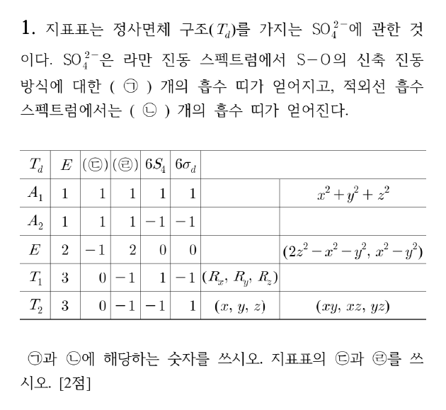

**정답** (답지 난이도 ★★☆☆☆) ㉠ **2**, ㉡ **1**, ㉢ **$8C_3$**, ㉣ **$3C_2$**

**공식·핵심 개념**

- 환원 공식 $n_i = \dfrac1h\sum_R g_R\,\chi_\Gamma(R)\,\chi_i(R)$
- 결합 신축의 $\chi(R)$ = 그 조작에서 **움직이지 않는 결합 수**
- IR 활성: $x, y, z$와 같은 대칭 / 라만 활성: 이차 함수와 같은 대칭
- $T_d$: $h = 24$ ($E,\ 8C_3,\ 3C_2,\ 6S_4,\ 6\sigma_d$)

**2027 출제 가능성 ★★★★☆ 높음** — 군론으로 IR·라만 띠 수를 세는 문항은 무기 기입형의 단골입니다. 사면체(CH₄, SO₄²⁻, Ni(CO)₄)는 지표표가 단순해 자주 쓰입니다.

**주어진 것** SO₄²⁻ ($T_d$), 지표표에서 두 열(㉢, ㉣)의 머리말이 빠짐

**구할 것** S–O 신축 진동의 라만 띠 수 ㉠, IR 띠 수 ㉡, 지표표의 ㉢·㉣

**풀이 전략** 먼저 지표값으로 빠진 조작을 찾고, 네 S–O 결합을 기저로 가약 표현을 만들어 환원합니다.

**(1) 지표표의 빈 열.** $T_d$의 조작은 $E,\ 8C_3,\ 3C_2,\ 6S_4,\ 6\sigma_d$입니다. E 표현의 지표가 −1인 열은 $C_3$(120° 회전에서 이중 축퇴 오비탈이 섞임), 2인 열은 $C_2$입니다. 계수까지 합하면 $1+8+3+6+6 = 24 = h$ ✓. 따라서 ㉢ = $8C_3$, ㉣ = $3C_2$.

**(2) S–O 결합 기저의 지표.** 각 조작에서 제자리에 남는 S–O 결합 수를 셉니다.

| 조작 | $E$ | $8C_3$ | $3C_2$ | $6S_4$ | $6\sigma_d$ |
|---|---|---|---|---|---|
| 남는 결합 | 4개 모두 | 축 위 1개 | 0 | 0 | 거울면 위 2개 |
| $\chi(\Gamma_{SO})$ | 4 | 1 | 0 | 0 | 2 |

**(3) 환원.**

$$n(A_1) = \tfrac{1}{24}\left[4\cdot1 + 8\cdot1\cdot1 + 0 + 0 + 6\cdot2\cdot1\right] = \tfrac{24}{24} = 1$$

$$n(A_2) = \tfrac{1}{24}\left[4 + 8 + 0 + 0 + 6\cdot2\cdot(-1)\right] = 0$$

$$n(E) = \tfrac{1}{24}\left[4\cdot2 + 8\cdot1\cdot(-1) + 0 + 0 + 0\right] = 0$$

$$n(T_1) = \tfrac{1}{24}\left[4\cdot3 + 0 + 0 + 0 + 6\cdot2\cdot(-1)\right] = 0$$

$$n(T_2) = \tfrac{1}{24}\left[4\cdot3 + 0 + 0 + 0 + 6\cdot2\cdot1\right] = \tfrac{24}{24} = 1$$

$$\Gamma_{SO} = A_1 + T_2$$

**(4) 선택 규칙.**

| 진동 | IR ($x,y,z$) | 라만 (이차 함수) |
|---|---|---|
| $A_1$ (대칭 신축, ~981 cm⁻¹) | 불활성 | 활성 ($x^2+y^2+z^2$) |
| $T_2$ (비대칭 신축, ~1105 cm⁻¹) | 활성 | 활성 ($xy, xz, yz$) |

라만 띠 **2개**(㉠), IR 띠 **1개**(㉡). $T_2$는 삼중 축퇴라 띠 하나로 나타납니다.

**검산** 차원 $1 + 3 = 4$ = S–O 결합 수 ✓. 실제 황산 이온 스펙트럼도 라만 981·1105 cm⁻¹, IR 1105 cm⁻¹ 근처 한 개입니다.

**채점 포인트·함정**

- 강의 필기의 "A₁ + E"는 오기입니다. E로 놓으면 차원이 1 + 2 = 3이 되어 결합 수 4와 맞지 않습니다.
- 축퇴된 진동은 띠 1개로 셉니다(T₂ → 3개가 아님).
- $T_d$는 반전 중심이 없어 상호 배제 규칙이 적용되지 않습니다. $T_2$가 IR·라만 모두 활성입니다.

## A형 2번 · SN2 입체 반전과 토실화(입체 유지) {#a2}

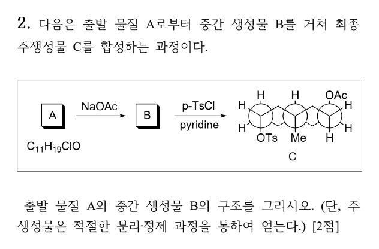

**정답** A: trans-데칼린(고리 접합 CH₃), **Cl은 적도**, **OH는 축**(CH₃와 같은 면, 1,3-이축). B: Cl 자리에 **OAc가 축 방향으로 반전**되어 들어간 하이드록시 에스터(C₁₃H₂₂O₃)

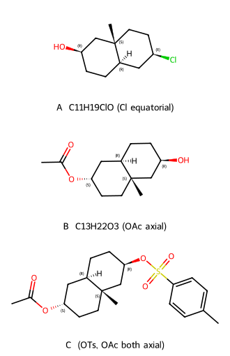

**공식·핵심 개념**

- SN2: 뒷면 공격 → **입체 반전**(Walden 반전)
- TsCl/pyridine: O–H의 O가 S를 공격 → **C–O 결합 유지 → 입체 유지**
- 사이클로헥세인: 1,3-관계의 두 축 치환기는 **같은 면**
- 이중 Newman 투영: 위·아래로 수직인 치환기 = 축

**2027 출제 가능성 ★★★★☆ 높음** — 고리 화합물의 SN2 반전과 토실화(입체 유지)를 거꾸로 추적하는 문항은 입체화학의 대표 유형입니다. 이중 Newman 투영은 최근 모의고사에서 자주 쓰입니다.

**주어진 것** A (C₁₁H₁₉ClO) → NaOAc → B → p-TsCl/pyridine → C, C의 구조(이중 Newman 투영: OTs 축·아래, 고리 접합 Me 축·아래, OAc 축·위)

**구할 것** A와 B의 구조

**풀이 전략** C에서 거꾸로 갑니다. 마지막 단계(토실화)는 입체를 바꾸지 않고, 첫 단계(SN2)는 반전시킵니다.

**(1) C 읽기.** Newman 투영에서 세 고리 탄소의 수직 치환기가 모두 축입니다. 접합 탄소의 Me(아래)와 다른 접합 탄소의 H(위)가 서로 반대 → **trans-데칼린**. OTs는 Me와 같은 면(아래) 축, OAc는 반대 면(위) 축입니다.

**(2) C → B (토실화, 입체 유지).** TsCl과의 반응에서 끊기는 결합은 **O–H**뿐이고 C–O 결합은 그대로입니다. 따라서 B에서 OTs 자리에는 **같은 방향(축, Me와 같은 면)의 OH**가 있습니다. OAc는 이미 B에 있었습니다.

**(3) B → A (SN2 반전).** OAc는 NaOAc의 AcO⁻가 C–Cl을 뒷면에서 공격해 들어온 것입니다. B의 OAc가 위쪽 축이므로, A의 Cl은 같은 탄소에서 **아래쪽 = 적도** 방향이었습니다.

**(4) 분자식 확인.**

| 화합물 | 분자식 | 치환기 |
|---|---|---|
| A | C₁₁H₁₉ClO | Cl(적도), OH(축), 접합 CH₃ |
| B | C₁₃H₂₂O₃ | OAc(축, 반전), OH(축), 접합 CH₃ |
| C | C₂₀H₂₈O₅S | OAc(축), OTs(축) |

A → B: −Cl + OCOCH₃ (C₂H₃O₂) → C₁₃H₂₂O₃ ✓.

**왜 이 생성물인가** 아세테이트는 약한 염기이자 괜찮은 친핵체라 2차 할로젠화물에서 E2보다 SN2가 우세합니다. 적도 Cl에 대한 뒷면 공격은 고리 위아래 중 축 방향에서 일어나므로, 생성된 OAc는 축이 됩니다(이후 의자형 뒤집힘은 trans-데칼린이라 불가능). 반대로 OH는 반응 중 C–O 결합이 한 번도 끊기지 않으므로 TsCl 단계까지 방향이 그대로입니다.

**메커니즘 — AcO⁻의 SN2(입체 반전)**

**메커니즘 — 토실화(입체 유지)**

**검산** RDKit으로 세 구조의 분자식(C₁₁H₁₉ClO, C₁₃H₂₂O₃)과 3차원 구조(MMFF)에서 Cl 적도·OH 축·OAc 축임을 확인했습니다.

**채점 포인트·함정**

- OH 쪽까지 반전시키면 틀립니다. 토실화는 **입체 유지**입니다.
- trans-데칼린은 고리 뒤집힘이 없으므로 축·적도가 고정됩니다. 그래서 "축 OAc"가 그대로 C에 보입니다.
- A의 Cl을 축으로 그리면 SN2 후 OAc가 적도가 되어 C와 맞지 않습니다.

## A형 3번 · IR·¹H NMR로 에스터 구조 결정, 산 촉매 가수분해 {#a3}

**정답** A = **methyl pivalate** (CH₃)₃C–CO–OCH₃ (methyl 2,2-dimethylpropanoate). 가수분해 생성물: **pivalic acid** (CH₃)₃CCOOH + **CH₃OH**

**공식·핵심 개념**

- 수소결핍지수 $= \dfrac{2C + 2 - H}{2}$
- 에스터 C=O 신축 ≈ 1735–1750 cm⁻¹, C–O 1150–1300 cm⁻¹
- OCH₃(에스터) δ ≈ 3.7, tert-뷰틸 δ ≈ 1.2 (s, 9H)
- 산 촉매 에스터 가수분해(AAC2) = Fischer 에스터화의 역반응

**2027 출제 가능성 ★★★★★ 매우 높음** — 분자식 + IR + ¹H NMR로 구조를 정하는 문항은 거의 매년 나옵니다. 에스터 가수분해와 묶는 형태도 기본형입니다.

**주어진 것** C₆H₁₂O₂, IR 1737 cm⁻¹(강함), 3000 cm⁻¹ 위 넓은 O–H 없음, ¹H NMR: δ 3.7(s), δ 1.2(s), 적분 높이 비 약 1 : 3

**구할 것** A의 구조, 산 촉매 가수분해 생성물

**풀이 전략** 분자식 → 불포화도 → IR로 작용기 → NMR의 적분·갈라짐으로 조각을 맞춥니다.

**(1) 불포화도.**

$$\text{IHD} = \frac{2(6) + 2 - 12}{2} = 1$$

C=O 하나면 끝입니다(고리·C=C 없음).

**(2) IR.** 1737 cm⁻¹ 강한 띠 = **에스터 C=O**(케톤 1715, 산 1710보다 높음). 3300~2500 cm⁻¹의 넓은 O–H 띠가 없으므로 카복실산이 아닙니다. 1150–1250 cm⁻¹의 강한 띠는 C–O 신축입니다.

**(3) ¹H NMR.** 12H를 적분 비 1 : 3으로 나누면 **3H : 9H**.

| δ (ppm) | 적분 | 갈라짐 | 배정 | 근거 |
|---|---|---|---|---|
| 3.7 | 3H | s | –CO–O**CH₃** | O에 직접 결합, 이웃 H 없음 |
| 1.2 | 9H | s | –C(**CH₃**)₃ | 4차 탄소에 붙은 동등한 메틸 3개 |

**(4) 조립.** CH₃O– + –C(=O)– + –C(CH₃)₃ = C₆H₁₂O₂ ✓. 9H 단일선은 tert-뷰틸, 3.7 ppm 3H 단일선은 메톡시이므로 **(CH₃)₃CCO₂CH₃**입니다.

**(5) 산 촉매 가수분해.**

$$\mathrm{(CH_3)_3CCO_2CH_3 + H_2O \xrightleftharpoons{H_3O^+} (CH_3)_3CCOOH + CH_3OH}$$

**왜 이 생성물인가** 산 촉매 가수분해는 아실–산소 결합(C(=O)–OCH₃)이 끊기는 AAC2 경로입니다. 물이 카보닐 탄소를 공격해 사면체 중간체를 거치고, 양성자화된 OCH₃가 CH₃OH로 떨어집니다. 따라서 산소 위의 메틸은 **메탄올**로 나오고, 카보닐 쪽은 **pivalic acid**가 됩니다. 이성질체 tert-butyl acetate(CH₃CO₂C(CH₃)₃)는 δ 2.0(s, 3H)·1.45(s, 9H)이므로 3.7 ppm 신호를 설명할 수 없습니다.

**메커니즘 — 산 촉매 에스터 가수분해(AAC2)**

**검산** 적분 3 + 9 = 12H ✓, 탄소 1 + 1 + 4 = 6 ✓, 산소 2 ✓.

**채점 포인트·함정**

- tert-butyl acetate와 혼동하지 않습니다. 3.7 ppm은 **O–CH₃**, 2.0 ppm이면 **CO–CH₃**입니다.
- 가수분해 생성물은 "모두" 그려야 하므로 메탄올을 빠뜨리면 감점입니다.

## A형 4번 · 2원자 이상 기체의 등온·등압 가역 팽창 {#a4}

**정답** (답지 난이도 ★★☆☆☆) $q_2 - q_1 = $ **$18.2\,T_0R$** (단위 K·mol 포함: $18.2\,R\,T_0\ \mathrm{K\cdot mol}$), $\Delta S_2 - \Delta S_1 = $ **$7R$** (mol)

**공식·핵심 개념**

- 등온 가역: $\Delta U = 0$, $q = nRT\ln\dfrac{V_2}{V_1}$, $\Delta S = nR\ln\dfrac{V_2}{V_1}$
- 등압: $q_P = nC_{P,m}\Delta T$, $\Delta S = nC_{P,m}\ln\dfrac{T_2}{T_1}$
- 이상 기체 $C_{P,m} = C_{V,m} + R$

**2027 출제 가능성 ★★★★☆ 높음** — 이상 기체 과정별 q, w, ΔU, ΔS 비교는 물리화학 열역학의 기본 문항으로 꾸준히 나옵니다.

**주어진 것** $n = 2$ mol, $T_i = T_0$, (가) 등온 가역 $V \to 4V$, (나) 등압 가역 $V \to 4V$, $C_{V,m} = \tfrac52R$, $\ln2 = 0.7$

**구할 것** $q_2 - q_1$, $\Delta S_2 - \Delta S_1$

**풀이 전략** 과정별로 q와 ΔS를 따로 구한 뒤 뺍니다. $\ln4 = 2\ln2 = 1.4$를 씁니다.

**(1) 과정 (가) — 등온.** 내부 에너지가 온도만의 함수이므로 $\Delta U = 0$, $q_1 = -w = nRT\ln(V_2/V_1)$.

$$q_1 = 2R T_0\ln4 = 2R T_0(1.4) = 2.8\,RT_0$$

$$\Delta S_1 = nR\ln4 = 2R(1.4) = 2.8\,R$$

**(2) 과정 (나) — 등압.** $PV = nRT$에서 $P$ 일정이면 $T \propto V$이므로 $T_f = 4T_0$, $\Delta T = 3T_0$.

$$C_{P,m} = \tfrac52R + R = \tfrac72R$$

$$q_2 = nC_{P,m}\Delta T = 2\cdot\tfrac72R\cdot3T_0 = 21\,RT_0$$

$$\Delta S_2 = nC_{P,m}\ln\frac{T_f}{T_0} = 2\cdot\tfrac72R\cdot\ln4 = 7R(1.4) = 9.8\,R$$

**(3) 차이.**

$$q_2 - q_1 = 21RT_0 - 2.8RT_0 = 18.2\,RT_0$$

$$\Delta S_2 - \Delta S_1 = 9.8R - 2.8R = 7.0\,R$$

**검산** ΔS 차이를 한 번에: $\Delta S_2 - \Delta S_1 = n(C_{P,m} - R)\ln4 = nC_{V,m}\ln4 = 2\cdot2.5R\cdot1.4 = 7R$ ✓ (등압 과정 = 등온 팽창 + 등적 가열로 나누어 본 것과 같음).

**채점 포인트·함정**

- 등압 과정의 열은 $C_V$가 아니라 **$C_P$**로 계산합니다.
- 답지는 단위를 붙여 "18.2 T₀R·K·mol", "7R·mol"로 적었습니다. $R$의 단위(J K⁻¹ mol⁻¹)와 곱해 J이 되도록 K·mol을 붙인 것입니다.

## A형 5번 · 2022 개정 '교육과정 설계의 개요'와 기체의 압력·부피 {#a5}

**정답**

- (㉠, 답지 추가 항목) 물질 영역 핵심 아이디어: **물질은 여러 가지 상태로 존재하며, 구성 입자의 운동에 따라 물질의 상태와 물리적 성질이 변한다.**
- ㉡ **의사소통과 협업**
- ㉢ 심미적 가치는 **내용과 형식의 일치에서 오는 쾌감**으로, [탐구 목표](압력–부피 관계를 입자 모형으로 설명)를 [탐구 과정](측정 → 그래프 → 해석)을 통해 이루어 내며 얻는 **성취감**을 통해 길러질 수 있다. (예: 압력을 0.5기압씩 올릴 때 부피가 규칙적으로 줄어 그래프가 매끈한 반비례 곡선으로 그려지고, 이를 입자 충돌로 깔끔하게 설명해 낼 때 느끼는 아름다움)
- ㉣ **과목별 위계성과 연속성**에 따라, 압력과 부피 사이의 **양적 관계를 계산하는 정량적 내용은 고등학교 '물질과 에너지'**에서 다루므로, 중학교에서는 **입자 모형을 이용한 정성적 설명**(압력이 커지면 부피가 줄어든다)에 주안점을 둔다.

**공식·핵심 개념**

- 2022 개정 과학과 역량 구성: **지식·이해 / 과정·기능 / 가치·태도**
- 과정·기능: 문제 인식 및 가설 설정, 탐구 설계 및 수행, 자료 수집·분석 및 해석, 결론 도출 및 일반화, **의사소통과 협업**
- 가치·태도: 과학 가치(심미적 가치, 감수성), 과학 태도(창의성, 유용성, 윤리성, 개방성), 참여·실천(과학문화 향유, 안전·지속가능 사회 기여)
- 핵심 아이디어는 과학과 관통 개념을 공유하며 **과목별 위계성과 연속성**을 지님

**2027 출제 가능성 ★★★★★ 매우 높음** — 2022 개정 교육과정의 '설계의 개요'(역량, 핵심 아이디어, 과정·기능, 가치·태도)는 적용 첫해부터 교육론 서술형의 중심 소재입니다.

**㉡.** (라)는 측정 결과를 그래프로 나타내 해석하는 활동(자료 분석·해석), (마)는 결과를 기록하고 **모둠별로 토의·발표**하는 활동입니다. 이 둘을 수행할 때 기대하는 과정·기능 중 빈칸에 들어갈 것은 목록의 마지막 항목인 **의사소통과 협업**입니다.

**㉢.** 심미적 가치는 과학 지식의 간결함·규칙성·조화에서 느끼는 아름다움입니다. 이 수업에서는 "기체의 압력–부피 관계를 입자 모형으로 설명한다"는 목표(내용)가 주사기 실험 → 표 → 그래프 → 해석의 과정(형식)과 맞아떨어질 때 느끼는 쾌감·성취감이 그 예입니다.

**㉣.** 2022 개정 중학교 과학은 기체의 압력과 부피의 관계를 **실험으로 확인하고 입자 모형으로 설명**하도록 합니다. $PV = $ 일정 같은 양적 계산은 고등학교 선택 과목 '물질과 에너지'로 넘어갑니다. 그래서 탐구 과정의 표·그래프도 "부피가 줄어드는 경향"을 확인하는 수준이면 충분합니다.

**채점 포인트·함정**

- ㉡은 "의사소통"만 쓰면 부족합니다. 2022 개정 용어는 **의사소통과 협업**입니다.
- ㉣은 "정성적"이라는 단어와 함께 **정량적 내용이 어느 과목으로 가는지**('물질과 에너지')까지 써야 근거가 됩니다.

## A형 6번 · 귀추·귀납·반증과 과학의 목적 {#a6}

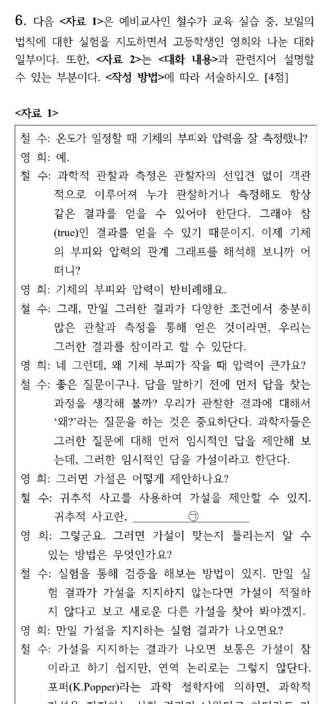

**정답**

- ㉠ 귀추법(abduction)은 **증거에 바탕을 두어 가설을 도출하는 추론**이다(관찰된 현상을 가장 잘 설명할 수 있는 원인을 다른 맥락의 지식에서 빌려와 잠정적 설명을 제안하는 사고).
- ㉡ (<자료 2>의 '과학적 가설의 반증 과정의 문제점'에 근거) **관찰 사실 자체가 참임을 보장받을 수 없으며, 더욱이 그 이론에 첨가된 보조 가설이나 초기 조건들 및 그 이론과 관계되는 다른 이론들의 조정이 얼마든지 가능하기 때문이다.** (보충: '귀납적 추리의 한계'에 근거하면 — 지지하는 사례가 아무리 많아도 다음 관찰에서 반례가 나올 수 있고, "가설 → 결과, 결과 참 ⇒ 가설 참"은 후건 긍정의 오류이기 때문이다.)
- 철수의 과학적 사고: 과학적 관찰과 측정을 통하여 누가 관찰하거나 측정해도 같은 결과를 얻는 객관적 결과를 얻음으로써 참(true)인 결과를 얻을 수 있다고 보는 **경험 귀납적 사고**
- 과학의 목적: 자연에서 일어나는 사물과 현상의 **기술·설명·이해·예상·통제**

**공식·핵심 개념**

- 귀납: 많은 사례 → 일반화(관찰의 객관성 전제)
- 귀추: 현상 → 이를 설명할 가설 제안(다른 맥락에서 원인 차용)
- 연역: 가설 → 예측 → 검증
- 포퍼의 반증주의: 지지 결과는 가설을 증명하지 못하고, 반례는 반증할 수 있음 / 뒤엠–콰인: 보조 가설 때문에 반증도 결정적이지 않음

**2027 출제 가능성 ★★★★☆ 높음** — 과학의 본성(귀납·귀추·연역, 반증주의)은 화학교육론의 고정 주제이고, 수업 대화에서 교사의 관점을 판단하게 하는 형식이 자주 쓰입니다.

**대화 분석.** 철수는 "관찰과 측정은 선입견 없이 객관적으로 이루어져 누가 해도 같은 결과", "다양한 조건에서 충분히 많은 관찰 → 참"이라고 말합니다. 관찰의 객관성과 사례 누적에 따른 일반화를 믿는 **경험 귀납주의** 관점입니다(관찰의 이론 의존성을 인정하지 않음).

| 추론 | 방향 | 이 수업에서 |
|---|---|---|
| 귀납 | 사례 → 일반화 | "부피와 압력이 반비례한다" |
| 귀추 | 현상 → 설명 가설 | "왜 부피가 작으면 압력이 클까?" → 입자 충돌 가설 |
| 연역 | 가설 → 예측·검증 | 가설에서 예측을 끌어내 실험 |

**㉡의 두 근거.** 반증의 문제점(관찰 자체의 오류 가능성, 보조 가설 조정 가능성)은 "반증조차 결정적이지 않다"는 논점이고, 귀납의 한계는 "지지 사례로는 참을 증명할 수 없다"는 논점입니다. 문항이 <자료 2> 중 한 가지에 근거하라고 했으므로, 어느 쪽을 택했는지 밝히고 그 내용으로 일관되게 쓰면 됩니다.

**채점 포인트·함정**

- 철수의 사고를 '반증주의'로 쓰면 틀립니다. 포퍼는 철수가 인용한 사람일 뿐, 철수 자신의 관찰관은 **귀납주의**입니다.
- 과학의 목적은 <자료 2>의 **기술과 설명**을 반드시 포함해 다섯 가지(기술·설명·이해·예상·통제)를 씁니다.

## A형 7번 · 화학 전지 만들기와 염다리 탐구 {#a7}

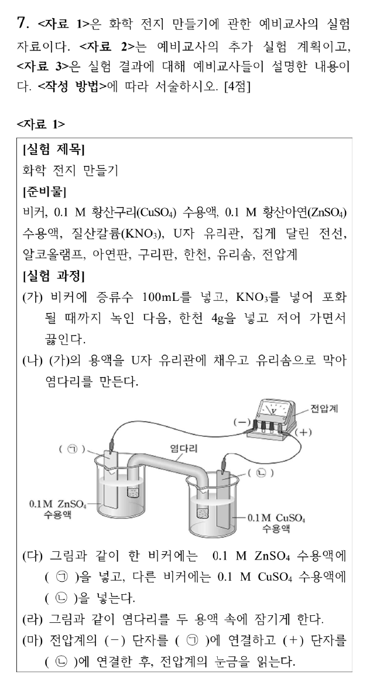

**정답**

- ㉠ **아연판**, ㉡ **구리판** (답지는 ㉠ 구리판, ㉡ 아연판 — 검토 메모 1)
- ㉢ **KNO₃ 수용액의 농도에 따라 전지의 전압 크기가 달라질 것이다.**
- ㉣ **KNO₃ 수용액의 농도**
- 옳지 않은 설명: **예비 교사 B** → "전자는 **도선**을 따라 산화 전극(아연)에서 환원 전극(구리)으로 이동하고, 염다리는 **이온의 이동으로 두 용액의 전하 균형(전기적 중성)**만 유지한다."

**공식·핵심 개념**

- 다니엘 전지: (−) Zn | Zn²⁺ ‖ Cu²⁺ | Cu (+), $E° = 0.34 - (-0.76) = 1.10$ V
- 산화 전극(−): Zn → Zn²⁺ + 2e⁻ / 환원 전극(+): Cu²⁺ + 2e⁻ → Cu
- 염다리: 음이온은 산화 전극 쪽, 양이온은 환원 전극 쪽으로 이동
- 변인: 조작 변인(바꾸는 것), 종속 변인(측정하는 것), 통제 변인(같게 하는 것)

**2027 출제 가능성 ★★★★☆ 높음** — 화학 전지 실험은 통합과학·화학에서 자주 다루는 탐구이고, 가설·변인 설정과 학생 오개념 수정을 묶는 형식이 교육론에서 반복됩니다.

**㉠·㉡.** 그림에서 ㉠은 **0.1 M ZnSO₄** 비커에, ㉡은 **0.1 M CuSO₄** 비커에 꽂혀 있고, (마)에서 전압계 (−) 단자를 ㉠, (+) 단자를 ㉡에 연결합니다. 금속은 자기 이온 용액에 담그므로 ㉠ = **아연판**, ㉡ = **구리판**이며, 실제로 아연이 산화 전극(−), 구리가 환원 전극(+)이라 전압계 연결도 맞습니다. 답지의 순서는 거꾸로입니다.

**㉢·㉣.** 문제 인식이 "KNO₃ 수용액의 농도는 전지의 전압에 어떤 영향을 미칠까?"이므로 가설은 그에 대한 잠정적 답, 조작 변인은 KNO₃ 농도, 종속 변인은 전압입니다. (가)에서 KNO₃를 "포화될 때까지" 녹인 과정을 참고하면 "포화 KNO₃로 만든 염다리일수록 전압이 클 것이다"처럼 방향을 정한 가설도 좋습니다.

**<자료 3> 판단.**

| 설명 | 판정 | 이유 |
|---|---|---|
| A: Zn이 전자를 내놓고 Zn²⁺로 용액에 들어감 | 옳음 | 산화 전극 반응 |
| **B: 전자가 용액과 염다리를 거쳐 이동** | **틀림** | 전자는 **도선**으로만 이동, 방향도 산화 → 환원 전극 |
| C: NO₃⁻는 ZnSO₄ 쪽으로 이동 | 옳음 | Zn²⁺가 늘어나는 쪽의 양전하를 상쇄 |
| D: 아연 전극 질량 감소 | 옳음 | Zn(s) → Zn²⁺(aq) |

**채점 포인트·함정**

- B의 오류는 두 가지(경로: 용액·염다리 ✗, 방향: 환원 → 산화 ✗)입니다. 고친 문장에 **도선, 산화 전극 → 환원 전극, 염다리는 이온 이동으로 전하 균형**이 모두 들어가야 합니다.
- 가설은 의문문이 아니라 검증 가능한 **평서문**으로 씁니다.

## A형 8번 · OsO₄ syn-다이올화, HIO₄ 절단, 메틸렌 아세탈 {#a8}

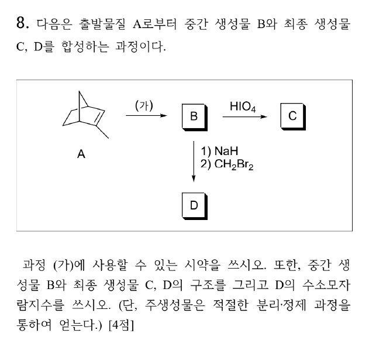

**정답** (가) **OsO₄, 이어서 NaHSO₃/H₂O** (또는 촉매량 OsO₄ + NMO, 차가운 묽은 KMnO₄/OH⁻). B = **exo-cis-2-methylnorbornane-2,3-diol**, C = **cis-3-acetylcyclopentane-1-carbaldehyde**, D = 메틸렌 아세탈(1,3-다이옥솔레인 고리), **수소결핍지수 3**

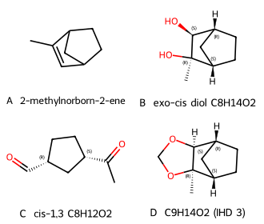

**공식·핵심 개념**

- OsO₄: 협동 [3+2] 고리화 → **syn 첨가**, 노보넨은 **exo 면**(C7 다리 쪽)에서 공격
- HIO₄: 1,2-다이올의 C–C 절단 → 카보닐 2개 (2차 OH → 알데하이드, 3차 OH → 케톤)
- NaH + CH₂X₂: 다이올 → 메틸렌 아세탈(Williamson 두 번)
- 수소결핍지수 = 고리 수 + π 결합 수

**2027 출제 가능성 ★★★★☆ 높음** — 알켄 산화(다이올화·산화 절단)와 이환 화합물의 입체 선택성은 유기 합성 문항의 단골입니다.

**주어진 것** A = 2-methylnorborn-2-ene (C₈H₁₂), A →(가)→ B →HIO₄→ C, B → ① NaH ② CH₂Br₂ → D

**구할 것** (가) 시약, B·C·D 구조, D의 수소결핍지수

**풀이 전략** HIO₄ 절단과 CH₂Br₂로 고리 아세탈이 생긴다는 점에서 B는 **1,2-다이올**입니다. 이환 고리의 입체(exo/endo)를 따라갑니다.

**(1) A → B.** 1,2-다이올을 만드는 syn-다이올화 시약 OsO₄를 씁니다. 노보넨의 C=C는 C7 다리(CH₂ 한 개) 쪽이 C5–C6 다리(CH₂CH₂, 안쪽 H가 가림)보다 덜 가려져 있어 **exo 면**에서 공격받습니다. 두 C–O 결합이 같은 면에 생기므로 B는 **exo-cis-다이올**(C₈H₁₄O₂)입니다. C2는 3차 알코올(CH₃ 붙음), C3는 2차 알코올입니다.

**(2) B → C (HIO₄).** 고리형 과아이오딘산 에스터를 거쳐 C2–C3 결합이 끊어집니다.

- C2(3차, CH₃ 붙음) → **케톤**: 아세틸기 –COCH₃
- C3(2차) → **알데하이드**: –CHO

남은 고리는 C1–C7–C4–C5–C6의 **사이클로펜테인**이고, 아세틸기와 포밀기는 C1·C4(1,3-위치)에 **cis**로 붙습니다(원래 같은 다리의 양 끝이었으므로). C = C₈H₁₂O₂, cis-3-acetylcyclopentane-1-carbaldehyde.

**(3) B → D.** NaH가 O–H를 탈양성자화하고, 알콕사이드가 CH₂Br₂를 SN2로 공격 → 남은 OH도 탈양성자화 → **분자 내 SN2**로 5원 고리 아세탈(–O–CH₂–O–)이 닫힙니다. cis-다이올이라 두 O가 같은 면에 있어 고리가 무리 없이 생깁니다.

$$\mathrm{C_8H_{14}O_2 + CH_2Br_2 - 2HBr = C_9H_{14}O_2}$$

**(4) D의 수소결핍지수.**

$$\text{IHD} = \frac{2(9) + 2 - 14}{2} = 3$$

고리 3개(노보네인의 두 고리 + 다이옥솔레인 고리), π 결합 0개 ✓.

**왜 이 생성물인가** exo 선택성은 노보넨 반응 전반(수소화, 에폭시화, 하이드로보레이션)에 공통입니다. HIO₄ 절단은 C–C 결합만 끊고 고리 탄소들의 입체 중심(C1, C4)은 건드리지 않으므로 cis 관계가 그대로 남습니다.

**메커니즘 — OsO₄ syn-다이올화**

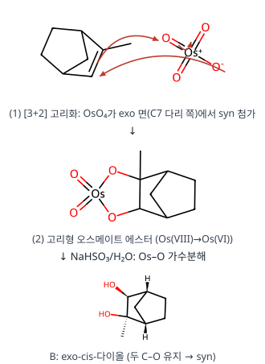

**메커니즘 — HIO₄ 산화 절단**

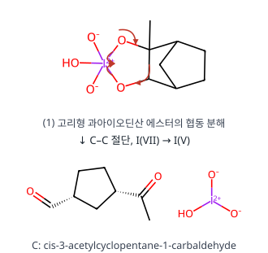

**메커니즘 — 메틸렌 아세탈 형성**

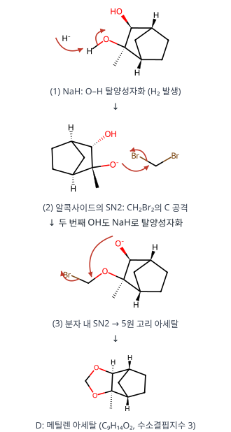

**검산** B: C₈H₁₄O₂(IHD 2 = 고리 2), C: C₈H₁₂O₂(IHD 3 = 고리 1 + C=O 2), D: C₉H₁₄O₂(IHD 3). RDKit 분자식 일치 ✓.

**채점 포인트·함정**

- (가)에 KMnO₄를 쓸 때는 **차갑고 묽은 염기성** 조건을 꼭 적습니다(뜨거운 KMnO₄는 C=C를 끊어 버림).
- C에서 3차 탄소 쪽은 알데하이드가 아니라 **케톤**입니다.
- 수소결핍지수에 아세탈 고리를 빠뜨려 2로 쓰는 실수가 많습니다.

## A형 9번 · van Deemter 식과 크로마토그래피 분리도 {#a9}

**정답** (답지 난이도 ★★★☆☆) $v_{\text{최적}} = $ **$\sqrt{B/C}$**, $H_{\text{최소}} = $ **$A + 2\sqrt{BC}$**, 선택 인자 α = **1.5**, 분리도 R = **4.0**

**공식·핵심 개념**

- $H = A + \dfrac{B}{v} + Cv$, 극소: $\dfrac{dH}{dv} = 0$
- 머무름 인자 $k = \dfrac{t_R - t_M}{t_M}$, 선택 인자 $\alpha = \dfrac{k_2}{k_1}$
- 분리도 $R = \dfrac{\Delta t_R}{\bar w} = \dfrac{2(t_{R2} - t_{R1})}{w_1 + w_2}$ ($w = 4\sigma$)

**2027 출제 가능성 ★★★★☆ 높음** — 크로마토그래피의 k, α, R, N, H 계산은 분석화학에서 해마다 비슷한 비중으로 나옵니다. van Deemter 극소 조건 유도는 미분 한 번이라 기입형에 알맞습니다.

**주어진 것** $H = A + B/v + Cv$, $t_M = 2.0$ 분, (가) $t_R = 6.0$, $w = 0.4$ 분, (나) $t_R = 8.0$, $w = 0.6$ 분

**구할 것** $v_{\text{최적}}$, $H_{\text{최소}}$(과정 포함), α, R

**풀이 전략** H를 v로 미분해 0으로 놓고, 크로마토그램 값은 정의식에 그대로 넣습니다.

**(1) 최적 유속.**

$$\frac{dH}{dv} = -\frac{B}{v^2} + C = 0 \;\Rightarrow\; v^2 = \frac BC \;\Rightarrow\; v_{\text{최적}} = \sqrt{\frac BC}$$

$\dfrac{d^2H}{dv^2} = \dfrac{2B}{v^3} > 0$이므로 극소입니다.

**(2) 최소 단높이.**

$$H_{\text{최소}} = A + \frac{B}{\sqrt{B/C}} + C\sqrt{\frac BC} = A + \sqrt{BC} + \sqrt{BC} = A + 2\sqrt{BC}$$

**(3) 머무름 인자와 선택 인자.**

$$k_{\text{(가)}} = \frac{6.0 - 2.0}{2.0} = 2.0, \qquad k_{\text{(나)}} = \frac{8.0 - 2.0}{2.0} = 3.0$$

$$\alpha = \frac{k_{\text{(나)}}}{k_{\text{(가)}}} = \frac{3.0}{2.0} = 1.5$$

**(4) 분리도.**

$$R = \frac{2(8.0 - 6.0)}{0.4 + 0.6} = \frac{4.0}{1.0} = 4.0$$

**검산** $R = 4.0$은 기준선 분리(R ≥ 1.5)를 크게 넘습니다. 머무름 시간의 비 8/6 = 1.33 ≠ α = 1.5 — α는 $t_R$가 아니라 **조정 머무름 시간**(또는 k)의 비이므로 다른 것이 맞습니다.

**채점 포인트·함정**

- α를 $t_{R2}/t_{R1} = 1.33$으로 쓰는 실수가 가장 흔합니다. 불감 시간을 빼야 합니다.
- R의 분모는 두 피크 폭의 **평균**입니다. 합을 그대로 쓰면 2.0이 나옵니다.
- 이동상 부피비(10배), 컬럼 길이 등은 이 질문에 쓰이지 않는 정보입니다.

## A형 10번 · H₂의 회전 라만과 진동–회전 라만 스펙트럼 {#a10}

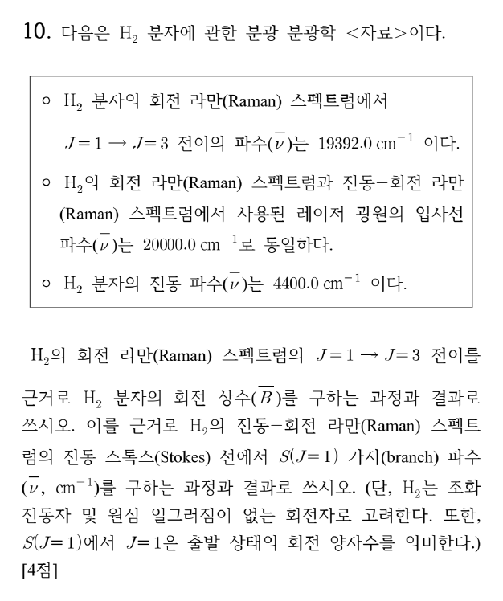

**정답** (답지 난이도 ★★★☆☆) $\tilde B$ = **60.8 cm⁻¹**, S(J = 1) 가지 파수 = **14992.0 cm⁻¹**

**공식·핵심 개념**

- 강체 회전자 $F(J) = \tilde BJ(J+1)$
- 라만 회전 선택 규칙 $\Delta J = 0, \pm2$ (S 가지: $\Delta J = +2$)
- S 가지 이동량 $F(J+2) - F(J) = \tilde B(4J + 6)$
- 스톡스 진동–회전 라만: $\tilde\nu = \tilde\nu_0 - \tilde\nu_{vib} - \tilde B(4J+6)$ (같은 $\tilde B$)

**2027 출제 가능성 ★★★☆☆ 보통** — 회전·진동 분광은 물리화학에서 주기적으로 나오지만, 라만 회전 S 가지까지 묻는 경우는 IR P·R 가지보다 드뭅니다.

**주어진 것** 레이저 $\tilde\nu_0 = 20000.0$ cm⁻¹, 회전 라만 $J = 1 \to 3$ 선 19392.0 cm⁻¹, 진동 파수 4400.0 cm⁻¹, 조화 진동자·강체 회전자

**구할 것** $\tilde B$, 진동–회전 라만 스톡스 S(1) 선 파수

**풀이 전략** 산란선은 입사선에서 분자가 얻은 에너지만큼 낮은 파수에 나타납니다(스톡스).

**(1) 회전 에너지 차.**

$$\Delta F = F(3) - F(1) = \tilde B(3\cdot4 - 1\cdot2) = 10\tilde B$$

($4J + 6$ 공식으로도 $J = 1$: $4 + 6 = 10$.)

**(2) $\tilde B$ 구하기.**

$$\tilde\nu_0 - 10\tilde B = 19392.0 \;\Rightarrow\; 10\tilde B = 20000.0 - 19392.0 = 608.0$$

$$\tilde B = 60.8\ \mathrm{cm^{-1}}$$

**(3) 진동–회전 S(1).** 진동 $v = 0 \to 1$과 회전 $J = 1 \to 3$이 함께 일어나므로 분자가 얻는 에너지는 $4400.0 + 608.0$입니다.

$$\tilde\nu_{S(1)} = 20000.0 - 4400.0 - 608.0 = 14992.0\ \mathrm{cm^{-1}}$$

**검산** H₂의 실제 $\tilde B$ ≈ 60.85 cm⁻¹, 진동 4161 cm⁻¹와 비슷한 크기 ✓. Q 가지($\Delta J = 0$)는 $20000 - 4400 = 15600$ cm⁻¹에 놓이고, S(1)은 그보다 608 cm⁻¹ 낮습니다.

| 선 | 이동량 (cm⁻¹) | 파수 (cm⁻¹) |
|---|---|---|
| 회전 S(1) | 608.0 | 19392.0 |
| 진동 Q | 4400.0 | 15600.0 |
| 진동–회전 S(1) | 4400.0 + 608.0 | 14992.0 |

**채점 포인트·함정**

- 라만 회전 선택 규칙은 $\Delta J = \pm2$(IR의 ±1과 다름)라 이동량이 $2\tilde B(J+1)$이 아니라 $\tilde B(4J+6)$입니다.
- 스톡스 선은 입사선보다 **작은** 파수입니다. 더하면 반스톡스가 됩니다.

## A형 11번 · 내부권 전자 전이와 해리 치환 {#a11}

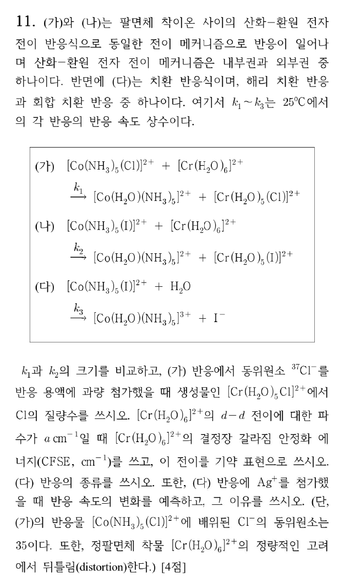

**정답** (답지 난이도 ★★☆☆☆)

- $k_1$ **<** $k_2$
- ³⁷Cl⁻를 과량 넣어도 생성물 [Cr(H₂O)₅Cl]²⁺의 Cl 질량수는 **35** (내부권: 다리 리간드가 Co에서 Cr로 직접 옮겨감)
- CFSE = **0.6a cm⁻¹** (−0.6Δo, Δo = a)
- 전이: **⁵Eg → ⁵T2g** (답지는 ²Eg → ²T2g — 검토 메모 2)
- (다): **해리 치환 반응**(D/Id)
- Ag⁺ 첨가 → 반응 속도 **증가**: Ag⁺가 I⁻와 AgI로 침전(또는 Co–I–Ag⁺ 결합)하여 Co–I 결합을 약하게 하고 I⁻ 이탈을 돕기 때문

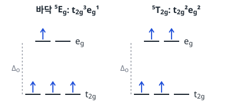

**공식·핵심 개념**

- 내부권 기구: 산화제의 리간드가 두 금속을 잇는 **다리**가 되어 전자 전달 후 환원제(Cr³⁺, 치환 불활성)에 남음
- 다리 효율: 분극성이 큰 I⁻ > Br⁻ > Cl⁻ > F⁻ (Co(NH₃)₅X²⁺ + Cr²⁺)
- CFSE(Oh) = $(-0.4n_{t_{2g}} + 0.6n_{e_g})\Delta_o$
- d⁴ 고스핀 바닥항 ⁵Eg, 들뜬 ⁵T2g → 스핀 허용 띠 하나(Jahn–Teller로 넓어짐)

**2027 출제 가능성 ★★★★☆ 높음** — Taube의 내부권·외부권 판별, 치환 불활성/활성, 해리·회합 치환은 무기 반응 기구의 중심 소재입니다.

**주어진 것** (가) Co(NH₃)₅Cl²⁺ + Cr(H₂O)₆²⁺, (나) Co(NH₃)₅I²⁺ + Cr(H₂O)₆²⁺, (다) Co(NH₃)₅I²⁺ + H₂O → Co(NH₃)₅(H₂O)³⁺ + I⁻, 생성물에 Cr–X 결합

**구할 것** $k_1$ vs $k_2$, Cl 질량수, CFSE·전이, (다)의 종류, Ag⁺ 효과

**풀이 전략** 생성물 [Cr(H₂O)₅X]²⁺에 X가 들어 있다는 것이 내부권의 증거입니다. 결정장은 고스핀 d⁴로 계산합니다.

**(1) 기구 판별.** Cr³⁺(d³)는 치환 불활성이므로 반응 후 Cr에 X가 붙어 있다면 X는 용액에서 들어간 것이 아니라 **Co–X–Cr 다리**를 통해 옮겨 온 것입니다 → **내부권**. 따라서 (가)에서 용액에 ³⁷Cl⁻를 과량 넣어도 생성물의 Cl은 원래 Co에 있던 **³⁵Cl**입니다.

**(2) $k_1$과 $k_2$.** 다리 리간드의 분극성이 클수록 전자를 잘 전달합니다. 실측(25 °C): X = Cl⁻ 6 × 10⁵, I⁻ 3 × 10⁶ M⁻¹ s⁻¹. 따라서 $k_1 < k_2$.

**(3) CFSE.** Cr²⁺ = [Ar]3d⁴, H₂O는 약한 장 → 고스핀 $t_{2g}^3e_g^1$. d–d 전이 에너지 a ≈ Δo.

$$\text{CFSE} = (3)(-0.4\Delta_o) + (1)(+0.6\Delta_o) = -0.6\Delta_o = -0.6a$$

크기 **0.6a cm⁻¹**(안정화).

**(4) 전이의 기약 표현.** 바닥 $t_{2g}^3e_g^1$: eg의 전자 1개가 두 오비탈 중 하나에 → **⁵Eg**. 들뜬 $t_{2g}^2e_g^2$: t2g의 빈자리 1개가 세 오비탈 중 하나에 → **⁵T2g**. 스핀 허용(ΔS = 0)이므로 전이는 **⁵Eg → ⁵T2g**. 실제로는 Jahn–Teller 뒤틀림으로 띠가 넓거나 갈라집니다(문항 단서 "뒤틀림").

**(5) (다) 해리 치환.** Co(III) 착물의 수화(aquation)는 이탈기(I⁻)의 결합이 끊어지는 것이 속도를 결정하는 **해리성** 경로입니다(들어오는 리간드의 종류에 거의 무관).

**(6) Ag⁺ 효과.** Ag⁺는 I⁻와 강하게 결합(AgI, $K_{sp} ≈ 10^{-16}$)합니다. Co–I–Ag⁺ 중간체가 Co–I 결합을 약하게 하고 이탈한 I⁻를 침전으로 제거하므로 해리 단계가 빨라져 **속도가 증가**합니다(친전자성 보조, electrophilic assistance).

**검산** 고스핀 d⁴ 홀전자 4개 → S = 2 → 다중도 2S + 1 = **5** ✓. 저스핀이라면 $t_{2g}^4$(³T1g)라 Eg가 나올 수 없으므로 답지의 "²Eg"는 어느 스핀 상태와도 맞지 않습니다.

**채점 포인트·함정**

- Cl 질량수를 37로 쓰면 외부권으로 판단한 것이 됩니다.
- 다중도는 반드시 홀전자 수에서 계산합니다(d⁴ 고스핀 → 5).
- Ag⁺ 이유에 "AgI 침전"과 "I⁻ 이탈 촉진(해리 단계)"을 함께 써야 완전합니다.

## A형 12번 · 산화–환원 적정 당량점의 전위 {#a12}

**정답** (답지 난이도 ★★★☆☆)

- (가) = **a**, (나) = **g**
- 당량점 질량 균형식: **[A²⁺] = [B⁴⁺]**, **[A³⁺] = [B³⁺]**
- $E_{\text{지시}} = \dfrac{a+g}{2} - 0.030\log\dfrac{\gamma_{A^{2+}}\gamma_{B^{3+}}}{\gamma_{A^{3+}}\gamma_{B^{4+}}}$ (V)

**공식·핵심 개념**

- 네른스트(25 °C, n = 1): $E = E° - 0.060\log\dfrac{a_{red}}{a_{ox}}$
- 그래프: x = log(a_red/a_ox), 기울기 −0.060 V, **x = 0에서 y절편 = E°**
- 당량점: 두 반쪽 전지 전위가 같고, 반응 화학량론으로 농도가 묶임
- 활동도 $a_i = \gamma_i[i]$

**2027 출제 가능성 ★★★★☆ 높음** — 산화–환원 적정의 당량점 전위 유도는 분석화학 서술형의 대표 문항이며, 활동도 계수까지 넣는 변형이 최근 나옵니다.

**주어진 것** A³⁺/A²⁺: E°(가), B⁴⁺/B³⁺: E°(나), 그래프 ㉠ = B 쌍, ㉡ = A 쌍(기울기 −0.060), 반응 A²⁺ + B⁴⁺ → A³⁺ + B³⁺ (자발)

**구할 것** (가)·(나), 당량점 질량 균형식 2개, 지시 전극 전위

**풀이 전략** 그래프의 x = 0 지점이 E°입니다. 당량점에서는 두 네른스트 식을 더해 농도를 지웁니다.

**(1) E° 읽기.** x = log(활동도 비) = 0일 때 $E = E°$. 오른쪽 눈금 a~g는 같은 간격의 전위 높이입니다. ㉡(A 쌍)은 x = 0에서 높이 **a**, ㉠(B 쌍)은 x = 0에서 높이 **g** → (가) = a, (나) = g. B⁴⁺가 더 강한 산화제(g > a)이므로 A²⁺를 B⁴⁺로 자발 적정할 수 있다는 조건과 맞습니다.

**(2) 질량 균형.** 당량점에서 넣은 B⁴⁺의 몰수 = 처음 A²⁺의 몰수. 1 : 1 반응이므로 생성물끼리, 남은 반응물끼리 같습니다.

$$[\mathrm{A^{3+}}] = [\mathrm{B^{3+}}], \qquad [\mathrm{A^{2+}}] = [\mathrm{B^{4+}}]$$

**(3) 두 네른스트 식.** 평형에서 지시 전극 전위는 두 쌍 모두에 대해 같습니다.

$$E = a - 0.060\log\frac{\gamma_{A^{2+}}[\mathrm{A^{2+}}]}{\gamma_{A^{3+}}[\mathrm{A^{3+}}]}$$

$$E = g - 0.060\log\frac{\gamma_{B^{3+}}[\mathrm{B^{3+}}]}{\gamma_{B^{4+}}[\mathrm{B^{4+}}]}$$

**(4) 더하기.**

$$2E = (a+g) - 0.060\log\frac{\gamma_{A^{2+}}\gamma_{B^{3+}}[\mathrm{A^{2+}}][\mathrm{B^{3+}}]}{\gamma_{A^{3+}}\gamma_{B^{4+}}[\mathrm{A^{3+}}][\mathrm{B^{4+}}]}$$

(2)를 넣으면 $\dfrac{[\mathrm{A^{2+}}][\mathrm{B^{3+}}]}{[\mathrm{A^{3+}}][\mathrm{B^{4+}}]} = 1$이 되어 농도 항이 사라집니다.

$$E_{\text{지시}} = \frac{a+g}{2} - 0.030\log\frac{\gamma_{A^{2+}}\gamma_{B^{3+}}}{\gamma_{A^{3+}}\gamma_{B^{4+}}}$$

**검산** 활동도 계수가 모두 1이면 $E = (a+g)/2$로, 두 쌍의 전자 수가 같을 때의 당량점 공식(평균)과 같습니다 ✓. 측정되는 전지 전압은 $E_{\text{전지}} = E_{\text{지시}} - 0.24$ V입니다.

**채점 포인트·함정**

- 그래프의 오른쪽 끝(x > 0) 높이를 E°로 읽으면 틀립니다. 반드시 **x = 0**에서 읽습니다.
- 계수 0.030은 두 식을 더한 뒤 2로 나누어서 생긴 것입니다(0.060/2).
- 질문은 지시 전극 전위이므로 S.C.E. 0.24 V를 빼지 않습니다.

# 전공 B

## B형 1번 · 이양성자산의 pKa와 pH {#b1}

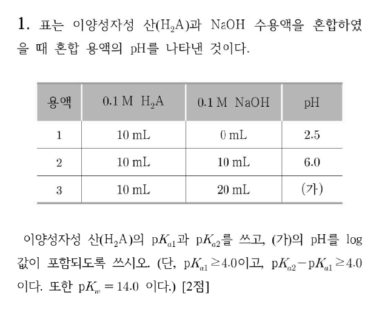

**정답** (답지 난이도 ★★☆☆☆) pKa₁ = **4.0**, pKa₂ = **8.0**, (가) pH = **$10.5 - \tfrac12\log3$** (≈ 10.26)

**공식·핵심 개념**

- 약산: $[\mathrm{H^+}] ≈ \sqrt{K_{a1}C}$
- 양쪽성 HA⁻: $\mathrm{pH} ≈ \tfrac12(\mathrm{p}K_{a1} + \mathrm{p}K_{a2})$
- 약염기 A²⁻: $K_b = K_w/K_{a2}$, $[\mathrm{OH^-}] ≈ \sqrt{K_bC}$

**2027 출제 가능성 ★★★★☆ 높음** — 다양성자산 적정의 세 지점(시작, 제1 당량점, 제2 당량점) pH는 분석화학의 기본 문항입니다.

**주어진 것** 0.1 M H₂A 10 mL에 0.1 M NaOH 0, 10, 20 mL → pH 2.5, 6.0, (가) / pKa₁ ≥ 4.0, ΔpKa ≥ 4.0, pKw = 14.0

**구할 것** pKa₁, pKa₂, (가)의 pH

**풀이 전략** 용액 1 = H₂A만, 용액 2 = 제1 당량점(HA⁻), 용액 3 = 제2 당량점(A²⁻)입니다.

**(1) 용액 1 → pKa₁.** $[\mathrm{H^+}] = 10^{-2.5}$, $C = 0.1$ M.

$$K_{a1} = \frac{[\mathrm{H^+}]^2}{C - [\mathrm{H^+}]} ≈ \frac{(10^{-2.5})^2}{0.1} = \frac{10^{-5}}{10^{-1}} = 10^{-4}$$

pKa₁ = **4.0** (해리도 $10^{-2.5}/0.1 ≈ 3\%$로 근사 타당).

**(2) 용액 2 → pKa₂.** NaOH 1당량 → 모두 HA⁻(0.05 M).

$$\mathrm{pH} = \tfrac12(\mathrm{p}K_{a1} + \mathrm{p}K_{a2}) = 6.0 \;\Rightarrow\; \mathrm{p}K_{a2} = 12.0 - 4.0 = 8.0$$

**(3) 용액 3 → pH.** NaOH 2당량 → A²⁻, 농도 $\dfrac{0.1\times10}{30} = \dfrac{1}{30}$ M.

$$K_b = \frac{10^{-14}}{10^{-8}} = 10^{-6}$$

$$[\mathrm{OH^-}] = \sqrt{10^{-6}\cdot\tfrac{1}{30}} \;\Rightarrow\; \mathrm{pOH} = \tfrac12\left(6 + \log30\right) = \tfrac12(6 + 1 + \log3) = 3.5 + \tfrac12\log3$$

$$\mathrm{pH} = 14.0 - 3.5 - \tfrac12\log3 = 10.5 - \tfrac12\log3 ≈ 10.26$$

**검산** $[\mathrm{OH^-}] = 1.83\times10^{-4}$ M ≪ 1/30 M(가수분해 0.5 %) → 근사 타당 ✓. 계산기로 pH 10.261 ✓.

**채점 포인트·함정**

- 용액 3의 부피는 30 mL입니다. 0.1 M 그대로 쓰면 $10.5 - \tfrac12\log3$이 아니라 10.5가 나옵니다.
- 답은 "log 값이 포함되도록" 쓰라고 했으므로 $10.5 - \tfrac12\log3$ 형태로 씁니다.

## B형 2번 · Monsanto 아세트산 공정 {#b2}

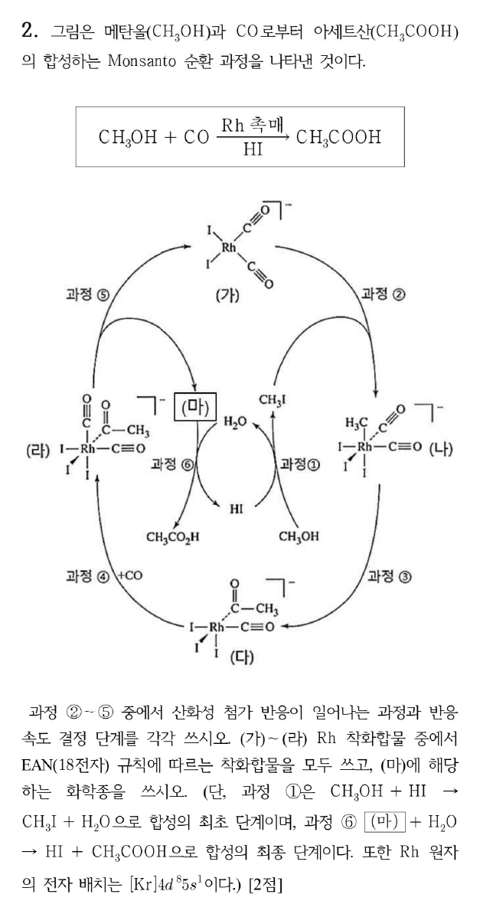

**정답** (답지 난이도 ★★☆☆☆) 산화성 첨가: **과정 ②**, 속도 결정 단계: **과정 ②**, 18전자 착화합물: **(나), (라)**, (마) = **CH₃COI**

**공식·핵심 개념**

- 산화성 첨가: 산화수 +2, 배위수 +2, 전자 수 +2
- 1,1-이동 삽입(CO 삽입): 산화수 불변, 배위 자리 하나 비움
- 환원성 제거: 산화수 −2, 배위수 −2
- 전자 수 세기(이온 모형): d 전자 + 리간드 전자쌍 × 2

**2027 출제 가능성 ★★★★☆ 높음** — 촉매 순환(Monsanto, Wilkinson, Heck 등)에서 기본 단계와 전자 수를 묻는 문항은 유기금속에서 가장 자주 나옵니다.

**주어진 것** 순환: (가) [Rh(CO)₂I₂]⁻ →② +CH₃I → (나) → ③ → (다) → ④ +CO → (라) → ⑤ → (가) + (마), ⑥ (마) + H₂O → HI + CH₃COOH, Rh = [Kr]4d⁸5s¹

**구할 것** 산화성 첨가 과정, 속도 결정 단계, 18전자 착화합물, (마)

**풀이 전략** 각 착물의 Rh 산화수와 d 전자 수, 배위수를 표로 정리합니다.

**(1) 전자 수.** Rh(0) = 9개의 원자가 전자 → Rh(I) = d⁸, Rh(III) = d⁶.

| 착물 | 리간드 | Rh 산화수 | d 전자 | 리간드 전자 | 총 전자 |
|---|---|---|---|---|---|
| (가) [Rh(CO)₂I₂]⁻ | 2CO, 2I⁻ | +1 | 8 | 4 × 2 = 8 | **16** |
| (나) [Rh(CH₃)(CO)₂I₃]⁻ | 2CO, 3I⁻, CH₃⁻ | +3 | 6 | 6 × 2 = 12 | **18** |
| (다) [Rh(COCH₃)(CO)I₃]⁻ | CO, 3I⁻, 아세틸 | +3 | 6 | 5 × 2 = 10 | **16** |
| (라) [Rh(COCH₃)(CO)₂I₃]⁻ | 2CO, 3I⁻, 아세틸 | +3 | 6 | 6 × 2 = 12 | **18** |

**(2) 단계 분류.**

| 과정 | 반응 | 종류 |
|---|---|---|
| ② | (가) + CH₃I → (나) | **산화성 첨가** (Rh(I) → Rh(III)), **속도 결정** |
| ③ | (나) → (다) | CO의 이동 삽입(CH₃ 이동) |
| ④ | (다) + CO → (라) | 리간드 배위 |
| ⑤ | (라) → (가) + CH₃COI | **환원성 제거** (Rh(III) → Rh(I)) |

**(3) (마).** 환원성 제거에서 아세틸기와 I가 함께 떨어져 **CH₃COI**(아세틸 아이오다이드). ⑥에서 물과 반응해 CH₃COOH와 HI가 되고, HI는 ①에서 CH₃OH를 CH₃I로 바꾸는 데 다시 쓰입니다.

**검산** 전체: ① CH₃OH + HI → CH₃I + H₂O, ②~⑤ CH₃I + CO → CH₃COI, ⑥ CH₃COI + H₂O → CH₃COOH + HI. 합 CH₃OH + CO → CH₃COOH ✓ (HI·Rh 촉매 재생).

**채점 포인트·함정**

- 속도 결정 단계는 CH₃I의 **산화성 첨가**입니다(속도 = k[Rh][CH₃I], CO 압력에 무관).
- 16전자 평면 사각형 Rh(I)은 18전자 규칙을 따르지 않지만 안정한 착물입니다.

## B형 3번 · STAD 협동 학습과 2022 개정 과학과 목표 {#b3}

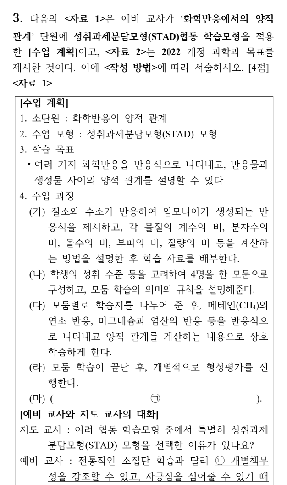

**정답** (공식 답지의 B형 3번 답은 이 문항과 맞지 않음 — 검토 메모 3. 아래는 문제지 기준 작성 답)

- ㉠ (마) **개인별 향상 점수를 산출하고, 이를 합산(평균)한 모둠 점수를 게시하여 기준에 도달한 모둠을 보상(팀 인정)한다.**
- ㉡ 판단 근거: (라)에서 모둠 학습 후 **개별적으로 형성평가**를 실시하고, 각자의 **개별 향상 점수**가 모둠 점수가 되어 **개별 보상과 집단 보상**이 함께 주어지므로 무임승차가 어렵기 때문이다.
- ㉢ 실수 사례: 반응식의 **계수비를 질량비로 착각**하는 것(예: N₂ + 3H₂ → 2NH₃에서 질량비를 1 : 3 : 2로 계산. 실제 질량비는 28 : 6 : 34 = 14 : 3 : 17). 또는 **기체가 아닌 물질에 부피비 = 계수비**를 적용하는 것.
- ㉣ **과학과 기술 및 사회의 상호 관계를 이해하고, 이를 바탕으로 개인과 사회의 문제 해결에 민주 시민으로서 참여하고 실천하는 능력을 기른다.** 관련된 과학의 본성: 과학 지식은 **사회·문화적 맥락의 영향을 받으며**, 과학·기술·사회는 서로 영향을 주고받는다(과학의 사회적 측면).

**공식·핵심 개념**

- STAD: 전체 수업 → 모둠 학습 → **개별 평가** → **개별 향상 점수** → **모둠 점수 게시·보상**
- 협동 학습의 요소: 긍정적 상호 의존, **개별 책무성**, 동등한 성공 기회, 집단 보상
- 2022 개정 과학과 목표 (1) 흥미·호기심과 태도, (2) 탐구 능력, (3) 핵심 개념 이해, (4) **과학·기술·사회 상호 관계와 참여·실천**, (5) 과학 학습의 즐거움·유용성, 평생 학습

**2027 출제 가능성 ★★★★☆ 높음** — STAD는 협동 학습모형 중 가장 자주 나오며, 개별 책무성·향상 점수가 핵심 채점어입니다. 2022 개정 과학과 목표 문장을 그대로 쓰게 하는 형식도 대비가 필요합니다.

**STAD 수업 절차와 (마).** (가) 교사의 전체 수업 → (나) 이질적 4인 모둠 → (다) 모둠 학습 → (라) 개별 형성평가 → **(마) 향상 점수 산출·모둠 점수 게시·보상**. STAD의 마지막 단계는 이전 기본 점수 대비 향상 정도로 개인 점수를 매기고, 그 합(평균)으로 모둠을 인정하는 것입니다.

**㉡ 개별 책무성.** 전통 소집단 학습에서는 모둠 결과물 하나로 평가해 일부가 다른 학생에게 기대는 문제가 생깁니다. STAD는 평가를 **개별로** 하고, 각자의 향상 점수가 모둠 점수에 들어가므로 모두가 스스로 학습해야 합니다. 원점수가 아니라 향상 점수이므로 하위 학생도 모둠에 기여할 수 있어 자긍심(성공 기회의 균등)이 생깁니다.

**㉢ 양적 관계 오류 정리.**

| 비 | 계수비와 같은가 | 비고 |
|---|---|---|
| 몰수비 | 같음 | |
| 분자 수비 | 같음 | |
| 부피비 | **기체만** 같음 | 같은 온도·압력 |
| 질량비 | **다름** | 몰질량을 곱해야 함 |

**㉣.** <자료 2>에 보이는 목표 (1)~(3)은 태도·탐구·개념에 관한 것이고, 빈칸 ㉣은 그다음 목표인 과학–기술–사회의 상호 관계입니다(원문 잘림으로 번호는 추정). 과학의 본성 중 **과학의 사회적·문화적 측면**(과학은 사회의 요구와 가치에 영향을 받고, 다시 사회를 바꿈)과 연결됩니다.

**채점 포인트·함정**

- ㉠에 "모둠 점수 게시"만 쓰고 **향상 점수**를 빠뜨리면 STAD의 핵심이 빠집니다.
- ㉡은 "개별 평가 + 향상 점수 → 개인 책임"이 드러나야 합니다.
- ㉣은 <자료 2>가 잘려 있어 답지와 대조할 수 없었습니다. (4)번 목표로 답하고, 과학의 본성 측면을 함께 씁니다.

## B형 4번 · 통합과학 2와 STS 수업모형 {#b4}

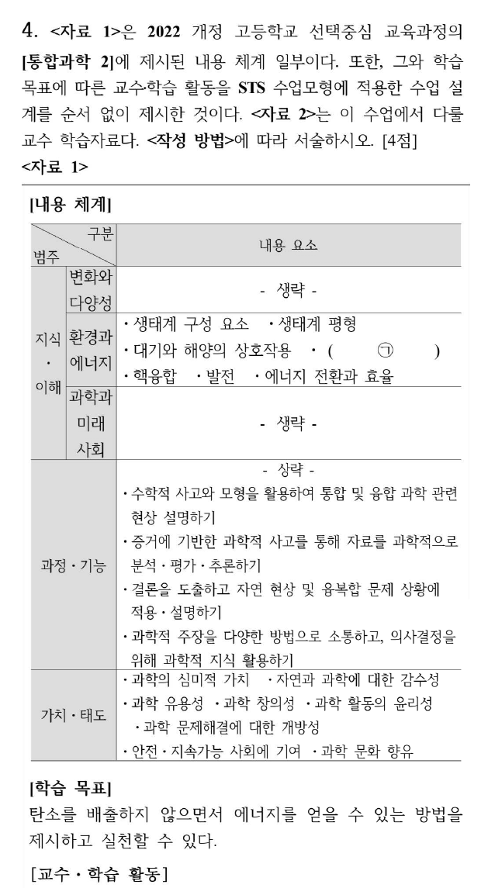

**정답**

- ㉠ **온실 기체와 지구 온난화**
- 순서: **D → B → A → C**
- B 단계: **탐색**. 예: 우리 학교의 여건과 태양광 발전 장치 설치와 관련 있는 다양한 자료와 정보를 수집한다. / 설치 여부를 결정하기 위한 조사 방법이나 실험 계획을 세우고 수행한다. / 자료를 근거로 다른 학생과 토의하여 설치 여부를 결정하는 방안을 모색한다. (중 1개)
- 마지막 단계(실행)의 활동 예: **우리 학교에 태양광 발전 장치를 설치할지에 대한 학생들의 최종 의견을 학교 해당 위원회에 전달한다.**

**공식·핵심 개념**

- Yager의 STS 수업모형: **문제로의 초대 → 탐색 → 설명 및 해결 방안 제시 → 실행**
- 실행 단계: 의사결정, 지식·기능 적용, 정보·생각 교환, 새로운 질문 찾기, 사회적 행동
- 2022 통합과학 2 '환경과 에너지': 생태계 구성 요소, 생태계 평형, 대기와 해양의 상호작용, 온실 기체와 지구 온난화, 핵융합, 발전, 에너지 전환과 효율

**2027 출제 가능성 ★★★★★ 매우 높음** — STS 수업모형은 교육론의 최빈출 모형이며, 2022 개정 통합과학의 내용 체계와 묶어 내기 좋습니다.

**단계 배열.**

| 순서 | 단계 | 활동 | 근거 |
|---|---|---|---|
| 1 | 문제로의 초대 | D | 화석 연료 고갈·지구 온난화 상황 제시(동영상) |
| 2 | 탐색 | B | 햇빛·바람·지열·폐기물 에너지 조사 |
| 3 | 설명 및 해결 방안 제시 | A | 방안 구체화·평가·재조사·선택 |
| 4 | 실행 | C | 실생활 적용, 정보 공유, 새 질문 |

**㉠.** '환경과 에너지' 영역의 내용 요소 중 대기와 해양의 상호작용 다음이 **온실 기체와 지구 온난화**입니다. 학습 목표(탄소 배출 없는 에너지)와도 연결됩니다.

**채점 포인트·함정**

- 탐색과 '설명 및 해결 방안 제시'를 혼동하기 쉽습니다. 정보 조사·자료 수집은 **탐색**, 방안을 구체화·평가·선택하는 것은 **해결 방안 제시**입니다.
- 실행 단계 예시에는 학교 밖(위원회)으로의 **사회적 행동·의사결정의 전달**이 드러나야 합니다.

## B형 5번 · 2022 개정 [화학] 성취기준, 개념변화, 순환학습 {#b5}

**정답**

- ㉠ 쌍극자 모멘트: **정성적으로만 다룬다.**
- ㉡ 루이스 전자점식의 중심 원자: **2, 3주기 전형 원소 중 Be, B와 옥텟 규칙을 따르는 경우로 한정한다.**
- 차시 지도 방략(포스너): **분자 구조를 이해하면 공유 결합 화합물의 성질을 예측하고 설명할 수 있음을 학습함으로써 화학의 유용성(생산성)을 깨닫도록 지도한다.**
- 로슨 순환학습 단계: **탐색 단계** — 학생들에게 직접적인 경험을 충분히 제공하여 제시된 학습 자료와의 구체적인 상호작용을 통해 **인지적 갈등(비평형)을 일으키는 단계**이기 때문이다.

**공식·핵심 개념**

- 포스너 개념변화 조건: **불만족 → 이해 가능성 → 그럴듯함 → 유용성(생산성)**
- 피아제: 동화·조절(적응), 비평형 → 평형화
- 로슨 순환학습: **탐색**(비평형 유발) → **용어 도입**(조절) → **개념 적용**(조직화·일반화)

**2027 출제 가능성 ★★★★★ 매우 높음** — 성취기준 해설·'적용 시 고려 사항'의 문구를 묻는 문항은 2022 개정 적용 이후 매년 나올 가능성이 큽니다. 포스너·피아제·로슨은 교육론 고정 출제 이론입니다.

**성취기준의 범위(적용 시 고려 사항).** [12화학02-02]의 쌍극자 모멘트는 계산하지 않고 결합의 극성과 분자의 극성을 판단하는 데 **정성적으로** 씁니다. [12화학02-03]의 루이스 전자점식은 중심 원자를 **2, 3주기 전형 원소**로 하되 옥텟 예외는 **Be, B**만 다룹니다(확장된 옥텟 SF₆ 등은 제외).

**포스너 조건 적용.**

| 조건 | 02-03 수업에서의 의미 |
|---|---|
| 불만족 | 기존 생각(분자는 평면·직선)으로 설명이 안 되는 현상 |
| 이해 가능성 | 전자쌍 반발 이론을 이해할 수 있음 |
| 그럴듯함 | 모형이 실제 분자 구조(결합각)와 맞음 |
| **유용성** | 구조로 극성·끓는점 등 **성질을 예측·설명** → 차시 방략 |

**(가)와 로슨 탐색 단계.** (가)는 기존 인지 구조 I이 새 환경 II를 만나 **갈등 → 비평형**이 되는 과정(조절의 출발점)입니다. 로슨의 순환학습에서 학생이 자료를 직접 다루며 기존 생각으로 설명되지 않는 결과를 마주하는 단계가 **탐색**입니다. 이어지는 용어 도입 단계에서 인지 구조 II가 형성(평형화)됩니다.

**채점 포인트·함정**

- ㉡은 "2, 3주기"와 "Be, B 예외" 두 요소를 모두 써야 합니다.
- 차시 방략은 포스너의 네 조건 중 **유용성**을 쓰라는 의도입니다(02-03 학습 후 → 다음 차시에서 성질 설명으로 확장).
- 문항 원문이 "그 판"에서 끊겨 있습니다. "그 판단 근거를 쓸 것"으로 보고 답했습니다.

## B형 6번 · d³ 착물의 전자 스펙트럼과 배치 혼합 {#b6}

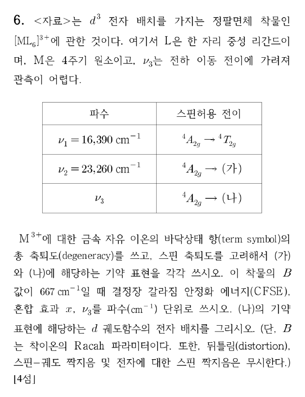

**정답** (답지 난이도 ★★☆☆☆)

- M³⁺ 자유 이온 바닥 항(⁴F)의 총 축퇴도: **28**
- (가) **⁴T1g(F)**, (나) **⁴T1g(P)**
- CFSE = **19,668 cm⁻¹**, 혼합 효과 x = **6,242 cm⁻¹**, ν₃ = **35,915 cm⁻¹**
- (나)의 전자 배치: **$t_{2g}^1e_g^2$** (아래 그림 오른쪽)

**공식·핵심 개념**

- 항의 축퇴도 $= (2S+1)(2L+1)$
- d³(Oh): ⁴F → ⁴A2g + ⁴T2g + ⁴T1g(F), ⁴P → ⁴T1g(P)
- 혼합 없을 때: $E(^4T_{2g}) = \Delta_o$, $E(^4T_{1g}(F)) = 1.8\Delta_o$, $E(^4T_{1g}(P)) = 1.2\Delta_o + 15B$
- 같은 대칭의 두 ⁴T1g가 섞여 아래는 x만큼 내려가고 위는 x만큼 올라감

**2027 출제 가능성 ★★★★☆ 높음** — d³·d⁸ 착물의 세 스핀 허용 띠 배정과 Δo·B 계산은 결정장 분광의 대표 문항입니다.

**주어진 것** [ML₆]³⁺, d³, M은 4주기(→ Cr³⁺), ν₁ = 16,390 cm⁻¹ (⁴A2g → ⁴T2g), ν₂ = 23,260 cm⁻¹, B = 667 cm⁻¹, ν₃는 전하 이동 띠에 가려짐

**구할 것** 바닥 항 축퇴도, (가)·(나), CFSE, x, ν₃, (나)의 배치

**풀이 전략** d³(Oh)에서는 ν₁ = Δo가 정확합니다. 혼합이 없을 때의 위치와 관측값의 차이가 x입니다.

**(1) 자유 이온 바닥 항.** d³: Hund 규칙 → $m_l = 2, 1, 0$에 하나씩, $L = 3$(F), $S = 3/2$.

$$(2S+1)(2L+1) = 4\times7 = 28$$

**(2) 띠 배정.** 바닥 ⁴A2g($t_{2g}^3$)에서 스핀 허용(쿼텟) 전이는 셋입니다.

| 전이 | 들뜬 상태 배치 | 혼합 없는 에너지 |
|---|---|---|
| ν₁: → ⁴T2g | $t_{2g}^2e_g^1$ | $\Delta_o$ |
| ν₂: → **⁴T1g(F)** (가) | $t_{2g}^2e_g^1$ | $1.8\Delta_o$ |
| ν₃: → **⁴T1g(P)** (나) | $t_{2g}^1e_g^2$ | $1.2\Delta_o + 15B$ |

**(3) CFSE.** $\Delta_o = \nu_1 = 16{,}390$ cm⁻¹.

$$\text{CFSE} = 3\times0.4\Delta_o = 1.2\times16{,}390 = 19{,}668\ \mathrm{cm^{-1}}$$

**(4) 혼합 효과 x.**

$$x = 1.8\Delta_o - \nu_2 = 1.8(16{,}390) - 23{,}260 = 29{,}502 - 23{,}260 = 6{,}242\ \mathrm{cm^{-1}}$$

**(5) ν₃.** 위쪽 ⁴T1g(P)는 같은 x만큼 올라갑니다.

$$\nu_3 = 1.2\Delta_o + 15B + x = 19{,}668 + 15(667) + 6{,}242$$

$$= 19{,}668 + 10{,}005 + 6{,}242 = 35{,}915\ \mathrm{cm^{-1}}$$

**(6) (나)의 배치.** ⁴T1g(P)의 주된 배치는 $t_{2g}^1e_g^2$(t2g에 1개, eg의 두 오비탈에 1개씩, 모두 같은 스핀).

**검산** 두 ⁴T1g의 무게중심 보존: $\nu_2 + \nu_3 = 3\Delta_o + 15B$ → $23{,}260 + 35{,}915 = 59{,}175$, $3(16{,}390) + 10{,}005 = 59{,}175$ ✓.

**채점 포인트·함정**

- d³에서 Δo는 ν₁ 그대로입니다(⁴T2g는 혼합 상대가 없음).
- CFSE는 $t_{2g}^3$ → $3\times(-0.4\Delta_o)$, 크기 1.2Δo입니다.
- (나)의 배치를 $t_{2g}^2e_g^1$로 그리면 ⁴T1g(F)가 됩니다.

## B형 7번 · 사전평형 근사와 겉보기 활성화 에너지 {#b7}

**정답** (답지 난이도 ★★★☆☆) $k = $ **$k_3\left(\dfrac{k_1}{k_2}\right)^{1/2}$** ($v = k[\mathrm A]^{1/2}[\mathrm B]^{1/2}$), $E_a(\text{전체}) = $ **$E_{a3} + \tfrac12E_{a1} - \tfrac12E_{a2}$**

**공식·핵심 개념**

- 빠른 평형: $K = \dfrac{k_1}{k_2} = \dfrac{[\mathrm D]^2}{[\mathrm A][\mathrm B]}$
- 속도 결정 단계(느림)의 속도 = 전체 속도
- 아레니우스 $k = Ae^{-E_a/RT}$ → $E_a = RT^2\dfrac{d\ln k}{dT}$
- $k = \prod k_i^{n_i}$이면 $E_a = \sum n_iE_{a,i}$

**2027 출제 가능성 ★★★★☆ 높음** — 사전평형·정류 상태 근사로 속도식을 유도하는 문항은 속도론의 고정 유형이며, 겉보기 활성화 에너지까지 묻는 확장이 자주 붙습니다.

**주어진 것** A + B ⇌ 2D (빠름, $k_1, k_2$), D → C (느림, $k_3$), C + D → E (빠름, $k_4$)

**구할 것** $v = k[\mathrm A]^m[\mathrm B]^n$의 k, 전체 $E_a$

**풀이 전략** 느린 단계 속도를 [D]로 쓰고, [D]를 빠른 평형에서 반응물 농도로 바꿉니다.

**(1) 속도 결정 단계.** C는 생기자마자 D와 빠르게 E가 되므로 E의 생성 속도 = C의 생성 속도.

$$v = k_3[\mathrm D]$$

**(2) 사전평형.**

$$k_1[\mathrm A][\mathrm B] = k_2[\mathrm D]^2 \;\Rightarrow\; [\mathrm D] = \left(\frac{k_1}{k_2}\right)^{1/2}[\mathrm A]^{1/2}[\mathrm B]^{1/2}$$

**(3) 속도식.**

$$v = k_3\left(\frac{k_1}{k_2}\right)^{1/2}[\mathrm A]^{1/2}[\mathrm B]^{1/2}, \qquad k = k_3\left(\frac{k_1}{k_2}\right)^{1/2}$$

**(4) 활성화 에너지.** 각 $k_i = A_ie^{-E_{ai}/RT}$를 넣으면

$$k = A_3\left(\frac{A_1}{A_2}\right)^{1/2}\exp\left[-\frac{E_{a3} + \frac12E_{a1} - \frac12E_{a2}}{RT}\right]$$

$$E_a(\text{전체}) = E_{a3} + \tfrac12E_{a1} - \tfrac12E_{a2}$$

**검산** 로그 미분: $\ln k = \ln k_3 + \tfrac12\ln k_1 - \tfrac12\ln k_2$ → 양변에 $RT^2\,d/dT$ → 같은 결과 ✓. $\tfrac12(E_{a1} - E_{a2}) = \tfrac12\Delta H°$(첫 단계)이므로, 첫 단계가 발열이면 겉보기 $E_a$가 $E_{a3}$보다 작습니다.

**채점 포인트·함정**

- 2D이므로 $K$에 $[\mathrm D]^2$가 들어가 지수가 1/2이 됩니다. $[\mathrm D] = K[\mathrm A][\mathrm B]$로 쓰면 틀립니다.
- 빠른 마지막 단계의 $k_4$, $E_{a4}$는 속도식에 들어가지 않습니다.

## B형 8번 · NBS 브로민화 → E2 → Diels–Alder → 오존 분해 {#b8}

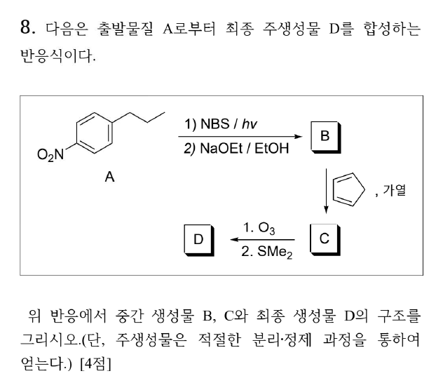

**정답** B = **(E)-1-nitro-4-(prop-1-en-1-yl)benzene**, C = Diels–Alder 부가물(노보넨, **아릴 endo·메틸 exo, 두 치환기 trans**, 라셈), D = 오존 분해 생성물 **사이클로펜테인-1,3-다이카브알데하이드**(두 CHO는 cis, 아릴은 CHO와 cis, 메틸은 trans, C₁₄H₁₅NO₄, 라셈)

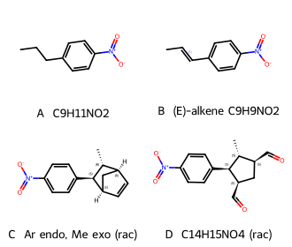

**공식·핵심 개념**

- NBS/hν: **벤질 자리** 라디칼 브로민화(벤질 라디칼의 공명 안정화)
- NaOEt/EtOH: E2, **Zaitsev + 콘쥬게이션** → (E)-스타이렌형 알켄
- Diels–Alder: suprafacial **syn 첨가 → 다이엔오필의 trans 관계 유지**, **endo 규칙**(π 치환기가 다이엔 아래)
- O₃ → Me₂S: C=C → 두 C=O (환원적 후처리 → 알데하이드)

**2027 출제 가능성 ★★★★☆ 높음** — Diels–Alder의 입체 선택성(endo, 입체 특이성)과 오존 분해를 이어 구조를 추적하는 문항은 유기 서술형의 대표입니다.

**주어진 것** A = 1-nitro-4-propylbenzene, ① NBS/hν ② NaOEt/EtOH → B, B + 사이클로펜타다이엔(가열) → C, ① O₃ ② SMe₂ → D

**구할 것** B, C, D의 구조

**풀이 전략** 각 단계의 위치 선택성(벤질), 입체(E, endo, trans 유지)를 차례로 결정합니다.

**(1) A → 벤질 브로마이드.** Br•가 C–H 결합 중 가장 약한 **벤질 C–H**(BDE ≈ 357 kJ/mol)를 떼어 냅니다. 생긴 벤질 라디칼은 벤젠 고리와 공명 안정화되고, Br₂(NBS + HBr에서 저농도로 공급)와 반응해 ArCHBrCH₂CH₃가 됩니다. NBS는 Br₂ 농도를 낮게 유지해 고리나 C=C 첨가를 막습니다.

**(2) → B (E2).** EtO⁻가 β-H(CH₂)를 떼며 Br이 이탈합니다. 생기는 C=C가 고리와 콘쥬게이션하는 **ArCH=CHCH₃**이며, 입체 장애가 작은 **(E)**가 주생성물입니다. B = C₉H₉NO₂.

**(3) B → C (Diels–Alder).** 사이클로펜타다이엔(s-cis 고정)이 다이엔, B의 C=C가 다이엔오필입니다(니트로페닐이 전자를 당겨 활성화).

- **입체 특이성**: (E)-알켄의 trans 관계가 생성물에서도 **trans**(Ar과 CH₃가 반대쪽).
- **endo 규칙**: π계를 가진 아릴기가 전이 상태에서 다이엔 아래(endo)에 놓여 이차 궤도 상호작용으로 안정화 → **Ar endo, CH₃ exo**.
- 두 면에서 같은 확률로 공격 → **라셈 혼합물**.

**(4) C → D (오존 분해).** 노보넨의 C=C(C5=C6)만 끊어집니다(벤젠 고리는 O₃에 불활성). 이환 골격이 열려 **사이클로펜테인**이 남고, 끊긴 두 탄소가 각각 **CHO**가 됩니다. 두 CHO는 원래 같은 다리의 양 끝이므로 **cis**이고, endo였던 아릴은 CHO와 같은 면, exo였던 메틸은 반대 면이 됩니다.

$$\mathrm{C_{14}H_{15}NO_2} \xrightarrow{\mathrm{O_3};\ \mathrm{Me_2S}} \mathrm{C_{14}H_{15}NO_4}$$

**왜 이 생성물인가** 벤질 자리가 아닌 C–H(2차 BDE ≈ 410 kJ/mol)는 NBS 조건에서 거의 반응하지 않습니다. E2에서 β-H는 CH₂ 쪽에만 있어 위치 이성질체 문제가 없고, 콘쥬게이션 덕분에 (E)-알켄이 열역학·속도론적으로 유리합니다. Diels–Alder에서 다이엔오필의 기하는 협동 반응이라 그대로 보존되고, 아릴(π계) endo가 속도론적 생성물입니다.

**메커니즘 — NBS 벤질 브로민화(라디칼 연쇄, 반쪽 화살표)**

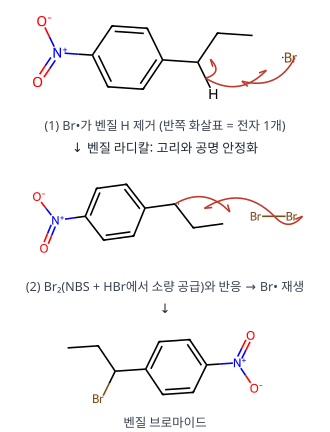

**메커니즘 — E2 제거**

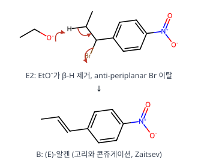

**메커니즘 — Diels–Alder 고리화 첨가**

**메커니즘 — 오존 분해(Criegee)와 환원적 후처리**

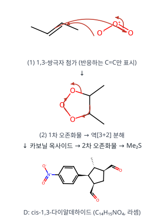

**검산** C: C₉H₉NO₂ + C₅H₆ = C₁₄H₁₅NO₂ ✓, D: + O₂ → C₁₄H₁₅NO₄ ✓. RDKit 3차원 구조로 C의 아릴이 C=C 쪽(endo), 메틸이 CH₂ 다리 쪽(exo)임을 확인했습니다.

**채점 포인트·함정**

- C에서 Ar과 CH₃를 cis로 그리면 입체 특이성 위반입니다.
- endo/exo를 거꾸로 하면(메틸 endo) D의 상대 배치가 바뀝니다.
- D는 SMe₂(환원적) 후처리이므로 카복실산이 아니라 **알데하이드**입니다.
- C와 D는 키랄이지만 라셈으로 생기므로 한 거울상만 그리고 "라셈"이라 적습니다.

## B형 9번 · Fischer 에스터화와 CH₃Li의 반응 {#b9}

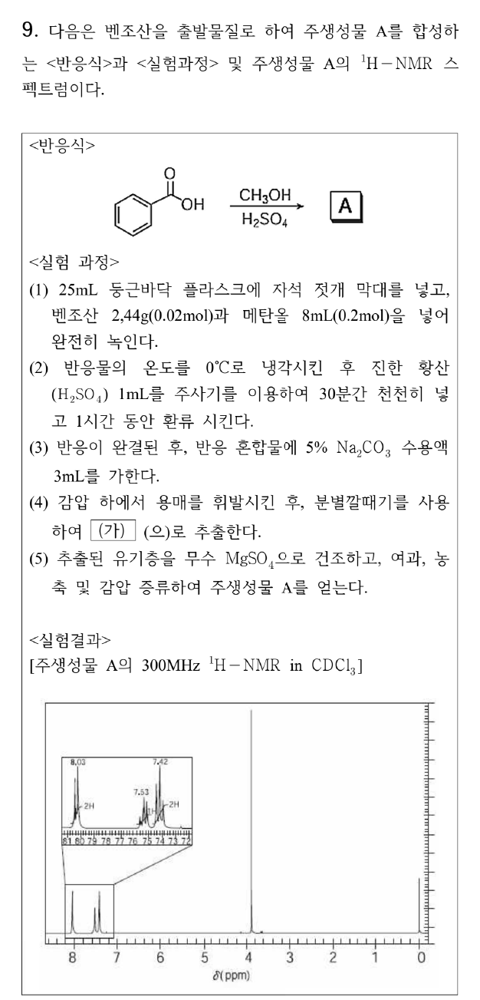

**정답**

- A = **methyl benzoate** C₆H₅CO₂CH₃, 8.03 ppm(2H) = **카보닐에 오르토인 고리 H 2개**(아래 그림의 빨간 원)
- CH₃OH 대신 2당량 CH₃Li: **acetophenone** C₆H₅COCH₃
- Na₂CO₃를 쓰는 이유: **촉매 H₂SO₄를 중화하고, 남은 벤조산을 물에 녹는 벤조산 나트륨으로 바꾸어 수층으로 제거**하기 위해(약염기라 에스터를 비누화하지 않음)
- (가): **다이에틸 에터**(또는 CH₂Cl₂ — 물과 섞이지 않고 에스터를 잘 녹이는 용매)

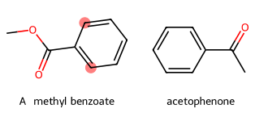

**공식·핵심 개념**

- Fischer 에스터화: 산 촉매 평형, 과량 알코올로 오른쪽 이동
- 카복실산 + RLi: 1당량은 탈양성자화(카복실레이트), 2당량째가 첨가 → **다이알콕사이드(안정)** → 후처리 → **케톤**
- 카보닐의 자기 이방성: 오르토 H가 가장 낮은 장(δ ≈ 8.0)
- 추출: 산성 불순물은 염기 수용액으로 염을 만들어 수층으로

**2027 출제 가능성 ★★★★☆ 높음** — 실험 과정(중화·추출·건조)과 NMR 배정을 함께 묻는 합성 실험형 문항은 최근 출제 비중이 늘었습니다.

**주어진 것** 벤조산 2.44 g(0.02 mol) + CH₃OH 8 mL(0.2 mol, 10당량), 진한 H₂SO₄, 환류 → 5% Na₂CO₃ → 용매 제거 → (가)로 추출 → MgSO₄ → 증류. A의 ¹H NMR: 8.03(2H), 7.53(1H), 7.42(2H), 3.9(s, 3H)

**구할 것** A(8.03 ppm H 표시), 2당량 CH₃Li 생성물, Na₂CO₃의 이유, (가)

**풀이 전략** 반응식이 Fischer 에스터화이므로 A는 메틸 에스터이고, NMR로 확인합니다.

**(1) A와 NMR 배정.**

| δ (ppm) | 적분 | 배정 | 이유 |
|---|---|---|---|
| **8.03** | **2H** | **오르토 H** | C=O의 전자 끌기 + 자기 이방성(탈가림 최대) |
| 7.53 | 1H | 파라 H | 공명으로 약간 탈가림 |
| 7.42 | 2H | 메타 H | 가장 덜 영향받음 |
| 3.9 | 3H (s) | OCH₃ | 에스터 산소에 결합 |

합 8H = C₈H₈O₂(methyl benzoate)의 H 수 ✓.

**(2) 2당량 CH₃Li.** 첫 당량은 산의 O–H(pKa 4.2)를 떼어 CH₄와 리튬 카복실레이트를 만듭니다. 두 번째 CH₃⁻가 카복실레이트 C=O에 첨가해 **다이알콕사이드(이음이온)**가 되는데, 음전하 두 개를 가진 이 중간체는 이탈기가 없어 더 반응하지 않습니다. 산 후처리에서 수화물(gem-다이올)이 물을 잃고 **acetophenone**이 됩니다. (에스터 + RLi와 달리 3차 알코올로 가지 않습니다.)

**(3) Na₂CO₃.**

$$\mathrm{H_2SO_4 + Na_2CO_3 \to Na_2SO_4 + H_2O + CO_2}$$

$$\mathrm{2\,C_6H_5COOH + Na_2CO_3 \to 2\,C_6H_5COONa + H_2O + CO_2}$$

산을 중화해 이후 농축·증류 중 에스터가 가수분해(역반응)되는 것을 막고, 반응하지 않은 벤조산을 수용성 염으로 바꾸어 유기층(에스터)과 분리합니다. NaOH 같은 강염기는 에스터를 비누화하므로 쓰지 않습니다.

**(4) (가).** 메탄올을 날린 뒤 물층에서 에스터를 꺼낼 용매는 **물과 섞이지 않고** 에스터를 잘 녹이며 끓는점이 낮은 것: 다이에틸 에터(또는 다이클로로메테인, 아세트산 에틸).

**메커니즘 — Fischer 에스터화**

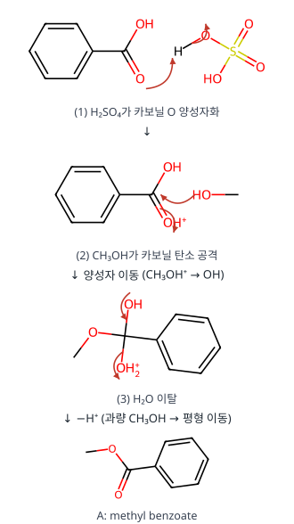

**메커니즘 — 카복실산 + 2 CH₃Li → 케톤**

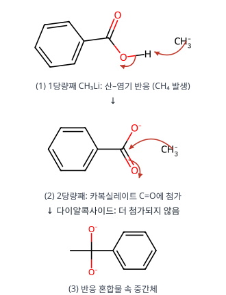

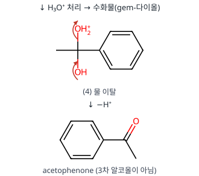

**검산** 벤조산 2.44 g ÷ 122.1 g/mol = 0.0200 mol ✓, CH₃OH 8 mL × 0.79 g/mL ÷ 32.0 g/mol = 0.198 ≈ 0.2 mol ✓ (10당량 → 평형 이동).

**채점 포인트·함정**

- 8.03 ppm 2H는 **카보닐 쪽 오르토 H 두 개**에 모두 동그라미를 쳐야 합니다.
- CH₃Li 2당량 생성물을 3차 알코올(2-phenylpropan-2-ol)로 쓰면 틀립니다. 출발물이 **카복실산**이라 첫 당량이 산–염기 반응에 쓰입니다.
- (가)에 메탄올·에탄올처럼 물과 섞이는 용매를 쓰면 안 됩니다.

## B형 10번 · 고리 위 입자의 변분 에너지 {#b10}

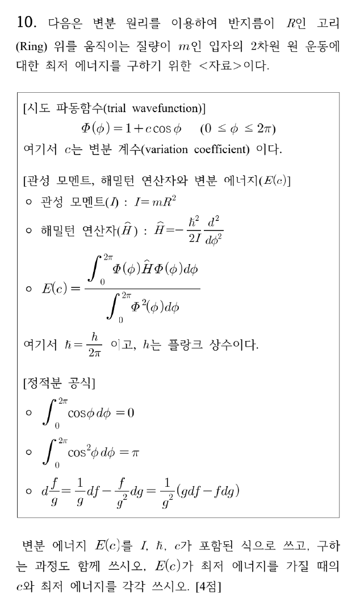

**정답** (답지 난이도 ★★★☆☆) $E(c) = $ **$\dfrac{\hbar^2}{2I}\left(\dfrac{c^2}{2+c^2}\right)$**, 최저일 때 $c = $ **0**, 최저 에너지 = **0**

**공식·핵심 개념**

- 변분 원리: $E(c) = \dfrac{\int\Phi\hat H\Phi\,d\phi}{\int\Phi^2\,d\phi} \ge E_0$
- 고리 위 입자 정확한 해: $E_m = \dfrac{m^2\hbar^2}{2I}$, $m = 0, \pm1, \dots$ → 바닥 $E_0 = 0$
- $\int_0^{2\pi}\cos\phi\,d\phi = 0$, $\int_0^{2\pi}\cos^2\phi\,d\phi = \pi$

**2027 출제 가능성 ★★★☆☆ 보통** — 변분법은 양자화학에서 가끔 나오며, 시도 함수의 적분 계산을 단계별로 쓰게 하는 서술형이 전형입니다.

**주어진 것** $\Phi = 1 + c\cos\phi$, $\hat H = -\dfrac{\hbar^2}{2I}\dfrac{d^2}{d\phi^2}$, 적분 공식

**구할 것** $E(c)$(과정), 최저 에너지일 때 c와 에너지

**풀이 전략** $\hat H\Phi$를 먼저 계산하고 분자·분모 적분을 따로 구한 뒤, 몫의 미분으로 극값을 찾습니다.

**(1) $\hat H\Phi$.**

$$\frac{d^2}{d\phi^2}(1 + c\cos\phi) = -c\cos\phi$$

$$\hat H\Phi = -\frac{\hbar^2}{2I}(-c\cos\phi) = \frac{\hbar^2c}{2I}\cos\phi$$

**(2) 분자.**

$$\int_0^{2\pi}(1 + c\cos\phi)\frac{\hbar^2c}{2I}\cos\phi\,d\phi = \frac{\hbar^2c}{2I}\left[\int_0^{2\pi}\cos\phi\,d\phi + c\int_0^{2\pi}\cos^2\phi\,d\phi\right]$$

$$= \frac{\hbar^2c}{2I}(0 + c\pi) = \frac{\pi\hbar^2c^2}{2I}$$

**(3) 분모.**

$$\int_0^{2\pi}(1 + 2c\cos\phi + c^2\cos^2\phi)\,d\phi = 2\pi + 0 + \pi c^2 = \pi(2 + c^2)$$

**(4) 변분 에너지.**

$$E(c) = \frac{\pi\hbar^2c^2/2I}{\pi(2+c^2)} = \frac{\hbar^2}{2I}\cdot\frac{c^2}{2+c^2}$$

**(5) 극소.** 주어진 몫의 미분 공식($f = c^2$, $g = 2 + c^2$):

$$\frac{dE}{dc} = \frac{\hbar^2}{2I}\cdot\frac{(2+c^2)(2c) - c^2(2c)}{(2+c^2)^2} = \frac{\hbar^2}{2I}\cdot\frac{4c}{(2+c^2)^2} = 0 \;\Rightarrow\; c = 0$$

$c < 0$에서 감소, $c > 0$에서 증가하므로 극소. $E(0) = 0$.

**검산** $c = 0$이면 $\Phi = 1$(상수) = 정확한 바닥 상태 $m = 0$, $E_0 = 0$ ✓. $c \to \infty$이면 $E \to \hbar^2/2I$ = $m = \pm1$ 준위(cos φ만 남음) ✓. 변분 에너지가 항상 $E_0 = 0$ 이상 ✓.

**채점 포인트·함정**

- 분모(정규화 적분)를 빼먹고 분자만 쓰면 $E(c)$가 틀립니다.
- 최저 에너지 0은 "영점 에너지가 없다"는 고리 위 입자의 특징입니다(경계 조건이 주기적이라 m = 0 허용).

## B형 11번 · H₂S로 황화물 선택적 침전 {#b11}

**정답** (답지 난이도 ★★★☆☆) 선택적 침전 pH 구간: **2.00 ≤ pH < 3.00**, pH 4.00에서 $\dfrac{[\mathrm{B^{2+}}]}{[\mathrm{C^+}]} = $ **1.0 × 10⁻⁶**

**공식·핵심 개념**

- $[\mathrm{S^{2-}}] = \dfrac{K_1[\mathrm{H_2S}]}{[\mathrm{H^+}]^2}$ (pH로 S²⁻ 농도 조절)
- 침전 시작: $Q > K_{sp}$ / 99.9 % 침전: 남은 농도 ≤ 처음의 0.1 %
- $K_{sp}(\mathrm{C_2S}) = [\mathrm{C^+}]^2[\mathrm{S^{2-}}]$ (제곱 주의)

**2027 출제 가능성 ★★★★☆ 높음** — pH로 조절하는 황화물·수산화물 선택적 침전은 분석화학 평형 문항에서 꾸준히 나옵니다.

**주어진 것** [B²⁺] = [C⁺] = 0.10 M, [H₂S] = 0.10 M 유지, $K_{sp}(\mathrm{BS}) = 10^{-22}$, $K_{sp}(\mathrm{C_2S}) = 10^{-18}$, $K_1 = 10^{-21}$

**구할 것** B²⁺ 99.9 % 이상 침전 + C⁺ 침전 없음의 pH 범위, pH 4.00에서 [B²⁺]/[C⁺]

**풀이 전략** 두 조건을 각각 [S²⁻] 범위로 바꾸고, $[\mathrm{S^{2-}}] = 10^{-22}/[\mathrm{H^+}]^2$로 pH 범위를 구합니다.

**(1) S²⁻와 pH.**

$$[\mathrm{S^{2-}}] = \frac{10^{-21}\times0.10}{[\mathrm{H^+}]^2} = \frac{10^{-22}}{[\mathrm{H^+}]^2}$$

**(2) B²⁺ 99.9 % 침전.** 남은 $[\mathrm{B^{2+}}] \le 0.10\times10^{-3} = 10^{-4}$ M.

$$[\mathrm{S^{2-}}] \ge \frac{10^{-22}}{10^{-4}} = 10^{-18} \;\Rightarrow\; \frac{10^{-22}}{[\mathrm{H^+}]^2} \ge 10^{-18} \;\Rightarrow\; [\mathrm{H^+}] \le 10^{-2} \;\Rightarrow\; \mathrm{pH} \ge 2.00$$

**(3) C⁺ 침전 없음.**

$$(0.10)^2[\mathrm{S^{2-}}] < 10^{-18} \;\Rightarrow\; [\mathrm{S^{2-}}] < 10^{-16} \;\Rightarrow\; [\mathrm{H^+}]^2 > 10^{-6} \;\Rightarrow\; \mathrm{pH} < 3.00$$

→ **2.00 ≤ pH < 3.00**

**(4) pH 4.00에서의 비.** 이 pH는 위 범위를 넘으므로 두 염 모두 침전합니다.

$$[\mathrm{S^{2-}}] = \frac{10^{-22}}{(10^{-4})^2} = 10^{-14}\ \mathrm M$$

$$[\mathrm{B^{2+}}] = \frac{10^{-22}}{10^{-14}} = 10^{-8}\ \mathrm M, \qquad [\mathrm{C^+}] = \sqrt{\frac{10^{-18}}{10^{-14}}} = 10^{-2}\ \mathrm M$$

$$\frac{[\mathrm{B^{2+}}]}{[\mathrm{C^+}]} = \frac{10^{-8}}{10^{-2}} = 1.0\times10^{-6}$$

**검산** pH 4에서 C⁺는 0.10 → 0.010 M(90 % 침전)으로 실제로 침전이 일어남 ✓. 경계 pH 3.00에서 $[\mathrm{S^{2-}}] = 10^{-16}$, $Q(\mathrm{C_2S}) = 10^{-2}\cdot10^{-16} = K_{sp}$로 딱 포화 ✓(그래서 3.00은 포함하지 않음).

**채점 포인트·함정**

- C₂S의 $K_{sp}$는 $[\mathrm{C^+}]^2$이므로 0.10을 **제곱**해야 합니다. 빠뜨리면 경계가 pH 2.5로 나옵니다.
- 등호 처리: 99.9 % "이상"은 ≤(포함), 침전 "없이"는 <(미포함).

---

원문: 2027학년도 대비 9–11월 전공화학 제1회 모의고사(안병천, 임용닷컴) 문제지·답지·강의 필기. 개인 학습용 정리입니다.

