# 2027학년도 대비 안병천 전공화학 모의고사 2회 — 상세해설

안병천 전공화학 9–11월 모의고사 제2회(전공 A 12문항 · 전공 B 11문항)의 문항별 해설입니다. 공식 답지(「전공 A와 B 답지(수강생용)-수정본1」)와 강의 필기본을 바탕으로 썼고, 모든 계산은 Python으로 다시 검산했습니다. 공식 답지에 정답이 없는 유기 5문항(A형 2·3·8번, B형 8·9번)은 강의 필기와 직접 풀이로 작성했고, 구조식은 RDKit으로 분자식·입체배열을 확인했습니다.

문항마다 새 쪽에서 시작하며 3단으로 **문제지 원문 → 정답 → 공식·핵심 개념 → 2027 출제 가능성 → 풀이 → 채점 포인트·함정** 순서로 읽으면 됩니다. 아래 표의 문항 번호를 누르면 해당 쪽으로 이동합니다.

유기 문항(A형 2·8번, B형 8·9번)에는 **굽은 화살표로 전자 이동을 표시한 단계별 메커니즘 그림**을 넣었습니다(빨간 화살표: 전자쌍이 출발하는 결합·비공유 전자쌍 → 도착하는 원자·결합).

교육론을 뺀 전공 문항의 풀이는 **주어진 것 / 구할 것 → 풀이 전략 → 단계별 풀이 (1)(2)… → 검산** 순서로 정리했습니다. 대입과 단위 환산을 생략하지 않았습니다.

**2027 출제 가능성**(★ 5개 만점)은 1997~2026 기출에서 그 소재가 얼마나 자주 나왔는지와 2022 개정 교육과정 적용 시점을 함께 고려한 추정치입니다. 정답 상자의 **답지 난이도**는 공식 답지에 적힌 값입니다.

## 정답 한눈에 보기 (목차) {#toc}

### 전공 A (12문항 40점)

| 번호 | 영역 | 정답 요약 | 2027 출제 가능성 |
|---|---|---|---|
| [1](#a1) | 무기 · 금속 결정 구조 | $b/a = \sqrt{2/3}$, fcc $\frac{\sqrt2}{6}\pi$, hcp AB 배열 | ★★★★☆ |
| [2](#a2) | 유기 · 산도 | A Hc, B Hb, C Hc | ★★★★☆ |
| [3](#a3) | 유기 · IR·MS·NMR | butanal, 알데하이드 C–H | ★★★★★ |
| [4](#a4) | 물리화학 · 진동-회전 스펙트럼 | Δv = +1, P ΔJ = −1, R ΔJ = +1, $B_0 = a/6$, $B_1 = b/10$ | ★★★★☆ |
| [5](#a5) | 화학교육 · 라카토스, 개념 변화, 귀추 | (나) 부정적 발견법, 핵·보호대, 개념 교환, 귀추적 추리 | ★★★★★ |
| [6](#a6) | 화학교육 · 헤론, 귀납, 통합과학 2 | 1수준, 귀납 – 일반화 오류, 아레니우스·온도 변화 | ★★★★★ |
| [7](#a7) | 화학교육 · 과정·기능, 동료평가 | 자료 수집·변환 / 분석·평가·추론, 입자 모형, 타당도 | ★★★★★ |
| [8](#a8) | 유기 · 수소붕소화, E2 | A trans-2-isopropylcyclohexanol, B = C 3-isopropylcyclohexene | ★★★★★ |
| [9](#a9) | 무기 · 군론, 진동 | Γ = 4, 0, 0, 0 → IR 활성 $A_u + B_u$ | ★★★★★ |
| [10](#a10) | 물리화학 · 등온 팽창 | ① $q = 0.7RT_0$, ② $q = 0.5RT_0$, ΔS 모두 $0.7R$ | ★★★★☆ |
| [11](#a11) | 분석화학 · 이온 크로마토그래피 | F 0.25, 3.2×10⁻⁴ M, $V_M/V_S$ 50, K 150, N 6400 | ★★★★☆ |
| [12](#a12) | 분석화학 · 용해도 평형 | $K_3 = 1\times10^4$, $[X^{2-}]/[HX^-] = 1\times10^{-9}$ (답지) | ★★★☆☆ |

### 전공 B (11문항 40점)

| 번호 | 영역 | 정답 요약 | 2027 출제 가능성 |
|---|---|---|---|
| [1](#b1) | 분석화학 · 인산염 적정 | x = 0.20, y = 0.10 | ★★★★★ |
| [2](#b2) | 무기 · 유기금속 전자 수 | 16전자 (나)(라)(바), 산화성 첨가 ②④ | ★★★★☆ |
| [3](#b3) | 화학교육 · 귀추, TWA, 오수벨 | 귀추적 추리, 모형으로 해석, 심리적 유의미가 | ★★★★★ |
| [4](#b4) | 화학교육 · STAD, 과학 목표 | 적절, 향상 점수 합산, 개별책무성, 과학·기술·사회 | ★★★★☆ |
| [5](#b5) | 화학교육 · 로슨 순환학습 | 초기 관찰, 가설 제시·검증, 적용 범위 확장 | ★★★★★ |
| [6](#b6) | 무기 · d⁸ Tanabe–Sugano | ³F₄, Δo 11000, x 1800, B 1000, 0.8a, 2a | ★★★★★ |
| [7](#b7) | 물리화학 · 정류 상태 근사 | $[Br] = (k_1/k_5)^{1/2}[Br_2]^{1/2}$, 초기·말기 속도식 | ★★★★☆ |
| [8](#b8) | 유기 · 알카인 환원 | A 3-methylpent-1-yne, B = D, C 비카이랄 | ★★★★☆ |
| [9](#b9) | 유기 · E2, 수소붕소화 | B 메실레이트, C Δ¹⁽⁸ᵃ⁾-옥탈린, 시약 ㄴ | ★★★★☆ |
| [10](#b10) | 물리화학 · 수소꼴 2p | $N = \frac{1}{2\sqrt6}(Z/a_0)^{5/2}$, $r_{mp} = 4a_0/Z$, $\langle r\rangle = 5a_0/Z$ | ★★★★☆ |
| [11](#b11) | 분석화학 · 전지 전위 | −0.40 V, $K_{sp}(\beta) = 1.0\times10^{-30}$ | ★★★★★ |

**검토 메모**

1. **A형 12번 ④**: 공식 답지 $[X^{2-}]/[HX^-] = 1\times10^{-9}$는 $[H^+] = 0.1$ M로 보고 $K_2/[H^+]$를 계산한 값입니다. 그런데 생긴 H⁺ 0.1 mol은 남은 HX⁻와 다시 반응해 H₂X가 됩니다($K = 1/K_1 = 10^6$). 이 반응까지 넣어 풀면 $[H^+] \approx 2.2\times10^{-3}$ M, **비 ≈ 4.5×10⁻⁸**입니다(수치 해로 확인). 해설에 두 값을 모두 적었습니다.
2. **유기 5문항**(A형 2·3·8번, B형 8·9번)은 공식 답지에 정답이 없습니다. 강의 필기와 직접 풀이로 정리했고, 필기 내용과 결과가 일치합니다.
3. **B형 8번**: 말단 알카인은 Na/NH₃(l) 조건에서 일부가 아세틸라이드로 탈양성자화됩니다. 실제로는 (NH₄)₂SO₄ 같은 양성자 공급원을 함께 넣어야 환원이 잘 됩니다. 출제 의도(B와 D가 같은 화합물)는 그대로입니다.
4. 공식 답지의 1차 커트 예상: 물리·무기·분석 영역 **22.3 / 40점**, 2차 **24.4 / 40점**.
5. 함께 보낸 답안지(2·3교시) 두 장은 비어 있어서 개인 채점은 하지 않았습니다.

# 전공 A

## A형 1번 · 금속 M의 상평형과 단위 세포 {#a1}

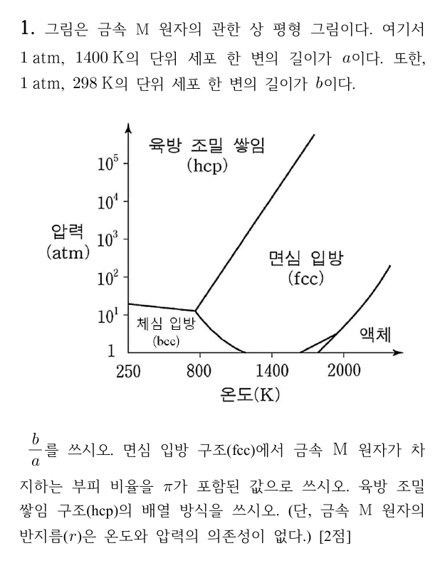

**정답** (답지 난이도 ★★☆☆☆) $\dfrac{b}{a} = \sqrt{\dfrac23}$, fcc의 부피 비율 $\dfrac{\sqrt2}{6}\pi$ $\left(= \dfrac{\pi}{3\sqrt2} \approx 0.740\right)$, hcp는 **AB(ABAB…) 배열**

**공식·핵심 개념**

- bcc: 2개/세포, 몸대각선 접촉 $4r = \sqrt3\,a$, 충전율 $\frac{\sqrt3}{8}\pi$ (68 %)
- fcc: 4개/세포, 면대각선 접촉 $4r = \sqrt2\,a$, 충전율 $\frac{\sqrt2}{6}\pi$ (74 %)
- hcp: ABAB…, fcc(ccp): ABCABC…

**2027 출제 가능성 ★★★★☆ 높음** — 단위 세포의 원자 수·접촉 조건·충전율은 무기·고체 영역에서 반복 출제됩니다. 상평형 그림 읽기와 묶는 형태가 새롭습니다.

**주어진 것** 금속 M의 상평형 그림, 1 atm·1400 K의 단위 세포 한 변 $a$, 1 atm·298 K의 한 변 $b$, 반지름 $r$은 일정

**구할 것** $b/a$, fcc의 부피 비율, hcp의 배열 방식

**풀이 전략** 그림에서 두 조건의 결정 구조를 읽고, 각 구조의 접촉 조건으로 한 변을 $r$로 나타냅니다.

**(1) 그림 읽기.** 1 atm(가로축 바로 위)에서 1400 K는 **면심 입방(fcc)** 영역, 298 K는 **체심 입방(bcc)** 영역입니다.

**(2) 한 변을 r로 나타내기.**

$$\text{fcc (면대각선 접촉)}:\ \sqrt2\,a = 4r \;\Rightarrow\; a = \frac{4r}{\sqrt2}$$

$$\text{bcc (몸대각선 접촉)}:\ \sqrt3\,b = 4r \;\Rightarrow\; b = \frac{4r}{\sqrt3}$$

$$\frac{b}{a} = \frac{4r/\sqrt3}{4r/\sqrt2} = \frac{\sqrt2}{\sqrt3} = \sqrt{\frac23} \approx 0.816$$

**(3) fcc 충전율.** 단위 세포 속 원자 수 $= 8\times\frac18 + 6\times\frac12 = 4$, $r = \frac{\sqrt2}{4}a$:

$$\frac{4\times\frac43\pi r^3}{a^3} = \frac{16\pi}{3}\cdot\frac{(\sqrt2)^3}{64} = \frac{16\pi}{3}\cdot\frac{2\sqrt2}{64} = \frac{\sqrt2}{6}\pi$$

**(4) hcp.** 세 번째 층이 첫 층 바로 위에 오는 **ABAB…** 배열입니다(fcc는 ABCABC…).

**검산** $\frac{\sqrt2}{6}\pi = 0.7405$ — 알려진 최밀 쌓임 74 %와 일치. $b < a$이므로 bcc 한 변이 더 짧은 것도 맞습니다(원자 2개 vs 4개).

**채점 포인트·함정**

- 298 K를 fcc로 잘못 읽지 않도록 1 atm 선을 따라갑니다(250~800 K, 1 atm은 bcc).
- 충전율은 "π가 포함된 값"을 요구하므로 0.74만 쓰면 감점될 수 있습니다.

## A형 2번 · 표시한 수소의 산도 비교 {#a2}

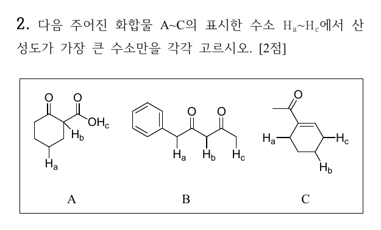

**정답** A **Hc**, B **Hb**, C **Hc**

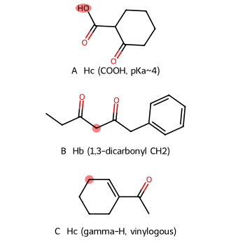

**공식·핵심 개념**

- 산도 = H⁺를 내놓은 뒤 남는 짝염기의 안정성
- 짝염기 안정화: 음전하가 놓인 원자의 전기음성도, 공명(비편재화), 유발 효과
- pKa: RCOOH ≈ 4–5 < 1,3-다이카보닐 ≈ 9–11 < 케톤 α-H ≈ 19–20 < 알케인 C–H ≈ 50

**2027 출제 가능성 ★★★★☆ 높음** — 산도 비교는 유기 기입형의 기본 소재이고, 확장된 엔올레이트(vinylogous) 같은 응용이 함께 나옵니다.

**주어진 것** 화합물 A(2-oxocyclohexanecarboxylic acid 골격), B(1-phenylhexane-3,5-dione 골격), C(1-acetylcyclohexene)와 표시한 수소 Ha~Hc

**구할 것** 각 화합물에서 가장 산성인 수소

**풀이 전략** 각 수소를 뗐을 때 생기는 음이온이 어디까지, 어떤 원자로 비편재화되는지 비교합니다.

**(1) A.** Ha는 고리의 평범한 sp³ C–H(pKa ≈ 50), Hb는 케톤과 카복실기 사이 α-H(pKa ≈ 10~11), Hc는 카복실 O–H(pKa ≈ 4)입니다. Hc를 떼면 음전하가 전기음성도가 큰 **O 두 개에 동등하게** 분산되므로 가장 산성입니다.

**(2) B.** Hb는 **두 C=O 사이** CH₂의 수소입니다. 짝염기 음전하가 O 두 개와 C에 걸쳐 비편재화되어 pKa ≈ 9입니다. Ha는 벤질 위치이면서 C=O 하나의 α(pKa ≈ 17~19), Hc는 C=O 하나의 α(pKa ≈ 20)입니다. 벤젠 고리는 음전하를 일부 안정화하지만 C=O 두 개만큼은 아닙니다.

**(3) C.** Hc(C3)를 떼면 음전하가 C3 → C2=C1 → C=O로 이어지는 **확장된(vinylogous) 엔올레이트**가 되어 O까지 전달됩니다. Ha(C6)를 떼면 음전하가 C6 → C1=C2를 거쳐 C2까지만 퍼지고 C=O의 O까지 가지 못합니다(교차 콘쥬게이션). Hb(C4)는 알릴 위치도 아닙니다.

**메커니즘 — 짝염기의 비편재화**

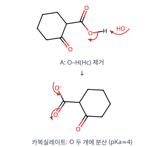

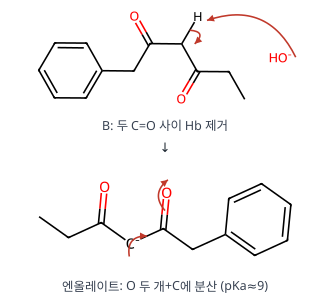

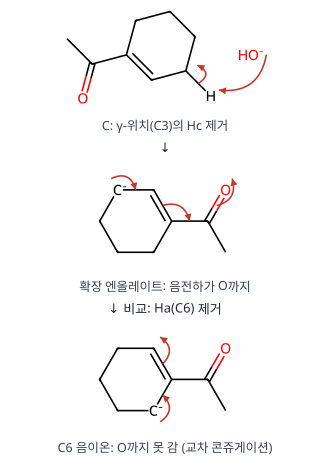

**검산** 세 경우 모두 "음전하가 O에 놓이는 공명 구조가 있는가"로 판정하면 A Hc, B Hb, C Hc가 남습니다.

**채점 포인트·함정**

- C에서 Ha(카보닐 쪽 탄소에 더 가까워 보이는 수소)를 고르기 쉽습니다. C6은 C=O에 직접 붙은 탄소의 α가 아니라 C1(알켄 탄소)의 이웃입니다.

## A형 3번 · C₄H₈O의 IR·MS·¹H NMR {#a3}

**정답** **butanal** CH₃CH₂CH₂CHO. 2820, 2715 cm⁻¹은 **알데하이드의 C–H(포밀 C–H) 결합**(아래 빨간 원)

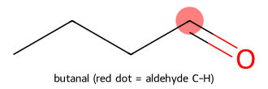

**공식·핵심 개념**

- 불포화도 $= \frac{2C + 2 - H}{2}$
- 알데하이드: C=O 1725 cm⁻¹, C–H 2820·2720 cm⁻¹ 이중선(페르미 공명), ¹H 9.5–10 ppm
- n+1 규칙, McLafferty 자리옮김(γ-H)

**2027 출제 가능성 ★★★★★ 매우 높음** — 분광 자료로 구조를 정하는 문항은 해마다 나옵니다.

**주어진 것** C₄H₈O, IR 2820·2715(이중선)·1725 cm⁻¹, MS 72·71·29, ¹H 9.7(s, 1H), 2.40(t), 1.6(6중선), 0.9(t)

**구할 것** 구조와 2820·2715 cm⁻¹에 해당하는 결합

**풀이 전략** 불포화도 → IR로 작용기 → NMR 갈라짐으로 사슬 연결 순서 → MS 조각으로 확인.

**(1) 불포화도.** $\frac{2(4) + 2 - 8}{2} = 1$ → C=O 하나(또는 고리·C=C).

**(2) IR.** 1725 cm⁻¹는 포화 알데하이드 C=O. 2820·2715 cm⁻¹ 이중선은 CHO의 C–H 신축이 C–H 굽힘 배음과 페르미 공명으로 둘로 갈라진 것입니다. 케톤에는 없습니다.

**(3) ¹H NMR 배정**

| δ (ppm) | 갈라짐 | 수소 | 근거 |
|---|---|---|---|
| 9.7 | s(작은 t) | –CHO | 카보닐 이방성 + O의 끌어당김 |
| 2.40 | t | –CH₂–CHO | 이웃 CH₂ 2H → n+1 = 3 |
| 1.6 | 6중선 | CH₃–CH₂–CH₂ | 이웃 H 3 + 2 = 5 → 6중선 |
| 0.9 | t | CH₃– | 이웃 CH₂ 2H |

(9.7 ppm은 실제로는 이웃 CH₂와 J ≈ 1.7 Hz로 작게 갈라진 삼중선이지만 문제는 단일선으로 주었습니다.)

**(4) MS.** M⁺ 72 = C₄H₈O. 71 = M − H(아실륨 C₃H₇CO⁺). 29 = CHO⁺(또는 C₂H₅⁺). 그림의 가장 큰 봉우리 44는 γ-H가 있는 알데하이드의 McLafferty 자리옮김 조각(CH₂=CHOH⁺•), 43은 C₃H₇⁺입니다.

**검산** 사슬 CH₃–CH₂–CH₂–CHO의 수소 3 + 2 + 2 + 1 = 8, 갈라짐이 t–6중선–t–s로 정확히 맞습니다. 2-methylpropanal이면 0.9 ppm이 6H 이중선이어야 하므로 제외됩니다.

**채점 포인트·함정**

- 동그라미는 C=O가 아니라 **포밀 C–H 결합**에 칩니다.
- butanone(C₄H₈O)도 불포화도 1이지만 9.7 ppm 신호와 2820/2715 이중선이 없습니다.

## A형 4번 · 이종핵 이원자 분자의 진동-회전 스펙트럼 {#a4}

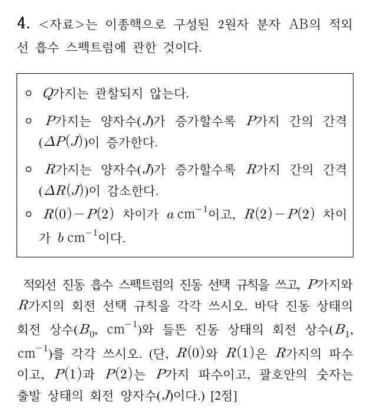

**정답** (답지 난이도 ★★☆☆☆) 진동 선택 규칙 **Δv = +1**(흡수), P가지 **ΔJ = −1**, R가지 **ΔJ = +1**, $B_0 = \dfrac{a}{6}\ \mathrm{cm^{-1}}$, $B_1 = \dfrac{b}{10}\ \mathrm{cm^{-1}}$

**공식·핵심 개념**

- $R(J) = \tilde\nu_0 + B_1(J+1)(J+2) - B_0J(J+1)$
- $P(J) = \tilde\nu_0 + B_1(J-1)J - B_0J(J+1)$
- 결합 차이: $R(J-1) - P(J+1) = 4B_0(J + \frac12)$, $R(J) - P(J) = 4B_1(J + \frac12)$

**2027 출제 가능성 ★★★★☆ 높음** — 진동-회전 분광은 물리화학 분광의 단골이며, 결합 차이법은 최근 출제 경향입니다.

**주어진 것** Q가지 없음, J가 커질수록 P 간격 증가·R 간격 감소, $R(0) - P(2) = a$, $R(2) - P(2) = b$ (cm⁻¹)

**구할 것** 선택 규칙, $B_0$(v = 0), $B_1$(v = 1)

**풀이 전략** 각 선의 위치를 $\tilde\nu_0, B_0, B_1$로 쓰고, 같은 들뜬 준위로 가는 두 선(→ $B_0$)과 같은 바닥 준위에서 출발하는 두 선(→ $B_1$)의 차이를 이용합니다.

**(1) 선택 규칙.** 흡수이므로 Δv = +1. 회전은 ΔJ = ±1(P: −1, R: +1)이며, Q가지(ΔJ = 0)가 없다는 것은 ¹Σ 상태(전자 각운동량 0)의 이원자 분자라는 뜻입니다.

**(2) 선 위치.** $F_v(J) = B_vJ(J+1)$이므로

$$R(J) = \tilde\nu_0 + B_1(J+1)(J+2) - B_0J(J+1)$$

$$P(J) = \tilde\nu_0 + B_1(J-1)J - B_0J(J+1)$$

**(3) $B_0$: R(0)과 P(2)는 둘 다 v=1, J=1로 갑니다.**

$$R(0) = \tilde\nu_0 + 2B_1, \qquad P(2) = \tilde\nu_0 + 2B_1 - 6B_0$$

$$R(0) - P(2) = 6B_0 = a \;\Rightarrow\; B_0 = \frac a6$$

**(4) $B_1$: R(2)와 P(2)는 둘 다 v=0, J=2에서 출발합니다.**

$$R(2) = \tilde\nu_0 + 12B_1 - 6B_0$$

$$R(2) - P(2) = 12B_1 - 2B_1 = 10B_1 = b \;\Rightarrow\; B_1 = \frac{b}{10}$$

**검산** P 간격 증가·R 간격 감소는 $B_1 < B_0$일 때 나타납니다(진동 들뜸으로 결합 길이 증가). 따라서 $\frac{b}{10} < \frac a6$이어야 일관됩니다. 일반식 $4B(J + \frac12)$에 J = 1, 2를 넣어도 $6B_0$, $10B_1$이 나옵니다.

**채점 포인트·함정**

- $B_0$에는 **바닥** 진동 상태, $B_1$에는 **들뜬** 진동 상태의 회전 상수를 씁니다. 두 결합 차이를 바꿔 쓰기 쉽습니다.

## A형 5번 · 라카토스의 연구 프로그램과 개념 변화 {#a5}

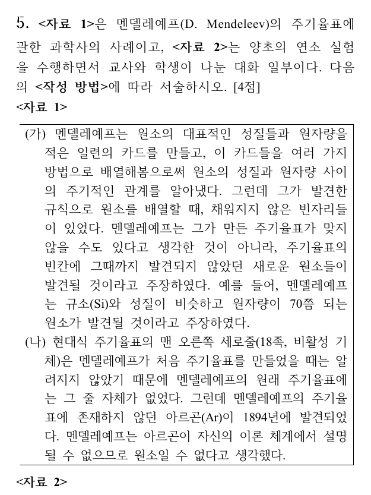

**정답**

- **(나)** — 아르곤이 "자신의 이론 체계에서 설명될 수 없으므로 원소일 수 없다"며 **새로운 보조 가설을 상정해 반증 사례를 배척**했습니다. 견고한 핵은 수정되지 않고 그대로 있어야 한다는 요구가 담긴 **부정적 발견법**입니다.
- (가)의 **견고한 핵**: 원소의 성질과 원자량 사이에 주기적인 관계가 있다. **보호대**: 그때까지 발견되지 않았던 새로운 원소들이 발견될 것이다(빈자리 예측).
- 개념 변화: "양초가 연소할 때 유리종 속의 산소가 소비된 양만큼 물이 올라온다"는 선개념(견고한 핵)이 "유리종 속의 온도가 내려가 내부 압력이 낮아졌기 때문"이라는 과학적 개념으로 **개념 교환**이 일어났습니다.
- 추리: **귀추적 추리** — 이전 상황의 성공적인 설명(온도 상승을 고려하지 않았던 점)을 새로운 상황에 빌려와 가설을 생성하는 정신적 과정이기 때문입니다.

**공식·핵심 개념**

- 라카토스: 견고한 핵 + 보호대(보조 가설), 부정적 발견법(핵 보호) / 긍정적 발견법(보호대 수정·확장)
- 개념 변화: 개념 포착(동화, 약한 재구성) vs 개념 교환(조절, 급진적 재구성)
- 귀추: 의문 → 유사 경험(원천) 탐색 → 설명 가설 생성

**2027 출제 가능성 ★★★★★ 매우 높음** — 라카토스와 귀추적 추리는 화학교육론에서 거의 매년 나옵니다.

**판단 근거.** (가)에서 빈칸은 이론을 버리는 근거가 아니라 **새 원소 예측**(긍정적 발견법 쪽)으로 쓰였습니다. (나)에서는 이론에 맞지 않는 Ar을 "원소가 아니다"라고 하여 반례를 핵이 아닌 곳으로 돌렸습니다. 학생은 산소 소비라는 핵심 생각 자체를 버리고 온도·압력이라는 새 설명 틀로 바꿨으므로 단순 보완(포착)이 아니라 교환입니다.

**채점 포인트·함정**

- 학생의 개념 변화를 쓸 때 "견고한 핵"(산소 소비 = 물 높이)을 반드시 넣으라고 했습니다.
- 귀추의 판단 준거: "기존 지식·경험을 빌려와 새 상황을 설명하는 가설을 만든다"는 문장이 들어가야 합니다.

## A형 6번 · 헤론의 탐구 수준과 귀납적 추리 {#a6}

**정답**

- 헤론 **1수준** 실험 — 수업한 내용을 **확인**하거나 **조작적 기술 습득**을 목적으로 하는 실험(문제·방법·결과를 교사가 모두 제시)
- 추리: **귀납적 추리**. 한계: 몇 가지 사례로부터 일반화하므로 **일반화의 오류**를 범하기 쉽습니다(예: 모든 산이 Mg와 같은 속도로 반응하거나 같은 전도성을 보이는 것은 아님).
- 차시 수업: [통합과학 2]에서 산·염기 정의는 **아레니우스 정의만** 다루고, 중화 반응 과정의 변화는 **용액의 온도 변화와 지시약의 색 변화만** 다룹니다. → 산과 염기를 혼합할 때 **용액의 온도를 측정하여 그래프로 나타내기**

**공식·핵심 개념**

- 헤론(Herron) 탐구 수준: 0(확인) / 1(문제·방법 제시) / 2(문제만 제시) / 3(모두 학생) — 강의 기준 1수준 = 확인·기능 습득
- 귀납: 사례 → 일반화, 한계 = 일반화의 오류
- 2022 개정 통합과학 2 [10통과2-01-04] 성취기준 해설

**2027 출제 가능성 ★★★★★ 매우 높음** — 통합과학 성취기준 적용 범위를 묻는 문항은 2022 개정 첫 적용 시기의 대표 유형입니다.

**판단 근거.** 활동지에 실험 과정과 기록 표가 모두 정해져 있고 학생은 그대로 수행해 결과를 확인합니다. 결론("산은 전류가 흐르고, Mg를 녹여 기체를 발생하며 BTB와 반응해 노란색")은 식초·염산 두 사례에서 일반화한 것입니다.

**채점 포인트·함정**

- 차시 탐구는 성취기준 해설의 "온도 변화와 지시약의 색 변화만" 범위 안이어야 합니다. pH 미터를 쓰는 중화 적정 곡선은 [화학] 과목 내용입니다.

## A형 7번 · 질량 보존 실험과 동료평가 {#a7}

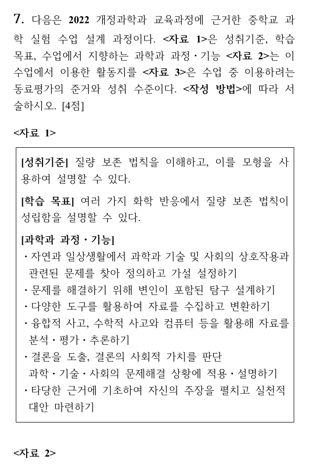

**정답**

- 과정·기능 ① **다양한 도구를 활용하여 자료를 수집하고 변환하기** — [결과 및 논의] (1)·(2)에서 질량을 측정해 기록하고 그래프로 나타냄
- 과정·기능 ② **융합적 사고, 수학적 사고와 컴퓨터 등을 활용해 자료를 분석·평가·추론하기** — (3)·(4)에서 입자 모형과 3D 프로그램으로 분석·평가
- ㉡ 질량 보존 법칙이 성립하는 이유를 **입자 모형을 이용하여 설명**하였다.
- ㉢ 실험 결과를 해석하고 논의하는 과정에서 **여러 의견을 조정**하였다.
- 평가 도구의 특성: **타당도(내용 타당도)** — 평가 준거가 성취기준·학습 목표의 내용을 제대로 측정하는가

**공식·핵심 개념**

- 2022 개정 과학과 과정·기능: 문제 인식·가설, 탐구 설계·수행, 자료 수집·변환, 분석·평가·추론, 결론 도출·적용, 의사소통·협업
- 평가 도구의 질: 타당도(내용·준거·구인), 신뢰도, 객관도, 실용도
- 질량 보존: 원자는 생성·소멸 없이 배열만 바뀜

**2027 출제 가능성 ★★★★★ 매우 높음** — 2022 개정 과정·기능 용어와 평가 도구의 특성은 교육과정 문항의 핵심입니다.

**채점 포인트·함정**

- 과정·기능 2가지는 <자료 1>의 문장 그대로 쓰고, 각각 활동 번호((1)(2), (3)(4))를 근거로 짝지어야 합니다.
- [관찰 3]은 기체(CO₂)가 발생하므로 뚜껑을 닫은 상태여야 질량이 보존됩니다.

## A형 8번 · 1-isopropylcyclohexene의 수소붕소화와 E2 {#a8}

**정답** A **trans-2-isopropylcyclohexan-1-ol**(라셈), B **3-isopropylcyclohexene**(라셈), C **3-isopropylcyclohexene**(B와 같음, 라셈)

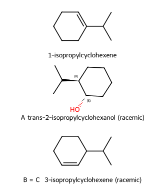

**공식·핵심 개념**

- 수소붕소화–산화: anti-Markovnikov, **syn 첨가**, 자리옮김 없음, 산화 단계에서 배열 유지
- POCl₃/pyridine, TsCl → t-BuOK: OH를 좋은 이탈기로 바꾼 뒤 **E2**
- 고리 E2: 이탈기와 β-H가 **트랜스-이축(anti-periplanar)**이어야 함

**2027 출제 가능성 ★★★★★ 매우 높음** — 입체 특이적 첨가와 고리 E2의 위치 선택성은 유기 서술형의 고정 소재입니다.

**주어진 것** 1-isopropylcyclohexene, (1) 9-BBN (2) H₂O₂/NaOH → A, A + POCl₃/pyridine → B, A + (1) TsCl (2) t-BuOK → C, 모두 라셈

**구할 것** A, B, C 구조

**풀이 전략** 수소붕소화의 위치·입체 선택성으로 A의 상대 배열(cis/trans)을 정하고, 그 배열에서 이탈기와 anti-periplanar인 β-H가 어느 쪽에 있는지로 알켄 위치를 정합니다.

**(1) A.** B는 덜 치환되고 덜 붐비는 C2에, H는 C1에 붙습니다(부피 큰 9-BBN이라 선택성이 더 큼). B와 H가 같은 면(syn)으로 들어가므로 새 C1–H와 C2–B가 cis, 즉 **C2–B와 C1–iPr은 trans**입니다. 산화에서 B가 OH로 배열을 유지하며 바뀌므로 OH와 iPr은 trans → **trans-2-isopropylcyclohexanol**. 위·아래 면 공격 확률이 같아 라셈입니다.

**(2) B.** POCl₃가 OH를 –OPOCl₂로 바꾸고 피리딘이 E2를 일으킵니다. 이탈기가 축 방향일 때만 E2가 가능한데, trans-1,2에서 OPOCl₂가 축이면 iPr도 축이고 그 탄소의 H(3차 H)는 **적도**라 anti-periplanar가 아닙니다. 남은 β-H는 반대쪽 CH₂(C6)의 축 H뿐 → C1=C6 이중결합 → 번호를 다시 매기면 **3-isopropylcyclohexene**(덜 치환된 알켄, 비-Zaitsev).

**(3) C.** TsCl은 C–O 결합을 건드리지 않고 OTs를 만듭니다(배열 유지). t-BuOK도 같은 이유로 C6의 축 H만 제거할 수 있고, 부피 큰 염기라 덜 치환된 쪽을 선호하는 성질까지 겹쳐 **B와 같은 생성물**이 됩니다.

**메커니즘 — 수소붕소화–산화 (A)**

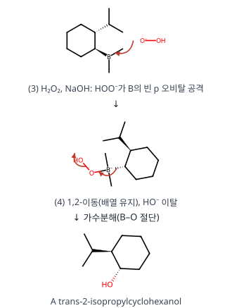

**메커니즘 — POCl₃/pyridine E2 (B)**

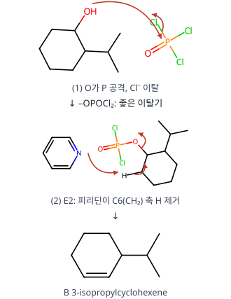

**메커니즘 — 토실화 후 t-BuOK E2 (C)**

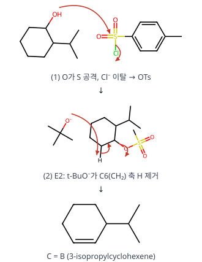

**왜 이 생성물인가.** E2의 위치 선택성은 "더 치환된 알켄(Zaitsev)"보다 **입체 조건(anti-periplanar)**이 먼저입니다. 3차 H가 이탈기와 trans-이축이 될 수 없으므로 Zaitsev 생성물(1-isopropylcyclohexene)은 거의 생기지 않습니다.

**검산** A C₉H₁₈O(출발물 C₉H₁₆ + H₂O), B·C C₉H₁₆(A − H₂O). RDKit로 확인한 A의 두 입체중심은 (1S,2R)/(1R,2S) 짝으로 trans입니다.

**채점 포인트·함정**

- A를 cis로 그리거나, B를 Zaitsev 생성물(출발물로 되돌아간 구조)로 쓰는 것이 가장 흔한 오답입니다.
- "라세미 혼합물"이라 했으므로 입체 표시는 상대 배열(trans)만 맞으면 됩니다.

## A형 9번 · 1,2-dichloroethane(C₂ₕ)의 C–H 신축 진동 {#a9}

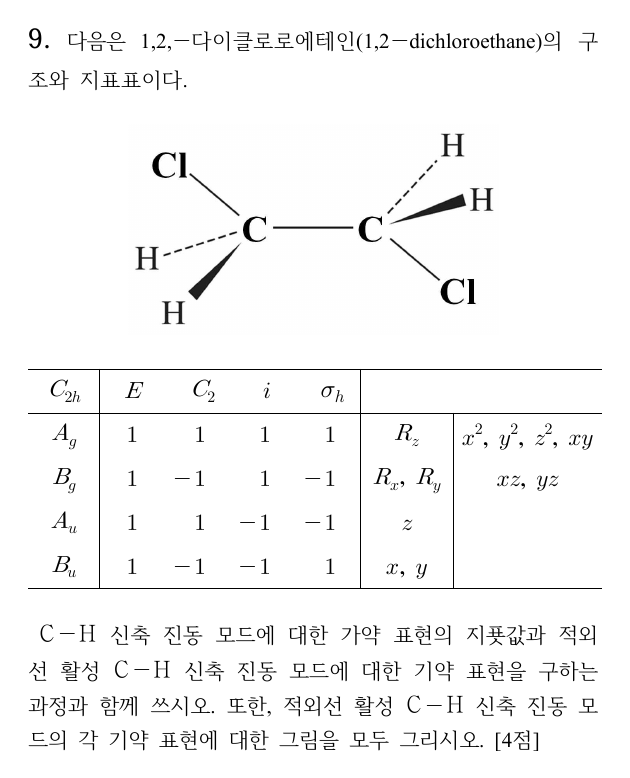

**정답** (답지 난이도 ★★☆☆☆) $\Gamma_{C-H}$ = **4, 0, 0, 0** (E, C₂, i, σh), $\Gamma = A_g + B_g + A_u + B_u$, IR 활성 **$A_u + B_u$**

**공식·핵심 개념**

- 결합 벡터의 지표 = 그 연산에서 제자리에 남는 C–H 결합 수
- 축소 공식 $n_i = \frac1h\sum_R \chi(R)\chi_i(R)$, C₂ₕ는 $h = 4$
- IR 활성: x, y, z와 같은 기약표현 / 중심 대칭 분자는 상호 배제

**2027 출제 가능성 ★★★★★ 매우 높음** — 진동 모드의 기약표현과 IR/Raman 활성은 무기 영역에서 거의 매년 나옵니다.

**주어진 것** anti 형태의 ClCH₂–CH₂Cl(C₂ₕ), 지표표

**구할 것** C–H 신축 가약 표현의 지표, IR 활성 기약 표현, 진동 모드 그림

**풀이 전략** C–H 결합 4개를 벡터로 두고 각 연산에서 제자리에 남는 개수를 센 뒤 축소합니다.

**(1) 대칭 요소 확인.** σh = Cl–C–C–Cl이 놓인 분자 평면, C₂ = C–C 중점을 지나 그 평면에 수직, i = C–C 중점. H 네 개는 모두 평면 밖(위 2, 아래 2)에 있습니다.

**(2) 지표.**

| 연산 | 제자리 C–H | χ |
|---|---|---|
| E | 4 | 4 |
| C₂ | 0 (H1↔H3 등, 탄소가 바뀜) | 0 |
| i | 0 (H1↔H4) | 0 |
| σh | 0 (평면 위 H ↔ 아래 H) | 0 |

**(3) 축소.**

$$n(A_g) = \tfrac14[4(1) + 0 + 0 + 0] = 1, \quad n(B_g) = \tfrac14[4(1) + 0 + 0 + 0] = 1$$

$$n(A_u) = \tfrac14[4(1) + 0 + 0 + 0] = 1, \quad n(B_u) = \tfrac14[4(1) + 0 + 0 + 0] = 1$$

$\Gamma = A_g + B_g + A_u + B_u$. 그중 $A_u(z)$, $B_u(x, y)$가 IR 활성, $A_g$, $B_g$는 Raman 활성입니다.

**(4) 모드 모양(투영 연산자).** H1(Ca, 앞), H2(Ca, 뒤), H3(Cb, 앞), H4(Cb, 뒤)라 하면 C₂: H1→H3, i: H1→H4, σh: H1→H2입니다.

$$A_u:\ r_1 + r_3 - r_4 - r_2$$

앞쪽(쐐기) H 둘이 늘어날 때 뒤쪽(점선) H 둘이 줄어듦 → 알짜 쌍극자가 분자 평면에 수직(z).

$$B_u:\ r_1 - r_3 - r_4 + r_2$$

한 CH₂의 두 C–H가 함께 늘어날 때 다른 CH₂는 함께 줄어듦 → 쌍극자가 분자 평면 안(x, y).

**검산** 모드 수 1 + 1 + 1 + 1 = 4 = C–H 결합 수. 중심 대칭이 있으므로 IR 활성(u)과 Raman 활성(g)이 겹치지 않습니다(상호 배제).

**채점 포인트·함정**

- σh에서 H가 제자리라고 세기 쉽습니다. H는 평면 위·아래에 있어 서로 바뀝니다.
- 그림은 모드마다 4개 결합의 늘어남·줄어듦 위상을 모두 표시해야 합니다.

## A형 10번 · 이상 기체의 등온 가역·비가역 팽창 {#a10}

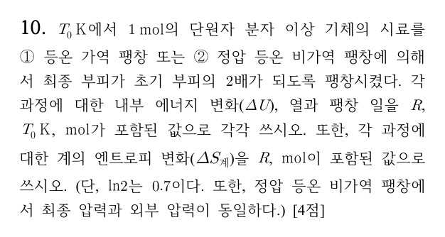

**정답** (답지 난이도 ★★☆☆☆)

| | ① 등온 가역 | ② 정압 등온 비가역 |
|---|---|---|
| q | $0.7RT_0$ K·mol | $0.5RT_0$ K·mol |
| w | $-0.7RT_0$ K·mol | $-0.5RT_0$ K·mol |
| ΔU | 0 | 0 |
| ΔS계 | $0.7R$ mol | $0.7R$ mol |

**공식·핵심 개념**

- 이상 기체 등온: $\Delta U = 0$, $q = -w$
- 가역: $w = -nRT\ln\frac{V_f}{V_i}$ / 일정 외부압: $w = -P_{ex}\Delta V$
- $\Delta S$는 상태 함수 → 같은 처음·나중 상태면 같음: $\Delta S = nR\ln\frac{V_f}{V_i}$

**2027 출제 가능성 ★★★★☆ 높음** — 가역·비가역 경로 비교는 열역학 기입형의 단골입니다.

**주어진 것** 단원자 이상 기체 1 mol, $T_0$ K, $V_f = 2V_i$, ln2 = 0.7, ②의 외부 압력 = 최종 압력

**구할 것** 두 과정의 ΔU, q, w, ΔS계

**풀이 전략** ΔU와 ΔS는 상태 함수라 두 과정이 같고, q와 w만 경로에 따라 계산합니다.

**(1) ΔU.** 이상 기체의 내부 에너지는 온도만의 함수 → 등온이므로 $\Delta U_① = \Delta U_② = 0$.

**(2) ① 가역 w, q.**

$$w_① = -\int_{V_i}^{2V_i}\frac{nRT_0}{V}dV = -nRT_0\ln2 = -(1\,\text{mol})RT_0(0.7) = -0.7RT_0$$

$$q_① = -w_① = 0.7RT_0$$

**(3) ② 비가역 w, q.** 외부 압력 $P_{ex} = P_f = \frac{nRT_0}{2V_i} = \frac12P_i$:

$$w_② = -P_{ex}(2V_i - V_i) = -\frac{nRT_0}{2V_i}\cdot V_i = -\frac12nRT_0 = -0.5RT_0$$

$$q_② = -w_② = 0.5RT_0$$

**(4) ΔS계.** 가역 경로로 계산하면

$$\Delta S = \int\frac{dq_{rev}}{T} = nR\ln\frac{V_f}{V_i} = 0.7R\ \text{(1 mol)}$$

②도 처음·나중 상태가 같으므로 $\Delta S_② = 0.7R$.

**검산** $|w_②| = 0.5RT_0 < |w_①| = 0.7RT_0$ — 가역 팽창이 최대 일을 한다는 사실과 맞습니다. ②에서 $\Delta S_{계} = 0.7R > q_②/T_0 = 0.5R$로 클라우지우스 부등식도 만족합니다.

**채점 포인트·함정**

- ②의 ΔS를 $q_②/T_0 = 0.5R$로 쓰면 틀립니다. 엔트로피는 가역 경로의 열로 계산합니다.
- 단위 표기는 문제 요구대로 R, $T_0$ K, mol이 포함되도록 씁니다.

## A형 11번 · 이온 크로마토그래피와 내부 표준물 {#a11}

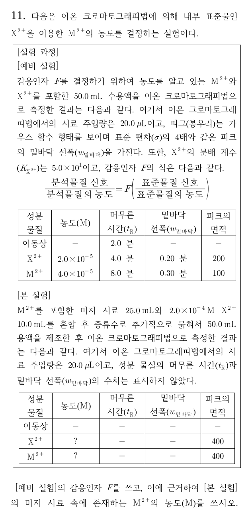

**정답** (답지 난이도 ★★★☆☆) F = **0.25**, 미지 시료 [M²⁺] = **3.2×10⁻⁴ M**, $V_M/V_S$ = **5.0×10¹**, $K_{M^{2+}}$ = **1.5×10²**, $N_{X^{2+}}$ = **6400**

**공식·핵심 개념**

- 감응 인자: $\dfrac{A_x}{[X]} = F\dfrac{A_s}{[S]}$
- 머무름 인자 $k = \dfrac{t_R - t_M}{t_M} = K\dfrac{V_S}{V_M}$
- 가우스 봉우리 $w = 4\sigma$ → $N = 16\left(\dfrac{t_R}{w}\right)^2$

**2027 출제 가능성 ★★★★☆ 높음** — 내부 표준법과 크로마토그래피 계산(k, K, N)은 분석화학 고빈도 유형입니다.

**주어진 것** 예비 실험: [X²⁺] = 2.0×10⁻⁵ M(면적 200, $t_R$ 4.0분, w 0.20분), [M²⁺] = 4.0×10⁻⁵ M(면적 100, $t_R$ 8.0분, w 0.30분), $t_M$ = 2.0분, $K_X = 50$ / 본 실험: 미지 25.0 mL + 2.0×10⁻⁴ M X²⁺ 10.0 mL → 50.0 mL, 면적 X 400, M 400

**구할 것** F, 미지 시료의 [M²⁺], $V_M/V_S$, $K_M$, $N_X$

**풀이 전략** 예비 실험으로 F를 정하고, 본 실험에서 내부 표준 농도와 F로 M²⁺ 농도를 구한 뒤 희석을 되돌립니다. 크로마토그래피 상수는 X²⁺ 자료에서 $V_M/V_S$를 구해 M²⁺에 적용합니다.

**(1) F.**

$$\frac{100}{4.0\times10^{-5}} = F\cdot\frac{200}{2.0\times10^{-5}} \;\Rightarrow\; 2.5\times10^6 = F(1.0\times10^7) \;\Rightarrow\; F = 0.25$$

**(2) 본 실험의 [X²⁺].** $2.0\times10^{-4}\ \mathrm{M}\times\frac{10.0}{50.0} = 4.0\times10^{-5}\ \mathrm{M}$

**(3) 혼합액 속 [M²⁺].**

$$\frac{400}{[M]} = 0.25\cdot\frac{400}{4.0\times10^{-5}} \;\Rightarrow\; [M] = \frac{4.0\times10^{-5}}{0.25} = 1.6\times10^{-4}\ \mathrm{M}$$

**(4) 희석 보정.** 미지 25.0 mL가 50.0 mL로 묽어졌으므로 $[M]_{미지} = 1.6\times10^{-4}\times\frac{50.0}{25.0} = 3.2\times10^{-4}\ \mathrm{M}$

**(5) $V_M/V_S$.** X²⁺: $k_X = \frac{4.0 - 2.0}{2.0} = 1.0$

$$\frac{V_M}{V_S} = \frac{K_X}{k_X} = \frac{50}{1.0} = 5.0\times10^1$$

**(6) $K_M$.** $k_M = \frac{8.0 - 2.0}{2.0} = 3.0$ → $K_M = k_M\frac{V_M}{V_S} = 3.0\times50 = 1.5\times10^2$

**(7) $N_X$.** $\sigma = w/4$이므로

$$N = \left(\frac{t_R}{\sigma}\right)^2 = 16\left(\frac{4.0}{0.20}\right)^2 = 16\times400 = 6400$$

**검산** $K_M/K_X = 150/50 = 3 = k_M/k_X$ — 같은 칼럼에서 두 비가 같아야 합니다. 주입량(20.0 μL)은 두 실험에서 같으므로 계산에 영향을 주지 않습니다.

**채점 포인트·함정**

- 본 실험에서 X²⁺ 농도에 희석(×10/50)을 빼먹으면 F 식이 틀어집니다.
- "미지 시료 속" 농도이므로 혼합액 농도(1.6×10⁻⁴ M)에서 다시 ×2를 합니다.

## A형 12번 · M₂X의 용해도와 산–염기 평형 {#a12}

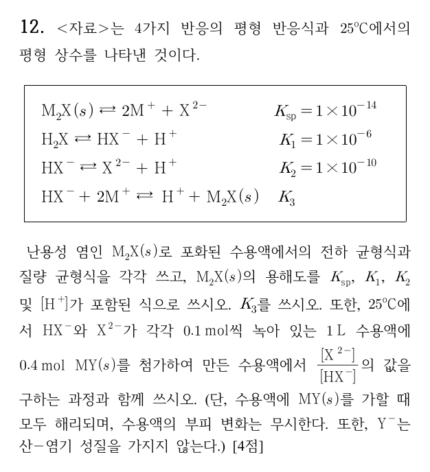

**정답**

- 전하 균형: $[M^+] + [H^+] = 2[X^{2-}] + [HX^-] + [OH^-]$
- 질량 균형: $[M^+] = 2\{[H_2X] + [HX^-] + [X^{2-}]\}$
- 용해도: $S = \dfrac12\left\{2\left(\dfrac{[H^+]^2 + [H^+]K_1 + K_1K_2}{K_1K_2}\right)K_{sp}\right\}^{1/3}$
- $K_3 = 1\times10^4$
- $\dfrac{[X^{2-}]}{[HX^-]} = 1\times10^{-9}$ (답지) / H₂X 생성까지 고려하면 ≈ **4.5×10⁻⁸** (검토 메모 1)

**공식·핵심 개념**

- $\alpha_{X^{2-}} = \dfrac{K_1K_2}{[H^+]^2 + [H^+]K_1 + K_1K_2}$
- $K_{sp} = [M^+]^2[X^{2-}] = (2S)^2\alpha_{X^{2-}}S$
- 반응을 더하면 K를 곱하고, 뒤집으면 역수

**2027 출제 가능성 ★★★☆☆ 보통** — 산–염기와 용해도를 엮는 체계적 평형 처리는 분석화학에서 가끔 나옵니다.

**주어진 것** $K_{sp}(M_2X) = 10^{-14}$, $K_1 = 10^{-6}$, $K_2 = 10^{-10}$, HX⁻·X²⁻ 각 0.1 mol + MY 0.4 mol(1 L, 전부 해리, Y⁻ 중성)

**구할 것** 균형식, 용해도, $K_3$, $[X^{2-}]/[HX^-]$

**풀이 전략** X는 H₂X·HX⁻·X²⁻ 세 형태로 나뉘므로 분율 $\alpha$로 $[X^{2-}]$를 나타냅니다. 마지막 계산은 침전이 거의 완전하다고 보고 남은 양으로 평형을 다시 풉니다.

**(1) 균형식.** 양전하 합 = 음전하 합(X²⁻는 2배)이 전하 균형, M₂X가 녹을 때 M : X = 2 : 1이 질량 균형입니다.

**(2) 용해도.** 녹은 X의 총량을 S라 하면 $[M^+] = 2S$, $[X^{2-}] = \alpha S$:

$$K_{sp} = (2S)^2\alpha S = 4\alpha S^3 \;\Rightarrow\; S = \left(\frac{K_{sp}}{4\alpha}\right)^{1/3}$$

$$\left(\frac{K_{sp}}{4\alpha}\right)^{1/3} = \frac12\left(\frac{2K_{sp}}{\alpha}\right)^{1/3} = \frac12\left\{2\cdot\frac{[H^+]^2 + [H^+]K_1 + K_1K_2}{K_1K_2}K_{sp}\right\}^{1/3}$$

**(3) $K_3$.** $HX^- \rightleftharpoons X^{2-} + H^+$ ($K_2$)와 $X^{2-} + 2M^+ \rightleftharpoons M_2X(s)$ ($1/K_{sp}$)를 더하면

$$K_3 = \frac{K_2}{K_{sp}} = \frac{10^{-10}}{10^{-14}} = 1\times10^4$$

**(4) 비 — 답지 방식.** X²⁻ 0.1 mol이 M⁺ 0.2 mol과 먼저 침전($1/K_{sp} = 10^{14}$), 남은 M⁺ 0.2 mol이 HX⁻ 0.1 mol과 $K_3$ 반응으로 침전하며 H⁺ 0.1 mol을 내놓는다고 보면

$$\frac{[X^{2-}]}{[HX^-]} = \frac{K_2}{[H^+]} = \frac{10^{-10}}{0.1} = 1\times10^{-9}$$

**(5) 비 — H₂X까지 고려.** 생긴 H⁺는 HX⁻와 다시 반응합니다($H^+ + HX^- \rightarrow H_2X$, $K = 10^6$). 알짜 반응은 $2HX^- + 2M^+ \rightarrow H_2X + M_2X(s)$이므로 HX⁻ 0.1 mol → H₂X 0.05 mol, M₂X 0.05 mol, M⁺ 0.1 mol이 남습니다.

$$[X^{2-}] = \frac{K_{sp}}{[M^+]^2} = \frac{10^{-14}}{(0.1)^2} = 10^{-12}\ \mathrm{M}$$

$$[H_2X] = \frac{[H^+]^2[X^{2-}]}{K_1K_2} = 10^{4}[H^+]^2 = 0.05 \;\Rightarrow\; [H^+] = 2.2\times10^{-3}\ \mathrm{M}$$

$$\frac{[X^{2-}]}{[HX^-]} = \frac{K_2}{[H^+]} = \frac{10^{-10}}{2.2\times10^{-3}} \approx 4.5\times10^{-8}$$

(질량·전하 균형을 모두 넣은 수치 해: [H⁺] = 2.16×10⁻³ M, 비 = 4.6×10⁻⁸)

**검산** (5)에서 $[HX^-] = [H^+][X^{2-}]/K_2 = 2.2\times10^{-5}$ M로 매우 작아 "HX⁻가 거의 다 반응했다"는 가정과 맞습니다.

**채점 포인트·함정**

- 질량 균형에서 M⁺는 X의 **2배**입니다. 계수 2의 위치를 거꾸로 쓰기 쉽습니다.
- 시험 답안은 공식 답지 값(1×10⁻⁹)을 쓰되, H₂X 생성을 무시했다는 가정을 밝혀 두면 안전합니다.

# 전공 B

## B형 1번 · HCl + Na₂HPO₄ 혼합액의 적정 {#b1}

**정답** (답지 난이도 ★★☆☆☆) **x = 0.20**, **y = 0.10**

**공식·핵심 개념**

- 양쪽성 화학종 pH $\approx \frac12(pK_{a,n} + pK_{a,n+1})$
- H₂PO₄⁻ 당량점 ≈ 4.7 (브로모크레졸 그린), HPO₄²⁻ 당량점 ≈ 9.7 (페놀프탈레인)
- 혼합물에서는 먼저 강산이 약염기를 양성자화

**2027 출제 가능성 ★★★★★ 매우 높음** — 다양성자산 혼합물 적정과 지시약 선택은 분석화학 최빈출 유형입니다.

**주어진 것** HCl x M + Na₂HPO₄ y M 혼합액 10 mL, 0.10 M NaOH, pKa 2.15·7.19·12.2, BCG 종말점 10 mL, 페놀프탈레인 종말점 20 mL

**구할 것** x, y

**풀이 전략** 두 지시약의 종말점에서 인산이 어떤 형태인지 정하고, 처음 상태에서 그 형태까지 가는 데 필요한 OH⁻ 몰수를 셉니다.

**(1) 종말점의 형태.** BCG(3.8~5.4)는 H₂PO₄⁻ 당량점 $\frac{2.15 + 7.19}{2} = 4.67$에서, 페놀프탈레인(8.4~10.0)은 HPO₄²⁻ 당량점 $\frac{7.19 + 12.2}{2} = 9.70$에서 변색합니다.

**(2) 혼합 직후.** 강산 HCl이 HPO₄²⁻를 H₂PO₄⁻로 바꿉니다(x > y). 남은 것: H⁺ $(x - y)$·10 mmol, H₂PO₄⁻ $y$·10 mmol.

**(3) (가) BCG.** 인산은 H₂PO₄⁻ 그대로 두고 남은 HCl만 적정합니다.

$$10(x - y) = 0.10\times10 = 1.0\ \mathrm{mmol}$$

**(4) (나) 페놀프탈레인.** H₂PO₄⁻까지 HPO₄²⁻로 되돌리므로 결국 처음 넣은 HCl 전부를 적정한 것과 같습니다.

$$10x = 0.10\times20 = 2.0\ \mathrm{mmol} \;\Rightarrow\; x = 0.20\ \mathrm{M}$$

**(5)** (3)에 넣으면 $10y = 2.0 - 1.0 = 1.0$ → $y = 0.10\ \mathrm{M}$

**검산** (나) − (가) = 10 mL = H₂PO₄⁻ 1.0 mmol을 HPO₄²⁻로 바꾸는 데 쓴 양 = 10y ✓.

**채점 포인트·함정**

- 페놀프탈레인 종말점에서 인산은 PO₄³⁻가 아니라 **HPO₄²⁻**입니다(pKa3 = 12.2라 수용액 적정에서 끝점이 안 보임).

## B형 2번 · Cp₂TaH₃ 촉매의 H/D 교환 메커니즘 {#b2}

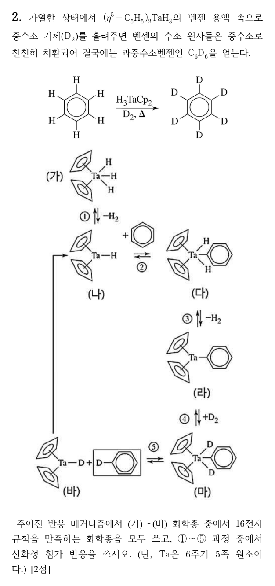

**정답** (답지 난이도 ★★☆☆☆) 16전자 화학종 **(나), (라), (바)**, 산화성 첨가 **②, ④**

**공식·핵심 개념**

- 중성 원자 계산법: 금속 족 번호 + η⁵-Cp 5 + H·아릴 1
- 산화성 첨가: 산화수 +2, 배위수 +2, 전자 수 +2 / 환원성 제거: 그 반대
- C–H 활성화 촉매 순환: 환원성 제거 ↔ 산화성 첨가

**2027 출제 가능성 ★★★★☆ 높음** — 유기금속 촉매 순환의 단계 이름과 전자 수 세기는 무기 기입형 단골입니다.

**주어진 것** Ta(5족), (가)~(바) 구조, ①~⑤ 단계

**구할 것** 16전자 화학종, 산화성 첨가 단계

**풀이 전략** 각 화학종의 전자 수와 Ta 산화수를 표로 만들고, 산화수가 +2 되는 단계를 고릅니다.

**(1) 전자 수(중성 원자 계산법).**

| 화학종 | Ta | Cp 2개 | H / D / Ph | 합 | Ta 산화수 |
|---|---|---|---|---|---|
| (가) Cp₂TaH₃ | 5 | 10 | 3 | **18** | +5 |
| (나) Cp₂TaH | 5 | 10 | 1 | **16** | +3 |
| (다) Cp₂Ta(H)₂Ph | 5 | 10 | 3 | **18** | +5 |
| (라) Cp₂TaPh | 5 | 10 | 1 | **16** | +3 |
| (마) Cp₂Ta(D)₂Ph | 5 | 10 | 3 | **18** | +5 |
| (바) Cp₂TaD | 5 | 10 | 1 | **16** | +3 |

**(2) 단계 분류.**

- ① (가) → (나) + H₂: Ta(V) → Ta(III), **환원성 제거**
- ② (나) + C₆H₆ → (다): C–H 결합이 끊어지며 Ta(III) → Ta(V), **산화성 첨가**
- ③ (다) → (라) + H₂: **환원성 제거**
- ④ (라) + D₂ → (마): D–D 결합 첨가, Ta(III) → Ta(V), **산화성 첨가**
- ⑤ (마) → (바) + C₆H₅D: **환원성 제거**

**검산** 산화성 첨가 단계(②④)마다 전자 수가 16 → 18로 2씩 늘고, 환원성 제거 단계마다 18 → 16으로 줄어 순환이 닫힙니다.

**채점 포인트·함정**

- 이온 계산법(Cp⁻ 6, H⁻ 2, Ta⁵⁺ d⁰)으로 세도 결과는 같습니다: (가) 0 + 12 + 6 = 18.
- 16전자는 "배위 불포화"라 다음 기질을 받을 수 있는 화학종입니다.

## B형 3번 · 상자 속 물체 활동과 비유 수업 {#b3}

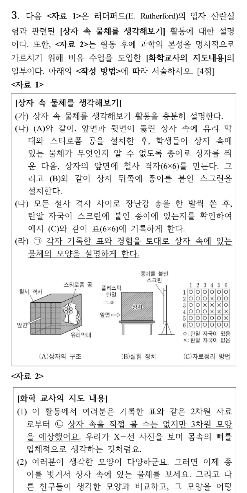

**정답**

- ㉠ **귀추적 추리** — 귀추법은 **발견의 논리**, 일반적 탐구 방법으로서의 가설 연역은 **정당화의 논리**라는 차이가 있습니다.
- ㉡ **모형을 만들어 물질 현상을 해석하기**
- ㉢ **α 입자 산란 실험과 원자핵 발견의 이해 확인**
- ㉣ 궁금증을 유발시켜 학습 의욕을 불러일으키기 때문에 **심리적 유의미가**를 갖습니다.

**공식·핵심 개념**

- 귀추(발견의 맥락) vs 가설 연역(정당화의 맥락)
- TWA: 목표 개념 도입 → 비유물 소개 → 특징 확인 → 대응 → 결론 도출 → 한계 지적
- 오수벨 유의미 학습 조건: 논리적·잠재적·심리적 유의미가

**2027 출제 가능성 ★★★★★ 매우 높음** — 귀추와 비유 수업(TWA), 오수벨은 교육론 최빈출 조합입니다.

**판단 근거.** 학생들은 탄알 자국이라는 결과로부터 그 원인이 되는 물체의 모양을 거꾸로 추정합니다(결과 → 원인 가설). 결론 도출 단계는 비유물(상자)과 목표 개념(원자 구조)을 연결해 정리하는 단계이며, 실제 상자 속 물체와 다르다는 경험은 호기심을 일으킵니다.

**채점 포인트·함정**

- ㉠은 "유비추리 제외" 조건이 있으므로 귀추적 추리로 씁니다.

## B형 4번 · STAD 수업 계획과 2022 개정 과학과 목표 {#b4}

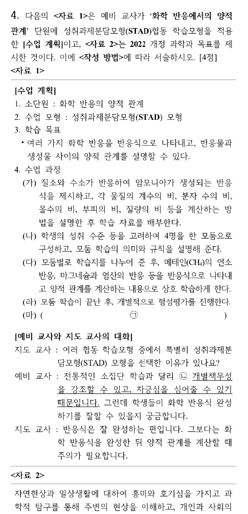

**정답**

- 적절성: **적절**. STAD 협동 학습은 화학 반응을 반응식, 반응물과 생성물 사이의 양적 관계 등 **과학적 사실과 개념처럼 목표가 분명한 교수학습**에 효과적이므로 수업 목표에 적절합니다.
- ㉠ **개별 성취 향상 점수를 합산하여 개인 및 모둠별로 적절한 보상**을 합니다.
- ㉡ 개인의 노력에 따른 **개별 향상 점수가 팀 보상에 기여**하므로 개별책무성과 자긍심을 심어줄 수 있습니다.
- ㉢ **과학·기술·사회의 상호 관계** — 과학과 기술은 상호 간에 영향을 미친다(여러 측면의 상호의존성)는 과학의 본성 측면

**공식·핵심 개념**

- STAD: 교사 설명 → 모둠 학습 → 개별 평가 → 개별 향상 점수 → 모둠 보상
- 2022 개정 과학과 목표 (1)~(4)
- 과학의 본성: 과학·기술·사회의 상호작용

**2027 출제 가능성 ★★★★☆ 높음** — 협동 학습모형과 교육과정 목표 빈칸은 꾸준히 출제됩니다.

**채점 포인트·함정**

- ㉠은 "개별 향상 점수"가 핵심어입니다. 원점수 합산이 아닙니다.

## B형 5번 · 로슨의 경험-귀추적 순환학습 {#b5}

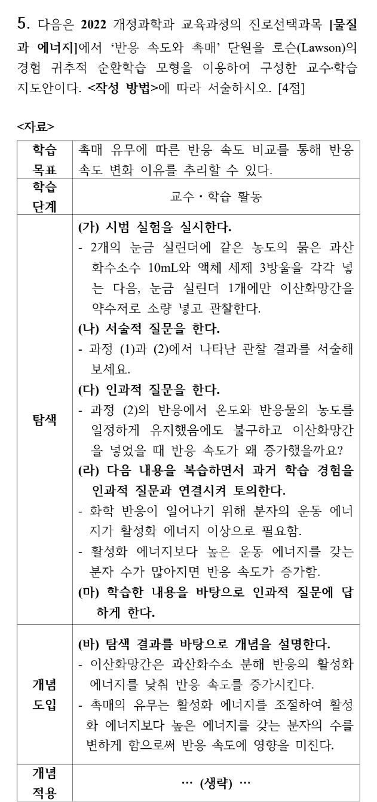

**정답**

- 첫 단계(의문 상황의 관찰): **온도와 반응물의 농도를 일정하게 유지했음에도 불구하고 이산화망간을 넣었을 때 반응 속도가 증가하였다.**
- 수정: 탐색 단계 활동 (라)의 인과적 질문에 대한 **가설을 제시**하고, (마)에서 **실험적 방법과 절차에 의해 제시된 가설을 검증**합니다.
- 개념 적용 단계: 탐구 단계와 개념 도입 단계에서 학습한 개념과 원리를 **새로운 상황과 문제에 적용**하는 단계로, 일상생활에서 각각의 예를 찾아 **화학의 유용성을 인식**하고 새로운 개념의 **적용 범위를 확장**합니다.

**공식·핵심 개념**

- 로슨 순환학습: 탐색 → 개념 도입 → 개념 적용
- 유형: 서술적 / 경험-귀추적 / 가설-연역적
- 귀추 가설 생성: 의문 관찰 → 원천(유사 경험) 탐색 → 가설 차용

**2027 출제 가능성 ★★★★★ 매우 높음** — 순환학습 3유형 구별과 재구성은 교육론 최빈출입니다.

**채점 포인트·함정**

- 가설-연역적으로 바꿀 때 "가설 명시"와 "실험으로 검증" 두 요소가 모두 있어야 합니다.

## B형 6번 · d⁸ Ni²⁺ 착물의 Tanabe–Sugano 해석 {#b6}

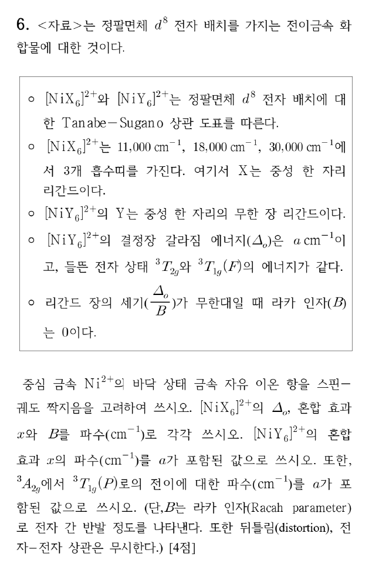

**정답** (답지 난이도 ★★★☆☆) Ni²⁺ 바닥 상태 **³F₄**, [NiX₆]²⁺ **Δo = 11,000**, **x = 1,800**, **B = 1,000 cm⁻¹**, [NiY₆]²⁺ **x = 0.8a cm⁻¹**, ³A₂g → ³T₁g(P) **2a cm⁻¹**

**공식·핵심 개념**

- 팔면체 d⁸(약한 장·강한 장 같음): ³A₂g → ³T₂g = Δo
- ³A₂g → ³T₁g(F) = 1.8Δo − x, ³A₂g → ³T₁g(P) = 1.2Δo + 15B + x
- 같은 대칭 상태(T₁g)끼리 섞이면 서로 밀어냄(x)

**2027 출제 가능성 ★★★★★ 매우 높음** — Ni²⁺ 전자 스펙트럼은 결정장 문항의 대표 예시이며 해마다 변형되어 나옵니다.

**주어진 것** [NiX₆]²⁺ 흡수띠 11,000·18,000·30,000 cm⁻¹ / [NiY₆]²⁺: Δo = a, ³T₂g와 ³T₁g(F) 에너지 같음, 무한 장에서 B = 0

**구할 것** 자유 이온 항, X의 Δo·x·B, Y의 x, Y의 ³A₂g → ³T₁g(P)

**풀이 전략** d⁸ 세 전이의 에너지 식을 세워 세 흡수띠에 대응시킵니다.

**(1) 자유 이온 항.** Ni²⁺ = [Ar]3d⁸. 홀전자 2개 → S = 1, 최대 L: $m_l$ = 2, 2, 1, 1, 0, 0, −1, −1 다음 2개 전자를 2, 1에 → L = 3(F). 반 넘게 찬 껍질이므로 J = L + S = 4 → **³F₄**.

**(2) 전이 에너지 식(바닥 ³A₂g = 0 기준).**

| 들뜬 상태 | 에너지 |
|---|---|
| ³T₂g | Δo |
| ³T₁g(F) | 1.8Δo − x |
| ³T₁g(P) | 1.2Δo + 15B + x |

**(3) [NiX₆]²⁺.**

$$\Delta_o = 11{,}000\ \mathrm{cm^{-1}}$$

$$1.8(11{,}000) - x = 18{,}000 \;\Rightarrow\; x = 19{,}800 - 18{,}000 = 1{,}800\ \mathrm{cm^{-1}}$$

$$1.2(11{,}000) + 15B + 1{,}800 = 30{,}000$$

$$15B = 15{,}000 \;\Rightarrow\; B = 1{,}000\ \mathrm{cm^{-1}}$$

**(4) [NiY₆]²⁺.** ³T₂g와 ³T₁g(F) 에너지가 같으므로

$$1.8a - x = a \;\Rightarrow\; x = 0.8a$$

무한 장에서 B = 0이므로

$$E(^3T_{1g}(P)) = 1.2a + 15(0) + 0.8a = 2a$$

**검산** 합 규칙: ³T₁g(F) + ³T₁g(P) = 3Δo + 15B. X: 18,000 + 30,000 = 48,000 = 33,000 + 15,000 ✓. Y: a + 2a = 3a + 0 ✓. 자유 Ni²⁺의 B(≈1,080 cm⁻¹)보다 작은 1,000 cm⁻¹는 네펠라욱세틱 효과로 타당합니다.

**채점 포인트·함정**

- 자유 이온 항은 "스핀–궤도 짝지음 고려"이므로 J까지(³F₄) 써야 합니다.
- 혼합 효과 x를 빼면 세 흡수띠가 서로 맞지 않습니다.

## B형 7번 · Br₂ + CH₄ 라디칼 연쇄 반응의 정류 상태 근사 {#b7}

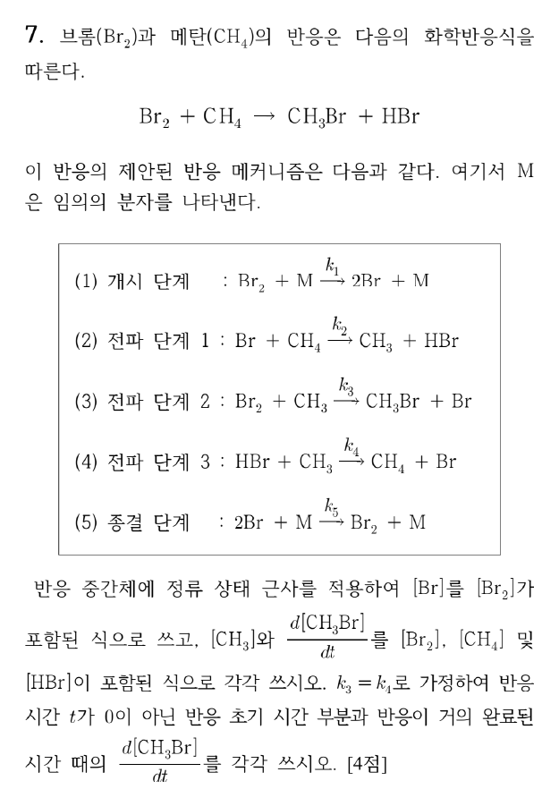

**정답** (답지 난이도 ★★★☆☆)

$$[Br] = \left(\frac{k_1}{k_5}[Br_2]\right)^{1/2}, \qquad [CH_3] = \frac{k_2\left(\frac{k_1}{k_5}[Br_2]\right)^{1/2}[CH_4]}{k_3[Br_2] + k_4[HBr]}$$

$$\frac{d[CH_3Br]}{dt} = k_2k_3\left(\frac{k_1}{k_5}\right)^{1/2}\frac{[CH_4][Br_2]^{3/2}}{k_3[Br_2] + k_4[HBr]}$$

초기: $k_2(k_1/k_5)^{1/2}[Br_2]^{1/2}[CH_4]$, 말기: $k_2(k_1/k_5)^{1/2}\dfrac{[CH_4][Br_2]^{3/2}}{[HBr]}$

**공식·핵심 개념**

- 정류 상태 근사: 반응성 큰 중간체의 $d[I]/dt \approx 0$
- 연쇄 반응: 개시 속도 = 종결 속도
- 생성물 억제(HBr의 역방향 단계)

**2027 출제 가능성 ★★★★☆ 높음** — 정류 상태 근사로 속도식을 유도하는 문항은 2024 기출 이후 계속 나옵니다.

**주어진 것** (1)~(5) 단계와 $k_1$~$k_5$, $k_3 = k_4$

**구할 것** [Br], [CH₃], $d[CH_3Br]/dt$, 초기·말기 속도식

**풀이 전략** 두 중간체(Br, CH₃)에 정류 상태 근사를 세우고, 두 식을 더해 전파 항을 지웁니다.

**(1) 두 정류 상태 식.**

$$\frac{d[CH_3]}{dt} = k_2[Br][CH_4] - k_3[Br_2][CH_3] - k_4[HBr][CH_3] = 0$$

$$\frac{d[Br]}{dt} = 2k_1[Br_2][M] - k_2[Br][CH_4] + k_3[Br_2][CH_3]$$

$$\qquad + k_4[HBr][CH_3] - 2k_5[Br]^2[M] = 0$$

**(2) 더하기.** 전파 항이 모두 지워집니다.

$$2k_1[Br_2][M] - 2k_5[Br]^2[M] = 0 \;\Rightarrow\; [Br] = \left(\frac{k_1}{k_5}[Br_2]\right)^{1/2}$$

**(3) [CH₃].** 첫 식에서

$$[CH_3] = \frac{k_2[Br][CH_4]}{k_3[Br_2] + k_4[HBr]}$$

**(4) 생성 속도.** CH₃Br은 (3) 단계에서만 생깁니다.

$$\frac{d[CH_3Br]}{dt} = k_3[Br_2][CH_3] = \frac{k_2k_3(k_1/k_5)^{1/2}[CH_4][Br_2]^{3/2}}{k_3[Br_2] + k_4[HBr]}$$

**(5) $k_3 = k_4$.** 분자·분모의 $k_3$이 약분됩니다.

$$\frac{d[CH_3Br]}{dt} = k_2\left(\frac{k_1}{k_5}\right)^{1/2}\frac{[CH_4][Br_2]^{3/2}}{[Br_2] + [HBr]}$$

- 초기($[Br_2] \gg [HBr]$, t ≠ 0): $k_2(k_1/k_5)^{1/2}[Br_2]^{1/2}[CH_4]$
- 말기($[HBr] \gg [Br_2]$): $k_2(k_1/k_5)^{1/2}[CH_4][Br_2]^{3/2}/[HBr]$

**검산** 초기 식의 전체 차수 1.5는 Br 원자를 매개로 하는 할로젠화 반응(H₂ + Br₂)의 초기 속도식과 같은 꼴입니다. 말기에는 HBr이 쌓일수록 느려지는 생성물 억제가 나타납니다.

**채점 포인트·함정**

- 개시 단계에서 Br 원자가 **2개** 생기므로 $2k_1$, 종결도 $2k_5$입니다. 계수를 빼먹어도 비율이 같아 [Br]은 같지만, 계수 처리 과정은 서술해야 합니다.
- t = 0에서는 [HBr] = 0이라 식이 정확히 성립하지만 문제는 "0이 아닌 초기"라고 했으므로 근사 조건을 씁니다.

## B형 8번 · 카이랄 알카인 C₆H₁₀의 환원 {#b8}

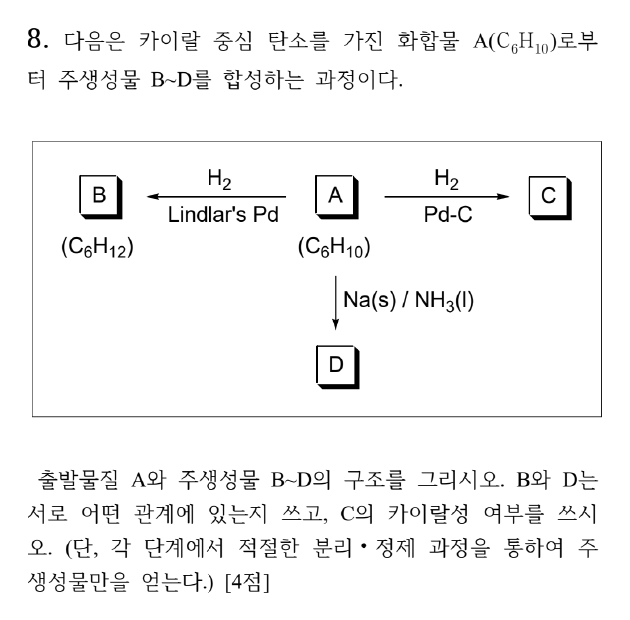

**정답** A **3-methylpent-1-yne**, B **3-methylpent-1-ene**, C **3-methylpentane**, D **3-methylpent-1-ene**. B와 D는 **같은 화합물(동일 화합물)**, C는 **비카이랄**(광학 비활성)

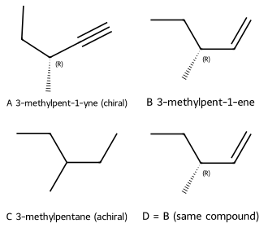

**공식·핵심 개념**

- Lindlar: 알카인 → cis-알켄 (syn 첨가) / Na, NH₃(l): 내부 알카인 → trans-알켄
- H₂, Pd-C: 완전 수소화
- 카이랄 중심: 서로 다른 네 치환기

**2027 출제 가능성 ★★★★☆ 높음** — 알카인 환원의 입체 선택성과 카이랄성 판단은 유기 기입형으로 자주 나옵니다.

**주어진 것** A(C₆H₁₀, 카이랄 중심 있음), A → B(C₆H₁₂, H₂/Lindlar), A → C(H₂/Pd-C), A → D(Na/NH₃)

**구할 것** A~D 구조, B와 D의 관계, C의 카이랄성

**풀이 전략** 불포화도와 시약으로 A가 알카인임을 정하고, C₆H₁₀ 알카인 중 카이랄 중심이 있는 것을 고릅니다.

**(1) A의 후보.** 불포화도 $\frac{2(6) + 2 - 10}{2} = 2$, Lindlar로 C₆H₁₂(알켄)가 되므로 삼중결합 하나입니다. C₆H₁₀ 비고리 알카인 7가지(1-hexyne, 2-hexyne, 3-hexyne, 3-methylpent-1-yne, 4-methylpent-1-yne, 4-methylpent-2-yne, 3,3-dimethylbut-1-yne) 중 입체중심이 있는 것은 **3-methylpent-1-yne**(C3: H, CH₃, C₂H₅, C≡CH) 하나뿐입니다(RDKit 확인).

**(2) B.** Lindlar는 삼중결합을 이중결합까지만 환원 → **3-methylpent-1-ene**(카이랄 중심 유지).

**(3) C.** 완전 수소화 → CH₃CH₂CH(CH₃)CH₂CH₃. C3에 에틸기가 두 개라 카이랄 중심이 사라짐 → **비카이랄**.

**(4) D.** Na/NH₃ 용해 금속 환원도 이중결합까지 → 말단 알켄이므로 cis/trans 구별이 없어 **B와 같은 화합물**입니다(입체중심 C3는 반응하지 않아 배열 유지).

**메커니즘 — Na/NH₃(l) 용해 금속 환원**

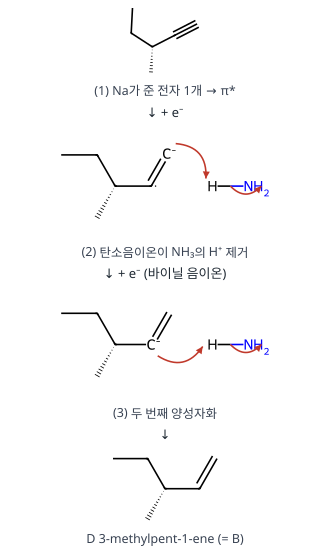

**검산** B·D C₆H₁₂, C C₆H₁₄ (A + 1 H₂, + 2 H₂). RDKit CIP: A·B·D의 C3은 같은 배열(R 또는 S 그대로)로 남습니다.

**채점 포인트·함정**

- 내부 알카인이었다면 B(cis)와 D(trans)는 기하 이성질체가 되지만, A가 카이랄이려면 말단 알카인이어야 하므로 B = D입니다.
- 말단 알카인의 Na/NH₃ 환원 실제 조건은 검토 메모 3 참고.

## B형 9번 · 데칼린 알코올의 E2와 수소붕소화 {#b9}

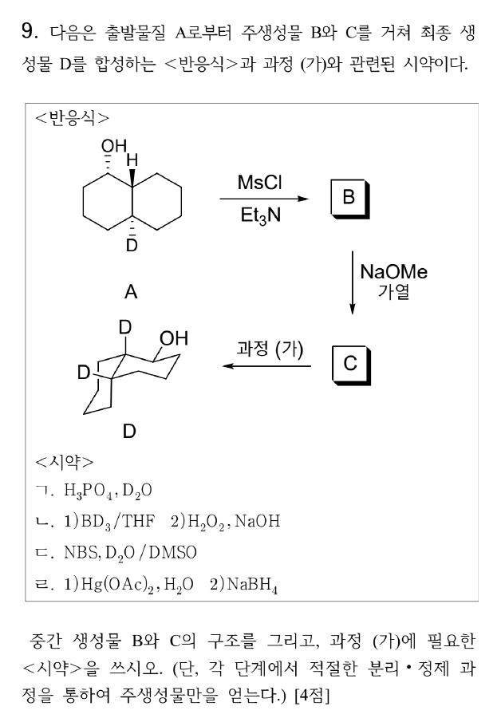

**정답** B **A의 메실레이트**(C1–OMs, 배열 유지), C **4a-D-Δ¹⁽⁸ᵃ⁾-옥탈린**(C1=C8a), 과정 (가) 시약 **ㄴ**(1) BD₃/THF 2) H₂O₂, NaOH)

**공식·핵심 개념**

- MsCl/Et₃N: O–H → O–Ms, C–O 결합은 그대로(배열 유지)
- 고리 E2: 이탈기와 β-H가 trans-이축, 가능하면 Zaitsev
- BD₃ 수소붕소화: syn 첨가, D는 더 치환된 탄소, 덜 붐비는 면에서 접근

**2027 출제 가능성 ★★★★☆ 높음** — 고리 계의 입체 특이적 반응 배열은 유기 서술형 고난도 소재입니다.

**주어진 것** A(trans-데칼린, C1–OH, C8a–H, C4a–D), MsCl/Et₃N → B, NaOMe/가열 → C, 과정 (가) → D(C1–OH 적도, C8a·C4a에 D)

**구할 것** B, C 구조, (가)의 시약

**풀이 전략** A의 OH와 C8a–H가 trans-이축인지 확인해 E2 방향을 정하고, D의 구조(OH·D의 위치와 면)로 (가)의 첨가 방식을 역추적합니다.

**(1) A의 입체.** 그림에서 C1–OH(점선, 아래), C8a–H(쐐기, 위), C4a–D(점선, 아래)입니다. 고리 접합 치환기가 서로 반대 면이므로 trans-데칼린이고, 접합 위치의 H·D는 축 방향입니다. C8a–H(위, 축)와 이웃 C1–OH(아래)는 trans-1,2 → **둘 다 축**입니다.

**(2) B.** MsCl이 OH의 O를 메실화합니다. C–O 결합이 끊어지지 않으므로 OMs도 축, 배열 그대로입니다.

**(3) C.** NaOMe(강염기)·가열 → E2. OMs(축)와 anti-periplanar인 β-H는 C8a–H(축)와 C2의 축 H 두 가지입니다. 더 치환된 알켄(삼치환)을 주는 **C8a–H 제거가 Zaitsev 주생성물** → C1=C8a 이중결합(Δ¹⁽⁸ᵃ⁾-옥탈린), C4a–D는 그대로.

**(4) (가) 시약 고르기.** D에는 C1에 OH, C8a에 D가 새로 붙어 있고 둘이 같은 면(cis)입니다. 즉 **C=C에 D와 OH가 syn, anti-Markovnikov(OH가 덜 치환된 C1)**로 들어갔습니다 → **ㄴ BD₃ 후 H₂O₂/NaOH**.

- ㄱ H₃PO₄/D₂O: 탄소양이온 경유 Markovnikov → OD가 3차 탄소(C8a)에 붙음
- ㄷ NBS/D₂O: 브로모하이드린(Br 포함)
- ㄹ 옥시수은화: Markovnikov → OH가 C8a

**(5) 면 선택성.** BD₃는 축 방향 C4a–D가 막는 아래 면을 피해 위 면으로 접근 → C8a–D(위)와 C4a–D(아래)가 다시 trans 접합이 되고, C1–OH(위)는 C8a–D(위, 축)와 cis → **적도**입니다.

**메커니즘 — 메실화와 E2 (A → B → C)**

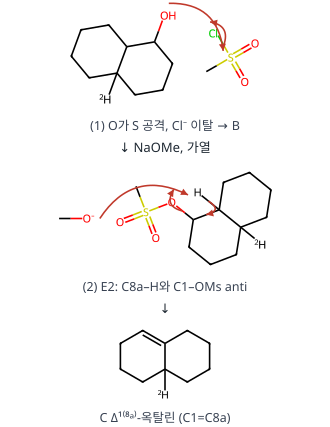

**메커니즘 — BD₃ 수소붕소화–산화 (C → D)**

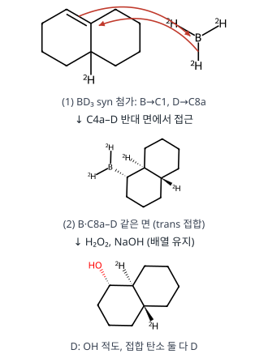

**왜 이 생성물인가.** C2–H 제거(이치환 알켄)도 입체 조건은 맞지만, C8a–H 제거가 더 안정한 삼치환 알켄을 줍니다. 이후 수소붕소화의 syn·anti-Markovnikov 성질이 OH(C1)와 D(C8a)의 위치·면을 동시에 결정합니다.

**검산** 분자식 A C₁₀H₁₇DO → B C₁₁H₁₉DO₃S → C C₁₀H₁₅D → D C₁₀H₁₆D₂O. RDKit 3D 배좌로 A(OH와 C8a–H 반대 면), D(OH와 C8a–D 같은 면, C4a–D 반대)를 확인했습니다.

**채점 포인트·함정**

- B는 SN2가 아니라 O의 메실화이므로 C1의 배열이 뒤집히지 않습니다.
- 시약 ㄱ을 고르면 D가 C1이 아니라 C8a에 OD가 붙는 구조가 됩니다.

## B형 10번 · 수소꼴 원자 2p 방사형 파동함수 {#b10}

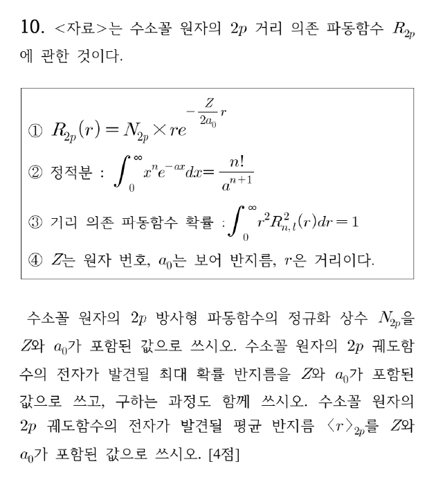

**정답** $N_{2p} = \dfrac{1}{2\sqrt6}\left(\dfrac{Z}{a_0}\right)^{5/2}$, 최대 확률 반지름 $\dfrac{4a_0}{Z}$, $\langle r\rangle_{2p} = \dfrac{5a_0}{Z}$

**공식·핵심 개념**

- 방사 확률 밀도 $P(r) = r^2R(r)^2$
- 최대 확률: $dP/dr = 0$
- $\langle r\rangle = \int_0^\infty r\cdot r^2R^2\,dr$, $\int_0^\infty x^ne^{-ax}dx = \frac{n!}{a^{n+1}}$

**2027 출제 가능성 ★★★★☆ 높음** — 수소꼴 파동함수의 정규화·기대치·최대 확률 반지름은 양자 영역에서 반복 출제됩니다.

**주어진 것** $R_{2p} = N_{2p}\,r\,e^{-Zr/2a_0}$, 정적분 공식, 정규화 조건 $\int_0^\infty r^2R^2dr = 1$

**구할 것** $N_{2p}$, 최대 확률 반지름, $\langle r\rangle_{2p}$

**풀이 전략** $R^2 = N^2r^2e^{-Zr/a_0}$이므로 지수 상수 $a = Z/a_0$로 놓고 적분 공식을 씁니다.

**(1) 정규화.**

$$N^2\int_0^\infty r^4e^{-Zr/a_0}dr = N^2\frac{4!}{(Z/a_0)^5} = 1 \;\Rightarrow\; N^2 = \frac{1}{24}\left(\frac{Z}{a_0}\right)^5$$

$$N_{2p} = \frac{1}{\sqrt{24}}\left(\frac{Z}{a_0}\right)^{5/2} = \frac{1}{2\sqrt6}\left(\frac{Z}{a_0}\right)^{5/2}$$

**(2) 최대 확률 반지름.** $P(r) = N^2r^4e^{-Zr/a_0}$

$$\frac{dP}{dr} = N^2\left(4r^3 - \frac{Z}{a_0}r^4\right)e^{-Zr/a_0} = N^2r^3e^{-Zr/a_0}\left(4 - \frac{Z}{a_0}r\right) = 0$$

$$r > 0 \;\Rightarrow\; r_{mp} = \frac{4a_0}{Z}$$

**(3) 평균 반지름.**

$$\langle r\rangle = N^2\int_0^\infty r^5e^{-Zr/a_0}dr = \frac{1}{24}\left(\frac{Z}{a_0}\right)^5\cdot\frac{5!}{(Z/a_0)^6} = \frac{120}{24}\cdot\frac{a_0}{Z} = \frac{5a_0}{Z}$$

**검산** Z = 1이면 $r_{mp} = 4a_0 = n^2a_0$로 보어 모형의 n = 2 궤도 반지름과 같고, $\langle r\rangle = \frac{a_0}{2Z}[3n^2 - l(l+1)] = \frac12(12 - 2)a_0 = 5a_0$와도 맞습니다.

**채점 포인트·함정**

- 지수에 2가 있어도 제곱하면 $e^{-Zr/a_0}$이 되므로 $a = Z/a_0$입니다.
- 최대 확률 반지름은 $|R|^2$이 아니라 $r^2R^2$을 미분합니다.

## B형 11번 · 결정형이 다른 두 MX₂ 전극으로 만든 전지 {#b11}

**정답** (답지 난이도 ★★★★☆) $E^\circ(MX_2(\alpha) + 2e^- \rightleftharpoons M + 2X^-)$ = **−0.40 V**, $K_{sp}(MX_2, \beta)$ = **1.0×10⁻³⁰**

**공식·핵심 개념**

- 난용성 염 전극: $E^\circ_{MX_2/M} = E^\circ_{M^{2+}/M} + \frac{0.060}{2}\log K_{sp}$
- $E_{전지} = E_+ - E_-$ (오른쪽 − 왼쪽)
- 두 반쪽의 [X⁻]가 같으면 로그 항이 약분

**2027 출제 가능성 ★★★★★ 매우 높음** — 전지 전위와 Ksp를 연결하는 계산은 분석화학 고빈도 유형입니다.

**주어진 것** $E^\circ(M^{2+}/M) = 0.20$ V, $K_{sp}(\alpha) = 1.0\times10^{-20}$, 양쪽 [X⁻] = 0.10 M, $E_{전지} = 0.30$ V, 0.060 V

**구할 것** α형 반응의 E°, β형의 Ksp

**풀이 전략** 난용성 염 전극의 E°를 Ksp로 나타내고, 두 반쪽 전위의 차가 0.30 V가 되도록 β형의 E°를 구합니다.

**(1) α형의 E°.** $MX_2 + 2e^- \rightarrow M + 2X^-$는 $MX_2 \rightarrow M^{2+} + 2X^-$($K_{sp}$)와 $M^{2+} + 2e^- \rightarrow M$의 합입니다.

$$E^\circ_\alpha = E^\circ_{M^{2+}/M} + \frac{0.060}{2}\log K_{sp,\alpha} = 0.20 + 0.030(-20) = -0.40\ \mathrm{V}$$

**(2) 반쪽 전위.** 오른쪽(+): α형, 왼쪽(−): β형.

$$E_+ = -0.40 - \frac{0.060}{2}\log(0.10)^2 = -0.40 + 0.060 = -0.34\ \mathrm{V}$$

$$E_- = E^\circ_\beta - \frac{0.060}{2}\log(0.10)^2 = E^\circ_\beta + 0.060$$

**(3) β형의 E°.**

$$E_{전지} = E_+ - E_- = -0.34 - (E^\circ_\beta + 0.060) = 0.30 \;\Rightarrow\; E^\circ_\beta = -0.70\ \mathrm{V}$$

**(4) β형의 Ksp.**

$$-0.70 = 0.20 + 0.030\log K_{sp,\beta}$$

$$\log K_{sp,\beta} = -30 \;\Rightarrow\; K_{sp,\beta} = 1.0\times10^{-30}$$

**검산** [X⁻]가 같으므로 $E_{전지} = E^\circ_\alpha - E^\circ_\beta = 0.030(\log K_{sp,\alpha} - \log K_{sp,\beta}) = 0.030(10) = 0.30$ V ✓. 더 안정한(덜 녹는) β형이 음극(−) 쪽입니다.

**채점 포인트·함정**

- 2전자 반응이므로 0.060/2 = 0.030을 씁니다.
- 전지 표기의 오른쪽이 (+), 왼쪽이 (−)입니다. 바꾸면 Ksp가 10⁻¹⁰이 됩니다.

---

원문: 2027학년도 대비 9–11월 전공화학 제2회 모의고사(안병천, 임용닷컴) 문제지·답지·강의 필기. 개인 학습용 정리입니다.

