# 2027학년도 대비 안병천 전공화학 모의고사 3회 — 상세해설

이 해설은 안병천 전공화학 9–11월 모의고사 제3회(전공 A 12문항, 전공 B 11문항)를 문항별로 풀이한 것입니다. 공식 답지(「제3회 화학모의고사 전공 A·B 문제와 답지」)와 강의 필기본을 바탕으로 풀이 과정, 개념, 채점 포인트를 채웠고, 계산은 모두 다시 해 보았습니다. 공식 답지에 정답이 없는 유기 5문항(A형 2·3·8번, B형 8·9번)은 강의 필기와 직접 풀이로 작성했습니다. 구조식의 분자식과 입체배열(CIP)은 RDKit으로 확인했습니다.

문항마다 새 쪽에서 시작합니다. 3단 배치이고, **문제지 원문 → 정답 → 공식·핵심 개념 → 2027 출제 가능성 → 풀이 → 채점 포인트·함정** 순서로 읽으면 됩니다. 아래 표의 문항 번호를 누르면 해당 쪽으로 이동합니다.

유기 문항(A형 2·8번, B형 8·9번)에는 **굽은 화살표로 전자 이동을 표시한 단계별 메커니즘 그림**을 넣었습니다. 빨간 화살표는 전자쌍이 출발하는 결합이나 비공유 전자쌍에서 도착하는 원자나 결합으로 향합니다.

교육론을 뺀 전공 문항의 풀이는 **주어진 것 / 구할 것 → 풀이 전략 → 단계별 풀이 (1)(2)… → 검산** 순서로 정리했습니다. 대입과 단위 환산은 생략하지 않았습니다.

**2027 출제 가능성**(★ 5개 만점)은 추정치입니다. 1997~2026 기출에서 그 소재가 얼마나 자주 나왔는지와 2022 개정 교육과정 적용 시점을 함께 고려했습니다. 정답 상자의 **답지 난이도**는 공식 답지에 적힌 값입니다.

## 정답 한눈에 보기 (목차) {#toc}

### 전공 A (12문항 40점)

| 번호 | 영역 | 정답 요약 | 2027 출제 가능성 |
|---|---|---|---|
| [1](#a1) | 물리화학 · 헤스 법칙 | ΔH₄ = ΔH₂ − 3ΔH₁, ΔHc = (2ΔH₄ + ΔH₃)/6 | ★★★☆☆ |
| [2](#a2) | 유기 · 수소화붕소 첨가 | A 3-methylpent-1-yne, B 3-methylcyclopentene | ★★★★☆ |
| [3](#a3) | 유기 · IR, ¹H·¹³C NMR | 4-methoxyphenylacetone | ★★★★★ |
| [4](#a4) | 물리화학 · 유사 1차 반응 | m + n = 3, k = 1/(t₁[B]₀²) | ★★★★☆ |
| [5](#a5) | 화학교육 · 몰, 피아제, 오수벨 | 형식적 조작기, 잠재적 유의미가 결여 | ★★★★★ |
| [6](#a6) | 화학교육 · 로슨 순환학습 | (마)–(나), Fe²⁺/MnO₄⁻ 탐색 | ★★★★★ |
| [7](#a7) | 화학교육 · POE / PEOE | 질량·밀도 혼용, 설명 1·2 | ★★★★☆ |
| [8](#a8) | 유기 · SN2, TLC·관 크로마토 | Rf 0.75, A > B > C, (가)A (나)B (다)C | ★★★★☆ |
| [9](#a9) | 분석화학 · EDTA 치환 적정 | 0.0050 M, K = 10⁸, 2.0×10⁻⁷, 2.0×10⁻¹⁰ M | ★★★★☆ |
| [10](#a10) | 물리화학 · 내부 압력, α, κT | πT = 0, α = (V − b)/VT | ★★★★☆ |
| [11](#a11) | 무기 · [CrL₆]³⁻ MO, d³ 전이 | σ 6.0, π 1.5, [CrF₆]³⁻, 27 000 cm⁻¹ | ★★★★☆ |
| [12](#a12) | 분석화학 · 전위차법 | E° = −0.20 V, K₂′ = 5.0×10²⁴ | ★★★★☆ |

### 전공 B (11문항 40점)

| 번호 | 영역 | 정답 요약 | 2027 출제 가능성 |
|---|---|---|---|
| [1](#b1) | 분석화학 · 약산·약염기 pH | pH 3.0, 11.0, K = 1.0×10⁶ | ★★★☆☆ |
| [2](#b2) | 분석화학 · 기체 크로마토그래피 | k_B 12.0, t_A 4.0 분, w_A 0.2 분 | ★★★★☆ |
| [3](#b3) | 화학교육 · 드라이버 개념 변화 | 상충된 상황에 노출, 가설 확정 | ★★★★★ |
| [4](#b4) | 화학교육 · 귀추, 라카토스, 쿤 | 인과적 의문, 태양계 가정, 전과학 | ★★★★☆ |
| [5](#b5) | 화학교육 · 과학의 본성 | 관찰의 이론 의존성, 개념 교환 | ★★★★☆ |
| [6](#b6) | 무기 · 치환 반응, fac/mer IR | 18, 회합, fac (A₁ + E) | ★★★★☆ |
| [7](#b7) | 무기 · 니트로실 착물 | ⓐ 18, (2), Cr·Mn·Fe, ㉠ | ★★★★☆ |
| [8](#b8) | 유기 · 다이에논–페놀 자리옮김 | K: Me > OMe, 중간체 B | ★★★☆☆ |
| [9](#b9) | 유기 · 보호기, Sandmeyer | (가) NaNO₂/HCl, (나) CuBr | ★★★★★ |
| [10](#b10) | 물리화학 · 고리 위의 입자 | N = (4/3π)^½, φ = π/2, 3π/2 | ★★★☆☆ |
| [11](#b11) | 물리화학 · 수소 원자 3p | n = 3, 6a₀, √2ħ, (B) | ★★★★☆ |

**검토 메모**

1. **유기 5문항에는 공식 정답이 없습니다**(A형 2·3·8번, B형 8·9번). 강의 필기와 직접 풀이로 정리했고, 필기에 적힌 결과와 일치합니다.
2. **A형 2번은 거울상 선택과 D의 위치 이성에 주의해야 합니다.**
   - 문제는 "광학 활성"이라고만 해서 A, B의 거울상 중 어느 것인지 정해지지 않습니다. 이 해설은 (S)-A와 (R)-B로 그렸고, 반대 거울상으로 답해도 됩니다.
   - B의 수소화붕소 첨가는 C1과 C2 양쪽에서 일어날 수 있어, 실제로는 trans-3-메틸(주)과 trans-2-메틸(부) 사이클로펜탄올의 혼합물이 생깁니다.
   - 필기에는 3-methylcyclopentanol 두 가지가 그려져 있어 의도가 분명하지 않습니다. 이 해설은 메틸 반대 면에서 붙는 trans-3-methylcyclopentanol을 주생성물로 했습니다.
3. **A형 3번**: ¹³C 스펙트럼은 170 ppm까지만 보여 케톤 C=O(약 206 ppm) 봉우리가 그림에 없습니다. 77 ppm의 세 봉우리는 CDCl₃ 용매, 0 ppm은 TMS입니다.
4. **A형 9번**: 답지는 $\alpha_{Y^{4-}} = 0.10$을 그대로 썼습니다. 주어진 pKa로 계산하면 $\alpha = 1/11 = 0.091$이어서 [H₂Y²⁻]는 $1.9\times10^{-10}$ M이 됩니다. 시험에서는 **주어진 0.10**을 쓰면 됩니다.
5. **A형 11번**: 답지의 27 000 cm⁻¹는 약한 장 근사, 즉 항 혼합을 무시한 $^4F$ 갈라짐 $1.8\Delta_o$에서 나온 값입니다. Racah B가 주어지지 않으니 이 방법이 출제 의도입니다.
6. **답지 "강의 참조" 항목**(A9·A12 과정, B6 이유, B7 이유, B10·B11 과정)은 직접 풀이로 채웠습니다.
7. **B형 4번**: 답지는 러더퍼드 모형을 쿤의 **전과학 단계**로 봅니다. "위기·혁명기"로 보는 해석도 가능하므로, 답지 근거(과학자 사이에 합의되지 않은 개인 활동)를 그대로 쓰는 것이 안전합니다.
8. **1차 커트 예상**(공식 답지, 물리·무기·분석 영역): 1차 23.1 / 40점, 2차 24.3 / 40점. 수강생 필기 메모에는 교육학 평균 14.37점, 전공(물·무·분) 최고 35점, 평균 15.23점이 적혀 있습니다.

# 전공 A

## A형 1번 · 헤스 법칙과 표준 연소 엔탈피 {#a1}

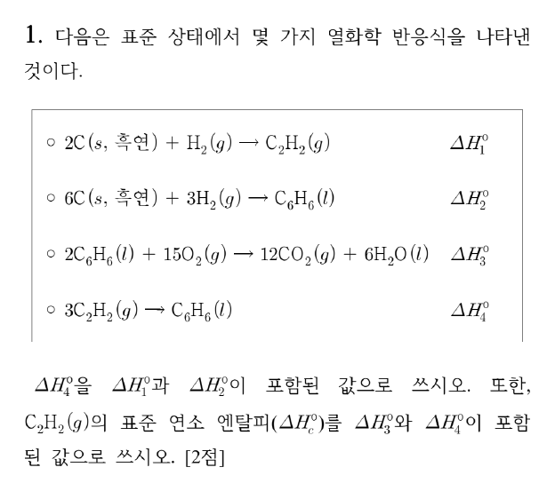

**정답** (답지 난이도 ★★☆☆☆) $\Delta H_4^\circ = \Delta H_2^\circ - 3\Delta H_1^\circ$, C₂H₂(g)의 표준 연소 엔탈피 $\Delta H_c^\circ = \dfrac{2\Delta H_4^\circ + \Delta H_3^\circ}{6}$

**공식·핵심 개념**

- 헤스 법칙: 반응식을 더하고 빼면 ΔH도 같은 계수로 더하고 뺀다
- $\Delta H_{rxn} = \sum \Delta H_f(\text{생성물}) - \sum \Delta H_f(\text{반응물})$
- 표준 연소 엔탈피: 물질 **1 mol**이 완전 연소할 때의 ΔH

**2027 출제 가능성 ★★★☆☆ 보통** — 2점 기입형의 워밍업 소재입니다. 반응식 계수를 1 mol 기준으로 맞추는 실수를 노립니다.

**주어진 것** C₂H₂와 C₆H₆(l)의 생성 반응($\Delta H_1^\circ$, $\Delta H_2^\circ$), 벤젠 2 mol의 연소($\Delta H_3^\circ$), 3C₂H₂ → C₆H₆($\Delta H_4^\circ$)

**구할 것** $\Delta H_4^\circ$를 $\Delta H_1^\circ$·$\Delta H_2^\circ$로, C₂H₂ 1 mol의 연소 엔탈피를 $\Delta H_3^\circ$·$\Delta H_4^\circ$로 나타내기

**풀이 전략** 목표 반응식을 주어진 반응식의 선형 결합으로 만들고, 같은 계수를 ΔH에 곱합니다.

**(1) $\Delta H_4^\circ$.** 3C₂H₂ → C₆H₆는 "C₆H₆ 생성(②)"에서 "C₂H₂ 생성(①) × 3"을 뺀 것입니다.

$$② - 3\times① :\ 6\mathrm C + 3\mathrm H_2 - 3(2\mathrm C + \mathrm H_2) \to \mathrm{C_6H_6} - 3\,\mathrm{C_2H_2}$$

$$\Rightarrow\ 3\mathrm{C_2H_2} \to \mathrm{C_6H_6},\quad \Delta H_4^\circ = \Delta H_2^\circ - 3\Delta H_1^\circ$$

**(2) 목표 반응.** C₂H₂ 1 mol의 연소:

$$\mathrm{C_2H_2}(g) + \tfrac52\mathrm O_2 \to 2\mathrm{CO_2}(g) + \mathrm{H_2O}(l)$$

**(3) 두 단계로 나누기.** C₂H₂ 1 mol을 먼저 벤젠 1/3 mol로 바꾼 뒤 그 벤젠을 태웁니다.

- ④ × 1/3: $\mathrm{C_2H_2} \to \tfrac13\mathrm{C_6H_6}$, $\quad\tfrac13\Delta H_4^\circ$
- ③ × 1/6: $\tfrac13\mathrm{C_6H_6} + \tfrac{15}{6}\mathrm O_2 \to 2\mathrm{CO_2} + \mathrm{H_2O}$, $\quad\tfrac16\Delta H_3^\circ$

**(4) 더하기.**

$$\Delta H_c^\circ = \frac{\Delta H_4^\circ}{3} + \frac{\Delta H_3^\circ}{6} = \frac{2\Delta H_4^\circ + \Delta H_3^\circ}{6}$$

**검산** 원소 수지: ④/3 + ③/6을 더하면 C 2개, H 2개, O 5개가 양변에서 맞습니다($\tfrac{15}{6}\times2 = 5$ = CO₂ 2개의 O 4개 + H₂O의 O 1개) ✓. 연소 엔탈피는 음수이고, $\Delta H_3^\circ$는 벤젠 2 mol 기준이라 1/6이 곱해지는 것이 맞습니다.

**채점 포인트·함정**

- ③은 벤젠 **2 mol** 연소입니다. 1/3을 곱하면 계수를 잘못 맞춘 것입니다(정답은 1/6).
- 답지는 $\dfrac{\Delta H_3^\circ + 2\Delta H_4^\circ}{6}$도 정답으로 인정합니다(같은 식).

## A형 2번 · C₆H₁₀ 이성질체와 수소화붕소 첨가–산화 {#a2}

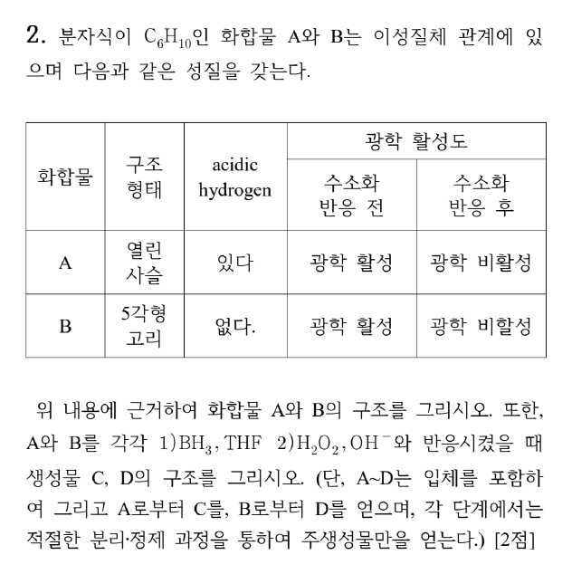

**정답** (공식 정답 없음 · 직접 풀이)

- A: **(S)-3-methylpent-1-yne**, C: **(S)-3-methylpentanal**
- B: **(R)-3-methylcyclopentene**, D: **(1R,3R)-3-methylcyclopentan-1-ol** (trans)
- (거울상끼리 바꾸어 답해도 됩니다. A·C, B·D의 입체 관계만 맞으면 됩니다.)

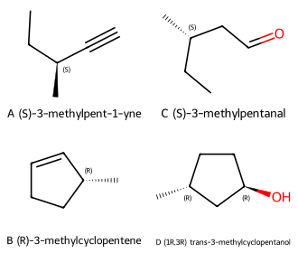

**공식·핵심 개념**

- 불포화도 $= \frac{2C+2-H}{2} = \frac{14-10}{2} = 2$
- 말단 알카인의 ≡C–H는 산성(pKa ≈ 25)
- BH₃ 첨가: **syn**, 반 마르코브니코프, 덜 가려진 면 / 산화는 **입체 보존**
- 말단 알카인 → 엔올 → 알데하이드(토토머화)

**2027 출제 가능성 ★★★★☆ 높음** — 분자식, 성질 단서, 구조 결정, 입체 생성물을 한 번에 묻는 유형은 유기 2점 문항의 단골입니다.

**주어진 것** C₆H₁₀ 이성질체 A(열린 사슬, 산성 H 있음)와 B(5원 고리, 산성 H 없음). 둘 다 광학 활성이고, 수소화 후 광학 비활성입니다.

**구할 것** A·B 구조, A → C, B → D(1) BH₃·THF, 2) H₂O₂·OH⁻)의 입체 구조

**풀이 전략** 불포화도 → 작용기 후보를 정하고, "수소화 후 비활성"이라는 조건으로 입체 중심의 위치를 찾습니다.

**(1) 불포화도 2.**

- A는 열린 사슬이므로 삼중 결합 1개(또는 C=C 2개)입니다. 산성 H가 있으니 **말단 알카인**입니다.
- B는 고리 1개 + C=C 1개입니다.

**(2) A 결정.** 말단 알카인 C₆이면서 입체 중심이 있으려면 HC≡C–CH(CH₃)–CH₂CH₃입니다. C3에 H, CH₃, C₂H₅, C≡CH 네 개가 붙습니다.

수소화하면 C≡CH가 CH₂CH₃가 되어 C3에 에틸기가 두 개 붙습니다. 그러면 3-methylpentane이 되어 **비카이랄**입니다 ✓.

**(3) B 결정.** 산성 H가 없는 5원 고리 C₆H₁₀이면 메틸사이클로펜텐입니다. 이중 결합 위치에 따라 1-, 3-, 4-methylcyclopentene이 가능합니다.

- 1-, 4-메틸: 입체 중심이 없음 → 광학 비활성(✗)
- **3-methylcyclopentene**: C3이 입체 중심 → 광학 활성 ✓. 수소화하면 methylcyclopentane(대칭면 있음) → 비활성 ✓

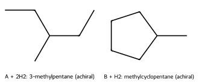

**(4) A → C.** BH₃가 말단 탄소(C1)에 B, C2에 H를 syn으로 붙입니다. 산화하면 엔올 HO–CH=CH–R이 되고, 이것이 토토머화하여 **알데하이드**가 됩니다.

- C3 입체 중심은 반응에 참여하지 않으므로 배열 그대로입니다.
- C에서 C3의 치환기 우선순위는 CH₂CHO > CH₂CH₃ > CH₃ > H입니다. (S)-A에서 (S)-C가 나옵니다(RDKit 확인).

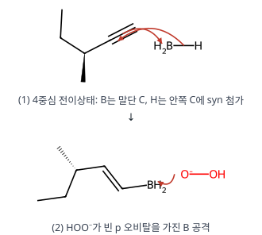

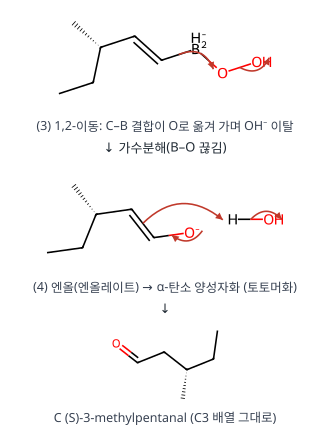

**(5) B → D: 위치.** B는 C1=C2이고, C3에 메틸이 있습니다. BH₃의 B는 덜 붐비는 탄소로 갑니다.

- C2는 메틸이 달린 C3 바로 옆이라 붐빕니다.
- 따라서 **B는 C1**(메틸에서 먼 쪽), H는 C2에 붙습니다. 산화하면 OH가 C1에 오고, 메틸과 1,3 관계인 **3-methylcyclopentanol**이 됩니다.

**(6) B → D: 입체.** BH₃는 메틸이 없는 면(반대 면)으로 접근합니다. 산화(1,2-이동)는 C–B → C–O를 **입체 보존**으로 바꿉니다. 그래서 OH는 메틸과 반대 면, 즉 **trans**에 놓입니다. (R)-B에서 (1R,3R)-D가 나옵니다(3D 구조로 trans 확인).

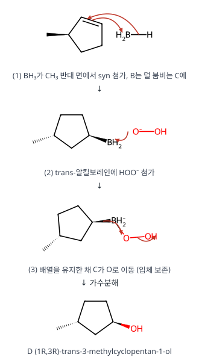

**왜 이 생성물인가** 수소화붕소 첨가는 4중심 전이 상태로 B와 H가 한꺼번에 같은 면에 붙습니다. 그래서 탄소 양이온이 없고, 자리옮김도 없습니다.

- 위치: B가 더 작은 치환 탄소로 가는 입체 효과가 결정합니다.
- 면: 고리의 메틸이 한쪽 면을 막아 BH₃가 반대 면에서 들어갑니다.
- 산화: HOO⁻가 B에 붙은 뒤 R가 B→O로 1,2-이동합니다. 이때 탄소의 배열이 그대로 유지되므로 OH는 B가 있던 자리를 차지합니다.

**검산** 분자식: A·B C₆H₁₀, C C₆H₁₂O, D C₆H₁₂O(RDKit) ✓. C와 D 모두 입체 중심을 갖고 광학 활성입니다.

**채점 포인트·함정**

- A를 1-hexyne처럼 입체 중심이 없는 구조로 쓰면 "광학 활성" 조건을 놓칩니다.
- A→C에서 엔올이나 마르코브니코프 케톤을 답으로 쓰면 틀립니다(**알데하이드**).
- D는 cis가 아닌 **trans**입니다(BH₃가 메틸 반대 면으로 접근, 산화는 보존).

## A형 3번 · 분광 자료로 C₁₀H₁₂O₂ 구조 결정 {#a3}

**정답** (공식 정답 없음 · 직접 풀이) **1-(4-methoxyphenyl)propan-2-one** (4-methoxyphenylacetone, p-CH₃O–C₆H₄–CH₂–CO–CH₃)

**공식·핵심 개념**

- IR 1711 cm⁻¹: 비콘쥬게이션 지방족 케톤 C=O(콘쥬게이션 케톤은 ~1685)
- ¹H 7.1/6.85 doublet 2쌍 = **para 이치환 벤젠**(AA′BB′)
- 3.8 ppm s 3H = Ar–OCH₃, 3.6 ppm s 2H = Ar–CH₂–C=O, 2.1 ppm s 3H = CH₃C=O

**2027 출제 가능성 ★★★★★ 매우 높음** — 분광 해석(IR + NMR)은 거의 매년 나오는 유기 소재입니다.

**주어진 것** C₁₀H₁₂O₂의 IR(1711 cm⁻¹ 강함), ¹H NMR(7.1 d, 6.85 d, 3.78 s, 3.62 s, 2.13 s), ¹³C NMR(158, 131, 127, 115, 56, 51, 30 ppm, 그 밖에 77 = CDCl₃, 0 = TMS)

**구할 것** 화합물 구조

**풀이 전략** 불포화도 → IR 작용기 → ¹H 조각(적분·갈라짐) → ¹³C로 탄소 종류 확인 → 조립.

**(1) 불포화도.**

$$\frac{2(10)+2-12}{2} = 5 = \text{벤젠 고리 }4 + \text{C=O }1$$

**(2) IR.** 1711 cm⁻¹는 C=O입니다. 1735 이상(에스터)이 아니고 1685 정도(아릴 케톤)도 아니므로 **방향족과 콘쥬게이션되지 않은 케톤**입니다. 3200–3600 cm⁻¹에 O–H가 없으므로 두 번째 O는 **에터**입니다.

**(3) ¹H NMR 조각.**

| δ (ppm) | 갈라짐 | 적분 | 조각 |
|---|---|---|---|
| 7.10, 6.85 | doublet × 2 | 2H + 2H | para 이치환 벤젠 |
| 3.78 | singlet | 3H | Ar–O–CH₃ |
| 3.62 | singlet | 2H | Ar–CH₂–C(=O) (이웃 H 없음) |
| 2.13 | singlet | 3H | CH₃–C(=O) |

H 합계 4 + 3 + 2 + 3 = 12 ✓.

**(4) ¹³C 확인.**

- 158(C–O 방향족), 131·115(CH 각 2개라 봉우리가 큼), 127(C–CH₂) → para 이치환 고리의 4종 탄소
- 56: OCH₃, 51: CH₂, 30: COCH₃
- 케톤 C=O(≈206)는 그림 범위(≤170) 밖이라 보이지 않습니다.

**(5) 조립.** CH₃O–C₆H₄–CH₂–C(=O)–CH₃. CH₂가 고리와 C=O 사이에 있어 3.6 ppm로 탈차폐되고 단일선입니다. OMe는 전자 주개라 오르토 H(6.85)가 메타 H(7.1)보다 높은 장에 나옵니다.

**검산** C: 6(고리) + 1(OMe) + 1(CH₂) + 2(COCH₃) = 10, H 12, O 2 → C₁₀H₁₂O₂ ✓(RDKit). 메틸 케톤이 Ar–CO–CH₂CH₃였다면 1685 cm⁻¹와 2.9 q / 1.2 t가 나와야 하므로 제외됩니다.

**채점 포인트·함정**

- 4-methoxyphenyl **acetone**(케톤)입니다. methyl 4-methylphenylacetate(에스터, 1740 cm⁻¹)와 헷갈리기 쉽지만 IR 1711이 케톤을 가리킵니다.
- 3.8 ppm 3H를 에스터 OCH₃로 보면 C=O 위치가 맞지 않습니다.

## A형 4번 · 유사 1차 반응과 반응 차수 {#a4}

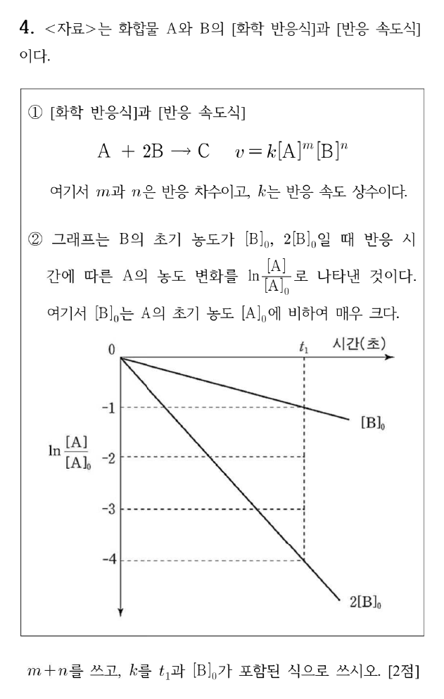

**정답** (답지 난이도 ★★☆☆☆) $m+n = 3$ ($m = 1$, $n = 2$), $k = \dfrac{1}{t_1[\mathrm B]_0^2}$

**공식·핵심 개념**

- [B]₀ ≫ [A]₀ → 유사 1차: $v = k_{obs}[\mathrm A]^m$, $k_{obs} = k[\mathrm B]_0^n$
- $\ln\frac{[\mathrm A]}{[\mathrm A]_0} = -k_{obs}t$가 직선 → $m = 1$
- 기울기 비 = $(2)^n$

**2027 출제 가능성 ★★★★☆ 높음** — 유사 1차 반응·고립법은 반응 속도론에서 자주 나옵니다.

**주어진 것** $v = k[\mathrm A]^m[\mathrm B]^n$, [B]₀ ≫ [A]₀. [B]₀일 때 $t_1$에서 $\ln([\mathrm A]/[\mathrm A]_0) = -1$, 2[B]₀일 때 $t_1$에서 −4. 두 그래프 모두 직선.

**구할 것** $m + n$, $k$를 $t_1$과 [B]₀로

**풀이 전략** B가 과량이면 [B]가 거의 변하지 않으므로 속도식이 A에 대한 유사 차수 반응이 됩니다. 그래프 모양으로 $m$을, 기울기 비로 $n$을 구합니다.

**(1) $m$.** $\ln[\mathrm A]$가 시간에 대해 직선이므로 A에 대해 1차입니다. 즉 $m = 1$이고

$$\ln\frac{[\mathrm A]}{[\mathrm A]_0} = -k_{obs}t,\quad k_{obs} = k[\mathrm B]_0^n$$

**(2) 기울기 읽기.**

$$k_{obs}([\mathrm B]_0) = \frac{1}{t_1},\qquad k_{obs}(2[\mathrm B]_0) = \frac{4}{t_1}$$

**(3) $n$.**

$$\frac{k(2[\mathrm B]_0)^n}{k[\mathrm B]_0^n} = 2^n = \frac{4/t_1}{1/t_1} = 4 \Rightarrow n = 2$$

따라서 $m + n = 3$.

**(4) $k$.**

$$\frac{1}{t_1} = k[\mathrm B]_0^2 \Rightarrow k = \frac{1}{t_1[\mathrm B]_0^2}$$

**검산** 단위: 3차 반응의 $k$는 M⁻²s⁻¹이고, $1/(\mathrm s\cdot\mathrm M^2)$ ✓. 2[B]₀일 때 $k_{obs} = k\cdot4[\mathrm B]_0^2 = 4/t_1$ ✓.

**채점 포인트·함정**

- 화학 반응식 계수(2B)를 차수로 쓰면 안 됩니다. 이 문제는 우연히 $n = 2$로 같지만 근거는 **그래프의 기울기 비**입니다.
- $k$는 $k_{obs}$가 아닙니다. $[\mathrm B]_0^2$로 나누어야 합니다.

## A형 5번 · 몰 개념, 피아제 논리적 사고력, 오수벨 {#a5}

**정답**

- ㉠ 몰은 **물질의 양을 나타내는 기본 물리량**이다.
- '지식의 적용' 수업목표: 기본 물리량인 몰이 물질의 양을 표현하는 데 **유용함을 말할 수 있다.**
- (가)에 옳게 답한 학생(8개): **형식적 조작기**. 판단 준거: **형식적 조작, 비례 논리를 이용한 가역적(연역적) 사고**를 할 수 있기 때문이다.
- ㉡: 학습 과제는 실사성과 구속성을 갖춘 **논리적 유의미가**를 가지지만, 학생이 관련 **인지구조(정착 지식)**를 갖추지 못해 **잠재적 유의미가**를 갖추지 못했다.

**공식·핵심 개념**

- 몰: SI 기본 단위(2019 재정의, $N_A = 6.022\,140\,76\times10^{23}$ mol⁻¹ 고정)
- 피아제 형식적 조작기: 비례·조합·변인 통제·확률·상관 논리
- 오수벨 유의미 학습 조건: 논리적 유의미가(과제: 실사성·구속성) + 잠재적 유의미가(학습자의 관련 정착 지식) + 유의미 학습 태세

**2027 출제 가능성 ★★★★★ 매우 높음** — 2022 개정 [화학] '화학의 언어' 성취기준은 새 교육과정 문항으로 아주 유력합니다. 피아제·오수벨도 반복 출제되는 학습 이론입니다.

**㉠ 몰의 정의.** 2022 개정 [화학]은 몰을 "물질의 양을 나타내는 기본 물리량"으로 다룹니다. '지식·이해 → 지식의 적용' 수업목표는 몰 단위의 **유용성을 설명**하는 수준으로 진술합니다.

**(가) 오렌지 문항.** 4개 : 6잔 = $x$ : 12잔에서 $x = 8$개입니다. 이것은 피아제 **논리적 사고력 검사(GALT/TOLT)**의 **비례 논리** 문항입니다. 비례 관계를 일반화하여 추론하면 **형식적 조작기**로 판단합니다. 몰 계산(입자 수 ↔ 질량 ↔ 몰)이 바로 비례 추론이라서, 이 검사가 학습 준비도 진단에 쓰였습니다.

**(다) ㉡.** 오수벨 유의미 수용학습의 두 조건은 다음과 같습니다.

- **논리적 유의미가**(과제 측면): 실사성(표현이 바뀌어도 의미가 같음)과 구속성(임의로 바꿀 수 없는 관계)을 갖추어야 합니다. 몰 개념은 이를 갖추었습니다.
- **잠재적 유의미가**(학습자 측면): 학습자의 인지구조에 관련 정착 지식이 있어야 합니다.

절반의 학생은 이 정착 지식이 없으므로 교사가 **선행조직자**(설명 조직자·비교 조직자)로 다리를 놓으려는 것입니다.

**채점 포인트·함정**

- ㉡은 "학습 태세가 없다"가 아니라 **잠재적 유의미가의 결여**입니다.
- 형식적 조작기의 근거로 "추상적 사고"만 쓰면 부족합니다. **비례 논리**를 명시하세요.

## A형 6번 · 로슨 순환학습의 연이은 적용 (산화·환원) {#a6}

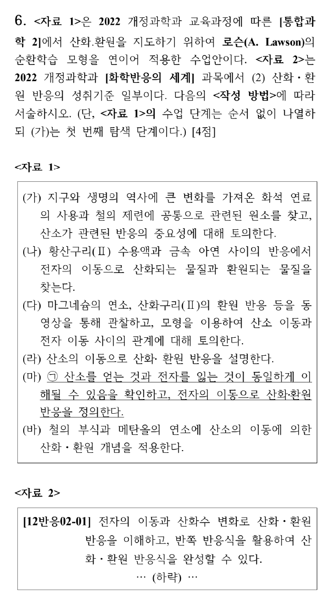

**정답**

- 두 번째 순환학습의 개념 도입 → 개념 적용: **(마) → (나)**
- ㉠의 예: $4\mathrm{Al}(s) + 3\mathrm O_2(g) \to 2\mathrm{Al_2O_3}(s)$에서 알루미늄은 **산소를 얻고 동시에 전자를 잃는다**(Al → Al³⁺ + 3e⁻).
- 새 순환학습의 탐색: $5\mathrm{Fe^{2+}} + \mathrm{MnO_4^-} + 8\mathrm H^+ \to 5\mathrm{Fe^{3+}} + \mathrm{Mn^{2+}} + 4\mathrm{H_2O}$ 반응에서 철과 이산화망가니즈(과망가니즈산 이온)의 산화·환원 관계를 **산소 또는 전자의 이동으로 설명**해 보게 하여 **인지적 갈등을 유발**한다(산소 이동만으로는 설명이 안 되고 산화수 개념이 필요해짐).
- 교사의 개념: 산화제와 환원제는 **정해져 있는 것이 아니라** 특정 산화·환원 반응에서 **상대적 세기**에 의해 결정된다.

**공식·핵심 개념**

- 로슨 순환학습: 탐색 → 개념 도입 → 개념 적용, 한 순환의 적용이 다음 순환의 탐색으로 이어짐
- 산화·환원 개념의 발달: 산소 → 전자 → 산화수
- 같은 물질(H₂O₂, SO₂ 등)이 반응에 따라 산화제도 환원제도 됨

**2027 출제 가능성 ★★★★★ 매우 높음** — 로슨 순환학습은 교수·학습 모형 중 출제 빈도가 가장 높습니다. 통합과학 2 산화·환원 단원과의 결합은 2022 개정 첫 적용기에 특히 유력합니다.

**단계 배열.** (가)가 첫 탐색이므로 두 순환은 다음과 같습니다.

| 순환 | 탐색 | 개념 도입 | 개념 적용 |
|---|---|---|---|
| 1 (산소) | (가) 산소 관련 반응 토의 | (라) 산소의 이동으로 정의 | (바) 철의 부식·메탄올 연소에 적용 |
| 2 (전자) | (다) Mg 연소·CuO 환원 관찰, 산소–전자 관계 토의 | **(마)** 전자의 이동으로 정의 | **(나)** CuSO₄ + Zn에 적용 |

(나)는 산소가 없는 반응이라 전자 개념이 생긴 **뒤에만** 적용할 수 있습니다.

**㉠의 예.** Al은 산화물에서 Al³⁺가 되므로, 산소를 얻은 것(산소 관점)과 전자 3개를 잃은 것(전자 관점)이 같은 사건입니다. O₂는 전자를 얻어 O²⁻가 됩니다.

**새 순환의 탐색.** [12반응02-01]은 **산화수 변화**와 **반쪽 반응식**을 요구합니다. Fe²⁺ → Fe³⁺(전자 잃음)는 전자로 설명되지만, Mn은 +7 → +2로 바뀌면서 산소가 물로 빠져나갑니다. 산소·전자 개념만으로는 깔끔하게 설명하기 어렵다는 **갈등**이 산화수 개념 도입을 준비합니다.

**채점 포인트·함정**

- 부호 순서를 (나)–(마)로 바꾸면 틀립니다.
- 탐색 활동은 반드시 **Fe²⁺–MnO₄⁻ 반응식**을 포함해야 합니다(조건).

## A형 7번 · POE와 PEOE 모형 (밀도·혼합 부피) {#a7}

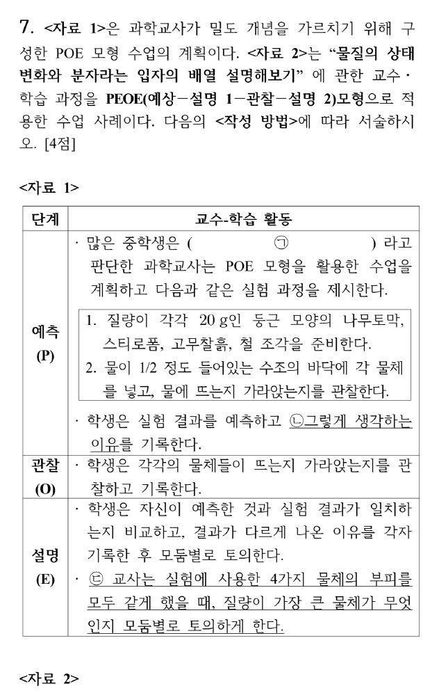

**정답**

- ㉠: 많은 중학생은 **질량과 밀도 개념을 구분하지 못하고 혼용한다**(무거우면 가라앉는다고 생각한다).
- ㉡의 장점: 설명(E) 단계에서 예상한 결과를 설명할 때 학생 **고유의 신념 체계를 확인**하고, 결과에 맞추어 이유를 바꾸는 **증거 왜곡을 방지**할 수 있다.
- ㉢의 의도(구성주의): 교사는 학습자 **스스로 밀도 개념을 구성**할 수 있도록 **중재(비계)**하고 있다.
- 설명 1: "물 10 mL와 에탄올 10 mL를 섞으면 20 mL가 된다(10 더하기 10은 20)."
- 설명 2: "콩과 좁쌀을 섞었더니 콩 사이에 좁쌀이 들어가 전체 부피가 줄었다."

**공식·핵심 개념**

- POE: 예측(+이유) → 관찰 → 설명
- PEOE: 예상 → **설명 1**(예상의 이유) → 관찰 → **설명 2**(관찰과 예상의 비교·재설명)
- 밀도 $\rho = m/V$, 같은 부피라면 질량이 큰 쪽이 밀도가 큼

**2027 출제 가능성 ★★★★☆ 높음** — POE는 2010년대 이후 여러 번 나왔고, PEOE 변형은 상대적으로 새 소재입니다.

**㉠.** 20 g으로 질량을 모두 같게 했는데도 뜨고 가라앉음이 다르게 나옵니다. 교사는 학생들이 "무거우면 가라앉는다"(질량 = 밀도)라는 오개념을 가졌다고 보고, 질량을 통제한 실험을 설계한 것입니다.

**㉡.** 예측의 **이유**를 미리 적게 하면, E 단계에서 학생의 원래 신념이 무엇이었는지 드러납니다. 관찰 후에 결과에 맞추어 사후적으로 이유를 바꾸는(증거 왜곡) 것도 막습니다. 문제에서 "학생 관점의 명료화"는 제외하라고 했으므로 이 두 가지를 씁니다.

**㉢.** 부피를 같게 하고 질량을 비교하게 하면 "단위 부피당 질량"이라는 밀도 개념에 학생 스스로 도달합니다. 이는 교사가 직접 정의를 주지 않고 사회적 상호작용(모둠 토의) 속에서 구성을 돕는 **구성주의적 중재**입니다.

**PEOE 구분.** 예상(20 mL가 될 것) → **설명 1**(10 + 10 = 20이니까) → 관찰(18 mL) → **설명 2**(콩과 좁쌀 비유로 입자 사이 빈 공간 설명).

**채점 포인트·함정**

- 설명 1과 설명 2는 **학생 발화 그대로** 찾아 쓰는 것이 안전합니다(답지 각 0.5점).
- ㉡에서 "학생 관점 명료화"를 쓰면 조건 위반입니다.

## A형 8번 · 1-프로판올 + HBr, TLC와 관 크로마토그래피 {#a8}

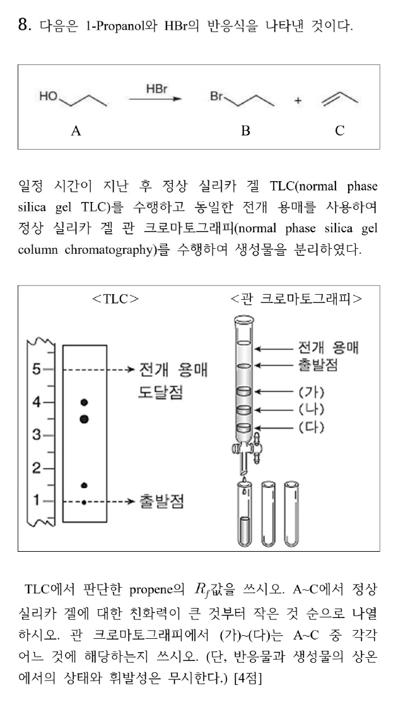

**정답** (공식 정답 없음 · 직접 풀이·필기 일치)

- propene의 $R_f$ = **0.75**
- 정상 실리카 겔 친화력: **A > B > C** (1-propanol > 1-bromopropane > propene)
- 관 크로마토그래피: **(가) A, (나) B, (다) C**

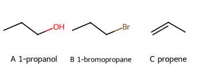

**공식·핵심 개념**

- $R_f = \dfrac{\text{출발점→점 거리}}{\text{출발점→전개 용매 도달점 거리}}$
- 정상(실리카, 극성) 정지상: 극성↑ → 흡착↑ → $R_f$↓, 늦게 용출
- 1차 알코올 + HBr: 양성자화 → **SN2**(주), E2(부, 프로펜)

**2027 출제 가능성 ★★★★☆ 높음** — 크로마토그래피는 2022 개정 탐구 활동과 맞닿아 있고, 유기 반응과 결합한 실험 문항으로 나오기 쉽습니다.

**주어진 것** A(1-propanol) + HBr → B(1-bromopropane) + C(propene). TLC: 출발점 1, 전개 용매 도달점 5, 점 위치 약 4.0, 3.5, 1.5. 관: 위에서부터 띠 (가), (나), (다)

**구할 것** propene의 $R_f$, 친화력 순서, (가)~(다)의 정체

**풀이 전략** 극성 순서(OH > C–Br > C=C)로 TLC 점과 관의 띠를 대응시킵니다.

**(1) 반응 메커니즘.** 1차 알코올의 OH를 HBr이 양성자화하여 좋은 이탈기 H₂O를 만듭니다. 1차 탄소 양이온은 불안정하므로 Br⁻가 **뒷면에서 SN2**로 공격해 B가 됩니다. 일부는 Br⁻/H₂O가 β-H를 떼는 E2로 C가 됩니다.

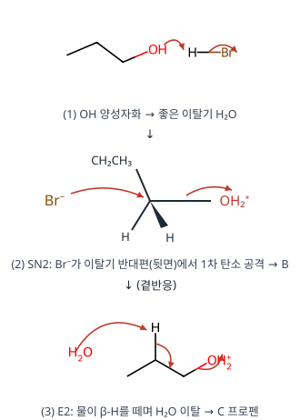

**(2) 극성과 친화력.**

- A: O–H가 실리카의 Si–OH와 **수소 결합** → 가장 강하게 흡착
- B: C–Br 쌍극자만 있음 → 중간
- C: 탄화수소, 거의 무극성 → 가장 약함

따라서 친화력은 **A > B > C**, $R_f$는 C > B > A입니다.

**(3) $R_f$ (C).** 가장 위의 점(약 4.0)이 propene입니다.

$$R_f = \frac{4.0 - 1.0}{5.0 - 1.0} = \frac{3.0}{4.0} = 0.75$$

참고: B ≈ $\frac{3.5-1}{4} = 0.63$, A ≈ $\frac{1.5-1}{4} = 0.13$.

**(4) 관 크로마토그래피.** 용매가 위에서 아래로 흐르므로 친화력이 약한 성분이 가장 빨리 내려갑니다. 아래 띠 (다)가 C, 중간 (나)가 B, 위 (가)가 A입니다.

**왜 이 생성물인가** 1차 기질은 탄소 양이온을 만들지 않으므로 SN1이나 자리옮김이 없습니다. 뒷면 공격이 쉬운 SN2가 주경로입니다. 프로펜은 산성 조건 가열에서 생기는 제거 부생성물로, 1차 기질이라 E2 비중은 작습니다.

**검산** 픽셀 측정: 출발점–도달점 211 px, 맨 위 점은 출발점에서 159 px → 159/211 = 0.754 ✓.

**채점 포인트·함정**

- $R_f$의 분모는 "전개 용매 도달점까지의 거리"이지 판 전체 길이가 아닙니다(5가 아니라 5 − 1 = 4).
- 관에서는 **아래쪽 띠가 먼저 나오는 덜 극성 물질**입니다.

## A형 9번 · EDTA 치환 적정 {#a9}

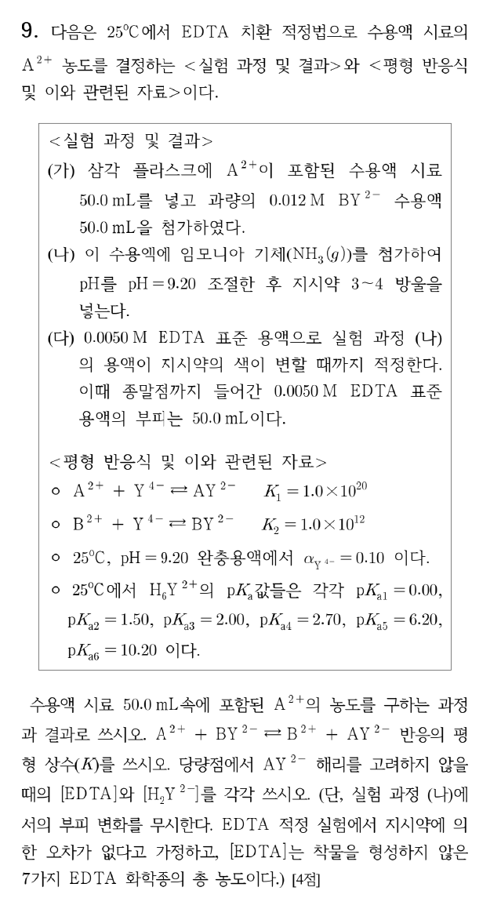

**정답** (답지 난이도 ★★★☆☆)

- 시료의 [A²⁺] = **0.0050 M**
- $K = 1.0\times10^{8}$
- 당량점의 [EDTA] = **2.0 × 10⁻⁷ M**, [H₂Y²⁻] = **2.0 × 10⁻¹⁰ M**

**공식·핵심 개념**

- 치환 적정: $\mathrm{A^{2+} + BY^{2-} \to AY^{2-} + B^{2+}}$ (K ≫ 1), 방출된 B²⁺를 EDTA로 적정 → mol B = mol A
- 조건 형성 상수 $K' = \alpha_{Y^{4-}}K_f$
- $[\mathrm Y^{4-}] = \alpha_{Y^{4-}}[\mathrm{EDTA}]$, 이웃 종의 비 $\frac{[\mathrm{H}_{n}\mathrm Y]}{[\mathrm H_{n-1}\mathrm Y]} = \frac{[\mathrm H^+]}{K_a}$

**2027 출제 가능성 ★★★★☆ 높음** — EDTA 적정(조건 형성 상수, 분율)은 분석화학의 핵심 출제 영역입니다. 치환 적정은 변형 소재로 좋습니다.

**주어진 것** 시료 50.0 mL + 0.012 M BY²⁻ 50.0 mL(과량), pH 9.20, 0.0050 M EDTA 50.0 mL로 종말점. $K_1 = 10^{20}$(AY), $K_2 = 10^{12}$(BY), $\alpha_{Y^{4-}} = 0.10$, pKa₅ = 6.20, pKa₆ = 10.20

**구할 것** [A²⁺], $K$, 당량점의 [EDTA]와 [H₂Y²⁻]

**풀이 전략** A가 BY에서 B를 정량적으로 밀어내므로 적정된 B mol = A mol입니다. 당량점은 "BY의 해리 평형"으로 [EDTA]를 구하고, 분율로 [H₂Y²⁻]를 구합니다.

**(1) 치환 평형 상수.** (AY 형성) − (BY 형성):

$$K = \frac{K_1}{K_2} = \frac{1.0\times10^{20}}{1.0\times10^{12}} = 1.0\times10^{8}$$

K가 커서 A²⁺는 모두 AY²⁻가 되고 같은 mol의 B²⁺가 나옵니다.

**(2) [A²⁺].**

$$n_{\mathrm{EDTA}} = 0.0050\ \mathrm M\times50.0\ \mathrm{mL} = 0.25\ \mathrm{mmol} = n_{\mathrm B^{2+}} = n_{\mathrm A^{2+}}$$

$$[\mathrm A^{2+}] = \frac{0.25\ \mathrm{mmol}}{50.0\ \mathrm{mL}} = 0.0050\ \mathrm M$$

(BY 0.60 mmol > 0.25 mmol이므로 과량 조건 ✓)

**(3) 당량점의 조성.** 전체 부피 50 + 50 + 50 = 150 mL입니다.

- AY²⁻: 0.25 mmol(해리 무시)
- BY²⁻: 남은 0.60 − 0.25 = 0.35 mmol + 적정으로 생긴 0.25 mmol = 0.60 mmol

$$[\mathrm{BY^{2-}}] = \frac{0.60}{150} = 4.0\times10^{-3}\ \mathrm M$$

**(4) [EDTA].** 당량점에서 BY의 해리로 $[\mathrm B^{2+}] = [\mathrm{EDTA}] = x$입니다.

$$K_2' = \alpha_{Y^{4-}}K_2 = 0.10\times1.0\times10^{12} = 1.0\times10^{11}$$

$$\frac{4.0\times10^{-3}}{x^2} = 1.0\times10^{11} \Rightarrow x^2 = 4.0\times10^{-14} \Rightarrow x = 2.0\times10^{-7}\ \mathrm M$$

**(5) [H₂Y²⁻].** 먼저 $[\mathrm Y^{4-}] = 0.10\times2.0\times10^{-7} = 2.0\times10^{-8}$ M입니다. $[\mathrm H^+] = 10^{-9.20}$이므로

$$\frac{[\mathrm{HY^{3-}}]}{[\mathrm{Y^{4-}}]} = \frac{10^{-9.20}}{10^{-10.20}} = 10,\qquad \frac{[\mathrm{H_2Y^{2-}}]}{[\mathrm{HY^{3-}}]} = \frac{10^{-9.20}}{10^{-6.20}} = 10^{-3}$$

$$[\mathrm{H_2Y^{2-}}] = 10\times10^{-3}\times2.0\times10^{-8} = 2.0\times10^{-10}\ \mathrm M$$

**검산** 주어진 pKa로 직접 계산한 $\alpha_{Y^{4-}} = \frac{1}{1+10} = 0.091$입니다. 문제의 0.10은 반올림 값입니다. 0.091을 쓰면 [EDTA] = 2.10 × 10⁻⁷, [H₂Y²⁻] = 1.9 × 10⁻¹⁰ M으로 거의 같습니다. 시험에서는 **주어진 0.10**을 씁니다. AY 해리: $K_1' = 10^{19}$이라 무시 조건이 타당합니다.

**채점 포인트·함정**

- 당량점 부피에 BY 용액 50 mL를 빠뜨려 100 mL로 계산하면 [BY]가 달라집니다.
- [BY²⁻]에 처음 남은 0.35 mmol을 빼먹지 마세요(합 0.60 mmol).
- [EDTA]는 **착물을 이루지 않은** 7종의 합이므로 $K'$ 식에 바로 들어갑니다.

## A형 10번 · 내부 압력, 열팽창 계수, 등온 압축률 {#a10}

**정답** (답지 난이도 ★★★★☆)

- $\left(\dfrac{\partial U}{\partial T}\right)_P = \pi_T\alpha V + C_{V,m}$, $\left(\dfrac{\partial U}{\partial P}\right)_T = -\pi_T\kappa_TV$
- 실제 기체 X의 $\pi_T = 0$
- $\alpha = \dfrac{V-b}{VT}$, $\kappa_T = \dfrac{(V-b)^2}{VRT}$
- $\Delta U = c_1(T_2-T_1) + \tfrac12c_2(T_2^2-T_1^2)$

**공식·핵심 개념**

- 열역학 상태식 $\pi_T = T\left(\frac{\partial P}{\partial T}\right)_V - P$
- $\alpha = \frac1V\left(\frac{\partial V}{\partial T}\right)_P$, $\kappa_T = -\frac1V\left(\frac{\partial V}{\partial P}\right)_T$
- 반발력만 있는 기체($P = RT/(V-b)$)는 $\pi_T = 0$ → $U$는 $T$만의 함수

**2027 출제 가능성 ★★★★☆ 높음** — 편미분 관계식, 내부 압력, 실제 기체 상태식은 물리화학 서술형의 단골입니다.

**주어진 것** $dU = C_{V,m}dT + \pi_TdV$, $P = \dfrac{RT}{V-b}$, $C_{V,m} = c_1 + c_2T$

**구할 것** $(\partial U/\partial T)_P$, $(\partial U/\partial P)_T$, $\pi_T$, $\alpha$, $\kappa_T$, $\Delta U$

**풀이 전략** $U(T,V)$를 연쇄 법칙으로 $P$나 $T$ 고정 조건으로 바꾸고, 상태식을 미분해 각 계수를 구합니다.

**(1) $(\partial U/\partial T)_P$.**

$$\left(\frac{\partial U}{\partial T}\right)_P = \pi_T\left(\frac{\partial V}{\partial T}\right)_P + C_{V,m} = \pi_T\alpha V + C_{V,m}$$

**(2) $(\partial U/\partial P)_T$.** $T$ 고정이면 $dU = \pi_TdV$이므로

$$\left(\frac{\partial U}{\partial P}\right)_T = \pi_T\left(\frac{\partial V}{\partial P}\right)_T = -\pi_T\kappa_TV$$

**(3) $\pi_T$.**

$$\left(\frac{\partial P}{\partial T}\right)_V = \frac{R}{V-b}$$

$$\pi_T = T\cdot\frac{R}{V-b} - \frac{RT}{V-b} = 0$$

**(4) $\alpha$.** 상태식을 $V = \frac{RT}{P} + b$로 바꾸면

$$\left(\frac{\partial V}{\partial T}\right)_P = \frac{R}{P} = \frac{V-b}{T}\ \Rightarrow\ \alpha = \frac{V-b}{VT} = \left(1-\frac bV\right)\frac1T$$

**(5) $\kappa_T$.**

$$\left(\frac{\partial V}{\partial P}\right)_T = -\frac{RT}{P^2} = -\frac{(V-b)^2}{RT}$$

$$\kappa_T = \frac{(V-b)^2}{V}\cdot\frac{1}{RT}$$

**(6) $\Delta U$.** $\pi_T = 0$이므로 $dU = C_{V,m}dT$이고, 경로·압력과 무관합니다.

$$\Delta U = \int_{T_1}^{T_2}(c_1 + c_2T)\,dT = c_1(T_2 - T_1) + \frac12c_2(T_2^2 - T_1^2)$$

**검산** $b \to 0$이면 $\alpha \to 1/T$, $\kappa_T \to V/RT = 1/P$로 이상 기체 결과와 같습니다 ✓. 차원: $\kappa_T$는 $\mathrm{m^6/(m^3\cdot J)} = 1/\mathrm{Pa}$ ✓.

**채점 포인트·함정**

- $\kappa_T$에 마이너스 부호가 정의에 들어 있어 $(\partial U/\partial P)_T$의 부호가 **음**입니다.
- 이 기체는 $a$(인력항)가 없어서 $\pi_T = 0$입니다. 반데르발스 기체라면 $\pi_T = a/V^2$입니다.

## A형 11번 · [CrL₆]³⁻의 MO, 분광화학 계열, d³ 전이 {#a11}

**정답** (답지 난이도 ★★★★☆)

- σ 결합 차수 **6.0**, π 결합 차수 **1.5**
- Δo가 큰 것: **[CrF₆]³⁻** / LMCT 흡수 파장이 짧은 것: **[CrF₆]³⁻**
- $^4A_{2g}\to{}^4T_{1g}(F)$: **27 000 cm⁻¹**
- $^4T_{1g}(P)$ 들뜬 상태의 d 전자 배치: $t_{2g}^1e_g^2$

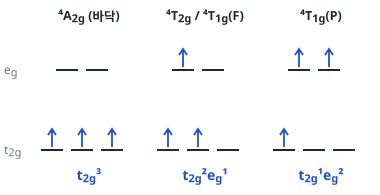

**공식·핵심 개념**

- 결합 차수 = (결합성 e − 반결합성 e)/2
- π 주개 리간드: t₂g가 π* → Δo 감소(F⁻ > Cl⁻ 순으로 Δo, 둘 다 약한 장)
- 약한 장 d³($^4F$): $^4A_{2g}$ −1.2Δo, $^4T_{2g}$ −0.2Δo, $^4T_{1g}(F)$ +0.6Δo

**2027 출제 가능성 ★★★★☆ 높음** — π 주개 MO 도표와 d–d 전이 에너지 계산은 무기 서술형에 자주 나옵니다.

**주어진 것** [CrL₆]³⁻ σ·π MO 도표(L = F⁻ 또는 Cl⁻, π 리간드 군 오비탈 12개), [CrF₆]³⁻의 Δo = 15 000 cm⁻¹, 항 혼합 무시

**구할 것** σ·π 결합 차수, Δo·LMCT 비교, $^4T_{1g}(F)$ 전이 파수, $^4T_{1g}(P)$의 배치

**풀이 전략** 전자를 MO에 채워 결합성/반결합성을 세고, 약한 장 상관 관계로 $^4F$의 갈라짐을 씁니다.

**(1) 전자 수.** Cr³⁺ d³ + σ 6쌍(12 e) + π 12개 오비탈(24 e) = 39 e

**(2) σ 결합 차수.** σ 결합성 $a_{1g}, t_{1u}, e_g$에 12 e가 모두 들어가고, σ 반결합성($e_g^*$ 등)은 비어 있습니다.

$$\text{BO}_\sigma = \frac{12 - 0}{2} = 6.0$$

**(3) π 결합 차수.** π 리간드 24 e 중 $t_{2g}$와 대칭이 맞는 6 e는 π 결합성 $t_{2g}$에 들어갑니다. 나머지 18 e는 비결합성($t_{1g}, t_{2u}, t_{1u}$)입니다. Cr의 d 전자 3개는 π 반결합성 $t_{2g}^*$에 들어갑니다.

$$\text{BO}_\pi = \frac{6 - 3}{2} = 1.5$$

**(4) Δo 비교.** F⁻와 Cl⁻ 모두 π 주개이지만 분광화학 계열은 F⁻ > Cl⁻입니다. Cl⁻는 π 주개 효과가 더 커서 t₂g*가 더 올라가므로 **[CrF₆]³⁻**의 Δo가 큽니다.

**(5) LMCT.** LMCT는 리간드 오비탈 → 금속 오비탈 전이입니다. F는 전기음성도가 커서 리간드 오비탈이 깊이 있고 산화되기 어렵습니다. 그래서 LMCT 에너지가 크고 파장이 짧은 것은 **[CrF₆]³⁻**입니다.

**(6) $^4T_{1g}(F)$ 파수.** 항 혼합이 없으면 $^4F$의 갈라짐은 무게 중심을 기준으로 다음과 같습니다.

$$^4A_{2g}: -1.2\Delta_o,\quad {}^4T_{2g}: -0.2\Delta_o,\quad {}^4T_{1g}(F): +0.6\Delta_o$$

검산: $1\times(-1.2) + 3\times(-0.2) + 3\times0.6 = 0$ ✓

$$\tilde\nu = 0.6\Delta_o - (-1.2\Delta_o) = 1.8\Delta_o = 1.8\times15\,000 = 27\,000\ \mathrm{cm^{-1}}$$

참고로 $^4A_{2g}\to{}^4T_{2g}$는 $1.0\Delta_o = 15\,000$ cm⁻¹입니다.

**(7) $^4T_{1g}(P)$ 배치.** 바닥 $t_{2g}^3$, $^4T_{2g}$·$^4T_{1g}(F)$는 $t_{2g}^2e_g^1$, $^4T_{1g}(P)$는 전자 2개가 올라간 $t_{2g}^1e_g^2$입니다(위 그림). 홀전자 3개의 스핀은 모두 평행해야 사중항이 유지됩니다.

**검산** 전자 수: σ 12 + π결합 6 + 비결합 18 + t₂g* 3 = 39 ✓.

**채점 포인트·함정**

- π 결합 차수를 $6/2 = 3$으로 쓰면 t₂g*의 d 전자 3개를 빠뜨린 것입니다.
- "LMCT 파장이 작은 것"을 Δo가 작은 쪽으로 헷갈리기 쉽습니다. LMCT는 **리간드 산화 용이성**으로 판단합니다.
- 스핀 화살표는 세 개 모두 같은 방향으로 그립니다.

## A형 12번 · 전위차법으로 구한 표준 전위와 조건 형성 상수 {#a12}

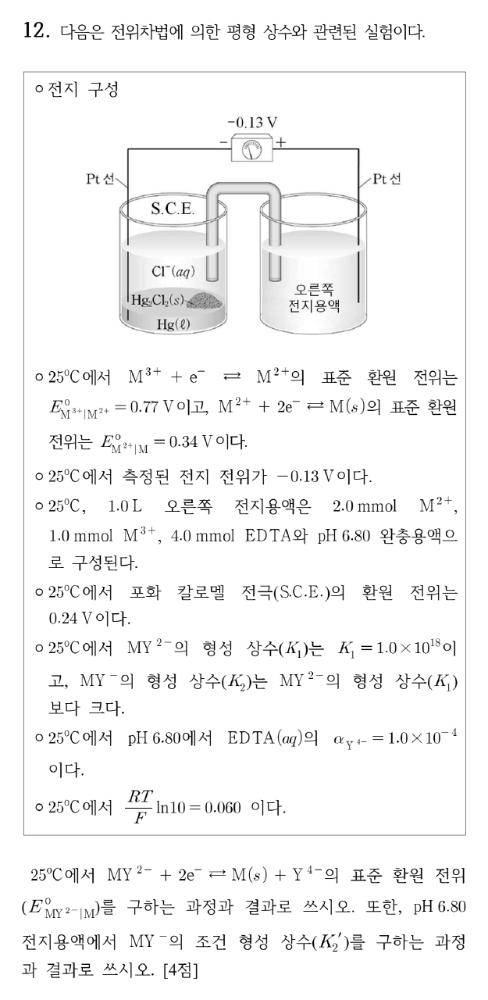

**정답** (답지 난이도 ★★★★☆) $E^\circ_{\mathrm{MY^{2-}|M}} = $ **−0.20 V**, $K_2' = $ **5.0 × 10²⁴**

**공식·핵심 개념**

- $E_{cell} = E_+ - E_-$ (SCE 0.24 V가 음극 쪽)
- 착물 반쪽 반응: $E^\circ_{\mathrm{MY|M}} = E^\circ_{\mathrm{M|M}} - \frac{0.060}{n}\log K_f$
- Nernst: $E = E^\circ - \frac{0.060}{n}\log Q$, $K' = \alpha_{Y^{4-}}K$

**2027 출제 가능성 ★★★★☆ 높음** — 착물 형성으로 표준 전위가 바뀌는 문제는 분석화학 전기화학 문항의 대표 유형입니다.

**주어진 것** 전지 전위 −0.13 V(SCE가 −단자), $E^\circ(\mathrm{M^{3+}|M^{2+}}) = 0.77$ V, $E^\circ(\mathrm{M^{2+}|M}) = 0.34$ V, 오른쪽 용액 1.0 L에 M²⁺ 2.0 mmol, M³⁺ 1.0 mmol, EDTA 4.0 mmol, pH 6.80. $K_1 = 10^{18}$, $\alpha = 1.0\times10^{-4}$, SCE 0.24 V

**구할 것** $E^\circ(\mathrm{MY^{2-}|M})$, $K_2'$

**풀이 전략** ① $\mathrm{MY^{2-}} \to \mathrm{M^{2+}} + \mathrm{Y^{4-}}$(해리)와 $\mathrm{M^{2+}} + 2e^- \to \mathrm M$을 더해 ΔG를 합칩니다. ② 오른쪽 Pt 전극의 전위를 $\mathrm{M^{3+}/M^{2+}}$ Nernst 식으로 쓰고, 유리 이온 농도를 착물 평형으로 바꿉니다.

**(1) $E^\circ(\mathrm{MY^{2-}|M})$.** $\Delta G^\circ$를 더하면

$$-2FE^\circ_{\mathrm{MY}} = -2F(0.34) + RT\ln K_1$$

$$E^\circ_{\mathrm{MY}} = 0.34 - \frac{0.060}{2}\log(1.0\times10^{18}) = 0.34 - 0.54 = -0.20\ \mathrm V$$

**(2) 오른쪽 전극 전위.**

$$E_{cell} = E_{right} - E_{SCE} \Rightarrow E_{right} = -0.13 + 0.24 = 0.11\ \mathrm V$$

**(3) 용액 조성.** EDTA 4.0 mmol이 M 3.0 mmol보다 많아 금속은 모두 착물이 됩니다.

$$[\mathrm{MY^{2-}}] = 2.0\times10^{-3},\quad [\mathrm{MY^-}] = 1.0\times10^{-3},\quad [\mathrm{EDTA}] = 1.0\times10^{-3}\ \mathrm M$$

**(4) 유리 이온 비.** $K_1' = \alpha K_1 = 1.0\times10^{-4}\times10^{18} = 1.0\times10^{14}$이고

$$\frac{[\mathrm{M^{2+}}]}{[\mathrm{M^{3+}}]} = \frac{[\mathrm{MY^{2-}}]/(K_1'[\mathrm{EDTA}])}{[\mathrm{MY^-}]/(K_2'[\mathrm{EDTA}])} = \frac{2.0\times K_2'}{1.0\times10^{14}}$$

**(5) Nernst 식에 대입.**

$$0.11 = 0.77 - 0.060\log\frac{2.0K_2'}{1.0\times10^{14}}$$

$$\log\frac{2.0K_2'}{10^{14}} = \frac{0.66}{0.060} = 11 \Rightarrow 2.0K_2' = 10^{25} \Rightarrow K_2' = 5.0\times10^{24}$$

**검산** $K_2' > K_1'$($5\times10^{24} > 10^{14}$)이므로 문제 조건 "$K_2 > K_1$"과 맞습니다 ✓. 이 값을 거꾸로 넣으면 $E = 0.77 - 0.06\times11 = 0.11$ V ✓.

**채점 포인트·함정**

- 측정 전위가 음수라 SCE가 (+)극이라고 착각하기 쉽습니다. 그림에서 SCE는 −단자이므로 $E_{right} = E_{cell} + 0.24$입니다.
- [EDTA]는 남은 1.0 mmol(1.0 × 10⁻³ M)이지만 비를 취하면 약분됩니다.
- n = 2 반응이므로 $0.060/2$를 씁니다.

# 전공 B

## B형 1번 · 약산·약염기의 pH와 산–염기 평형 상수 {#b1}

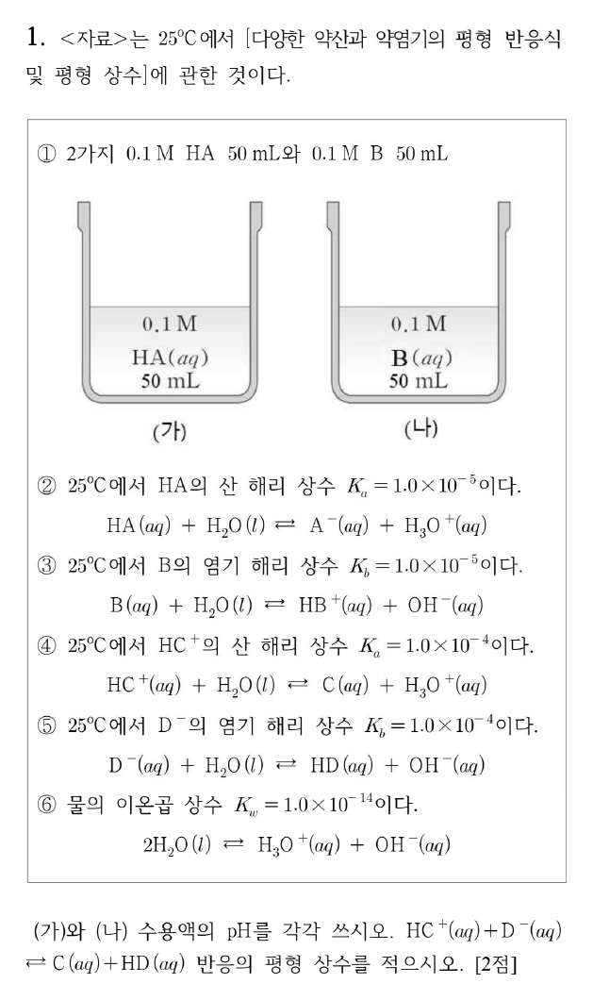

**정답** (답지 난이도 ★★☆☆☆) (가) pH **3.0**, (나) pH **11.0**, $K = $ **1.0 × 10⁶**

**공식·핵심 개념**

- 약산 $[\mathrm H^+] \approx \sqrt{K_aC}$, 약염기 $[\mathrm{OH^-}] \approx \sqrt{K_bC}$
- $K_aK_b = K_w$ (짝산–짝염기)
- 산 + 염기 반응의 $K = \dfrac{K_a(\text{반응물 산})}{K_a(\text{생성물 산})}$

**2027 출제 가능성 ★★★☆☆ 보통** — 기본 계산 2점 문항입니다. B형 앞 번호에 자주 놓입니다.

**주어진 것** 0.1 M HA($K_a = 10^{-5}$), 0.1 M B($K_b = 10^{-5}$), HC⁺ $K_a = 10^{-4}$, D⁻ $K_b = 10^{-4}$

**구할 것** (가)·(나)의 pH, HC⁺ + D⁻ ⇌ C + HD의 $K$

**풀이 전략** 근사식으로 pH를 구하고 5 % 규칙을 확인합니다. 평형 상수는 반응식을 Ka·Kb 식의 조합으로 만듭니다.

**(1) (가).**

$$[\mathrm H^+] = \sqrt{1.0\times10^{-5}\times0.1} = 1.0\times10^{-3}\ \mathrm M \Rightarrow \mathrm{pH} = 3.0$$

해리 백분율 $10^{-3}/0.1 = 1\ \% < 5\ \%$ ✓

**(2) (나).**

$$[\mathrm{OH^-}] = \sqrt{1.0\times10^{-5}\times0.1} = 1.0\times10^{-3} \Rightarrow \mathrm{pOH} = 3.0,\ \mathrm{pH} = 11.0$$

**(3) $K$.** 반응식 = (HC⁺의 산 해리) + (D⁻의 염기 해리) + (물의 역 자동 이온화):

$$K = K_a(\mathrm{HC^+})\cdot K_b(\mathrm{D^-})\cdot\frac{1}{K_w} = \frac{10^{-4}\times10^{-4}}{10^{-14}} = 1.0\times10^{6}$$

또는 HD의 $K_a = K_w/K_b = 10^{-10}$을 써서 $K = 10^{-4}/10^{-10} = 10^6$.

**검산** 강한 쪽 산(HC⁺, pKa 4)이 약한 쪽 산(HD, pKa 10)을 만드는 방향이므로 $K \gg 1$ ✓.

**채점 포인트·함정**

- $K = K_aK_b$로 끝내면 $10^{-8}$이 되어 틀립니다. $K_w$로 나누어야 합니다.

## B형 2번 · 기체 크로마토그래피의 용량 인자와 분리도 {#b2}

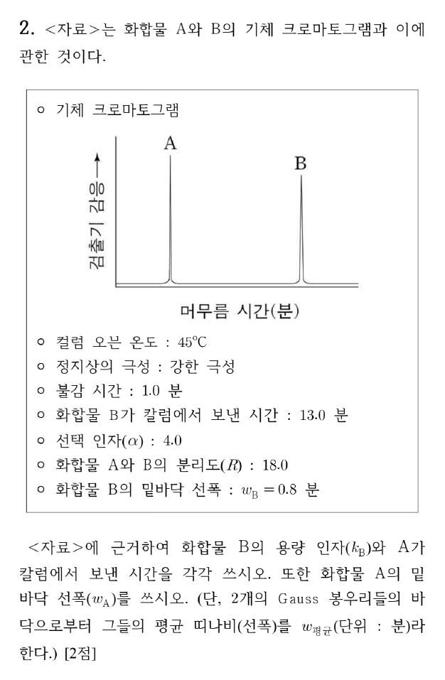

**정답** (답지 난이도 ★★☆☆☆) $k_B = $ **12.0**, A가 칼럼에서 보낸 시간 **4.0 분**, $w_A = $ **0.2 분**

**공식·핵심 개념**

- 용량 인자 $k = \dfrac{t_R - t_M}{t_M}$
- 선택 인자 $\alpha = \dfrac{k_B}{k_A}$ (B가 늦게 나옴)
- 분리도 $R = \dfrac{\Delta t_R}{w_{av}}$, $w_{av} = \frac{w_A + w_B}{2}$

**2027 출제 가능성 ★★★★☆ 높음** — 크로마토그래피 기본 지표 계산은 해마다 형태를 바꾸어 나옵니다.

**주어진 것** $t_M = 1.0$ 분, $t_{R,B} = 13.0$ 분, $\alpha = 4.0$, $R = 18.0$, $w_B = 0.8$ 분

**구할 것** $k_B$, $t_{R,A}$, $w_A$

**풀이 전략** 정의식을 차례로 적용합니다. "칼럼에서 보낸 시간"은 머무름 시간 $t_R$입니다.

**(1) $k_B$.**

$$k_B = \frac{13.0 - 1.0}{1.0} = 12.0$$

**(2) $t_{R,A}$.**

$$k_A = \frac{k_B}{\alpha} = \frac{12.0}{4.0} = 3.0$$

$$t_{R,A} = t_M(1 + k_A) = 1.0\times4.0 = 4.0\ \text{분}$$

**(3) $w_A$.**

$$R = \frac{13.0 - 4.0}{w_{av}} = 18.0 \Rightarrow w_{av} = 0.50\ \text{분}$$

$$w_A = 2w_{av} - w_B = 1.0 - 0.8 = 0.2\ \text{분}$$

**검산** $R = \frac{9.0}{(0.2+0.8)/2} = 18$ ✓. A가 먼저 나와 봉우리가 좁은 것은 그림(A가 더 날카로움)과 맞습니다.

**채점 포인트·함정**

- "칼럼에서 보낸 시간"을 조정 머무름 시간(3.0 분)으로 쓰지 마세요. 답지는 **4.0 분**입니다.
- 분리도 식을 $2\Delta t_R/(w_A+w_B)$로 써도 같은 값입니다.

## B형 3번 · 드라이버 개념 변화 모형 (화학 반응의 질량 보존) {#b3}

**정답**

- (다): '생각의 재구성'의 하위 단계 **상충된 상황에 노출**
- 이유: 앙금 생성 반응과 기체 발생 탐구 실험 전후에 **질량의 변화가 없음을 경험**하게 하여, 나무 연소에서 질량이 변한다는 생각과 **인지 갈등**을 일으키기 때문이다.
- ㉠: 화학 반응이 일어날 때 물질을 구성하는 **원자의 배열만 변하고, 원자의 종류와 수는 변하지 않음**을 설명한다.
- ㉡: **가설의 확정**(가설의 기각 또는 수용)

**공식·핵심 개념**

- 드라이버 개념 변화 모형: 오리엔테이션 → 생각의 표현 → **생각의 재구성**(명료화와 교환 → 상충된 상황에 노출 → 새로운 생각의 구성 → 새로운 생각의 평가) → 생각의 적용 → 생각 변화의 검토
- 질량 보존: 닫힌 계에서 반응 전후 질량 합이 같음

**2027 출제 가능성 ★★★★★ 매우 높음** — 드라이버 모형은 개념 변화 학습 이론 중 가장 자주 나옵니다. 질량 보존 단원과 결합한 수업 계획 문항이 전형입니다.

**단계 판단.** (가)는 모둠 의견을 나누어 공유하므로 **명료화와 교환**입니다. (다)는 닫힌 계 실험으로 "질량이 변하지 않는다"는 반례를 경험시키므로 **상충된 상황에 노출**입니다. (라)는 원인을 설명하므로 **새로운 생각의 구성**입니다.

**㉠과 2022 개정 [과학].** 원자 수준 설명은 중학교 '화학 반응의 규칙과 에너지 변화' 성취기준에 근거합니다. 질량 보존을 **원자의 재배열**로 설명하는 것이 핵심입니다.

**㉡.** 결론 도출은 탐구 과정의 마지막 요소이므로, 실험 결과를 근거로 처음 가설("질량이 변한다")을 **기각하거나 수용**하는지를 평가합니다.

**채점 포인트·함정**

- (다)를 "새로운 생각의 구성"으로 쓰면 틀립니다. 직접 실험으로 반례를 보는 단계는 **상충된 상황에 노출**입니다.
- ㉠은 "질량이 보존된다"만 쓰면 부족합니다. **원자의 종류와 수 불변**을 써야 합니다.

## B형 4번 · 러더퍼드 원자 모형과 과학 철학 {#b4}

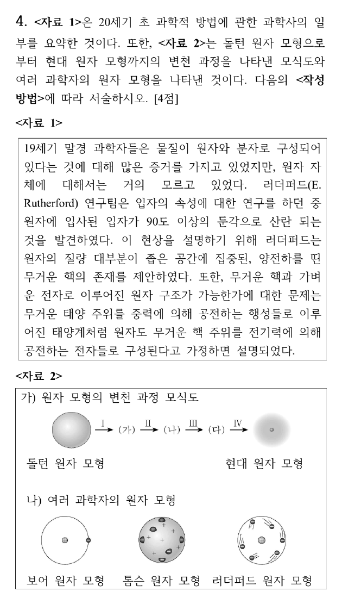

**정답**

- 귀추적 추리의 두 번째 단계(**인과적 의문 형성**): "양전하를 띤 알파 입자는 원자 내부의 빈 공간은 통과하지만, 양으로 하전된 (무거운) 중심에는 둔각으로 산란될 것이다."
- 보호대: "무거운 태양 주위를 중력에 의해 공전하는 행성들로 이루어진 태양계처럼, 원자도 무거운 핵 주위를 전기력에 의해 공전하는 전자들로 구성된다"는 **가정**
- 쿤의 관점: **전과학 단계**. 근거: 러더퍼드 모형은 과학자 사이에 **합의되지 않은** 상황에서, 비조직적이고 다양한 목적을 지닌 과학자 **개인의 활동**이었기 때문이다.
- 과학의 본성: 과학은 경험적 기반 위에서 **상상력과 추론의 산물**이다. 판단 준거: 돌턴, 톰슨, 러더퍼드, 보어 등은 원자에 대한 가정과 실험 결과를 바탕으로 상상력과 창의적 추론을 통해 원자 모형을 제시하였다.

**공식·핵심 개념**

- 귀추: 의문 상황 관찰 → **인과적 의문 형성** → 가설 생성(기존 지식 차용) → 가설 검증
- 라카토스 연구 프로그램: 견고한 핵(반증 불가) + **보호대**(보조 가설)
- 쿤: 전과학 → 정상 과학(패러다임) → 변칙 사례 → 위기 → 과학 혁명

**2027 출제 가능성 ★★★★☆ 높음** — 과학 철학자(쿤·라카토스)와 귀추적 추리를 묶는 문항은 화학교육 B형에 자주 나옵니다.

**귀추 단계.** 둔각 산란이라는 놀라운 현상을 관찰하는 것이 1단계입니다. 2단계는 "왜 일부만 큰 각으로 튀어나오는가?"라는 **인과적 의문**을 형성하는 것입니다. 이어 양전하 중심의 존재를 가설로 생성하고(3단계), 태양계 모형을 **차용**합니다.

**보호대.** 러더퍼드 연구 프로그램의 견고한 핵은 "질량이 좁은 공간에 집중된 양전하 핵"입니다. "가벼운 전자가 어떻게 안정하게 존재하는가"라는 문제를 막아 주는 보조 가설이 **태양계 유비 가정**입니다.

**쿤의 단계.** 답지는 **전과학 단계**로 봅니다. 원자 구조에 대해 공유된 패러다임이 없고, 여러 모형(톰슨·나가오카·러더퍼드)이 경쟁하던 시기라는 것이 근거입니다.

**채점 포인트·함정**

- 보호대는 "핵의 존재"가 아닙니다(견고한 핵). **태양계 가정**을 찾아 써야 합니다.
- 과학의 본성은 판단 준거(여러 과학자의 모형 제시 과정)와 함께 씁니다.

## B형 5번 · 과학의 본성, 반증주의, 쿤의 격변적 모형 {#b5}

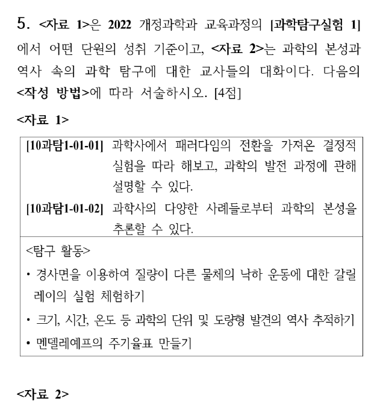

**정답**

- 과학의 본성 두 가지: 과학사의 다양한 사례에서 과학자들의 **결정적 실험과 우연한 발견** 등을 통한 과학 지식의 도출 방법, 과학 지식의 **잠정성**을 체험할 기회를 제공하기 때문이다.
- ㉠(반증주의): 가설 연역에서 반증의 수단인 관찰이 **이론 의존성**을 가지므로 반증 결과에 영향을 미치기 때문이다(반증 사례가 나와도 관찰이나 보조 가설을 의심할 수 있음).
- ㉡의 시사점: 과학적 진보의 격변적 모형은 학생의 오개념을 과학적 개념으로 교환하는 **개념 교환 모형**과 **토론 수업, 역할 놀이** 등의 수업 전략에서 효과적임을 시사한다.

**공식·핵심 개념**

- 반증주의(포퍼): 가설은 반증으로만 기각, 그러나 관찰의 이론 의존성 → 결정적 실험의 한계(뒤엠–콰인)
- 쿤: 패러다임 전환 = 격변적(혁명적) 변화, 사회적 합의
- 개념 교환(Hewson): 기존 개념을 버리고 새 개념으로 교체

**2027 출제 가능성 ★★★★☆ 높음** — 2022 개정 [과학탐구실험 1]의 '과학의 본성' 성취기준은 새 교육과정 문항으로 적합합니다.

**과학의 본성.** [10과탐1-01-01]은 갈릴레이 결정적 실험을, 탐구 활동은 도량형 발견의 역사와 멘델레예프 주기율표를 다룹니다. 그래서 (1) 지식 도출 방법(결정적 실험, 우연한 발견)과 (2) 지식의 잠정성(이론이 바뀌어 옴)을 체험할 수 있습니다.

**㉠.** 반증주의는 예측과 관찰이 어긋나면 가설을 기각해야 한다고 봅니다. 하지만 관찰 자체가 이론에 의존하므로, 과학자는 관찰 이론이나 보조 가설을 수정해 원래 이론을 지킬 수 있습니다. 그래서 한쪽 결과만으로 이론이 곧바로 폐기되지 않습니다(라카토스의 보호대로 이어짐).

**㉡.** 패러다임이 통째로 바뀐다는 격변 모형은 학생의 개념도 점진적 확장(개념 포섭·교환 중 교환)으로 바뀐다고 봅니다. 그래서 상충되는 관점을 드러내고 사회적으로 합의하는 **토론·역할 놀이**가 효과적입니다.

**채점 포인트·함정**

- ㉠은 "반증주의의 과학적 방법"이라는 조건 때문에 **가설 연역 + 관찰의 이론 의존성**을 함께 써야 합니다.

## B형 6번 · [M(CO)₃(H₂O)₃]⁺의 치환 반응과 fac/mer IR {#b6}

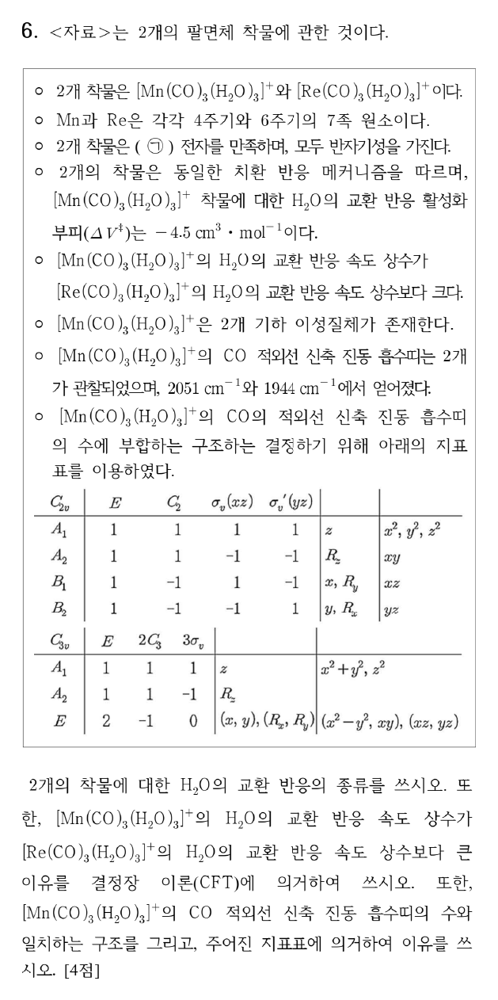

**정답** (답지 난이도 ★★★☆☆)

- ㉠ **18**(전자 규칙). H₂O 교환 반응: **회합(associative, 회합 교환 I_a)** 메커니즘
- Mn이 빠른 이유(CFT): 같은 족 5d의 Re는 4d·3d보다 **Δo가 커서** 저스핀 d⁶의 결정장 안정화 에너지가 크다. 7배위 전이 상태로 갈 때 잃는 **결정장 활성화 에너지(CFAE)**가 Re에서 더 크므로 Re가 느리고 Mn이 빠르다.
- 구조: **fac-[Mn(CO)₃(H₂O)₃]⁺**(C₃ᵥ). CO 신축 $\Gamma = A_1 + E$ → IR 활성 **2개**(2051, 1944 cm⁻¹와 일치). mer(C₂ᵥ)는 $2A_1 + B_1$ → 3개.

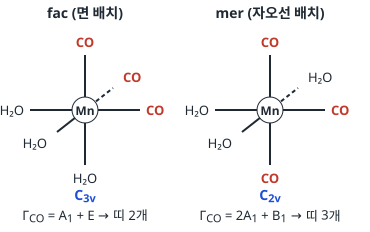

**공식·핵심 개념**

- 활성화 부피 $\Delta V^\ddagger < 0$ → 회합적(전이 상태가 더 조밀)
- 저스핀 d⁶ 팔면체: CFSE $= -2.4\Delta_o$, 치환 비활성
- IR 활성: x, y, z와 같은 대칭의 기약표현

**2027 출제 가능성 ★★★★☆ 높음** — 카보닐 IR 띠 수로 이성질체를 고르는 문항은 군론 응용의 대표 소재입니다.

**주어진 것** Mn(I)·Re(I) 착물, $\Delta V^\ddagger = -4.5$ cm³ mol⁻¹, $k_{\mathrm{Mn}} > k_{\mathrm{Re}}$, 이성질체 2개, CO 띠 2개, C₂ᵥ·C₃ᵥ 지표표

**구할 것** ㉠, 교환 반응 종류, 속도 차이의 CFT 근거, 구조와 지표표 근거

**풀이 전략** 전자 수 → 활성화 부피 부호 → Δo 크기로 속도를 설명하고, 환원 공식으로 CO 띠 수를 셉니다.

**(1) 전자 수.** Mn⁺는 d⁶, CO 3 × 2 e, H₂O 3 × 2 e이므로 $6 + 6 + 6 = 18$ e입니다(Re도 같은 7족).

**(2) 회합.** 18전자인데도 $\Delta V^\ddagger < 0$입니다. 이는 들어오는 H₂O가 결합을 먼저 만드는 회합적 활성화(I_a)를 뜻합니다.

**(3) 속도 차이.** Δo는 3d < 4d < 5d 순으로 커집니다(5d는 약 1.5~2배). 저스핀 d⁶에서 전이 상태(7배위)로 가면 CFSE의 손실(CFAE)이 Δo에 비례해 커지므로 Re의 활성화 에너지가 더 큽니다.

**(4) fac (C₃ᵥ) 환원.** CO 3개의 신축 벡터 표현은 $\Gamma = (3, 0, 1)$입니다(E, 2C₃, 3σᵥ).

$$n(A_1) = \tfrac16[3\cdot1 + 2\cdot0\cdot1 + 3\cdot1\cdot1] = 1$$

$$n(A_2) = \tfrac16[3 + 0 + 3(-1)] = 0$$

$$n(E) = \tfrac16[3\cdot2 + 2\cdot0\cdot(-1) + 3\cdot1\cdot0] = 1$$

$\Gamma = A_1 + E$입니다. A₁(z)와 E(x, y) 모두 IR 활성이므로 **2개**입니다 ✓.

**(5) mer (C₂ᵥ) 환원.** 세 CO가 한 평면(xz)에 있다고 두면 $\Gamma = (3, 1, 3, 1)$입니다(E, C₂, σᵥ(xz), σᵥ′(yz)). C₂와 σᵥ′(yz)에서는 z축 위의 CO 1개만 제자리에 남고, σᵥ(xz)에서는 3개 모두 남습니다.

$$n(A_1) = \tfrac14[3 + 1 + 3 + 1] = 2,\quad n(A_2) = \tfrac14[3 + 1 - 3 - 1] = 0$$

$$n(B_1) = \tfrac14[3 - 1 + 3 - 1] = 1,\quad n(B_2) = \tfrac14[3 - 1 - 3 + 1] = 0$$

$\Gamma = 2A_1 + B_1$입니다. 모두 IR 활성이므로 **3개**입니다 ✗.

**검산** 환원 결과의 차원: fac $1 + 2 = 3$, mer $2 + 1 = 3$ = CO 수 ✓.

**채점 포인트·함정**

- "18전자이므로 해리"라고 쓰면 활성화 부피 자료와 모순입니다.
- 이유는 CFT(Δo, CFAE)로 써야 합니다. 상대론 효과나 M–L 결합 세기만 쓰면 조건 위반입니다.
- 구조는 CO 세 개가 **한 면**을 차지하게 그립니다(fac).

## B형 7번 · 니트로실 착물의 전자 수와 N–O 진동 {#b7}

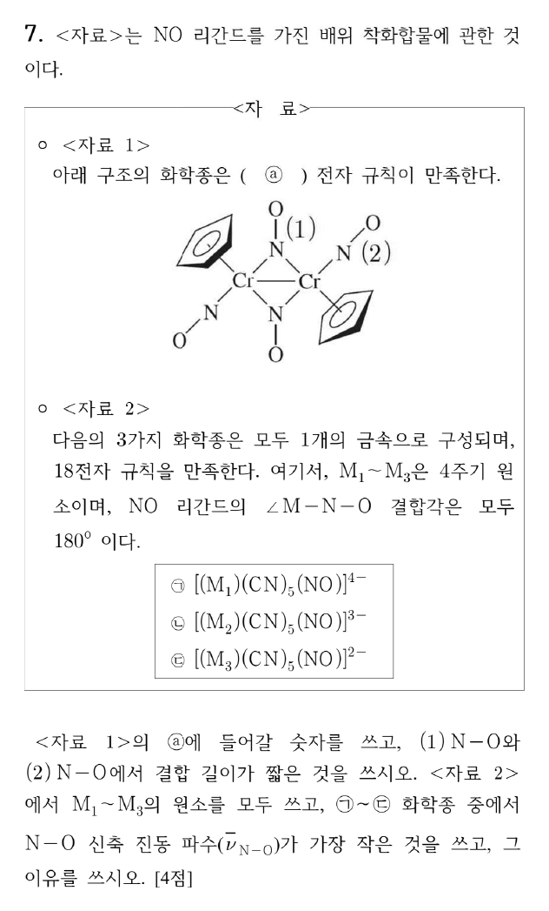

**정답** (답지 난이도 ★★★☆☆)

- ⓐ **18**
- 결합 길이가 짧은 것: **(2) N–O**(말단, 직선형)
- M₁ = **Cr**(24), M₂ = **Mn**(25), M₃ = **Fe**(26)
- $\tilde\nu_{\mathrm{N-O}}$가 가장 작은 것: **㉠ [Cr(CN)₅(NO)]⁴⁻**. 이유: 금속 산화수가 가장 낮아(Cr⁰) d 전자 밀도가 높으므로 NO의 π*로 **역공여**가 가장 크다. 그러면 N–O 결합 차수가 낮아져 진동수가 가장 작다.

**공식·핵심 개념**

- 직선 NO = NO⁺(2 e 이온 계산) = 3 e(중성 계산), 다리 μ₂-NO = 3 e를 두 금속이 나눔
- Cp = 5 e(중성) / 6 e(Cp⁻)
- 역공여↑ → ν(N–O)↓, 결합 길이↑

**2027 출제 가능성 ★★★★☆ 높음** — 18전자 규칙과 π 역공여에 따른 IR 비교는 유기금속 단골 소재입니다.

**주어진 것** Cp₂Cr₂(μ-NO)₂(NO)₂ 구조, 4주기 M의 [M(CN)₅(NO)]ⁿ⁻(n = 4, 3, 2), 직선 M–N–O, 18전자

**구할 것** ⓐ, 짧은 N–O, M₁~M₃, 가장 작은 $\tilde\nu_{\mathrm{N-O}}$와 이유

**풀이 전략** 중성 계산법으로 Cr 하나의 전자를 세고, 이온 계산법(NO⁺, CN⁻)으로 금속의 dⁿ을 정합니다.

**(1) ⓐ (Cr 하나 기준, 중성 계산).**

| 기여 | 전자 수 |
|---|---|
| Cr(6족) | 6 |
| η⁵-Cp | 5 |
| 말단 NO(직선) | 3 |
| 다리 NO 2개(각 3 e를 둘이 나눔) | 1.5 × 2 = 3 |
| Cr–Cr 결합 | 1 |
| 합 | **18** |

**(2) 결합 길이.** 다리 NO는 두 금속에서 π* 역공여를 받아 결합 차수가 더 낮아집니다. 말단 직선 NO(NO⁺에 가까움, 3중 결합 성격)의 N–O가 **더 짧습니다**. IR로도 말단 ~1650~1750, 다리 ~1500 cm⁻¹ 근처입니다.

**(3) M 결정.** NO⁺(+1), CN⁻(−1) × 5이므로

$$x + 5(-1) + (+1) = -n \Rightarrow x = 4 - n$$

| 화학종 | 전하 | 금속 산화수 | 18 e 조건: $d^m + 10 + 2 = 18$ | 원소 |
|---|---|---|---|---|
| ㉠ | 4− | 0 | $m = 6$ → 6족 | Cr |
| ㉡ | 3− | +1 | $d^6$ → 7족 | Mn |
| ㉢ | 2− | +2 | $d^6$ → 8족 | Fe (니트로프루사이드) |

**(4) ν(N–O).** 모두 d⁶이지만 산화수가 0 < +1 < +2입니다. 산화수가 낮을수록 d 오비탈 에너지가 높고 확산되어 π* 역공여가 강합니다. 따라서 ν(N–O)는 ㉠ < ㉡ < ㉢이고, 가장 작은 것은 **㉠**입니다. 실측 값은 ㉢ Na₂[Fe(CN)₅NO]에서 약 1940 cm⁻¹이고 ㉠으로 갈수록 내려갑니다.

**검산** ㉢: Fe²⁺ d⁶ 6 + CN 10 + NO⁺ 2 = 18 ✓.

**채점 포인트·함정**

- 다리 NO를 각 Cr에 3 e씩 세면 19.5 e가 되어 틀립니다(1.5 e씩).
- 직선 NO를 NO⁻(굽은형)로 세면 M을 잘못 정합니다. 조건 "∠M–N–O = 180°"가 NO⁺ 계산을 지정합니다.

## B형 8번 · 다이에논–페놀 자리옮김 {#b8}

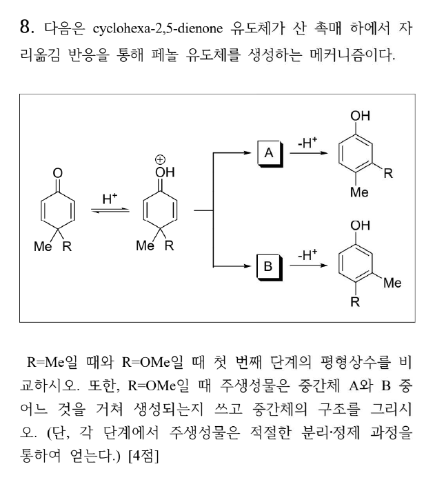

**정답** (공식 정답 없음 · 직접 풀이·필기 일치)

- 첫 단계(카보닐 양성자화)의 평형 상수: **R=Me > R=OMe**. OMe는 유발 효과(σ 끌개)로 양이온을 불안정하게 합니다.
- R=OMe의 주생성물은 **중간체 B**를 거칩니다. B는 Me가 C4 → C3으로 이동하여 양전하가 OMe 탄소에 놓인 **옥소카베늄 이온**입니다.

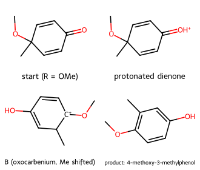

**공식·핵심 개념**

- 다이에논–페놀 자리옮김: 산 촉매 양성자화 → 1,2-알킬 이동 → 탈양성자화 → 방향족화
- 이동 후 남는 양이온의 안정성이 이동기를 결정
- OMe: σ 끌개(유발), π 주개(공명) → 이웃 양이온을 공명으로 크게 안정화

**2027 출제 가능성 ★★★☆☆ 보통** — 자리옮김 반응은 고급 소재이지만, "양이온 안정성으로 경로 판단"이라는 사고 틀은 자주 나옵니다.

**주어진 것** 4,4-이치환 cyclohexa-2,5-dienone(Me, R), H⁺ 촉매 → 중간체 A(R 이동) 또는 B(Me 이동) → 페놀

**구할 것** R = Me와 OMe일 때 첫 단계 K 비교, R=OMe일 때 주경로 중간체와 구조

**풀이 전략** 양성자화된 다이에논의 양전하 위치(C1, C3, C5)를 보고 C4 치환기의 효과를 판단합니다. 1,2-이동 후 C4에 남는 양전하를 무엇이 안정화하는지 비교합니다.

**(1) 첫 단계.** 카보닐 O에 H⁺가 붙으면 양전하는 C1, C3, C5에 걸칩니다. C4의 OMe는 공명으로는 이 양이온과 연결되지 않습니다(C4는 sp³). 그래서 전기음성 O의 **σ 끌개 효과**만 작용해 양이온이 불안정해집니다. 따라서 $K_{\mathrm{OMe}} < K_{\mathrm{Me}}$입니다.

**(2) 1,2-이동 선택.** C3(양전하 자리)으로 C4의 한 기가 옮겨 가면 C4에 양전하가 남습니다.

- **A 경로(OMe 이동)**: C4에 Me만 남음 → 3차 알킬 양이온(알릴성 공명)
- **B 경로(Me 이동)**: C4에 OMe가 남음 → O의 비공유 전자쌍이 공명($\mathrm{C^+–OMe \leftrightarrow C=O^+Me}$)하는 **옥소카베늄** → 훨씬 안정

따라서 R=OMe에서는 **B**를 거칩니다.

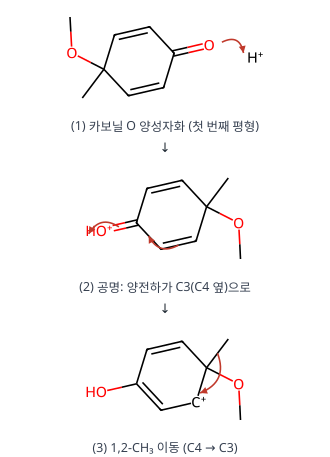

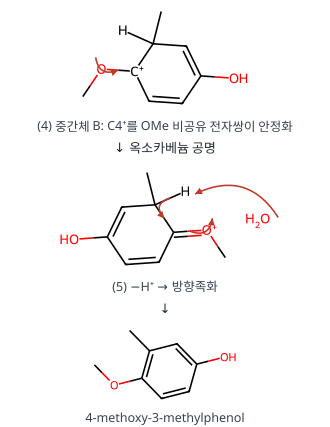

**(3) 생성물.** B에서 C3의 H⁺가 빠지면 고리가 방향족화되어 4-methoxy-3-methylphenol이 됩니다(그림의 아래 생성물, R = OMe가 OH의 para).

비교를 위해 A 경로를 그렸습니다. OMe가 이동하면 덜 안정한 양이온이 남습니다.

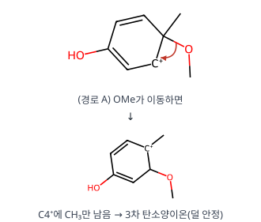

**왜 이 생성물인가** 1,2-이동은 이동하는 기의 이동 적성보다 **이동 후 생기는 양이온의 안정성**이 결정합니다. 메톡시가 남아 있는 탄소는 산소 비공유 전자쌍으로 옥소카베늄이 되어 공명 안정화가 큽니다. 그래서 OMe는 "제자리를 지키고" Me가 이동합니다.

**검산** B: C₈H₁₁O₂⁺. 최종 페놀 C₈H₁₀O₂(RDKit) = 출발 다이에논 C₈H₁₀O₂의 이성질체 ✓(자리옮김은 원자 수 보존).

**채점 포인트·함정**

- OMe의 공명 효과(π 주개)를 첫 단계에 적용해 "K가 커진다"고 쓰면 틀립니다. C4는 sp³라 **유발 효과만** 작용합니다.
- 중간체 B는 양전하를 **O–C4** 옥소카베늄으로 그려야 합니다.

## B형 9번 · 니트로벤젠에서 1-브로모-2,6-다이클로로-4-tert-뷰틸벤젠 합성 {#b9}

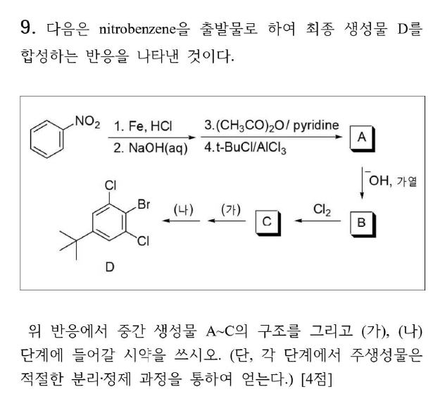

**정답** (공식 정답 없음 · 직접 풀이·필기 일치)

- A: **N-(4-tert-butylphenyl)acetamide**
- B: **4-tert-butylaniline**
- C: **2,6-dichloro-4-tert-butylaniline**
- (가) **NaNO₂, HCl (0–5 °C)**, (나) **CuBr** (Sandmeyer)

**공식·핵심 개념**

- Fe/HCl: Ar–NO₂ → Ar–NH₃⁺ → (NaOH) Ar–NH₂
- 아세틸 보호: –NHAc는 여전히 o,p-지향이지만 덜 활성화되고 루이스 산과 착물을 만들지 않음
- 다이아조화: ArNH₂ + HNO₂ → ArN₂⁺, Sandmeyer: CuX → ArX

**2027 출제 가능성 ★★★★★ 매우 높음** — 방향족 다단계 합성(보호기 + 지향성 + 다이아조늄)은 유기 4점 문항의 단골입니다.

**주어진 것** 니트로벤젠 → 1. Fe, HCl 2. NaOH → 3. Ac₂O/pyridine 4. t-BuCl/AlCl₃ → A → ⁻OH, 가열 → B → Cl₂ → C → (가) → (나) → D

**구할 것** A~C 구조, (가)·(나) 시약

**풀이 전략** D에서 거꾸로 봅니다. Br은 다이아조늄으로 바꾸어 넣고, 두 Cl은 NH₂의 ortho로 들어가며, t-Bu는 para에 있습니다.

**(1) 아닐린과 아세틸화.** Fe/HCl로 니트로기를 아민으로 환원하고 NaOH로 중화하면 아닐린이 됩니다. Ac₂O/pyridine으로 아세트아닐라이드를 만듭니다. 이 보호에는 두 가지 이유가 있습니다.

- 자유 NH₂는 AlCl₃와 루이스 산–염기 착물을 이루어 Friedel–Crafts를 막습니다.
- 과도한 활성화로 다중 치환이 일어납니다.

**(2) Friedel–Crafts 알킬화 → A.** AlCl₃가 t-Bu⁺를 만들고, –NHAc의 o,p-지향 중 입체적으로 유리한 **para**에 붙습니다.

**(3) 가수분해 → B.** ⁻OH와 가열로 아마이드를 가수분해하여 4-tert-butylaniline을 얻습니다.

**(4) 염소화 → C.** NH₂는 강한 o,p-지향 활성화기입니다. para는 t-Bu가 막고 있으므로 두 **ortho** 자리(2, 6)에 Cl₂가 들어갑니다. 아닐린은 활성이 커서 루이스 산 없이도 이중 치환됩니다.

**(5) (가)·(나).** NaNO₂/HCl(0–5 °C)로 NO⁺를 만들어 다이아조늄염을 얻습니다. 이어 CuBr(Sandmeyer)로 N₂를 Br로 바꿉니다.

**왜 이 생성물인가** NH₂를 "지향기"로 쓴 뒤 다이아조늄으로 바꾸어 원하는 치환기(Br)로 교체하는 전략입니다. Br을 직접 넣으면 tert-뷰틸 기준 위치가 맞지 않습니다. NH₂가 있던 자리(1번)에만 Br을 넣을 수 있는 방법이 Sandmeyer입니다.

**검산** 분자식 A C₁₂H₁₇NO, B C₁₀H₁₅N, C C₁₀H₁₃Cl₂N, D C₁₀H₁₁BrCl₂(RDKit) ✓.

**채점 포인트·함정**

- A에서 t-Bu를 ortho에 쓰면 틀립니다(입체 장애 → **para**).
- (나)를 CuCl이나 HBr만 쓰면 감점됩니다. **CuBr**입니다.
- 다이아조화 온도(0–5 °C)를 쓰면 좋습니다(분해 방지).

## B형 10번 · 고리 위의 입자: 정규화와 확률 밀도 {#b10}

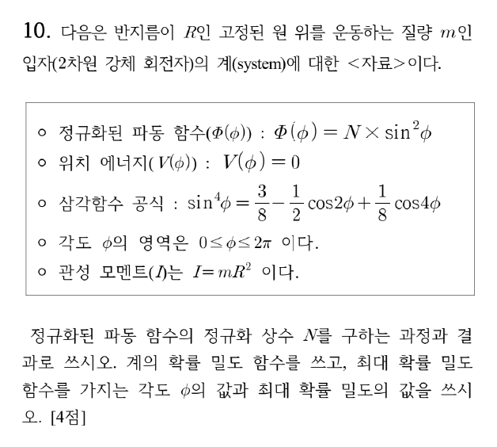

**정답** (답지 난이도 ★★★☆☆)

- $N = \left(\dfrac{4}{3\pi}\right)^{1/2}$
- 확률 밀도 $P(\phi) = \dfrac{4}{3\pi}\sin^4\phi$
- 최대인 φ: $\dfrac{\pi}{2}$, $\dfrac{3\pi}{2}$, 최댓값 $\dfrac{4}{3\pi}$ (≈ 0.424)

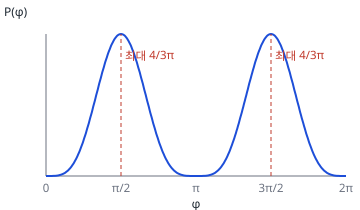

**공식·핵심 개념**

- 정규화 $\int_0^{2\pi}|\Phi|^2d\phi = 1$
- $\int_0^{2\pi}\cos(m\phi)\,d\phi = 0$ ($m \neq 0$)
- 확률 밀도 $= |\Phi(\phi)|^2$

**2027 출제 가능성 ★★★☆☆ 보통** — 고리 위 입자는 양자역학 기본 계 중 상대적으로 덜 나오지만 정규화 계산은 기본입니다.

**주어진 것** $\Phi = N\sin^2\phi$, $V = 0$, $\sin^4\phi = \frac38 - \frac12\cos2\phi + \frac18\cos4\phi$, $0 \le \phi \le 2\pi$

**구할 것** $N$, $P(\phi)$, 최대 위치와 값

**풀이 전략** 삼각함수 공식을 넣어 적분하면 cos 항은 한 주기 적분으로 0이 됩니다.

**(1) 정규화.**

$$\int_0^{2\pi}N^2\sin^4\phi\,d\phi = N^2\left[\frac38(2\pi) - \frac12\cdot0 + \frac18\cdot0\right] = N^2\cdot\frac{3\pi}{4} = 1$$

$$N = \left(\frac{4}{3\pi}\right)^{1/2}$$

**(2) 확률 밀도.**

$$P(\phi) = |\Phi|^2 = \frac{4}{3\pi}\sin^4\phi$$

**(3) 최댓값.** $\sin^4\phi \le 1$이고 $|\sin\phi| = 1$일 때 최대이므로 $\phi = \pi/2,\ 3\pi/2$입니다.

$$P_{max} = \frac{4}{3\pi} \approx 0.424$$

**검산** sympy: $\int_0^{2\pi}\sin^4\phi\,d\phi = 3\pi/4$ ✓. 최솟값 0은 φ = 0, π(마디).

**채점 포인트·함정**

- 적분 구간은 $2\pi$입니다. $\pi$로 하면 $N$이 √2배 커집니다.
- "최대 확률 밀도의 값"은 $N^2$, 즉 $4/(3\pi)$입니다. $N$이 아닙니다.

## B형 11번 · 수소 원자 3p 오비탈 {#b11}

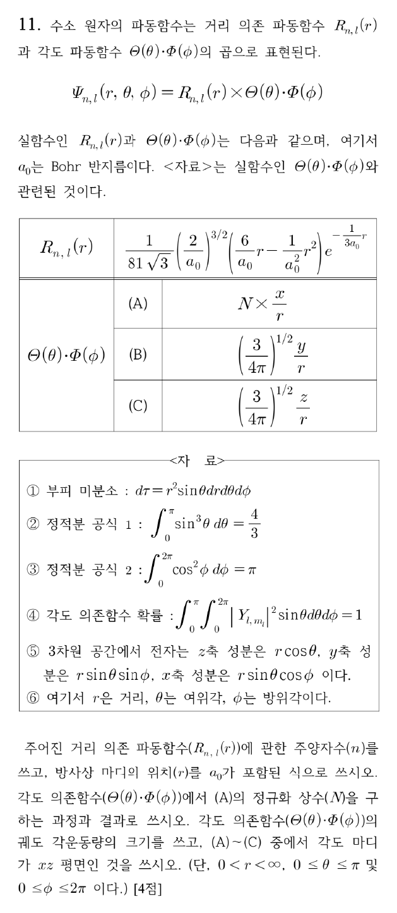

**정답** (답지 난이도 ★★★☆☆)

- $n = $ **3**, 방사상 마디 $r = $ **6a₀**
- (A)의 $N = \left(\dfrac{3}{4\pi}\right)^{1/2}$
- 궤도 각운동량의 크기 **$\sqrt2\,\hbar$**
- 각도 마디가 xz 평면인 것: **(B)**

**공식·핵심 개념**

- 방사상 마디 수 $= n - l - 1$, 각도 마디 수 $= l$
- $|\mathbf L| = \sqrt{l(l+1)}\,\hbar$
- $x/r = \sin\theta\cos\phi$, $y/r = \sin\theta\sin\phi$, $z/r = \cos\theta$

**2027 출제 가능성 ★★★★☆ 높음** — 수소 원자 파동함수의 마디와 정규화는 물리화학 단골 소재입니다.

**주어진 것** $R(r) \propto \left(\frac{6}{a_0}r - \frac{1}{a_0^2}r^2\right)e^{-r/3a_0}$, 각도 함수 (A) $Nx/r$, (B) $\propto y/r$, (C) $\propto z/r$

**구할 것** $n$, 방사상 마디, (A)의 $N$, $|\mathbf L|$, xz 평면 마디를 가진 것

**풀이 전략** 지수 $e^{-r/na_0}$로 $n$을, 각도 함수(x/r 형태)로 $l = 1$을 정합니다. 다항식의 근이 마디입니다.

**(1) $n$.** $e^{-r/3a_0} = e^{-r/na_0}$이므로 $n = 3$입니다. 각도 함수가 x, y, z의 1차식이므로 $l = 1$(3p)입니다.

**(2) 방사상 마디.**

$$\frac{6}{a_0}r - \frac{r^2}{a_0^2} = \frac{r}{a_0}\left(6 - \frac{r}{a_0}\right) = 0$$

$r > 0$이므로 $r = 6a_0$입니다. 마디 수 $n - l - 1 = 1$개 ✓.

**(3) (A)의 정규화.** $x/r = \sin\theta\cos\phi$이므로

$$N^2\int_0^\pi\sin^2\theta\sin\theta\,d\theta\int_0^{2\pi}\cos^2\phi\,d\phi = N^2\cdot\frac43\cdot\pi = 1$$

$$N = \left(\frac{3}{4\pi}\right)^{1/2}$$

(B), (C)와 같은 값입니다.

**(4) 각운동량.**

$$|\mathbf L| = \sqrt{1(1+1)}\,\hbar = \sqrt2\,\hbar$$

**(5) xz 평면 마디.** xz 평면은 $y = 0$입니다. $y/r$이 0이 되는 (B)($3p_y$)입니다.

**검산** sympy: $\int\sin^3\theta\,d\theta\int\cos^2\phi\,d\phi = 4\pi/3$ ✓. $r = 0$은 원점이라 마디로 세지 않습니다.

**채점 포인트·함정**

- 방사상 마디를 $r = 0$까지 포함해 두 개로 쓰면 틀립니다.
- (A)의 각도 마디는 yz 평면, (C)는 xy 평면입니다.

---

원문: 2027학년도 대비 9–11월 전공화학 제3회 모의고사(안병천, 임용닷컴) 문제지·답지·강의 필기. 개인 학습용 정리입니다.

