# 2027학년도 대비 안병천 전공화학 모의고사 4회 — 상세해설

안병천 전공화학 9–11월 모의고사 제4회(전공 A 12문항 · 전공 B 11문항)의 문항별 해설입니다. 공식 답지(「전공 A와 B 답지(수강생용)」)와 강의 필기본을 바탕으로 풀이 과정·개념·채점 포인트를 채웠고, 모든 계산은 다시 검산했습니다. 공식 답지에 정답이 없는 유기 5문항(A형 2·3·8번, B형 8·9번)은 강의 필기와 직접 풀이로 작성했고, 구조식은 RDKit으로 분자식·입체배열(CIP)을 확인했습니다.

문항마다 새 쪽에서 시작하며 3단으로 **문제지 원문 → 정답 → 공식·핵심 개념 → 2027 출제 가능성 → 풀이 → 채점 포인트·함정** 순서로 읽으면 됩니다. 아래 표의 문항 번호를 누르면 해당 쪽으로 이동합니다.

유기 문항(A형 2·3·8번, B형 8·9번)에는 **굽은 화살표로 전자 이동을 표시한 단계별 메커니즘 그림**을 넣었습니다(빨간 화살표: 전자쌍이 출발하는 결합·비공유 전자쌍 → 도착하는 원자·결합).

교육론을 뺀 전공 문항의 풀이는 **주어진 것 / 구할 것 → 풀이 전략 → 단계별 풀이 (1)(2)… → 검산** 순서로 정리했습니다. 대입과 단위 환산을 생략하지 않았고, 모든 수치는 다시 계산해 확인했습니다.

**2027 출제 가능성**(★ 5개 만점)은 1997~2026 기출에서 그 소재가 얼마나 자주 나왔는지와 2022 개정 교육과정 적용 시점을 함께 고려한 추정치입니다. 정답 상자의 **답지 난이도**는 공식 답지에 적힌 값입니다.

## 정답 한눈에 보기 (목차) {#toc}

### 전공 A (12문항 40점)

| 번호 | 영역 | 정답 요약 | 2027 출제 가능성 |
|---|---|---|---|
| [1](#a1) | 물리화학 · 볼츠만 분포 | III 확률 1/5, T→∞: 1/5, 2/5, 2/5 | ★★★☆☆ |
| [2](#a2) | 유기 · 방향족성 | A, 방향족 (가)·(라), (가)>(나), (라)>(다) | ★★★★☆ |
| [3](#a3) | 유기 · 오존 분해, Claisen, NMR | methyl 2-methyl-3-oxopentanoate | ★★★★★ |
| [4](#a4) | 물리화학 · 평행 반응 | $t_1 = 1$ s, [B]/[C] = 3/2, [C] = 3α/7 | ★★★★☆ |
| [5](#a5) | 화학교육 · 2022 개정, 헨리 법칙 | 용해도, 부분 압력, 입자 모형, 흡열 → 발열 | ★★★★★ |
| [6](#a6) | 화학교육 · STAD | STAD, 개별 향상 점수 합산, 감수성·유용성 | ★★★★☆ |
| [7](#a7) | 화학교육 · 통합과학 2 성취기준 | 산화·환원, 오류 2곳 수정, 동료 평가 | ★★★★★ |
| [8](#a8) | 유기 · 아세틸라이드, Diels–Alder, 에폭시화 | A 1-phenylbut-2-yn-1-one, B 에폭사이드(라셈) | ★★★★☆ |
| [9](#a9) | 분석화학 · 용해도와 착물 | $S = K_{sp}(\frac{1}{[X^-]} + \frac{1}{K_1} + \frac{[X^-]}{K_1K_2})$, $[X^-] = \sqrt{K_1K_2}$ | ★★★☆☆ |
| [10](#a10) | 물리화학 · 수소 1s 기대치 | $N = (\pi a_0^3)^{-1/2}$, $\langle 1/r\rangle = 1/a_0$ | ★★★☆☆ |
| [11](#a11) | 무기 · NO₂ 분자 궤도함수 | x, z 편광, $A_2 + B_1$, 1b₁, 2b₁, NO₂⁺ | ★★★★☆ |
| [12](#a12) | 분석화학 · 크로마토그래피 | 역상, 12.0 / 42.0 분, R = 30.0 | ★★★★☆ |

### 전공 B (11문항 40점)

| 번호 | 영역 | 정답 요약 | 2027 출제 가능성 |
|---|---|---|---|
| [1](#b1) | 무기 · 페로브스카이트 | $r_C = \frac{\sqrt2}{2}l - r$, ⓐ $= \frac{l}{\sqrt2 l - 2r}$ | ★★★★☆ |
| [2](#b2) | 분석화학 · EDTA 적정 | 10⁻⁶ ≤ [M²⁺] ≤ 10⁻⁴ M, 질량 균형식 | ★★★★☆ |
| [3](#b3) | 화학교육 · 로슨 순환학습 | 귀추적 추리, 가설 연역적 재구성 | ★★★★★ |
| [4](#b4) | 화학교육 · 고윈의 V도 | 이론, 활성화 에너지 설명, 가치 주장 | ★★★★☆ |
| [5](#b5) | 화학교육 · 개념도, 오수벨 | 파생적 포섭, 명제 6점, 교차 연결 | ★★★★☆ |
| [6](#b6) | 무기 · Tanabe–Sugano | B 800, Δo 8000, x 1600, ν₁ 8000 cm⁻¹ | ★★★★☆ |
| [7](#b7) | 무기 · 18전자, 등엽성, IR | 8족, CH₂, $2A_1'+A_2'+3E'+A_2''+E''$ | ★★★★☆ |
| [8](#b8) | 유기 · 환원, 에터화, 오존 분해 | C: meso (3R,4S) 이산 | ★★★★☆ |
| [9](#b9) | 유기 · 다이아조늄 | ㄷ → ㄹ → ㄱ → ㅁ | ★★★★☆ |
| [10](#b10) | 물리화학 · 열역학 관계식 | ΔH₁ 0.1 J, ΔH₂ 15000 J, ΔS 50 ln2 J/K | ★★★☆☆ |
| [11](#b11) | 분석화학 · 네른스트 식 | −0.90, −0.84, −1.11 V | ★★★★★ |

**검토 메모**

1. **유기 5문항**(A형 2·3·8번, B형 8·9번)은 공식 답지에 정답이 없습니다. 강의 필기와 직접 풀이로 정리했고, 필기 내용과 결과가 일치합니다.
2. **B형 5번**: 답지의 "6점"은 명제 항목 점수입니다. 노박·고윈 기준으로 개념도 전체를 채점하면 명제 6 + 위계 10 + 예 5 = **21점**입니다. 문제가 어느 쪽을 묻는지 모호하므로 둘 다 써 두면 안전합니다.
3. **A형 11번**: 편광 축과 기약표현은 (나)의 좌표축(분자 평면 = yz, x는 평면에 수직) 기준입니다. (가) 축으로 답하면 x와 y가 바뀝니다.
4. 공식 답지의 1차 커트 예상: 물리·무기·분석 영역 23.3 / 40점, 2차 24.8 / 40점. 수강생 필기에는 교육학 최고 20점(평균 15.32점), 전공 최고 36점이 적혀 있습니다.

# 전공 A

## A형 1번 · 3준위 계의 볼츠만 분포 {#a1}

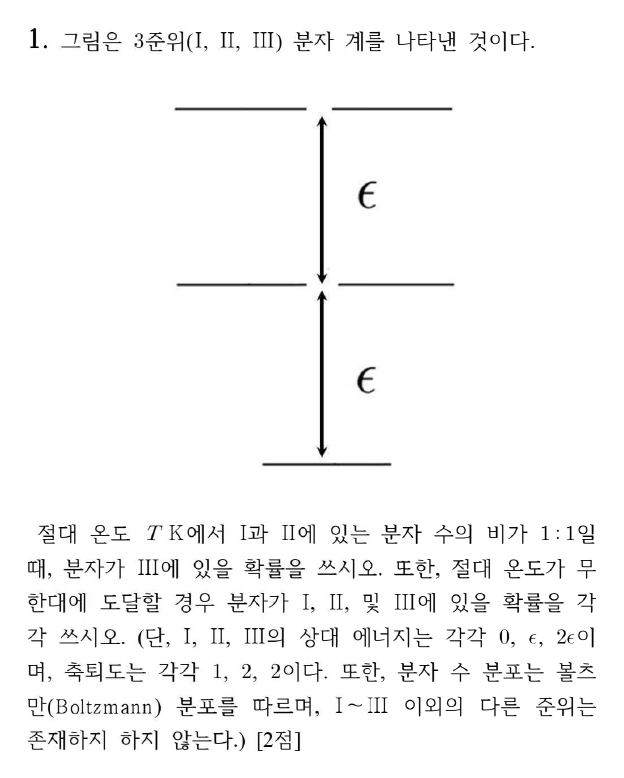

**정답** (답지 난이도 ★★☆☆☆) 분자가 III에 있을 확률 **1/5**. T → ∞: I **1/5**, II **2/5**, III **2/5**

**공식·핵심 개념**

- $N_i \propto g_i\,e^{-\varepsilon_i/kT}$, 확률 $p_i = \dfrac{g_ie^{-\varepsilon_i/kT}}{q}$
- 분배함수 $q = \sum g_ie^{-\varepsilon_i/kT}$
- $T\to\infty$: $p_i \to g_i/\sum g_i$, $T\to0$: 바닥 준위만

**2027 출제 가능성 ★★★☆☆ 보통** — 통계열역학(볼츠만 분포·분배함수)은 물리화학 기입형에 주기적으로 나옵니다. 축퇴도가 있는 준위 계산이 기본형입니다.

**주어진 것** 준위 I·II·III의 에너지 $0,\ \varepsilon,\ 2\varepsilon$, 축퇴도 $g = 1, 2, 2$ / 어떤 온도 $T$에서 $N_I : N_{II} = 1 : 1$ / 볼츠만 분포, 다른 준위 없음

**구할 것** 그 온도에서 III에 있을 확률, $T \to \infty$에서 I·II·III의 확률

**풀이 전략** 볼츠만 분포 $N_i \propto g_ie^{-\varepsilon_i/kT}$에 주어진 비를 넣어 $e^{-\varepsilon/kT}$를 먼저 정하고, 분배함수로 나누어 확률을 구합니다.

**(1) 확률 식 세우기.** 준위 $i$에 있을 확률은

$$p_i = \frac{g_ie^{-\varepsilon_i/kT}}{q}$$

$$q = 1 + 2e^{-\varepsilon/kT} + 2e^{-2\varepsilon/kT}$$

**(2) 조건으로 볼츠만 인자 구하기.** I과 II의 분자 수가 같으므로

$$\frac{N_{II}}{N_I} = \frac{2e^{-\varepsilon/kT}}{1\cdot e^{0}} = 1 \;\Rightarrow\; e^{-\varepsilon/kT} = \frac12$$

이때 $kT = \varepsilon/\ln2 \approx 1.44\,\varepsilon$입니다. III의 인자는 $e^{-2\varepsilon/kT} = \left(\tfrac12\right)^2 = \tfrac14$.

**(3) 분배함수.**

$$q = 1 + 2\cdot\tfrac12 + 2\cdot\tfrac14 = 1 + 1 + \tfrac12 = \tfrac52$$

**(4) 각 준위의 확률.**

| 준위 | $g_ie^{-\varepsilon_i/kT}$ | $p_i = (\cdot)/q$ |
|---|---|---|
| I | $1\times1 = 1$ | $1 \div \tfrac52 = \tfrac25$ |
| II | $2\times\tfrac12 = 1$ | $\tfrac25$ |
| III | $2\times\tfrac14 = \tfrac12$ | $\tfrac12 \div \tfrac52 = \tfrac15$ |

→ III에 있을 확률 **1/5**.

**(5) $T\to\infty$.** $\varepsilon/kT \to 0$이므로 모든 볼츠만 인자가 $e^{0} = 1$이 됩니다.

$$q \to 1 + 2 + 2 = 5, \quad p_I = \tfrac15,\ p_{II} = \tfrac25,\ p_{III} = \tfrac25$$

온도가 아무리 높아도 확률은 같아지지 않고 **축퇴도에 비례**합니다.

**검산** 각 경우 확률의 합 $\tfrac25 + \tfrac25 + \tfrac15 = 1$, $\tfrac15 + \tfrac25 + \tfrac25 = 1$ ✓. 반대 극한 $T \to 0$이면 $p_I \to 1$로, 온도가 오를수록 위 준위의 확률이 커지는 경향과 맞습니다.

**채점 포인트·함정**

- 축퇴도를 빼먹고 $e^{-\varepsilon/kT} = 1$로 놓으면 (1)이 틀립니다.
- 무한 온도에서 확률이 "모두 1/3"이 아니라 **축퇴도에 비례**한다는 점이 핵심입니다.

## A형 2번 · Hückel 규칙과 방향족성 {#a2}

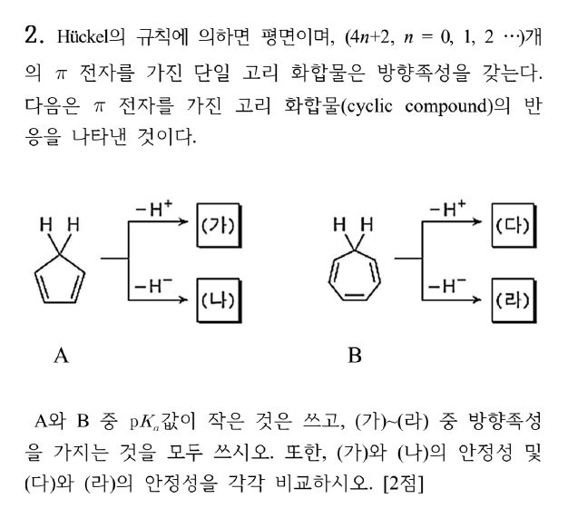

**정답** pKa가 작은 것: **A** (cyclopentadiene). 방향족: **(가), (라)**. 안정성: **(가) > (나)**, **(라) > (다)**

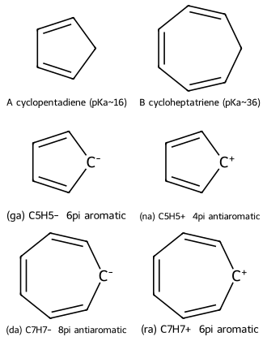

그림 이름표: (ga)~(ra) = (가)~(라)

**공식·핵심 개념**

- Hückel: 고리·평면·완전 콘쥬게이션 + π전자 $4n+2$ → 방향족, $4n$ → 반방향족
- 짝염기가 방향족이면 산성↑ (cyclopentadiene pKa ≈ 16)
- tropylium C₇H₇⁺, Cp⁻: 6π 방향족 이온

**2027 출제 가능성 ★★★★☆ 높음** — 방향족성 판정과 산도 비교는 유기 기입형의 단골입니다. 헤테로고리(피롤·피리딘)로 바꿔 나올 수 있습니다.

**주어진 것** A = cyclopentadiene(C₅H₆), B = cycloheptatriene(C₇H₈). 각각 H⁺를 떼면 (가)·(다), H⁻를 떼면 (나)·(라)

**구할 것** pKa가 작은 쪽, 방향족인 이온, (가)/(나)와 (다)/(라)의 안정성 비교

**풀이 전략** CH₂ 탄소에서 H⁺(전자쌍은 남김) 또는 H⁻(전자쌍째 떠남)를 떼면 그 탄소가 sp²가 되어 고리 전체가 p 오비탈로 이어집니다. 그다음 π 전자 수로 Hückel 판정을 하고, 짝염기 안정성으로 산도를 비교합니다.

**(1) CH₂ 탄소에 무슨 일이 생기나.**

- H⁺ 제거: C–H 결합 전자쌍이 탄소에 남아 **채워진 p 오비탈**(음전하)이 됩니다.
- H⁻ 제거: 전자쌍이 수소와 함께 떠나 **빈 p 오비탈**(양전하)이 됩니다.

어느 경우든 sp³ 탄소가 sp²로 바뀌어 고리의 모든 원자가 p 오비탈을 가지게 됩니다(고리형·평면·연속 콘쥬게이션 조건 충족).

**(2) π 전자 수 세기.**

| 이온 | C=C의 π 전자 | CH₂ 자리 | 합 | 4n+2 / 4n | 판정 |
|---|---|---|---|---|---|
| (가) C₅H₅⁻ | 2 × 2 = 4 | 전자쌍 +2 | **6** | n = 1 (4n+2) | 방향족 |
| (나) C₅H₅⁺ | 4 | 빈 오비탈 0 | **4** | n = 1 (4n) | 반방향족 |
| (다) C₇H₇⁻ | 3 × 2 = 6 | +2 | **8** | n = 2 (4n) | 반방향족 |
| (라) C₇H₇⁺ | 6 | 0 | **6** | n = 1 (4n+2) | 방향족 |

**(3) Hückel MO로 확인.** 고리 $N$각형의 MO 에너지는 $E_k = \alpha + 2\beta\cos\frac{2\pi k}{N}$입니다($\beta < 0$).

| 고리 | 준위 ($\times\beta$, α 기준) | 채우기 |
|---|---|---|
| 5원 | $2.000$, $0.618$(2개), $-1.618$(2개) | 6e: 결합성 3개가 모두 참 → 닫힌 껍질 / 4e: 0.618 준위 2개에 전자 1개씩 → 이중 라디칼 |
| 7원 | $2.000$, $1.247$(2개), $-0.445$(2개), $-1.802$(2개) | 6e: 결합성만 참 / 8e: 반결합성 $-0.445$ 준위 2개에 1개씩 |

6π 이온은 결합성 오비탈만 꽉 채워 안정하고, 4π·8π 이온은 축퇴된 오비탈에 홀전자가 남아 불안정합니다.

**(4) 공명으로 본 안정화.** Cp⁻의 음전하는 다섯 탄소에 고르게 퍼져 공명 구조가 5개이고, C–C 결합 길이가 모두 같습니다(1.40 Å). tropylium의 양전하는 일곱 탄소에 퍼집니다.

**(5) pKa 비교.** $\mathrm{HA \rightleftharpoons A^- + H^+}$에서 짝염기가 안정할수록 $K_a$가 큽니다.

- A의 짝염기 (가)는 방향족 → A의 pKa ≈ 16 (물 15.7과 비슷할 만큼 산성)
- B의 짝염기 (다)는 반방향족 → B의 pKa ≈ 36

$\Delta\mathrm{p}K_a \approx 20$이므로 $K_a$는 약 $10^{20}$배 차이 → **A의 pKa가 작습니다.**

**왜 이런 결과인가** 같은 "탄화수소의 CH₂"인데도 산도가 10²⁰배 다른 이유는 오로지 짝염기의 방향족성입니다. 전하의 부호(±)가 아니라 π 전자 수가 안정성을 정하므로, 양이온인 tropylium(라)은 안정하고 음이온인 (다)는 불안정합니다.

**메커니즘 — (가) Cp⁻ 생성**

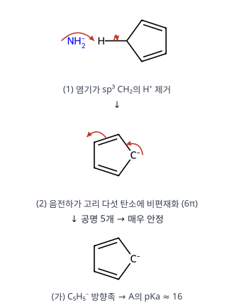

**메커니즘 — (라) tropylium 생성**

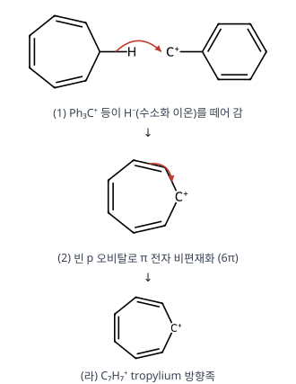

**검산** 실제로 NaCp는 시판 시약이고 Cp⁻는 ferrocene의 리간드입니다. tropylium bromide(C₇H₇⁺Br⁻)는 물에 녹는 이온성 고체입니다. 둘 다 위 판정과 맞습니다.

**채점 포인트·함정**

- 출발물 A·B 자체는 sp³ 탄소(CH₂)가 있어 고리 콘쥬게이션이 끊기므로 방향족이 아닙니다.
- tropylium(라)은 양이온인데도 매우 안정 — 전하 부호가 아니라 π 전자 수로 판단합니다.

## A형 3번 · 오존 분해 → 에스터화 → Claisen 축합 {#a3}

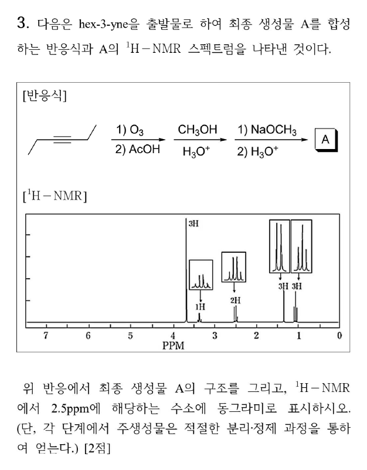

**정답** A = **methyl 2-methyl-3-oxopentanoate** CH₃CH₂C(=O)CH(CH₃)CO₂CH₃, 2.5 ppm = 케톤 옆 **CH₂** (아래 빨간 원)

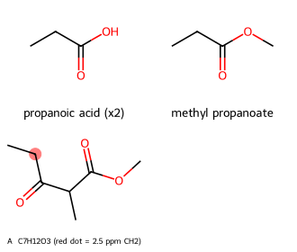

**공식·핵심 개념**

- 알카인 오존 분해(+H₂O) → 카복실산 2분자
- Fischer 에스터화 RCOOH + R′OH ⇌ RCOOR′ (H⁺)
- Claisen 축합: 에스터 2분자 → β-케토에스터 + R′OH
- ¹H NMR: 이웃 H가 n개 → n+1 갈라짐

**2027 출제 가능성 ★★★★★ 매우 높음** — 다단계 합성 + ¹H NMR 배정은 거의 해마다 나오는 유기 핵심 유형입니다. 특정 수소에 표시하게 하는 형식도 그대로 나올 수 있습니다.

**주어진 것** hex-3-yne → ① O₃ ② AcOH → CH₃OH/H₃O⁺ → ① NaOCH₃ ② H₃O⁺ → A / ¹H NMR: 3.7(s, 3H), 3.4(q, 1H), 2.5(q, 2H), 1.3(d, 3H), 1.05(t, 3H)

**구할 것** A의 구조, 2.5 ppm에 해당하는 수소

**풀이 전략** 단계마다 생성물의 분자식을 따라가고(탄소 수 보존 확인), 마지막 구조를 NMR 적분·갈라짐과 맞춰 봅니다.

**(1) 오존 분해.** 대칭 내부 알카인 $\mathrm{CH_3CH_2C{\equiv}CCH_2CH_3}$(C₆H₁₀)의 삼중결합에 O₃가 첨가하고, 물(AcOH 수용액)로 처리하면 삼중결합 양 끝이 각각 COOH가 됩니다.

$$\mathrm{C_6H_{10}} \xrightarrow{\mathrm{O_3},\ \mathrm{H_2O}} 2\,\mathrm{CH_3CH_2COOH}\ (\mathrm{C_3H_6O_2})$$

대칭이라 생성물은 propanoic acid 한 종류뿐입니다(탄소 3 + 3 = 6 ✓).

**(2) Fischer 에스터화.** 산 촉매 평형(과량 CH₃OH로 오른쪽 이동):

① C=O 산소 양성자화(탄소의 친전자성 증가) → ② CH₃OH가 카보닐 탄소 공격(사면체 중간체) → ③ 양성자 이동(OCH₃의 H → OH) → ④ H₂O 이탈 → ⑤ 탈양성자화

$$\mathrm{CH_3CH_2COOH + CH_3OH \rightleftharpoons CH_3CH_2CO_2CH_3 + H_2O}$$

methyl propanoate, C₄H₈O₂ (M = 88).

**(3) Claisen 축합 (5단계).**

**(3-1)** CH₃O⁻가 α-H(pKa ≈ 25)를 떼어 엔올레이트를 만듭니다. pKa 차이 때문에 평형상 엔올레이트는 조금만 생깁니다.

**(3-2)** 엔올레이트의 α-탄소가 다른 에스터의 C=O 탄소를 공격 → 사면체 알콕사이드.

**(3-3)** C=O가 다시 생기며 CH₃O⁻가 이탈 → β-케토에스터.

**(3-4)** 생성물의 두 C=O 사이 H(pKa ≈ 11)를 CH₃O⁻(짝산 CH₃OH, pKa ≈ 15.5)가 거의 완전히 떼어 냅니다. 이 비가역에 가까운 단계가 전체 평형을 생성물 쪽으로 끄는 **구동력**입니다.

**(3-5)** H₃O⁺ 후처리로 양성자화 → A.

$$2\,\mathrm{C_4H_8O_2} - \mathrm{CH_4O} = \mathrm{C_7H_{12}O_3}\ (M = 144)$$

**(4) 구조.** 친핵체가 된 것은 α-탄소(CH₂)이므로 새 C–C 결합이 생긴 탄소에 CH₃ 가지가 붙습니다.

$$\mathrm{CH_3CH_2{-}C(=O){-}CH(CH_3){-}CO_2CH_3}$$

**(5) ¹H NMR 배정.** 갈라짐은 (이웃 탄소의 H 수 + 1)입니다.

| δ (ppm) | 적분 | 갈라짐 | 이웃 H | 수소 | 이동 이유 |
|---|---|---|---|---|---|
| 3.7 | 3H | s | 0 | OC**H₃** | 전기음성 O에 직접 결합 |
| 3.4 | 1H | q | 3 (CH₃) | C2–**H** | C=O 두 개 사이 |
| **2.5** | **2H** | **q** | **3 (CH₃)** | **C4H₂** (케톤 α) | C=O 하나에 인접 |
| 1.3 | 3H | d | 1 (CH) | C2–C**H₃** | 알킬 |
| 1.05 | 3H | t | 2 (CH₂) | C5**H₃** | 알킬, 가장 높은 장 |

**왜 이 생성물인가** 한 가지 에스터의 자기 축합이라 생성물은 하나뿐입니다. 염기로 NaOCH₃를 쓴 이유는 에스터의 알콕시기와 같게 해 에스터 교환으로 섞이는 것을 막기 위함입니다(NaOEt를 쓰면 메틸·에틸 에스터가 섞임).

**메커니즘 — Fischer 에스터화**

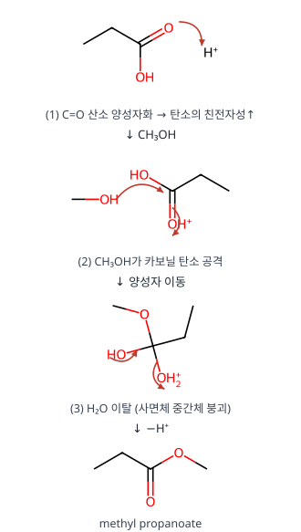

**메커니즘 — Claisen 축합**

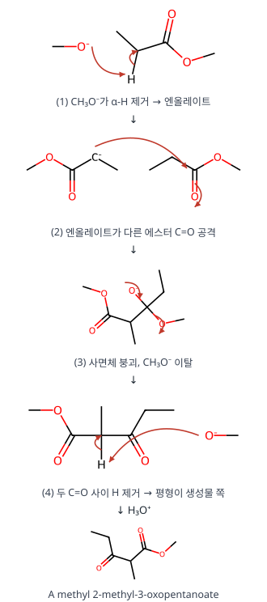

**검산** NMR 적분 합 3 + 1 + 2 + 3 + 3 = 12H = C₇H₁₂O₃의 H 수 ✓. 불포화도 $(2\cdot7+2-12)/2 = 2$ = C=O 2개 ✓.

**채점 포인트·함정**

- 2.5 ppm 사중선(2H)은 **케톤에 붙은 CH₂**입니다. 1H 사중선(3.5)과 혼동하지 않습니다.
- Claisen 생성물은 "에스터 두 분자 − CH₃OH": C₄H₈O₂ × 2 − CH₄O = C₇H₁₂O₃ ✓

## A형 4번 · 평행 반응의 속도론 {#a4}

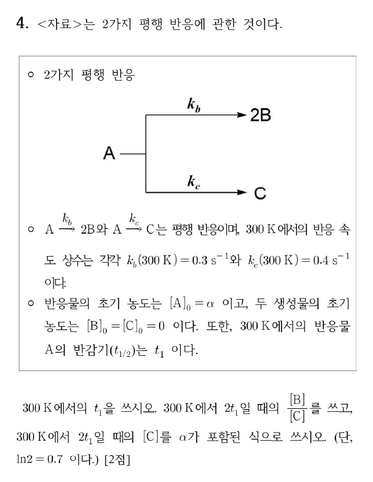

**정답** (답지 난이도 ★★☆☆☆) $t_1 = 1$ s, 2t₁에서 $\dfrac{[B]}{[C]} = \dfrac32$, $[C] = \dfrac{3\alpha}{7}$

**공식·핵심 개념**

- 평행 1차 반응: $[A] = [A]_0e^{-(k_1+k_2)t}$, $t_{1/2} = \dfrac{\ln2}{k_1+k_2}$
- 생성물 비 = 속도 상수 비(계수 반영): $[B]/[C] = 2k_b/k_c$
- C로 가는 분율 $= k_c/(k_b+k_c)$

**2027 출제 가능성 ★★★★☆ 높음** — 속도론은 2024 기출처럼 메커니즘·적분 속도식으로 자주 나옵니다. 평행·연속 반응은 2027에도 유력합니다.

**주어진 것** $\mathrm{A \xrightarrow{k_b} 2B}$, $\mathrm{A \xrightarrow{k_c} C}$, $k_b = 0.3\ \mathrm{s^{-1}}$, $k_c = 0.4\ \mathrm{s^{-1}}$ (300 K), $[\mathrm{A}]_0 = \alpha$, $[\mathrm{B}]_0 = [\mathrm{C}]_0 = 0$, $\ln2 = 0.7$

**구할 것** A의 반감기 $t_1$, $2t_1$에서 $[\mathrm B]/[\mathrm C]$와 $[\mathrm C]$

**풀이 전략** A의 소멸은 두 1차 경로의 합이므로 하나의 1차 반응($k = k_b + k_c$)으로 다룹니다. 생성물은 그 순간의 [A]에 비례해 쌓이므로 비율은 속도 상수 비로 정해집니다.

**(1) A의 속도식과 적분.**

$$-\frac{d[\mathrm A]}{dt} = k_b[\mathrm A] + k_c[\mathrm A] = (k_b + k_c)[\mathrm A] = k[\mathrm A]$$

$$k = 0.3 + 0.4 = 0.7\ \mathrm{s^{-1}}, \qquad [\mathrm A] = \alpha e^{-kt}$$

**(2) 반감기.** $[\mathrm A] = \alpha/2$를 넣으면

$$e^{-kt_1} = \tfrac12 \;\Rightarrow\; t_1 = \frac{\ln2}{k} = \frac{0.7}{0.7\ \mathrm{s^{-1}}} = 1.0\ \mathrm{s}$$

**(3) 생성물의 속도식.** A 한 분자가 B 두 분자를 만들므로 계수 2가 붙습니다.

$$\frac{d[\mathrm B]}{dt} = 2k_b[\mathrm A], \qquad \frac{d[\mathrm C]}{dt} = k_c[\mathrm A]$$

적분하면($\int_0^t \alpha e^{-kt'}dt' = \frac{\alpha}{k}(1 - e^{-kt})$)

$$[\mathrm B] = \frac{2k_b}{k}\alpha(1 - e^{-kt}), \qquad [\mathrm C] = \frac{k_c}{k}\alpha(1 - e^{-kt})$$

**(4) 농도 비.** 두 식을 나누면 시간 항이 지워집니다.

$$\frac{[\mathrm B]}{[\mathrm C]} = \frac{2k_b}{k_c} = \frac{2(0.3)}{0.4} = \frac{3}{2}$$

**(5) $t = 2t_1$에서 [C].** $e^{-k\cdot2t_1} = \left(e^{-kt_1}\right)^2 = \tfrac14$이므로 $1 - e^{-kt} = \tfrac34$.

$$[\mathrm C] = \frac{0.4}{0.7}\times\frac34\alpha = \frac47\cdot\frac34\alpha = \frac{3\alpha}{7}$$

같은 방법으로 $[\mathrm B] = \frac{0.6}{0.7}\cdot\frac34\alpha = \frac{9\alpha}{14}$.

**검산** A 원자 보존: 남은 A + 반응한 A(B는 2개가 A 1개분, C는 1개가 A 1개분)

$$\frac{\alpha}{4} + \frac12\cdot\frac{9\alpha}{14} + \frac{3\alpha}{7} = \frac{7\alpha + 9\alpha + 12\alpha}{28} = \alpha\ ✓$$

**채점 포인트·함정**

- [B]/[C]에서 **계수 2**(A → 2B)를 빠뜨리면 3/4이 됩니다.
- 평행 반응의 반감기는 $k$의 **합**으로 정해집니다.

## A형 5번 · 헨리 법칙과 2022 개정 [물질과 에너지] {#a5}

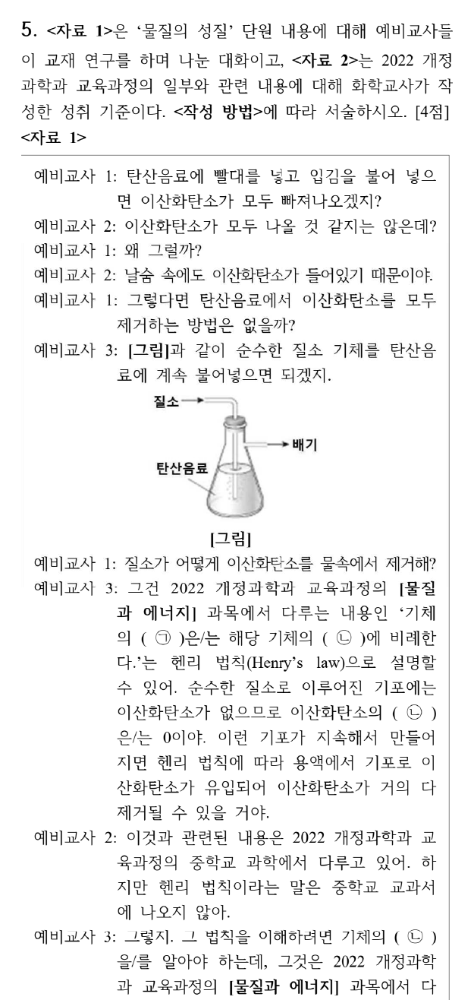

**정답**

- ㉠ **용해도**, ㉡ **부분 압력**
- ㉢ **입자 모형** — 물질의 상태를 나타내는 입자 모형은 입자 사이의 **상대적 거리**, **입자 배열의 불규칙한 정도**, **입자의 운동성** 등을 비교한 내용을 포함한다.
- ㉣ 디지털 소양: 모의실험, 모형이나 시청각 자료, 가상 현실·증강 현실 자료, 소프트웨어, 컴퓨터 및 스마트 기기, 인터넷 등의 최신 정보 통신 기술과 기기를 실험과 탐구에 적절히 활용한다.
- (나) 오류: 이산화탄소가 물에 녹는 과정은 **흡열 과정 → 발열 과정**으로 수정.

**공식·핵심 개념**

- 헨리 법칙: $C = k_HP_{\text{gas}}$ (부분 압력에 비례)
- 기체 용해는 발열 → 온도↑ 용해도↓ (르샤틀리에)
- 2022 개정 [물질과 에너지], 중학교 '물질의 성질' 관통개념: 입자 모형

**2027 출제 가능성 ★★★★★ 매우 높음** — 2027은 2022 개정 선택과목([물질과 에너지])이 본격적으로 다뤄지는 시기라, 새 과목 내용을 묻는 교육과정 문항이 나올 가능성이 매우 높습니다.

**헨리 법칙**: 일정 온도에서 기체의 용해도는 그 기체의 **부분 압력**에 비례($C = k_H P_{\text{gas}}$). 질소 기포 속 CO₂의 부분 압력은 0이므로, 용액의 CO₂가 기포로 계속 빠져나갑니다(가스 스트리핑).

**온도의 영향.** 기체가 녹는 과정은 분자가 용매에 붙잡히며 에너지를 내놓는 **발열** 과정($\Delta H < 0$)입니다. 르샤틀리에 원리에 따라 온도가 높아지면 역방향(기체 방출)으로 평형이 이동 → 용해도 감소. 결론("온도가 높으면 용해도 감소")은 맞고 근거의 "흡열"만 틀렸습니다.

**채점 포인트·함정**

- 중학교에서 말하는 "압력"은 정확히는 해당 기체의 **부분 압력**입니다.
- ㉢의 관통개념은 3가지 이상(상대적 거리, 배열의 불규칙성, 운동성)을 씁니다.

## A형 6번 · 성취과제분담모형(STAD) {#a6}

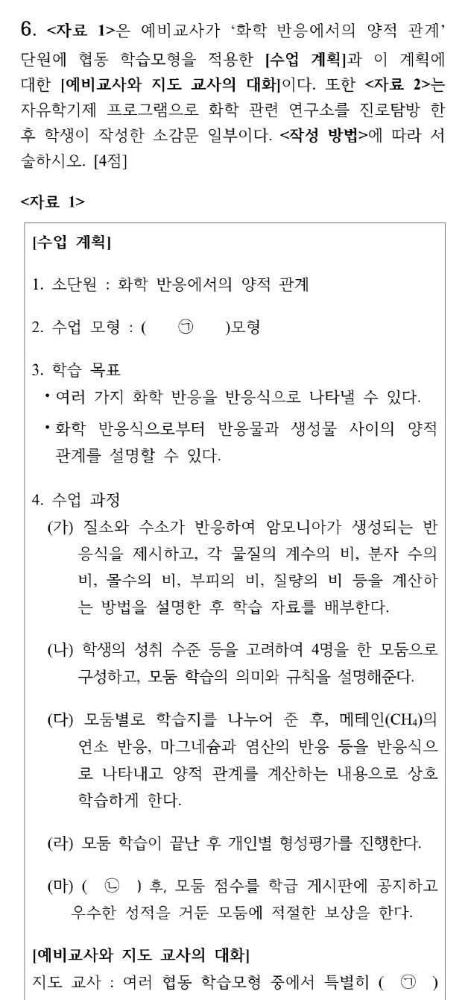

**정답**

- ㉠ **성취과제분담모형(STAD)**. 화학 반응에서의 양적 관계와 같이 목표가 뚜렷하고 분명한 과학적 사실과 개념, 과학적 탐구 과정 등의 교수-학습에 효과적이기 때문이다.
- ㉡ **개별 향상 점수를 합산하여 모둠 점수를 계산**한 뒤
- ㉢ 자긍심을 길러주는 이유: 개별 향상 점수가 모두 모둠 보상에 기여하므로, 성취 수준과 관계없이 개인의 노력으로 집단의 성공에 기여할 수 있다.
- ㉣ 과학의 가치·태도 요소: **과학의 가치(감수성)**, **과학 태도(유용성)**

**공식·핵심 개념**

- STAD: 전체 수업 → 모둠 학습 → 개별 평가 → **개별 향상 점수** → 모둠 보상
- 협동 학습모형: STAD, Jigsaw, TGT, GI
- 2022 개정 가치·태도: 감수성, 유용성, 윤리성, 개방성 등

**2027 출제 가능성 ★★★★☆ 높음** — 협동 학습모형은 화학교육론에서 꾸준히 나옵니다. 2022 개정 가치·태도 요소와 묶는 형태가 최근 경향입니다.

**STAD 수업 절차**: 교사의 전체 수업 → 이질적 4~5명 모둠 학습 → **개별 평가**(퀴즈, 협동 불가) → **개별 향상 점수**(기본 점수 대비 향상 정도) 산출 → 모둠 점수 = 향상 점수 합(평균) → 모둠 보상.

| 협동 학습모형 | 특징 |
|---|---|
| STAD | 개별 향상 점수 → 모둠 보상, 명확한 사실·개념 학습 |
| Jigsaw | 전문가 집단 → 모집단에서 서로 가르침 |
| TGT | 퀴즈 대신 토너먼트 게임 |
| GI(집단 탐구) | 모둠이 주제를 정해 탐구·발표 |

**㉣.** 연구소 방문 뒤 신문 기사·홍보 자료·사진을 모아 직업을 비교하고 이해한 내용은 과학과 직업·사회의 관계에 대한 **감수성**, 과학의 **유용성** 인식에 해당합니다.

**채점 포인트·함정**

- "향상 점수"가 핵심어입니다. 원점수 합산이 아님을 분명히 씁니다.
- 자긍심 이유에는 "누구나 모둠에 기여할 수 있음(성공 기회의 균등)"이 들어가야 합니다.

## A형 7번 · 통합과학 2 '변화와 다양성' 성취기준 {#a7}

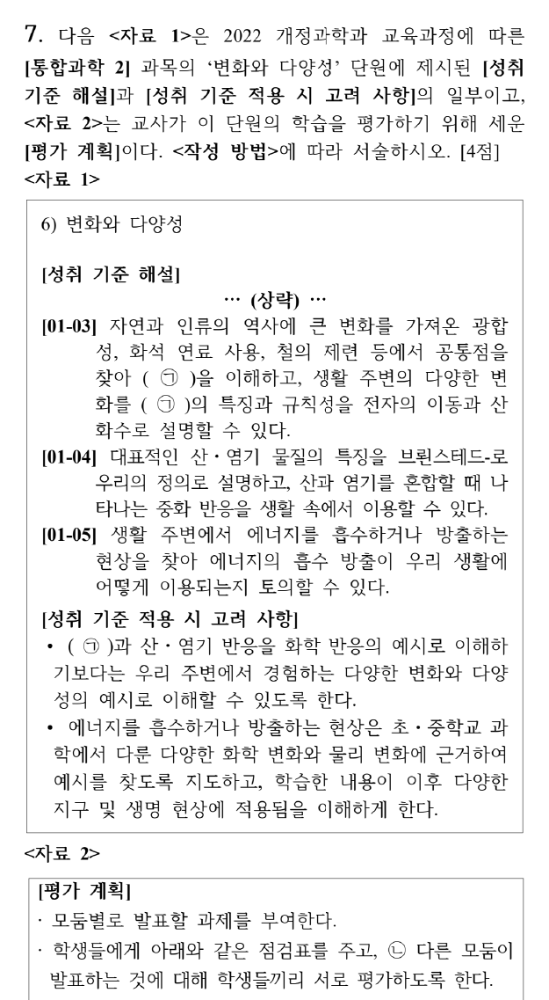

**정답**

- ㉠ **산화·환원**
- 오류 ①: [01-03] "…전자의 이동과 산화수로 설명할 수 있다" → "**산소와 전자의 이동으로 설명하되, 산화수는 다루지 않는다**."
- 오류 ②: [01-04] "…브뢴스테드-로우리의 정의로 설명하고" → "**아레니우스 정의로만 설명한다**."
- ㉡ **동료 평가**. 장점: 동료들에게 긍정적인 시사점을 서로 제공함으로써 모둠의 성과를 향상할 수 있다.

**공식·핵심 개념**

- 통합과학 2: 산화·환원은 산소·전자 이동까지(산화수 X), 산·염기는 아레니우스 정의까지
- 성취기준 해설·적용 시 고려 사항 비교
- 평가: 동료 평가 / 자기 평가 / 관찰 평가

**2027 출제 가능성 ★★★★★ 매우 높음** — 성취기준 해설의 오류 찾기는 2022 개정 첫 적용 시기의 대표 유형입니다. 통합과학의 화학 범위는 우선순위가 높습니다.

**2022 개정 통합과학 2의 범위.** 산화·환원은 **산소·전자의 이동**까지만(산화수는 [화학]에서), 산·염기는 **아레니우스 정의**까지만(브뢴스테드–로우리는 [화학]에서) 다룹니다. 출제자가 상위 과목 내용을 섞어 넣은 곳을 찾는 유형입니다.

**동료 평가 vs 자기 평가**: 동료 평가는 다른 학생(모둠)을 평가 — 다양한 관점, 평가 기준 내면화, 상호 피드백. 자기 평가는 자신을 평가 — 메타인지, 성찰.

**채점 포인트·함정**

- 수정한 문장을 **바르게 다시 쓰는** 것까지 해야 합니다(틀린 곳 지적만으로는 감점).

## A형 8번 · 아세틸라이드 첨가, Diels–Alder, 에폭시화 {#a8}

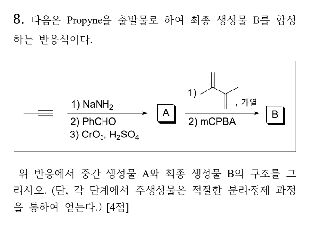

**정답** A = **1-phenylbut-2-yn-1-one** (CH₃C≡C–CO–Ph), B = Diels–Alder 생성물의 **사치환 C=C만 에폭시화된 화합물**(cis 에폭사이드, 라셈 혼합물)

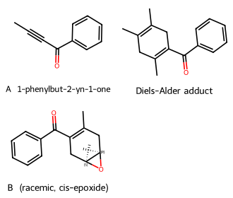

**공식·핵심 개념**

- 말단 알카인 + NaNH₂ → 아세틸라이드 (pKa ≈ 25) → 알데하이드 첨가
- Jones 산화(CrO₃/H₂SO₄): 2차 알코올 → 케톤
- Diels–Alder: 다이엔(s-cis) + 전자 부족 친다이엔체, 알카인이면 1,4-cyclohexadiene
- mCPBA: 전자 풍부한 C=C 우선, syn 첨가

**2027 출제 가능성 ★★★★☆ 높음** — Diels–Alder와 위치·입체 선택성은 유기 서술형에서 자주 나옵니다. 화학 선택성(어느 C=C)을 묻는 구성도 대비하세요.

**주어진 것** propyne → ① NaNH₂ ② PhCHO ③ CrO₃, H₂SO₄ → A → ① 2,3-dimethyl-1,3-butadiene, 가열 ② mCPBA → B

**구할 것** A와 B의 구조

**풀이 전략** 시약마다 반응 유형(산염기 → 친핵성 첨가 → 산화 → [4+2] → 에폭시화)을 정하고, B 단계에서는 두 C=C의 전자 밀도 차이로 화학 선택성을 판단합니다.

**(1) NaNH₂: 말단 알카인 탈양성자화.** NH₃(pKa ≈ 38)가 propyne(pKa ≈ 25)보다 훨씬 약한 산이므로 평형이 완전히 오른쪽입니다. sp 탄소는 s 성격이 50%라 음전하를 잘 붙잡습니다.

$$\mathrm{CH_3C{\equiv}C{-}H + NH_2^- \longrightarrow CH_3C{\equiv}C^- + NH_3}$$

**(2) PhCHO 첨가.** 아세틸라이드가 알데하이드 C=O 탄소를 공격 → 알콕사이드 → 후처리 양성자화 → 2차 알코올 1-phenylbut-2-yn-1-ol(C₁₀H₁₀O). 새 입체중심이 생기지만 다음 단계 산화로 사라집니다.

**(3) Jones 산화(CrO₃/H₂SO₄ = H₂CrO₄).**

**(3-1)** 알코올 O가 Cr(VI)에 첨가 → 크로메이트 에스터.

**(3-2)** 물이 카비놀 C–H를 떼어 내며 C=O가 생기고 Cr–O가 끊어져 Cr(VI) → Cr(IV)(E2와 비슷한 제거).

$$\mathrm{A} = \mathrm{CH_3C{\equiv}C{-}C(=O){-}Ph},\ \ \mathrm{C_{10}H_8O}\ (M = 144)$$

2차 알코올이라 케톤에서 멈춥니다.

**(4) Diels–Alder.** A의 C≡C는 C=O와 콘쥬게이션되어 전자가 부족한 **친다이엔체**입니다. 다이엔이 s-cis 형태로 와서 6개 원자가 고리형 전이 상태를 만들고, σ 결합 2개가 동시에 생깁니다.

$$\mathrm{C_{10}H_8O + C_6H_{10} \longrightarrow C_{16}H_{18}O}$$

친다이엔체가 **알카인**이므로 새 고리에 C=C가 두 개 남아 1,4-cyclohexadiene이 됩니다. 다이엔이 좌우 대칭이라 위치 이성질체는 생기지 않습니다.

**(5) mCPBA: 어느 C=C인가.** 생성 고리에는 사치환 C=C가 두 개 있습니다.

| C=C | 치환기 | 전자 밀도 | mCPBA |
|---|---|---|---|
| 친다이엔체에서 온 C=C | COPh, CH₃ | C=O와 콘쥬게이션 → **부족** | 느림 |
| 다이엔에서 온 C=C | CH₃, CH₃ (고립) | 알킬 전자 주개 → **풍부** | **빠름** |

과산은 친전자체이므로 전자가 풍부한 C=C만 에폭시화합니다. O 원자가 한 면에서 동시에 두 C에 전달되는(협동, "나비" 전이 상태) syn 첨가라 두 C–O 결합이 같은 쪽 → cis 에폭사이드.

$$\mathrm{B}:\ \mathrm{C_{16}H_{18}O_2}$$

**(6) 입체화학.** 새 입체중심 2개(에폭사이드 탄소). 고리의 위·아래 면이 동등하므로 두 면 공격 확률이 같아 (4R,5S)와 (4S,5R)의 **라셈 혼합물**이 됩니다. 분자 안에 거울면이 없으므로(COPh 쪽과 CH₂ 쪽이 다름) meso가 아닙니다.

**왜 이 생성물인가** ① 산화를 거쳐 C≡C를 전자 부족하게 만들어야 Diels–Alder가 잘 일어나고, ② 그 결과 한 분자 안에 전자 부족 C=C와 전자 풍부 C=C가 함께 생기므로 mCPBA가 둘을 구별합니다.

**메커니즘 — 아세틸라이드 첨가 → Jones 산화**

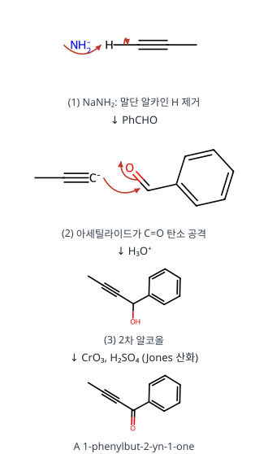

**메커니즘 — Jones 산화 상세 (크로메이트 에스터)**

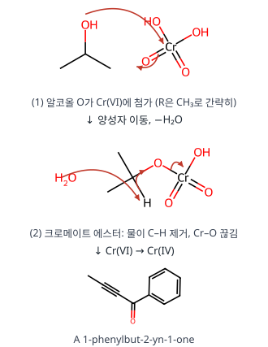

**메커니즘 — Diels–Alder와 에폭시화**

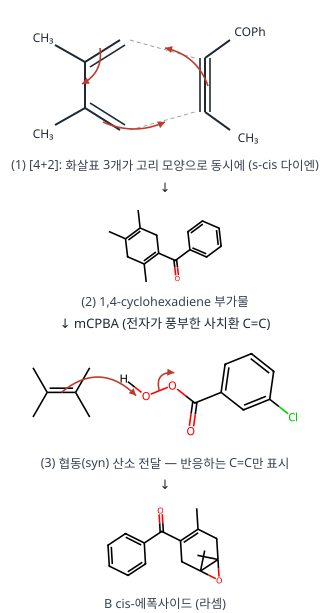

**검산** B의 불포화도 $(2\cdot16 + 2 - 18)/2 = 8$ = 벤젠 4 + C=O 1 + C=C 1 + 육원 고리 1 + 에폭사이드 고리 1 ✓.

**채점 포인트·함정**

- PhCHO 첨가 뒤 Jones 산화까지 해야 A가 **케톤**입니다(알코올로 멈추면 틀림).
- 에폭시화 위치 선택성(전자 풍부한 C=C)이 이 문항의 핵심입니다.

## A형 9번 · 착물 형성이 있는 용해도 {#a9}

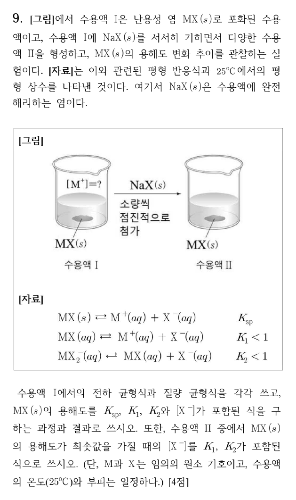

**정답** (답지 난이도 ★★★☆☆)

- 전하 균형식: $[\mathrm{M^+}] + [\mathrm{H^+}] = [\mathrm{OH^-}] + [\mathrm{X^-}] + [\mathrm{MX_2^-}]$
- 질량 균형식(수용액 I): $[\mathrm{M^+}] = [\mathrm{X^-}] + [\mathrm{MX_2^-}]$
- 용해도: $S = K_{sp}\left(\dfrac{1}{[\mathrm{X^-}]} + \dfrac{1}{K_1} + \dfrac{[\mathrm{X^-}]}{K_1K_2}\right)$
- 최소 용해도: $[\mathrm{X^-}] = \sqrt{K_1K_2}$

**공식·핵심 개념**

- 전하 균형식, 질량 균형식 세우기
- 용해도 $S$ = 녹은 M의 모든 화학종 합
- 착물 형성: 공통 이온 효과 vs 착물 효과 → 최솟값 $dS/d[X^-] = 0$

**2027 출제 가능성 ★★★☆☆ 보통** — 체계적 평형 처리(전하·질량 균형)는 분석화학에서 나오지만 착물 용해도 최솟값까지는 드뭅니다. 균형식 쓰기는 꼭 연습하세요.

**주어진 것** $\mathrm{MX(s) \rightleftharpoons M^+ + X^-}$ ($K_{sp}$), $\mathrm{MX(aq) \rightleftharpoons M^+ + X^-}$ ($K_1 < 1$), $\mathrm{MX_2^- \rightleftharpoons MX(aq) + X^-}$ ($K_2 < 1$) / 수용액 I = MX 포화 용액, 수용액 II = NaX를 조금씩 넣은 용액

**구할 것** 수용액 I의 전하·질량 균형식, 용해도 $S$의 식, $S$가 최소일 때 $[\mathrm{X^-}]$

**풀이 전략** 녹아 있는 화학종을 모두 적고, 각 농도를 $K_{sp}$, $K_1$, $K_2$와 $[\mathrm{X^-}]$ 하나로 표현합니다. $S$는 "녹아 있는 M의 모든 형태의 합"입니다.

**(1) 수용액 I의 화학종.** $\mathrm{M^+,\ X^-,\ MX(aq),\ MX_2^-,\ H^+,\ OH^-}$

**(2) 전하 균형** (양전하 농도 합 = 음전하 농도 합, 전하 1이라 계수 1):

$$[\mathrm{M^+}] + [\mathrm{H^+}] = [\mathrm{X^-}] + [\mathrm{MX_2^-}] + [\mathrm{OH^-}]$$

**(3) 질량 균형.** MX가 1 : 1로 녹으므로 "녹은 M 원자 수 = 녹은 X 원자 수"입니다.

$$\begin{aligned}
&[\mathrm{M^+}] + [\mathrm{MX}] + [\mathrm{MX_2^-}] \\
&= [\mathrm{X^-}] + [\mathrm{MX}] + 2[\mathrm{MX_2^-}] \\
&\Rightarrow\ [\mathrm{M^+}] = [\mathrm{X^-}] + [\mathrm{MX_2^-}]
\end{aligned}$$

(물에서 $[\mathrm{H^+}] = [\mathrm{OH^-}]$이면 (2)와 같은 식이 되어 서로 맞습니다.)

**(4) 각 화학종을 $[\mathrm{X^-}]$로 표현.**

$$[\mathrm{M^+}] = \frac{K_{sp}}{[\mathrm{X^-}]}$$

$$K_1 = \frac{[\mathrm{M^+}][\mathrm{X^-}]}{[\mathrm{MX}]} \Rightarrow [\mathrm{MX}] = \frac{K_{sp}}{K_1}$$

$$K_2 = \frac{[\mathrm{MX}][\mathrm{X^-}]}{[\mathrm{MX_2^-}]} \Rightarrow [\mathrm{MX_2^-}] = \frac{K_{sp}[\mathrm{X^-}]}{K_1K_2}$$

**(5) 용해도.**

$$\begin{aligned}
S &= [\mathrm{M^+}] + [\mathrm{MX}] + [\mathrm{MX_2^-}] \\
&= K_{sp}\left(\frac{1}{[\mathrm{X^-}]} + \frac{1}{K_1} + \frac{[\mathrm{X^-}]}{K_1K_2}\right)
\end{aligned}$$

이 식은 평형 상수만으로 세운 것이라 NaX를 넣은 수용액 II에도 그대로 성립합니다(질량 균형은 바뀌지만 $S$의 식은 그대로).

**(6) 최솟값.** $x = [\mathrm{X^-}]$로 놓고 미분합니다.

$$\frac{dS}{dx} = K_{sp}\left(-\frac{1}{x^2} + \frac{1}{K_1K_2}\right) = 0 \;\Rightarrow\; x = \sqrt{K_1K_2}$$

$\dfrac{d^2S}{dx^2} = \dfrac{2K_{sp}}{x^3} > 0$이므로 최솟값입니다.

$$S_{min} = K_{sp}\left(\frac{2}{\sqrt{K_1K_2}} + \frac{1}{K_1}\right)$$

**(7) 해석.** X⁻가 적을 때는 $1/x$ 항(공통 이온 효과)이 커서 X⁻를 넣을수록 S가 줄고, 많을 때는 $x$ 항(MX₂⁻ 착물 형성)이 커져 S가 다시 늘어납니다.

**검산** 단위: $K_{sp}$(M²)/$x$(M) = M, $K_{sp}/K_1$ = M²/M = M, $K_{sp}x/(K_1K_2)$ = M²·M/M² = M — 세 항 모두 M ✓. 예: $K_{sp} = 10^{-10}$, $K_1 = 10^{-3}$, $K_2 = 10^{-1}$이면 $x_{min} = 10^{-2}$ M, $S_{min} = 10^{-8} + 10^{-7} + 10^{-8} = 1.2\times10^{-7}$ M.

**채점 포인트·함정**

- $K_1, K_2$는 **해리** 상수입니다(형성 상수가 아님). 식에서 $K$가 분모로 들어가는 이유입니다.
- 전하 균형식에서 MX₂⁻의 전하 계수는 1입니다.

## A형 10번 · 수소 원자 1s의 정규화와 기대치 {#a10}

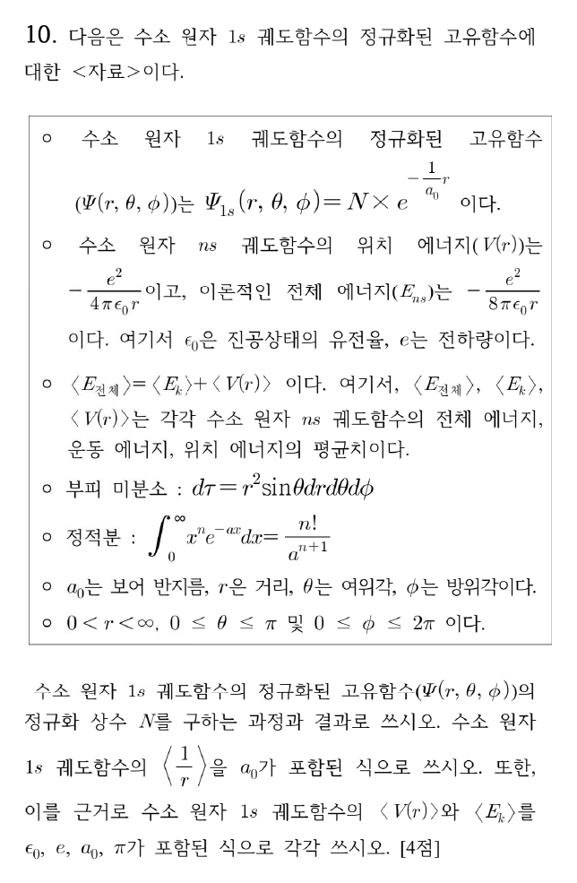

**정답** (답지 난이도 ★★★☆☆) $N = \left(\dfrac{1}{\pi a_0^3}\right)^{1/2}$, $\left\langle\dfrac1r\right\rangle = \dfrac{1}{a_0}$, $\langle V\rangle = -\dfrac{e^2}{4\pi\varepsilon_0 a_0}$, $\langle E_k\rangle = \dfrac{e^2}{8\pi\varepsilon_0 a_0}$

**공식·핵심 개념**

- 정규화 $\int|\psi|^2d\tau = 1$, $d\tau = r^2\sin\theta\,dr\,d\theta\,d\phi$
- $\int_0^\infty x^ne^{-ax}dx = \dfrac{n!}{a^{n+1}}$
- 비리얼 정리(쿨롱 퍼텐셜): $2\langle E_k\rangle = -\langle V\rangle$

**2027 출제 가능성 ★★★☆☆ 보통** — 수소 원자 기대치 계산은 양자 영역에서 가끔 나옵니다. ⟨r⟩, 최대 확률 반지름으로 바꿔 나올 수 있습니다.

**주어진 것** $\Psi_{1s} = Ne^{-r/a_0}$, $V(r) = -\dfrac{e^2}{4\pi\varepsilon_0r}$, $\langle E\rangle = \langle E_k\rangle + \langle V\rangle$, $d\tau = r^2\sin\theta\,dr\,d\theta\,d\phi$, $\int_0^\infty x^ne^{-ax}dx = \dfrac{n!}{a^{n+1}}$

**구할 것** $N$, $\langle 1/r\rangle$, $\langle V\rangle$, $\langle E_k\rangle$

**풀이 전략** 3차원 적분을 각도 부분($4\pi$)과 반지름 부분(주어진 정적분 공식, $a = 2/a_0$)으로 나눕니다. $\langle E_k\rangle$는 전체 에너지에서 위치 에너지를 빼서 구합니다.

**(1) 정규화 조건.**

$$\int|\Psi|^2d\tau = N^2\int_0^\infty r^2e^{-2r/a_0}dr\int_0^\pi\sin\theta\,d\theta\int_0^{2\pi}d\phi = 1$$

**(2) 각도 적분.**

$$\int_0^\pi\sin\theta\,d\theta = [-\cos\theta]_0^\pi = 2, \qquad \int_0^{2\pi}d\phi = 2\pi$$

곱하면 $4\pi$.

**(3) 반지름 적분** ($n = 2$, $a = 2/a_0$):

$$\int_0^\infty r^2e^{-2r/a_0}dr = \frac{2!}{(2/a_0)^3} = \frac{2a_0^3}{8} = \frac{a_0^3}{4}$$

**(4) N.**

$$N^2\cdot4\pi\cdot\frac{a_0^3}{4} = N^2\pi a_0^3 = 1 \;\Rightarrow\; N = \left(\frac{1}{\pi a_0^3}\right)^{1/2}$$

**(5) ⟨1/r⟩** ($n = 1$):

$$\begin{aligned}
\left\langle\frac1r\right\rangle &= N^2\cdot4\pi\int_0^\infty r^2\cdot\frac1r\,e^{-2r/a_0}dr \\
&= \frac{4}{a_0^3}\cdot\frac{1!}{(2/a_0)^2} = \frac{4}{a_0^3}\cdot\frac{a_0^2}{4} = \frac{1}{a_0}
\end{aligned}$$

**(6) ⟨V⟩.** 상수는 적분 밖으로 나옵니다.

$$\langle V\rangle = -\frac{e^2}{4\pi\varepsilon_0}\left\langle\frac1r\right\rangle = -\frac{e^2}{4\pi\varepsilon_0a_0}$$

**(7) ⟨E_k⟩.** 1s의 전체 에너지는 자료 식의 r 자리에 $a_0$를 넣은 $E_{1s} = -\dfrac{e^2}{8\pi\varepsilon_0a_0}$입니다.

$$\begin{aligned}
\langle E_k\rangle &= E_{1s} - \langle V\rangle \\
&= -\frac{e^2}{8\pi\varepsilon_0a_0} + \frac{e^2}{4\pi\varepsilon_0a_0} = \frac{e^2}{8\pi\varepsilon_0a_0}
\end{aligned}$$

**검산** 비리얼 정리(쿨롱 퍼텐셜): $2\langle E_k\rangle = -\langle V\rangle$ → $2\cdot\frac{e^2}{8\pi\varepsilon_0a_0} = \frac{e^2}{4\pi\varepsilon_0a_0}$ ✓. 수치로 $\langle E_k\rangle = 13.6$ eV, $\langle V\rangle = -27.2$ eV, $E_{1s} = -13.6$ eV ✓. (참고: 같은 방법으로 $\langle r\rangle = \frac32a_0$.)

**채점 포인트·함정**

- 부피 요소의 $r^2$와 각도 적분 $4\pi$를 빠뜨리기 쉽습니다.
- 정적분 공식 $\int_0^\infty x^n e^{-ax}dx = n!/a^{n+1}$에서 $a = 2/a_0$입니다(지수에 2가 붙음).

## A형 11번 · NO₂의 분자 궤도함수와 대칭 {#a11}

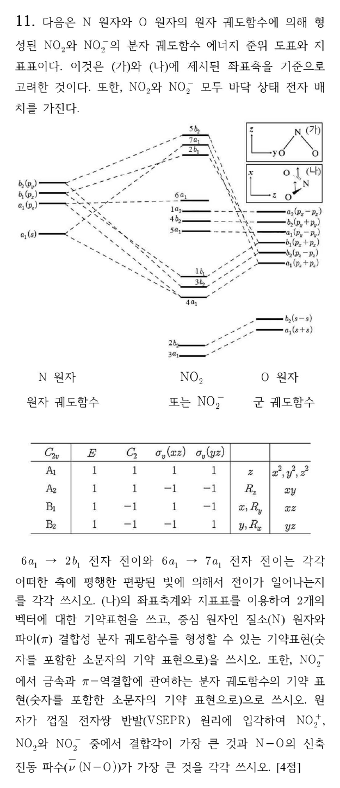

**정답** (답지 난이도 ★★★☆☆)

- 6a₁ → 2b₁: **x축** 편광, 6a₁ → 7a₁: **z축** 편광
- 2개 벡터의 기약표현: $\Gamma = A_2 + B_1$, N과 π 결합성 MO: **1b₁**
- NO₂⁻에서 금속과 π-역결합에 관여하는 MO: **2b₁**
- 결합각 최대 **NO₂⁺**, ν̃(N–O) 최대 **NO₂⁺**

**공식·핵심 개념**

- 전이 허용: $\Gamma_i\times\Gamma_\mu\times\Gamma_f \ni A_1$
- 군 궤도함수: 같은 기약표현끼리만 섞임
- VSEPR 결합각: NO₂⁺ 180° > NO₂ 134° > NO₂⁻ 115°

**2027 출제 가능성 ★★★★☆ 높음** — MO 도표 + 지표표로 대칭을 묻는 문항은 무기에서 해마다 나옵니다. 편광·π 역결합까지 묶는 고난도형도 대비하세요.

**주어진 것** NO₂/NO₂⁻의 MO 도표(아래부터 3a₁, 2b₂, 4a₁, 3b₂, 1b₁, 5a₁, 4b₂, 1a₂, 6a₁, 2b₁, 7a₁, 5b₂), C₂ᵥ 지표표, 좌표축 (가)·(나)

**구할 것** 6a₁→2b₁, 6a₁→7a₁의 편광 축, (나) 기준 두 π 벡터의 기약표현과 N과 π 결합성 MO, NO₂⁻의 π-역결합 MO, 결합각·ν̃(N–O)가 가장 큰 화학종

**풀이 전략** 전이는 "적분 대칭곱에 A₁이 들어가야 허용", 군 궤도함수는 "조작별 지표 → 축소", 결합각은 Walsh 도표(6a₁ 전자 수)로 판단합니다.

**(1) 좌표 정리 ((나) 기준).** C₂축 = z, 분자 평면 = yz, x는 평면에 수직입니다.

**(2) 전이 편광.** 전이 쌍극자 $\int\psi_i\,\hat\mu_q\,\psi_f\,d\tau \neq 0$이려면 $\Gamma_i\times\Gamma_q\times\Gamma_f \ni A_1$.

| 전이 | x (B₁) | y (B₂) | z (A₁) |
|---|---|---|---|
| 6a₁ → 2b₁ | $A_1\!\times\!B_1\!\times\!B_1 = A_1$ ✓ | $A_1\!\times\!B_2\!\times\!B_1 = A_2$ | $A_1\!\times\!A_1\!\times\!B_1 = B_1$ |
| 6a₁ → 7a₁ | $B_1$ | $B_2$ | $A_1$ ✓ |

→ 6a₁ → 2b₁은 **x**, 6a₁ → 7a₁은 **z** 편광.

**(3) 두 π 벡터(O의 pₓ, 평면에 수직)의 Γ.**

| | E | C₂ | σᵥ(xz) | σᵥ(yz) |
|---|---|---|---|---|
| 그대로 있는 벡터 | 2 | 0 (O 교환) | 0 (O 교환) | 2 (O 그대로, 벡터 반전) |
| 벡터 하나당 지표 | +1 | — | — | −1 |
| Γ | 2 | 0 | 0 | −2 |

**(4) 축소** ($h = 4$, $n_i = \frac14\sum\chi_\Gamma\chi_i$):

- $n(A_1) = \frac14[2(1) + 0 + 0 + (-2)(1)] = 0$
- $n(A_2) = \frac14[2(1) + 0 + 0 + (-2)(-1)] = 1$
- $n(B_1) = \frac14[2(1) + 0 + 0 + (-2)(-1)] = 1$
- $n(B_2) = \frac14[2(1) + 0 + 0 + (-2)(1)] = 0$

→ $\Gamma_\pi = A_2 + B_1$. SALC: $B_1 = p_x(\mathrm{O_1}) + p_x(\mathrm{O_2})$, $A_2 = p_x(\mathrm{O_1}) - p_x(\mathrm{O_2})$.

**(5) N과 섞이는 것.** N의 $p_x$는 B₁ → B₁ SALC와 결합성 **1b₁**, 반결합성 2b₁을 만듭니다. A₂에 맞는 N 오비탈은 없어 1a₂는 O에 남는 비결합 오비탈입니다.

**(6) 전자 채우기.** NO₂ 원자가 전자 5 + 2×6 = 17, NO₂⁻ 18.

$$\begin{aligned}
&3a_1^2\,2b_2^2\,4a_1^2\,3b_2^2\,1b_1^2\,5a_1^2\,4b_2^2\,1a_2^2 \\
&+\ 6a_1^1\ (\mathrm{NO_2})\ \text{또는}\ 6a_1^2\ (\mathrm{NO_2^-})
\end{aligned}$$

NO₂⁻의 HOMO = 6a₁, LUMO = **2b₁**(π*, N의 pₓ 계수 큼) → 금속 d 전자를 받는 π-역결합 오비탈.

**(7) 결합각.** 6a₁은 분자가 굽을수록 내려가는(안정해지는) 오비탈입니다. 6a₁ 전자가 0 → 1 → 2개로 늘수록 더 굽습니다.

| 화학종 | 전자 | VSEPR | 6a₁ 전자 | 결합각 |
|---|---|---|---|---|
| NO₂⁺ | 16 | AX₂ | 0 | **180°** |
| NO₂ | 17 | AX₂E(홀전자) | 1 | ~134° |
| NO₂⁻ | 18 | AX₂E | 2 | ~115° |

**(8) ν̃(N–O).** Lewis 구조로 결합 차수는 NO₂⁺ 2(O=N⁺=O), NO₂·NO₂⁻ 1.5입니다. 결합 차수가 가장 큰 NO₂⁺의 힘상수·파수가 가장 큽니다(실측 비대칭 신축 대략 2360, 1618, 1260–1330 cm⁻¹).

**검산** 차원 확인: Γ의 E 지표 2 = A₂(1) + B₁(1) ✓. NO₂는 6a₁에 홀전자 1개라 상자성 라디칼 — 실제 NO₂가 이합체 N₂O₄를 만드는 것과 맞습니다.

**채점 포인트·함정**

- 축을 (가)로 잡으면 B₁·B₂가 바뀝니다. 문제가 지정한 (나) 기준으로 답합니다.

## A형 12번 · 역상 액체 크로마토그래피 {#a12}

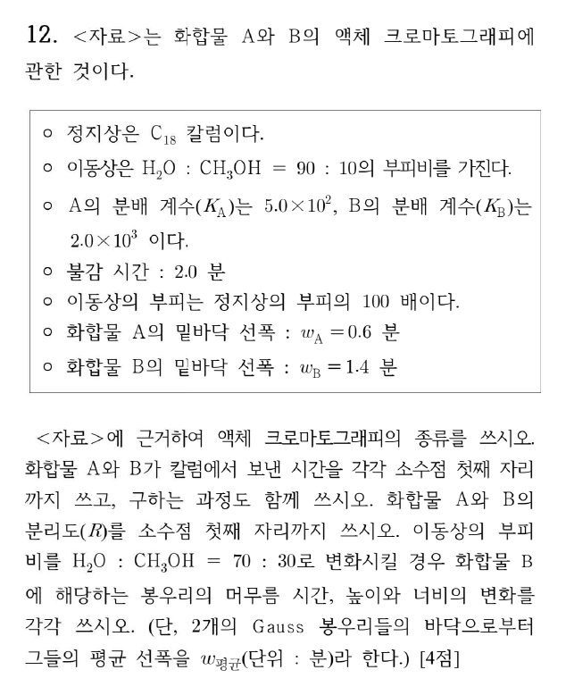

**정답** (답지 난이도 ★★★☆☆) **역상 분배 크로마토그래피**, A **12.0분**, B **42.0분**, 분리도 **30.0**, 메탄올 비율↑: 머무름 시간 **감소**, 높이 **증가**, 너비 **감소**

**공식·핵심 개념**

- $k = K\dfrac{V_s}{V_m}$, $t_R = t_M(1 + k)$
- 분리도 $R = \dfrac{\Delta t_R}{w_{평균}}$
- 역상(C₁₈): 유기 용매 비율↑ → 머무름↓

**2027 출제 가능성 ★★★★☆ 높음** — 크로마토그래피 계산(k, α, R, N)은 분석화학 기입·서술형으로 자주 나옵니다.

**주어진 것** 정지상 C₁₈, 이동상 H₂O : CH₃OH = 90 : 10, $K_A = 5.0\times10^2$, $K_B = 2.0\times10^3$, $t_M = 2.0$ 분, $V_m = 100V_s$, $w_A = 0.6$ 분, $w_B = 1.4$ 분

**구할 것** 크로마토그래피 종류, $t_{R,A}$, $t_{R,B}$, 분리도 $R$, 이동상을 70 : 30으로 바꿀 때 B 봉우리의 머무름 시간·높이·너비 변화

**풀이 전략** 분배 계수 → 머무름 인자($k = KV_s/V_m$) → 머무름 시간($t_R = t_M(1+k)$) → 분리도 순서로 계산합니다.

**(1) 종류.** 정지상(C₁₈ 알킬)이 비극성, 이동상(물·메탄올)이 극성 → **역상 분배 크로마토그래피**.

**(2) 머무름 인자.** $V_s/V_m = 1/100$이므로

$$k_A = 5.0\times10^2\times\frac{1}{100} = 5.0, \qquad k_B = 2.0\times10^3\times\frac{1}{100} = 20$$

**(3) 머무름 시간.**

$$t_{R,A} = 2.0(1 + 5.0) = 12.0\ \text{분}$$

$$t_{R,B} = 2.0(1 + 20) = 42.0\ \text{분}$$

**(4) 분리도.**

$$w_{평균} = \frac{0.6 + 1.4}{2} = 1.0\ \text{분}$$

$$R = \frac{t_{R,B} - t_{R,A}}{w_{평균}} = \frac{42.0 - 12.0}{1.0} = 30.0$$

(참고: 선택 인자 $\alpha = k_B/k_A = 4.0$, 단수 $N = 16(t_R/w)^2$은 A 6400, B 14400.)

**(5) 이동상 70 : 30.** 메탄올 비율이 늘면 이동상의 극성이 낮아져(용리 세기 증가) 비극성 분석물이 이동상에 더 머뭅니다 → $K$, $k$ 감소.

대략적인 추정(극성 지수 P′: 물 10.2, 메탄올 5.1, 역상 경험식 $k_2/k_1 = 10^{(P'_2 - P'_1)/2}$):

$$P'_1 = 0.9(10.2) + 0.1(5.1) = 9.69, \quad P'_2 = 0.7(10.2) + 0.3(5.1) = 8.67$$

$$\frac{k_2}{k_1} = 10^{-0.51} \approx 0.31 \Rightarrow k_B \approx 6.2,\ t_{R,B} \approx 14\ \text{분}$$

- 머무름 시간: **감소**
- 너비: 칼럼 안에 머무는 시간이 짧아 띠 퍼짐이 줄어 **감소** ($w = 4t_R/\sqrt N$)
- 높이: 봉우리 면적(시료 양)은 같고 너비가 줄었으므로 **증가**

**검산** 시간 단위는 모두 분, $R$은 무차원 ✓. $R = 30$은 기준선 분리 기준 1.5보다 훨씬 커서 두 봉우리가 충분히 떨어져 있습니다.

**채점 포인트·함정**

- $V_m = 100V_s$이므로 $V_s/V_m = 1/100$ (뒤집지 않기).
- 역상에서 유기 용매 비율을 늘리면 머무름이 **짧아집니다**(정상과 반대).

# 전공 B

## B형 1번 · 페로브스카이트 구조 {#b1}

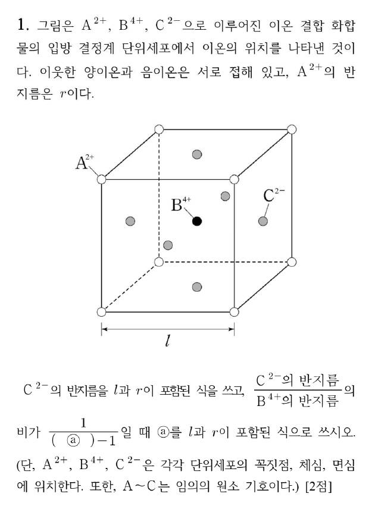

**정답** (답지 난이도 ★★☆☆☆) $r_{C^{2-}} = \dfrac{\sqrt2}{2}l - r$, ⓐ $= \dfrac{l}{\sqrt2\,l - 2r}$

**공식·핵심 개념**

- 단위세포 원자 수: 꼭짓점 ⅛, 면심 ½, 체심 1
- 페로브스카이트 ABX₃: A 꼭짓점, B 체심, X 면심
- 접촉: A–X 면대각선 ½, B–X 변 ½

**2027 출제 가능성 ★★★★☆ 높음** — 결정 구조와 이온 반지름 관계는 2023 기출 이후 계속 나오는 무기 소재입니다. 허용 인자(tolerance factor)로도 변형될 수 있습니다.

**주어진 것** 입방 단위세포: A²⁺ 꼭짓점, B⁴⁺ 체심, C²⁻ 면심 / 한 변 $l$, A²⁺ 반지름 $r$ / 이웃한 양이온과 음이온은 접촉

**구할 것** C²⁻의 반지름, $\dfrac{r_C}{r_B} = \dfrac{1}{ⓐ - 1}$일 때 ⓐ

**풀이 전략** 각 양이온–음이온 쌍의 중심 사이 거리를 좌표로 구해 "반지름의 합 = 중심 거리"를 세웁니다.

**(1) 조성.** A: $8\times\frac18 = 1$, B: $1$, C: $6\times\frac12 = 3$ → ABC₃, 전하 $+2 + 4 - 6 = 0$ ✓ (페로브스카이트, CaTiO₃형).

**(2) A–C 거리.** A $(0,0,0)$와 면심 C $(\tfrac l2, \tfrac l2, 0)$:

$$d_{AC} = \sqrt{\left(\tfrac l2\right)^2 + \left(\tfrac l2\right)^2} = \frac{\sqrt2}{2}l$$

접촉하므로 $r + r_C = \dfrac{\sqrt2}{2}l$ → $r_C = \dfrac{\sqrt2}{2}l - r$.

**(3) B–C 거리.** 체심 B $(\tfrac l2, \tfrac l2, \tfrac l2)$와 면심 C $(\tfrac l2, \tfrac l2, 0)$: $d_{BC} = \tfrac l2$.

$$r_B = \frac l2 - r_C = \frac l2 - \frac{\sqrt2}{2}l + r = \frac{l - \sqrt2\,l + 2r}{2}$$

**(4) 비를 원하는 꼴로.** $u = \sqrt2\,l - 2r$로 놓으면 $r_C = u/2$, $r_B = (l - u)/2$.

$$\frac{r_C}{r_B} = \frac{u}{l - u} = \frac{1}{\dfrac lu - 1}$$

$$ⓐ = \frac lu = \frac{l}{\sqrt2\,l - 2r}$$

**검산** 수치 예 $l = 4.00$, $r = 1.40$: $r_C = 1.428$, $r_B = 0.572$, $r_C/r_B = 2.499$; ⓐ $= 4.00/(5.657 - 2.80) = 1.400$, $1/(1.400 - 1) = 2.50$ ✓. 두 접촉이 동시에 성립한다는 것은 허용 인자 $t = \dfrac{r_A + r_C}{\sqrt2(r_B + r_C)} = 1$(이상적 입방 페로브스카이트)인 경우입니다.

**채점 포인트·함정**

- A–C 접촉은 **면대각선**, B–C 접촉은 **변**의 절반입니다.
- 분모를 $\frac{l}{\sqrt2 l - 2r} - 1$ 꼴로 만드는 변형 과정을 보여 줍니다.

## B형 2번 · EBT 지시약과 EDTA 적정 {#b2}

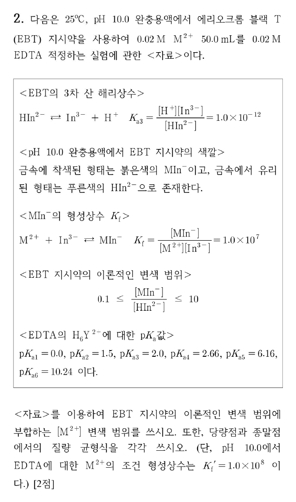

**정답** (답지 난이도 ★★☆☆☆) $1\times10^{-6}\ \mathrm{M} \le [\mathrm{M^{2+}}] \le 1\times10^{-4}\ \mathrm{M}$

- 당량점: $[\mathrm{M^{2+}}] = [\mathrm{H_6Y^{2+}}] + [\mathrm{H_5Y^+}] + [\mathrm{H_4Y}] + [\mathrm{H_3Y^-}] + [\mathrm{H_2Y^{2-}}] + [\mathrm{HY^{3-}}] + [\mathrm{Y^{4-}}]$
- 종말점: $[\mathrm{M^{2+}}] + [\mathrm{MIn^-}] = [\mathrm{H_6Y^{2+}}] + \cdots + [\mathrm{Y^{4-}}]$

**공식·핵심 개념**

- 조건 형성상수 $K_f' = \alpha_{Y^{4-}}K_f$
- 지시약 변색: $0.1 \le [MIn]/[HIn] \le 10$
- 당량점: 넣은 EDTA = 금속 전체 (질량 균형)

**2027 출제 가능성 ★★★★☆ 높음** — EDTA 적정은 분석화학의 대표 소재입니다. 당량점 pM 계산이나 지시약 선택 근거로 나올 수 있습니다.

**주어진 것** pH 10.0, 0.02 M M²⁺ 50.0 mL를 0.02 M EDTA로 적정 / $K_{a3}$(HIn²⁻) $= 1.0\times10^{-12}$, $K_f$(MIn⁻) $= 1.0\times10^7$ / 변색 범위 $0.1 \le [\mathrm{MIn^-}]/[\mathrm{HIn^{2-}}] \le 10$ / $K_f' = 1.0\times10^8$

**구할 것** 변색 범위에 해당하는 [M²⁺], 당량점·종말점의 질량 균형식

**풀이 전략** 두 평형을 더해 "M²⁺ + HIn²⁻ ⇌ MIn⁻ + H⁺" 하나로 만들면 색 비가 [M²⁺]와 [H⁺]만으로 표현됩니다.

**(1) 평형 합치기.**

$$\begin{array}{lr}
\mathrm{HIn^{2-} \rightleftharpoons In^{3-} + H^+} & K_{a3} \\
\mathrm{M^{2+} + In^{3-} \rightleftharpoons MIn^-} & K_f \\ \hline
\mathrm{M^{2+} + HIn^{2-} \rightleftharpoons MIn^- + H^+} & K_fK_{a3}
\end{array}$$

$$K = (1.0\times10^7)(1.0\times10^{-12}) = 1.0\times10^{-5}$$

**(2) 색 비를 [M²⁺]로.**

$$\frac{[\mathrm{MIn^-}]}{[\mathrm{HIn^{2-}}]} = \frac{K[\mathrm{M^{2+}}]}{[\mathrm{H^+}]} = \frac{1.0\times10^{-5}}{1.0\times10^{-10}}[\mathrm{M^{2+}}] = 1.0\times10^5[\mathrm{M^{2+}}]$$

**(3) 변색 범위.**

$$0.1 \le 1.0\times10^5[\mathrm{M^{2+}}] \le 10$$

$$\Rightarrow\ 1.0\times10^{-6}\ \mathrm M \le [\mathrm{M^{2+}}] \le 1.0\times10^{-4}\ \mathrm M \quad(\mathrm{pM}\ 4.0\sim6.0)$$

**(4) 지시약이 맞는지 확인.** 당량점 부피 $V_e = \dfrac{0.02\times50.0}{0.02} = 50.0$ mL, 전체 100.0 mL.

$$[\mathrm{MY^{2-}}] = \frac{1.00\ \mathrm{mmol}}{100.0\ \mathrm{mL}} = 0.0100\ \mathrm M$$

해리 $\mathrm{MY \rightleftharpoons M + EDTA}$에서 $[\mathrm M] = [\mathrm{EDTA}] = x$:

$$\frac{0.0100}{x^2} = K_f' = 1.0\times10^8 \Rightarrow x = 1.0\times10^{-5}\ \mathrm M\ (\mathrm{pM}\ 5.0)$$

변색 범위의 가운데(pM 5)이므로 EBT가 알맞은 지시약입니다. (참고: 주어진 pKa로 계산한 $\alpha_{Y^{4-}}$(pH 10) $= 0.365$.)

**(5) 당량점의 질량 균형.** 넣은 EDTA 전체 = 금속 전체.

$$[\mathrm{M^{2+}}] + [\mathrm{MY^{2-}}] = [\mathrm{MY^{2-}}] + \textstyle\sum_{n=0}^{6}[\mathrm{H}_n\mathrm{Y}]$$

MY²⁻를 양변에서 지우면 $[\mathrm{M^{2+}}] = [\mathrm{H_6Y^{2+}}] + [\mathrm{H_5Y^+}] + \cdots + [\mathrm{Y^{4-}}]$.

**(6) 종말점의 질량 균형.** 지시약이 금속 일부(MIn⁻)를 붙잡고 있으므로 금속 쪽에 더합니다.

$$[\mathrm{M^{2+}}] + [\mathrm{MIn^-}] = [\mathrm{H_6Y^{2+}}] + \cdots + [\mathrm{Y^{4-}}]$$

**검산** 색이 반쯤 바뀌는 점($[\mathrm{MIn^-}] = [\mathrm{HIn^{2-}}]$)은 $[\mathrm M] = 1.0\times10^{-5}$ M로, 당량점 [M]과 정확히 같습니다 → 적정 오차가 거의 없습니다.

**채점 포인트·함정**

- $K_f$와 $K_{a3}$를 결합해 [H⁺]가 들어간 비로 만드는 것이 핵심입니다.

## B형 3번 · 로슨의 순환학습 모형 {#b3}

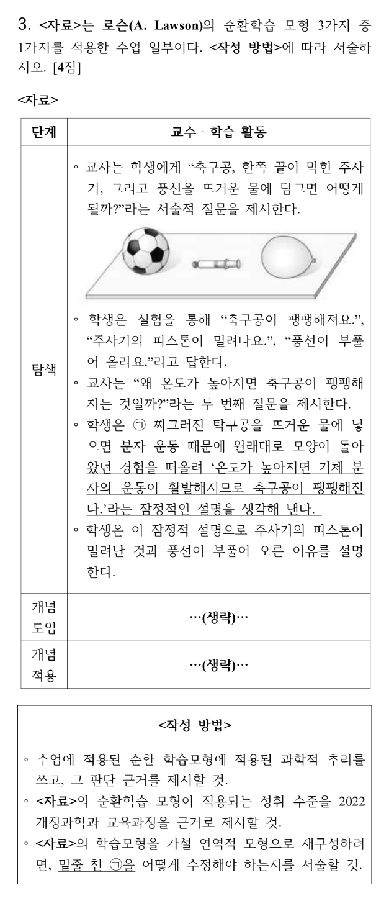

**정답**

- 과학적 추리: **귀추적 추리**(경험-귀추적 순환학습). 탐색 단계에서 경험적 사실(찌그러진 탁구공이 펴진 경험)로부터 '온도가 높아지면 기체 분자의 운동이 활발해지므로 축구공이 팽팽해진다'라는 가설을 생성하기 때문이다.
- 성취 수준: 기체의 온도와 부피 관계를 실험 결과로부터 알아내고, 이를 입자 모형으로 해석할 수 있다.
- ㉠ 수정: 경험에 근거한 설명 대신 '**온도가 높아지면 기체 분자의 운동이 활발해진다**'는 일반화 가설을 제시하고, 이를 **실험 방법 및 절차로 검증**하게 한다.

**공식·핵심 개념**

- 로슨 순환학습: 탐색 → 개념 도입 → 개념 적용
- 3유형: 서술적(귀납) / 경험-귀추적 / 가설-연역적
- 귀추: 유사 경험에서 잠정적 설명 생성

**2027 출제 가능성 ★★★★★ 매우 높음** — 순환학습과 과학적 추리 유형(귀납·연역·귀추)은 화학교육론 최빈출입니다.

**로슨의 순환학습 3유형**

| 유형 | 추리 | 탐색 단계 특징 |
|---|---|---|
| 서술적 | 경험-귀납적 | 관찰·기술, 규칙성 발견 |
| 경험-귀추적 | 귀추 | "왜?" 질문 → 유사 경험에서 잠정적 설명 생성 |
| 가설-연역적 | 가설-연역 | 가설 제시 → 예측 → 실험으로 검증 |

자료에서는 두 번째 질문 "왜?"에 학생이 **유사한 경험(원천)**을 떠올려 설명을 만드므로 경험-귀추적입니다.

**채점 포인트·함정**

- 가설 연역적으로 바꿀 때는 "가설을 **명시적으로 세우고, 실험 설계로 검증**" 두 요소가 모두 있어야 합니다.

## B형 4번 · 고윈의 V도 {#b4}

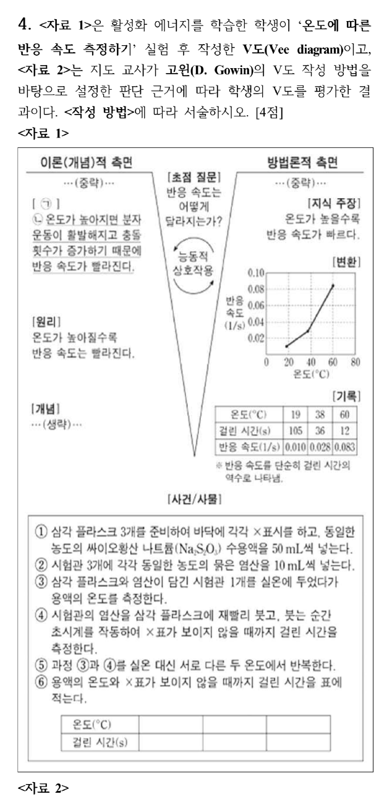

**정답**

- ㉠ **이론**(분자 운동론). ㉡ 과학적 설명: 온도가 올라가면 **활성화 에너지 이상의 에너지를 가진 분자 수가 많아지므로** 반응 속도가 증가한다.
- ㉣ 가치 주장의 판단 근거: **지식 주장이 실생활에서 유용한 가치를 드러냈는가?**
- ㉢ 초점 질문 수정: "**온도에 따라 반응 속도는 어떻게 달라질까?**"
- 적용: 실험과 과학 이론과의 연관성을 보고자 할 때, 즉 **실험실 수업 또는 실험 평가** 등에 적절한 평가 방법이다.

**공식·핵심 개념**

- V도: 초점 질문 · 개념적 측면(이론·원리·개념) · 방법론적 측면(기록·변환·지식 주장·가치 주장) · 사건/사물
- 활성화 에너지와 맥스웰–볼츠만 분포

**2027 출제 가능성 ★★★★☆ 높음** — 고윈의 V도는 실험 수업·평가와 엮여 종종 나옵니다. 각 요소의 판단 근거를 외워 두면 기입형에 강합니다.

**V도 구조**: 가운데 초점 질문, 아래 꼭짓점 사건·사물. 왼쪽 개념적 측면(세계관 → 철학 → **이론** → 원리 → 개념), 오른쪽 방법론적 측면(기록 → 변환 → 지식 주장 → 가치 주장). 두 측면이 초점 질문을 중심으로 상호작용합니다.

**㉡ 수정 이유.** 충돌 횟수 증가만으로는 온도 10 °C 상승에 속도가 2~3배 되는 현상을 설명하지 못합니다. 선행 개념인 **활성화 에너지**와 맥스웰–볼츠만 분포를 써서 "유효 충돌 분자의 비율이 크게 늘어난다"로 설명합니다.

**㉢.** 원래 질문 "반응 속도는 어떻게 달라지는가?"에는 **독립 변인(온도)**이 없어 미충족.

**채점 포인트·함정**

- 기록이 '미충족'인 이유: 사건·사물에 진술된 과정(서로 다른 세 온도, 걸린 시간)을 표로 정확히 기록하지 않았기 때문 — 함께 정리해 두면 좋습니다.

## B형 5번 · 개념도와 오수벨의 포섭 {#b5}

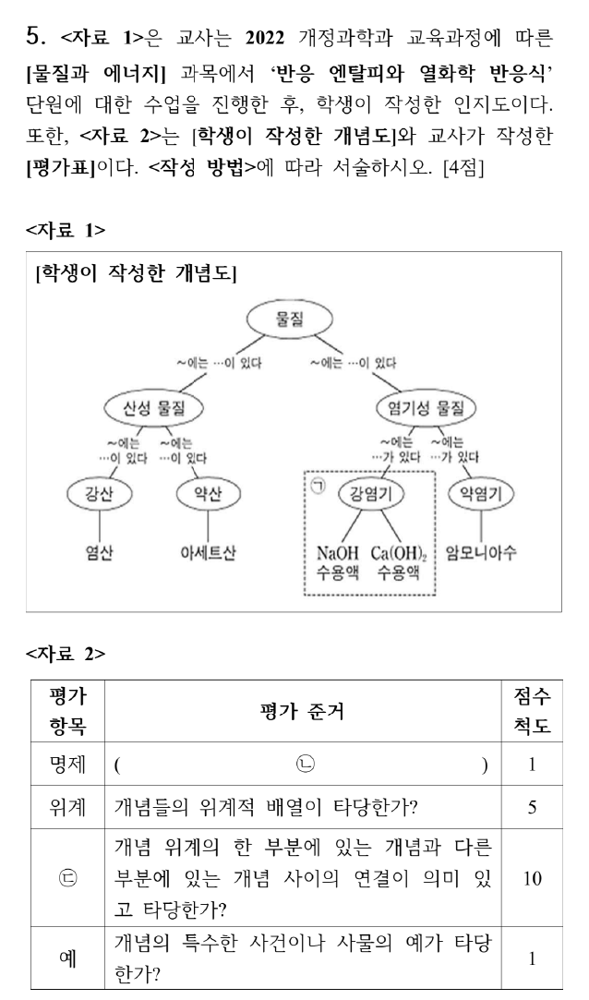

**정답**

- 포섭: **파생적 포섭**. 인지구조의 기존 개념(강염기)에 특수한 사례(KOH 수용액)가 추가되는 유의미학습의 원리로서, **점진적 분화**에 따라 선행지식이 더욱 정교화된다.
- ㉡ **개념들 사이의 관계를 서술하는 명제가 타당한가?** / **6점**
- 표준개념도: 교과의 장이나 단원 내용을 **소개**하거나 그 내용을 **정리**할 때 쓰인다.
- ㉢ **교차 연결(횡적 연결)**

**공식·핵심 개념**

- 오수벨: 파생적 포섭 / 상관적 포섭 / 상위적·병렬적 학습, 점진적 분화·통합적 조정
- 노박·고윈 채점: 명제 1, 위계 5, 교차 연결 10, 예 1

**2027 출제 가능성 ★★★★☆ 높음** — 개념도와 유의미학습은 꾸준한 출제 소재입니다. 채점 기준 계산까지 대비하세요.

**오수벨의 포섭 유형**

| 유형 | 내용 | 예 |
|---|---|---|
| 파생적 포섭 | 기존 개념의 **예**를 추가 (개념 자체는 그대로) | 강염기 ← KOH |
| 상관적 포섭 | 기존 개념을 **확장·수정** | 염기 정의에 NH₃ 추가 |
| 상위적 학습 | 하위 개념들을 묶는 상위 개념 학습 | |
| 병렬적 학습 | 같은 수준의 새 개념 | |

**노박·고윈 채점 기준과 이 개념도**

| 항목 | 점수 | 이 개념도 |
|---|---|---|
| 명제 | 1점/개 | 연결어가 있는 관계 6개 → **6점** |
| 위계 | 5점/수준 | 물질 → 산성·염기성 → 강·약 : 2수준 → 10점 |
| 교차 연결 | 10점/개 | 없음 → 0점 |
| 예 | 1점/개 | 염산, 아세트산, NaOH, Ca(OH)₂, 암모니아수 → 5점 |

(전체 21점. 답지의 "6점"은 명제 항목 점수입니다 — 검토 메모 2 참고)

**채점 포인트·함정**

- 파생적 포섭과 상관적 포섭의 구분이 자주 출제됩니다. KOH는 새로운 **예**일 뿐 강염기의 뜻을 바꾸지 않습니다.

## B형 6번 · d⁷ Tanabe–Sugano 도표 {#b6}

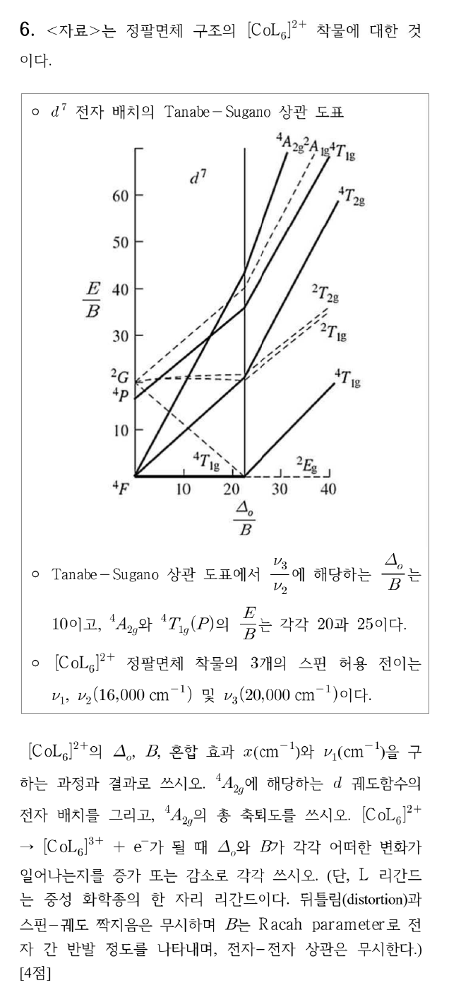

**정답** (답지 난이도 ★★★☆☆) $B = 800\ \mathrm{cm^{-1}}$, $\Delta_o = 8000\ \mathrm{cm^{-1}}$, $x = 1600\ \mathrm{cm^{-1}}$, $\nu_1 = 8000\ \mathrm{cm^{-1}}$. ⁴A₂g = t₂g³eg⁴, 총 축퇴도 **4**. Co²⁺ → Co³⁺: Δo **증가**, B **증가**

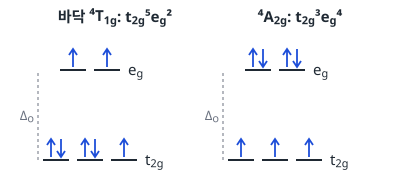

**공식·핵심 개념**

- Tanabe–Sugano: 전이 에너지 비로 Δo/B 결정
- d⁷ 약한 장: $\nu_1 = 0.8\Delta_o + x$, $\nu_2 = 1.8\Delta_o + x$, $\nu_3 = 0.6\Delta_o + 15B + 2x$
- 총 축퇴도 = (2S+1) × 궤도 축퇴도

**2027 출제 가능성 ★★★★☆ 높음** — 전자 스펙트럼 해석은 무기 고난도 서술형의 단골입니다. d³·d⁸(쉬운 경우)과 d⁷(혼합 효과)을 구분해 두세요.

**주어진 것** 정팔면체 [CoL₆]²⁺(L 중성 한자리), d⁷ Tanabe–Sugano 도표 / $\nu_3/\nu_2$에 해당하는 $\Delta_o/B = 10$, 그때 ⁴A₂g와 ⁴T₁g(P)의 $E/B$ = 20, 25 / $\nu_2 = 16000$, $\nu_3 = 20000\ \mathrm{cm^{-1}}$

**구할 것** $\Delta_o$, $B$, 혼합 효과 $x$, $\nu_1$, ⁴A₂g의 전자 배치와 총 축퇴도, Co³⁺로 산화될 때 $\Delta_o$·$B$의 변화

**풀이 전략** 도표에서 $\nu_3/\nu_2$ 비로 $\Delta_o/B$를 읽고, 한 띠의 $E/B$로 B를 정합니다. 그다음 약한 장 d⁷의 전이 에너지 식으로 $x$와 $\nu_1$을 구하고, 남은 띠로 검산합니다.

**(1) 전자 배치와 바닥 상태.** Co: [Ar]3d⁷4s² → Co²⁺: 3d⁷. $\Delta_o/B = 10$은 교차점(약 22)보다 작은 약한 장 → 고스핀 $t_{2g}^5e_g^2$, 바닥 항 ⁴T₁g(F). 스핀 허용(사중항) 전이는 ⁴T₂g, ⁴A₂g, ⁴T₁g(P) 세 개.

**(2) 띠 배정과 Δo/B.**

$$\frac{\nu_3}{\nu_2} = \frac{20000}{16000} = 1.25 = \frac{25}{20}$$

→ $\Delta_o/B = 10$, $\nu_2$ = ⁴A₂g ($E/B = 20$), $\nu_3$ = ⁴T₁g(P) ($E/B = 25$).

**(3) B와 Δo.**

$$B = \frac{16000}{20} = 800\ \mathrm{cm^{-1}}, \qquad \Delta_o = 10B = 8000\ \mathrm{cm^{-1}}$$

**(4) 전이 에너지 식.** 섞이기 전 에너지(Δo 단위): ⁴T₁g(F) $-0.6\Delta_o$, ⁴T₂g $+0.2\Delta_o$, ⁴A₂g $+1.2\Delta_o$, ⁴T₁g(P) $15B$. 같은 대칭 ⁴T₁g 두 개가 섞여 아래 것은 $x$만큼 내려가고 위 것은 $x$만큼 올라갑니다.

| 전이 | 식 |
|---|---|
| $\nu_1$ (→⁴T₂g) | $0.2\Delta_o - (-0.6\Delta_o - x) = 0.8\Delta_o + x$ |
| $\nu_2$ (→⁴A₂g) | $1.2\Delta_o + 0.6\Delta_o + x = 1.8\Delta_o + x$ |
| $\nu_3$ (→⁴T₁g(P)) | $(15B + x) + 0.6\Delta_o + x = 0.6\Delta_o + 15B + 2x$ |

**(5) x와 ν₁.**

$$16000 = 1.8(8000) + x = 14400 + x \Rightarrow x = 1600\ \mathrm{cm^{-1}}$$

$$\nu_1 = 0.8(8000) + 1600 = 8000\ \mathrm{cm^{-1}}\ (\lambda = 1250\ \mathrm{nm})$$

**(6) ⁴A₂g.** $t_{2g}^5e_g^2$에서 전자 두 개가 $t_{2g} \to e_g$로 올라간 $t_{2g}^3e_g^4$입니다. $t_{2g}$의 세 전자는 모두 홀전자(↑↑↑), $e_g$는 꽉 참 → $S = \tfrac32$, $2S+1 = 4$. A는 궤도 축퇴도 1 → **총 축퇴도 4 × 1 = 4** (바닥 ⁴T₁g는 4 × 3 = 12).

**(7) Co²⁺ → Co³⁺.**

- Δo **증가**: 금속 전하가 커져 리간드가 더 가까이 강하게 결합 (보통 40~60% 증가).
- B **증가**: 유효 핵전하가 커져 d 오비탈이 수축 → 전자 간 반발 증가. (참고: 자유 Co²⁺의 B ≈ 970 cm⁻¹이므로 이 착물의 $\beta = 800/970 \approx 0.82$.)

**검산** $\nu_3 = 0.6(8000) + 15(800) + 2(1600) = 4800 + 12000 + 3200 = 20000\ \mathrm{cm^{-1}}$ ✓ (주어진 값과 일치). 파장 ν₂ 625 nm, ν₃ 500 nm.

**채점 포인트·함정**

- 도표의 ⁴A₂g(20)과 ⁴T₁g(P)(25)는 바닥 상태 기준 E/B입니다.
- x를 넣지 않으면 세 전이 값이 서로 맞지 않습니다 — 세 식으로 검산하세요.

## B형 7번 · M₃(CO)₁₂의 18전자 규칙, 등엽성, CO 진동 {#b7}

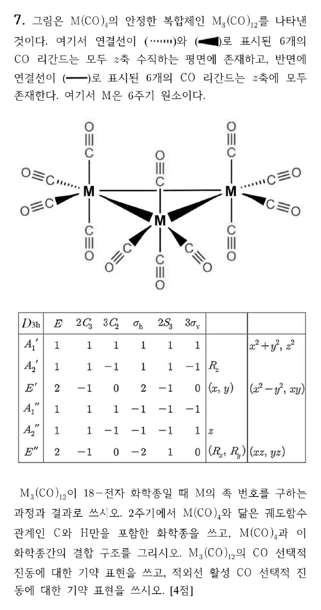

**정답** (답지 난이도 ★★★☆☆)

- M의 족: **8족** (6주기 → Os, Os₃(CO)₁₂)
- 등엽성 화학종: **CH₂**, 결합 구조: **H₂C=M(CO)₄**
- $\Gamma_{CO} = 2A_1' + A_2' + 3E' + A_2'' + E''$, IR 활성: **3E′ + A₂″**

**공식·핵심 개념**

- 18전자 규칙: 금속 전자 + 리간드 전자 + M–M 결합 1개당 1
- 등엽성: d⁸ ML₄ ↔ CH₂, d⁹ ML₅ ↔ CH₃
- CO 진동: 움직이지 않는 CO 수로 Γ → 축소 → IR(x,y,z)

**2027 출제 가능성 ★★★★☆ 높음** — 금속 카보닐 전자 수 세기와 CO 진동 대칭은 무기에서 자주 나옵니다. 등엽성은 최근 출제 빈도가 오르는 소재입니다.

**주어진 것** M₃(CO)₁₂, M은 6주기 / 각 M에 CO 4개(평면 안 2개, z축 2개), M–M 결합 3개 / D₃h 지표표

**구할 것** M의 족 번호, M(CO)₄와 등엽인 2주기 C·H 화학종과 결합 구조, CO 신축 진동의 기약표현과 IR 활성 기약표현

**풀이 전략** 18전자 규칙을 금속 하나 기준으로 세우고, 등엽성은 "18전자까지 모자란 전자 수·프런티어 오비탈 수"로 대응시킵니다. 진동은 움직이지 않는 CO 수로 Γ를 세운 뒤 축소합니다.

**(1) 금속 하나의 전자 수 (중성 계산).**

$$\underbrace{x}_{\text{족 번호}} + \underbrace{4\times2}_{\text{CO}} + \underbrace{2\times1}_{\text{M–M 2개}} = 18 \Rightarrow x = 8$$

→ **8족**, 6주기 → Os (Os₃(CO)₁₂).

**(2) 분자 전체로 검산.** M–M 결합이 $b$개인 다핵 착물: 총 전자 수 $= 18n - 2b = 18(3) - 2(3) = 48$. $3x + 12\times2 = 48$ → $x = 8$ ✓.

**(3) 등엽성.** Os(CO)₄ 조각의 전자: $8 + 8 = 16$ → 18까지 2개 부족, 팔면체에서 리간드 두 자리가 빈 $d^8$ ML₄ → 전자 1개씩 든 프런티어 오비탈 **2개**. CH₂(C 4 + H 2 = 6, 팔전자까지 2개 부족, 프런티어 오비탈 2개)와 같습니다.

| 조각 | 18/8까지 부족 | 프런티어 오비탈 | 등엽 |
|---|---|---|---|
| d⁸ ML₄ (Os(CO)₄) | 2 | 2 | **CH₂** |
| d⁹ ML₅ | 1 | 1 | CH₃ |

그래서 Os₃(CO)₁₂ ↔ 사이클로프로페인 (CH₂)₃이고, 두 조각을 합치면 에틸렌 H₂C=CH₂처럼 **H₂C=Os(CO)₄**(금속 카벤) 구조가 됩니다.

**(4) Γ_CO 세우기** (z = C₃, M₃ 평면 = σh):

| D₃h | E | 2C₃ | 3C₂ | σh | 2S₃ | 3σᵥ |
|---|---|---|---|---|---|---|
| 그대로 있는 CO | 12 | 0 | 0 | 6 (평면 안) | 0 | 2 (한 M의 축 CO) |

C₂는 그 축 위 M의 축 CO 두 개를 서로 바꾸고 평면 CO도 바꾸므로 0입니다.

**(5) 축소** ($h = 12$, $n_i = \frac{1}{12}\sum g\,\chi_\Gamma\chi_i$, 열 순서 E, σh, σᵥ만 0이 아님):

- $A_1'$: $\frac{1}{12}[12 + 6 + 3(2)(1)] = \frac{24}{12} = 2$
- $A_2'$: $\frac{1}{12}[12 + 6 + 3(2)(-1)] = 1$
- $E'$: $\frac{1}{12}[12(2) + 6(2) + 0] = 3$
- $A_1''$: $\frac{1}{12}[12 - 6 - 6] = 0$
- $A_2''$: $\frac{1}{12}[12 - 6 + 6] = 1$
- $E''$: $\frac{1}{12}[24 - 12 + 0] = 1$

$$\Gamma_{CO} = 2A_1' + A_2' + 3E' + A_2'' + E''$$

차원: $2 + 1 + 6 + 1 + 2 = 12$ ✓. (축 CO만: $A_1' + E' + A_2'' + E''$, 평면 CO만: $A_1' + A_2' + 2E'$.)

**(6) IR 활성.** x, y → E′, z → A₂″이므로 **3E′ + A₂″** → IR 띠 4개. Raman 활성은 $2A_1' + 3E' + E''$.

**검산** E′는 IR·Raman 모두 활성(중심 대칭 없음 → 상호 배제 원리 적용 안 됨). 실제 Os₃(CO)₁₂의 IR에도 CO 띠가 4개 나타납니다.

**채점 포인트·함정**

- M–M 결합 전자를 세지 않으면 족이 10이 됩니다.

## B형 8번 · 무수물의 환원 → 에터화 → 산화적 오존 분해 {#b8}

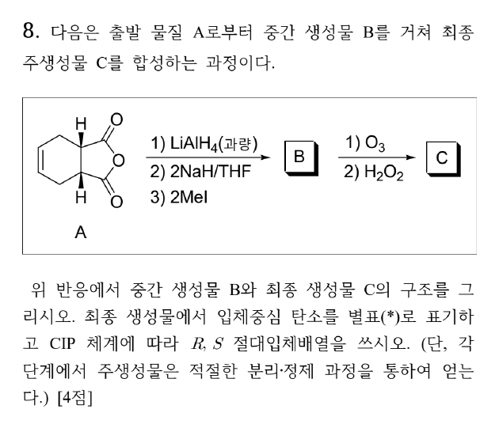

**정답** B = **cis-4,5-bis(methoxymethyl)cyclohexene**, C = **3,4-bis(methoxymethyl)hexanedioic acid**, 입체중심 C3*·C4*, **(3R, 4S) — meso**

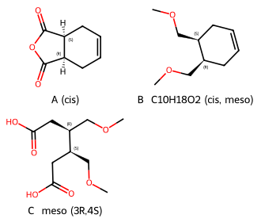

**공식·핵심 개념**

- LiAlH₄: 산무수물·에스터 → 1차 알코올
- Williamson: RO⁻ + CH₃I → ROCH₃ (SN2)
- O₃ 후 H₂O₂ → 카복실산 / Me₂S → 알데하이드
- meso: 입체중심이 있어도 대칭면 → 광학 비활성

**2027 출제 가능성 ★★★★☆ 높음** — 다단계 합성 + R/S 표기는 유기 서술형의 고정 유형입니다. meso 판정이 자주 함정으로 쓰입니다.

**주어진 것** A = cis-1,2,3,6-tetrahydrophthalic anhydride(C₈H₈O₃) → ① LiAlH₄(과량) ② 2 NaH/THF ③ 2 MeI → B → ① O₃ ② H₂O₂ → C

**구할 것** B, C의 구조, C의 입체중심(*)과 R/S

**풀이 전략** 각 단계에서 바뀌는 작용기만 추적하고, 고리의 두 입체중심은 어떤 단계에서도 결합이 끊어지지 않으므로 cis 관계가 끝까지 유지된다는 점을 이용합니다.

**(1) LiAlH₄ 환원 (H⁻ 4당량).**

**(1-1)** H⁻가 한 C=O 탄소 공격 → 사면체 알콕사이드.

**(1-2)** C=O가 다시 생기며 고리 O(카복실레이트)가 이탈 → 고리 열림: 알데하이드 + 카복실레이트.

**(1-3)** 알데하이드가 바로 환원 → 1차 알콕사이드. 카복실레이트(알루미늄염)도 과량 LiAlH₄에 의해 1차 알코올까지 환원.

**(1-4)** H₃O⁺ 후처리 → cis-cyclohex-4-ene-1,2-diyldimethanol (C₈H₁₄O₂).

**(2) Williamson 에터 합성.**

**(2-1)** NaH의 H⁻(짝산 H₂, pKa ≈ 35)가 OH(pKa ≈ 16)를 떼어 냄 → 알콕사이드 + H₂↑ (기체가 빠져 비가역).

**(2-2)** 알콕사이드가 CH₃I의 탄소를 SN2 공격, I⁻ 이탈. 메틸은 β-H가 없어 E2 경쟁이 없습니다. 2당량이라 두 OH 모두 OCH₃.

$$\mathrm{B}:\ \text{cis-4,5-bis(methoxymethyl)cyclohexene},\ \mathrm{C_{10}H_{18}O_2}$$

**(3) 오존 분해 + H₂O₂.**

**(3-1)** O₃가 고리 C=C에 1,3-쌍극자 첨가 → 1차 오존화물.

**(3-2)** 역 [3+2]로 카보닐 + 카보닐 옥사이드로 갈라졌다가 다시 붙어 2차 오존화물(고리가 열린 상태로 두 끝이 연결).

**(3-3)** H₂O₂ 산화적 후처리: 생기는 알데하이드가 카복실산까지 산화 → 양 끝이 COOH.

$$\mathrm{C}:\ \mathrm{HOOC{-}CH_2{-}C^*H(CH_2OMe){-}C^*H(CH_2OMe){-}CH_2{-}COOH}$$

3,4-bis(methoxymethyl)hexanedioic acid, C₁₀H₁₈O₆.

**(4) C3의 CIP 우선순위.**

| 치환기 | 붙은 원자 | 순위 |
|---|---|---|
| CH₂OCH₃ | (O, H, H) | 1 |
| C4 | (C, C, H) | 2 |
| CH₂COOH | (C, H, H) | 3 |
| H | — | 4 |

C4도 같은 방식으로 정해 보면 두 탄소의 치환기 구성이 같고, cis 고리에서 왔으므로 배열은 서로 거울상 관계 → **(3R, 4S)**. 분자 안에 대칭 요소가 있어 **meso**(광학 비활성)입니다.

**왜 이 생성물인가** ① 무수물은 LiAlH₄에 두 C=O가 모두 환원되어 다이올이 되고, ② 오존 분해의 후처리가 H₂O₂(산화적)이므로 알데하이드가 아니라 카복실산이 됩니다. ③ 입체중심의 결합은 한 번도 끊어지지 않아 출발물의 cis가 그대로 meso로 이어집니다(trans였다면 (3R,4R)/(3S,4S) 라셈).

**메커니즘 — LiAlH₄ 무수물 환원**

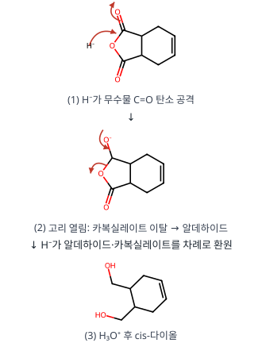

**메커니즘 — Williamson 에터 합성**

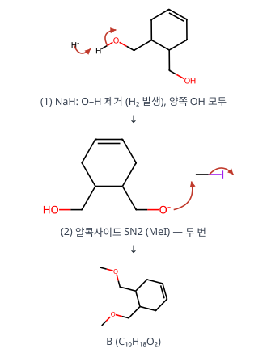

**메커니즘 — 산화적 오존 분해**

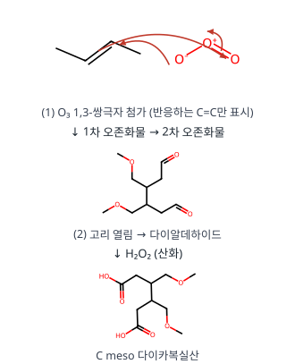

**메커니즘 — H₂O₂: 알데하이드 → 카복실산**

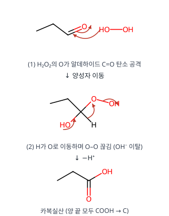

**검산** 분자식 추적: A C₈H₈O₃ → (H 6개 첨가, O 1개 제거) 다이올 C₈H₁₄O₂ → (CH₂ 2개 첨가) B C₁₀H₁₈O₂ → (O 4개 첨가) C C₁₀H₁₈O₆. C의 불포화도 $(20 + 2 - 18)/2 = 2$ = COOH의 C=O 2개 ✓.

**채점 포인트·함정**

- H₂O₂ 처리이므로 알데하이드가 아니라 **카복실산**입니다(Me₂S면 알데하이드).
- 입체중심이 2개라도 meso라 광학 비활성 — (3R,4R)/(3S,4S)는 trans에서 나옵니다.

## B형 9번 · 아세틸 보호와 다이아조늄 탈아미노화 {#b9}

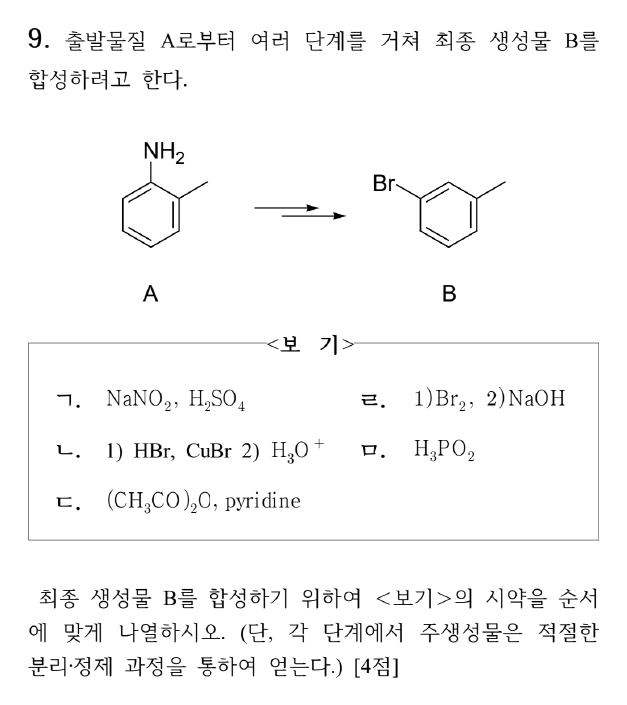

**정답** **ㄷ → ㄹ → ㄱ → ㅁ** (ㄴ은 쓰지 않음)

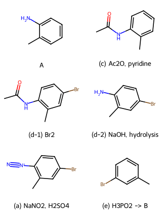

그림 이름표: (a) ㄱ, (c) ㄷ, (d) ㄹ, (e) ㅁ

**공식·핵심 개념**

- 아세틸화로 NH₂ 활성 조절·보호
- 다이아조늄: ArNH₂ + NaNO₂/H⁺ → ArN₂⁺
- ArN₂⁺ + H₃PO₂ → ArH, + CuBr → ArBr (Sandmeyer)

**2027 출제 가능성 ★★★★☆ 높음** — 방향족 치환 순서와 다이아조늄을 이용한 메타 치환 합성은 시약 순서 배열형으로 나오기 좋습니다.

**주어진 것** A = 2-methylaniline(o-toluidine) → B = 3-bromotoluene / 보기 ㄱ NaNO₂, H₂SO₄ ㄴ HBr, CuBr; H₃O⁺ ㄷ (CH₃CO)₂O, pyridine ㄹ Br₂; NaOH ㅁ H₃PO₂

**구할 것** 시약의 순서

**풀이 전략** 목표는 CH₃의 **메타**에 Br. CH₃는 o,p 지향기라 직접 넣을 수 없으므로, NH₂를 "임시 지향기"로 써서 원하는 자리에 Br을 넣고 마지막에 NH₂를 지웁니다.

**(1) 자리 확인.** A에서 NH₂ = C1, CH₃ = C2. NH₂의 para는 **C4**이고, 이 자리는 CH₃(C2)에서 보면 **meta**입니다 → NH₂의 para에 Br을 넣으면 됩니다.

**(2) ㄷ 아세틸화.** N 비공유 전자쌍이 무수물 C=O 탄소 공격 → 사면체 중간체 → 아세테이트 이탈 → 피리딘이 N–H를 떼어 냄 → N-(2-methylphenyl)acetamide (C₉H₁₁NO).

이유: ① 아닐린은 너무 활성이라 Br₂ 수용액에서 2,4,6-삼치환까지 갑니다. 아세틸화하면 N의 비공유 전자쌍이 C=O 쪽으로도 비편재화되어 활성이 적당히 낮아집니다. ② NHAc가 부피가 커서 ortho보다 para 공격이 유리합니다.

**(3) ㄹ-1) Br₂: 어디에 붙나.** σ 착물(아레늄 이온)의 안정성으로 판단합니다.

| 공격 자리 | 양전하가 오는 탄소 | N의 공명 안정화 | 결과 |
|---|---|---|---|
| C4 (NHAc의 para) | C1, C3, C5 | **C1의 N이 전자쌍 제공** (이미늄 공명) | 주생성물 |
| C6 (NHAc의 ortho) | C1, C3, C5 | 있음, 그러나 입체 장애 | 소량 |
| C5 (NHAc의 meta) | C2, C4, C6 | 없음 | 거의 없음 |

→ 4-bromo-2-methylacetanilide (C₉H₁₀BrNO).

**(4) ㄹ-2) NaOH 가수분해.** HO⁻가 아마이드 C=O 공격 → 사면체 중간체 → ArNH⁻ 이탈 → 아세트산과 양성자 교환(비가역) → 4-bromo-2-methylaniline (C₇H₈BrN).

**(5) ㄱ 다이아조화 (0–5 °C).** $\mathrm{HNO_2 + H^+ \to NO^+ + H_2O}$ → ArNH₂가 NO⁺ 공격 → N-나이트로소아민 → 토토머화(Ar–N=N–OH) → OH 양성자화, H₂O 이탈 → **ArN₂⁺**.

**(6) ㅁ H₃PO₂ 탈아미노화.** 라디칼 연쇄: Ar• + H–PH(O)OH → Ar–H + •P; 생긴 P 라디칼이 ArN₂⁺에서 전자를 받아 Ar•와 N₂를 만듭니다. N₂ 기체가 빠지는 것이 구동력.

$$\mathrm{B}:\ \text{3-bromotoluene},\ \mathrm{C_7H_7Br}$$

**왜 ㄴ을 쓰지 않나** Sandmeyer(CuBr)는 N₂⁺ 자리에 **Br**을 넣으므로 1,4-dibromo-2-methylbenzene이 되어 버립니다. 여기서는 N₂⁺ 자리를 **H**로 바꿔야 하므로 ㅁ.

**순서** **ㄷ → ㄹ → ㄱ → ㅁ**

**메커니즘 — ㄷ 아세틸화**

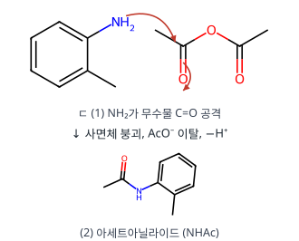

**메커니즘 — ㄹ 브로민화와 탈보호**

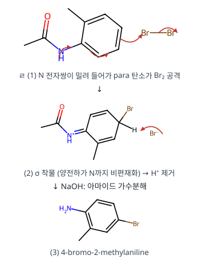

**메커니즘 — ㄹ-2) NaOH 아마이드 가수분해**

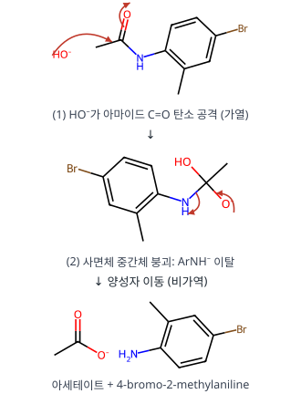

**메커니즘 — ㄱ 다이아조화 → ㅁ 탈아미노화**

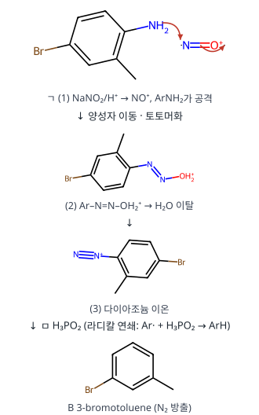

**검산** 분자식: A C₇H₉N → C₉H₁₁NO(+C₂H₂O) → C₉H₁₀BrNO(H→Br) → C₇H₈BrN(−C₂H₂O) → ArN₂⁺ → B C₇H₇Br. B의 MS는 m/z 170/172 = 1 : 1(Br 1개).

**채점 포인트·함정**

- ㄴ(Sandmeyer, HBr/CuBr)은 N₂⁺를 **Br로** 바꾸므로 여기서 쓰면 Br이 2개가 되거나 위치가 틀립니다.
- 보호 없이 Br₂를 쓰면 아닐린이 너무 활성이라 다중 브로민화됩니다.

## B형 10번 · 실제 기체의 엔탈피·엔트로피 변화 {#b10}

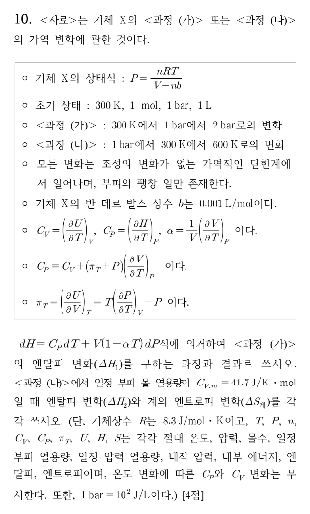

**정답** (답지 난이도 ★★★☆☆) $\Delta H_1 = 0.1$ J, $\Delta H_2 = 15000$ J, $\Delta S_{계} = 50.0\ln2\ \mathrm{J/K}$ (≈ 34.7 J/K)

**공식·핵심 개념**

- $dH = C_PdT + V(1 - \alpha T)dP$
- $\pi_T = T(\partial P/\partial T)_V - P$
- $C_P - C_V = (\pi_T + P)(\partial V/\partial T)_P$
- 등압: $\Delta S = C_P\ln(T_2/T_1)$

**2027 출제 가능성 ★★★☆☆ 보통** — 열역학 관계식을 상태방정식에 적용하는 유형은 모의고사 1회 A형 8번과 같은 계열입니다. 형태만 바꿔 반복 출제됩니다.

**주어진 것** 상태식 $P = \dfrac{nRT}{V - nb}$, $b = 0.001$ L/mol, 초기 300 K·1 mol·1 bar·1 L / (가) 300 K에서 1 → 2 bar, (나) 1 bar에서 300 → 600 K / $C_{V,m} = 41.7$ J/K·mol, $R = 8.3$ J/mol·K, 1 bar = 10² J/L

**구할 것** $\Delta H_1$(과정 가), $\Delta H_2$와 $\Delta S_{계}$(과정 나)

**풀이 전략** $dH = C_PdT + V(1 - \alpha T)dP$에서 (가)는 $dT = 0$, (나)는 $dP = 0$인 항만 남깁니다. 필요한 편미분은 상태식을 V에 대해 푼 식에서 구합니다.

**(1) 상태식을 V로.**

$$V = \frac{nRT}{P} + nb, \qquad \left(\frac{\partial V}{\partial T}\right)_P = \frac{nR}{P}$$

**(2) $V(1 - \alpha T)$ 계산.** $\alpha V = (\partial V/\partial T)_P$이므로

$$\begin{aligned}
V(1 - \alpha T) &= V - T\left(\frac{\partial V}{\partial T}\right)_P \\
&= \frac{nRT}{P} + nb - \frac{nRT}{P} = nb
\end{aligned}$$

압력·온도와 무관한 상수입니다.

**(3) 과정 (가).** $dT = 0$:

$$\Delta H_1 = \int_1^2 nb\,dP = nb\,\Delta P = (1)(0.001\ \mathrm L)(1\ \mathrm{bar})$$

$$= 0.001\ \mathrm{L\,bar} \times 100\ \frac{\mathrm J}{\mathrm{L\,bar}} = 0.1\ \mathrm J$$

**(4) 내부 압력.**

$$\left(\frac{\partial P}{\partial T}\right)_V = \frac{nR}{V - nb} \Rightarrow \pi_T = T\cdot\frac{nR}{V - nb} - P = P - P = 0$$

**(5) $C_P$.**

$$C_P = C_V + (\pi_T + P)\left(\frac{\partial V}{\partial T}\right)_P = C_V + P\cdot\frac{nR}{P} = C_V + nR$$

$$C_P = 41.7 + 8.3 = 50.0\ \mathrm{J/K}$$

**(6) 과정 (나).** $dP = 0$:

$$\Delta H_2 = C_P\Delta T = 50.0 \times (600 - 300) = 15000\ \mathrm J$$

$$\Delta S_{계} = \int_{300}^{600}\frac{C_P}{T}dT = 50.0\ln\frac{600}{300} = 50.0\ln2\ \mathrm{J/K}$$

($\approx 34.7$ J/K)

**검산** 이상기체($b = 0$)라면 $\Delta H_1 = 0$이어야 하는데, 식 $nb\Delta P$도 $b \to 0$에서 0이 됩니다 ✓. 이 기체는 반발(부피)만 있고 인력 항이 없어 $\pi_T = 0$, 그래서 $C_P - C_V = nR$이 이상기체와 같습니다.

**채점 포인트·함정**

- 단위 환산: 1 bar·L = 100 J (자료의 1 bar = 10² J/L).
- 이 기체는 인력 항이 없어 내부 압력 $\pi_T = 0$ → $C_P - C_V = nR$ 그대로입니다.

## B형 11번 · 착물·침전이 있는 전지 전위 {#b11}

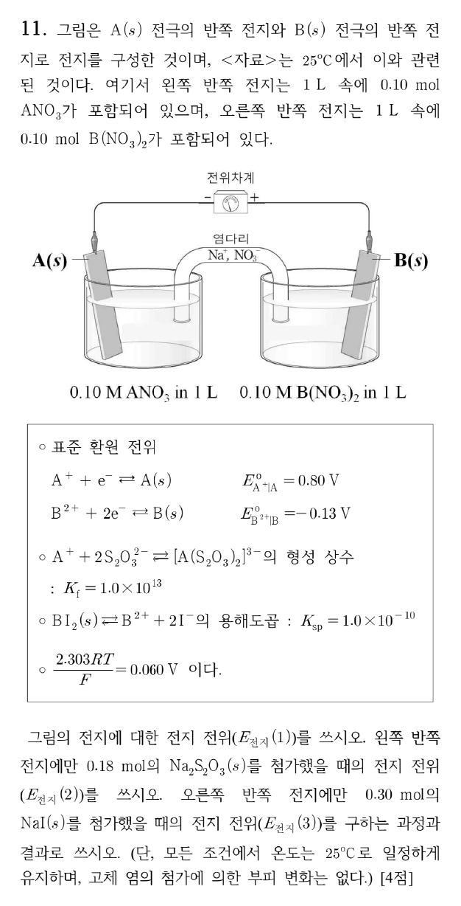

**정답** (답지 난이도 ★★★☆☆) $E_{전지}(1) = -0.90$ V, $E_{전지}(2) = -0.84$ V, $E_{전지}(3) = -1.11$ V

**공식·핵심 개념**

- 네른스트: $E = E^\circ - \dfrac{0.060}{n}\log Q$
- 착물 형성·침전 → 유리 이온 농도 변화 → 전위 변화
- 한정 반응물 먼저 처리 후 남은 농도로 계산

**2027 출제 가능성 ★★★★★ 매우 높음** — 전기화학과 평형(착물·Ksp)을 묶는 계산은 분석화학 고빈도 유형입니다. 2027에도 형태를 바꿔 나올 가능성이 매우 높습니다.

**주어진 것** 왼쪽: A(s) | 0.10 M ANO₃ 1 L, 오른쪽: B(s) | 0.10 M B(NO₃)₂ 1 L / $E^\circ_{A^+|A} = 0.80$ V, $E^\circ_{B^{2+}|B} = -0.13$ V / $K_f$[A(S₂O₃)₂]³⁻ $= 1.0\times10^{13}$, $K_{sp}$(BI₂) $= 1.0\times10^{-10}$, $2.303RT/F = 0.060$ V / 전위차계 왼쪽 −, 오른쪽 +

**구할 것** $E_{전지}(1)$, 왼쪽에 Na₂S₂O₃ 0.18 mol을 넣은 $E_{전지}(2)$, 오른쪽에 NaI 0.30 mol을 넣은 $E_{전지}(3)$

**풀이 전략** 각 전극의 전위를 네른스트 식(환원 반쪽 반응 기준)으로 따로 구한 뒤 $E_{전지} = E_{오른쪽} - E_{왼쪽}$. 착물·침전은 먼저 한정 반응물로 양을 정리하고 남은 유리 이온 농도로 계산합니다.

**(1) 네른스트 식.**

$$E_A = 0.80 + 0.060\log[\mathrm{A^+}], \qquad E_B = -0.13 + \frac{0.060}{2}\log[\mathrm{B^{2+}}]$$

**(2) $E_{전지}(1)$.**

$$E_A = 0.80 + 0.060\log0.10 = 0.80 - 0.06 = 0.74\ \mathrm V$$

$$E_B = -0.13 + 0.030\log0.10 = -0.13 - 0.03 = -0.16\ \mathrm V$$

$$E_{전지}(1) = -0.16 - 0.74 = -0.90\ \mathrm V$$

**(3) 왼쪽에 S₂O₃²⁻ 0.18 mol.** 반응 $\mathrm{A^+ + 2S_2O_3^{2-} \to A(S_2O_3)_2^{3-}}$ ($K_f$ 매우 큼 → 거의 완결).

| | A⁺ | S₂O₃²⁻ | 착물 |
|---|---|---|---|
| 처음 (mol) | 0.10 | 0.18 | 0 |
| 반응 | −0.09 | −0.18 | +0.09 |
| 나중 | **0.01** | ≈ 0 | 0.09 |

S₂O₃²⁻가 한정 반응물이므로 A⁺가 0.01 M 남습니다. (남은 S₂O₃²⁻: $[\mathrm L]^2 = \frac{0.09}{0.01\times10^{13}}$ → $[\mathrm L] = 9.5\times10^{-7}$ M로 무시 가능.)

$$E_A = 0.80 + 0.060\log0.01 = 0.80 - 0.12 = 0.68\ \mathrm V$$

$$E_{전지}(2) = -0.16 - 0.68 = -0.84\ \mathrm V$$

**(4) 오른쪽에 I⁻ 0.30 mol.** $\mathrm{B^{2+} + 2I^- \to BI_2(s)}$:

| | B²⁺ | I⁻ |
|---|---|---|
| 처음 (mol) | 0.10 | 0.30 |
| 침전 | −0.10 | −0.20 |
| 나중 | ≈ 0 | **0.10** |

$$[\mathrm{B^{2+}}] = \frac{K_{sp}}{[\mathrm{I^-}]^2} = \frac{1.0\times10^{-10}}{(0.10)^2} = 1.0\times10^{-8}\ \mathrm M$$

$$E_B = -0.13 + 0.030\log(1.0\times10^{-8}) = -0.13 - 0.24 = -0.37\ \mathrm V$$

$$E_{전지}(3) = -0.37 - 0.74 = -1.11\ \mathrm V$$

**검산** 방향 확인: 왼쪽 [A⁺]가 줄면 $E_A$가 내려가 전지 전위가 덜 음수가 되고((1) → (2): −0.90 → −0.84), 오른쪽 [B²⁺]가 줄면 $E_B$가 내려가 더 음수가 됩니다((1) → (3): −0.90 → −1.11) ✓. 음수는 실제 자발 방향이 A⁺ 환원·B 산화라는 뜻입니다.

**채점 포인트·함정**

- (2)에서 착물이 다 생긴다고 보고 [A⁺]를 Kf로 구하면 틀립니다 — S₂O₃²⁻가 **부족**합니다.
- B는 2전자 반응이므로 $0.060/2 = 0.030$을 씁니다.
- 음수 전위는 그림의 연결 방향(오른쪽 − 왼쪽)대로 쓴 값입니다. 실제 자발 반응은 A⁺ 환원, B 산화입니다.

---

원문: 2027학년도 대비 9–11월 전공화학 제4회 모의고사(안병천, 임용닷컴) 문제지·답지·강의 필기. 개인 학습용 정리입니다.

