# 2027학년도 대비 안병천 전공화학 모의고사 5회 — 상세해설

이 해설은 안병천 전공화학통합모의고사 제5회(전공 A 12문항, 전공 B 11문항)를 문항별로 풀이한 것입니다. **공식 답지가 없어서** 강의 필기(12쪽)와 직접 풀이로 정답을 정했고, 계산은 모두 다시 해 보았습니다. 구조식의 분자식·입체배열(CIP)은 RDKit으로, 고리 치환기의 cis/trans는 3차원 구조로 확인했습니다.

문항마다 새 쪽에서 시작하며 **문제지 원문 → 정답 → 공식·핵심 개념 → 2027 출제 가능성 → 풀이 → 채점 포인트·함정** 순서입니다. 전공 문항 풀이는 **주어진 것 / 구할 것 → 풀이 전략 → 단계별 풀이 (1)(2)… → 검산** 순서이고, 유기 문항(A형 2·3·8번, B형 9번)에는 굽은 화살표 메커니즘 그림을 넣었습니다. **2027 출제 가능성**(★ 5개 만점)은 1997~2026 기출 빈도와 2022 개정 교육과정을 고려한 추정치입니다. 표의 번호를 누르면 해당 쪽으로 이동합니다.

## 정답 한눈에 보기 (목차) {#toc}

### 전공 A (12문항 40점)

| 번호 | 영역 | 정답 요약 | 2027 출제 가능성 |
|---|---|---|---|
| [1](#a1) | 물리화학 · 초기 속도법 | a = 0.1 M, k = 2.0×10³, Ea = 5.81 kJ/mol | ★★★★☆ |
| [2](#a2) | 유기 · 알카인 오존 분해 | A 4-methylhex-2-yne, C 2-methylbutanoic acid | ★★★★☆ |
| [3](#a3) | 유기 · PCC, MS·IR·NMR | B phenylacetone, 91 C₇H₇⁺, 43 CH₃CO⁺ | ★★★★★ |
| [4](#a4) | 무기 · 18전자, π 역결합 | (가)(나)(다) 모두, Mn d → 알릴 ψ₃ | ★★★★☆ |
| [5](#a5) | 화학교육 · 비고츠키 | [10통과2-01-04], ZPD·비계, 아레니우스 | ★★★★★ |
| [6](#a6) | 화학교육 · 실험 피드백 | (라) 수정, 지시약·온도만, 반응식 | ★★★★★ |
| [7](#a7) | 화학교육 · STS, 오개념 | 질문 생성, 디지털 공유, 몰비·pH 7 | ★★★★☆ |
| [8](#a8) | 유기 · Diels–Alder·BH₃ | A all-cis 라셈(비활성), B 한 거울상(활성) | ★★★★★ |
| [9](#a9) | 분석화학 · 침전 평형 | 0.58 g, 1.0×10⁻⁶ M, 1.0×10⁻¹⁴ M | ★★★★☆ |
| [10](#a10) | 물리화학 · 수소 2s | N = (32πa₀³)^−½, 2s, r = 2a₀ | ★★★★☆ |
| [11](#a11) | 무기 · d⁸ Td, TS 도표 | ³A₂(3), e³t₂⁵, −3200, −10 800 cm⁻¹ | ★★★★★ |
| [12](#a12) | 분석 · 분광 광도법 | D₂+W, a = 1.2×10⁻³, x = 500, y = 0.60, K = 4.0×10⁹ | ★★★★☆ |

### 전공 B (11문항 40점)

| 번호 | 영역 | 정답 요약 | 2027 출제 가능성 |
|---|---|---|---|
| [1](#b1) | 분석 · 전위차법 | [A²⁺] = 1.0×10⁻²⁰ M, K = 1.0×10²² | ★★★★☆ |
| [2](#b2) | 무기 · 점군 | 사이클로헥세인 의자형 D₃d, S₈ D₄d | ★★★★☆ |
| [3](#b3) | 화학교육 · 구성 체제 | 모형, 단위세포 입자 수, 물질과 에너지 | ★★★★☆ |
| [4](#b4) | 화학교육 · 과학의 본성, 쿤 | 관찰의 이론 의존성, 위기→혁명, 가설 연역 | ★★★★★ |
| [5](#b5) | 화학교육 · 탐구 방법, 평가 | 촉진자, ①, 흥미·호기심, 학습 개선 | ★★★★☆ |
| [6](#b6) | 무기 · B₂H₆ 3c-2e | D₂h·C₃h, (1)<(2), H₂CO₃, Ag+B₃g+B₁u+B₂u | ★★★★★ |
| [7](#b7) | 물리화학 · ΔH·ΔS | ΔH = 7000 J, ΔS = 38 J/K | ★★★★☆ |
| [8](#b8) | 유기 · 의자형 스트레인 | 0.1, 2.55, 3.7 kcal/mol | ★★★★☆ |
| [9](#b9) | 유기 · 산염화물 | A·D 케톤, E 알데하이드, SOCl₂ | ★★★★★ |
| [10](#b10) | 물리화학 · 구면 조화 | $d_{xz}$, $d_{yz}$, A = 1/√2, ⟨Lz⟩ = ħ/6 | ★★★☆☆ |
| [11](#b11) | 분석 · 모세관 전기 이동 | ㉡, (다), −2.0×10⁻⁸, 시간↓ 높이↑ 너비↓ | ★★★★☆ |

**검토 메모**

1. **공식 답지가 없습니다.** 정답은 강의 필기(12쪽)와 직접 풀이로 정했습니다. 필기와 직접 풀이가 다른 문항은 없었습니다. 필기에 없는 교육론 서술(A5~A7, B3~B5), A형 12번 광원, B형 11번 pH 변화는 직접 작성했습니다.
2. **성취기준 문구는 원문 확인이 필요합니다.** A형 5번 ㉠([10통과2-01-04])과 B형 3번의 구성 체제는 2022 개정 교육과정 문서의 내용을 요약했습니다. 시험장에서는 고시 원문 그대로 써야 하므로, 교육과정 문서와 한 번 대조하세요.
3. **A형 6번 ③**: 피드백 ③은 "성취기준의 범위를 벗어난 곳이 있습니다"뿐이라 어느 부분을 가리키는지 문제에 없습니다. 이 해설은 [실험 결과] 3(중화 반응을 화학 반응식으로 이해)을 범위 밖으로 보았습니다. 다른 해석이 있을 수 있습니다.
4. **A형 4번**: 문제의 Mn 전자 배치 "[Ar]4d⁵6s²"는 **[Ar]3d⁵4s²**의 오타로 보입니다. 원자가 전자 7개는 같으므로 전자 수 계산에는 영향이 없습니다. ψ₃와 겹치는 d 오비탈 이름은 축을 어떻게 잡느냐에 따라 달라집니다(이 해설: Mn–알릴 중심 = z축, C1···C3 = x축 → $d_{yz}$).
5. **A형 2번**: "광학 활성"만 주어져 거울상은 정해지지 않습니다. (S)로 그렸고 반대 거울상도 정답입니다. **B(3-methylhexane)도 카이랄**이어서 A의 배열을 그대로 가진 광학 활성 물질입니다.
6. **A형 8번**: A와 B는 **같은 구조(2,5-dimethylcyclohex-3-ene-1-carbaldehyde, 세 치환기 모두 cis)**입니다. A는 라셈(비활성), B는 한 거울상(활성)이라는 대비가 출제 의도로 보입니다. B의 입체는 "BH₃가 인접 CH₃ 반대 면으로 접근한다"는 가정에서 나왔습니다.
7. **B형 8번 A**: 그림에서 에틸 결합이 쐐기 없이 그려져 있습니다. 필기와 같이 **cis(축–적도)**로 보면 0.1 kcal/mol입니다. trans로 읽으면 이적도 0.9 vs 이축 3.7 → 2.8 kcal/mol이 됩니다.
8. **B형 10번**: 주어진 $Y_{2,\pm1}$에는 Condon–Shortley 부호 $(-1)^m$이 없습니다. 주어진 식 그대로 계산하면 ⓐ → $d_{xz}$, ⓑ → $d_{yz}$입니다.

# 전공 A

## A형 1번 · 초기 속도법과 활성화 에너지 {#a1}

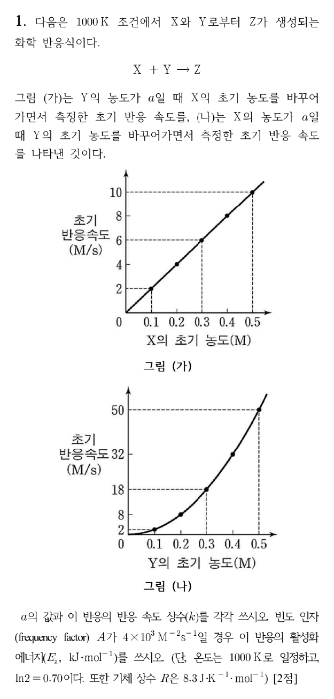

**정답** $a = 0.1\ \mathrm M$, $k = 2.0\times10^{3}\ \mathrm{M^{-2}\,s^{-1}}$, $E_a = 5.81\ \mathrm{kJ\,mol^{-1}}$ (속도식 $v = k[\mathrm X][\mathrm Y]^2$)

**공식·핵심 개념**

- 속도 법칙 $v = k[\mathrm X]^m[\mathrm Y]^n$: 한 농도만 바꾸어 차수를 정한다
- 직선(원점 통과) → 1차, 2배에 4배 → 2차
- 아레니우스 식 $k = A\,e^{-E_a/RT}$ → $E_a = RT\ln\dfrac{A}{k}$

**2027 출제 가능성 ★★★★☆ 높음** — 그래프에서 차수 읽기와 아레니우스 식 결합은 2점 기입형으로 자주 나옵니다.

**주어진 것** (가) [Y] = a일 때 [X]에 따른 초기 속도(직선), (나) [X] = a일 때 [Y]에 따른 초기 속도(곡선), A = 4×10³ M⁻²s⁻¹, T = 1000 K, ln2 = 0.70, R = 8.3 J/(K·mol)

**구할 것** a, k, Eₐ

**풀이 전략** 각 그래프에서 차수를 읽고, 두 그래프의 기울기(비례 상수)를 비교해 a와 k를 동시에 구합니다.

**(1) X의 차수.** (가)는 원점을 지나는 직선입니다. [X]가 0.1 → 0.2 → 0.3 M일 때 속도가 2 → 4 → 6 M/s이므로 **1차**입니다. 비례 상수는

$$k\,a^{n} = \frac{2\ \mathrm{M/s}}{0.1\ \mathrm M} = 20\ \mathrm{s^{-1}}$$

**(2) Y의 차수.** (나)에서 [Y]가 0.1 → 0.3 → 0.5 M(1 : 3 : 5배)일 때 속도는 2 → 18 → 50 M/s(1 : 9 : 25배)입니다. 제곱에 비례하므로 **2차**입니다($n = 2$).

$$k\,a\,(0.1)^2 = 2 \ \Rightarrow\ k\,a = \frac{2}{0.01} = 200\ \mathrm{M^{-1}s^{-1}}$$

**(3) a와 k.** (1)에서 $k a^2 = 20$, (2)에서 $k a = 200$입니다.

$$a = \frac{k a^2}{k a} = \frac{20}{200} = 0.1\ \mathrm M$$

$$k = \frac{200}{0.1} = 2.0\times10^{3}\ \mathrm{M^{-2}\,s^{-1}}$$

**(4) 활성화 에너지.**

$$\frac{k}{A} = \frac{2.0\times10^3}{4.0\times10^3} = \frac12 = e^{-E_a/RT}$$

$$E_a = RT\ln2 = 8.3 \times 1000 \times 0.70$$

$$= 5810\ \mathrm{J\,mol^{-1}} = 5.81\ \mathrm{kJ\,mol^{-1}}$$

**검산** (가)의 [X] = 0.5 M 점: $v = 2000 \times 0.5 \times 0.1^2 = 10$ M/s ✓. (나)의 [Y] = 0.4 M 점: $v = 2000 \times 0.1 \times 0.4^2 = 32$ M/s ✓.

**채점 포인트·함정**

- k의 단위는 전체 3차이므로 **M⁻²s⁻¹**입니다. 빈도 인자 A의 단위와 같은지 확인하면 실수를 막을 수 있습니다.
- (가)의 기울기 20을 그대로 k로 쓰면 안 됩니다. 기울기에는 $a^2$이 들어 있습니다.

## A형 2번 · 광학 활성 알카인의 수소화와 오존 분해 {#a2}

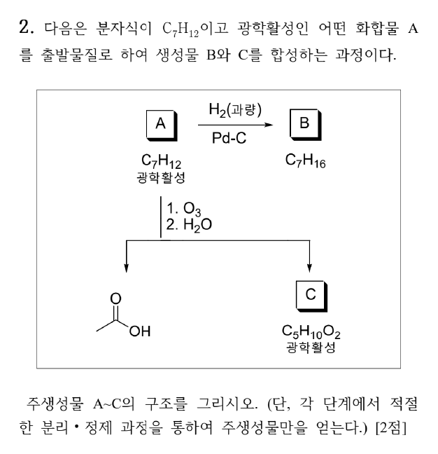

**정답** (필기·직접 풀이)

- A: **4-methylhex-2-yne** CH₃C≡C–CH(CH₃)CH₂CH₃ (예: S 배열)
- B: **3-methylhexane** (C3 배열 유지, 광학 활성)
- C: **2-methylbutanoic acid** HOOC–CH(CH₃)CH₂CH₃ (A와 같은 배열 기호)

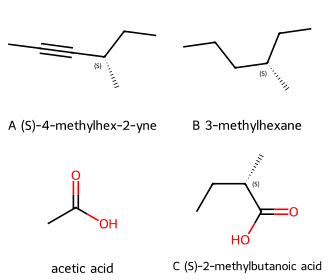

**공식·핵심 개념**

- 불포화도 $= \dfrac{2C+2-H}{2} = \dfrac{16-12}{2} = 2$ → 삼중 결합 1개
- 내부 알카인 + O₃ → H₂O: 삼중 결합이 끊겨 **카복실산 두 개**
- H₂/Pd-C(과량): C≡C → CH₂–CH₂ (입체 중심은 반응하지 않음)

**2027 출제 가능성 ★★★★☆ 높음** — 분해 생성물로 원래 구조를 거꾸로 맞추는 문항은 유기 2점의 대표 유형입니다.

**주어진 것** A: C₇H₁₂, 광학 활성. A → (H₂ 과량, Pd-C) → B(C₇H₁₆). A → (O₃, H₂O) → 아세트산 + C(C₅H₁₀O₂, 광학 활성)

**구할 것** A, B, C의 구조

**풀이 전략** 오존 분해 조각 두 개를 삼중 결합 자리에서 다시 이어 붙입니다.

**(1) 작용기.** 불포화도 2인데, 수소화로 H가 4개 늘어(C₇H₁₂ → C₇H₁₆) 고리 없이 사슬 알케인이 됩니다. 따라서 **삼중 결합 1개**입니다.

**(2) 조각 맞추기.** 오존 분해로 두 카복실산이 나왔으므로 내부 알카인입니다.

- 아세트산(C₂) → 삼중 결합 한쪽은 CH₃–C≡
- C(C₅H₁₀O₂, 카이랄) → 다른 쪽 C₄ 사슬 + COOH. 입체 중심이 있는 C₅ 산은 **2-methylbutanoic acid**뿐입니다.
- 두 COOH 탄소를 삼중 결합으로 이으면 A = CH₃–C≡C–CH(CH₃)–CH₂CH₃, 탄소 수 2 + 5 = 7 ✓

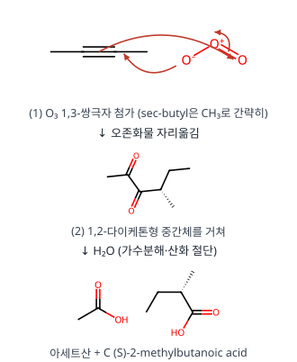

**(3) B.** 삼중 결합이 CH₂–CH₂로 바뀌면 C3에 H, CH₃, C₂H₅, **C₃H₇**이 붙습니다. 네 치환기가 모두 달라 B도 입체 중심이 있고, 반응하지 않은 C3의 배열이 그대로 남습니다.

**(4) 배열 기호.** A의 C4(우선순위 C≡C > C₂H₅ > CH₃ > H), B의 C3(C₃H₇ > C₂H₅ > CH₃ > H), C의 C2(COOH > C₂H₅ > CH₃ > H)에서 1순위 자리가 모두 같은 원래 탄소입니다. 그래서 (S)-A → (S)-B, (S)-C로 기호가 같습니다(RDKit 확인).

**왜 이 생성물인가** 오존 분해는 C≡C의 두 π 결합과 σ 결합을 모두 끊어 각 탄소를 COOH까지 산화합니다. 입체 중심(C4)은 삼중 결합 옆이지만 결합이 끊기지 않으므로 C에 그대로 남아 C가 광학 활성입니다.

**검산** C₇H₁₂: C 7, H 3+0+0+1+3+2+3 = 12 ✓. C: C₅H₁₀O₂ ✓.

**채점 포인트·함정**

- 말단 알카인(hex-1-yne 계열)은 오존 분해에서 CO₂와 산이 나와 아세트산이 생기지 않습니다.
- 4-methylhex-1-yne 같은 다른 이성질체는 아세트산 조건을 만족하지 못합니다.

## A형 3번 · PCC 산화와 MS·IR·NMR 구조 결정 {#a3}

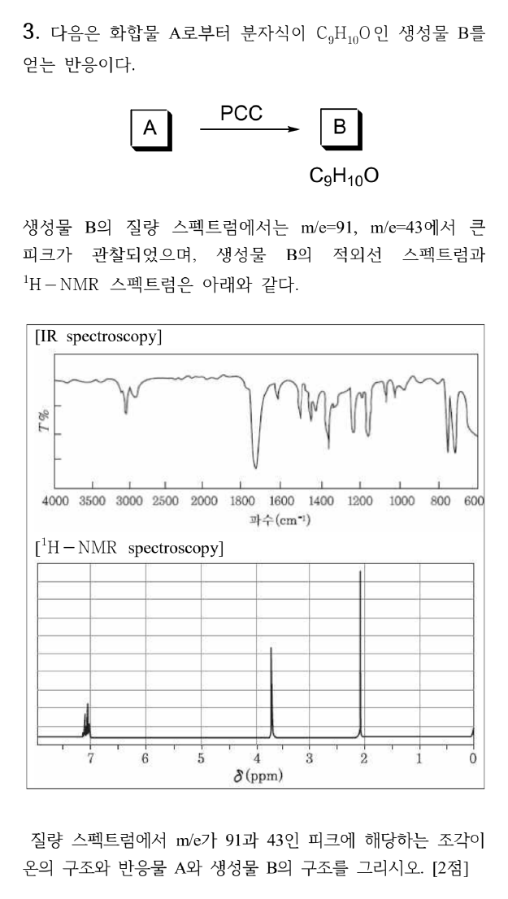

**정답** (필기·직접 풀이)

- m/z 91: **트로필륨 이온 C₇H₇⁺** (벤질 양이온이 자리옮김한 방향족 7원 고리)
- m/z 43: **아실륨 이온 CH₃C≡O⁺**
- A: **1-phenylpropan-2-ol**, B: **phenylacetone** (1-phenylpropan-2-one, M = 134)

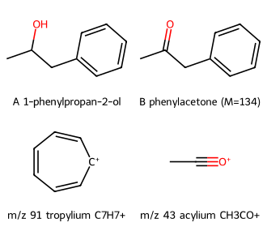

**공식·핵심 개념**

- PCC: 1차 알코올 → 알데하이드, **2차 알코올 → 케톤** (무수 조건)
- IR 1715 cm⁻¹: 지방족 케톤 C=O, 3000 cm⁻¹ 근처: C–H
- MS: 카보닐 옆 α-절단 → 아실륨 이온과 벤질(트로필륨) 이온

**2027 출제 가능성 ★★★★★ 매우 높음** — IR·NMR·MS 종합 구조 결정은 매년 나오는 유형입니다.

**주어진 것** A → (PCC) → B(C₉H₁₀O). B의 MS 큰 봉우리 m/z 91, 43. IR, ¹H NMR(δ 7.2, 3.7, 2.1)

**구할 것** m/z 91, 43 조각 이온, A와 B의 구조

**풀이 전략** 분자식과 IR로 작용기를 정하고, NMR 적분비로 조각을 세운 뒤 MS로 확인합니다.

**(1) 불포화도.** $\dfrac{2(9)+2-10}{2} = 5$ → 벤젠 고리(4) + C=O(1)

**(2) IR.** 약 1715 cm⁻¹의 강한 흡수 → 케톤 C=O. 3300 cm⁻¹ 근처 O–H가 없고, 2720 cm⁻¹ 알데하이드 C–H도 없습니다.

**(3) ¹H NMR.**

| δ (ppm) | 적분 | 갈라짐 | 배정 |
|---|---|---|---|
| 7.2 | 5H | 다중선 | C₆H₅– (일치환 벤젠) |
| 3.7 | 2H | 단일선 | Ph–CH₂–C(=O) (벤질 + 카보닐 옆) |
| 2.1 | 3H | 단일선 | –C(=O)–CH₃ |

두 단일선은 이웃 H가 없다는 뜻이므로 CH₂와 CH₃ 사이에 C=O가 있습니다 → **PhCH₂COCH₃**.

**(4) MS.** 카보닐 양쪽에서 α-절단이 일어납니다.

- PhCH₂–COCH₃ → **PhCH₂⁺**(m/z 91) → 7원 고리 트로필륨 C₇H₇⁺로 자리옮김(방향족, 6π 전자)
- PhCH₂–C≡O⁺ 반대쪽 → **CH₃C≡O⁺**(m/z 43, 12 + 3 + 12 + 16 = 43)

**(5) A.** PCC가 2차 알코올을 케톤으로 바꾸었으므로 A는 C=O 자리에 CH–OH가 있는 **1-phenylpropan-2-ol**(C₉H₁₂O)입니다.

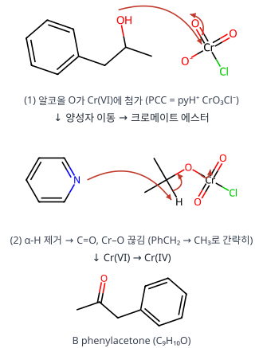

**왜 이 생성물인가** PCC는 알코올 O를 Cr(VI)에 붙여 크로메이트 에스터를 만든 뒤, 염기(피리딘)가 α-H를 떼어 C=O를 만듭니다. 2차 알코올이라 α-탄소에 H가 하나뿐이고, 케톤에서 반응이 끝납니다.

**검산** M = 9(12) + 10(1) + 16 = 134. 91 + 43 = 134 ✓ (두 조각이 C=O–CH₂ 결합 양쪽).

**채점 포인트·함정**

- 91을 "벤질 양이온"으로만 쓰면 감점될 수 있습니다. 구조는 **7원 고리 트로필륨**으로 그립니다.
- 3-phenylpropanal(PhCH₂CH₂CHO)은 같은 분자식이지만 NMR에 9.8 ppm 신호와 삼중선이 있어야 합니다.

## A형 4번 · Mn 카보닐 착물의 18전자 규칙과 알릴 π 역결합 {#a4}

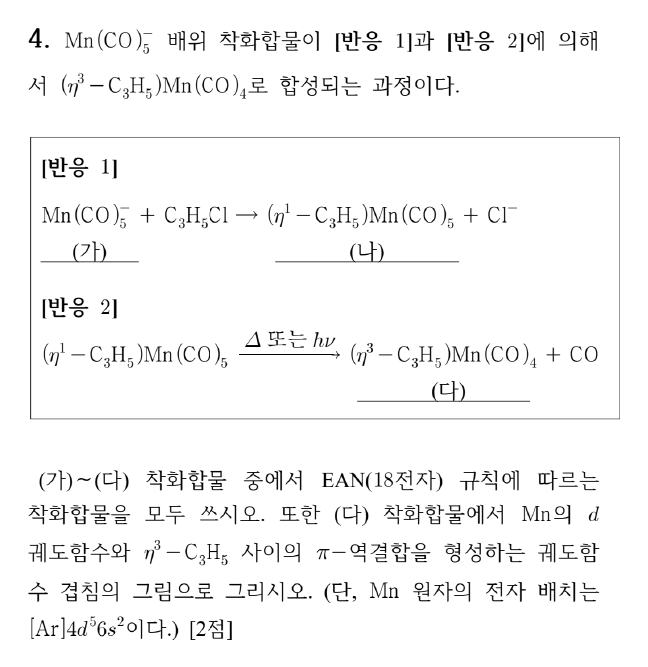

**정답** (필기·직접 풀이)

- 18전자 규칙을 따르는 착물: **(가), (나), (다) 모두**
- 역결합: Mn의 **채워진 d 오비탈($d_{yz}$)** → η³-C₃H₅의 **빈 ψ₃(마디 2개)**. 같은 위상의 로브끼리 겹치는 그림(아래)

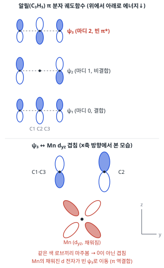

**공식·핵심 개념**

- 전자 수(중성 원자법): 금속 원자가 전자 + 리간드 전자 + 전하 보정
- CO 2e, η¹-알릴 1e(라디칼) / η³-알릴 3e, Cl⁻ 제거
- 알릴 π MO: ψ₁(결합) < ψ₂(비결합) < ψ₃(반결합). 알릴 음이온은 ψ₁²ψ₂²

**2027 출제 가능성 ★★★★☆ 높음** — 전자 수 세기와 η¹ → η³ 전환은 유기금속 단골입니다. 궤도 겹침 그림은 서술형 대비용입니다.

**주어진 것** [반응 1] Mn(CO)₅⁻ + C₃H₅Cl → (η¹-C₃H₅)Mn(CO)₅ + Cl⁻, [반응 2] CO 1개가 빠지며 η³-C₃H₅

**구할 것** 18전자 착물, Mn d와 η³-알릴의 π 역결합 그림

**풀이 전략** 중성 원자법으로 세 착물의 전자 수를 셉니다. 역결합은 Mn의 채워진 d와 대칭이 맞는 알릴의 빈 MO를 찾습니다.

**(1) (가) Mn(CO)₅⁻.** Mn 7 + CO 5 × 2 + 음전하 1 = **18** ✓ (Mn(−I), d⁸)

**(2) (나) (η¹-C₃H₅)Mn(CO)₅.** Mn 7 + η¹-알릴 1 + CO 5 × 2 = **18** ✓ (이온법: Mn(I) d⁶ + C₃H₅⁻ 2 + 10 = 18)

**(3) (다) (η³-C₃H₅)Mn(CO)₄.** Mn 7 + η³-알릴 3 + CO 4 × 2 = **18** ✓ (이온법: Mn(I) d⁶ + C₃H₅⁻ 4 + 8 = 18)

[반응 2]에서 CO 하나(2e)가 빠지는 대신 알릴이 결합을 하나 더 내어(1e → 3e) 18전자가 유지됩니다.

**(4) 알릴 π MO.** p 오비탈 세 개가 섞여 ψ₁(+,+,+), ψ₂(+,0,−), ψ₃(+,−,+)가 됩니다. η³-알릴(음이온 기준)은 ψ₁, ψ₂에 전자가 차고 **ψ₃가 비어** 있습니다.

**(5) 역결합 짝.** 축을 Mn → 알릴 중심 = z, C1···C3 = x로 잡으면

- ψ₁(모두 같은 부호) ↔ Mn $d_{z^2}$·s·$p_z$: 알릴 → Mn σ 주기
- ψ₂(x 방향 부호 바뀜) ↔ $d_{xz}$: 알릴 → Mn π 주기
- ψ₃(양 끝 같은 부호, 가운데 반대) ↔ **$d_{yz}$**: C2만 y 방향으로 튀어나와 있어 $d_{yz}$의 y > 0, y < 0 로브와 부호가 맞습니다. Mn d⁶의 채워진 d 전자가 빈 ψ₃로 들어가는 것이 **π 역결합**입니다.

**왜 ψ₃인가** 역결합은 "금속의 채워진 d → 리간드의 빈 오비탈"입니다. 알릴에서 비어 있는 π 오비탈은 ψ₃뿐이고, 마디가 2개라서 C1·C3와 C2의 부호가 반대입니다. 이 부호 패턴과 겹침 적분이 0이 아닌 d 오비탈을 골라야 합니다.

**검산** 세 착물 모두 18전자 → 반응 1·2 모두 전자 수 규칙을 유지하는 반응(친핵성 치환, CO 해리–배위 전환)과 맞습니다.

**채점 포인트·함정**

- (나)의 η¹-알릴은 σ 결합 하나만 있으므로 1e(이온법 2e)입니다. 3e로 세면 20전자가 되어 틀립니다.
- 그림에는 **로브의 위상(색)**이 서로 맞아 겹침이 0이 아님을 반드시 보여야 합니다.

## A형 5번 · 산과 염기 수업의 성취기준과 비고츠키 {#a5}

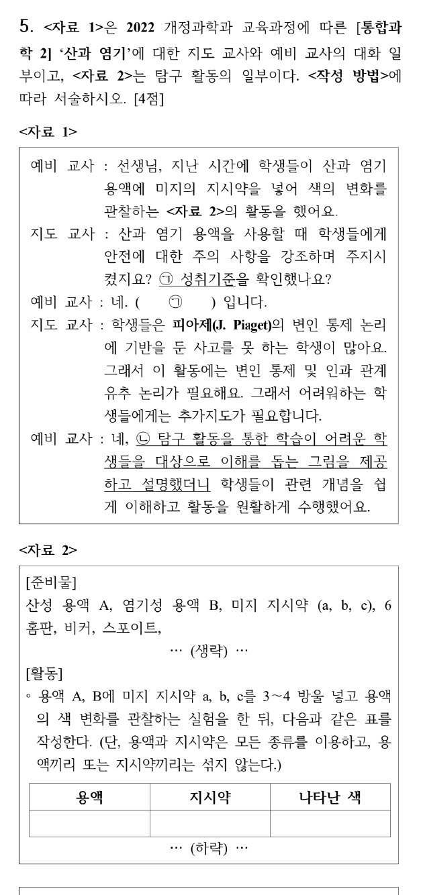

**정답** (직접 작성)

- ㉠ **[10통과2-01-04]** 대표적인 산·염기 물질의 특징을 알고, 산과 염기를 혼합할 때 나타나는 변화를 설명할 수 있다. (요지 — 고시 원문 확인 필요)
- ㉡ 이유: 비고츠키에 따르면 학생 혼자 해결할 수 있는 **실제적 발달 수준**과 도움을 받아 도달할 수 있는 **잠재적 발달 수준** 사이에 **근접 발달 영역(ZPD)**이 있습니다. 변인 통제·인과 유추 논리가 부족한 학생에게 그림과 설명이라는 **비계(scaffolding)**를 주면 ZPD 안에서 다음 발달 수준으로 나아갈 수 있습니다.
- 산·염기 정의: **아레니우스 정의** — 산은 수용액에서 H⁺을, 염기는 OH⁻을 내놓는 물질
- 탐구 활동 예: 질산칼륨 수용액을 적신 거름종이에 염산(또는 NaOH 수용액)을 묻히고 전류를 흘려 지시약 색이 (−)극(또는 (+)극) 쪽으로 이동하는 것을 관찰 → 산의 공통 성질이 **H⁺** 때문임을 확인

**공식·핵심 개념**

- 비고츠키: ZPD, 비계, 사회적 상호작용 → 내면화
- 2022 개정 [통합과학 2]: 산·염기는 **아레니우스 정의만**, 중화는 **지시약 색 변화·온도 변화**로 확인
- 피아제의 형식적 조작기: 변인 통제, 비례·인과 논리

**2027 출제 가능성 ★★★★★ 매우 높음** — 2022 개정 통합과학의 적용 범위와 비고츠키는 최근 교육론의 고정 소재입니다.

**판단 근거.** 예비 교사는 "탐구 활동을 통한 학습이 어려운 학생"에게 그림을 제공했습니다. 학생 혼자서는 못 하지만 도움을 받으면 할 수 있는 과제를 주고, 교사가 일시적으로 도와주는 것이므로 비계 설정입니다. 피아제는 발달 단계에 맞춰 기다리는 쪽이고, 비고츠키는 도움으로 발달을 이끄는 쪽이라는 점을 대비해서 쓰면 좋습니다.

**정의와 활동의 연결.** 2022 개정 통합과학 2의 산·염기 학습은 아레니우스 정의 수준입니다. 활동은 "여러 산(염기) 수용액에 공통으로 들어 있는 입자가 H⁺(OH⁻)"임을 보이는 것이어야 합니다. 이온의 이동을 지시약 색으로 보는 실험이나, 여러 산 수용액의 공통 성질(금속과 반응, 지시약 색 변화, 전기 전도성)을 비교하는 활동이 맞습니다. 브뢴스테드–로리 정의(양성자 주고받기)는 [화학] 과목 내용이라 쓰면 안 됩니다.

**채점 포인트·함정**

- ZPD를 "실제적 발달 수준과 잠재적 발달 수준 사이"라고 정의까지 써야 합니다.
- 정의를 쓰고 그 정의에 **부합하는** 활동(H⁺·OH⁻ 확인)을 써야 점수가 납니다. 단순 지시약 색 관찰만 쓰면 정의와 연결이 약합니다.

## A형 6번 · 중화 반응 실험 설계 피드백 {#a6}

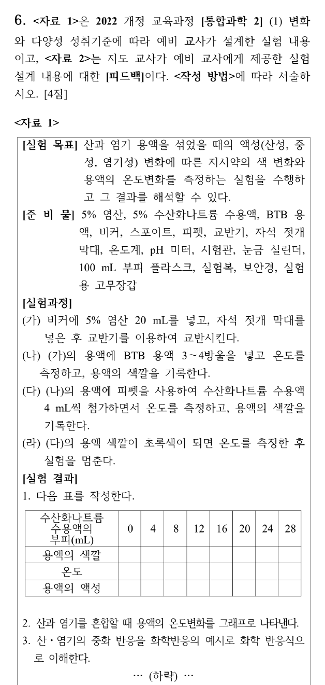

**정답** (직접 작성)

- ② 수정: (라) "용액 색깔이 초록색이 되면 실험을 멈춘다" → **초록색이 된 뒤에도 수산화나트륨 수용액을 계속 넣어 푸른색이 될 때까지(28 mL까지) 온도와 색을 측정한다.** 이유: 실험 목표가 산성·중성·염기성 **모든 액성 변화**에 따른 색과 온도 변화를 측정하는 것이고, 결과 표도 28 mL까지 기록하게 되어 있습니다. 중화점 이후 온도가 다시 내려가는 경향을 보아야 온도 변화 그래프를 해석할 수 있습니다.
- ① 이유: [통합과학 2] 성취기준에서 중화 반응은 **지시약의 색 변화와 온도 변화로 정성적으로** 확인합니다. pH 측정(pH 미터)과 정확한 농도의 용액 제조(부피 플라스크)는 [화학]의 양적 관계 내용이라 필요하지 않습니다.
- ③ 이유: [실험 결과] 3 "산·염기 중화 반응을 화학 반응식으로 이해한다"는 성취기준 해설의 범위를 벗어납니다. 해설은 산·염기를 아레니우스 정의로만 다루고, 중화 반응에서 일어나는 변화를 **용액의 온도 변화와 지시약의 색 변화**로 확인하도록 제한합니다. (해석 — 검토 메모 3)

**공식·핵심 개념**

- BTB: 산성 노란색, 중성 초록색, 염기성 푸른색
- 중화열: 혼합 용액의 온도는 중화점에서 최고, 이후 낮아짐
- [통합과학 2] 중화: 지시약 색·온도 변화(정성), 양적 관계·pH는 [화학]

**2027 출제 가능성 ★★★★★ 매우 높음** — 실험 설계 오류 찾기와 성취기준 범위 판단은 2022 개정 적용 이후 가장 많이 나오는 형식입니다.

**판단 근거.** 5% 염산 20 mL에 5% NaOH를 4 mL씩 넣으면 중화점(초록) 근처에서 온도가 최고가 됩니다. 거기서 멈추면 "염기성" 칸과 온도가 내려가는 구간이 비게 되어, 실험 목표의 "액성(산성, 중성, 염기성) 변화"를 확인할 수 없습니다. ①은 성취기준(무엇을 다루는가), ③은 성취기준 해설(어디까지 다루는가)로 근거를 나누어 쓰라는 것이 작성 방법의 의도입니다.

**채점 포인트·함정**

- ②는 반드시 **(라)를 찾아 수정한 문장**과 **이유** 두 가지를 다 써야 합니다.
- ①의 근거로 "정성적 확인"이라는 표현을 넣으면 안전합니다.

## A형 7번 · STS 수업 모형과 중화 반응 오개념 {#a7}

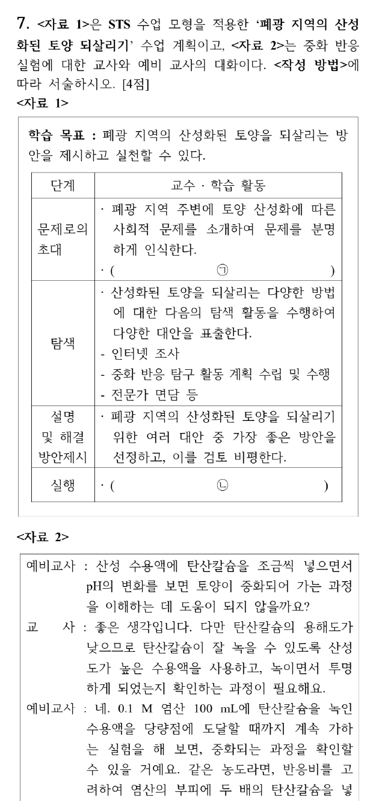

**정답** (직접 작성)

- ㉠ (문제로의 초대) **학생들이 토양 산성화 문제와 관련된 질문을 스스로 만들고, 그중에서 탐구할 문제를 정하게 한다.**
- ㉡ (실행) 선정한 토양 개선 방안(예: 석회석·탄산칼슘 살포)을 **디지털 플랫폼(온라인 협업 게시판, 학급 누리집, SNS, 카드 뉴스·영상)**으로 공유하고, 지역 주민·지자체에 알리는 **온라인 캠페인**이나 제안 활동을 실천한다.
- 오개념 1: "같은 농도라면 **염산 부피의 두 배**의 탄산칼슘을 넣어야 중화가 완결된다." → CaCO₃ + 2HCl → CaCl₂ + H₂O + CO₂에서 CaCO₃ : HCl = **1 : 2**이므로 HCl 몰수의 **절반**이 필요합니다(0.010 mol HCl → 0.0050 mol = 0.50 g).
- 오개념 2: "중화(당량)점의 pH는 항상 7이다." → 생성된 **CO₂가 물에 녹아 탄산(약산)**이 되므로 당량점 pH가 3.8로 산성입니다.

**공식·핵심 개념**

- STS 수업 모형(Yager): 문제로의 초대 → 탐색 → 설명 및 해결 방안 제시 → 실행
- 2022 개정: 디지털 교육 환경 변화 반영 — 온라인 플랫폼·디지털 도구로 탐구·공유·소통
- CaCO₃ + 2HCl → CaCl₂ + H₂O + CO₂ (M(CaCO₃) = 100)

**2027 출제 가능성 ★★★★☆ 높음** — STS 단계별 활동과 실험 자료 속 오개념 찾기는 자주 나옵니다. 디지털 플랫폼 활용은 2022 개정의 새 키워드입니다.

**자료 검산.** 0.1 M 염산 100 mL의 H⁺는 $0.1 \times 0.100 = 0.010$ mol입니다. CaCO₃ m g은 $\dfrac{m}{100}$ mol이고 H⁺를 그 2배 소모합니다.

$$[\mathrm H^+] = \frac{0.010 - 2\times\frac{m}{100}}{0.100\ \mathrm L}$$

| CaCO₃ (g) | 남은 H⁺ (mol) | [H⁺] (M) | pH 계산 | 표의 pH |
|---|---|---|---|---|
| 0 | 0.010 | 0.10 | 1.00 | 1.0 |
| 0.1 | 0.008 | 0.08 | 1.10 | 1.1 |
| 0.2 | 0.006 | 0.06 | 1.22 | 1.2 |
| 0.3 | 0.004 | 0.04 | 1.40 | 1.4 |
| 0.4 | 0.002 | 0.02 | 1.70 | 1.7 |
| 0.5 | 0 | (CO₂ 용해) | — | 3.8 |

표가 계산과 정확히 맞고, 당량점은 **0.50 g**입니다. 예비 교사 말대로 "염산 부피의 두 배"를 넣으면 크게 과량이 됩니다. 0.5 g에서 pH가 7이 아니라 3.8인 것은 CO₂ 포화 수용액(H₂CO₃)의 pH와 비슷합니다.

**채점 포인트·함정**

- ㉠은 STS의 핵심인 **학생이 질문을 생성**한다는 점을 넣어야 합니다. 교사가 문제를 제시하는 활동은 이미 위 칸에 있습니다.
- 오개념은 "무엇이 틀렸는지 + 올바른 개념" 짝으로 쓰는 것이 안전합니다.

## A형 8번 · Diels–Alder 반응과 수소붕소화–산화의 입체화학 {#a8}

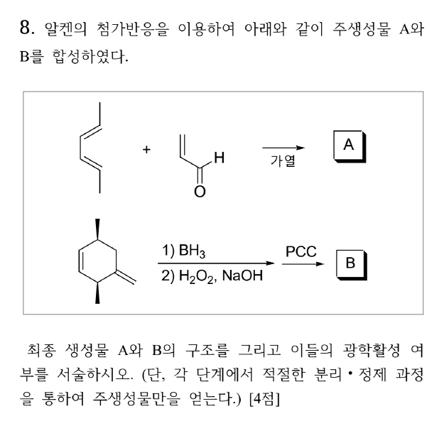

**정답** (필기·직접 풀이)

- A: **2,5-dimethylcyclohex-3-ene-1-carbaldehyde**, CHO와 두 CH₃가 모두 cis(endo 부가물). 두 거울상이 1 : 1로 생기는 **라셈 혼합물 → 광학 비활성**
- B: **같은 구조(세 치환기 모두 cis)의 한 거울상 (1R,2S,5S) → 광학 활성**

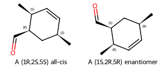

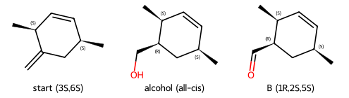

**공식·핵심 개념**

- Diels–Alder: 협동 [4+2], **syn 첨가**, 다이엔 "바깥쪽" 치환기끼리 cis, **endo 규칙**
- 수소붕소화: syn, 반 마르코브니코프(B는 덜 치환된 C), 덜 붐비는 면
- H₂O₂/NaOH 산화: C–B → C–O **입체 보존** / PCC: 1차 알코올 → 알데하이드
- 비카이랄 반응물 → 카이랄 생성물은 라셈, 카이랄(한 거울상) 반응물 → 광학 활성

**2027 출제 가능성 ★★★★★ 매우 높음** — Diels–Alder 입체(endo)와 수소붕소화 입체를 묻는 4점 서술형은 거의 매년 나옵니다.

**주어진 것** (2E,4E)-hexa-2,4-diene + acrolein, 가열 → A. 두 CH₃가 cis(둘 다 쐐기)인 3,6-dimethyl-4-methylenecyclohexene → 1) BH₃ 2) H₂O₂, NaOH → PCC → B

**구할 것** A, B의 구조와 광학 활성 여부

**풀이 전략** A는 "다이엔 말단 치환기 + endo"로 세 치환기의 상대 배열을 정합니다. B는 출발물의 입체 중심이 유지된다는 점과 BH₃가 접근하는 면을 따져 새 입체 중심을 정합니다.

**(1) A의 구조.** 다이엔 C2–C5가 고리의 C2, C3=C4, C5가 되고, 친다이엔체의 두 탄소가 C6(CH₂)과 C1(CHO)이 됩니다. CH₃는 C2·C5, CHO는 C1에 붙습니다.

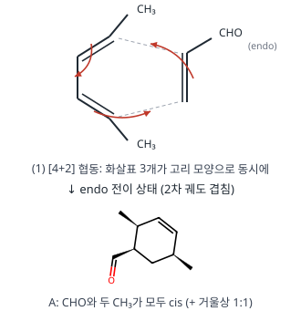

**(2) A의 입체.**

- (2E,4E) 다이엔이 s-cis로 돌면 두 CH₃는 모두 **바깥쪽**을 향합니다. 같은 면에서 새 결합이 생기므로 C2와 C5의 CH₃는 **cis**입니다.
- **endo 규칙**: CHO의 C=O π가 다이엔의 C3=C4 쪽 π와 겹치는(2차 궤도 상호작용) 전이 상태가 더 안정합니다. endo 치환기는 다이엔의 바깥쪽 치환기와 **같은 면**에 놓이므로 CHO도 cis입니다.
- 결과: 세 치환기 모두 cis. 3차원 구조로 확인했습니다.

**(3) A의 광학 활성.** 다이엔과 아크롤레인은 모두 비카이랄입니다. 친다이엔체의 위·아래 면이 같은 확률로 반응하므로 (1R,2S,5S)와 (1S,2R,5R)가 1 : 1로 생깁니다 → **라셈, 광학 비활성**.

**(4) B: 수소붕소화 위치.** 엑소 메틸렌(C=CH₂)에서 B는 덜 치환된 **CH₂**에, H는 고리 탄소에 syn으로 붙습니다. 산화하면 **CH₂OH**(1차 알코올)가 됩니다.

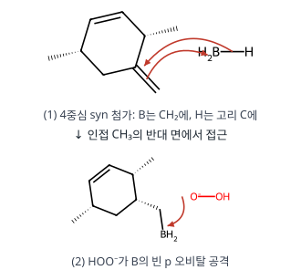

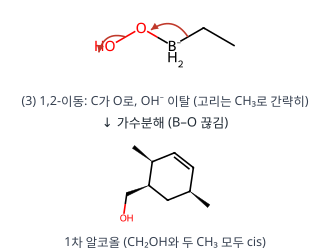

**(5) B: 입체.** 바로 옆 C의 CH₃가 한쪽 면을 가립니다. BH₃는 **CH₃ 반대 면**에서 접근하므로 고리 탄소에 붙는 H는 CH₃와 trans, 새로 생긴 CH₂B는 CH₃와 **cis**가 됩니다. 산화(입체 보존)와 PCC 산화(입체 중심 반응 안 함)를 거쳐 CHO도 CH₃와 cis입니다.

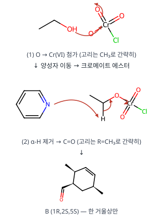

**(6) B의 광학 활성.** 출발물은 쐐기로 한 거울상(3S,6S)만 그려져 있고, 두 입체 중심은 반응에 참여하지 않습니다. 새 입체 중심도 한쪽으로만 생기므로 B는 **한 거울상 (1R,2S,5S)**이고 광학 활성입니다. 고리 번호를 다시 매기면 B는 A와 같은 화합물이며, A 라셈 중 한 거울상입니다.

**왜 이 생성물인가** Diels–Alder는 6개 전자가 고리 모양으로 한 번에 움직이는 협동 반응이라 반응물의 기하(E,E)와 endo 배향이 생성물의 상대 배열로 그대로 옮겨집니다. 수소붕소화도 4중심 전이 상태로 B와 H가 같은 면에 동시에 붙고, 이후 단계는 모두 입체 보존입니다.

**검산** A·B 모두 C₉H₁₄O, 불포화도 3(고리 1 + C=C 1 + C=O 1) ✓. RDKit CIP: B = (1R,2S,5S), A = (1R,2S,5S) + (1S,2R,5R).

**채점 포인트·함정**

- A를 한 구조만 그리고 "광학 활성"이라고 하면 틀립니다. 반드시 **라셈 → 비활성**을 써야 합니다.
- PCC는 1차 알코올을 **알데하이드**에서 멈춥니다(무수). 카복실산으로 쓰면 틀립니다.
- B의 CHO를 CH₃와 trans로 그리면 수소붕소화의 면 선택을 반대로 한 것입니다.

## A형 9번 · 최소 침전 질량과 공통 이온 효과 {#a9}

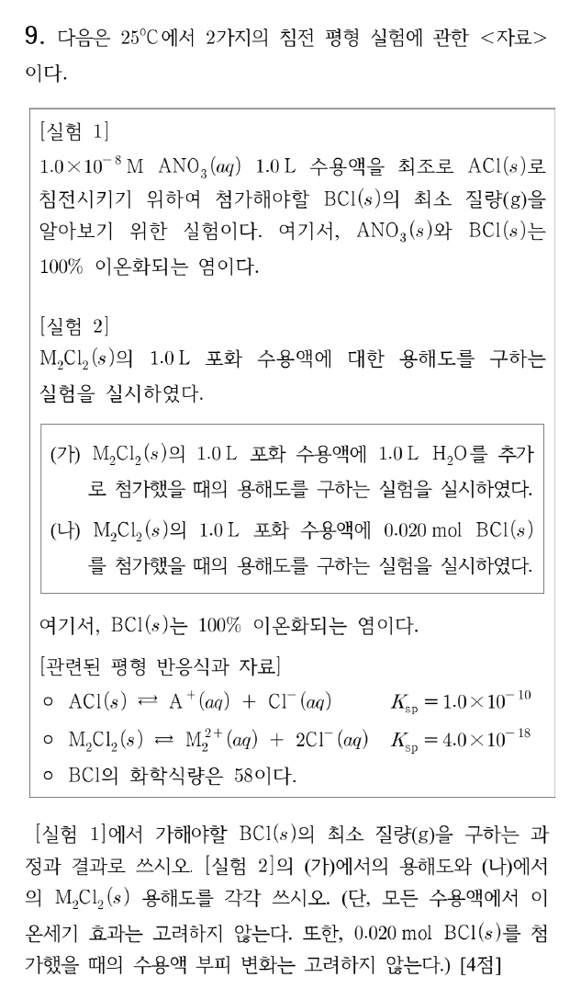

**정답** (필기·직접 풀이) [실험 1] BCl **0.58 g**, [실험 2] (가) **1.0×10⁻⁶ M**, (나) **1.0×10⁻¹⁴ M**

**공식·핵심 개념**

- 침전 시작 조건: $Q = K_{sp}$
- M₂Cl₂ ⇌ M₂²⁺ + 2Cl⁻: $K_{sp} = s(2s)^2 = 4s^3$
- 공통 이온 효과: $s = K_{sp}/[\mathrm{Cl^-}]^2$
- 용해도는 온도에 따라 정해지는 값 → 물을 더 넣어도 변하지 않음

**2027 출제 가능성 ★★★★☆ 높음** — Ksp와 공통 이온 효과는 분석화학 기본 계산으로 꾸준히 나옵니다.

**주어진 것** [A⁺] = 1.0×10⁻⁸ M(1.0 L), ACl $K_{sp} = 1.0\times10^{-10}$, M₂Cl₂ $K_{sp} = 4.0\times10^{-18}$, BCl 화학식량 58

**구할 것** 최소 BCl 질량, (가)·(나)의 M₂Cl₂ 용해도

**풀이 전략** 침전 직전 $Q = K_{sp}$로 필요한 [Cl⁻]를 구하고, 포화 용액은 $4s^3$, 공통 이온이 있으면 [Cl⁻]를 고정해 풉니다.

**(1) 필요한 [Cl⁻].**

$$[\mathrm{Cl^-}] = \frac{K_{sp}}{[\mathrm A^+]} = \frac{1.0\times10^{-10}}{1.0\times10^{-8}} = 1.0\times10^{-2}\ \mathrm M$$

**(2) BCl 질량.** 1.0 L이므로 0.010 mol입니다.

$$0.010\ \mathrm{mol} \times 58\ \mathrm{g/mol} = 0.58\ \mathrm g$$

**(3) M₂Cl₂의 용해도.**

$$4s^3 = 4.0\times10^{-18} \ \Rightarrow\ s^3 = 1.0\times10^{-18} \ \Rightarrow\ s = 1.0\times10^{-6}\ \mathrm M$$

**(4) (가) 물 1.0 L 추가.** 용해도는 일정 온도에서 정해진 값입니다. 고체가 남아 있으면 더 녹아 다시 포화되므로 용해도는 **1.0×10⁻⁶ M** 그대로입니다. (녹아 있는 총량은 늘어나지만 농도로 나타낸 용해도는 같습니다.)

**(5) (나) BCl 0.020 mol 첨가.** [Cl⁻] = 0.020 M(2s는 무시)입니다.

$$s = \frac{K_{sp}}{[\mathrm{Cl^-}]^2} = \frac{4.0\times10^{-18}}{(0.020)^2} = \frac{4.0\times10^{-18}}{4.0\times10^{-4}} = 1.0\times10^{-14}\ \mathrm M$$

**검산** (나): $2s = 2\times10^{-14} \ll 0.020$이므로 근사가 맞습니다. (1): BCl을 0.58 g보다 적게 넣으면 $Q < K_{sp}$로 침전이 생기지 않습니다 ✓.

**채점 포인트·함정**

- $K_{sp} = s^3$이나 $s\cdot s^2$로 쓰면 틀립니다. Cl⁻ 농도는 **2s**입니다.
- (가)에서 "부피가 2배 → 용해도 절반"으로 쓰면 용해도 개념을 잘못 이해한 것입니다.

## A형 10번 · 수소 원자 2s 파동함수의 정규화와 마디 {#a10}

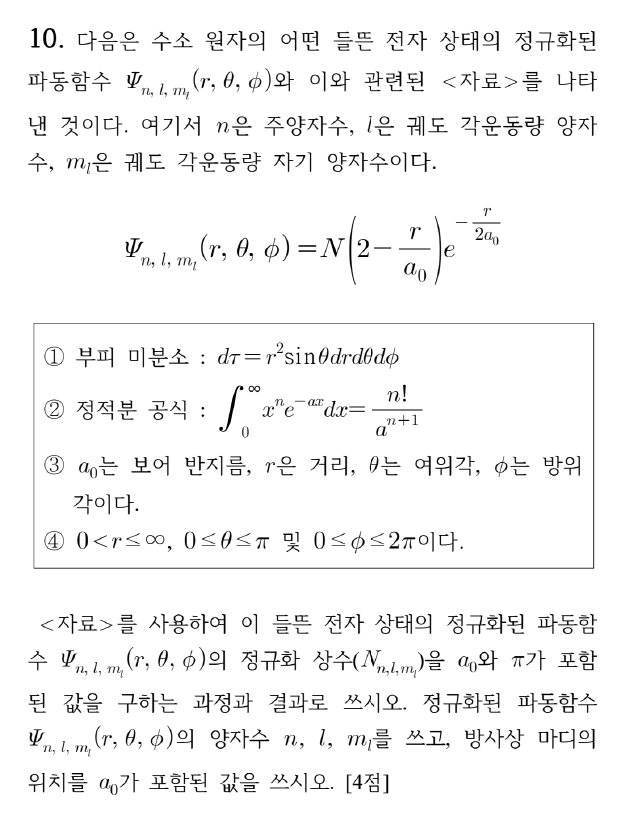

**정답** (필기·직접 풀이) $N = \dfrac{1}{\sqrt{32\pi a_0^3}}$, $n = 2$, $l = 0$, $m_l = 0$ (2s), 방사상 마디 $r = 2a_0$

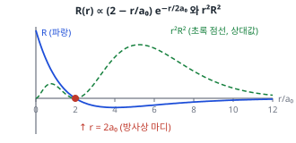

**공식·핵심 개념**

- 정규화: $\int|\Psi|^2 d\tau = 1$, $d\tau = r^2\sin\theta\,dr\,d\theta\,d\phi$
- $\int_0^\infty x^n e^{-ax}dx = \dfrac{n!}{a^{n+1}}$
- 마디 수: 방사상 $n - l - 1$, 각 $l$

**2027 출제 가능성 ★★★★☆ 높음** — 수소 원자 파동함수의 정규화·마디는 물리화학 서술형 단골입니다.

**주어진 것** $\Psi = N\left(2 - \dfrac{r}{a_0}\right)e^{-r/2a_0}$ (θ, φ에 무관), 부피 요소, 정적분 공식

**구할 것** N, 양자수, 방사상 마디 위치

**풀이 전략** 각 부분 적분(4π)과 동경 부분 적분을 나눈 뒤, 동경 적분을 세 항으로 전개합니다.

**(1) 정규화 조건.**

$$N^2\int_0^{2\pi}\!d\phi\int_0^{\pi}\!\sin\theta\,d\theta\int_0^\infty\!\left(2-\frac{r}{a_0}\right)^2 e^{-r/a_0}r^2dr = 1$$

각 부분: $2\pi \times 2 = 4\pi$

**(2) 동경 적분 전개.**

$$\left(2-\frac{r}{a_0}\right)^2 r^2 = 4r^2 - \frac{4r^3}{a_0} + \frac{r^4}{a_0^2}$$

$a = 1/a_0$로 공식을 쓰면

$$\int_0^\infty 4r^2e^{-r/a_0}dr = 4\cdot 2!\,a_0^3 = 8a_0^3$$

$$\int_0^\infty \frac{4r^3}{a_0}e^{-r/a_0}dr = \frac{4}{a_0}\cdot 3!\,a_0^4 = 24a_0^3$$

$$\int_0^\infty \frac{r^4}{a_0^2}e^{-r/a_0}dr = \frac{1}{a_0^2}\cdot 4!\,a_0^5 = 24a_0^3$$

합: $8a_0^3 - 24a_0^3 + 24a_0^3 = 8a_0^3$

**(3) N.**

$$N^2 \times 4\pi \times 8a_0^3 = 1 \ \Rightarrow\ N = \frac{1}{\sqrt{32\pi a_0^3}}$$

**(4) 양자수.** θ, φ에 의존하지 않으므로 $l = 0$, $m_l = 0$입니다. 지수가 $e^{-r/2a_0}$(= $e^{-Zr/na_0}$, Z = 1)이므로 $n = 2$ → **2s**

**(5) 방사상 마디.** $2 - \dfrac{r}{a_0} = 0 \Rightarrow r = 2a_0$ (마디 수 $n - l - 1 = 1$ ✓)

**검산** 수소 2s의 표준식 $\psi_{200} = \dfrac{1}{4\sqrt{2\pi}}\left(\dfrac{1}{a_0}\right)^{3/2}\left(2-\dfrac{r}{a_0}\right)e^{-r/2a_0}$에서 $\dfrac{1}{4\sqrt{2\pi}} = \dfrac{1}{\sqrt{32\pi}}$ ✓

**채점 포인트·함정**

- 4π를 빠뜨리면 $N = (8a_0^3)^{-1/2}$로 틀립니다.
- 마디 위치는 $r = 2a_0$ 하나입니다. r = 0과 r = ∞는 마디로 세지 않습니다.

## A형 11번 · [NiCl₄]²⁻의 d–d 전이와 결정장 안정화 에너지 {#a11}

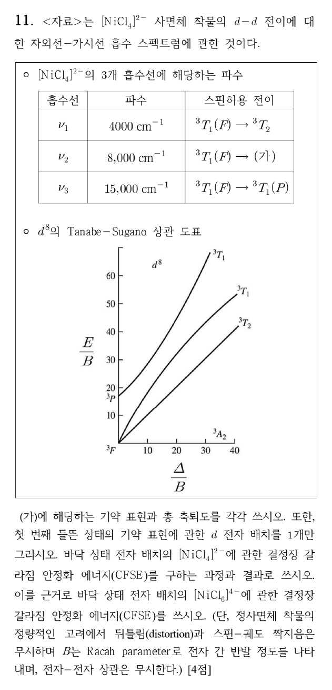

**정답** (필기·직접 풀이)

- (가) **³A₂**, 총 축퇴도 **3** (스핀 3 × 궤도 1)
- 첫 번째 들뜬 상태 ³T₂의 배치: **e³t₂⁵** (아래 그림 가운데)
- [NiCl₄]²⁻ CFSE: Δt = 4000 cm⁻¹, e⁴t₂⁴ → **−0.8Δt = −3200 cm⁻¹**
- [NiCl₆]⁴⁻: Δo = (9/4)Δt = 9000 cm⁻¹, $t_{2g}^6e_g^2$ → **−1.2Δo = −10 800 cm⁻¹**

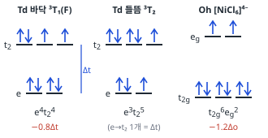

**공식·핵심 개념**

- Td: e(−0.6Δt) 아래, t₂(+0.4Δt) 위 / Oh: t₂g(−0.4Δo), $e_g$(+0.6Δo)
- $\Delta_t \approx \dfrac49\Delta_o$
- Td d⁸ 스핀 허용 전이: ³T₁(F) → ³T₂, ³A₂, ³T₁(P)
- 항의 축퇴도 = $(2S+1)\times$ 궤도 축퇴도(A 1, E 2, T 3)

**2027 출제 가능성 ★★★★★ 매우 높음** — Tanabe–Sugano 도표 해석과 CFSE는 결정장 이론의 핵심 출제 소재입니다.

**주어진 것** ν₁ 4000(³T₁(F) → ³T₂), ν₂ 8000(→ (가)), ν₃ 15 000 cm⁻¹(→ ³T₁(P)), d⁸ TS 도표. 전자–전자 상관 무시

**구할 것** (가)의 기약 표현·축퇴도, ³T₂의 배치, [NiCl₄]²⁻와 [NiCl₆]⁴⁻의 CFSE

**풀이 전략** 도표에서 ³F에서 갈라진 세 항(³T₁, ³T₂, ³A₂)을 읽습니다. 전자 반발을 무시하면 각 들뜬 상태의 에너지는 e → t₂로 옮겨 간 전자 수 × Δt입니다.

**(1) (가).** ³F는 Td에서 ³T₁ + ³T₂ + ³A₂로 갈라집니다. 도표 오른쪽 아래에 ³A₂가 표시되어 있고, ν₁(³T₂), ν₃(³T₁(P))이 정해져 있으므로 ν₂의 도착 상태는 **³A₂**입니다. 축퇴도 = 3(스핀) × 1(A) = **3**

**(2) 배치.** Td d⁸ 바닥 상태는 e⁴t₂⁴입니다. e 전자 1개가 t₂로 가면 **e³t₂⁵**(³T₂), 2개가 가면 e²t₂⁶(³A₂)입니다.

**(3) Δt.** 전자 반발을 무시하면

$$\nu_1 = E(e^3t_2^5) - E(e^4t_2^4) = \Delta_t = 4000\ \mathrm{cm^{-1}}$$

$$\nu_2 = E(e^2t_2^6) - E(e^4t_2^4) = 2\Delta_t = 8000\ \mathrm{cm^{-1}}\ ✓$$

**(4) [NiCl₄]²⁻ CFSE.**

$$\mathrm{CFSE} = 4(-0.6\Delta_t) + 4(+0.4\Delta_t)$$

$$= -2.4\Delta_t + 1.6\Delta_t = -0.8\Delta_t$$

$$= -0.8 \times 4000 = -3200\ \mathrm{cm^{-1}}$$

**(5) [NiCl₆]⁴⁻.** 같은 Ni²⁺, 같은 Cl⁻이므로

$$\Delta_o = \frac94\Delta_t = \frac94 \times 4000 = 9000\ \mathrm{cm^{-1}}$$

Oh d⁸: $t_{2g}^6e_g^2$

$$\mathrm{CFSE} = 6(-0.4\Delta_o) + 2(+0.6\Delta_o) = -1.2\Delta_o$$

$$= -1.2\times9000 = -10\,800\ \mathrm{cm^{-1}}$$

**검산** ν₂/ν₁ = 2로 단순 모형(2전자 / 1전자 들뜸)과 맞습니다. 팔면체 CFSE가 사면체보다 훨씬 크다는 것은 Ni²⁺ 착물이 대부분 팔면체라는 사실과 맞습니다.

**채점 포인트·함정**

- Td에서는 e가 **아래**입니다. Oh처럼 t₂를 아래에 두면 배치가 틀립니다.
- 축퇴도는 스핀 다중도까지 곱해야 합니다(³A₂ → 3, ³T₂였다면 9).
- CFSE 부호(음수 = 안정화)를 일관되게 씁니다.

## A형 12번 · 분광 광도법으로 구하는 산 해리와 평형 상수 {#a12}

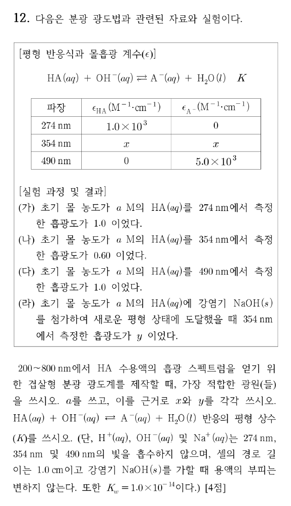

**정답** (직접 풀이)

- 광원: **중수소(D₂) 램프**(자외선, 약 160~380 nm) + **텅스텐(할로젠) 램프**(가시광, 약 320~2500 nm)
- a = **1.2×10⁻³ M**, x = **500 M⁻¹cm⁻¹**, y = **0.60**
- K = **4.0×10⁹**

**공식·핵심 개념**

- 비어–람베르트: $A = \varepsilon b c$, 혼합물은 $A = \sum\varepsilon_i b c_i$
- 등흡광점: $\varepsilon_{HA} = \varepsilon_{A^-}$ → 흡광도가 전체 농도에만 의존
- $K = \dfrac{[\mathrm A^-]}{[\mathrm{HA}][\mathrm{OH^-}]} = \dfrac{K_a}{K_w}$

**2027 출제 가능성 ★★★★☆ 높음** — 두 파장 흡광도로 산–염기 분율을 구하는 문항과 기기 구성(광원)은 분석화학의 단골입니다.

**주어진 것** 274 nm: HA만 흡수(ε 1.0×10³), 490 nm: A⁻만 흡수(ε 5.0×10³), 354 nm: 둘 다 ε = x. 흡광도 (가) 1.0, (나) 0.60, (다) 1.0, (라) y. b = 1.0 cm, $K_w = 1.0\times10^{-14}$

**구할 것** 광원, a, x, y, K

**풀이 전략** 한 성분만 흡수하는 파장에서 [HA], [A⁻]를 각각 구하고, 합으로 a를 얻습니다.

**(1) 광원.** 200~800 nm 전체를 덮어야 합니다. 자외선 영역은 **D₂ 램프**, 가시광 영역은 **텅스텐–할로젠 램프**가 맡고, 약 350 nm 부근에서 광원을 바꿉니다.

**(2) [HA].** (가) 274 nm:

$$[\mathrm{HA}] = \frac{A}{\varepsilon b} = \frac{1.0}{(1.0\times10^3)(1.0)} = 1.0\times10^{-3}\ \mathrm M$$

**(3) [A⁻].** (다) 490 nm:

$$[\mathrm A^-] = \frac{1.0}{(5.0\times10^3)(1.0)} = 2.0\times10^{-4}\ \mathrm M$$

**(4) a.** 물에서 HA 일부가 해리했으므로

$$a = [\mathrm{HA}] + [\mathrm A^-] = 1.0\times10^{-3} + 2.0\times10^{-4} = 1.2\times10^{-3}\ \mathrm M$$

**(5) x.** (나) 354 nm: $0.60 = x(1.0)([\mathrm{HA}] + [\mathrm A^-]) = x \times 1.2\times10^{-3}$

$$x = \frac{0.60}{1.2\times10^{-3}} = 500\ \mathrm{M^{-1}cm^{-1}}$$

**(6) y.** 354 nm는 **등흡광점**입니다. NaOH로 HA가 A⁻로 바뀌어도 전체 농도 a는 같습니다(부피 변화 없음).

$$y = 500 \times 1.0 \times 1.2\times10^{-3} = 0.60$$

**(7) Ka.** 물에서 HA ⇌ H⁺ + A⁻, [H⁺] = [A⁻] = 2.0×10⁻⁴ M

$$K_a = \frac{(2.0\times10^{-4})^2}{1.0\times10^{-3}} = \frac{4.0\times10^{-8}}{1.0\times10^{-3}} = 4.0\times10^{-5}$$

**(8) K.** HA + OH⁻ ⇌ A⁻ + H₂O는 (HA ⇌ H⁺ + A⁻) + (H⁺ + OH⁻ ⇌ H₂O)입니다.

$$K = \frac{K_a}{K_w} = \frac{4.0\times10^{-5}}{1.0\times10^{-14}} = 4.0\times10^{9}$$

**검산** 해리도 $2.0\times10^{-4}/1.2\times10^{-3} = 17\%$ — Ka 4×10⁻⁵, 농도 10⁻³ M인 약산에서 적당한 값입니다. 근의 공식으로 풀어도 $[\mathrm H^+] = 2.0\times10^{-4}$를 넣으면 $K_a(a - 2.0\times10^{-4}) = 4.0\times10^{-8}$ ✓.

**채점 포인트·함정**

- a를 [HA] = 1.0×10⁻³ M로만 쓰면 틀립니다. 490 nm 흡광도가 0이 아니므로 A⁻가 있습니다.
- 광원은 **두 가지**를 모두 써야 합니다. 텅스텐 램프 하나로는 200~320 nm를 낼 수 없습니다.

# 전공 B

## B형 1번 · 전위차법으로 구하는 착이온 형성 상수 {#b1}

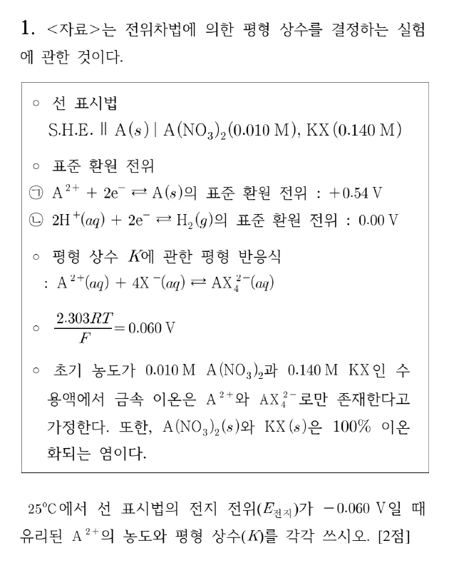

**정답** (필기·직접 풀이) $[\mathrm A^{2+}] = 1.0\times10^{-20}\ \mathrm M$, $K = 1.0\times10^{22}$

**공식·핵심 개념**

- $E_{전지} = E_{오른쪽(환원)} - E_{왼쪽(산화)}$, SHE = 0 V
- 네른스트 식: $E = E^\circ - \dfrac{0.060}{n}\log\dfrac{1}{[\mathrm A^{2+}]}$
- 물질 수지: [X⁻] = 0.140 − 4[AX₄²⁻]

**2027 출제 가능성 ★★★★☆ 높음** — 전지 전위로 평형 상수를 구하는 2점 문항은 분석화학에서 자주 나옵니다.

**주어진 것** S.H.E. ‖ A(s) | A²⁺ 총 0.010 M, KX 0.140 M, $E^\circ(\mathrm A^{2+}/\mathrm A) = +0.54$ V, $E_{전지} = -0.060$ V, $\frac{2.303RT}{F} = 0.060$ V

**구할 것** 유리 [A²⁺], 형성 상수 K

**풀이 전략** 전지 전위 → 오른쪽 전극 전위 → 네른스트 식으로 [A²⁺]. 나머지 금속은 모두 AX₄²⁻로 보고 K를 계산합니다.

**(1) 오른쪽 전극 전위.**

$$E_{전지} = E_{A} - E_{SHE} \ \Rightarrow\ E_{A} = -0.060 - 0 = -0.060\ \mathrm V$$

**(2) 네른스트 식.**

$$-0.060 = 0.54 + \frac{0.060}{2}\log[\mathrm A^{2+}]$$

$$\log[\mathrm A^{2+}] = \frac{-0.060 - 0.54}{0.030} = \frac{-0.60}{0.030} = -20$$

$$[\mathrm A^{2+}] = 1.0\times10^{-20}\ \mathrm M$$

**(3) 물질 수지.** 유리 A²⁺는 무시할 만큼 적으므로 [AX₄²⁻] ≈ 0.010 M입니다.

$$[\mathrm X^-] = 0.140 - 4(0.010) = 0.100\ \mathrm M$$

**(4) K.**

$$K = \frac{[\mathrm{AX_4^{2-}}]}{[\mathrm A^{2+}][\mathrm X^-]^4} = \frac{0.010}{(1.0\times10^{-20})(0.100)^4}$$

$$= \frac{1.0\times10^{-2}}{1.0\times10^{-24}} = 1.0\times10^{22}$$

**검산** [A²⁺]/총 A = 10⁻¹⁸ → 사실상 전부 착물이라는 가정이 맞습니다. K가 매우 커서 E가 E°보다 0.60 V 낮아진 것과도 맞습니다.

**채점 포인트·함정**

- [X⁻]를 0.140 M 그대로 쓰면 K = 2.6×10²¹로 틀립니다. 착물에 X⁻ **4개**가 쓰입니다.
- SHE가 왼쪽(산화 전극)이므로 $E_{전지}$가 곧 A 전극 전위입니다.

## B형 2번 · 사이클로헥세인과 S₈의 점군 {#b2}

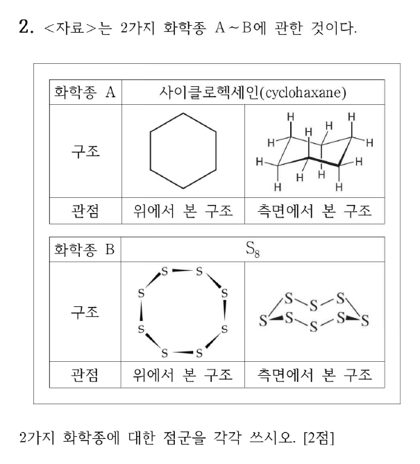

**정답** (필기·직접 풀이) A 사이클로헥세인(의자형): **D₃d**, B S₈(왕관형): **D₄d**

**공식·핵심 개념**

- 점군 판별: 주축 Cₙ → 수직 C₂ n개? → σh? → σd?
- Dₙd: 주축 Cₙ + 수직 C₂ n개 + σd n개 (σh 없음), S₂ₙ 포함
- D₃d는 i를 가짐(S₆), D₄d는 i 없음(S₈)

**2027 출제 가능성 ★★★★☆ 높음** — 점군은 매년 출제되며, 고리 분자의 Dₙd는 함정 소재로 자주 쓰입니다.

**주어진 것** 사이클로헥세인 위·옆 모습(의자형), S₈ 위·옆 모습(왕관형)

**구할 것** 두 점군

**풀이 전략** 위에서 본 그림으로 주축 차수를, 옆모습으로 위·아래 원자 배치(엇갈림 여부)를 확인합니다.

**(1) 사이클로헥세인.**

- 위에서 보면 정육각형이지만 탄소가 위·아래로 번갈아 있으므로 주축은 **C₃**(C₆ 아님)입니다.
- 마주보는 C–C 결합의 가운데를 지나는 **수직 C₂** 3개가 있습니다.
- 수평 거울면은 없고(위·아래 탄소가 다름), C₂ 사이를 지나는 **σd** 3개와 대칭 중심 i가 있습니다 → **D₃d**

**(2) S₈.**

- 위 4개, 아래 4개 S가 45° 엇갈린 왕관형입니다. 주축은 **C₄**입니다(S₈ 회전반사축도 있음).
- 수직 C₂ 4개, σd 4개가 있고 σh는 없습니다 → **D₄d**

**검산** 위수: D₃d = 12, D₄d = 16. 의자형 사이클로헥세인 D₃d는 교과서 표준 예입니다.

**채점 포인트·함정**

- 위에서 본 정육각형·정팔각형만 보고 D₆h, D₈h로 쓰면 틀립니다. 옆모습에서 원자가 같은 평면에 있지 않습니다.
- 배 모양 사이클로헥세인은 C₂v입니다.

## B형 3번 · 3D 소프트웨어 수업과 [물질과 에너지] 구성 체제 {#b3}

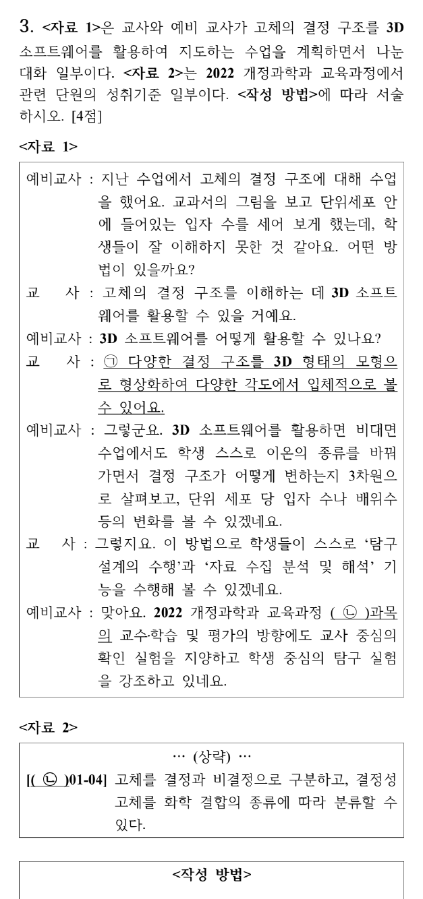

**정답** (직접 작성)

- ㉠에 해당하는 기능: **모형의 생성과 활용** (다양한 결정 구조를 3D 모형으로 형상화하여 관찰). 3D 소프트웨어를 쓴다는 점에서 "수학적 사고와 컴퓨터 활용"도 관련 있지만, ㉠의 핵심은 모형입니다.
- 잘못된 곳: 학생들이 **단위 세포 안의 입자 수나 배위수**를 세고, 이온 종류를 바꾸며 결정 구조 변화를 보게 한 점. 판단 준거: 성취기준 [12물에01-04]는 고체를 **결정과 비결정으로 구분**하고 결정성 고체를 **화학 결합의 종류(이온·공유·금속·분자 결정)에 따라 분류**하는 데까지입니다. 단위 세포 입자 수·배위수 계산은 성취기준 범위를 벗어납니다.
- ㉡ **물질과 에너지** (2022 개정 진로 선택 과목)
- 구성 체제: **1. 성격 및 목표**(가. 성격, 나. 목표) / **2. 내용 체계 및 성취기준**(가. 내용 체계, 나. 성취기준) / **3. 교수·학습 및 평가**(가. 교수·학습, 나. 평가)

**공식·핵심 개념**

- 2022 개정 내용 체계: 핵심 아이디어 / 지식·이해, **과정·기능**, 가치·태도
- 과정·기능 예: 문제 인식과 가설 설정, 탐구 설계와 수행, 자료 수집·분석 및 해석, 수학적 사고와 컴퓨터 활용, 모형의 생성과 활용, 증거에 기초한 토론과 논증, 결론 도출 및 평가, 의사소통
- [물질과 에너지] 1단원: 물질의 세 가지 상태(기체·액체·고체)

**2027 출제 가능성 ★★★★☆ 높음** — 과목 구성 체제와 성취기준 범위 판단은 2022 개정 첫 적용기에 꼭 나오는 소재입니다.

**판단 근거.** 교사가 "다양한 각도에서 입체적으로 볼 수 있다"고 한 것은 보이지 않는 입자 배열을 3D 모형으로 만들어 쓰는 활동입니다. 작성 방법이 "<자료 1>에 제시된 기능은 제외"라고 했으므로 대화에 나온 '탐구 설계와 수행', '자료 수집·분석 및 해석'은 답이 될 수 없습니다. 성취기준 코드 [(㉡)01-04]의 01은 1단원이므로, 고체 결정을 1단원에서 다루는 진로 선택 과목 **물질과 에너지**입니다.

**채점 포인트·함정**

- 구성 체제는 **세 개의 큰 항목과 각 하위 항목**을 정확한 이름으로 써야 합니다.
- "단위 세포 당 입자 수나 배위수"를 정확히 짚어야 합니다. "3D 소프트웨어 사용"은 잘못이 아닙니다.

## B형 4번 · 근대 화학사로 보는 과학의 본성과 쿤 {#b4}

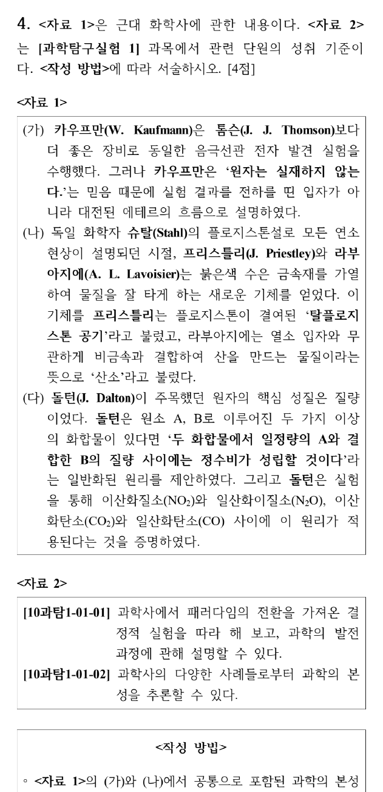

**정답** (직접 작성)

- 공통된 과학의 본성: **관찰의 이론 의존성**(과학 지식은 과학자의 이론·신념에 영향을 받는다). 이유: [10과탐1-01-02]는 과학사 사례에서 과학의 본성을 추론하도록 합니다. (가) 카우프만은 "원자는 실재하지 않는다"는 믿음 때문에 같은 실험 결과를 에테르의 흐름으로, (나) 프리스틀리는 플로지스톤설 때문에 산소를 '탈플로지스톤 공기'로 해석했습니다. 같은 관찰을 이론에 따라 다르게 해석했습니다.
- (나)의 발달 단계: **위기 → 과학 혁명**. 준거: 플로지스톤설(정상 과학의 패러다임)로 설명되지 않는 **변칙 사례**(산소의 발견, 연소 후 질량 증가)가 쌓여 위기가 오고, 라부아지에의 **산소설이라는 새 패러다임**이 경쟁하다가 받아들여지는 **패러다임 전환**이 일어났습니다.
- (다)의 탐구 방법: **가설 연역적 탐구**. 이유: 돌턴은 원자설에서 '배수 비례 법칙'이라는 일반 원리(가설)를 먼저 제안하고, 그로부터 연역한 예측을 NO₂/N₂O, CO₂/CO 실험으로 검증했습니다. 관찰에서 일반화로 가는 귀납과 순서가 반대입니다.

**공식·핵심 개념**

- 과학의 본성: 잠정성, 관찰의 이론 의존성, 창의성, 사회·문화적 영향
- 쿤: 전과학 → 정상 과학 → 변칙 사례 → 위기 → 과학 혁명(패러다임 전환) → 새 정상 과학
- 가설 연역: 문제 → 가설 → 연역적 예측 → 실험 검증 → 결론

**2027 출제 가능성 ★★★★★ 매우 높음** — 과학사 사례로 과학의 본성과 쿤을 묻는 문항은 거의 매년 나옵니다.

**판단 근거.** (나)에서 프리스틀리와 라부아지에는 **같은 기체**를 얻었지만 서로 다른 이론 틀로 이름을 붙였습니다. 두 패러다임이 공존하며 경쟁하는 상황은 쿤의 위기 단계의 특징이고, 결국 산소설이 받아들여진 것이 혁명입니다. 정상 과학 단계라면 기존 패러다임 안에서 퍼즐 풀이만 일어납니다.

**채점 포인트·함정**

- 이유를 쓸 때 반드시 **<자료 2>의 성취기준**([10과탐1-01-02])을 근거로 언급해야 합니다.
- 쿤의 단계는 "준거"(변칙 사례·경쟁 패러다임·패러다임 전환)를 함께 써야 점수가 납니다.

## B형 5번 · 귀납·연역 탐구와 교수·학습-평가 일체화 {#b5}

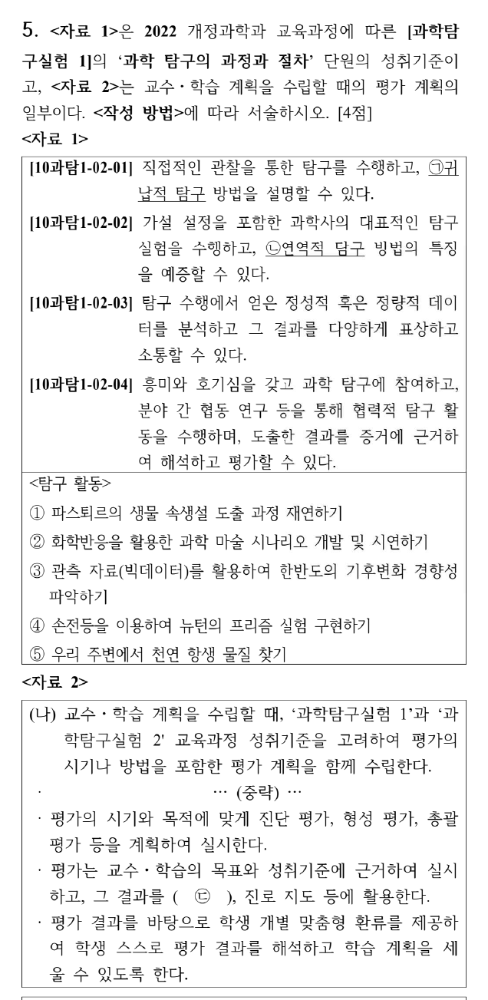

**정답** (직접 작성)

- ㉠ 귀납적 탐구에서 교사 역할(구성주의): 정답을 알려 주는 전달자가 아니라 **안내자·촉진자**. 학생이 직접 관찰한 자료에서 스스로 규칙성을 찾도록 질문을 던지고, 학생의 사전 개념을 드러내며, 토론으로 의미를 구성하게 돕습니다.
- ㉡ 예: **① 파스퇴르의 생물 속생설 도출 과정 재연하기**. 판단 준거: 가설(생물은 생물에서만 생긴다)을 먼저 세우고 백조목 플라스크 실험으로 검증하는, 가설 설정을 포함한 과학사의 대표 탐구 실험이기 때문입니다.
- ②에서 측정할 수 있는 과학적 태도: **과학에 대한 흥미와 호기심** (또는 협력)
- ㉢ **학생의 학습 개선(교수·학습 개선)**. 이유: 평가가 수업 끝의 서열화가 아니라 학습 과정의 일부가 되어, 성취기준에 근거한 수업과 평가가 일관되게 이루어지고 피드백으로 학생의 성장을 도울 수 있기 때문입니다(교수·학습-평가 일체화, 과정 중심 평가).

**공식·핵심 개념**

- 귀납적 탐구: 관찰 → 자료 → 규칙성 발견 / 연역적 탐구: 가설 → 예측 → 검증
- 구성주의 교사: 안내자, 촉진자, 조력자
- 2022 개정 평가: 진단·형성·총괄 평가, 결과 환류, **교수·학습-평가의 연계(일체화)**

**2027 출제 가능성 ★★★★☆ 높음** — 과학탐구실험의 탐구 방법과 2022 개정 평가 방향은 최근 교육론 빈출입니다.

**판단 근거.** ②(과학 마술)는 [10과탐1-02-04]의 "흥미와 호기심을 갖고 과학 탐구에 참여"에 해당하는 활동입니다. ③은 빅데이터 분석(02-03), ④는 결정적 실험 재현, ⑤는 생활 속 탐구로, 가설–검증 구조가 분명한 것은 ①입니다.

**채점 포인트·함정**

- ㉠은 "구성주의 관점"이라는 조건이 있으므로 **학생 스스로 의미를 구성**한다는 표현을 넣습니다.
- ㉢은 교육과정 문서 표현이 "학생의 학습 개선"인지 "교수·학습 개선"인지 고시 원문으로 확인하세요(검토 메모 2).

## B형 6번 · 다이보레인의 3중심 2전자 결합과 진동 모드 {#b6}

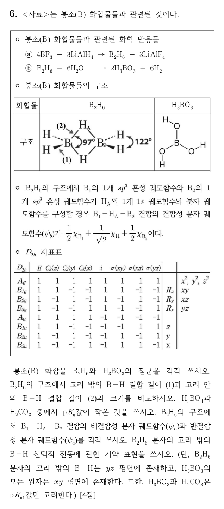

**정답** (필기·직접 풀이)

- 점군: B₂H₆ **D₂h**, H₃BO₃ **C₃h**
- 결합 길이: **(1) < (2)** (고리 밖 2c-2e B–H가 고리 안 3c-2e B–H보다 짧음)
- pKa가 작은 것: **H₂CO₃** (pKa₁ ≈ 6.35 < H₃BO₃ ≈ 9.24)
- $\psi_n = \dfrac{1}{\sqrt2}(\chi_{B_1} - \chi_{B_2})$, $\psi_a = \dfrac12\chi_{B_1} - \dfrac{1}{\sqrt2}\chi_H + \dfrac12\chi_{B_2}$
- 고리 밖 B–H 신축 진동: $\Gamma = A_g + B_{3g} + B_{1u} + B_{2u}$

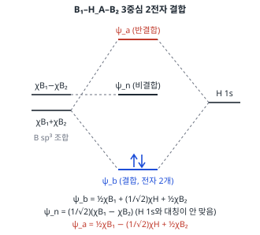

**공식·핵심 개념**

- 3c-2e: 결합성·비결합성·반결합성 MO 3개 중 결합성에 전자 2개 → 결합 차수 ½
- MO 정규 직교: $\sum c_i^2 = 1$, $\sum c_i c_j' = 0$
- 축소 공식 $n_i = \dfrac1h\sum_R \chi(R)\chi_i(R)$, 신축 진동은 움직이지 않는 결합만 χ = 1

**2027 출제 가능성 ★★★★★ 매우 높음** — 다이보레인 3c-2e, 점군, 진동 모드 기약 표현을 한 문항에 묶는 형식은 무기화학 4점 대표 유형입니다.

**주어진 것** B₂H₆ 구조(고리 밖 B–H는 yz 평면), $\psi_b$ 식, D₂h 지표표, H₃BO₃는 xy 평면

**구할 것** 점군 2개, 결합 길이 비교, pKa 비교, $\psi_n$·$\psi_a$, 고리 밖 B–H 신축의 기약 표현

**풀이 전략** $\psi_b$와 정규 직교하는 두 조합을 찾고, 고리 밖 B–H 4개를 기저로 축소 공식을 씁니다.

**(1) 점군.** B₂H₆는 서로 수직인 C₂ 3개와 i, σ 3개를 가집니다 → **D₂h**. H₃BO₃는 평면이고 O–H가 바람개비처럼 한 방향으로 돌아 있어 C₃와 σh(분자 평면)만 있습니다(수직 C₂·σv 없음) → **C₃h**

**(2) 결합 길이.** 고리 밖 B–H는 전자 2개가 원자 2개에 걸친 보통 결합(결합 차수 1)이고, 고리 안 B–H–B는 전자 2개가 원자 3개에 퍼져 B–H 하나당 결합 차수 ½입니다. 차수가 작을수록 길어 **(1) < (2)** (실측 약 1.19 Å < 1.33 Å)

**(3) pKa.** H₃BO₃는 H⁺를 직접 내놓지 않고 물의 OH⁻를 받는 루이스 산(B(OH)₃ + H₂O → B(OH)₄⁻ + H⁺)이라 매우 약합니다(pKa 9.24). H₂CO₃(pKa₁ 6.35)가 더 강한 산 → **H₂CO₃의 pKa가 작음**

**(4) $\psi_n$.** H 1s는 B₁ ↔ B₂를 바꾸는 대칭 조작에 대해 대칭입니다. 반대칭 조합 $\chi_{B_1} - \chi_{B_2}$는 H와 겹침이 0이므로 **비결합성**입니다. 정규화: $c^2 + c^2 = 1 \Rightarrow c = \dfrac{1}{\sqrt2}$

$$\psi_n = \frac{1}{\sqrt2}(\chi_{B_1} - \chi_{B_2})$$

**(5) $\psi_a$.** 대칭 조합과 H가 반대 위상으로 섞인 것입니다. $\psi_a = c_1\chi_{B_1} + c_2\chi_H + c_1\chi_{B_2}$로 두고

$\psi_b$와 직교하는 조건:

$$\tfrac12 c_1 + \tfrac{1}{\sqrt2}c_2 + \tfrac12 c_1 = 0 \ \Rightarrow\ c_2 = -\sqrt2\,c_1$$

정규화 조건:

$$2c_1^2 + c_2^2 = 2c_1^2 + 2c_1^2 = 1 \ \Rightarrow\ c_1 = \tfrac12,\ c_2 = -\tfrac{1}{\sqrt2}$$

$$\psi_a = \frac12\chi_{B_1} - \frac{1}{\sqrt2}\chi_H + \frac12\chi_{B_2}$$

**(6) 고리 밖 B–H 신축의 가약 표현.** B–B 축이 z, 고리 밖 H 4개가 yz 평면에 있습니다. 결합 벡터 4개 중 제자리에 있는 것만 χ = 1입니다.

| 조작 | E | C₂(z) | C₂(y) | C₂(x) | i | σ(xy) | σ(xz) | σ(yz) |
|---|---|---|---|---|---|---|---|---|
| Γ | 4 | 0 | 0 | 0 | 0 | 0 | 0 | 4 |

(σ(yz)는 4개 결합을 모두 제자리에 둡니다. 다른 조작은 모든 결합을 옮깁니다.)

**(7) 축소 (h = 8).** χ(E) = 4와 χ(σ(yz)) = 4만 남으므로

$$n_i = \frac18\left[4 + 4\chi_i(\sigma_{yz})\right]$$

- σ(yz) = +1인 $A_g, B_{3g}, B_{1u}, B_{2u}$: 각각 $(4+4)/8 = 1$
- σ(yz) = −1인 $B_{1g}, B_{2g}, A_u, B_{3u}$: 각각 $(4-4)/8 = 0$

$$\Gamma_{B-H} = A_g + B_{3g} + B_{1u} + B_{2u}$$

**검산** 차원 1 + 1 + 1 + 1 = 4 = 결합 수 ✓. IR 활성: B₁u(z), B₂u(y) / 라만 활성: $A_g$, B₃g(yz) — 상호 배제 규칙(i 있음)과 맞습니다. $\psi_b$·$\psi_n$·$\psi_a$는 서로 직교합니다($\tfrac14 - \tfrac12 + \tfrac14 = 0$).

**채점 포인트·함정**

- $\psi_n$에 $\chi_H$를 넣으면 틀립니다. 대칭이 맞지 않아 계수가 0입니다.
- 지표표의 B₂u 행은 σ(yz) = +1, B₃u 행은 −1입니다. 축 방향을 문제 조건(yz 평면)에 맞춰 읽어야 합니다.

## B형 7번 · 기화와 가열 과정의 ΔH·ΔS {#b7}

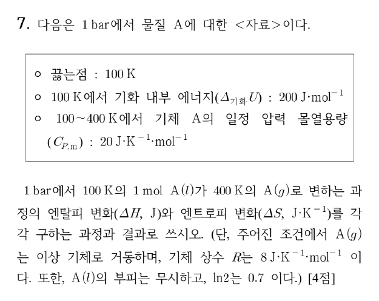

**정답** (필기·직접 풀이) $\Delta H = 7000\ \mathrm J$, $\Delta S = 38\ \mathrm{J\,K^{-1}}$

**공식·핵심 개념**

- $\Delta H = \Delta U + \Delta(PV)$, 이상 기체·액체 부피 무시: $\Delta_{vap}H = \Delta_{vap}U + RT$
- 가역 상전이: $\Delta S = \dfrac{\Delta H}{T_b}$
- 일정 압력 가열: $\Delta H = C_P\Delta T$, $\Delta S = C_P\ln\dfrac{T_2}{T_1}$

**2027 출제 가능성 ★★★★☆ 높음** — 경로를 나눠 상태 함수를 더하는 계산은 열역학 서술형 기본형입니다.

**주어진 것** 1 bar, 끓는점 100 K, $\Delta_{vap}U = 200$ J/mol, $C_{P,m}(g) = 20$ J/(K·mol), R = 8 J/(K·mol), ln2 = 0.7

**구할 것** 1 mol A(l, 100 K) → A(g, 400 K)의 ΔH, ΔS

**풀이 전략** ① 100 K에서 기화, ② 기체를 100 → 400 K로 가열. 상태 함수이므로 두 단계를 더합니다.

**(1) 기화 엔탈피.**

$$\Delta_{vap}H = \Delta_{vap}U + P\Delta V = \Delta_{vap}U + RT_b$$

$$= 200 + 8 \times 100 = 1000\ \mathrm{J}$$

**(2) 가열 엔탈피.**

$$\Delta H_2 = C_P\Delta T = 20 \times (400 - 100) = 6000\ \mathrm J$$

**(3) ΔH.** $1000 + 6000 = 7000\ \mathrm J$

**(4) 기화 엔트로피.**

$$\Delta S_1 = \frac{\Delta_{vap}H}{T_b} = \frac{1000}{100} = 10\ \mathrm{J\,K^{-1}}$$

**(5) 가열 엔트로피.**

$$\Delta S_2 = C_P\ln\frac{400}{100} = 20 \times \ln4 = 20 \times 2\ln2$$

$$= 20 \times 1.4 = 28\ \mathrm{J\,K^{-1}}$$

**(6) ΔS.** $10 + 28 = 38\ \mathrm{J\,K^{-1}}$

**검산** 정확한 ln4 = 1.386을 쓰면 ΔS = 37.7 J/K → 주어진 ln2 = 0.7로 38 J/K ✓.

**채점 포인트·함정**

- $\Delta_{vap}U$를 그대로 ΔH로 쓰면 1000 J 대신 200 J가 되어 틀립니다. 기체가 생기며 한 일 RT를 더해야 합니다.
- 가열 단계에 $C_V$를 쓰면 안 됩니다(일정 압력).

## B형 8번 · 의자형 형태의 1,3-이축 스트레인 {#b8}

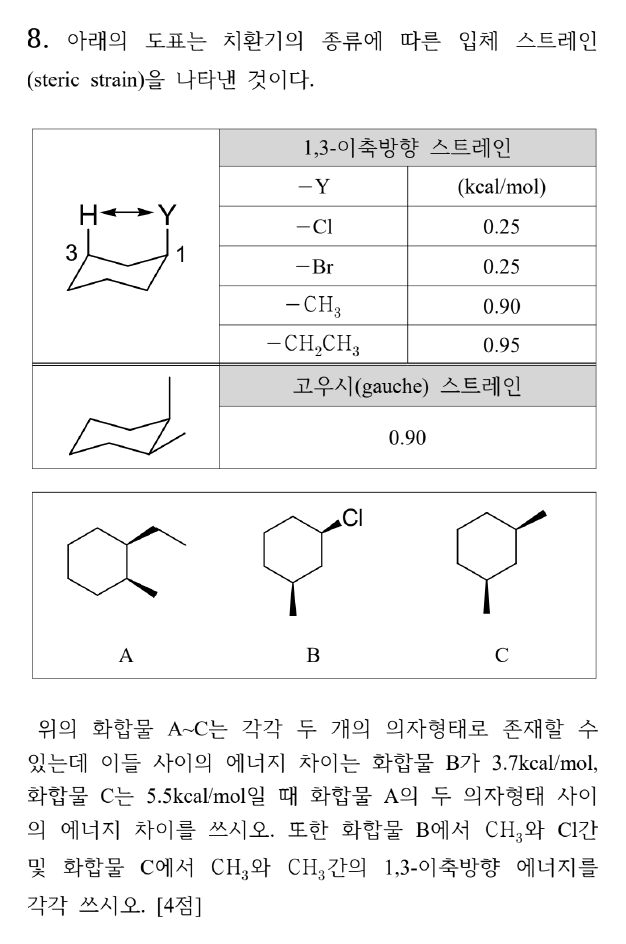

**정답** (필기·직접 풀이)

- A 두 의자형의 에너지 차이: **0.1 kcal/mol**
- B의 CH₃–Cl 1,3-이축 에너지: **2.55 kcal/mol**
- C의 CH₃–CH₃ 1,3-이축 에너지: **3.7 kcal/mol**

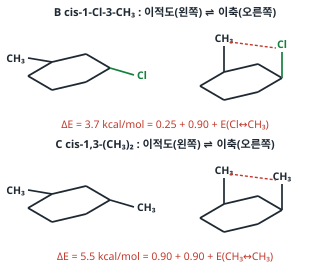

**공식·핵심 개념**

- 축 치환기 하나 = 1,3-H 상호작용 **2개** (표의 값은 H↔Y 한 쌍)
- cis-1,2: 항상 축 1 + 적도 1, 고우시 1개는 두 형태에 공통
- cis-1,3: 이적도 ⇌ 이축(치환기끼리 1,3-이축 상호작용)

**2027 출제 가능성 ★★★★☆ 높음** — 의자형 에너지 계산은 유기 입체화학 서술형에서 꾸준히 나옵니다.

**주어진 것** H↔Y 1,3-이축: Cl 0.25, Br 0.25, CH₃ 0.90, C₂H₅ 0.95, 고우시 0.90 kcal/mol. ΔE(B) = 3.7, ΔE(C) = 5.5 kcal/mol

**구할 것** A의 ΔE, B의 CH₃↔Cl, C의 CH₃↔CH₃ 1,3-이축 에너지

**풀이 전략** 각 형태의 스트레인을 항목별로 더한 뒤 차이를 구합니다.

**(1) A (cis-1-ethyl-2-methyl).** 두 형태 모두 한 치환기는 축, 하나는 적도이고, 인접 치환기 사이 고우시 0.90은 양쪽에 똑같이 있습니다.

- 에틸 축: $2 \times 0.95 + 0.90 = 2.80$
- 메틸 축: $2 \times 0.90 + 0.90 = 2.70$

$$\Delta E_A = 2.80 - 2.70 = 0.1\ \mathrm{kcal/mol}$$

**(2) B (cis-1-Cl-3-CH₃).** 이적도 형태는 스트레인 0입니다. 이축 형태에서 Cl은 C5-H와, CH₃도 C5-H와 각각 한 쌍씩 상호작용하고, Cl과 CH₃끼리 서로 1,3-이축입니다.

$$3.7 = 0.25 + 0.90 + E(\mathrm{Cl{\leftrightarrow}CH_3})$$

$$E(\mathrm{Cl{\leftrightarrow}CH_3}) = 3.7 - 1.15 = 2.55\ \mathrm{kcal/mol}$$

**(3) C (cis-1,3-dimethyl).** 같은 방식으로

$$5.5 = 0.90 + 0.90 + E(\mathrm{CH_3{\leftrightarrow}CH_3})$$

$$E(\mathrm{CH_3{\leftrightarrow}CH_3}) = 5.5 - 1.8 = 3.7\ \mathrm{kcal/mol}$$

**검산** 문헌값: CH₃↔CH₃ 1,3-이축 약 3.7 kcal/mol ✓. CH₃↔Cl이 더 작은 것은 C–Cl 결합이 길고 Cl이 CH₃보다 덜 붐비기 때문입니다.

**채점 포인트·함정**

- 축 치환기 하나의 H↔Y 상호작용은 원래 2개지만, 이축 형태에서는 그중 하나가 상대 치환기와의 상호작용으로 바뀝니다. 그래서 H↔Y는 **치환기당 1개**만 셉니다.
- A에서 고우시를 한쪽에만 넣으면 0.8 또는 1.0이 나와 틀립니다.

## B형 9번 · 산염화물에서 출발하는 케톤·알데하이드 합성 {#b9}

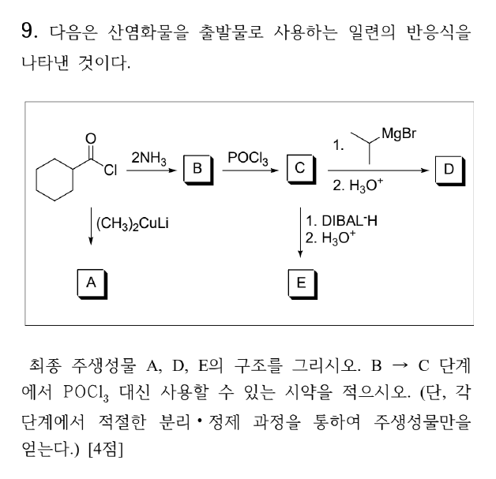

**정답** (필기·직접 풀이)

- A: **cyclohexyl methyl ketone** (1-cyclohexylethan-1-one)
- D: **cyclohexyl isopropyl ketone** (1-cyclohexyl-2-methylpropan-1-one)
- E: **cyclohexanecarbaldehyde**
- POCl₃ 대신: **SOCl₂** (또는 P₂O₅, (CF₃CO)₂O)

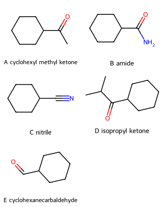

**공식·핵심 개념**

- 산염화물 + R₂CuLi → 케톤(케톤에서 멈춤), + RMgX → 3차 알코올
- 1차 아마이드 + 탈수제(POCl₃, SOCl₂, P₂O₅) → 나이트릴
- 나이트릴 + RMgX → 이민염 → H₃O⁺ → **케톤** / + DIBAL-H → 이민염 → H₃O⁺ → **알데하이드**

**2027 출제 가능성 ★★★★★ 매우 높음** — 카복실산 유도체 상호 변환과 시약 선택은 유기 4점 문항의 고정 소재입니다.

**주어진 것** cyclohexanecarbonyl chloride → (CH₃)₂CuLi → A / 2NH₃ → B → POCl₃ → C → i-PrMgBr, H₃O⁺ → D / C → DIBAL-H, H₃O⁺ → E

**구할 것** A, D, E 구조, POCl₃ 대체 시약

**풀이 전략** 각 단계가 어떤 작용기 변환인지 차례로 적용합니다.

**(1) A.** 길만 시약(무른 친핵체)은 반응성이 큰 산염화물과만 반응하고, 생긴 케톤과는 거의 반응하지 않습니다 → **메틸 케톤 A**

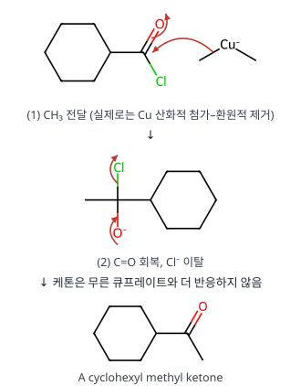

**(2) B.** NH₃가 첨가–제거로 Cl을 치환해 1차 아마이드가 됩니다. 두 번째 NH₃는 생긴 HCl을 중화합니다(그래서 2당량).

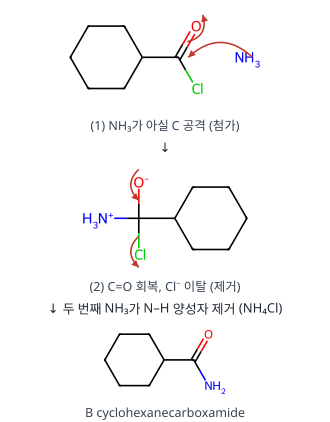

**(3) C.** POCl₃가 아마이드 O를 좋은 이탈기로 바꾸고, N–H 두 개가 빠지며 **나이트릴**이 됩니다(전체 −H₂O).

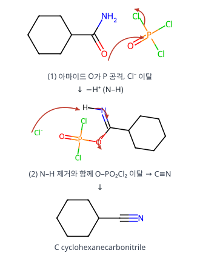

**(4) D.** i-PrMgBr이 C≡N 탄소에 한 번 첨가하면 음전하를 띤 이민 Mg염이 되어 더 이상 첨가되지 않습니다. 산 수용액에서 이민 → 케톤으로 가수분해됩니다.

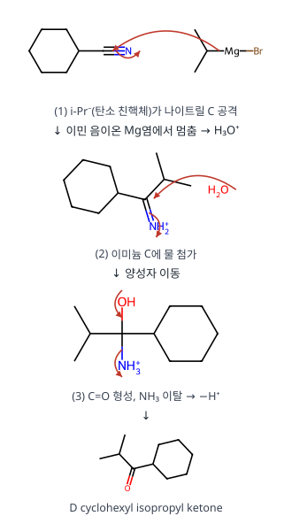

**(5) E.** DIBAL-H(1당량, 저온)는 수소화 이온을 한 번만 주어 알루미늄 이민염에서 멈춥니다. 가수분해하면 **알데하이드**가 됩니다.

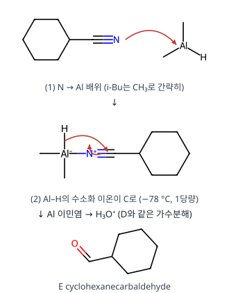

**(6) 대체 시약.** 아마이드 탈수에는 **SOCl₂**(O를 –OS(O)Cl로 활성화, SO₂·HCl 발생)가 가장 흔하고, P₂O₅, 트라이플루오로아세트산 무수물도 쓰입니다.

**왜 이 생성물인가** 나이트릴과 산염화물은 모두 같은 산화 수준(카복실산 단계)입니다. 친핵체가 **한 번만** 들어가도록 만드는 장치가 핵심입니다. 큐프레이트는 무른 친핵체라 케톤을 공격하지 않고, 나이트릴은 첫 첨가 후 음전하 이민염이 되어 두 번째 공격을 막습니다.

**검산** 분자식: A C₈H₁₄O, D C₁₀H₁₈O, E C₇H₁₂O (RDKit).

**채점 포인트·함정**

- 산염화물에 그리냐르를 쓰면 3차 알코올까지 갑니다. A에 길만 시약을 쓰는 이유를 알아야 합니다.
- DIBAL-H를 과량·상온으로 쓰면 1차 아민까지 환원될 수 있습니다(조건: 1당량, −78 °C).

## B형 10번 · d 오비탈의 실수 조합과 각운동량 기댓값 {#b10}

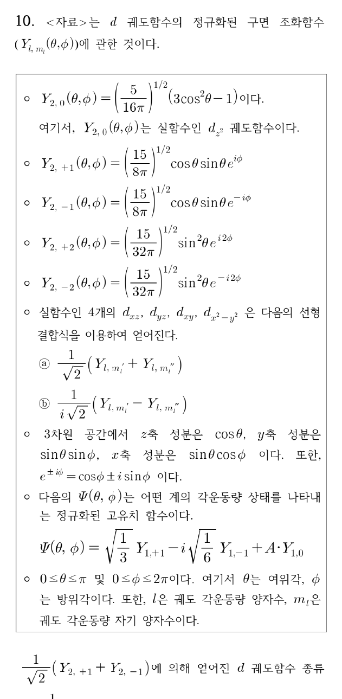

**정답** (필기·직접 풀이) ⓐ $\frac{1}{\sqrt2}(Y_{2,+1}+Y_{2,-1})$ → **$d_{xz}$**, ⓑ $\frac{1}{i\sqrt2}(Y_{2,+1}-Y_{2,-1})$ → **$d_{yz}$**, $A = \dfrac{1}{\sqrt2}$, $\langle L_z\rangle = \dfrac{\hbar}{6}$

**공식·핵심 개념**

- $e^{i\phi} + e^{-i\phi} = 2\cos\phi$, $e^{i\phi} - e^{-i\phi} = 2i\sin\phi$
- $\cos\theta\sin\theta\cos\phi \propto zx$, $\cos\theta\sin\theta\sin\phi \propto yz$
- 정규화된 고유함수 전개: $\sum|c_m|^2 = 1$, $\langle L_z\rangle = \sum|c_m|^2 m\hbar$

**2027 출제 가능성 ★★★☆☆ 보통** — 각운동량 고유함수의 중첩과 기댓값은 가끔 나오는 고난도 소재입니다.

**주어진 것** $Y_{2,\pm1} = \left(\frac{15}{8\pi}\right)^{1/2}\cos\theta\sin\theta\,e^{\pm i\phi}$, 직교 좌표 성분, $\Psi = \sqrt{\tfrac13}Y_{1,+1} - i\sqrt{\tfrac16}Y_{1,-1} + A\,Y_{1,0}$, $\hat L_z = -i\hbar\,\partial/\partial\phi$

**구할 것** ⓐ·ⓑ의 d 오비탈, A, ⟨Lz⟩

**풀이 전략** 지수 함수를 삼각 함수로 바꾸어 직교 좌표로 읽고, Ψ는 $Y_{1,m}$이 정규 직교라는 점을 씁니다.

**(1) ⓐ.**

$$\frac{1}{\sqrt2}(Y_{2,1}+Y_{2,-1}) = \frac{1}{\sqrt2}\left(\frac{15}{8\pi}\right)^{1/2}\cos\theta\sin\theta\,(2\cos\phi)$$

$\cos\theta\cdot\sin\theta\cos\phi$ = (z 성분)(x 성분) → **$d_{xz}$**

**(2) ⓑ.**

$$\frac{1}{i\sqrt2}(Y_{2,1}-Y_{2,-1}) = \frac{1}{i\sqrt2}\left(\frac{15}{8\pi}\right)^{1/2}\cos\theta\sin\theta\,(2i\sin\phi)$$

$\cos\theta\cdot\sin\theta\sin\phi$ = (z 성분)(y 성분) → **$d_{yz}$**

**(3) A.** $Y_{1,m}$은 정규 직교이므로

$$\left|\sqrt{\tfrac13}\right|^2 + \left|-i\sqrt{\tfrac16}\right|^2 + A^2 = 1$$

$$\frac13 + \frac16 + A^2 = 1 \ \Rightarrow\ A^2 = \frac12 \ \Rightarrow\ A = \frac{1}{\sqrt2}$$

**(4) ⟨Lz⟩.** $\hat L_z Y_{1,m} = m\hbar\,Y_{1,m}$이므로

$$\langle L_z\rangle = \frac13(+1)\hbar + \frac16(-1)\hbar + \frac12(0)\hbar = \frac{2-1}{6}\hbar = \frac{\hbar}{6}$$

**검산** 확률의 합 1/3 + 1/6 + 1/2 = 1 ✓. ⟨Lz⟩는 −ħ와 +ħ 사이 ✓.

**채점 포인트·함정**

- $-i\sqrt{1/6}$의 확률은 $|-i|^2 \cdot \tfrac16 = \tfrac16$입니다. 음수로 계산하면 안 됩니다.
- Condon–Shortley 부호를 넣은 교재 정의($Y_{2,1}$에 − 부호)로 계산하면 ⓐ·ⓑ가 바뀔 수 있습니다. 문제에 **주어진 식**으로 답합니다(검토 메모 8).

## B형 11번 · 모세관 띠 전기 이동과 전기 삼투 흐름 {#b11}

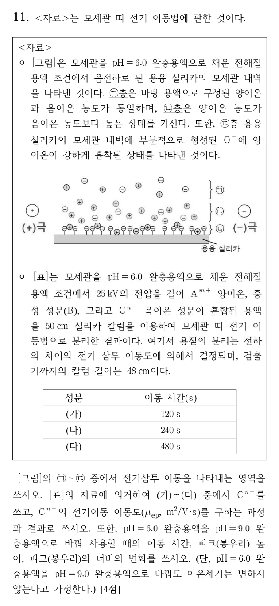

**정답** (필기·직접 풀이)

- 전기 삼투 이동 영역: **㉡** (확산층)
- Cⁿ⁻: **(다)**, $\mu_{ep} = -2.0\times10^{-8}\ \mathrm{m^2/(V\cdot s)}$
- pH 9.0: 이동 시간 **감소**, 봉우리 높이 **증가**, 봉우리 너비 **감소**

**공식·핵심 개념**

- $E = V/L_{전체}$, 겉보기 이동도 $\mu_{app} = \dfrac{L_d/t}{E} = \dfrac{L_d L_t}{tV}$
- $\mu_{app} = \mu_{eo} + \mu_{ep}$, 중성 성분: $\mu_{ep} = 0$ → $\mu_{eo}$
- 검출 순서(용융 실리카, EOF가 (−)극으로): 양이온 → 중성 → 음이온

**2027 출제 가능성 ★★★★☆ 높음** — 모세관 전기 이동의 EOF와 이동도 계산은 최근 분석화학에서 자주 나오는 소재입니다.

**주어진 것** 칼럼 50 cm, 검출기까지 48 cm, 25 kV, pH 6.0. 이동 시간 (가) 120 s, (나) 240 s, (다) 480 s. 성분: A^m+, 중성 B, Cⁿ⁻

**구할 것** EOF 영역, Cⁿ⁻와 μep, pH 9.0에서의 변화

**풀이 전략** 중성 B의 시간으로 μeo를 구하고, 음이온의 겉보기 이동도에서 μeo를 뺍니다.

**(1) EOF 영역.** 음전하를 띤 실리카 벽(SiO⁻)에 양이온이 강하게 붙은 층(㉢, 고정층) 바깥에, 양이온이 많은 **확산층(㉡)**이 있습니다. 전압을 걸면 ㉡의 과잉 양이온이 (−)극으로 끌려가며 용매를 함께 끌고 가 전기 삼투 흐름이 생깁니다. ㉠은 전하가 균형인 바탕 용액입니다.

**(2) 검출 순서.** EOF가 (−)극(검출기 쪽)으로 흐르므로 양이온은 EOF + 전기 이동으로 가장 빠르고, 중성은 EOF만으로, 음이온은 EOF에서 반대 방향 이동을 뺀 만큼 가장 느립니다. 따라서 (가) A^m+, (나) B, **(다) Cⁿ⁻**

**(3) 전기장.**

$$E = \frac{V}{L} = \frac{25\times10^3\ \mathrm V}{0.50\ \mathrm m} = 5.0\times10^4\ \mathrm{V/m}$$

**(4) μeo (중성 B).**

$$v_{eo} = \frac{0.48\ \mathrm m}{240\ \mathrm s} = 2.0\times10^{-3}\ \mathrm{m/s}$$

$$\mu_{eo} = \frac{v_{eo}}{E} = \frac{2.0\times10^{-3}}{5.0\times10^4} = 4.0\times10^{-8}\ \mathrm{m^2/(V\cdot s)}$$

**(5) Cⁿ⁻의 겉보기 이동도.**

$$\mu_{app} = \frac{0.48/480}{5.0\times10^4} = \frac{1.0\times10^{-3}}{5.0\times10^4} = 2.0\times10^{-8}\ \mathrm{m^2/(V\cdot s)}$$

**(6) μep.**

$$\mu_{ep} = \mu_{app} - \mu_{eo} = 2.0\times10^{-8} - 4.0\times10^{-8}$$

$$= -2.0\times10^{-8}\ \mathrm{m^2/(V\cdot s)}$$

음수 = EOF와 반대 방향((+)극 쪽)으로 이동

**(7) pH 9.0.** pH가 높아지면 실라놀(Si–OH)의 해리가 늘어 벽의 음전하와 제타 전위가 커지고 **μeo가 증가**합니다. 모든 성분이 더 빨리 검출기에 도달해 **이동 시간이 줄고**, 확산할 시간이 짧아 봉우리가 **좁아지며**, 같은 양이 좁은 띠에 모여 **높아집니다**.

**검산** (가): $\mu_{app} = \dfrac{0.48/120}{5.0\times10^4} = 8.0\times10^{-8}$ → $\mu_{ep} = +4.0\times10^{-8}$ (양이온, 양수) ✓. (다)의 $\mu_{app}$가 양수이므로 음이온도 EOF에 실려 결국 검출기에 도달합니다 ✓.

**채점 포인트·함정**

- E를 계산할 때 **전체 길이 50 cm**를 쓰고, 속도를 계산할 때는 **검출기까지 48 cm**를 씁니다.
- μep의 **부호**(음수)를 꼭 씁니다. 크기만 쓰면 감점될 수 있습니다.

---

원문: 2027학년도 대비 안병천 전공화학통합모의고사 제5회(임용닷컴) 문제지·강의 필기. 공식 답지 없이 필기와 직접 풀이로 작성한 개인 학습용 정리입니다.

