# 2027학년도 대비 안병천 전공화학 모의고사 6회 — 상세해설

이 해설은 안병천 전공화학통합모의고사 제6회(전공 A 12문항, 전공 B 11문항)를 문항별로 풀이한 것입니다. 정답은 **공식 답지**(「9-11월 전공화학 제6회 모의고사 전공 A와 B 답지」)와 대조했고, 답지에 정답이 없는 유기 5문항(A형 2·3·8번, B형 8·9번)은 강의 필기(11쪽)와 직접 풀이로 작성했습니다. 계산은 모두 다시 해 보았고, 구조식의 분자식·입체배열(CIP)은 RDKit으로 확인했습니다.

문항마다 새 쪽에서 시작하며 **문제지 원문 → 정답 → 공식·핵심 개념 → 2027 출제 가능성 → 풀이 → 채점 포인트·함정** 순서입니다. 전공 문항 풀이는 **주어진 것 / 구할 것 → 풀이 전략 → 단계별 풀이 (1)(2)… → 검산** 순서이고, 유기 문항(A형 2·8번, B형 8·9번)에는 굽은 화살표 메커니즘 그림을 넣었습니다(빨간 화살표: 전자쌍이 출발하는 결합·비공유 전자쌍 → 도착하는 원자·결합). **2027 출제 가능성**(★ 5개 만점)은 1997~2026 기출 빈도와 2022 개정 교육과정을 고려한 추정치입니다. 정답 상자의 **답지 난이도**는 공식 답지에 적힌 값입니다. 표의 번호를 누르면 해당 쪽으로 이동합니다.

## 정답 한눈에 보기 (목차) {#toc}

### 전공 A (12문항 40점)

| 번호 | 영역 | 정답 요약 | 2027 출제 가능성 |
|---|---|---|---|
| [1](#a1) | 분석 · EDTA 역적정 | [Ca²⁺] = 0.020 M, 20 wt% | ★★★★☆ |
| [2](#a2) | 유기 · 다이음이온, 브로모에터화 | H_B > H_A > H_C, A = 2-(bromomethyl)THF 유도체 | ★★★★☆ |
| [3](#a3) | 유기 · ¹H NMR 짝짓기 | A–ㄴ, B–ㄱ, C–ㄷ, D–ㄹ | ★★★★★ |
| [4](#a4) | 무기 · CH₃ MO, Walsh | $A_1 + E$, ㉠·㉢·㉤ | ★★★★☆ |
| [5](#a5) | 화학교육 · 쿤, 오수벨 | 과학의 위기, 패러다임 교체, 상위적 학습·통합적 조정 | ★★★★★ |
| [6](#a6) | 화학교육 · 브루너, 2022 개정 | 학습 의욕, 작동적→영상적→상징적, 입자 모형, [물질과 에너지] | ★★★★★ |
| [7](#a7) | 화학교육 · POE, 로슨 | 자신의 언어로 설명, 귀납 vs 귀추, 경험-귀추적, (나) 엔탈피 | ★★★★★ |
| [8](#a8) | 유기 · 산화·아마이드·환원 | A 3,3-dimethylbutan-1-ol, B 산, C 다이메틸아마이드 | ★★★★☆ |
| [9](#a9) | 무기 · 결정 구조 | A 8, B 16, 배위수 4·2, $b = \frac{\sqrt3}{32}l$, $\frac{\sqrt3}{512}\pi$ | ★★★★☆ |
| [10](#a10) | 물리화학 · 고리 위 입자 | ⟨φ⟩ = π, 1/2π, $9\hbar^2/2mr^2$, 4ħ | ★★★★☆ |
| [11](#a11) | 물리화학 · 정류 상태 근사 | $-\frac{k_1k_3[A_2][M] - k_2k_4[A]^2[M]}{k_2[M]+k_3}$ | ★★★★★ |
| [12](#a12) | 분석 · 용매 추출 | D = 1.0, Q = 0.25, 0.025 M, 7.5×10⁻³ mol | ★★★★☆ |

### 전공 B (11문항 40점)

| 번호 | 영역 | 정답 요약 | 2027 출제 가능성 |
|---|---|---|---|
| [1](#b1) | 분석 · 약산–약염기 적정 | pK = −7.78, (가) 2.86, (나) 10.64 | ★★★★★ |
| [2](#b2) | 분석 · 침전 평형, 활동도 | [Ag⁺] 5.0×10⁻² M, [I⁻] 2.5×10⁻¹⁵ M | ★★★★☆ |
| [3](#b3) | 화학교육 · 로슨, 피아제, 비고츠키 | 화학 평형, 탐색 단계, 비계, 짝산·짝염기 | ★★★★★ |
| [4](#b4) | 화학교육 · 과학탐구실험 1 | [10과탐1-02-03], 안내, 포괄적 지식으로 예측, STEAM | ★★★★☆ |
| [5](#b5) | 화학교육 · 오수벨, 개념도 | 비교 선행조직자, 자기 평가, 위계 15점, 명제 | ★★★★☆ |
| [6](#b6) | 무기 · XeOF₄ 군론 | $4A_1+A_2+2B_1+B_2+5E$, Xe–F $A_1+B_1+E$, IR $A_1+E$ | ★★★★★ |
| [7](#b7) | 물리화학 · 비가역 단열 팽창 | ΔU = −150 R·K·mol, ΔS = 2R ln2 + 3R ln0.95 | ★★★★☆ |
| [8](#b8) | 유기 · 오존 분해, 분자 내 SN2 | B 트라이올, C trans-접합 고리 에터 | ★★★★☆ |
| [9](#b9) | 유기 · SNAr | 첨가–제거(SNAr), C 니트로 설파이드, Fe/HCl | ★★★★★ |
| [10](#b10) | 무기 · d⁶ Tanabe–Sugano | 25, ⁵T₂g→⁵Eg, 1, B 567, Δo 22 680 cm⁻¹ | ★★★★★ |
| [11](#b11) | 분석 · 분광 광도법 | ε = 4.0a/(bc)×10⁻², T% = 10^1.20, 0.125 M | ★★★★★ |

**검토 메모**

1. **공식 답지와 대조했습니다.** 답지에 정답이 있는 18문항은 모두 답지와 일치합니다(교육론은 답지 문구를 따름). 답지에 정답이 없는 유기 5문항(A형 2·3·8번, B형 8·9번)은 강의 필기와 직접 풀이로 작성했고, 필기 결과와 같습니다. 답지가 "강의 참조"로 비워 둔 풀이 과정(A10, A11, B7, B10, B11)은 직접 채웠습니다.
2. **A형 5번 오수벨 학습 유형**: 답지는 "**병위적** 학습 … **통합적 조정**"이라고 썼습니다. 공유 결합만 알던 학생이 더 포괄적인 '화학 결합'을 배우는 것은 **상위적 학습**이고, 상위적 학습의 원리가 통합적 조정입니다. "병위적"은 "상위적"의 오기로 보고 이 해설은 **상위적 학습**으로 썼습니다(병렬적 학습이라면 통합적 조정과 짝이 맞지 않습니다).
3. **B형 8번 C의 R/S**: OH가 붙은 입체중심은 곁사슬 CH(OH)CH₃ 탄소입니다. 이 탄소는 NaBH₄가 메틸 케톤을 환원할 때 생기므로 **R·S가 함께 생깁니다**(부분입체이성질체 혼합물). 답지에 정답이 없어, 이 해설은 판정 방법과 두 경우를 함께 적었습니다.
4. **B형 9번 (가) 시약**: H₂/Pd-C(필기에 있음)도 니트로기를 환원하지만, 실제로는 **황이 Pd 촉매를 피독**시키고 **C–Br 수소화 분해**가 함께 일어날 수 있습니다. 한 가지만 쓸 때는 **Fe/HCl** 또는 **SnCl₂/HCl**이 가장 안전합니다.
5. **A형 6번**: 답지 표현대로 ㉡을 "작동적 → 영상적 → 상징적"으로 썼습니다. 성취기준(몰수까지 포함한 기체 법칙)은 고등학교 선택 중심 교육과정 **진로 선택 과목 [물질과 에너지]**에 해당합니다.
6. **1차 커트 예상**(공식 답지, 물리·무기·분석 영역): 1차 **24.9 / 40점**, 2차 **26.3 / 40점**.

# 전공 A

## A형 1번 · EDTA 역적정으로 CaCO₃ 함량 구하기 {#a1}

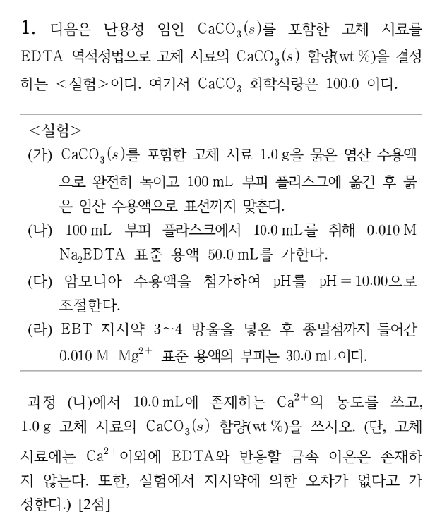

**정답** (답지 난이도 ★★☆☆☆) 과정 (나)의 10.0 mL 속 $[\mathrm{Ca^{2+}}] = 0.020\ \mathrm M$, 고체 시료의 CaCO₃ 함량 **20 wt%**

**공식·핵심 개념**

- 역적정: (분석물과 반응한 EDTA) = (넣은 EDTA) − (남은 EDTA를 적정한 Mg²⁺)
- EDTA는 금속 이온과 항상 **1 : 1**로 결합
- 분취(aliquot) 환산: 전체 = 분취량 × (전체 부피 / 분취 부피)

**2027 출제 가능성 ★★★★☆ 높음** — EDTA 적정(직접·역·치환)은 분석화학 기입형의 단골입니다.

**주어진 것** 시료 1.0 g → 100 mL, 그중 10.0 mL에 0.010 M EDTA 50.0 mL, 남은 EDTA를 0.010 M Mg²⁺ 30.0 mL로 적정, CaCO₃ 화학식량 100.0

**구할 것** 10.0 mL 속 [Ca²⁺], 고체의 CaCO₃ wt%

**풀이 전략** 넣은 EDTA에서 Mg²⁺가 소비한 몫을 빼면 Ca²⁺와 반응한 EDTA가 나옵니다. EDTA : Ca²⁺ = 1 : 1입니다.

**(1) 넣은 EDTA.**

$$n_{\mathrm{EDTA}} = 0.010\ \mathrm M \times 50.0\ \mathrm{mL} = 0.50\ \mathrm{mmol}$$

**(2) 남은 EDTA (Mg²⁺ 적정).**

$$n_{\mathrm{Mg}} = 0.010\ \mathrm M \times 30.0\ \mathrm{mL} = 0.30\ \mathrm{mmol}$$

**(3) Ca²⁺와 반응한 EDTA = Ca²⁺ 몰수.**

$$n_{\mathrm{Ca}} = 0.50 - 0.30 = 0.20\ \mathrm{mmol}$$

$$[\mathrm{Ca^{2+}}] = \frac{0.20\ \mathrm{mmol}}{10.0\ \mathrm{mL}} = 0.020\ \mathrm M$$

**(4) 시료 전체의 CaCO₃.** 100 mL 중 10.0 mL를 취했으므로 10배입니다.

$$n_{\mathrm{CaCO_3}} = 0.20\ \mathrm{mmol} \times \frac{100\ \mathrm{mL}}{10.0\ \mathrm{mL}} = 2.0\ \mathrm{mmol}$$

$$m = 2.0\times10^{-3}\ \mathrm{mol} \times 100.0\ \mathrm{g/mol} = 0.20\ \mathrm g$$

$$\text{함량} = \frac{0.20\ \mathrm g}{1.0\ \mathrm g}\times100 = 20\ \mathrm{wt\%}$$

**검산** Ca²⁺ 0.20 mmol + Mg²⁺ 0.30 mmol = EDTA 0.50 mmol ✓

**채점 포인트·함정**

- (가)에서 녹인 용액은 100 mL이지만 실제로 적정한 것은 10.0 mL입니다. 10배 환산을 빠뜨리면 2 wt%가 됩니다.
- pH 10 완충(암모니아)은 EDTA가 Y⁴⁻ 형태로 충분히 존재하고 EBT가 변색하도록 맞추는 조건입니다.

## A형 2번 · 1,3-다이케톤 다이음이온의 알킬화와 브로모에터화 {#a2}

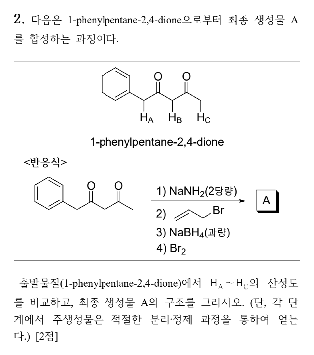

**정답** 산성도 **H_B > H_A > H_C**. A = 2-(bromomethyl)-4-phenyl-5-(2-hydroxypropyl)테트라하이드로퓨란 (C₁₄H₁₉BrO₂, 아래 마지막 구조)

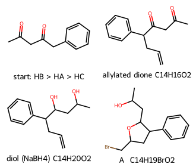

**공식·핵심 개념**

- 산성도: 두 C=O 사이 CH₂(pKa ≈ 9) > 벤질 + C=O 옆 CH₂(≈ 18) > C=O 옆 CH₃(≈ 20)
- 다이음이온: 염기 1당량째는 가장 산성인 H, 2당량째는 다음으로 산성인 H 제거 → **바깥(덜 안정한) 탄소음이온이 친핵체**
- NaBH₄(과량): 케톤 두 개 → 2차 알코올 두 개
- Br₂ + 알켄 + 분자 내 OH → 브로모늄 이온을 OH가 열어 고리 에터(5-exo 우선)

**2027 출제 가능성 ★★★★☆ 높음** — 엔올레이트·다이음이온 위치 선택성과 할로고리화는 유기 2점 문항으로 자주 나옵니다.

**주어진 것** 1-phenylpentane-2,4-dione(PhCH₂COCH₂COCH₃), 1) NaNH₂ 2당량 2) 알릴 브로마이드 3) NaBH₄ 과량 4) Br₂

**구할 것** H_A~H_C 산성도 순서, A 구조

**풀이 전략** 짝염기의 안정성(공명으로 음전하가 퍼지는 정도)으로 산성도를 정하고, 2당량 염기가 만드는 다이음이온에서 어느 탄소가 알킬화되는지 판단합니다.

**(1) 산성도.**

| 수소 | 짝염기의 음전하 비편재화 | 판정 |
|---|---|---|
| H_B (C3, 두 C=O 사이) | 두 C=O의 O 두 곳 | 가장 산성 (pKa ≈ 9) |
| H_A (C1, Ph와 C=O 사이) | C=O의 O + 벤젠 고리 | 두 번째 |
| H_C (C5, CH₃) | C=O의 O 한 곳만 | 가장 약함 |

**(2) 다이음이온.** NaNH₂ 1당량은 H_B를 떼어 안정한 엔올레이트를 만들고, 2당량째는 남은 수소 중 더 산성인 **H_A**를 뗍니다. 이렇게 생긴 C1 음이온은 C3 음이온보다 덜 안정해서 **반응성이 크므로 C1에서 알킬화**가 일어납니다(SN2).

**(3) 알릴화.** PhCH⁻–CO–CH⁻–COCH₃ + CH₂=CHCH₂Br → H₃O⁺ 처리 후 PhCH(CH₂CH=CH₂)–CO–CH₂–CO–CH₃ (C₁₄H₁₆O₂).

**(4) NaBH₄ 환원.** 두 C=O가 모두 2차 알코올이 되어 1,3-다이올(C₁₄H₂₀O₂)이 됩니다.

**(5) Br₂.** C=C가 Br₂와 브로모늄 이온을 만들고, 분자 안의 OH가 이를 엽니다. C2–OH에서 브로모늄 안쪽 탄소까지 세면 O–C2–C1–CH₂–CH 고리가 **5원 고리(5-exo)**가 되므로 이 경로가 우세합니다. 결과는 바깥 탄소에 CH₂Br이 붙은 테트라하이드로퓨란입니다. 다른 OH(C4)로는 7원 고리가 되어 불리합니다.

**왜 이 생성물인가** 알킬화 위치는 "덜 안정한 음이온 = 더 강한 친핵체"로, 고리화 위치는 "5원 고리 형성이 가장 빠름(5-exo)"으로 결정됩니다. Br₂가 단순히 다이브로민화(1,2-다이브로마이드)하는 것보다 분자 내 OH가 브로모늄을 여는 속도가 훨씬 빠릅니다.

**검산** 분자식: C₁₄H₂₀O₂ + Br₂ − HBr = C₁₄H₁₉BrO₂ ✓ (RDKit 확인)

**메커니즘 — ① 다이음이온 생성과 알킬화**

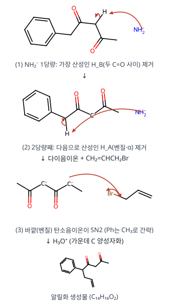

**메커니즘 — ② NaBH₄ 환원**

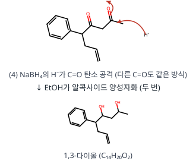

**메커니즘 — ③ 브로모늄 형성과 분자 내 고리화**

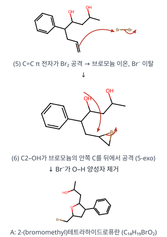

**채점 포인트·함정**

- H_A가 H_C보다 산성인 이유(벤질 공명)를 함께 써야 합니다.
- 가운데 탄소(C3)를 알킬화한 구조는 1당량 염기일 때의 답입니다. 2당량에서는 바깥 탄소입니다.
- 새로 생긴 입체중심들은 특정되지 않으므로 입체 표시 없이 그려도 됩니다.

## A형 3번 · 트라이클로로페놀 네 가지의 ¹H NMR {#a3}

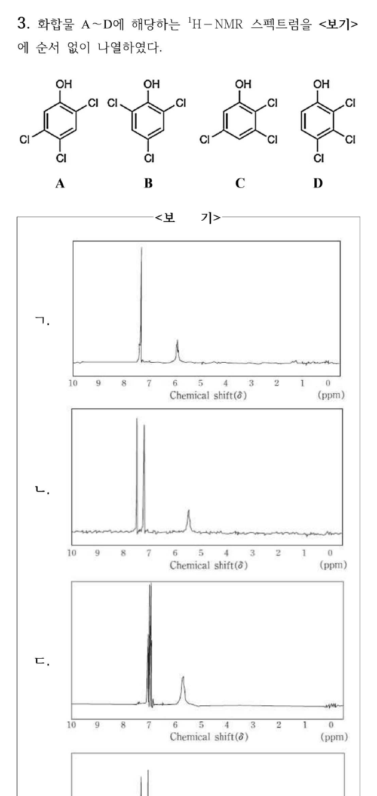

**정답** **A–ㄴ, B–ㄱ, C–ㄷ, D–ㄹ**

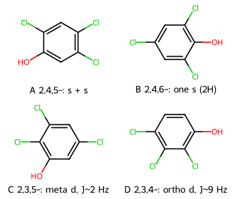

**공식·핵심 개념**

- 방향족 H–H 짝지음 상수: ortho ≈ 7–9 Hz, meta ≈ 2–3 Hz, para ≈ 0–1 Hz(보통 갈라짐 없음)
- 대칭으로 같은 환경이면 신호 하나
- OH는 넓은 단일선(5–6 ppm), 방향족 H는 7 ppm 근처

**2027 출제 가능성 ★★★★★ 매우 높음** — 치환 위치를 짝지음 상수로 구별하는 NMR 해석은 거의 매년 나옵니다.

**주어진 것** 트라이클로로페놀 A(2,4,5-), B(2,4,6-), C(2,3,5-), D(2,3,4-)와 스펙트럼 ㄱ~ㄹ

**구할 것** 짝짓기

**풀이 전략** 방향족 H가 몇 종류인지(대칭), 그리고 두 H가 서로 어떤 위치(ortho/meta/para)인지로 갈라짐 모양을 예측합니다.

**(1) 각 화합물의 방향족 H.**

| 화합물 | 방향족 H 위치 | 서로의 관계 | 예상 모양 | 스펙트럼 |
|---|---|---|---|---|
| A 2,4,5- | H3, H6 | para | 단일선 두 개(서로 떨어짐) | **ㄴ** (7.4, 7.2 단일선 2개) |
| B 2,4,6- | H3, H5 | 대칭으로 동등 | 단일선 하나(2H) | **ㄱ** (7.3 단일선 1개) |
| C 2,3,5- | H4, H6 | meta | J ≈ 2 Hz 이중선 두 개(거의 붙어 보임) | **ㄷ** (7.0 근처 좁은 갈라짐) |
| D 2,3,4- | H5, H6 | ortho | J ≈ 9 Hz 이중선 두 개 | **ㄹ** (봉우리 4개, 간격 넓음) |

**(2) OH 신호.** 네 스펙트럼 모두 5.5–6 ppm의 넓은 신호가 OH입니다(분자 간 수소 결합·교환으로 넓어짐).

**검산** 방향족 H 적분비: A·C·D는 1 : 1, B는 2H 하나 — 스펙트럼의 봉우리 수와 맞습니다 ✓

**채점 포인트·함정**

- C와 D는 둘 다 "이중선 두 개"지만 **간격(J)**이 다릅니다. meta는 좁고(ㄷ), ortho는 넓습니다(ㄹ).
- A의 두 H는 para라서 짝지음이 거의 없어 단일선 두 개로 보입니다.

## A형 4번 · CH₃의 군 궤도와 CH₃ → CH₃⁺의 Walsh 변화 {#a4}

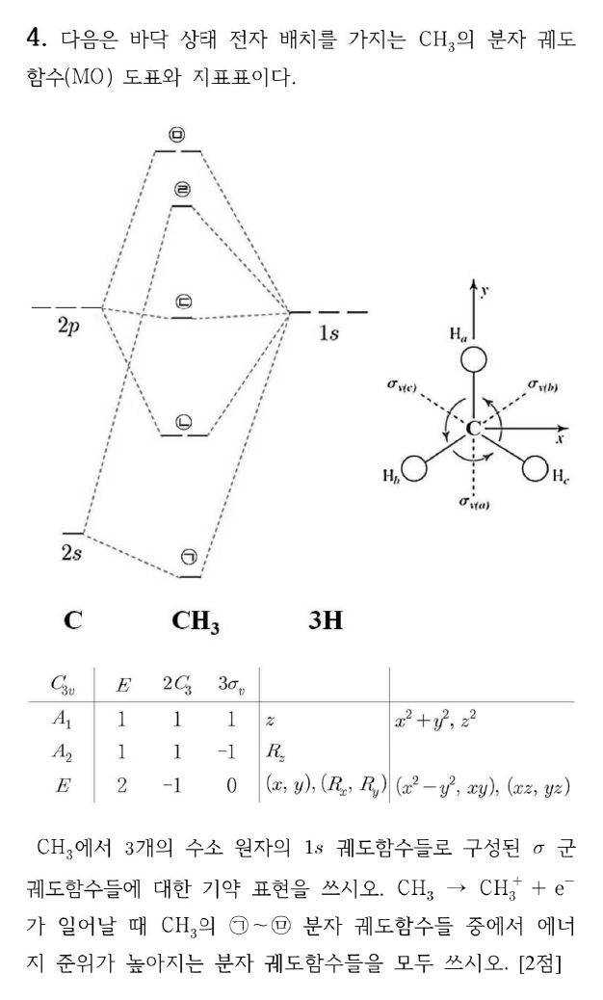

**정답** (답지 난이도 ★★☆☆☆) $\Gamma_{\sigma}^{(3)} = A_1 + E$. 에너지가 높아지는 MO: **㉠, ㉢, ㉤**

**공식·핵심 개념**

- 군 궤도 Γ: 각 대칭 조작에서 **제자리에 남는 H 1s 개수**
- 축소 공식 $n_i = \frac1h\sum_R g_R\,\chi_i(R)\,\chi(R)$
- Walsh: 결합각이 바뀌면 겹침이 줄어드는 MO는 올라가고 늘어나는 MO는 내려간다

**2027 출제 가능성 ★★★★☆ 높음** — 군 궤도 기약표현과 MO 도표 해석은 무기 영역의 고정 출제 소재입니다.

**주어진 것** C₃ᵥ 지표표, CH₃(피라미드) MO 도표 ㉠~㉤, CH₃ → CH₃⁺ + e⁻

**구할 것** 3H σ 군 궤도의 기약표현, 이온화 때 에너지가 올라가는 MO

**풀이 전략** Γ를 만들고 축소합니다. CH₃⁺는 평면(D₃h)이 되므로, 피라미드 → 평면으로 변할 때 각 MO의 겹침 변화를 따져 봅니다.

**(1) 가약 표현.**

| C₃ᵥ | E | 2C₃ | 3σᵥ |
|---|---|---|---|
| 제자리 H | 3 | 0 | 1 |

**(2) 축소 (h = 6).**

$$n(A_1) = \tfrac16[1\cdot1\cdot3 + 2\cdot1\cdot0 + 3\cdot1\cdot1] = \tfrac16(3 + 0 + 3) = 1$$

$$n(A_2) = \tfrac16[3 + 0 + 3\cdot(-1)\cdot1] = 0$$

$$n(E) = \tfrac16[1\cdot2\cdot3 + 2\cdot(-1)\cdot0 + 3\cdot0\cdot1] = \tfrac16\cdot6 = 1$$

$$\Gamma_\sigma = A_1 + E$$

**(3) MO 배정.** C의 2s·2pz(A₁), 2px·2py(E)가 이 군 궤도와 섞입니다. ㉠ 2a₁(결합성), ㉡ 1e(결합성), ㉢ 3a₁(주로 2pz, 비결합성 — 홀전자), ㉣ 4a₁, ㉤ 2e(반결합성)입니다. 전자 7개 배치: 2a₁² 1e⁴ 3a₁¹.

**(4) 피라미드 → 평면(Walsh 상관도).**

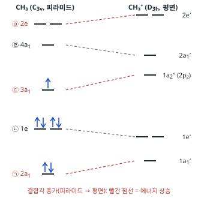

| MO | 평면이 될 때 | 이유 |
|---|---|---|
| ㉠ 2a₁ → 1a₁′ | **올라감** | 피라미드에서 섞여 들던 2pz 성분이 평면에서 사라져 결합 안정화 감소 |
| ㉡ 1e → 1e′ | 내려감(거의 그대로) | 평면에서 2px·2py와 H 1s 겹침이 커짐 |
| ㉢ 3a₁ → 1a₂″ | **크게 올라감** | 평면에서 2pz가 H와 전혀 겹치지 못해 순수 비결합 p가 됨 |
| ㉣ 4a₁ → 2a₁′ | 내려감 | 2pz 반결합 성분이 사라짐 |
| ㉤ 2e → 2e′ | **올라감** | 평면에서 반결합 겹침이 커짐 |

**검산** CH₃⁺(전자 6개)는 HOMO가 1e′이고, 비어 있는 1a₂″(2pz)가 평면 구조를 안정하게 합니다 — 탄소 양이온이 sp² 평면인 것과 일치 ✓

**채점 포인트·함정**

- 이 문항의 핵심은 "이온화 → 구조가 평면으로 바뀜"입니다. 전자 하나가 빠진 ㉢만 쓰면 부분 점수입니다.
- σᵥ에서 제자리에 남는 H는 1개(그 평면 위의 H)입니다.

## A형 5번 · 쿤의 과학 혁명과 오수벨의 유의미 수용학습 {#a5}

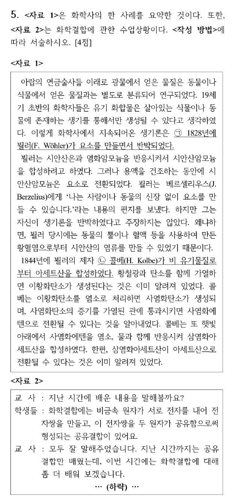

**정답**

- 과학 발달 단계: **과학의 위기**. 판단 준거: 화학사에서 지속되어 온 생기론으로 ㉠(뵐러의 요소 합성)과 ㉡(콜베의 아세트산 합성) 같은 **변칙 사례가 늘어나**, 생기론으로 설명할 수 없는 현상이 나타났기 때문이다.
- 해결 방법: 변칙 사례가 늘어나 위기가 형성되고 **대안적인 이론이 등장**하면(해결의 전제조건), 과학 사회에서 이를 **새로운 패러다임으로 교체**함으로써(과학 혁명) 위기가 해결된다.
- 오수벨: **상위적 학습**을 통한 인지구조의 변화 및 재구성 — **통합적 조정**의 원리 (답지 표기 "병위적" → 검토 메모 2)

**공식·핵심 개념**

- 쿤: 전과학 → 정상과학 → 변칙 사례 누적 → **위기** → 과학 혁명(패러다임 교체) → 새 정상과학
- 오수벨 학습 유형: 하위적(파생·상관) / **상위적** / 병렬적
- 원리: 하위적 → 점진적 분화, 상위적 → **통합적 조정**

**2027 출제 가능성 ★★★★★ 매우 높음** — 쿤과 오수벨은 화학교육론에서 거의 매년 나오는 조합입니다.

**자료 해석**

- ㉠·㉡은 "유기물은 생기를 통해서만 만들어진다"는 생기론에 대한 **반례**입니다. 하나만으로는 패러다임이 무너지지 않았고(뵐러도 생기론 반박을 주장하지 않음), 반례가 쌓여 위기가 됩니다.
- 해결의 전제조건은 **대안 이론의 등장**입니다. 쿤에 따르면 대안 없이 기존 패러다임을 버리지 않습니다.
- 자료 2에서 학생은 '공유 결합'만 알았고, 교사는 이를 포함하는 더 포괄적인 '화학 결합'을 가르칩니다. 새 개념이 기존 개념보다 **상위**이므로 상위적 학습이고, 기존 개념들을 새로운 큰 틀로 묶어 재구성하는 원리가 **통합적 조정**입니다.

**채점 포인트·함정**

- 단계 이름만 쓰지 말고 "변칙 사례의 증가"라는 판단 준거를 써야 합니다.
- 해결 방법에는 "대안 이론의 등장(전제조건)"과 "패러다임 교체(과학 혁명)" 두 요소가 모두 들어가야 합니다.

## A형 6번 · 브루너의 수업 이론과 나선형 교육과정 {#a6}

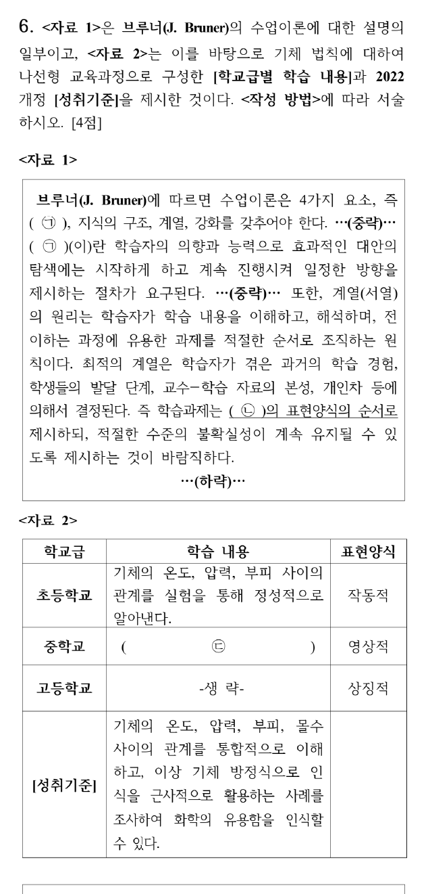

**정답**

- ㉠ **학습 의욕(학습 경향성)**, ㉡ **작동적 → 영상적 → 상징적**
- ㉢ 압력 또는 온도 변화에 따른 **기체 분자의 배열 및 운동 상태 변화를 입자 모형으로 설명**한다.
- 교육과정 체계·과목: **고등학교 선택 중심 교육과정의 진로 선택 과목 [물질과 에너지]**

**공식·핵심 개념**

- 브루너 수업 이론 4요소: 학습 의욕(경향성), 지식의 구조, 계열(서열), 강화
- 표현 양식: 작동적(행동) → 영상적(그림·모형) → 상징적(기호·수식)
- 나선형 교육과정: 같은 개념을 학교급이 올라갈수록 깊고 넓게 반복

**2027 출제 가능성 ★★★★★ 매우 높음** — 브루너와 2022 개정 과목 체계(진로 선택 [물질과 에너지])를 묶는 형태가 유력합니다.

**자료 해석**

- "학습자의 의향과 능력으로 효과적인 대안의 탐색을 시작·계속·방향 제시" → **학습 의욕**(학습 경향성).
- 표의 초등(작동적) → 중학교(영상적) → 고등(상징적) 순서가 ㉡입니다.
- 중학교는 영상적 표현이므로 기체 법칙을 **입자 모형(그림)**으로 다룹니다 — 2022 개정 중학교 '기체의 성질' 단원이 입자 모형 해석입니다.
- 성취기준은 "온도·압력·부피·**몰수**"와 "이상 기체 방정식"을 다루므로 공통 과목이 아니라 진로 선택 과목 [물질과 에너지]입니다.

**채점 포인트·함정**

- ㉡은 세 표현 양식을 **순서대로** 써야 합니다.
- 과목명만이 아니라 "선택 중심 교육과정의 진로 선택 과목"이라는 체계를 함께 씁니다.

## A형 7번 · POE 재구성과 로슨의 순환학습 {#a7}

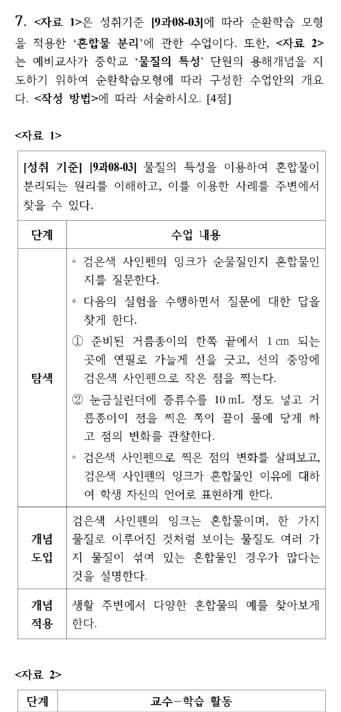

**정답**

- E(설명) 단계: **검은색 사인펜으로 찍은 점의 변화를 살펴보고, 검은색 사인펜의 잉크가 혼합물인 이유에 대하여 학생 자신의 언어로 설명하게 한다.**
- 추리 방법: 자료 1의 탐색 단계는 **귀납적 추리**, 자료 2의 (가) 단계는 **귀추적 추리**. 귀납적 추리는 관찰 사실의 직접적 일반화를 도출하고, 귀추적 추리는 경험적 사실로부터 개연성 있는 설명(가설)을 만드는 추리이다.
- 자료 2는 **경험-귀추적 순환학습 모형** — (가) 탐색 단계에서 인과적 질문에 대해 경험적 사실을 끌어와 가설을 형성하도록 했기 때문이다.
- 잘못 설계한 곳: **(나) 단계에서 용해가 일어나는 원리를 엔탈피 변화 측면에서 설명**하는 것은 고등학교 [물질과 에너지] 과목의 성취기준으로, 중학교 수준을 벗어난다.

**공식·핵심 개념**

- POE: 예상(Predict) → 관찰(Observe) → 설명(Explain)
- 로슨 순환학습: 서술적(귀납) / 경험-귀추적 / 가설-연역적
- 귀납: 관찰 → 일반화, 귀추: 현상 → 가장 그럴듯한 원인(가설)

**2027 출제 가능성 ★★★★★ 매우 높음** — 순환학습 유형 구별과 성취기준 수준 오류 찾기는 교육론 최빈출입니다.

**자료 해석**

- 자료 1의 탐색은 크로마토그래피 결과를 보고 "잉크는 혼합물"이라는 일반화를 이끌어 냅니다 → 귀납(서술적 순환학습).
- 자료 2 (가)는 "왜 어떤 물질은 물에, 어떤 물질은 헥세인에 녹을까?"라는 인과 질문에 예상과 그 이유를 말하게 합니다 → 귀추(경험-귀추적). 가설을 연역해 통제 실험으로 검증하는 단계가 없으므로 가설-연역적은 아닙니다.
- 중학교 '물질의 특성'은 용해도·밀도 등 성질 위주이며, 용해의 엔탈피는 [물질과 에너지]에서 다룹니다.

**채점 포인트·함정**

- 두 추리의 **차이**(직접적 일반화 vs 개연성 있는 가설)를 비교해 써야 합니다.
- 잘못된 곳은 "어느 단계, 무엇, 왜(교육과정 근거)"를 모두 씁니다.

## A형 8번 · 1차 알코올 → 산 → 아마이드 → 아민 {#a8}

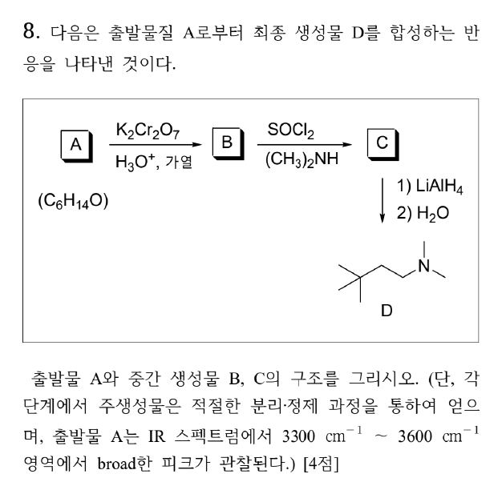

**정답** A **3,3-dimethylbutan-1-ol** (CH₃)₃CCH₂CH₂OH, B **3,3-dimethylbutanoic acid** (CH₃)₃CCH₂COOH, C **N,N,3,3-tetramethylbutanamide** (CH₃)₃CCH₂CON(CH₃)₂

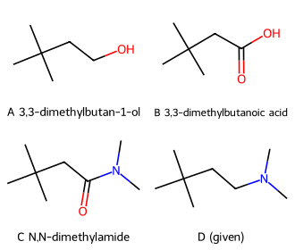

**공식·핵심 개념**

- K₂Cr₂O₇/H₃O⁺, 가열: 1차 알코올 → 카복실산(알데하이드에서 멈추지 않음)
- SOCl₂: RCOOH → RCOCl, 이어 2차 아민(2당량) → 3차 아마이드
- LiAlH₄: 아마이드 → 아민(C=O → CH₂)

**2027 출제 가능성 ★★★★☆ 높음** — 카복실산 유도체 변환과 역합성 추론은 유기 서술형에서 자주 나옵니다.

**주어진 것** A C₆H₁₄O(IR 3300–3600 cm⁻¹ 넓은 띠 = O–H), 최종 D = (CH₃)₃CCH₂CH₂N(CH₃)₂

**구할 것** A, B, C 구조

**풀이 전략** D에서 거꾸로 갑니다. LiAlH₄는 아마이드 C=O를 CH₂로 바꾸므로, D의 N 옆 CH₂가 원래 C=O였습니다.

**(1) C.** D의 N–CH₂를 C=O로 되돌리면 (CH₃)₃CCH₂C(=O)N(CH₃)₂ (C₈H₁₇NO).

**(2) B.** 아마이드는 산 염화물 + (CH₃)₂NH로 만들었고, 산 염화물은 카복실산 + SOCl₂로 만듭니다 → (CH₃)₃CCH₂COOH (C₆H₁₂O₂).

**(3) A.** 크로뮴산 산화로 카복실산이 되는 것은 **1차 알코올**입니다 → (CH₃)₃CCH₂CH₂OH (C₆H₁₄O, IHD = 0, O–H 띠) ✓

**왜 이 생성물인가** 탄소 수 6이 그대로 유지되고(C–C 결합을 만들거나 끊는 단계 없음), 작용기만 OH → COOH → CON(CH₃)₂ → CH₂N(CH₃)₂로 바뀝니다.

**검산** A C₆H₁₄O ✓, D C₈H₁₉N = A의 C₆ 골격 + N(CH₃)₂ ✓ (RDKit)

**메커니즘 — ① 크로뮴산 산화**

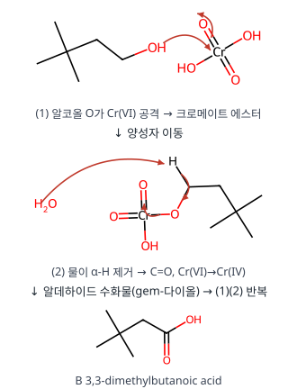

**메커니즘 — ② SOCl₂로 산 염화물**

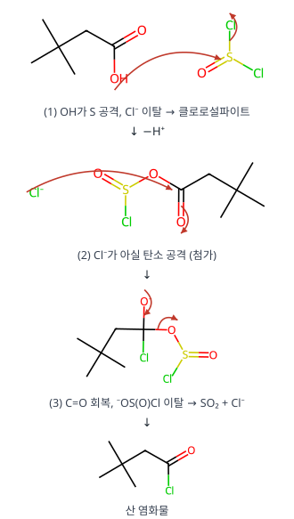

**메커니즘 — ③ 아마이드 형성(첨가–제거)**

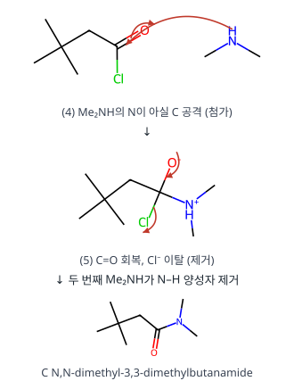

**메커니즘 — ④ LiAlH₄ 환원 (이미늄 경유)**

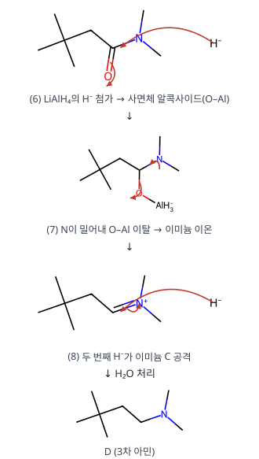

**채점 포인트·함정**

- 아마이드 + LiAlH₄는 에스터와 달리 **이미늄 이온**을 거쳐 아민이 됩니다(O가 떨어져 나감). 알코올이 되지 않습니다.
- 산 염화물에 아민을 넣을 때 HCl을 받을 아민이 한 당량 더 필요합니다.

## A형 9번 · A⁴⁺B²⁻ 입방 결정의 단위 세포 {#a9}

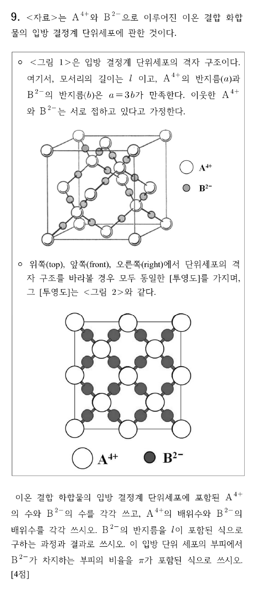

**정답** (답지 난이도 ★★★☆☆) A⁴⁺ **8개**, B²⁻ **16개**, 배위수 A⁴⁺ **4**, B²⁻ **2**, $b = \dfrac{\sqrt3}{32}l$, 부피 비율 $\dfrac{\sqrt3}{512}\pi$

**공식·핵심 개념**

- 단위 세포 원자 수: 꼭짓점 ⅛, 면심 ½, 내부 1
- 다이아몬드형 배열: 이웃 A–A 거리 = 체대각선의 ¼ = $\frac{\sqrt3}{4}l$
- 부피 비율 = (구의 부피 합) / $l^3$

**2027 출제 가능성 ★★★★☆ 높음** — 단위 세포 개수·배위수·반지름 비 계산은 결정 구조 문항의 기본형입니다(β-크리스토발라이트 SiO₂형).

**주어진 것** 꼭짓점·면심·내부 4곳에 A⁴⁺, A⁴⁺ 사이마다 B²⁻, 모서리 l, a = 3b, 이웃 이온 접촉

**구할 것** 이온 수, 배위수, b, B²⁻ 부피 비율

**풀이 전략** A⁴⁺는 다이아몬드(면심 입방 + 사면체 자리 절반) 배열이고, 이웃한 A⁴⁺ 사이 정중앙에 B²⁻가 있습니다(SiO₂형). 체대각선 방향으로 A–B–A가 일직선으로 접촉합니다.

**(1) A⁴⁺ 수.**

$$8\times\frac18 + 6\times\frac12 + 4\times1 = 1 + 3 + 4 = 8$$

**(2) B²⁻ 수.** 전하 중성 A⁴⁺B²⁻₂ → 8 × 2 = **16** (그림에서 내부 A 4개가 각각 B 4개와 결합 → 16개 모두 세포 안).

**(3) 배위수.** 내부 A⁴⁺ 하나에 B²⁻ 4개(사면체) → **4**. B²⁻는 A⁴⁺ 두 개 사이 → **2**.

**(4) 반지름.** 이웃 A⁴⁺ 중심 사이 거리는 체대각선($\sqrt3 l$)의 ¼이고, 그 사이에 B²⁻가 끼어 있습니다.

$$\frac{\sqrt3}{4}l = 2a + 2b = 2(3b) + 2b = 8b$$

$$b = \frac{\sqrt3}{32}l$$

**(5) 부피 비율.**

$$\frac{16\times\frac43\pi b^3}{l^3} = \frac{64\pi}{3}\left(\frac{\sqrt3}{32}\right)^3 = \frac{64\pi}{3}\cdot\frac{3\sqrt3}{32768} = \frac{\sqrt3}{512}\pi$$

**검산** 수치: $\sqrt3\pi/512 = 0.0106$ (약 1.1 %) — B²⁻가 작은 이온(a = 3b)이라 작게 나오는 것이 맞습니다 ✓

**채점 포인트·함정**

- 이웃 A–A 거리를 면대각선의 ½로 잡으면 틀립니다. 다이아몬드형에서 가장 가까운 A–A는 **체대각선의 ¼**입니다.
- 구하는 과정에서 $a = 3b$를 대입하는 단계를 보여야 합니다.

## A형 10번 · 고리 위 입자와 [18]annulene {#a10}

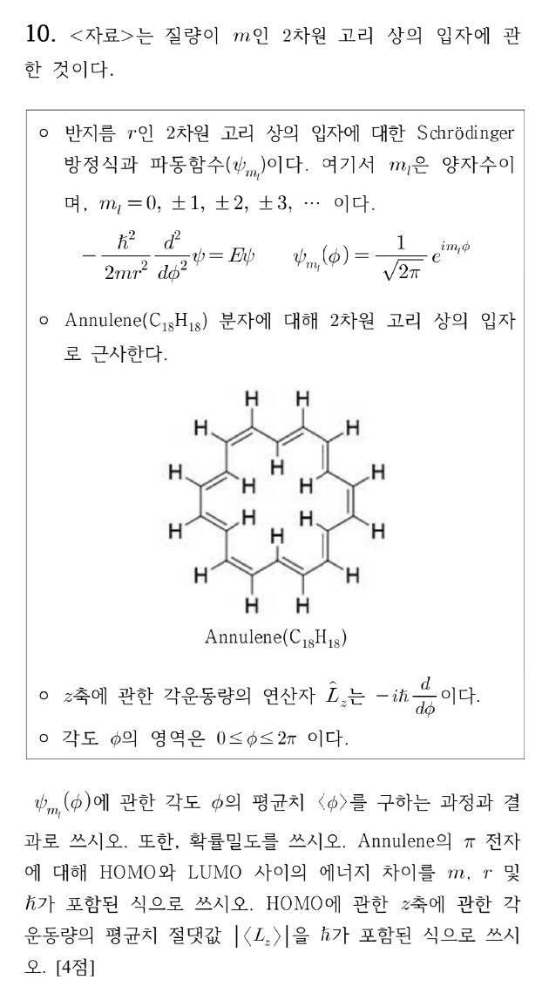

**정답** (답지 난이도 ★★★☆☆) $\langle\phi\rangle = \pi$, 확률밀도 $|\psi|^2 = \dfrac{1}{2\pi}$, $\Delta E_{\mathrm{HOMO-LUMO}} = \dfrac{9\hbar^2}{2mr^2}$, $|\langle L_z\rangle| = 4\hbar$

**공식·핵심 개념**

- $E_{m_l} = \dfrac{m_l^2\hbar^2}{2mr^2}$, $m_l = 0$은 한 준위, $\pm m_l$은 이중 축퇴
- 기대치 $\langle A\rangle = \int\psi^*\hat A\psi\,d\phi$
- $\hat L_z\psi = m_l\hbar\,\psi$ (고유함수)

**2027 출제 가능성 ★★★★☆ 높음** — 고리 위 입자로 방향족 π 전자를 근사하는 문항은 양자 영역에서 반복 출제됩니다.

**주어진 것** $\psi = \frac{1}{\sqrt{2\pi}}e^{im_l\phi}$, $0\le\phi\le2\pi$, $\hat L_z = -i\hbar\frac{d}{d\phi}$, C₁₈H₁₈의 π 전자 18개

**구할 것** ⟨φ⟩, 확률밀도, ΔE(HOMO–LUMO), HOMO의 |⟨L_z⟩|

**(1) 확률밀도.**

$$|\psi|^2 = \psi^*\psi = \frac{1}{2\pi}e^{-im_l\phi}e^{im_l\phi} = \frac{1}{2\pi}$$

(각도에 무관 — 고리 위 모든 위치의 확률이 같습니다)

**(2) ⟨φ⟩.**

$$\langle\phi\rangle = \int_0^{2\pi}\frac{1}{2\pi}\,\phi\,d\phi = \frac{1}{2\pi}\left[\frac{\phi^2}{2}\right]_0^{2\pi} = \frac{1}{2\pi}\cdot\frac{4\pi^2}{2} = \pi$$

**(3) 전자 배치.** $m_l = 0$에 2개, $\pm1, \pm2, \pm3, \pm4$에 각 4개 → 2 + 16 = 18. HOMO는 $m_l = \pm4$, LUMO는 $\pm5$.

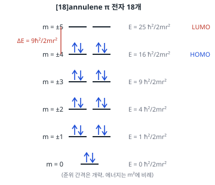

$$\Delta E = \frac{(5^2 - 4^2)\hbar^2}{2mr^2} = \frac{9\hbar^2}{2mr^2}$$

**(4) HOMO의 ⟨L_z⟩.**

$$\hat L_z\psi_{\pm4} = -i\hbar\cdot(\pm4i)\psi_{\pm4} = \pm4\hbar\,\psi_{\pm4} \;\Rightarrow\; |\langle L_z\rangle| = 4\hbar$$

**검산** 18 = 4n + 2 (n = 4) → 방향족 휘켈 수, 닫힌 껍질 ✓

**채점 포인트·함정**

- ⟨φ⟩ 적분에서 $|\psi|^2$이 상수라는 점을 먼저 보여야 합니다.
- $m_l = 0$ 준위는 축퇴되지 않아 전자 2개만 들어갑니다. 모든 준위를 4개로 채우면 HOMO가 틀어집니다.

## A형 11번 · 비활성 기체가 있는 해리 반응의 정류 상태 근사 {#a11}

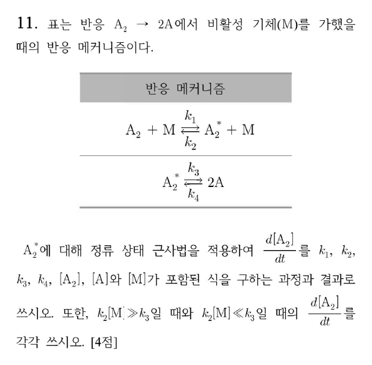

**정답** (답지 난이도 ★★★☆☆)

$$\frac{d[\mathrm{A_2}]}{dt} = -\frac{k_1k_3}{k_2[\mathrm M]+k_3}[\mathrm{A_2}][\mathrm M] + \frac{k_2k_4}{k_2[\mathrm M]+k_3}[\mathrm A]^2[\mathrm M]$$

$k_2[\mathrm M]\gg k_3$: $-\dfrac{k_1k_3}{k_2}[\mathrm{A_2}] + k_4[\mathrm A]^2$ / $k_2[\mathrm M]\ll k_3$: $-k_1[\mathrm{A_2}][\mathrm M] + \dfrac{k_2k_4}{k_3}[\mathrm A]^2[\mathrm M]$

**공식·핵심 개념**

- 정류 상태 근사: 반응성 중간체 $d[\mathrm I]/dt \approx 0$
- 린데만 기구: 충돌 활성화(M) → 활성 분자 → 분해
- 고압 한계(1차) / 저압 한계(2차, [M]에 비례)

**2027 출제 가능성 ★★★★★ 매우 높음** — 정류 상태 근사 유도와 극한 조건은 2024 기출 이후 속도론의 대표 유형입니다.

**주어진 것** $\mathrm{A_2 + M} \underset{k_2}{\overset{k_1}{\rightleftharpoons}} \mathrm{A_2^* + M}$, $\mathrm{A_2^*} \underset{k_4}{\overset{k_3}{\rightleftharpoons}} \mathrm{2A}$

**구할 것** $d[\mathrm{A_2}]/dt$ (일반식과 두 극한)

**풀이 전략** A₂*에 정류 상태를 적용해 [A₂*]를 구하고, A₂의 속도식에 대입합니다.

**(1) A₂의 속도식.**

$$\frac{d[\mathrm{A_2}]}{dt} = -k_1[\mathrm{A_2}][\mathrm M] + k_2[\mathrm{A_2^*}][\mathrm M]$$

**(2) A₂*에 정류 상태.**

$$\frac{d[\mathrm{A_2^*}]}{dt} = k_1[\mathrm{A_2}][\mathrm M] - k_2[\mathrm{A_2^*}][\mathrm M] - k_3[\mathrm{A_2^*}] + k_4[\mathrm A]^2 = 0$$

$$[\mathrm{A_2^*}] = \frac{k_1[\mathrm{A_2}][\mathrm M] + k_4[\mathrm A]^2}{k_2[\mathrm M] + k_3}$$

**(3) 대입.**

$$\frac{d[\mathrm{A_2}]}{dt} = -k_1[\mathrm{A_2}][\mathrm M] + \frac{k_2[\mathrm M]\left(k_1[\mathrm{A_2}][\mathrm M] + k_4[\mathrm A]^2\right)}{k_2[\mathrm M] + k_3}$$

통분하면 $k_1k_2[\mathrm{A_2}][\mathrm M]^2$ 항이 지워집니다.

$$= \frac{-k_1k_3[\mathrm{A_2}][\mathrm M] + k_2k_4[\mathrm A]^2[\mathrm M]}{k_2[\mathrm M] + k_3}$$

**(4) $k_2[\mathrm M]\gg k_3$ (고압).** 분모 ≈ $k_2[\mathrm M]$:

$$\frac{d[\mathrm{A_2}]}{dt} = -\frac{k_1k_3}{k_2}[\mathrm{A_2}] + k_4[\mathrm A]^2$$

**(5) $k_2[\mathrm M]\ll k_3$ (저압).** 분모 ≈ $k_3$:

$$\frac{d[\mathrm{A_2}]}{dt} = -k_1[\mathrm{A_2}][\mathrm M] + \frac{k_2k_4}{k_3}[\mathrm A]^2[\mathrm M]$$

**검산** 평형($d[\mathrm{A_2}]/dt = 0$)이면 $\frac{[\mathrm A]^2}{[\mathrm{A_2}]} = \frac{k_1k_3}{k_2k_4} = K_1K_2$ — 두 단계 평형 상수의 곱으로 전체 평형 상수가 나옵니다 ✓

**채점 포인트·함정**

- A₂*가 사라지는 경로는 $k_2[\mathrm M]$과 $k_3$ 두 가지, 생기는 경로는 $k_1$과 $k_4$ 두 가지입니다. 역반응 $k_4$를 빠뜨리기 쉽습니다.
- 고압 한계에서 정반응은 [M]과 무관한 **1차**, 저압 한계에서는 [M]에 비례하는 **2차**입니다.

## A형 12번 · 일양성자성 염기의 용매 추출 {#a12}

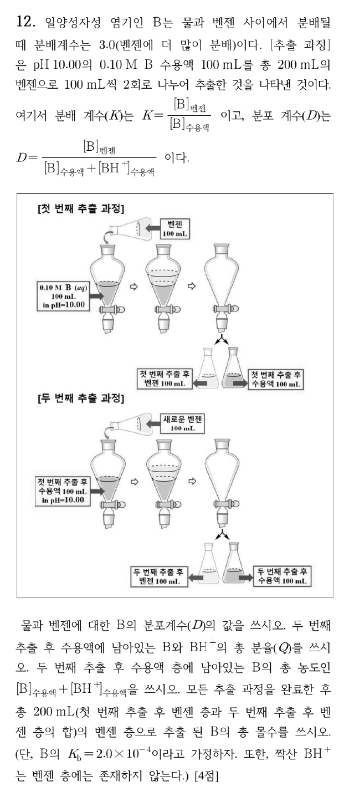

**정답** (답지 난이도 ★★★☆☆) D = **1.0**, Q = **0.25**, $[\mathrm B]_{aq} + [\mathrm{BH^+}]_{aq} = 2.5\times10^{-2}\ \mathrm M$, 추출된 B **7.5×10⁻³ mol**

**공식·핵심 개념**

- 분포 계수 $D = K\cdot\alpha_{\mathrm B}$, $\alpha_{\mathrm B} = \dfrac{[\mathrm B]}{[\mathrm B]+[\mathrm{BH^+}]} = \dfrac{K_a}{K_a + [\mathrm{H^+}]}$
- 한 번 추출 후 남는 분율 $q = \dfrac{V_{aq}}{V_{aq} + D\,V_{org}}$, n번이면 $q^n$

**2027 출제 가능성 ★★★★☆ 높음** — pH에 따른 분포 계수와 반복 추출은 분석화학 계산형으로 꾸준히 나옵니다.

**주어진 것** K = 3.0, K_b = 2.0×10⁻⁴, pH 10.00, 0.10 M × 100 mL, 벤젠 100 mL × 2회

**구할 것** D, Q, 남은 총 농도, 추출된 총 몰수

**(1) B의 분율.** pH 10 → [OH⁻] = 1.0×10⁻⁴ M.

$$\frac{[\mathrm{BH^+}]}{[\mathrm B]} = \frac{K_b}{[\mathrm{OH^-}]} = \frac{2.0\times10^{-4}}{1.0\times10^{-4}} = 2 \;\Rightarrow\; \alpha_{\mathrm B} = \frac{1}{1+2} = \frac13$$

**(2) 분포 계수.**

$$D = K\,\alpha_{\mathrm B} = 3.0\times\frac13 = 1.0$$

**(3) 남는 분율.** 같은 부피(100 mL)씩 추출하므로

$$q = \frac{100}{100 + 1.0\times100} = 0.5, \qquad Q = q^2 = 0.25$$

**(4) 남은 총 농도.**

$$0.10\ \mathrm M\times0.25 = 2.5\times10^{-2}\ \mathrm M$$

**(5) 추출된 몰수.**

$$0.10\ \mathrm M\times0.100\ \mathrm L\times(1-0.25) = 7.5\times10^{-3}\ \mathrm{mol}$$

**검산** 남은 2.5×10⁻³ mol + 추출 7.5×10⁻³ mol = 처음 1.0×10⁻² mol ✓

**채점 포인트·함정**

- K(3.0)를 그대로 쓰면 틀립니다. pH 10에서는 B의 ⅔가 BH⁺로 물에 남으므로 D = 1.0입니다.
- 200 mL를 한 번에 쓰면 q = 1/3(남는 비율 0.33)으로 두 번 나눠 추출하는 것(0.25)보다 효율이 낮습니다.

# 전공 B

## B형 1번 · 약산을 약염기로 적정 {#b1}

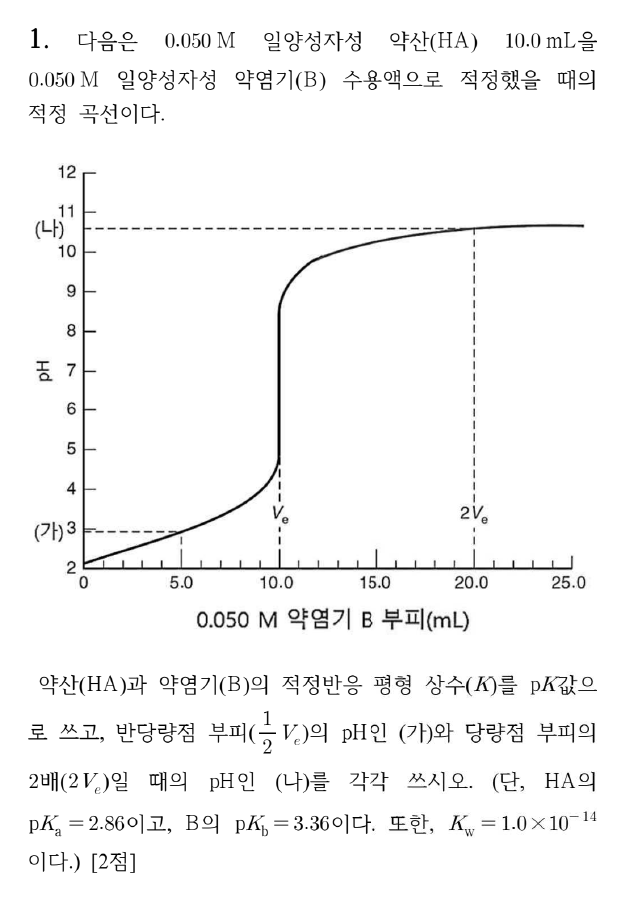

**정답** (답지 난이도 ★★☆☆☆) **pK = −7.78** (K = 10⁷·⁷⁸), (가) **2.86**, (나) **10.64**

**공식·핵심 개념**

- $\mathrm{HA + B \rightleftharpoons A^- + BH^+}$, $K = \dfrac{K_aK_b}{K_w}$
- 반당량점: [HA] = [A⁻] → pH = pK_a(HA)
- 2V_e: [B] = [BH⁺] → pH = pK_a(BH⁺) = 14 − pK_b

**2027 출제 가능성 ★★★★★ 매우 높음** — 적정 곡선의 특징점 pH는 분석화학 최빈출 소재입니다.

**(1) 평형 상수.**

$$K = \frac{K_aK_b}{K_w} = \frac{10^{-2.86}\times10^{-3.36}}{10^{-14}} = 10^{7.78} \;\Rightarrow\; \mathrm pK = -7.78$$

**(2) 반당량점(5.0 mL).** HA 0.50 mmol 중 0.25 mmol이 반응 → HA 0.25, A⁻ 0.25 mmol. K가 매우 커서 B는 모두 반응합니다.

$$\mathrm{pH} = \mathrm pK_a + \log\frac{[\mathrm{A^-}]}{[\mathrm{HA}]} = 2.86 + 0 = 2.86$$

**(3) 2V_e(20.0 mL).** B 1.0 mmol 중 0.50 mmol이 BH⁺, 0.50 mmol이 남은 B.

$$\mathrm{pK_a(BH^+)} = 14.00 - 3.36 = 10.64, \qquad \mathrm{pH} = 10.64 + \log\frac{0.50}{0.50} = 10.64$$

**검산** 당량점에서는 A⁻와 BH⁺가 같은 양이므로 $\mathrm{pH} \approx \frac12(2.86 + 10.64) = 6.75$ — 곡선의 급변 구간 가운데와 맞습니다 ✓

**채점 포인트·함정**

- pK는 $-\log K$이므로 K가 1보다 크면 음수가 됩니다.
- (나)는 염기의 pK_b가 아니라 짝산 BH⁺의 pK_a로 계산합니다.

## B형 2번 · 활동도를 고려한 AgI 침전 평형 {#b2}

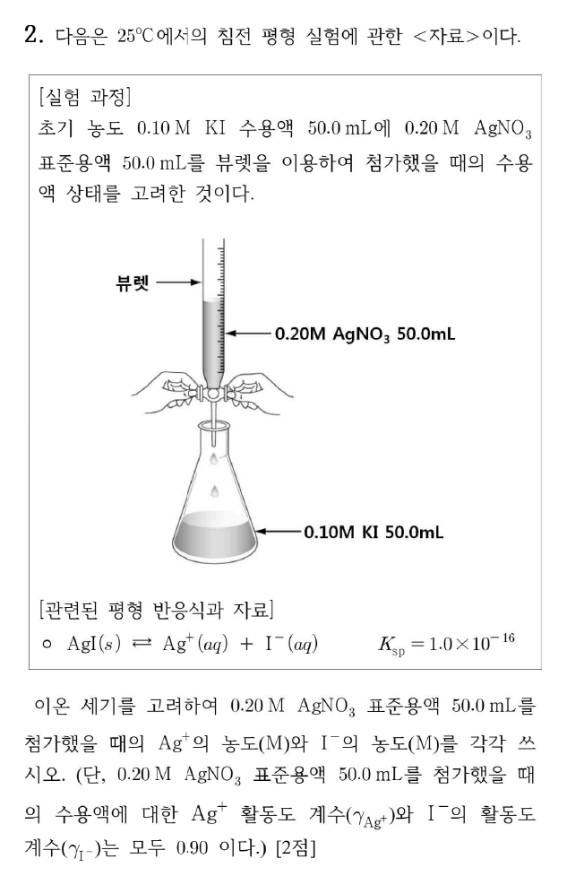

**정답** (답지 난이도 ★★☆☆☆) $[\mathrm{Ag^+}] = 5.0\times10^{-2}\ \mathrm M$, $[\mathrm{I^-}] = 2.5\times10^{-15}\ \mathrm M$

**공식·핵심 개념**

- 활동도 $a = \gamma[\ ]$, $K_{sp} = a_{\mathrm{Ag^+}}a_{\mathrm{I^-}} = \gamma_{\mathrm{Ag^+}}[\mathrm{Ag^+}]\,\gamma_{\mathrm{I^-}}[\mathrm{I^-}]$
- 당량점 뒤: 과량 Ag⁺가 [Ag⁺]를 정한다

**2027 출제 가능성 ★★★★☆ 높음** — 침전 적정과 활동도 계수는 분석화학 기입형으로 자주 나옵니다.

**(1) 양적 관계.** I⁻ 0.10 × 50.0 = 5.0 mmol, Ag⁺ 0.20 × 50.0 = 10.0 mmol → AgI 5.0 mmol 침전, Ag⁺ 5.0 mmol 과량, 전체 100.0 mL.

$$[\mathrm{Ag^+}] = \frac{5.0\ \mathrm{mmol}}{100.0\ \mathrm{mL}} = 5.0\times10^{-2}\ \mathrm M$$

**(2) [I⁻].**

$$[\mathrm{I^-}] = \frac{K_{sp}}{\gamma_{\mathrm{Ag^+}}\gamma_{\mathrm{I^-}}[\mathrm{Ag^+}]} = \frac{1.0\times10^{-16}}{0.90\times0.90\times5.0\times10^{-2}} = 2.5\times10^{-15}\ \mathrm M$$

**검산** 활동도를 무시하면 2.0×10⁻¹⁵ M — 활동도 계수가 1보다 작으면 용해도가 커지므로 2.5×10⁻¹⁵가 더 큰 것이 맞습니다 ✓

**채점 포인트·함정**

- AgI가 녹아 나오는 Ag⁺(≈10⁻¹⁵ M)는 과량 Ag⁺에 비해 무시합니다.
- 활동도 계수 두 개를 모두 곱해야 합니다(γ² = 0.81).

## B형 3번 · 염의 가수분해 수업과 순환학습·비계 {#b3}

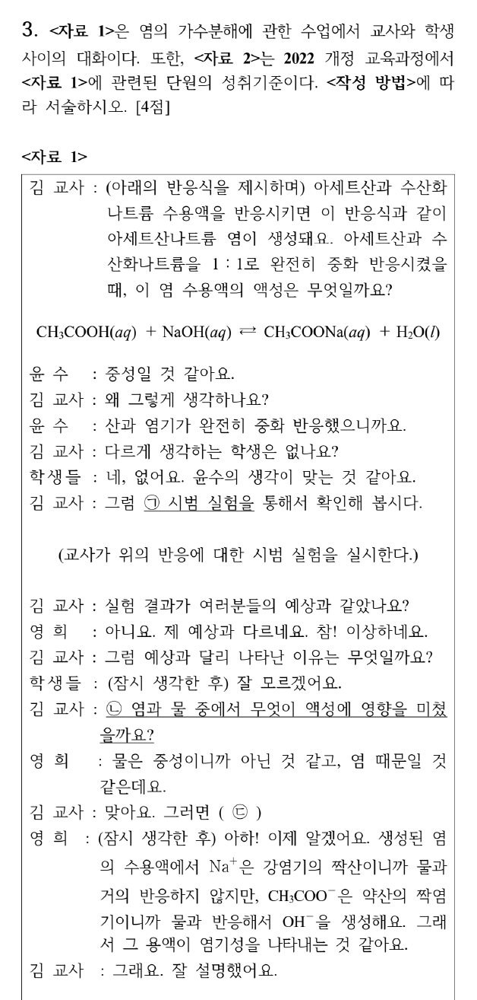

**정답**

- 관통개념: **화학 평형**
- ㉠의 단계: **탐색 단계**. 시범 실험을 통해 학생들의 **인지적 갈등(비평형)을 유발**하려고 하기 때문이다.
- ㉡·㉢ 비계의 목적: 학습자 스스로 교수적 도움을 통해 학습에 **능동적인 역할을 수행**하고 **성공적인 문제 해결**에 이르게 하기 위해서이다(근접 발달 영역 안에서 잠재적 발달 수준에 도달).
- ㉢: **아세트산나트륨이 물에 녹아 있을 때를 브뢴스테드–라우리 정의에 의한 짝산·짝염기로 설명해 봅시다.**

**공식·핵심 개념**

- 로슨 순환학습: 탐색 → 용어(개념) 도입 → 개념 적용
- 피아제: 동화 → **비평형(인지적 갈등)** → 조절 → 평형
- 비고츠키: ZPD, 비계(scaffolding), 사회적 상호작용

**2027 출제 가능성 ★★★★★ 매우 높음** — 순환학습·피아제·비고츠키를 한 수업 대화에 묶는 형식은 교육론 대표 유형입니다.

**자료 해석**

- 학생들은 "중화 → 중성"이라고 예상했는데 시범 실험 결과가 염기성이라 예상과 달라졌습니다. 이처럼 기존 생각으로 설명되지 않는 경험을 주는 것이 피아제의 비평형이고, 로슨에서는 학생이 직접 현상을 겪는 **탐색 단계**입니다.
- ㉡·㉢은 답을 바로 주지 않고 질문으로 사고를 이끄는 **언어적 비계**입니다.
- ㉢은 성취기준 [12반응01-01](브뢴스테드–라우리 정의)에 근거해 CH₃COO⁻를 짝염기로 보게 하는 질문이 들어가야, 영희의 다음 설명(CH₃COO⁻ + H₂O → CH₃COOH + OH⁻)으로 이어집니다.

**채점 포인트·함정**

- 단계 이름과 함께 "인지적 갈등(비평형) 유발"이라는 피아제 근거를 반드시 씁니다.
- ㉢은 성취기준의 용어(브뢴스테드–라우리, 짝산·짝염기)가 드러나야 합니다.

## B형 4번 · 과학탐구실험 1 성취기준과 탐구 방법 {#b4}

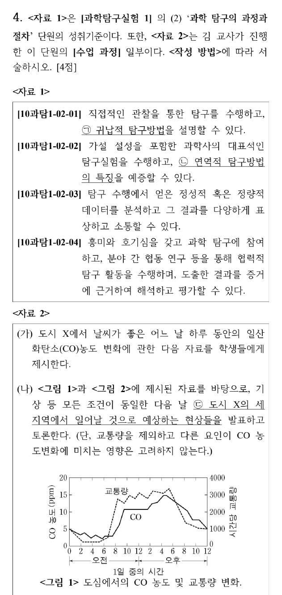

**정답**

- 부합하는 성취기준: **[10과탐1-02-03]** — 하루 동안의 일산화탄소(CO) 농도 변화에 관한 자료의 추리와 이를 바탕으로 예상되는 현상들을 발표하고 토론하기 때문이다(정성·정량 데이터 분석, 다양한 표상과 소통).
- ㉠ 귀납적 탐구 방법에서 교사의 역할: 학생들 **스스로 주요한 개념이나 그들 간의 관계(규칙성)를 찾도록 안내**한다.
- ㉡ 연역적 탐구 방법의 특징을 함양하기 위한 방안: **이미 학습된 포괄적 지식으로 주어진 현상을 설명하거나 새로운 현상을 예측·서술하게 한다.**
- [10과탐1-02-04] STEAM 실례: **화학 반응을 활용한 과학 마술 시나리오 개발 및 시연하기**

**공식·핵심 개념**

- 귀납적 탐구: 여러 사례 → 규칙성 발견(교사는 안내자)
- 연역적 탐구: 일반 원리 → 개별 현상 설명·예측
- STEAM: 과학·기술·공학·예술·수학 융합, 흥미·협력 탐구

**2027 출제 가능성 ★★★★☆ 높음** — 2022 개정 [과학탐구실험 1] 성취기준은 새 교육과정 문항으로 출제하기 좋습니다.

**자료 해석** (가)·(나)는 실험을 직접 하지 않고 **주어진 그래프 자료를 분석**해 다음 날 세 지역의 CO 변화를 예상·발표·토론합니다. 이는 데이터를 분석하고 결과를 표상·소통하는 [10과탐1-02-03]에 해당합니다(직접 관찰 탐구인 -01, 과학사 실험인 -02와 구별).

**채점 포인트·함정**

- 성취기준 번호와 함께 "자료 분석·예상·발표·토론"이라는 판단 준거를 씁니다.
- STEAM 실례는 협력적 탐구와 결과 해석·평가가 드러나는 활동이면 인정됩니다.

## B형 5번 · 선행조직자와 개념도 평가 {#b5}

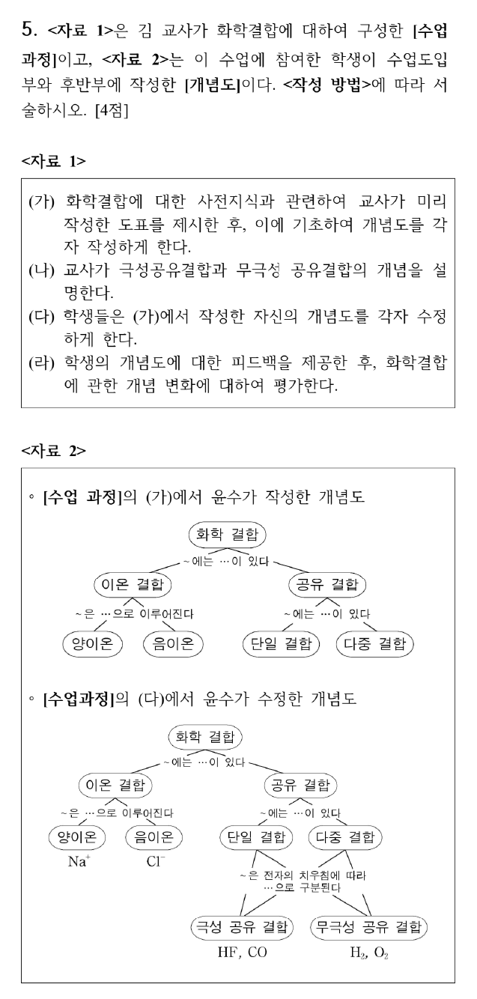

**정답**

- (가)의 포섭 전략: **비교 선행조직자**로서 **관념적 근거지를 제공**하고 **인지적 다리** 기능을 함으로써 **통합적 조정(화합)**의 원리를 갖도록 한다.
- (다)의 자기 평가적 의의: **수업 전에 작성한 개념도와 비교하여 학습된 정도와 개념의 종류를 확인**할 수 있다.
- 위계 점수: **3 × 5 = 15점**
- ㉠: **개념들의 연관, 즉 개념들 사이의 관계를 바르게 서술하는 명제가 타당하면**

**공식·핵심 개념**

- 선행조직자: 설명 조직자(새 내용) / **비교 조직자**(사전 지식과 비교)
- 노박·고윈 채점: 명제 1, 위계 5/단계, 교차연결 10, 실례 1
- 개념도의 자기 평가: 수업 전후 비교로 개념 변화 확인

**2027 출제 가능성 ★★★★☆ 높음** — 개념도 채점 기준과 선행조직자는 꾸준히 나오는 교육론 소재입니다.

**위계 계산.** 수정한 개념도: 화학 결합 → (이온 결합·공유 결합) → (양이온·음이온, 단일·다중 결합) → (극성·무극성 공유 결합). 타당한 위계 단계는 **3단계** → 3 × 5 = 15점.

**채점 포인트·함정**

- "비교" 선행조직자인 이유는 학생의 **사전 지식(화학 결합)과 관련된 도표**를 제시했기 때문입니다.
- 교차 연결은 "단일·다중 결합 → 극성·무극성"이 서로 다른 가지를 잇는지로 따지는데, 같은 '공유 결합' 가지 안의 연결이라 교차 연결 점수는 없습니다.

## B형 6번 · XeOF₄의 진동 기약표현 {#b6}

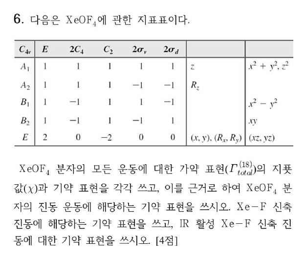

**정답** (답지 난이도 ★★★☆☆) $\chi(\Gamma_{total}) = 18, 2, -2, 4, 2$; $\Gamma_{total} = 4A_1 + A_2 + 2B_1 + B_2 + 5E$; $\Gamma_{vib} = 3A_1 + 2B_1 + B_2 + 3E$; Xe–F 신축 $A_1 + B_1 + E$; IR 활성 Xe–F 신축 $A_1 + E$

**공식·핵심 개념**

- $\chi_{3N}(R)$ = (제자리 원자 수) × (원자당 기여: E 3, C₄ 1, C₂ −1, σ 1)
- $\Gamma_{vib} = \Gamma_{3N} - \Gamma_{trans} - \Gamma_{rot}$
- IR 활성: x, y, z와 같은 기약표현 (C₄ᵥ: A₁, E)

**2027 출제 가능성 ★★★★★ 매우 높음** — 진동 모드 기약표현과 IR 활성 판정은 무기에서 거의 매년 나옵니다.

**주어진 것** XeOF₄(사각뿔, C₄ᵥ, Xe·O가 C₄ 축, F 4개가 σᵥ 위)

**(1) Γ_total.**

| C₄ᵥ | E | 2C₄ | C₂ | 2σᵥ | 2σd |
|---|---|---|---|---|---|
| 제자리 원자 | 6 | 2 | 2 | 4 | 2 |
| 원자당 기여 | 3 | 1 | −1 | 1 | 1 |
| χ | 18 | 2 | −2 | 4 | 2 |

**(2) 축소 (h = 8).**

$$n(A_1) = \tfrac18[18 + 2\cdot2 + (-2) + 2\cdot4 + 2\cdot2] = \tfrac{32}{8} = 4$$

$$n(A_2) = \tfrac18[18 + 4 - 2 - 8 - 4] = 1$$

$$n(B_1) = \tfrac18[18 - 4 - 2 + 8 - 4] = 2$$

$$n(B_2) = \tfrac18[18 - 4 - 2 - 8 + 4] = 1$$

$$n(E) = \tfrac18[2\cdot18 + 0 + (-2)(-2) + 0 + 0] = \tfrac{40}{8} = 5$$

**(3) Γ_vib.** 병진 $A_1 + E$, 회전 $A_2 + E$를 뺍니다.

$$\Gamma_{vib} = 3A_1 + 2B_1 + B_2 + 3E\quad(3 + 2 + 1 + 6 = 12 = 3N - 6)$$

**(4) Xe–F 신축.** 결합 벡터 4개의 Γ: E 4, C₄ 0, C₂ 0, σᵥ 2, σd 0.

$$n(A_1) = \tfrac18(4 + 2\cdot2) = 1,\quad n(B_1) = \tfrac18(4 + 2\cdot2) = 1$$

$$n(E) = \tfrac18(2\cdot4) = 1 \;\Rightarrow\; A_1 + B_1 + E$$

**(5) IR 활성.** z → A₁, (x, y) → E이므로 **A₁ + E** (B₁은 Raman 활성).

**검산** Γ_total 차원 4 + 1 + 2 + 1 + 10 = 18 = 3N ✓

**채점 포인트·함정**

- C₂에서 원자당 기여는 −1입니다(2 × (−1) = −2).
- F가 σᵥ 위에 있는지 σd 위에 있는지에 따라 B₁·B₂가 바뀝니다. 문제의 지표표 χ(σᵥ = 4)로 F가 σᵥ 위에 있음을 확인합니다.

## B형 7번 · 일정 외부 압력에 대한 비가역 단열 팽창 {#b7}

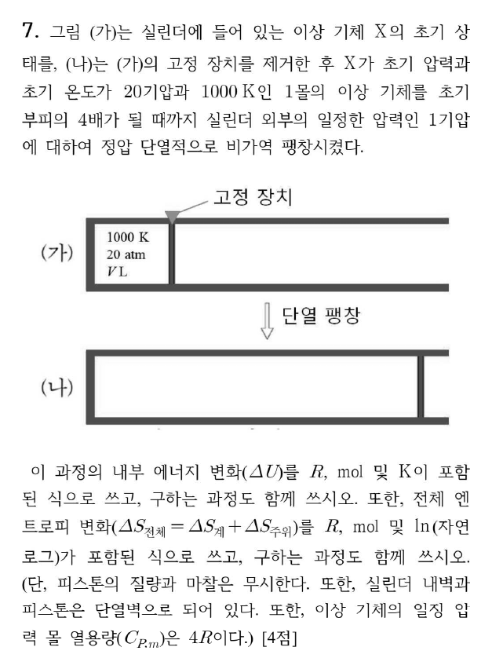

**정답** (답지 난이도 ★★★☆☆) $\Delta U = -150\,R\cdot\mathrm{K\cdot mol}$ (최종 온도 950 K), $\Delta S_{전체} = 2R\ln2 + 3R\ln\dfrac{95}{100}$ (단위 mol 곱함)

**공식·핵심 개념**

- 단열: q = 0 → $\Delta U = w = -P_{ext}\Delta V$
- 이상 기체 $\Delta U = nC_{V,m}\Delta T$, $C_{V,m} = C_{P,m} - R$
- $\Delta S = nC_{V,m}\ln\dfrac{T_2}{T_1} + nR\ln\dfrac{V_2}{V_1}$, 단열이므로 $\Delta S_{주위} = 0$

**2027 출제 가능성 ★★★★☆ 높음** — 비가역 단열 팽창의 ΔU·ΔS는 열역학 서술형의 단골입니다.

**주어진 것** n = 1 mol, T₁ = 1000 K, P₁ = 20 atm, V₂ = 4V₁, P_ext = 1 atm, C_P,m = 4R

**(1) 처음 부피.**

$$V_1 = \frac{nRT_1}{P_1} = \frac{1\cdot R\cdot1000}{20} = 50R\ \text{(atm 단위)}$$

**(2) 일.**

$$\Delta V = 4V_1 - V_1 = 150R, \qquad w = -P_{ext}\Delta V = -1\times150R$$

$$\Delta U = q + w = -150\,R\cdot\mathrm{K\cdot mol}$$

**(3) 최종 온도.** $C_{V,m} = 4R - R = 3R$:

$$\Delta U = nC_{V,m}\Delta T \;\Rightarrow\; -150R = 3R\,\Delta T \;\Rightarrow\; \Delta T = -50\ \mathrm K,\; T_2 = 950\ \mathrm K$$

**(4) 계의 엔트로피.**

$$\Delta S_{계} = 3R\ln\frac{950}{1000} + R\ln4 = 3R\ln\frac{95}{100} + 2R\ln2$$

**(5) 주위.** 열 출입이 없으므로 $\Delta S_{주위} = 0$ → $\Delta S_{전체} = 2R\ln2 + 3R\ln\frac{95}{100}$

**검산** 수치: $2(0.693) + 3(-0.0513) = 1.232\,R > 0$ — 비가역 과정이므로 전체 엔트로피 증가 ✓. 최종 압력 $P_2 = \frac{950}{1000}\cdot\frac{20}{4} = 4.75$ atm > 1 atm (피스톤은 계속 밀려나다 고정 장치에서 멈춤).

**채점 포인트·함정**

- 가역 단열($\Delta S = 0$) 식 $TV^{\gamma-1}$ = 일정을 쓰면 틀립니다. 외부 압력이 일정한 **비가역** 과정입니다.
- C_P,m = 4R이 주어졌으므로 C_V,m = 3R로 바꿔 써야 합니다.

## B형 8번 · 바이사이클로 알켄의 오존 분해와 분자 내 고리 에터 형성 {#b8}

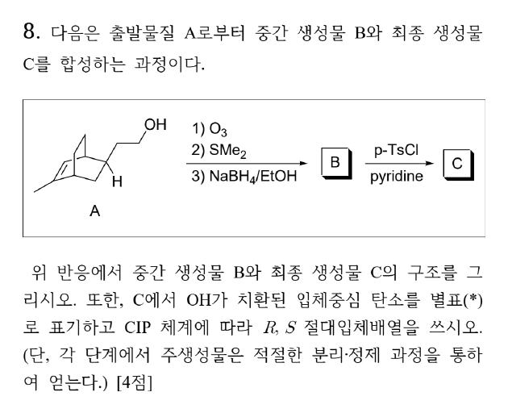

**정답** B = 고리가 열린 **트라이올**(CH₂OH, CH₂CH₂OH, CH(OH)CH₃가 붙은 사이클로헥세인, C₁₁H₂₂O₃), C = **trans-접합 옥타하이드로아이소크로멘**(6원 고리 에터) + 곁사슬 CH(OH)CH₃. OH가 붙은 입체중심(*) = 곁사슬 CH(OH) 탄소 — NaBH₄ 환원이 입체 선택적이지 않아 **R·S 두 부분입체이성질체가 함께** 생김(검토 메모 3).

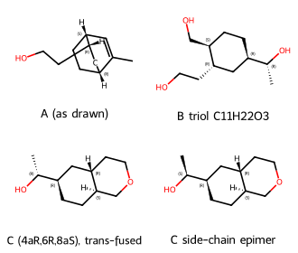

**공식·핵심 개념**

- O₃ 후 SMe₂: C=C 절단 → 알데하이드·케톤(산화 없음)
- NaBH₄: 알데하이드·케톤 → 1차·2차 알코올
- TsCl/pyridine: **입체 장애가 가장 작은 1차 OH**를 선택적으로 토실화 → 좋은 이탈기
- 분자 내 SN2: 5·6원 고리 형성이 빠름

**2027 출제 가능성 ★★★★☆ 높음** — 고리 화합물 오존 분해와 분자 내 SN2, CIP 판정을 묶은 다단계 서술형은 유기 고난도 유형입니다.

**주어진 것** A: 메틸이 붙은 C=C를 가진 바이사이클로[2.2.2]옥텐 + CH₂CH₂OH 곁사슬. 1) O₃ 2) SMe₂ 3) NaBH₄ → B, p-TsCl/pyridine → C

**풀이 전략** 고리 C=C를 끊으면 바이사이클로 골격이 사이클로헥세인 하나로 열리고, 다리목 두 탄소에 CHO와 COCH₃가 cis로 남습니다. 이후 환원 → 1차 OH 토실화 → 분자 내 SN2 순서로 추적합니다.

**(1) 오존 분해.** C=C(CH–C(CH₃))가 끊어져 한 다리목에 **CHO**, 다른 다리목에 **COCH₃**가 생깁니다. 두 다리목 치환기는 원래 같은 다리에 있었으므로 고리에서 **cis(1,4)**입니다. 곁사슬 CH₂CH₂OH는 CHO 쪽 다리목 옆 탄소에 남습니다.

**(2) NaBH₄.** CHO → **CH₂OH**, COCH₃ → **CH(OH)CH₃** → B(트라이올, C₁₁H₂₂O₃).

**(3) 토실화.** 1차 OH 두 개(고리의 CH₂OH, 곁사슬 CH₂CH₂OH) 중 고리에서 더 먼 **CH₂CH₂–OH**가 입체 장애가 가장 작아 먼저 토실화됩니다(필기). 2차 OH는 반응이 느립니다.

**(4) 분자 내 SN2.** 이웃 탄소의 CH₂OH 산소가 C–OTs 탄소를 뒤에서 공격 → O, CH₂, 고리 C, 고리 C, CH₂, CH₂로 된 **6원 고리 에터**. 원래 이웃한 두 고리 치환기가 trans였으므로 접합부는 **trans-접합**입니다.

**(5) OH가 붙은 입체중심의 CIP.** 곁사슬 탄소의 치환기: −OH > −CH(고리, C·C·H) > −CH₃ > −H. H를 뒤로 두고 OH → 고리 → CH₃ 방향이 시계 방향이면 R, 반시계면 S입니다. 이 탄소는 (2) 단계에서 평면 C=O에 H⁻가 어느 면으로든 들어가 만들어지므로 **R와 S가 모두 생깁니다**(RDKit: 그림의 첫 구조 R, 두 번째 구조 S).

**왜 이 생성물인가** 오존 분해로 C=C만 끊기므로 고리의 다른 입체중심은 그대로 유지되고, 토실화는 가장 덜 붐빈 1차 OH에서, 고리화는 6원 고리가 되는 이웃 O에서 일어납니다. 2차 OH(CH(OH)CH₃)는 토실화되더라도 6원 고리를 만들 위치가 아니라 그대로 남습니다.

**검산** B C₁₁H₂₂O₃ − H₂O(실제로는 −TsOH) = C C₁₁H₂₀O₂ ✓ (RDKit)

**메커니즘 — ① 오존 분해 (반응하는 C=C 부분만)**

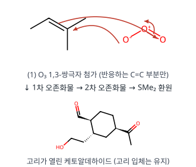

**메커니즘 — ② NaBH₄ 환원**

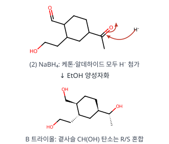

**메커니즘 — ③ 토실화와 분자 내 SN2**

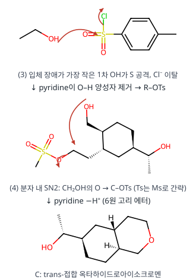

**채점 포인트·함정**

- SMe₂(환원성 처리)이므로 카복실산이 아니라 알데하이드·케톤이 생깁니다.
- TsCl/pyridine만으로 끝나면 토실레이트지만, 분자 안에 6원 고리를 만들 수 있는 OH가 있으면 고리화가 이어집니다.
- 별표는 곁사슬 CH(OH) 탄소에 표시합니다.

## B형 9번 · 친핵성 방향족 치환(SNAr)과 니트로기 환원 {#b9}

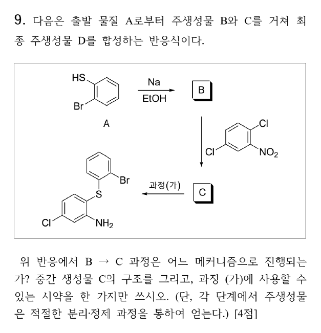

**정답** B → C: **친핵성 방향족 치환(SNAr, 첨가–제거)**. C = (2-bromophenyl)(4-chloro-2-nitrophenyl) sulfide (C₁₂H₇BrClNO₂S). (가) 시약: **Fe/HCl** (또는 SnCl₂/HCl; H₂/Pd-C는 검토 메모 4)

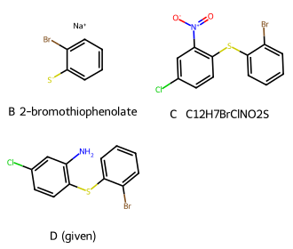

**공식·핵심 개념**

- SNAr 조건: 강한 전자 끌기기(NO₂)가 이탈기의 **ortho·para**에 있어야 함
- 첨가–제거: Meisenheimer 착물(음전하가 NO₂의 O까지 비편재화)
- ArNO₂ → ArNH₂: Fe/HCl, SnCl₂/HCl, H₂/Pd-C

**2027 출제 가능성 ★★★★★ 매우 높음** — SNAr의 위치 선택성과 Meisenheimer 착물은 유기 서술형의 단골입니다.

**주어진 것** A 2-bromobenzenethiol, Na/EtOH → B, 2,5-다이클로로나이트로벤젠 → C, (가) → D(아민)

**(1) B.** Na + EtOH → NaOEt. EtO⁻가 산성인 S–H(pKa ≈ 7)를 떼어 **티올레이트 ArS⁻Na⁺**를 만듭니다.

**(2) 어느 Cl이 치환되는가.** 1,4-다이클로로-2-나이트로벤젠에서 C1–Cl은 NO₂의 **ortho**, C4–Cl은 NO₂의 **meta**입니다. ortho Cl 자리에 친핵체가 첨가되어야 음전하가 NO₂의 O까지 퍼지므로, **NO₂ 옆 Cl만 치환**됩니다.

**(3) C.** ArS⁻가 C1을 공격 → Meisenheimer 착물 → Cl⁻ 이탈 → 2-니트로-4-클로로페닐 설파이드. D(주어진 아민)와 골격이 일치합니다.

**(4) (가).** NO₂ → NH₂ 환원. Ar–Br, Ar–Cl, C–S를 보존해야 하므로 **Fe/HCl**(또는 SnCl₂/HCl) 후 염기 처리가 가장 적합합니다.

**왜 이 생성물인가** SNAr의 속도는 Meisenheimer 착물의 안정성이 정합니다. NO₂가 ortho·para에 있을 때만 음전하를 직접 받을 수 있어 그 위치의 Cl만 반응합니다. ArS⁻의 Br은 니트로기가 없는 고리에 있어 반응하지 않습니다.

**검산** C₁₂H₇BrClNO₂S → (NO₂ → NH₂) C₁₂H₉BrClNS = D ✓ (RDKit)

**메커니즘 — 티올레이트 생성과 SNAr (첨가–제거)**

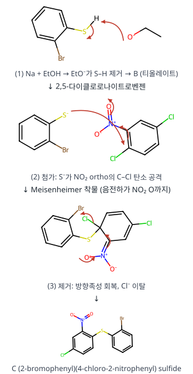

**채점 포인트·함정**

- "친핵성 방향족 치환" 또는 "SNAr(첨가–제거)"로 써야 합니다. SN1·SN2(방향족 탄소에서는 일어나지 않음)는 오답입니다.
- 시약은 한 가지만 쓰라고 했으므로 가장 확실한 Fe/HCl 하나를 씁니다.

## B형 10번 · d⁶ Tanabe–Sugano 도표와 [Co(en)₃]³⁺ {#b10}

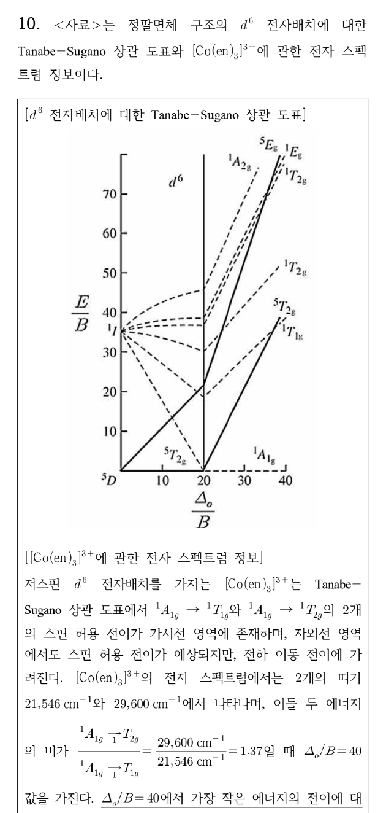

**정답** (답지 난이도 ★★★☆☆) 자유 이온 바닥 항(⁵D) 축퇴도 **25**, [CoF₆]³⁻ 스핀 허용 전이 **⁵T₂g → ⁵Eg**, [Co(en)₃]³⁺ 바닥 상태(¹A₁g) 축퇴도 **1**, $B = 567\ \mathrm{cm^{-1}}$, $\Delta_o = 22\,680\ \mathrm{cm^{-1}}$

**공식·핵심 개념**

- 항의 축퇴도 = (2S + 1)(2L + 1)
- 스핀 허용: 같은 스핀 다중도끼리
- Tanabe–Sugano: 띠 에너지 비 → Δo/B, E/B 값 → B

**2027 출제 가능성 ★★★★★ 매우 높음** — Tanabe–Sugano로 B·Δo를 구하는 문항은 무기 서술형 최빈출입니다.

**(1) 자유 이온 d⁶.** 바닥 항 ⁵D: S = 2, L = 2.

$$(2S+1)(2L+1) = 5\times5 = 25$$

**(2) [CoF₆]³⁻.** F⁻는 약한 장 → 고스핀 t₂g⁴eg² = **⁵T₂g**. 같은 다중도(5)의 들뜬 상태는 **⁵Eg**(t₂g³eg³) 하나뿐 → ⁵T₂g → ⁵Eg.

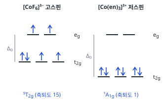

**(3) [Co(en)₃]³⁺.** 강한 장 → 저스핀 t₂g⁶ = **¹A₁g** → (2S + 1) × (A의 궤도 축퇴 1) = 1 × 1 = **1**.

**(4) B와 Δo.** 띠 에너지 비 29 600 / 21 546 = 1.37 → Δo/B = 40. 이때 가장 낮은 전이(¹A₁g → ¹T₁g)의 E/B = 38.

$$B = \frac{21\,546\ \mathrm{cm^{-1}}}{38} = 567\ \mathrm{cm^{-1}}$$

$$\Delta_o = 40B = 40\times567 = 22\,680\ \mathrm{cm^{-1}}$$

**검산** 자유 Co³⁺의 B(≈ 1100 cm⁻¹)보다 작아(β = 567/1100 ≈ 0.52) 공유성(네펠라욱세틱 효과)이 큰 착물과 일치합니다 ✓

**채점 포인트·함정**

- 바닥 상태의 E/B는 0이므로, 첫 번째 띠 21 546 cm⁻¹를 E/B = 38로 나눕니다.
- ⁵D의 축퇴도를 5로만 쓰면(궤도만) 틀립니다. 스핀 축퇴(5)까지 곱합니다.

## B형 11번 · 몰흡광 계수와 표준물 첨가법 {#b11}

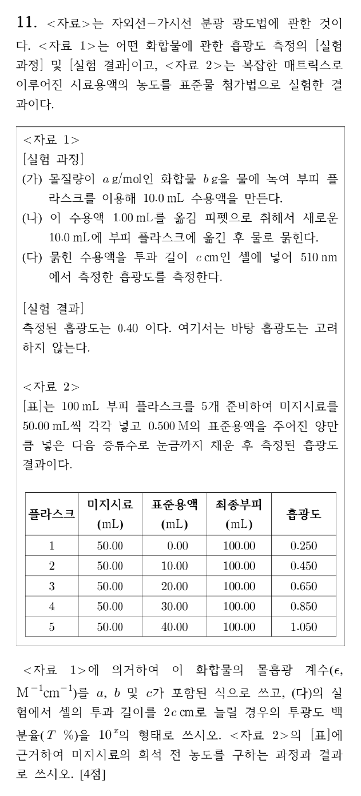

**정답** (답지 난이도 ★★★☆☆) $\varepsilon = \dfrac{4.0a}{bc}\times10^{-2}\ \mathrm{M^{-1}cm^{-1}}$, $T\% = 10^{1.20}$, 미지시료의 희석 전 농도 **0.125 M**

**공식·핵심 개념**

- Beer 법칙 $A = \varepsilon bc$, $A = -\log T = 2 - \log T\%$
- 표준물 첨가법: $A = m(V_s c_s + V_x c_x)$ → x 절편에서 $V_x c_x = |V_{s,0}|c_s$

**2027 출제 가능성 ★★★★★ 매우 높음** — Beer 법칙과 표준물 첨가법은 분석화학에서 해마다 형태를 바꿔 나옵니다.

**(1) 측정 용액 농도.** b g ÷ a g/mol = b/a mol을 10.0 mL에 녹이고, 1.00 mL를 10.0 mL로 10배 희석:

$$c = \frac{b/a}{0.0100\ \mathrm L}\times\frac{1}{10} = \frac{10b}{a}\ \mathrm M$$

**(2) ε.**

$$\varepsilon = \frac{A}{b_{path}\,c} = \frac{0.40}{c\cdot\frac{10b}{a}} = \frac{0.040a}{bc} = \frac{4.0a}{bc}\times10^{-2}\ \mathrm{M^{-1}cm^{-1}}$$

**(3) 투과 길이 2c.** 흡광도 2배 → A = 0.80.

$$T = 10^{-0.80},\qquad T\% = 100\times10^{-0.80} = 10^{2-0.80} = 10^{1.20}\ (\approx 15.8\%)$$

**(4) 표준물 첨가.** 표준 10.00 mL마다 A가 0.200씩 증가 → 기울기 0.0200 /mL. 흡광도 0 외삽:

$$V_{s,0} = -\frac{0.250}{0.0200} = -12.5\ \mathrm{mL}$$

$$c_x = \frac{12.5\ \mathrm{mL}\times0.500\ \mathrm M}{50.00\ \mathrm{mL}} = 0.125\ \mathrm M$$

**검산** 플라스크 5: 0.250 + 40.00 × 0.0200 = 1.050 ✓

**채점 포인트·함정**

- 셀 길이 기호(c)와 농도 기호가 겹치므로 식에서 구별해 씁니다.
- 표준물 첨가법에서는 최종 부피(100 mL)가 모든 플라스크에서 같아 약분됩니다. 미지시료 부피 50.00 mL로 나누는 것을 잊지 않습니다.

---

원문: 2027학년도 대비 9–11월 안병천 전공화학통합모의고사 제6회(임용닷컴) 문제지·답지·강의 필기. 개인 학습용 정리입니다.

