# 안병천 1~3회 전공 엄선 문항 — 2027 출제 가능성 높은 문제

안병천 전공화학 모의고사 1·2·3회에서 **교육론을 빼고 전공(유기·무기·분석·물리) 문항만** 골라 영역별로 묶었습니다. 전공 51문항 중 ★5 문항은 모두 넣고, ★4 가운데 기출 유형과 가장 가깝고 풀이 가치가 큰 문항을 더했습니다. 총 **27문항**(유기 8, 무기 7, 분석 6, 물리 6)입니다.

**고른 기준**: ① 1997~2026 기출에서 거의 매년 나오는 유형인가, ② 영역별 핵심 단원(분광 구조 결정, 입체화학, 군론, 결정장, 적정·평형, 속도론·열역학 관계식)을 빠짐없이 덮는가, ③ 한 문항 안에 여러 개념을 묶어 실전 서술형 형식에 가까운가, ④ 풀이 과정·메커니즘이 공부할 가치가 있을 만큼 좋은가. 계산만 반복하는 2점 문항(헤스 법칙, 단순 pH 등)과 출제 빈도가 낮은 소재(고리 위 입자, 라만 회전 분광, 다이에논–페놀 자리옮김 등)는 뺐습니다.

각 문항의 원문·정답·공식 박스·단계별 풀이·메커니즘은 원래 회차 해설지와 같습니다. 본문의 "검토 메모"는 해당 회차 해설지 1쪽의 메모를 가리킵니다.

## 엄선 문항 목록 {#toc}

### 전공 A 엄선 목록 (유기·무기)

| 번호 | 출처 | 영역 · 주제 | 출제 가능성 |
|---|---|---|---|
| [1](#r1a3) | 1회 A형 3번 | 유기화학 · IR·¹H NMR로 에스터 구조 결정, 산 촉매 가수분해 | ★★★★★ |
| [2](#r2a3) | 2회 A형 3번 | 유기화학 · C₄H₈O의 IR·MS·¹H NMR | ★★★★★ |
| [3](#r3a3) | 3회 A형 3번 | 유기화학 · 분광 자료로 C₁₀H₁₂O₂ 구조 결정 | ★★★★★ |
| [4](#r1a2) | 1회 A형 2번 | 유기화학 · SN2 입체 반전과 토실화(입체 유지) | ★★★★☆ |
| [5](#r2a8) | 2회 A형 8번 | 유기화학 · 1-isopropylcyclohexene의 수소붕소화와 E2 | ★★★★★ |
| [6](#r2b9) | 2회 B형 9번 | 유기화학 · 데칼린 알코올의 E2와 수소붕소화 | ★★★★☆ |
| [7](#r1b8) | 1회 B형 8번 | 유기화학 · NBS 브로민화 → E2 → Diels–Alder → 오존 분해 | ★★★★☆ |
| [8](#r3b9) | 3회 B형 9번 | 유기화학 · 니트로벤젠에서 1-브로모-2,6-다이클로로-4-tert-뷰틸벤젠 합성 | ★★★★★ |
| [9](#r2a9) | 2회 A형 9번 | 무기화학 · 1,2-dichloroethane(C₂ₕ)의 C–H 신축 진동 | ★★★★★ |
| [10](#r1a1) | 1회 A형 1번 | 무기화학 · SO₄²⁻의 S–O 신축 진동 (Td) | ★★★★☆ |
| [11](#r3b6) | 3회 B형 6번 | 무기화학 · [M(CO)₃(H₂O)₃]⁺의 치환 반응과 fac/mer IR | ★★★★☆ |
| [12](#r2b6) | 2회 B형 6번 | 무기화학 · d⁸ Ni²⁺ 착물의 Tanabe–Sugano 해석 | ★★★★★ |
| [13](#r1b6) | 1회 B형 6번 | 무기화학 · d³ 착물의 전자 스펙트럼과 배치 혼합 | ★★★★☆ |
| [14](#r3a11) | 3회 A형 11번 | 무기화학 · [CrL₆]³⁻의 MO, 분광화학 계열, d³ 전이 | ★★★★☆ |
| [15](#r1b2) | 1회 B형 2번 | 무기화학 · Monsanto 아세트산 공정 | ★★★★☆ |

### 전공 B 엄선 목록 (분석·물리)

| 번호 | 출처 | 영역 · 주제 | 출제 가능성 |
|---|---|---|---|
| [16](#r2b1) | 2회 B형 1번 | 분석화학 · HCl + Na₂HPO₄ 혼합액의 적정 | ★★★★★ |
| [17](#r3a9) | 3회 A형 9번 | 분석화학 · EDTA 치환 적정 | ★★★★☆ |
| [18](#r1a12) | 1회 A형 12번 | 분석화학 · 산화–환원 적정 당량점의 전위 | ★★★★☆ |
| [19](#r2b11) | 2회 B형 11번 | 분석화학 · 결정형이 다른 두 MX₂ 전극으로 만든 전지 | ★★★★★ |
| [20](#r1b11) | 1회 B형 11번 | 분석화학 · H₂S로 황화물 선택적 침전 | ★★★★☆ |
| [21](#r1a9) | 1회 A형 9번 | 분석화학 · van Deemter 식과 크로마토그래피 분리도 | ★★★★☆ |
| [22](#r1b7) | 1회 B형 7번 | 물리화학 · 사전평형 근사와 겉보기 활성화 에너지 | ★★★★☆ |
| [23](#r2b7) | 2회 B형 7번 | 물리화학 · Br₂ + CH₄ 라디칼 연쇄 반응의 정류 상태 근사 | ★★★★☆ |
| [24](#r3a10) | 3회 A형 10번 | 물리화학 · 내부 압력, 열팽창 계수, 등온 압축률 | ★★★★☆ |
| [25](#r1a4) | 1회 A형 4번 | 물리화학 · 2원자 이상 기체의 등온·등압 가역 팽창 | ★★★★☆ |
| [26](#r2a4) | 2회 A형 4번 | 물리화학 · 이종핵 이원자 분자의 진동-회전 스펙트럼 | ★★★★☆ |
| [27](#r3b11) | 3회 B형 11번 | 물리화학 · 수소 원자 3p 오비탈 | ★★★★☆ |

원문: 2027학년도 대비 안병천 전공화학통합모의고사 제1·2·3회(임용닷컴) 문제지·답지·강의 필기. 개인 학습용 정리입니다.

# 전공 A

## 1. 1회 A형 3번 · IR·¹H NMR로 에스터 구조 결정, 산 촉매 가수분해 {#r1a3}

**엄선 이유** — 분광(IR·NMR) 구조 결정 + 가수분해 — 매년 나오는 유형

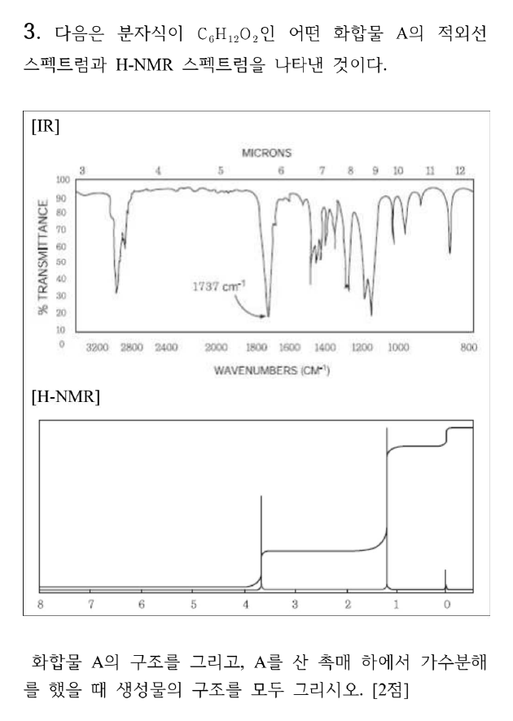

**정답** A = **methyl pivalate** (CH₃)₃C–CO–OCH₃ (methyl 2,2-dimethylpropanoate). 가수분해 생성물: **pivalic acid** (CH₃)₃CCOOH + **CH₃OH**

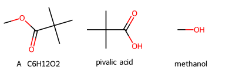

**공식·핵심 개념**

- 수소결핍지수 $= \dfrac{2C + 2 - H}{2}$
- 에스터 C=O 신축 ≈ 1735–1750 cm⁻¹, C–O 1150–1300 cm⁻¹
- OCH₃(에스터) δ ≈ 3.7, tert-뷰틸 δ ≈ 1.2 (s, 9H)
- 산 촉매 에스터 가수분해(AAC2) = Fischer 에스터화의 역반응

**2027 출제 가능성 ★★★★★ 매우 높음** — 분자식 + IR + ¹H NMR로 구조를 정하는 문항은 거의 매년 나옵니다. 에스터 가수분해와 묶는 형태도 기본형입니다.

**주어진 것** C₆H₁₂O₂, IR 1737 cm⁻¹(강함), 3000 cm⁻¹ 위 넓은 O–H 없음, ¹H NMR: δ 3.7(s), δ 1.2(s), 적분 높이 비 약 1 : 3

**구할 것** A의 구조, 산 촉매 가수분해 생성물

**풀이 전략** 분자식 → 불포화도 → IR로 작용기 → NMR의 적분·갈라짐으로 조각을 맞춥니다.

**(1) 불포화도.**

$$\text{IHD} = \frac{2(6) + 2 - 12}{2} = 1$$

C=O 하나면 끝입니다(고리·C=C 없음).

**(2) IR.** 1737 cm⁻¹ 강한 띠 = **에스터 C=O**(케톤 1715, 산 1710보다 높음). 3300~2500 cm⁻¹의 넓은 O–H 띠가 없으므로 카복실산이 아닙니다. 1150–1250 cm⁻¹의 강한 띠는 C–O 신축입니다.

**(3) ¹H NMR.** 12H를 적분 비 1 : 3으로 나누면 **3H : 9H**.

| δ (ppm) | 적분 | 갈라짐 | 배정 | 근거 |
|---|---|---|---|---|
| 3.7 | 3H | s | –CO–O**CH₃** | O에 직접 결합, 이웃 H 없음 |
| 1.2 | 9H | s | –C(**CH₃**)₃ | 4차 탄소에 붙은 동등한 메틸 3개 |

**(4) 조립.** CH₃O– + –C(=O)– + –C(CH₃)₃ = C₆H₁₂O₂ ✓. 9H 단일선은 tert-뷰틸, 3.7 ppm 3H 단일선은 메톡시이므로 **(CH₃)₃CCO₂CH₃**입니다.

**(5) 산 촉매 가수분해.**

$$\mathrm{(CH_3)_3CCO_2CH_3 + H_2O \xrightleftharpoons{H_3O^+} (CH_3)_3CCOOH + CH_3OH}$$

**왜 이 생성물인가** 산 촉매 가수분해는 아실–산소 결합(C(=O)–OCH₃)이 끊기는 AAC2 경로입니다. 물이 카보닐 탄소를 공격해 사면체 중간체를 거치고, 양성자화된 OCH₃가 CH₃OH로 떨어집니다. 따라서 산소 위의 메틸은 **메탄올**로 나오고, 카보닐 쪽은 **pivalic acid**가 됩니다. 이성질체 tert-butyl acetate(CH₃CO₂C(CH₃)₃)는 δ 2.0(s, 3H)·1.45(s, 9H)이므로 3.7 ppm 신호를 설명할 수 없습니다.

**메커니즘 — 산 촉매 에스터 가수분해(AAC2)**

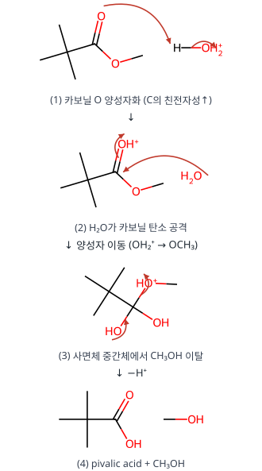

**검산** 적분 3 + 9 = 12H ✓, 탄소 1 + 1 + 4 = 6 ✓, 산소 2 ✓.

**채점 포인트·함정**

- tert-butyl acetate와 혼동하지 않습니다. 3.7 ppm은 **O–CH₃**, 2.0 ppm이면 **CO–CH₃**입니다.
- 가수분해 생성물은 "모두" 그려야 하므로 메탄올을 빠뜨리면 감점입니다.

## 2. 2회 A형 3번 · C₄H₈O의 IR·MS·¹H NMR {#r2a3}

**엄선 이유** — IR·MS·NMR 종합 구조 결정

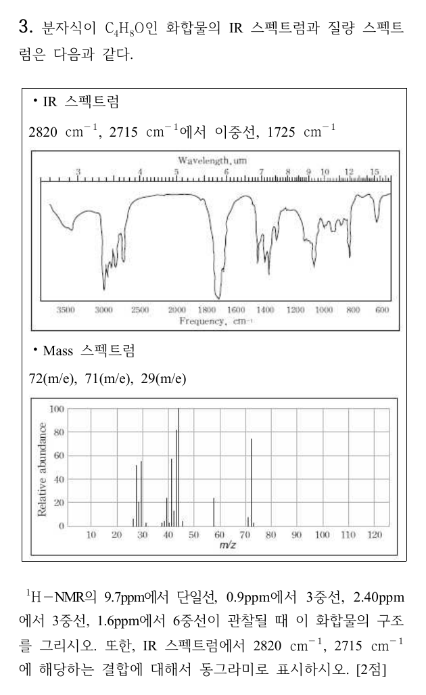

**정답** **butanal** CH₃CH₂CH₂CHO. 2820, 2715 cm⁻¹은 **알데하이드의 C–H(포밀 C–H) 결합**(아래 빨간 원)

**공식·핵심 개념**

- 불포화도 $= \frac{2C + 2 - H}{2}$
- 알데하이드: C=O 1725 cm⁻¹, C–H 2820·2720 cm⁻¹ 이중선(페르미 공명), ¹H 9.5–10 ppm
- n+1 규칙, McLafferty 자리옮김(γ-H)

**2027 출제 가능성 ★★★★★ 매우 높음** — 분광 자료로 구조를 정하는 문항은 해마다 나옵니다.

**주어진 것** C₄H₈O, IR 2820·2715(이중선)·1725 cm⁻¹, MS 72·71·29, ¹H 9.7(s, 1H), 2.40(t), 1.6(6중선), 0.9(t)

**구할 것** 구조와 2820·2715 cm⁻¹에 해당하는 결합

**풀이 전략** 불포화도 → IR로 작용기 → NMR 갈라짐으로 사슬 연결 순서 → MS 조각으로 확인.

**(1) 불포화도.** $\frac{2(4) + 2 - 8}{2} = 1$ → C=O 하나(또는 고리·C=C).

**(2) IR.** 1725 cm⁻¹는 포화 알데하이드 C=O. 2820·2715 cm⁻¹ 이중선은 CHO의 C–H 신축이 C–H 굽힘 배음과 페르미 공명으로 둘로 갈라진 것입니다. 케톤에는 없습니다.

**(3) ¹H NMR 배정**

| δ (ppm) | 갈라짐 | 수소 | 근거 |
|---|---|---|---|
| 9.7 | s(작은 t) | –CHO | 카보닐 이방성 + O의 끌어당김 |
| 2.40 | t | –CH₂–CHO | 이웃 CH₂ 2H → n+1 = 3 |
| 1.6 | 6중선 | CH₃–CH₂–CH₂ | 이웃 H 3 + 2 = 5 → 6중선 |
| 0.9 | t | CH₃– | 이웃 CH₂ 2H |

(9.7 ppm은 실제로는 이웃 CH₂와 J ≈ 1.7 Hz로 작게 갈라진 삼중선이지만 문제는 단일선으로 주었습니다.)

**(4) MS.** M⁺ 72 = C₄H₈O. 71 = M − H(아실륨 C₃H₇CO⁺). 29 = CHO⁺(또는 C₂H₅⁺). 그림의 가장 큰 봉우리 44는 γ-H가 있는 알데하이드의 McLafferty 자리옮김 조각(CH₂=CHOH⁺•), 43은 C₃H₇⁺입니다.

**검산** 사슬 CH₃–CH₂–CH₂–CHO의 수소 3 + 2 + 2 + 1 = 8, 갈라짐이 t–6중선–t–s로 정확히 맞습니다. 2-methylpropanal이면 0.9 ppm이 6H 이중선이어야 하므로 제외됩니다.

**채점 포인트·함정**

- 동그라미는 C=O가 아니라 **포밀 C–H 결합**에 칩니다.
- butanone(C₄H₈O)도 불포화도 1이지만 9.7 ppm 신호와 2820/2715 이중선이 없습니다.

## 3. 3회 A형 3번 · 분광 자료로 C₁₀H₁₂O₂ 구조 결정 {#r3a3}

**엄선 이유** — ¹H·¹³C NMR까지 쓰는 구조 결정, 최근 기출과 형식이 가장 비슷

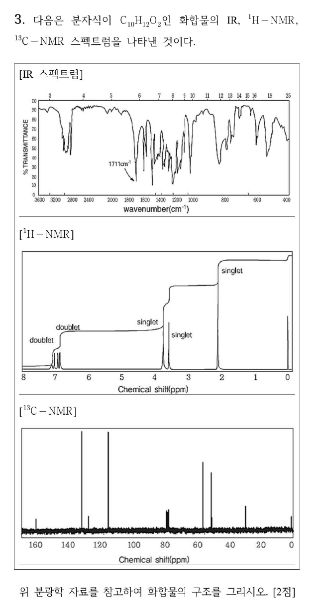

**정답** (공식 정답 없음 · 직접 풀이) **1-(4-methoxyphenyl)propan-2-one** (4-methoxyphenylacetone, p-CH₃O–C₆H₄–CH₂–CO–CH₃)

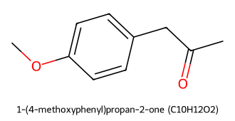

**공식·핵심 개념**

- IR 1711 cm⁻¹: 비콘쥬게이션 지방족 케톤 C=O(콘쥬게이션 케톤은 ~1685)
- ¹H 7.1/6.85 doublet 2쌍 = **para 이치환 벤젠**(AA′BB′)
- 3.8 ppm s 3H = Ar–OCH₃, 3.6 ppm s 2H = Ar–CH₂–C=O, 2.1 ppm s 3H = CH₃C=O

**2027 출제 가능성 ★★★★★ 매우 높음** — 분광 해석(IR + NMR)은 거의 매년 나오는 유기 소재입니다.

**주어진 것** C₁₀H₁₂O₂의 IR(1711 cm⁻¹ 강함), ¹H NMR(7.1 d, 6.85 d, 3.78 s, 3.62 s, 2.13 s), ¹³C NMR(158, 131, 127, 115, 56, 51, 30 ppm, 그 밖에 77 = CDCl₃, 0 = TMS)

**구할 것** 화합물 구조

**풀이 전략** 불포화도 → IR 작용기 → ¹H 조각(적분·갈라짐) → ¹³C로 탄소 종류 확인 → 조립.

**(1) 불포화도.**

$$\frac{2(10)+2-12}{2} = 5 = \text{벤젠 고리 }4 + \text{C=O }1$$

**(2) IR.** 1711 cm⁻¹는 C=O입니다. 1735 이상(에스터)이 아니고 1685 정도(아릴 케톤)도 아니므로 **방향족과 콘쥬게이션되지 않은 케톤**입니다. 3200–3600 cm⁻¹에 O–H가 없으므로 두 번째 O는 **에터**입니다.

**(3) ¹H NMR 조각.**

| δ (ppm) | 갈라짐 | 적분 | 조각 |
|---|---|---|---|
| 7.10, 6.85 | doublet × 2 | 2H + 2H | para 이치환 벤젠 |
| 3.78 | singlet | 3H | Ar–O–CH₃ |
| 3.62 | singlet | 2H | Ar–CH₂–C(=O) (이웃 H 없음) |
| 2.13 | singlet | 3H | CH₃–C(=O) |

H 합계 4 + 3 + 2 + 3 = 12 ✓.

**(4) ¹³C 확인.**

- 158(C–O 방향족), 131·115(CH 각 2개라 봉우리가 큼), 127(C–CH₂) → para 이치환 고리의 4종 탄소
- 56: OCH₃, 51: CH₂, 30: COCH₃
- 케톤 C=O(≈206)는 그림 범위(≤170) 밖이라 보이지 않습니다.

**(5) 조립.** CH₃O–C₆H₄–CH₂–C(=O)–CH₃. CH₂가 고리와 C=O 사이에 있어 3.6 ppm로 탈차폐되고 단일선입니다. OMe는 전자 주개라 오르토 H(6.85)가 메타 H(7.1)보다 높은 장에 나옵니다.

**검산** C: 6(고리) + 1(OMe) + 1(CH₂) + 2(COCH₃) = 10, H 12, O 2 → C₁₀H₁₂O₂ ✓(RDKit). 메틸 케톤이 Ar–CO–CH₂CH₃였다면 1685 cm⁻¹와 2.9 q / 1.2 t가 나와야 하므로 제외됩니다.

**채점 포인트·함정**

- 4-methoxyphenyl **acetone**(케톤)입니다. methyl 4-methylphenylacetate(에스터, 1740 cm⁻¹)와 헷갈리기 쉽지만 IR 1711이 케톤을 가리킵니다.
- 3.8 ppm 3H를 에스터 OCH₃로 보면 C=O 위치가 맞지 않습니다.

## 4. 1회 A형 2번 · SN2 입체 반전과 토실화(입체 유지) {#r1a2}

**엄선 이유** — 고리 SN2 반전 + 토실화(입체 유지)를 거꾸로 추적하는 입체화학 대표 유형

**정답** A: trans-데칼린(고리 접합 CH₃), **Cl은 적도**, **OH는 축**(CH₃와 같은 면, 1,3-이축). B: Cl 자리에 **OAc가 축 방향으로 반전**되어 들어간 하이드록시 에스터(C₁₃H₂₂O₃)

**공식·핵심 개념**

- SN2: 뒷면 공격 → **입체 반전**(Walden 반전)
- TsCl/pyridine: O–H의 O가 S를 공격 → **C–O 결합 유지 → 입체 유지**
- 사이클로헥세인: 1,3-관계의 두 축 치환기는 **같은 면**
- 이중 Newman 투영: 위·아래로 수직인 치환기 = 축

**2027 출제 가능성 ★★★★☆ 높음** — 고리 화합물의 SN2 반전과 토실화(입체 유지)를 거꾸로 추적하는 문항은 입체화학의 대표 유형입니다. 이중 Newman 투영은 최근 모의고사에서 자주 쓰입니다.

**주어진 것** A (C₁₁H₁₉ClO) → NaOAc → B → p-TsCl/pyridine → C, C의 구조(이중 Newman 투영: OTs 축·아래, 고리 접합 Me 축·아래, OAc 축·위)

**구할 것** A와 B의 구조

**풀이 전략** C에서 거꾸로 갑니다. 마지막 단계(토실화)는 입체를 바꾸지 않고, 첫 단계(SN2)는 반전시킵니다.

**(1) C 읽기.** Newman 투영에서 세 고리 탄소의 수직 치환기가 모두 축입니다. 접합 탄소의 Me(아래)와 다른 접합 탄소의 H(위)가 서로 반대 → **trans-데칼린**. OTs는 Me와 같은 면(아래) 축, OAc는 반대 면(위) 축입니다.

**(2) C → B (토실화, 입체 유지).** TsCl과의 반응에서 끊기는 결합은 **O–H**뿐이고 C–O 결합은 그대로입니다. 따라서 B에서 OTs 자리에는 **같은 방향(축, Me와 같은 면)의 OH**가 있습니다. OAc는 이미 B에 있었습니다.

**(3) B → A (SN2 반전).** OAc는 NaOAc의 AcO⁻가 C–Cl을 뒷면에서 공격해 들어온 것입니다. B의 OAc가 위쪽 축이므로, A의 Cl은 같은 탄소에서 **아래쪽 = 적도** 방향이었습니다.

**(4) 분자식 확인.**

| 화합물 | 분자식 | 치환기 |
|---|---|---|
| A | C₁₁H₁₉ClO | Cl(적도), OH(축), 접합 CH₃ |
| B | C₁₃H₂₂O₃ | OAc(축, 반전), OH(축), 접합 CH₃ |
| C | C₂₀H₂₈O₅S | OAc(축), OTs(축) |

A → B: −Cl + OCOCH₃ (C₂H₃O₂) → C₁₃H₂₂O₃ ✓.

**왜 이 생성물인가** 아세테이트는 약한 염기이자 괜찮은 친핵체라 2차 할로젠화물에서 E2보다 SN2가 우세합니다. 적도 Cl에 대한 뒷면 공격은 고리 위아래 중 축 방향에서 일어나므로, 생성된 OAc는 축이 됩니다(이후 의자형 뒤집힘은 trans-데칼린이라 불가능). 반대로 OH는 반응 중 C–O 결합이 한 번도 끊기지 않으므로 TsCl 단계까지 방향이 그대로입니다.

**메커니즘 — AcO⁻의 SN2(입체 반전)**

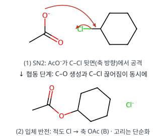

**메커니즘 — 토실화(입체 유지)**

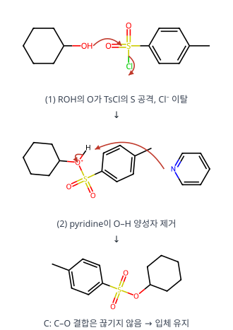

**검산** RDKit으로 세 구조의 분자식(C₁₁H₁₉ClO, C₁₃H₂₂O₃)과 3차원 구조(MMFF)에서 Cl 적도·OH 축·OAc 축임을 확인했습니다.

**채점 포인트·함정**

- OH 쪽까지 반전시키면 틀립니다. 토실화는 **입체 유지**입니다.
- trans-데칼린은 고리 뒤집힘이 없으므로 축·적도가 고정됩니다. 그래서 "축 OAc"가 그대로 C에 보입니다.
- A의 Cl을 축으로 그리면 SN2 후 OAc가 적도가 되어 C와 맞지 않습니다.

## 5. 2회 A형 8번 · 1-isopropylcyclohexene의 수소붕소화와 E2 {#r2a8}

**엄선 이유** — 수소붕소화의 syn 첨가 + 고리 E2(anti-periplanar) 입체 선택성

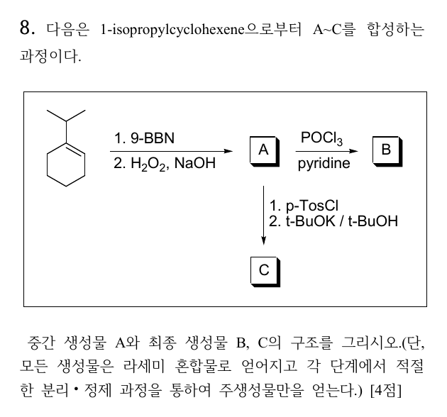

**정답** A **trans-2-isopropylcyclohexan-1-ol**(라셈), B **3-isopropylcyclohexene**(라셈), C **3-isopropylcyclohexene**(B와 같음, 라셈)

**공식·핵심 개념**

- 수소붕소화–산화: anti-Markovnikov, **syn 첨가**, 자리옮김 없음, 산화 단계에서 배열 유지
- POCl₃/pyridine, TsCl → t-BuOK: OH를 좋은 이탈기로 바꾼 뒤 **E2**
- 고리 E2: 이탈기와 β-H가 **트랜스-이축(anti-periplanar)**이어야 함

**2027 출제 가능성 ★★★★★ 매우 높음** — 입체 특이적 첨가와 고리 E2의 위치 선택성은 유기 서술형의 고정 소재입니다.

**주어진 것** 1-isopropylcyclohexene, (1) 9-BBN (2) H₂O₂/NaOH → A, A + POCl₃/pyridine → B, A + (1) TsCl (2) t-BuOK → C, 모두 라셈

**구할 것** A, B, C 구조

**풀이 전략** 수소붕소화의 위치·입체 선택성으로 A의 상대 배열(cis/trans)을 정하고, 그 배열에서 이탈기와 anti-periplanar인 β-H가 어느 쪽에 있는지로 알켄 위치를 정합니다.

**(1) A.** B는 덜 치환되고 덜 붐비는 C2에, H는 C1에 붙습니다(부피 큰 9-BBN이라 선택성이 더 큼). B와 H가 같은 면(syn)으로 들어가므로 새 C1–H와 C2–B가 cis, 즉 **C2–B와 C1–iPr은 trans**입니다. 산화에서 B가 OH로 배열을 유지하며 바뀌므로 OH와 iPr은 trans → **trans-2-isopropylcyclohexanol**. 위·아래 면 공격 확률이 같아 라셈입니다.

**(2) B.** POCl₃가 OH를 –OPOCl₂로 바꾸고 피리딘이 E2를 일으킵니다. 이탈기가 축 방향일 때만 E2가 가능한데, trans-1,2에서 OPOCl₂가 축이면 iPr도 축이고 그 탄소의 H(3차 H)는 **적도**라 anti-periplanar가 아닙니다. 남은 β-H는 반대쪽 CH₂(C6)의 축 H뿐 → C1=C6 이중결합 → 번호를 다시 매기면 **3-isopropylcyclohexene**(덜 치환된 알켄, 비-Zaitsev).

**(3) C.** TsCl은 C–O 결합을 건드리지 않고 OTs를 만듭니다(배열 유지). t-BuOK도 같은 이유로 C6의 축 H만 제거할 수 있고, 부피 큰 염기라 덜 치환된 쪽을 선호하는 성질까지 겹쳐 **B와 같은 생성물**이 됩니다.

**메커니즘 — 수소붕소화–산화 (A)**

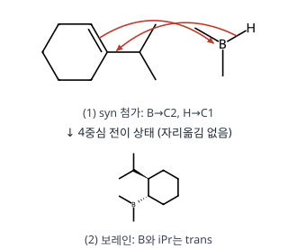

**메커니즘 — POCl₃/pyridine E2 (B)**

**메커니즘 — 토실화 후 t-BuOK E2 (C)**

**왜 이 생성물인가.** E2의 위치 선택성은 "더 치환된 알켄(Zaitsev)"보다 **입체 조건(anti-periplanar)**이 먼저입니다. 3차 H가 이탈기와 trans-이축이 될 수 없으므로 Zaitsev 생성물(1-isopropylcyclohexene)은 거의 생기지 않습니다.

**검산** A C₉H₁₈O(출발물 C₉H₁₆ + H₂O), B·C C₉H₁₆(A − H₂O). RDKit로 확인한 A의 두 입체중심은 (1S,2R)/(1R,2S) 짝으로 trans입니다.

**채점 포인트·함정**

- A를 cis로 그리거나, B를 Zaitsev 생성물(출발물로 되돌아간 구조)로 쓰는 것이 가장 흔한 오답입니다.
- "라세미 혼합물"이라 했으므로 입체 표시는 상대 배열(trans)만 맞으면 됩니다.

## 6. 2회 B형 9번 · 데칼린 알코올의 E2와 수소붕소화 {#r2b9}

**엄선 이유** — 데칼린 고리의 E2·수소붕소화 — 의자형 입체 특이성 고난도

**정답** B **A의 메실레이트**(C1–OMs, 배열 유지), C **4a-D-Δ¹⁽⁸ᵃ⁾-옥탈린**(C1=C8a), 과정 (가) 시약 **ㄴ**(1) BD₃/THF 2) H₂O₂, NaOH)

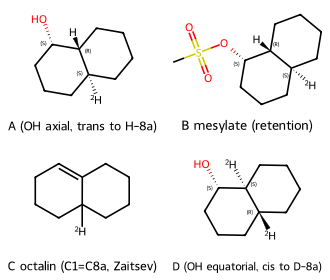

**공식·핵심 개념**

- MsCl/Et₃N: O–H → O–Ms, C–O 결합은 그대로(배열 유지)
- 고리 E2: 이탈기와 β-H가 trans-이축, 가능하면 Zaitsev
- BD₃ 수소붕소화: syn 첨가, D는 더 치환된 탄소, 덜 붐비는 면에서 접근

**2027 출제 가능성 ★★★★☆ 높음** — 고리 계의 입체 특이적 반응 배열은 유기 서술형 고난도 소재입니다.

**주어진 것** A(trans-데칼린, C1–OH, C8a–H, C4a–D), MsCl/Et₃N → B, NaOMe/가열 → C, 과정 (가) → D(C1–OH 적도, C8a·C4a에 D)

**구할 것** B, C 구조, (가)의 시약

**풀이 전략** A의 OH와 C8a–H가 trans-이축인지 확인해 E2 방향을 정하고, D의 구조(OH·D의 위치와 면)로 (가)의 첨가 방식을 역추적합니다.

**(1) A의 입체.** 그림에서 C1–OH(점선, 아래), C8a–H(쐐기, 위), C4a–D(점선, 아래)입니다. 고리 접합 치환기가 서로 반대 면이므로 trans-데칼린이고, 접합 위치의 H·D는 축 방향입니다. C8a–H(위, 축)와 이웃 C1–OH(아래)는 trans-1,2 → **둘 다 축**입니다.

**(2) B.** MsCl이 OH의 O를 메실화합니다. C–O 결합이 끊어지지 않으므로 OMs도 축, 배열 그대로입니다.

**(3) C.** NaOMe(강염기)·가열 → E2. OMs(축)와 anti-periplanar인 β-H는 C8a–H(축)와 C2의 축 H 두 가지입니다. 더 치환된 알켄(삼치환)을 주는 **C8a–H 제거가 Zaitsev 주생성물** → C1=C8a 이중결합(Δ¹⁽⁸ᵃ⁾-옥탈린), C4a–D는 그대로.

**(4) (가) 시약 고르기.** D에는 C1에 OH, C8a에 D가 새로 붙어 있고 둘이 같은 면(cis)입니다. 즉 **C=C에 D와 OH가 syn, anti-Markovnikov(OH가 덜 치환된 C1)**로 들어갔습니다 → **ㄴ BD₃ 후 H₂O₂/NaOH**.

- ㄱ H₃PO₄/D₂O: 탄소양이온 경유 Markovnikov → OD가 3차 탄소(C8a)에 붙음
- ㄷ NBS/D₂O: 브로모하이드린(Br 포함)
- ㄹ 옥시수은화: Markovnikov → OH가 C8a

**(5) 면 선택성.** BD₃는 축 방향 C4a–D가 막는 아래 면을 피해 위 면으로 접근 → C8a–D(위)와 C4a–D(아래)가 다시 trans 접합이 되고, C1–OH(위)는 C8a–D(위, 축)와 cis → **적도**입니다.

**메커니즘 — 메실화와 E2 (A → B → C)**

**메커니즘 — BD₃ 수소붕소화–산화 (C → D)**

**왜 이 생성물인가.** C2–H 제거(이치환 알켄)도 입체 조건은 맞지만, C8a–H 제거가 더 안정한 삼치환 알켄을 줍니다. 이후 수소붕소화의 syn·anti-Markovnikov 성질이 OH(C1)와 D(C8a)의 위치·면을 동시에 결정합니다.

**검산** 분자식 A C₁₀H₁₇DO → B C₁₁H₁₉DO₃S → C C₁₀H₁₅D → D C₁₀H₁₆D₂O. RDKit 3D 배좌로 A(OH와 C8a–H 반대 면), D(OH와 C8a–D 같은 면, C4a–D 반대)를 확인했습니다.

**채점 포인트·함정**

- B는 SN2가 아니라 O의 메실화이므로 C1의 배열이 뒤집히지 않습니다.
- 시약 ㄱ을 고르면 D가 C1이 아니라 C8a에 OD가 붙는 구조가 됩니다.

## 7. 1회 B형 8번 · NBS 브로민화 → E2 → Diels–Alder → 오존 분해 {#r1b8}

**엄선 이유** — NBS → E2 → Diels–Alder(endo) → 오존 분해로 구조를 추적하는 다단계 서술형

**정답** B = **(E)-1-nitro-4-(prop-1-en-1-yl)benzene**, C = Diels–Alder 부가물(노보넨, **아릴 endo·메틸 exo, 두 치환기 trans**, 라셈), D = 오존 분해 생성물 **사이클로펜테인-1,3-다이카브알데하이드**(두 CHO는 cis, 아릴은 CHO와 cis, 메틸은 trans, C₁₄H₁₅NO₄, 라셈)

**공식·핵심 개념**

- NBS/hν: **벤질 자리** 라디칼 브로민화(벤질 라디칼의 공명 안정화)
- NaOEt/EtOH: E2, **Zaitsev + 콘쥬게이션** → (E)-스타이렌형 알켄
- Diels–Alder: suprafacial **syn 첨가 → 다이엔오필의 trans 관계 유지**, **endo 규칙**(π 치환기가 다이엔 아래)
- O₃ → Me₂S: C=C → 두 C=O (환원적 후처리 → 알데하이드)

**2027 출제 가능성 ★★★★☆ 높음** — Diels–Alder의 입체 선택성(endo, 입체 특이성)과 오존 분해를 이어 구조를 추적하는 문항은 유기 서술형의 대표입니다.

**주어진 것** A = 1-nitro-4-propylbenzene, ① NBS/hν ② NaOEt/EtOH → B, B + 사이클로펜타다이엔(가열) → C, ① O₃ ② SMe₂ → D

**구할 것** B, C, D의 구조

**풀이 전략** 각 단계의 위치 선택성(벤질), 입체(E, endo, trans 유지)를 차례로 결정합니다.

**(1) A → 벤질 브로마이드.** Br•가 C–H 결합 중 가장 약한 **벤질 C–H**(BDE ≈ 357 kJ/mol)를 떼어 냅니다. 생긴 벤질 라디칼은 벤젠 고리와 공명 안정화되고, Br₂(NBS + HBr에서 저농도로 공급)와 반응해 ArCHBrCH₂CH₃가 됩니다. NBS는 Br₂ 농도를 낮게 유지해 고리나 C=C 첨가를 막습니다.

**(2) → B (E2).** EtO⁻가 β-H(CH₂)를 떼며 Br이 이탈합니다. 생기는 C=C가 고리와 콘쥬게이션하는 **ArCH=CHCH₃**이며, 입체 장애가 작은 **(E)**가 주생성물입니다. B = C₉H₉NO₂.

**(3) B → C (Diels–Alder).** 사이클로펜타다이엔(s-cis 고정)이 다이엔, B의 C=C가 다이엔오필입니다(니트로페닐이 전자를 당겨 활성화).

- **입체 특이성**: (E)-알켄의 trans 관계가 생성물에서도 **trans**(Ar과 CH₃가 반대쪽).
- **endo 규칙**: π계를 가진 아릴기가 전이 상태에서 다이엔 아래(endo)에 놓여 이차 궤도 상호작용으로 안정화 → **Ar endo, CH₃ exo**.
- 두 면에서 같은 확률로 공격 → **라셈 혼합물**.

**(4) C → D (오존 분해).** 노보넨의 C=C(C5=C6)만 끊어집니다(벤젠 고리는 O₃에 불활성). 이환 골격이 열려 **사이클로펜테인**이 남고, 끊긴 두 탄소가 각각 **CHO**가 됩니다. 두 CHO는 원래 같은 다리의 양 끝이므로 **cis**이고, endo였던 아릴은 CHO와 같은 면, exo였던 메틸은 반대 면이 됩니다.

$$\mathrm{C_{14}H_{15}NO_2} \xrightarrow{\mathrm{O_3};\ \mathrm{Me_2S}} \mathrm{C_{14}H_{15}NO_4}$$

**왜 이 생성물인가** 벤질 자리가 아닌 C–H(2차 BDE ≈ 410 kJ/mol)는 NBS 조건에서 거의 반응하지 않습니다. E2에서 β-H는 CH₂ 쪽에만 있어 위치 이성질체 문제가 없고, 콘쥬게이션 덕분에 (E)-알켄이 열역학·속도론적으로 유리합니다. Diels–Alder에서 다이엔오필의 기하는 협동 반응이라 그대로 보존되고, 아릴(π계) endo가 속도론적 생성물입니다.

**메커니즘 — NBS 벤질 브로민화(라디칼 연쇄, 반쪽 화살표)**

**메커니즘 — E2 제거**

**메커니즘 — Diels–Alder 고리화 첨가**

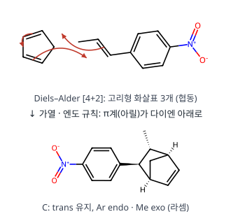

**메커니즘 — 오존 분해(Criegee)와 환원적 후처리**

**검산** C: C₉H₉NO₂ + C₅H₆ = C₁₄H₁₅NO₂ ✓, D: + O₂ → C₁₄H₁₅NO₄ ✓. RDKit 3차원 구조로 C의 아릴이 C=C 쪽(endo), 메틸이 CH₂ 다리 쪽(exo)임을 확인했습니다.

**채점 포인트·함정**

- C에서 Ar과 CH₃를 cis로 그리면 입체 특이성 위반입니다.
- endo/exo를 거꾸로 하면(메틸 endo) D의 상대 배치가 바뀝니다.
- D는 SMe₂(환원적) 후처리이므로 카복실산이 아니라 **알데하이드**입니다.
- C와 D는 키랄이지만 라셈으로 생기므로 한 거울상만 그리고 "라셈"이라 적습니다.

## 8. 3회 B형 9번 · 니트로벤젠에서 1-브로모-2,6-다이클로로-4-tert-뷰틸벤젠 합성 {#r3b9}

**엄선 이유** — 보호기·지향성·다이아조늄을 엮는 방향족 다단계 합성

**정답** (공식 정답 없음 · 직접 풀이·필기 일치)

- A: **N-(4-tert-butylphenyl)acetamide**
- B: **4-tert-butylaniline**
- C: **2,6-dichloro-4-tert-butylaniline**
- (가) **NaNO₂, HCl (0–5 °C)**, (나) **CuBr** (Sandmeyer)

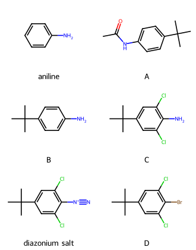

**공식·핵심 개념**

- Fe/HCl: Ar–NO₂ → Ar–NH₃⁺ → (NaOH) Ar–NH₂
- 아세틸 보호: –NHAc는 여전히 o,p-지향이지만 덜 활성화되고 루이스 산과 착물을 만들지 않음
- 다이아조화: ArNH₂ + HNO₂ → ArN₂⁺, Sandmeyer: CuX → ArX

**2027 출제 가능성 ★★★★★ 매우 높음** — 방향족 다단계 합성(보호기 + 지향성 + 다이아조늄)은 유기 4점 문항의 단골입니다.

**주어진 것** 니트로벤젠 → 1. Fe, HCl 2. NaOH → 3. Ac₂O/pyridine 4. t-BuCl/AlCl₃ → A → ⁻OH, 가열 → B → Cl₂ → C → (가) → (나) → D

**구할 것** A~C 구조, (가)·(나) 시약

**풀이 전략** D에서 거꾸로 봅니다. Br은 다이아조늄으로 바꾸어 넣고, 두 Cl은 NH₂의 ortho로 들어가며, t-Bu는 para에 있습니다.

**(1) 아닐린과 아세틸화.** Fe/HCl로 니트로기를 아민으로 환원하고 NaOH로 중화하면 아닐린이 됩니다. Ac₂O/pyridine으로 아세트아닐라이드를 만듭니다. 이 보호에는 두 가지 이유가 있습니다.

- 자유 NH₂는 AlCl₃와 루이스 산–염기 착물을 이루어 Friedel–Crafts를 막습니다.
- 과도한 활성화로 다중 치환이 일어납니다.

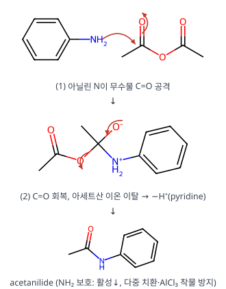

**(2) Friedel–Crafts 알킬화 → A.** AlCl₃가 t-Bu⁺를 만들고, –NHAc의 o,p-지향 중 입체적으로 유리한 **para**에 붙습니다.

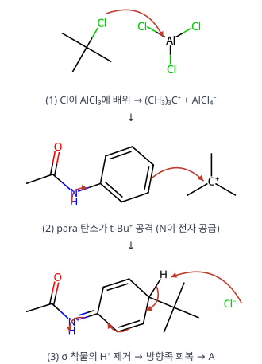

**(3) 가수분해 → B.** ⁻OH와 가열로 아마이드를 가수분해하여 4-tert-butylaniline을 얻습니다.

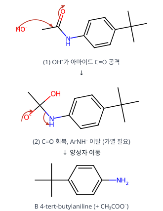

**(4) 염소화 → C.** NH₂는 강한 o,p-지향 활성화기입니다. para는 t-Bu가 막고 있으므로 두 **ortho** 자리(2, 6)에 Cl₂가 들어갑니다. 아닐린은 활성이 커서 루이스 산 없이도 이중 치환됩니다.

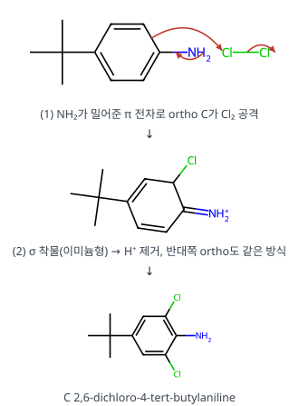

**(5) (가)·(나).** NaNO₂/HCl(0–5 °C)로 NO⁺를 만들어 다이아조늄염을 얻습니다. 이어 CuBr(Sandmeyer)로 N₂를 Br로 바꿉니다.

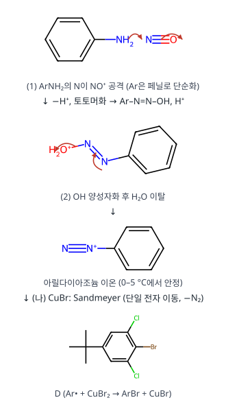

**왜 이 생성물인가** NH₂를 "지향기"로 쓴 뒤 다이아조늄으로 바꾸어 원하는 치환기(Br)로 교체하는 전략입니다. Br을 직접 넣으면 tert-뷰틸 기준 위치가 맞지 않습니다. NH₂가 있던 자리(1번)에만 Br을 넣을 수 있는 방법이 Sandmeyer입니다.

**검산** 분자식 A C₁₂H₁₇NO, B C₁₀H₁₅N, C C₁₀H₁₃Cl₂N, D C₁₀H₁₁BrCl₂(RDKit) ✓.

**채점 포인트·함정**

- A에서 t-Bu를 ortho에 쓰면 틀립니다(입체 장애 → **para**).
- (나)를 CuCl이나 HBr만 쓰면 감점됩니다. **CuBr**입니다.
- 다이아조화 온도(0–5 °C)를 쓰면 좋습니다(분해 방지).

## 9. 2회 A형 9번 · 1,2-dichloroethane(C₂ₕ)의 C–H 신축 진동 {#r2a9}

**엄선 이유** — 진동 모드 기약표현과 IR/Raman 활성 — 군론 고정 출제

**정답** (답지 난이도 ★★☆☆☆) $\Gamma_{C-H}$ = **4, 0, 0, 0** (E, C₂, i, σh), $\Gamma = A_g + B_g + A_u + B_u$, IR 활성 **$A_u + B_u$**

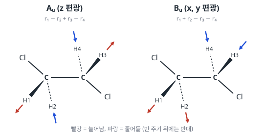

**공식·핵심 개념**

- 결합 벡터의 지표 = 그 연산에서 제자리에 남는 C–H 결합 수
- 축소 공식 $n_i = \frac1h\sum_R \chi(R)\chi_i(R)$, C₂ₕ는 $h = 4$
- IR 활성: x, y, z와 같은 기약표현 / 중심 대칭 분자는 상호 배제

**2027 출제 가능성 ★★★★★ 매우 높음** — 진동 모드의 기약표현과 IR/Raman 활성은 무기 영역에서 거의 매년 나옵니다.

**주어진 것** anti 형태의 ClCH₂–CH₂Cl(C₂ₕ), 지표표

**구할 것** C–H 신축 가약 표현의 지표, IR 활성 기약 표현, 진동 모드 그림

**풀이 전략** C–H 결합 4개를 벡터로 두고 각 연산에서 제자리에 남는 개수를 센 뒤 축소합니다.

**(1) 대칭 요소 확인.** σh = Cl–C–C–Cl이 놓인 분자 평면, C₂ = C–C 중점을 지나 그 평면에 수직, i = C–C 중점. H 네 개는 모두 평면 밖(위 2, 아래 2)에 있습니다.

**(2) 지표.**

| 연산 | 제자리 C–H | χ |
|---|---|---|
| E | 4 | 4 |
| C₂ | 0 (H1↔H3 등, 탄소가 바뀜) | 0 |
| i | 0 (H1↔H4) | 0 |
| σh | 0 (평면 위 H ↔ 아래 H) | 0 |

**(3) 축소.**

$$n(A_g) = \tfrac14[4(1) + 0 + 0 + 0] = 1, \quad n(B_g) = \tfrac14[4(1) + 0 + 0 + 0] = 1$$

$$n(A_u) = \tfrac14[4(1) + 0 + 0 + 0] = 1, \quad n(B_u) = \tfrac14[4(1) + 0 + 0 + 0] = 1$$

$\Gamma = A_g + B_g + A_u + B_u$. 그중 $A_u(z)$, $B_u(x, y)$가 IR 활성, $A_g$, $B_g$는 Raman 활성입니다.

**(4) 모드 모양(투영 연산자).** H1(Ca, 앞), H2(Ca, 뒤), H3(Cb, 앞), H4(Cb, 뒤)라 하면 C₂: H1→H3, i: H1→H4, σh: H1→H2입니다.

$$A_u:\ r_1 + r_3 - r_4 - r_2$$

앞쪽(쐐기) H 둘이 늘어날 때 뒤쪽(점선) H 둘이 줄어듦 → 알짜 쌍극자가 분자 평면에 수직(z).

$$B_u:\ r_1 - r_3 - r_4 + r_2$$

한 CH₂의 두 C–H가 함께 늘어날 때 다른 CH₂는 함께 줄어듦 → 쌍극자가 분자 평면 안(x, y).

**검산** 모드 수 1 + 1 + 1 + 1 = 4 = C–H 결합 수. 중심 대칭이 있으므로 IR 활성(u)과 Raman 활성(g)이 겹치지 않습니다(상호 배제).

**채점 포인트·함정**

- σh에서 H가 제자리라고 세기 쉽습니다. H는 평면 위·아래에 있어 서로 바뀝니다.
- 그림은 모드마다 4개 결합의 늘어남·줄어듦 위상을 모두 표시해야 합니다.

## 10. 1회 A형 1번 · SO₄²⁻의 S–O 신축 진동 (Td) {#r1a1}

**엄선 이유** — Td 사면체 음이온의 IR·Raman 띠 수 — 군론 기본형

**정답** (답지 난이도 ★★☆☆☆) ㉠ **2**, ㉡ **1**, ㉢ **$8C_3$**, ㉣ **$3C_2$**

**공식·핵심 개념**

- 환원 공식 $n_i = \dfrac1h\sum_R g_R\,\chi_\Gamma(R)\,\chi_i(R)$
- 결합 신축의 $\chi(R)$ = 그 조작에서 **움직이지 않는 결합 수**
- IR 활성: $x, y, z$와 같은 대칭 / 라만 활성: 이차 함수와 같은 대칭
- $T_d$: $h = 24$ ($E,\ 8C_3,\ 3C_2,\ 6S_4,\ 6\sigma_d$)

**2027 출제 가능성 ★★★★☆ 높음** — 군론으로 IR·라만 띠 수를 세는 문항은 무기 기입형의 단골입니다. 사면체(CH₄, SO₄²⁻, Ni(CO)₄)는 지표표가 단순해 자주 쓰입니다.

**주어진 것** SO₄²⁻ ($T_d$), 지표표에서 두 열(㉢, ㉣)의 머리말이 빠짐

**구할 것** S–O 신축 진동의 라만 띠 수 ㉠, IR 띠 수 ㉡, 지표표의 ㉢·㉣

**풀이 전략** 먼저 지표값으로 빠진 조작을 찾고, 네 S–O 결합을 기저로 가약 표현을 만들어 환원합니다.

**(1) 지표표의 빈 열.** $T_d$의 조작은 $E,\ 8C_3,\ 3C_2,\ 6S_4,\ 6\sigma_d$입니다. E 표현의 지표가 −1인 열은 $C_3$(120° 회전에서 이중 축퇴 오비탈이 섞임), 2인 열은 $C_2$입니다. 계수까지 합하면 $1+8+3+6+6 = 24 = h$ ✓. 따라서 ㉢ = $8C_3$, ㉣ = $3C_2$.

**(2) S–O 결합 기저의 지표.** 각 조작에서 제자리에 남는 S–O 결합 수를 셉니다.

| 조작 | $E$ | $8C_3$ | $3C_2$ | $6S_4$ | $6\sigma_d$ |
|---|---|---|---|---|---|
| 남는 결합 | 4개 모두 | 축 위 1개 | 0 | 0 | 거울면 위 2개 |
| $\chi(\Gamma_{SO})$ | 4 | 1 | 0 | 0 | 2 |

**(3) 환원.**

$$n(A_1) = \tfrac{1}{24}\left[4\cdot1 + 8\cdot1\cdot1 + 0 + 0 + 6\cdot2\cdot1\right] = \tfrac{24}{24} = 1$$

$$n(A_2) = \tfrac{1}{24}\left[4 + 8 + 0 + 0 + 6\cdot2\cdot(-1)\right] = 0$$

$$n(E) = \tfrac{1}{24}\left[4\cdot2 + 8\cdot1\cdot(-1) + 0 + 0 + 0\right] = 0$$

$$n(T_1) = \tfrac{1}{24}\left[4\cdot3 + 0 + 0 + 0 + 6\cdot2\cdot(-1)\right] = 0$$

$$n(T_2) = \tfrac{1}{24}\left[4\cdot3 + 0 + 0 + 0 + 6\cdot2\cdot1\right] = \tfrac{24}{24} = 1$$

$$\Gamma_{SO} = A_1 + T_2$$

**(4) 선택 규칙.**

| 진동 | IR ($x,y,z$) | 라만 (이차 함수) |
|---|---|---|
| $A_1$ (대칭 신축, ~981 cm⁻¹) | 불활성 | 활성 ($x^2+y^2+z^2$) |
| $T_2$ (비대칭 신축, ~1105 cm⁻¹) | 활성 | 활성 ($xy, xz, yz$) |

라만 띠 **2개**(㉠), IR 띠 **1개**(㉡). $T_2$는 삼중 축퇴라 띠 하나로 나타납니다.

**검산** 차원 $1 + 3 = 4$ = S–O 결합 수 ✓. 실제 황산 이온 스펙트럼도 라만 981·1105 cm⁻¹, IR 1105 cm⁻¹ 근처 한 개입니다.

**채점 포인트·함정**

- 강의 필기의 "A₁ + E"는 오기입니다. E로 놓으면 차원이 1 + 2 = 3이 되어 결합 수 4와 맞지 않습니다.
- 축퇴된 진동은 띠 1개로 셉니다(T₂ → 3개가 아님).
- $T_d$는 반전 중심이 없어 상호 배제 규칙이 적용되지 않습니다. $T_2$가 IR·라만 모두 활성입니다.

## 11. 3회 B형 6번 · [M(CO)₃(H₂O)₃]⁺의 치환 반응과 fac/mer IR {#r3b6}

**엄선 이유** — 카보닐 IR 띠 수로 fac/mer 판별 + 치환 반응 기구

**정답** (답지 난이도 ★★★☆☆)

- ㉠ **18**(전자 규칙). H₂O 교환 반응: **회합(associative, 회합 교환 I_a)** 메커니즘
- Mn이 빠른 이유(CFT): 같은 족 5d의 Re는 4d·3d보다 **Δo가 커서** 저스핀 d⁶의 결정장 안정화 에너지가 크다. 7배위 전이 상태로 갈 때 잃는 **결정장 활성화 에너지(CFAE)**가 Re에서 더 크므로 Re가 느리고 Mn이 빠르다.
- 구조: **fac-[Mn(CO)₃(H₂O)₃]⁺**(C₃ᵥ). CO 신축 $\Gamma = A_1 + E$ → IR 활성 **2개**(2051, 1944 cm⁻¹와 일치). mer(C₂ᵥ)는 $2A_1 + B_1$ → 3개.

**공식·핵심 개념**

- 활성화 부피 $\Delta V^\ddagger < 0$ → 회합적(전이 상태가 더 조밀)
- 저스핀 d⁶ 팔면체: CFSE $= -2.4\Delta_o$, 치환 비활성
- IR 활성: x, y, z와 같은 대칭의 기약표현

**2027 출제 가능성 ★★★★☆ 높음** — 카보닐 IR 띠 수로 이성질체를 고르는 문항은 군론 응용의 대표 소재입니다.

**주어진 것** Mn(I)·Re(I) 착물, $\Delta V^\ddagger = -4.5$ cm³ mol⁻¹, $k_{\mathrm{Mn}} > k_{\mathrm{Re}}$, 이성질체 2개, CO 띠 2개, C₂ᵥ·C₃ᵥ 지표표

**구할 것** ㉠, 교환 반응 종류, 속도 차이의 CFT 근거, 구조와 지표표 근거

**풀이 전략** 전자 수 → 활성화 부피 부호 → Δo 크기로 속도를 설명하고, 환원 공식으로 CO 띠 수를 셉니다.

**(1) 전자 수.** Mn⁺는 d⁶, CO 3 × 2 e, H₂O 3 × 2 e이므로 $6 + 6 + 6 = 18$ e입니다(Re도 같은 7족).

**(2) 회합.** 18전자인데도 $\Delta V^\ddagger < 0$입니다. 이는 들어오는 H₂O가 결합을 먼저 만드는 회합적 활성화(I_a)를 뜻합니다.

**(3) 속도 차이.** Δo는 3d < 4d < 5d 순으로 커집니다(5d는 약 1.5~2배). 저스핀 d⁶에서 전이 상태(7배위)로 가면 CFSE의 손실(CFAE)이 Δo에 비례해 커지므로 Re의 활성화 에너지가 더 큽니다.

**(4) fac (C₃ᵥ) 환원.** CO 3개의 신축 벡터 표현은 $\Gamma = (3, 0, 1)$입니다(E, 2C₃, 3σᵥ).

$$n(A_1) = \tfrac16[3\cdot1 + 2\cdot0\cdot1 + 3\cdot1\cdot1] = 1$$

$$n(A_2) = \tfrac16[3 + 0 + 3(-1)] = 0$$

$$n(E) = \tfrac16[3\cdot2 + 2\cdot0\cdot(-1) + 3\cdot1\cdot0] = 1$$

$\Gamma = A_1 + E$입니다. A₁(z)와 E(x, y) 모두 IR 활성이므로 **2개**입니다 ✓.

**(5) mer (C₂ᵥ) 환원.** 세 CO가 한 평면(xz)에 있다고 두면 $\Gamma = (3, 1, 3, 1)$입니다(E, C₂, σᵥ(xz), σᵥ′(yz)). C₂와 σᵥ′(yz)에서는 z축 위의 CO 1개만 제자리에 남고, σᵥ(xz)에서는 3개 모두 남습니다.

$$n(A_1) = \tfrac14[3 + 1 + 3 + 1] = 2,\quad n(A_2) = \tfrac14[3 + 1 - 3 - 1] = 0$$

$$n(B_1) = \tfrac14[3 - 1 + 3 - 1] = 1,\quad n(B_2) = \tfrac14[3 - 1 - 3 + 1] = 0$$

$\Gamma = 2A_1 + B_1$입니다. 모두 IR 활성이므로 **3개**입니다 ✗.

**검산** 환원 결과의 차원: fac $1 + 2 = 3$, mer $2 + 1 = 3$ = CO 수 ✓.

**채점 포인트·함정**

- "18전자이므로 해리"라고 쓰면 활성화 부피 자료와 모순입니다.
- 이유는 CFT(Δo, CFAE)로 써야 합니다. 상대론 효과나 M–L 결합 세기만 쓰면 조건 위반입니다.
- 구조는 CO 세 개가 **한 면**을 차지하게 그립니다(fac).

## 12. 2회 B형 6번 · d⁸ Ni²⁺ 착물의 Tanabe–Sugano 해석 {#r2b6}

**엄선 이유** — Ni²⁺ Tanabe–Sugano 해석(Δo, B, 혼합 x) — 결정장 대표 문항

**정답** (답지 난이도 ★★★☆☆) Ni²⁺ 바닥 상태 **³F₄**, [NiX₆]²⁺ **Δo = 11,000**, **x = 1,800**, **B = 1,000 cm⁻¹**, [NiY₆]²⁺ **x = 0.8a cm⁻¹**, ³A₂g → ³T₁g(P) **2a cm⁻¹**

**공식·핵심 개념**

- 팔면체 d⁸(약한 장·강한 장 같음): ³A₂g → ³T₂g = Δo
- ³A₂g → ³T₁g(F) = 1.8Δo − x, ³A₂g → ³T₁g(P) = 1.2Δo + 15B + x
- 같은 대칭 상태(T₁g)끼리 섞이면 서로 밀어냄(x)

**2027 출제 가능성 ★★★★★ 매우 높음** — Ni²⁺ 전자 스펙트럼은 결정장 문항의 대표 예시이며 해마다 변형되어 나옵니다.

**주어진 것** [NiX₆]²⁺ 흡수띠 11,000·18,000·30,000 cm⁻¹ / [NiY₆]²⁺: Δo = a, ³T₂g와 ³T₁g(F) 에너지 같음, 무한 장에서 B = 0

**구할 것** 자유 이온 항, X의 Δo·x·B, Y의 x, Y의 ³A₂g → ³T₁g(P)

**풀이 전략** d⁸ 세 전이의 에너지 식을 세워 세 흡수띠에 대응시킵니다.

**(1) 자유 이온 항.** Ni²⁺ = [Ar]3d⁸. 홀전자 2개 → S = 1, 최대 L: $m_l$ = 2, 2, 1, 1, 0, 0, −1, −1 다음 2개 전자를 2, 1에 → L = 3(F). 반 넘게 찬 껍질이므로 J = L + S = 4 → **³F₄**.

**(2) 전이 에너지 식(바닥 ³A₂g = 0 기준).**

| 들뜬 상태 | 에너지 |
|---|---|
| ³T₂g | Δo |
| ³T₁g(F) | 1.8Δo − x |
| ³T₁g(P) | 1.2Δo + 15B + x |

**(3) [NiX₆]²⁺.**

$$\Delta_o = 11{,}000\ \mathrm{cm^{-1}}$$

$$1.8(11{,}000) - x = 18{,}000 \;\Rightarrow\; x = 19{,}800 - 18{,}000 = 1{,}800\ \mathrm{cm^{-1}}$$

$$1.2(11{,}000) + 15B + 1{,}800 = 30{,}000$$

$$15B = 15{,}000 \;\Rightarrow\; B = 1{,}000\ \mathrm{cm^{-1}}$$

**(4) [NiY₆]²⁺.** ³T₂g와 ³T₁g(F) 에너지가 같으므로

$$1.8a - x = a \;\Rightarrow\; x = 0.8a$$

무한 장에서 B = 0이므로

$$E(^3T_{1g}(P)) = 1.2a + 15(0) + 0.8a = 2a$$

**검산** 합 규칙: ³T₁g(F) + ³T₁g(P) = 3Δo + 15B. X: 18,000 + 30,000 = 48,000 = 33,000 + 15,000 ✓. Y: a + 2a = 3a + 0 ✓. 자유 Ni²⁺의 B(≈1,080 cm⁻¹)보다 작은 1,000 cm⁻¹는 네펠라욱세틱 효과로 타당합니다.

**채점 포인트·함정**

- 자유 이온 항은 "스핀–궤도 짝지음 고려"이므로 J까지(³F₄) 써야 합니다.
- 혼합 효과 x를 빼면 세 흡수띠가 서로 맞지 않습니다.

## 13. 1회 B형 6번 · d³ 착물의 전자 스펙트럼과 배치 혼합 {#r1b6}

**엄선 이유** — d³ 세 스핀 허용 띠 배정과 배치 혼합 — 결정장 분광

**정답** (답지 난이도 ★★☆☆☆)

- M³⁺ 자유 이온 바닥 항(⁴F)의 총 축퇴도: **28**
- (가) **⁴T1g(F)**, (나) **⁴T1g(P)**
- CFSE = **19,668 cm⁻¹**, 혼합 효과 x = **6,242 cm⁻¹**, ν₃ = **35,915 cm⁻¹**
- (나)의 전자 배치: **$t_{2g}^1e_g^2$** (아래 그림 오른쪽)

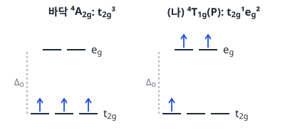

**공식·핵심 개념**

- 항의 축퇴도 $= (2S+1)(2L+1)$
- d³(Oh): ⁴F → ⁴A2g + ⁴T2g + ⁴T1g(F), ⁴P → ⁴T1g(P)
- 혼합 없을 때: $E(^4T_{2g}) = \Delta_o$, $E(^4T_{1g}(F)) = 1.8\Delta_o$, $E(^4T_{1g}(P)) = 1.2\Delta_o + 15B$
- 같은 대칭의 두 ⁴T1g가 섞여 아래는 x만큼 내려가고 위는 x만큼 올라감

**2027 출제 가능성 ★★★★☆ 높음** — d³·d⁸ 착물의 세 스핀 허용 띠 배정과 Δo·B 계산은 결정장 분광의 대표 문항입니다.

**주어진 것** [ML₆]³⁺, d³, M은 4주기(→ Cr³⁺), ν₁ = 16,390 cm⁻¹ (⁴A2g → ⁴T2g), ν₂ = 23,260 cm⁻¹, B = 667 cm⁻¹, ν₃는 전하 이동 띠에 가려짐

**구할 것** 바닥 항 축퇴도, (가)·(나), CFSE, x, ν₃, (나)의 배치

**풀이 전략** d³(Oh)에서는 ν₁ = Δo가 정확합니다. 혼합이 없을 때의 위치와 관측값의 차이가 x입니다.

**(1) 자유 이온 바닥 항.** d³: Hund 규칙 → $m_l = 2, 1, 0$에 하나씩, $L = 3$(F), $S = 3/2$.

$$(2S+1)(2L+1) = 4\times7 = 28$$

**(2) 띠 배정.** 바닥 ⁴A2g($t_{2g}^3$)에서 스핀 허용(쿼텟) 전이는 셋입니다.

| 전이 | 들뜬 상태 배치 | 혼합 없는 에너지 |
|---|---|---|
| ν₁: → ⁴T2g | $t_{2g}^2e_g^1$ | $\Delta_o$ |
| ν₂: → **⁴T1g(F)** (가) | $t_{2g}^2e_g^1$ | $1.8\Delta_o$ |
| ν₃: → **⁴T1g(P)** (나) | $t_{2g}^1e_g^2$ | $1.2\Delta_o + 15B$ |

**(3) CFSE.** $\Delta_o = \nu_1 = 16{,}390$ cm⁻¹.

$$\text{CFSE} = 3\times0.4\Delta_o = 1.2\times16{,}390 = 19{,}668\ \mathrm{cm^{-1}}$$

**(4) 혼합 효과 x.**

$$x = 1.8\Delta_o - \nu_2 = 1.8(16{,}390) - 23{,}260 = 29{,}502 - 23{,}260 = 6{,}242\ \mathrm{cm^{-1}}$$

**(5) ν₃.** 위쪽 ⁴T1g(P)는 같은 x만큼 올라갑니다.

$$\nu_3 = 1.2\Delta_o + 15B + x = 19{,}668 + 15(667) + 6{,}242$$

$$= 19{,}668 + 10{,}005 + 6{,}242 = 35{,}915\ \mathrm{cm^{-1}}$$

**(6) (나)의 배치.** ⁴T1g(P)의 주된 배치는 $t_{2g}^1e_g^2$(t2g에 1개, eg의 두 오비탈에 1개씩, 모두 같은 스핀).

**검산** 두 ⁴T1g의 무게중심 보존: $\nu_2 + \nu_3 = 3\Delta_o + 15B$ → $23{,}260 + 35{,}915 = 59{,}175$, $3(16{,}390) + 10{,}005 = 59{,}175$ ✓.

**채점 포인트·함정**

- d³에서 Δo는 ν₁ 그대로입니다(⁴T2g는 혼합 상대가 없음).
- CFSE는 $t_{2g}^3$ → $3\times(-0.4\Delta_o)$, 크기 1.2Δo입니다.
- (나)의 배치를 $t_{2g}^2e_g^1$로 그리면 ⁴T1g(F)가 됩니다.

## 14. 3회 A형 11번 · [CrL₆]³⁻의 MO, 분광화학 계열, d³ 전이 {#r3a11}

**엄선 이유** — π 주개 MO 도표 + 분광화학 계열 + d³ 전이 에너지

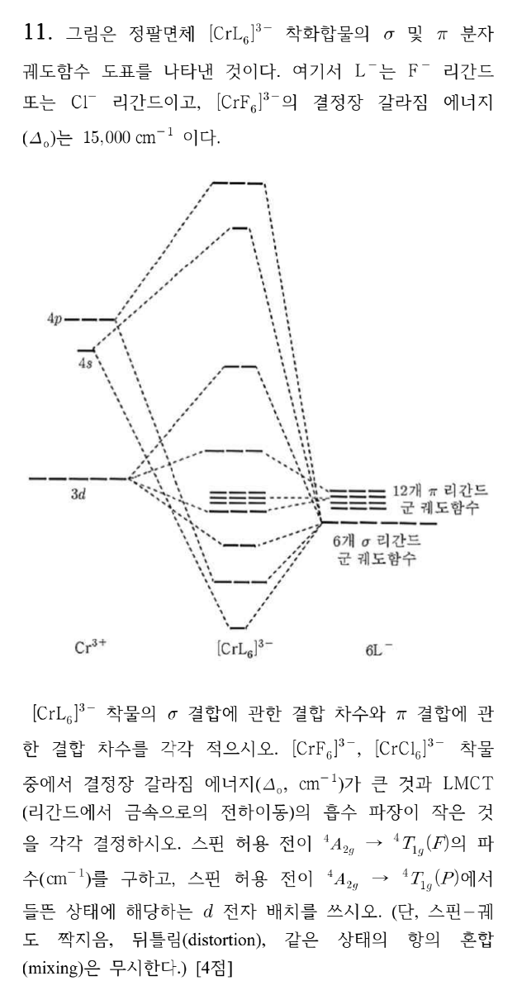

**정답** (답지 난이도 ★★★★☆)

- σ 결합 차수 **6.0**, π 결합 차수 **1.5**
- Δo가 큰 것: **[CrF₆]³⁻** / LMCT 흡수 파장이 짧은 것: **[CrF₆]³⁻**
- $^4A_{2g}\to{}^4T_{1g}(F)$: **27 000 cm⁻¹**
- $^4T_{1g}(P)$ 들뜬 상태의 d 전자 배치: $t_{2g}^1e_g^2$

**공식·핵심 개념**

- 결합 차수 = (결합성 e − 반결합성 e)/2
- π 주개 리간드: t₂g가 π* → Δo 감소(F⁻ > Cl⁻ 순으로 Δo, 둘 다 약한 장)
- 약한 장 d³($^4F$): $^4A_{2g}$ −1.2Δo, $^4T_{2g}$ −0.2Δo, $^4T_{1g}(F)$ +0.6Δo

**2027 출제 가능성 ★★★★☆ 높음** — π 주개 MO 도표와 d–d 전이 에너지 계산은 무기 서술형에 자주 나옵니다.

**주어진 것** [CrL₆]³⁻ σ·π MO 도표(L = F⁻ 또는 Cl⁻, π 리간드 군 오비탈 12개), [CrF₆]³⁻의 Δo = 15 000 cm⁻¹, 항 혼합 무시

**구할 것** σ·π 결합 차수, Δo·LMCT 비교, $^4T_{1g}(F)$ 전이 파수, $^4T_{1g}(P)$의 배치

**풀이 전략** 전자를 MO에 채워 결합성/반결합성을 세고, 약한 장 상관 관계로 $^4F$의 갈라짐을 씁니다.

**(1) 전자 수.** Cr³⁺ d³ + σ 6쌍(12 e) + π 12개 오비탈(24 e) = 39 e

**(2) σ 결합 차수.** σ 결합성 $a_{1g}, t_{1u}, e_g$에 12 e가 모두 들어가고, σ 반결합성($e_g^*$ 등)은 비어 있습니다.

$$\text{BO}_\sigma = \frac{12 - 0}{2} = 6.0$$

**(3) π 결합 차수.** π 리간드 24 e 중 $t_{2g}$와 대칭이 맞는 6 e는 π 결합성 $t_{2g}$에 들어갑니다. 나머지 18 e는 비결합성($t_{1g}, t_{2u}, t_{1u}$)입니다. Cr의 d 전자 3개는 π 반결합성 $t_{2g}^*$에 들어갑니다.

$$\text{BO}_\pi = \frac{6 - 3}{2} = 1.5$$

**(4) Δo 비교.** F⁻와 Cl⁻ 모두 π 주개이지만 분광화학 계열은 F⁻ > Cl⁻입니다. Cl⁻는 π 주개 효과가 더 커서 t₂g*가 더 올라가므로 **[CrF₆]³⁻**의 Δo가 큽니다.

**(5) LMCT.** LMCT는 리간드 오비탈 → 금속 오비탈 전이입니다. F는 전기음성도가 커서 리간드 오비탈이 깊이 있고 산화되기 어렵습니다. 그래서 LMCT 에너지가 크고 파장이 짧은 것은 **[CrF₆]³⁻**입니다.

**(6) $^4T_{1g}(F)$ 파수.** 항 혼합이 없으면 $^4F$의 갈라짐은 무게 중심을 기준으로 다음과 같습니다.

$$^4A_{2g}: -1.2\Delta_o,\quad {}^4T_{2g}: -0.2\Delta_o,\quad {}^4T_{1g}(F): +0.6\Delta_o$$

검산: $1\times(-1.2) + 3\times(-0.2) + 3\times0.6 = 0$ ✓

$$\tilde\nu = 0.6\Delta_o - (-1.2\Delta_o) = 1.8\Delta_o = 1.8\times15\,000 = 27\,000\ \mathrm{cm^{-1}}$$

참고로 $^4A_{2g}\to{}^4T_{2g}$는 $1.0\Delta_o = 15\,000$ cm⁻¹입니다.

**(7) $^4T_{1g}(P)$ 배치.** 바닥 $t_{2g}^3$, $^4T_{2g}$·$^4T_{1g}(F)$는 $t_{2g}^2e_g^1$, $^4T_{1g}(P)$는 전자 2개가 올라간 $t_{2g}^1e_g^2$입니다(위 그림). 홀전자 3개의 스핀은 모두 평행해야 사중항이 유지됩니다.

**검산** 전자 수: σ 12 + π결합 6 + 비결합 18 + t₂g* 3 = 39 ✓.

**채점 포인트·함정**

- π 결합 차수를 $6/2 = 3$으로 쓰면 t₂g*의 d 전자 3개를 빠뜨린 것입니다.
- "LMCT 파장이 작은 것"을 Δo가 작은 쪽으로 헷갈리기 쉽습니다. LMCT는 **리간드 산화 용이성**으로 판단합니다.
- 스핀 화살표는 세 개 모두 같은 방향으로 그립니다.

## 15. 1회 B형 2번 · Monsanto 아세트산 공정 {#r1b2}

**엄선 이유** — Monsanto 촉매 순환의 기본 단계·전자 수 — 유기금속 단골

**정답** (답지 난이도 ★★☆☆☆) 산화성 첨가: **과정 ②**, 속도 결정 단계: **과정 ②**, 18전자 착화합물: **(나), (라)**, (마) = **CH₃COI**

**공식·핵심 개념**

- 산화성 첨가: 산화수 +2, 배위수 +2, 전자 수 +2
- 1,1-이동 삽입(CO 삽입): 산화수 불변, 배위 자리 하나 비움
- 환원성 제거: 산화수 −2, 배위수 −2
- 전자 수 세기(이온 모형): d 전자 + 리간드 전자쌍 × 2

**2027 출제 가능성 ★★★★☆ 높음** — 촉매 순환(Monsanto, Wilkinson, Heck 등)에서 기본 단계와 전자 수를 묻는 문항은 유기금속에서 가장 자주 나옵니다.

**주어진 것** 순환: (가) [Rh(CO)₂I₂]⁻ →② +CH₃I → (나) → ③ → (다) → ④ +CO → (라) → ⑤ → (가) + (마), ⑥ (마) + H₂O → HI + CH₃COOH, Rh = [Kr]4d⁸5s¹

**구할 것** 산화성 첨가 과정, 속도 결정 단계, 18전자 착화합물, (마)

**풀이 전략** 각 착물의 Rh 산화수와 d 전자 수, 배위수를 표로 정리합니다.

**(1) 전자 수.** Rh(0) = 9개의 원자가 전자 → Rh(I) = d⁸, Rh(III) = d⁶.

| 착물 | 리간드 | Rh 산화수 | d 전자 | 리간드 전자 | 총 전자 |
|---|---|---|---|---|---|
| (가) [Rh(CO)₂I₂]⁻ | 2CO, 2I⁻ | +1 | 8 | 4 × 2 = 8 | **16** |
| (나) [Rh(CH₃)(CO)₂I₃]⁻ | 2CO, 3I⁻, CH₃⁻ | +3 | 6 | 6 × 2 = 12 | **18** |
| (다) [Rh(COCH₃)(CO)I₃]⁻ | CO, 3I⁻, 아세틸 | +3 | 6 | 5 × 2 = 10 | **16** |
| (라) [Rh(COCH₃)(CO)₂I₃]⁻ | 2CO, 3I⁻, 아세틸 | +3 | 6 | 6 × 2 = 12 | **18** |

**(2) 단계 분류.**

| 과정 | 반응 | 종류 |
|---|---|---|
| ② | (가) + CH₃I → (나) | **산화성 첨가** (Rh(I) → Rh(III)), **속도 결정** |
| ③ | (나) → (다) | CO의 이동 삽입(CH₃ 이동) |
| ④ | (다) + CO → (라) | 리간드 배위 |
| ⑤ | (라) → (가) + CH₃COI | **환원성 제거** (Rh(III) → Rh(I)) |

**(3) (마).** 환원성 제거에서 아세틸기와 I가 함께 떨어져 **CH₃COI**(아세틸 아이오다이드). ⑥에서 물과 반응해 CH₃COOH와 HI가 되고, HI는 ①에서 CH₃OH를 CH₃I로 바꾸는 데 다시 쓰입니다.

**검산** 전체: ① CH₃OH + HI → CH₃I + H₂O, ②~⑤ CH₃I + CO → CH₃COI, ⑥ CH₃COI + H₂O → CH₃COOH + HI. 합 CH₃OH + CO → CH₃COOH ✓ (HI·Rh 촉매 재생).

**채점 포인트·함정**

- 속도 결정 단계는 CH₃I의 **산화성 첨가**입니다(속도 = k[Rh][CH₃I], CO 압력에 무관).
- 16전자 평면 사각형 Rh(I)은 18전자 규칙을 따르지 않지만 안정한 착물입니다.

## 16. 2회 B형 1번 · HCl + Na₂HPO₄ 혼합액의 적정 {#r2b1}

**엄선 이유** — 다양성자산 혼합물 적정과 지시약 — 분석 최빈출

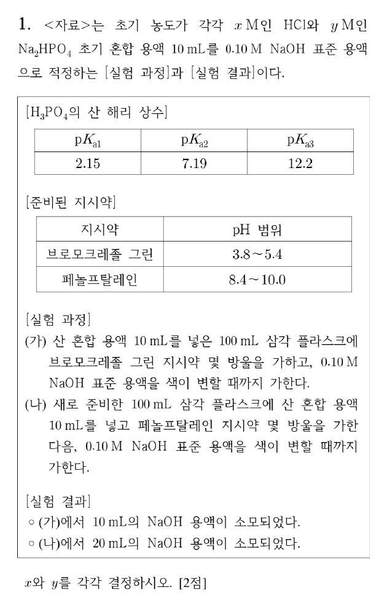

**정답** (답지 난이도 ★★☆☆☆) **x = 0.20**, **y = 0.10**

**공식·핵심 개념**

- 양쪽성 화학종 pH $\approx \frac12(pK_{a,n} + pK_{a,n+1})$
- H₂PO₄⁻ 당량점 ≈ 4.7 (브로모크레졸 그린), HPO₄²⁻ 당량점 ≈ 9.7 (페놀프탈레인)
- 혼합물에서는 먼저 강산이 약염기를 양성자화

**2027 출제 가능성 ★★★★★ 매우 높음** — 다양성자산 혼합물 적정과 지시약 선택은 분석화학 최빈출 유형입니다.

**주어진 것** HCl x M + Na₂HPO₄ y M 혼합액 10 mL, 0.10 M NaOH, pKa 2.15·7.19·12.2, BCG 종말점 10 mL, 페놀프탈레인 종말점 20 mL

**구할 것** x, y

**풀이 전략** 두 지시약의 종말점에서 인산이 어떤 형태인지 정하고, 처음 상태에서 그 형태까지 가는 데 필요한 OH⁻ 몰수를 셉니다.

**(1) 종말점의 형태.** BCG(3.8~5.4)는 H₂PO₄⁻ 당량점 $\frac{2.15 + 7.19}{2} = 4.67$에서, 페놀프탈레인(8.4~10.0)은 HPO₄²⁻ 당량점 $\frac{7.19 + 12.2}{2} = 9.70$에서 변색합니다.

**(2) 혼합 직후.** 강산 HCl이 HPO₄²⁻를 H₂PO₄⁻로 바꿉니다(x > y). 남은 것: H⁺ $(x - y)$·10 mmol, H₂PO₄⁻ $y$·10 mmol.

**(3) (가) BCG.** 인산은 H₂PO₄⁻ 그대로 두고 남은 HCl만 적정합니다.

$$10(x - y) = 0.10\times10 = 1.0\ \mathrm{mmol}$$

**(4) (나) 페놀프탈레인.** H₂PO₄⁻까지 HPO₄²⁻로 되돌리므로 결국 처음 넣은 HCl 전부를 적정한 것과 같습니다.

$$10x = 0.10\times20 = 2.0\ \mathrm{mmol} \;\Rightarrow\; x = 0.20\ \mathrm{M}$$

**(5)** (3)에 넣으면 $10y = 2.0 - 1.0 = 1.0$ → $y = 0.10\ \mathrm{M}$

**검산** (나) − (가) = 10 mL = H₂PO₄⁻ 1.0 mmol을 HPO₄²⁻로 바꾸는 데 쓴 양 = 10y ✓.

**채점 포인트·함정**

- 페놀프탈레인 종말점에서 인산은 PO₄³⁻가 아니라 **HPO₄²⁻**입니다(pKa3 = 12.2라 수용액 적정에서 끝점이 안 보임).

## 17. 3회 A형 9번 · EDTA 치환 적정 {#r3a9}

**엄선 이유** — EDTA 치환 적정·조건 형성 상수·분율

**정답** (답지 난이도 ★★★☆☆)

- 시료의 [A²⁺] = **0.0050 M**
- $K = 1.0\times10^{8}$
- 당량점의 [EDTA] = **2.0 × 10⁻⁷ M**, [H₂Y²⁻] = **2.0 × 10⁻¹⁰ M**

**공식·핵심 개념**

- 치환 적정: $\mathrm{A^{2+} + BY^{2-} \to AY^{2-} + B^{2+}}$ (K ≫ 1), 방출된 B²⁺를 EDTA로 적정 → mol B = mol A
- 조건 형성 상수 $K' = \alpha_{Y^{4-}}K_f$
- $[\mathrm Y^{4-}] = \alpha_{Y^{4-}}[\mathrm{EDTA}]$, 이웃 종의 비 $\frac{[\mathrm{H}_{n}\mathrm Y]}{[\mathrm H_{n-1}\mathrm Y]} = \frac{[\mathrm H^+]}{K_a}$

**2027 출제 가능성 ★★★★☆ 높음** — EDTA 적정(조건 형성 상수, 분율)은 분석화학의 핵심 출제 영역입니다. 치환 적정은 변형 소재로 좋습니다.

**주어진 것** 시료 50.0 mL + 0.012 M BY²⁻ 50.0 mL(과량), pH 9.20, 0.0050 M EDTA 50.0 mL로 종말점. $K_1 = 10^{20}$(AY), $K_2 = 10^{12}$(BY), $\alpha_{Y^{4-}} = 0.10$, pKa₅ = 6.20, pKa₆ = 10.20

**구할 것** [A²⁺], $K$, 당량점의 [EDTA]와 [H₂Y²⁻]

**풀이 전략** A가 BY에서 B를 정량적으로 밀어내므로 적정된 B mol = A mol입니다. 당량점은 "BY의 해리 평형"으로 [EDTA]를 구하고, 분율로 [H₂Y²⁻]를 구합니다.

**(1) 치환 평형 상수.** (AY 형성) − (BY 형성):

$$K = \frac{K_1}{K_2} = \frac{1.0\times10^{20}}{1.0\times10^{12}} = 1.0\times10^{8}$$

K가 커서 A²⁺는 모두 AY²⁻가 되고 같은 mol의 B²⁺가 나옵니다.

**(2) [A²⁺].**

$$n_{\mathrm{EDTA}} = 0.0050\ \mathrm M\times50.0\ \mathrm{mL} = 0.25\ \mathrm{mmol} = n_{\mathrm B^{2+}} = n_{\mathrm A^{2+}}$$

$$[\mathrm A^{2+}] = \frac{0.25\ \mathrm{mmol}}{50.0\ \mathrm{mL}} = 0.0050\ \mathrm M$$

(BY 0.60 mmol > 0.25 mmol이므로 과량 조건 ✓)

**(3) 당량점의 조성.** 전체 부피 50 + 50 + 50 = 150 mL입니다.

- AY²⁻: 0.25 mmol(해리 무시)
- BY²⁻: 남은 0.60 − 0.25 = 0.35 mmol + 적정으로 생긴 0.25 mmol = 0.60 mmol

$$[\mathrm{BY^{2-}}] = \frac{0.60}{150} = 4.0\times10^{-3}\ \mathrm M$$

**(4) [EDTA].** 당량점에서 BY의 해리로 $[\mathrm B^{2+}] = [\mathrm{EDTA}] = x$입니다.

$$K_2' = \alpha_{Y^{4-}}K_2 = 0.10\times1.0\times10^{12} = 1.0\times10^{11}$$

$$\frac{4.0\times10^{-3}}{x^2} = 1.0\times10^{11} \Rightarrow x^2 = 4.0\times10^{-14} \Rightarrow x = 2.0\times10^{-7}\ \mathrm M$$

**(5) [H₂Y²⁻].** 먼저 $[\mathrm Y^{4-}] = 0.10\times2.0\times10^{-7} = 2.0\times10^{-8}$ M입니다. $[\mathrm H^+] = 10^{-9.20}$이므로

$$\frac{[\mathrm{HY^{3-}}]}{[\mathrm{Y^{4-}}]} = \frac{10^{-9.20}}{10^{-10.20}} = 10,\qquad \frac{[\mathrm{H_2Y^{2-}}]}{[\mathrm{HY^{3-}}]} = \frac{10^{-9.20}}{10^{-6.20}} = 10^{-3}$$

$$[\mathrm{H_2Y^{2-}}] = 10\times10^{-3}\times2.0\times10^{-8} = 2.0\times10^{-10}\ \mathrm M$$

**검산** 주어진 pKa로 직접 계산한 $\alpha_{Y^{4-}} = \frac{1}{1+10} = 0.091$입니다. 문제의 0.10은 반올림 값입니다. 0.091을 쓰면 [EDTA] = 2.10 × 10⁻⁷, [H₂Y²⁻] = 1.9 × 10⁻¹⁰ M으로 거의 같습니다. 시험에서는 **주어진 0.10**을 씁니다. AY 해리: $K_1' = 10^{19}$이라 무시 조건이 타당합니다.

**채점 포인트·함정**

- 당량점 부피에 BY 용액 50 mL를 빠뜨려 100 mL로 계산하면 [BY]가 달라집니다.
- [BY²⁻]에 처음 남은 0.35 mmol을 빼먹지 마세요(합 0.60 mmol).
- [EDTA]는 **착물을 이루지 않은** 7종의 합이므로 $K'$ 식에 바로 들어갑니다.

## 18. 1회 A형 12번 · 산화–환원 적정 당량점의 전위 {#r1a12}

**엄선 이유** — 산화–환원 적정 당량점 전위 유도(활동도 포함)

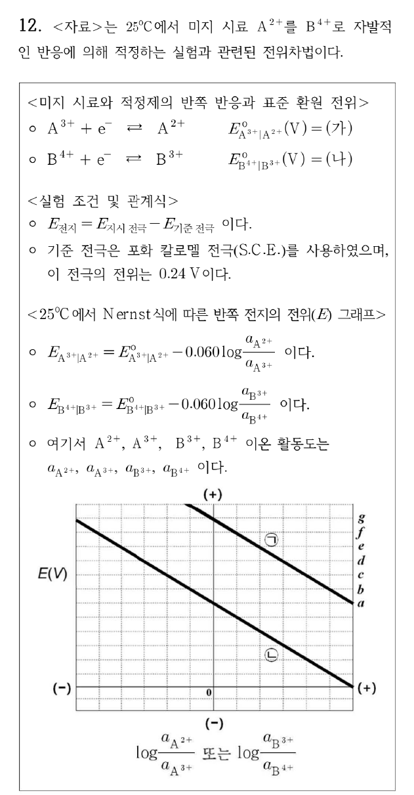

**정답** (답지 난이도 ★★★☆☆)

- (가) = **a**, (나) = **g**
- 당량점 질량 균형식: **[A²⁺] = [B⁴⁺]**, **[A³⁺] = [B³⁺]**
- $E_{\text{지시}} = \dfrac{a+g}{2} - 0.030\log\dfrac{\gamma_{A^{2+}}\gamma_{B^{3+}}}{\gamma_{A^{3+}}\gamma_{B^{4+}}}$ (V)

**공식·핵심 개념**

- 네른스트(25 °C, n = 1): $E = E° - 0.060\log\dfrac{a_{red}}{a_{ox}}$
- 그래프: x = log(a_red/a_ox), 기울기 −0.060 V, **x = 0에서 y절편 = E°**
- 당량점: 두 반쪽 전지 전위가 같고, 반응 화학량론으로 농도가 묶임
- 활동도 $a_i = \gamma_i[i]$

**2027 출제 가능성 ★★★★☆ 높음** — 산화–환원 적정의 당량점 전위 유도는 분석화학 서술형의 대표 문항이며, 활동도 계수까지 넣는 변형이 최근 나옵니다.

**주어진 것** A³⁺/A²⁺: E°(가), B⁴⁺/B³⁺: E°(나), 그래프 ㉠ = B 쌍, ㉡ = A 쌍(기울기 −0.060), 반응 A²⁺ + B⁴⁺ → A³⁺ + B³⁺ (자발)

**구할 것** (가)·(나), 당량점 질량 균형식 2개, 지시 전극 전위

**풀이 전략** 그래프의 x = 0 지점이 E°입니다. 당량점에서는 두 네른스트 식을 더해 농도를 지웁니다.

**(1) E° 읽기.** x = log(활동도 비) = 0일 때 $E = E°$. 오른쪽 눈금 a~g는 같은 간격의 전위 높이입니다. ㉡(A 쌍)은 x = 0에서 높이 **a**, ㉠(B 쌍)은 x = 0에서 높이 **g** → (가) = a, (나) = g. B⁴⁺가 더 강한 산화제(g > a)이므로 A²⁺를 B⁴⁺로 자발 적정할 수 있다는 조건과 맞습니다.

**(2) 질량 균형.** 당량점에서 넣은 B⁴⁺의 몰수 = 처음 A²⁺의 몰수. 1 : 1 반응이므로 생성물끼리, 남은 반응물끼리 같습니다.

$$[\mathrm{A^{3+}}] = [\mathrm{B^{3+}}], \qquad [\mathrm{A^{2+}}] = [\mathrm{B^{4+}}]$$

**(3) 두 네른스트 식.** 평형에서 지시 전극 전위는 두 쌍 모두에 대해 같습니다.

$$E = a - 0.060\log\frac{\gamma_{A^{2+}}[\mathrm{A^{2+}}]}{\gamma_{A^{3+}}[\mathrm{A^{3+}}]}$$

$$E = g - 0.060\log\frac{\gamma_{B^{3+}}[\mathrm{B^{3+}}]}{\gamma_{B^{4+}}[\mathrm{B^{4+}}]}$$

**(4) 더하기.**

$$2E = (a+g) - 0.060\log\frac{\gamma_{A^{2+}}\gamma_{B^{3+}}[\mathrm{A^{2+}}][\mathrm{B^{3+}}]}{\gamma_{A^{3+}}\gamma_{B^{4+}}[\mathrm{A^{3+}}][\mathrm{B^{4+}}]}$$

(2)를 넣으면 $\dfrac{[\mathrm{A^{2+}}][\mathrm{B^{3+}}]}{[\mathrm{A^{3+}}][\mathrm{B^{4+}}]} = 1$이 되어 농도 항이 사라집니다.

$$E_{\text{지시}} = \frac{a+g}{2} - 0.030\log\frac{\gamma_{A^{2+}}\gamma_{B^{3+}}}{\gamma_{A^{3+}}\gamma_{B^{4+}}}$$

**검산** 활동도 계수가 모두 1이면 $E = (a+g)/2$로, 두 쌍의 전자 수가 같을 때의 당량점 공식(평균)과 같습니다 ✓. 측정되는 전지 전압은 $E_{\text{전지}} = E_{\text{지시}} - 0.24$ V입니다.

**채점 포인트·함정**

- 그래프의 오른쪽 끝(x > 0) 높이를 E°로 읽으면 틀립니다. 반드시 **x = 0**에서 읽습니다.
- 계수 0.030은 두 식을 더한 뒤 2로 나누어서 생긴 것입니다(0.060/2).
- 질문은 지시 전극 전위이므로 S.C.E. 0.24 V를 빼지 않습니다.

## 19. 2회 B형 11번 · 결정형이 다른 두 MX₂ 전극으로 만든 전지 {#r2b11}

**엄선 이유** — 전지 전위 ↔ Ksp 연결 계산

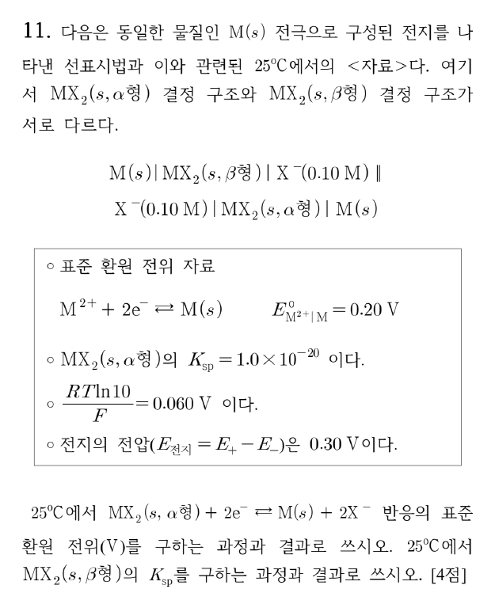

**정답** (답지 난이도 ★★★★☆) $E^\circ(MX_2(\alpha) + 2e^- \rightleftharpoons M + 2X^-)$ = **−0.40 V**, $K_{sp}(MX_2, \beta)$ = **1.0×10⁻³⁰**

**공식·핵심 개념**

- 난용성 염 전극: $E^\circ_{MX_2/M} = E^\circ_{M^{2+}/M} + \frac{0.060}{2}\log K_{sp}$
- $E_{전지} = E_+ - E_-$ (오른쪽 − 왼쪽)
- 두 반쪽의 [X⁻]가 같으면 로그 항이 약분

**2027 출제 가능성 ★★★★★ 매우 높음** — 전지 전위와 Ksp를 연결하는 계산은 분석화학 고빈도 유형입니다.

**주어진 것** $E^\circ(M^{2+}/M) = 0.20$ V, $K_{sp}(\alpha) = 1.0\times10^{-20}$, 양쪽 [X⁻] = 0.10 M, $E_{전지} = 0.30$ V, 0.060 V

**구할 것** α형 반응의 E°, β형의 Ksp

**풀이 전략** 난용성 염 전극의 E°를 Ksp로 나타내고, 두 반쪽 전위의 차가 0.30 V가 되도록 β형의 E°를 구합니다.

**(1) α형의 E°.** $MX_2 + 2e^- \rightarrow M + 2X^-$는 $MX_2 \rightarrow M^{2+} + 2X^-$($K_{sp}$)와 $M^{2+} + 2e^- \rightarrow M$의 합입니다.

$$E^\circ_\alpha = E^\circ_{M^{2+}/M} + \frac{0.060}{2}\log K_{sp,\alpha} = 0.20 + 0.030(-20) = -0.40\ \mathrm{V}$$

**(2) 반쪽 전위.** 오른쪽(+): α형, 왼쪽(−): β형.

$$E_+ = -0.40 - \frac{0.060}{2}\log(0.10)^2 = -0.40 + 0.060 = -0.34\ \mathrm{V}$$

$$E_- = E^\circ_\beta - \frac{0.060}{2}\log(0.10)^2 = E^\circ_\beta + 0.060$$

**(3) β형의 E°.**

$$E_{전지} = E_+ - E_- = -0.34 - (E^\circ_\beta + 0.060) = 0.30 \;\Rightarrow\; E^\circ_\beta = -0.70\ \mathrm{V}$$

**(4) β형의 Ksp.**

$$-0.70 = 0.20 + 0.030\log K_{sp,\beta}$$

$$\log K_{sp,\beta} = -30 \;\Rightarrow\; K_{sp,\beta} = 1.0\times10^{-30}$$

**검산** [X⁻]가 같으므로 $E_{전지} = E^\circ_\alpha - E^\circ_\beta = 0.030(\log K_{sp,\alpha} - \log K_{sp,\beta}) = 0.030(10) = 0.30$ V ✓. 더 안정한(덜 녹는) β형이 음극(−) 쪽입니다.

**채점 포인트·함정**

- 2전자 반응이므로 0.060/2 = 0.030을 씁니다.
- 전지 표기의 오른쪽이 (+), 왼쪽이 (−)입니다. 바꾸면 Ksp가 10⁻¹⁰이 됩니다.

## 20. 1회 B형 11번 · H₂S로 황화물 선택적 침전 {#r1b11}

**엄선 이유** — pH로 조절하는 황화물 선택적 침전

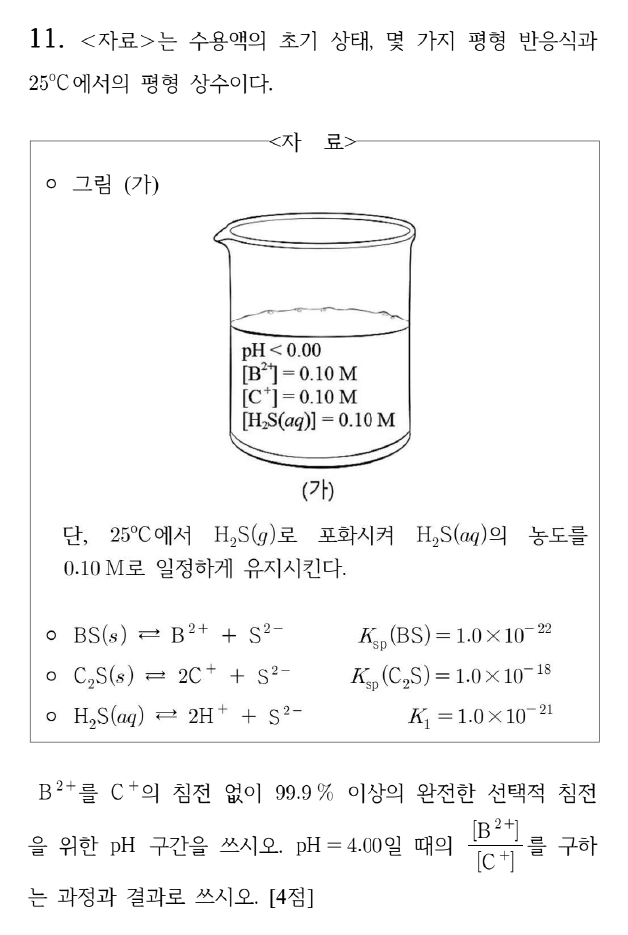

**정답** (답지 난이도 ★★★☆☆) 선택적 침전 pH 구간: **2.00 ≤ pH < 3.00**, pH 4.00에서 $\dfrac{[\mathrm{B^{2+}}]}{[\mathrm{C^+}]} = $ **1.0 × 10⁻⁶**

**공식·핵심 개념**

- $[\mathrm{S^{2-}}] = \dfrac{K_1[\mathrm{H_2S}]}{[\mathrm{H^+}]^2}$ (pH로 S²⁻ 농도 조절)
- 침전 시작: $Q > K_{sp}$ / 99.9 % 침전: 남은 농도 ≤ 처음의 0.1 %
- $K_{sp}(\mathrm{C_2S}) = [\mathrm{C^+}]^2[\mathrm{S^{2-}}]$ (제곱 주의)

**2027 출제 가능성 ★★★★☆ 높음** — pH로 조절하는 황화물·수산화물 선택적 침전은 분석화학 평형 문항에서 꾸준히 나옵니다.

**주어진 것** [B²⁺] = [C⁺] = 0.10 M, [H₂S] = 0.10 M 유지, $K_{sp}(\mathrm{BS}) = 10^{-22}$, $K_{sp}(\mathrm{C_2S}) = 10^{-18}$, $K_1 = 10^{-21}$

**구할 것** B²⁺ 99.9 % 이상 침전 + C⁺ 침전 없음의 pH 범위, pH 4.00에서 [B²⁺]/[C⁺]

**풀이 전략** 두 조건을 각각 [S²⁻] 범위로 바꾸고, $[\mathrm{S^{2-}}] = 10^{-22}/[\mathrm{H^+}]^2$로 pH 범위를 구합니다.

**(1) S²⁻와 pH.**

$$[\mathrm{S^{2-}}] = \frac{10^{-21}\times0.10}{[\mathrm{H^+}]^2} = \frac{10^{-22}}{[\mathrm{H^+}]^2}$$

**(2) B²⁺ 99.9 % 침전.** 남은 $[\mathrm{B^{2+}}] \le 0.10\times10^{-3} = 10^{-4}$ M.

$$[\mathrm{S^{2-}}] \ge \frac{10^{-22}}{10^{-4}} = 10^{-18} \;\Rightarrow\; \frac{10^{-22}}{[\mathrm{H^+}]^2} \ge 10^{-18} \;\Rightarrow\; [\mathrm{H^+}] \le 10^{-2} \;\Rightarrow\; \mathrm{pH} \ge 2.00$$

**(3) C⁺ 침전 없음.**

$$(0.10)^2[\mathrm{S^{2-}}] < 10^{-18} \;\Rightarrow\; [\mathrm{S^{2-}}] < 10^{-16} \;\Rightarrow\; [\mathrm{H^+}]^2 > 10^{-6} \;\Rightarrow\; \mathrm{pH} < 3.00$$

→ **2.00 ≤ pH < 3.00**

**(4) pH 4.00에서의 비.** 이 pH는 위 범위를 넘으므로 두 염 모두 침전합니다.

$$[\mathrm{S^{2-}}] = \frac{10^{-22}}{(10^{-4})^2} = 10^{-14}\ \mathrm M$$

$$[\mathrm{B^{2+}}] = \frac{10^{-22}}{10^{-14}} = 10^{-8}\ \mathrm M, \qquad [\mathrm{C^+}] = \sqrt{\frac{10^{-18}}{10^{-14}}} = 10^{-2}\ \mathrm M$$

$$\frac{[\mathrm{B^{2+}}]}{[\mathrm{C^+}]} = \frac{10^{-8}}{10^{-2}} = 1.0\times10^{-6}$$

**검산** pH 4에서 C⁺는 0.10 → 0.010 M(90 % 침전)으로 실제로 침전이 일어남 ✓. 경계 pH 3.00에서 $[\mathrm{S^{2-}}] = 10^{-16}$, $Q(\mathrm{C_2S}) = 10^{-2}\cdot10^{-16} = K_{sp}$로 딱 포화 ✓(그래서 3.00은 포함하지 않음).

**채점 포인트·함정**

- C₂S의 $K_{sp}$는 $[\mathrm{C^+}]^2$이므로 0.10을 **제곱**해야 합니다. 빠뜨리면 경계가 pH 2.5로 나옵니다.
- 등호 처리: 99.9 % "이상"은 ≤(포함), 침전 "없이"는 <(미포함).

## 21. 1회 A형 9번 · van Deemter 식과 크로마토그래피 분리도 {#r1a9}

**엄선 이유** — van Deemter 극소 조건과 분리도 — 크로마토그래피 계산

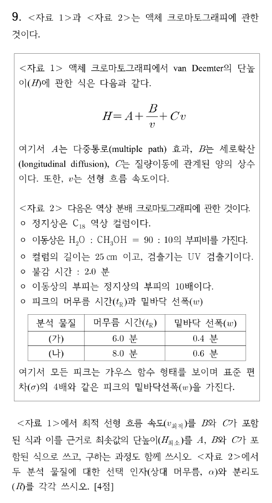

**정답** (답지 난이도 ★★★☆☆) $v_{\text{최적}} = $ **$\sqrt{B/C}$**, $H_{\text{최소}} = $ **$A + 2\sqrt{BC}$**, 선택 인자 α = **1.5**, 분리도 R = **4.0**

**공식·핵심 개념**

- $H = A + \dfrac{B}{v} + Cv$, 극소: $\dfrac{dH}{dv} = 0$
- 머무름 인자 $k = \dfrac{t_R - t_M}{t_M}$, 선택 인자 $\alpha = \dfrac{k_2}{k_1}$
- 분리도 $R = \dfrac{\Delta t_R}{\bar w} = \dfrac{2(t_{R2} - t_{R1})}{w_1 + w_2}$ ($w = 4\sigma$)

**2027 출제 가능성 ★★★★☆ 높음** — 크로마토그래피의 k, α, R, N, H 계산은 분석화학에서 해마다 비슷한 비중으로 나옵니다. van Deemter 극소 조건 유도는 미분 한 번이라 기입형에 알맞습니다.

**주어진 것** $H = A + B/v + Cv$, $t_M = 2.0$ 분, (가) $t_R = 6.0$, $w = 0.4$ 분, (나) $t_R = 8.0$, $w = 0.6$ 분

**구할 것** $v_{\text{최적}}$, $H_{\text{최소}}$(과정 포함), α, R

**풀이 전략** H를 v로 미분해 0으로 놓고, 크로마토그램 값은 정의식에 그대로 넣습니다.

**(1) 최적 유속.**

$$\frac{dH}{dv} = -\frac{B}{v^2} + C = 0 \;\Rightarrow\; v^2 = \frac BC \;\Rightarrow\; v_{\text{최적}} = \sqrt{\frac BC}$$

$\dfrac{d^2H}{dv^2} = \dfrac{2B}{v^3} > 0$이므로 극소입니다.

**(2) 최소 단높이.**

$$H_{\text{최소}} = A + \frac{B}{\sqrt{B/C}} + C\sqrt{\frac BC} = A + \sqrt{BC} + \sqrt{BC} = A + 2\sqrt{BC}$$

**(3) 머무름 인자와 선택 인자.**

$$k_{\text{(가)}} = \frac{6.0 - 2.0}{2.0} = 2.0, \qquad k_{\text{(나)}} = \frac{8.0 - 2.0}{2.0} = 3.0$$

$$\alpha = \frac{k_{\text{(나)}}}{k_{\text{(가)}}} = \frac{3.0}{2.0} = 1.5$$

**(4) 분리도.**

$$R = \frac{2(8.0 - 6.0)}{0.4 + 0.6} = \frac{4.0}{1.0} = 4.0$$

**검산** $R = 4.0$은 기준선 분리(R ≥ 1.5)를 크게 넘습니다. 머무름 시간의 비 8/6 = 1.33 ≠ α = 1.5 — α는 $t_R$가 아니라 **조정 머무름 시간**(또는 k)의 비이므로 다른 것이 맞습니다.

**채점 포인트·함정**

- α를 $t_{R2}/t_{R1} = 1.33$으로 쓰는 실수가 가장 흔합니다. 불감 시간을 빼야 합니다.
- R의 분모는 두 피크 폭의 **평균**입니다. 합을 그대로 쓰면 2.0이 나옵니다.
- 이동상 부피비(10배), 컬럼 길이 등은 이 질문에 쓰이지 않는 정보입니다.

## 22. 1회 B형 7번 · 사전평형 근사와 겉보기 활성화 에너지 {#r1b7}

**엄선 이유** — 사전평형 근사와 겉보기 활성화 에너지 — 2024 기출 계열

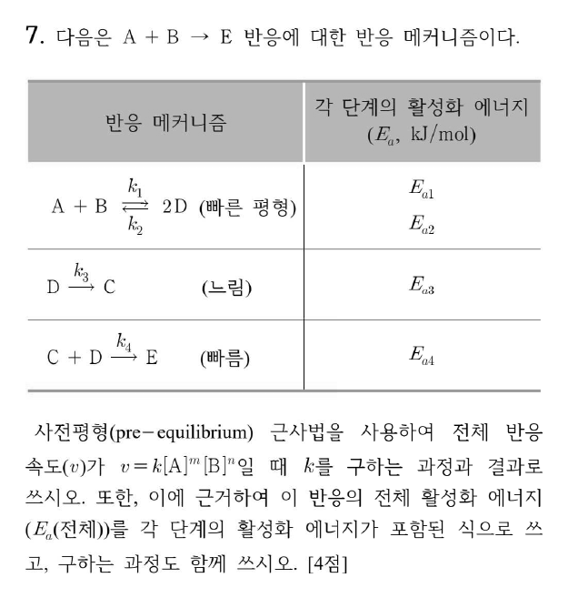

**정답** (답지 난이도 ★★★☆☆) $k = $ **$k_3\left(\dfrac{k_1}{k_2}\right)^{1/2}$** ($v = k[\mathrm A]^{1/2}[\mathrm B]^{1/2}$), $E_a(\text{전체}) = $ **$E_{a3} + \tfrac12E_{a1} - \tfrac12E_{a2}$**

**공식·핵심 개념**

- 빠른 평형: $K = \dfrac{k_1}{k_2} = \dfrac{[\mathrm D]^2}{[\mathrm A][\mathrm B]}$
- 속도 결정 단계(느림)의 속도 = 전체 속도
- 아레니우스 $k = Ae^{-E_a/RT}$ → $E_a = RT^2\dfrac{d\ln k}{dT}$
- $k = \prod k_i^{n_i}$이면 $E_a = \sum n_iE_{a,i}$

**2027 출제 가능성 ★★★★☆ 높음** — 사전평형·정류 상태 근사로 속도식을 유도하는 문항은 속도론의 고정 유형이며, 겉보기 활성화 에너지까지 묻는 확장이 자주 붙습니다.

**주어진 것** A + B ⇌ 2D (빠름, $k_1, k_2$), D → C (느림, $k_3$), C + D → E (빠름, $k_4$)

**구할 것** $v = k[\mathrm A]^m[\mathrm B]^n$의 k, 전체 $E_a$

**풀이 전략** 느린 단계 속도를 [D]로 쓰고, [D]를 빠른 평형에서 반응물 농도로 바꿉니다.

**(1) 속도 결정 단계.** C는 생기자마자 D와 빠르게 E가 되므로 E의 생성 속도 = C의 생성 속도.

$$v = k_3[\mathrm D]$$

**(2) 사전평형.**

$$k_1[\mathrm A][\mathrm B] = k_2[\mathrm D]^2 \;\Rightarrow\; [\mathrm D] = \left(\frac{k_1}{k_2}\right)^{1/2}[\mathrm A]^{1/2}[\mathrm B]^{1/2}$$

**(3) 속도식.**

$$v = k_3\left(\frac{k_1}{k_2}\right)^{1/2}[\mathrm A]^{1/2}[\mathrm B]^{1/2}, \qquad k = k_3\left(\frac{k_1}{k_2}\right)^{1/2}$$

**(4) 활성화 에너지.** 각 $k_i = A_ie^{-E_{ai}/RT}$를 넣으면

$$k = A_3\left(\frac{A_1}{A_2}\right)^{1/2}\exp\left[-\frac{E_{a3} + \frac12E_{a1} - \frac12E_{a2}}{RT}\right]$$

$$E_a(\text{전체}) = E_{a3} + \tfrac12E_{a1} - \tfrac12E_{a2}$$

**검산** 로그 미분: $\ln k = \ln k_3 + \tfrac12\ln k_1 - \tfrac12\ln k_2$ → 양변에 $RT^2\,d/dT$ → 같은 결과 ✓. $\tfrac12(E_{a1} - E_{a2}) = \tfrac12\Delta H°$(첫 단계)이므로, 첫 단계가 발열이면 겉보기 $E_a$가 $E_{a3}$보다 작습니다.

**채점 포인트·함정**

- 2D이므로 $K$에 $[\mathrm D]^2$가 들어가 지수가 1/2이 됩니다. $[\mathrm D] = K[\mathrm A][\mathrm B]$로 쓰면 틀립니다.
- 빠른 마지막 단계의 $k_4$, $E_{a4}$는 속도식에 들어가지 않습니다.

## 23. 2회 B형 7번 · Br₂ + CH₄ 라디칼 연쇄 반응의 정류 상태 근사 {#r2b7}

**엄선 이유** — 라디칼 연쇄 반응의 정류 상태 근사 속도식

**정답** (답지 난이도 ★★★☆☆)

$$[Br] = \left(\frac{k_1}{k_5}[Br_2]\right)^{1/2}, \qquad [CH_3] = \frac{k_2\left(\frac{k_1}{k_5}[Br_2]\right)^{1/2}[CH_4]}{k_3[Br_2] + k_4[HBr]}$$

$$\frac{d[CH_3Br]}{dt} = k_2k_3\left(\frac{k_1}{k_5}\right)^{1/2}\frac{[CH_4][Br_2]^{3/2}}{k_3[Br_2] + k_4[HBr]}$$

초기: $k_2(k_1/k_5)^{1/2}[Br_2]^{1/2}[CH_4]$, 말기: $k_2(k_1/k_5)^{1/2}\dfrac{[CH_4][Br_2]^{3/2}}{[HBr]}$

**공식·핵심 개념**

- 정류 상태 근사: 반응성 큰 중간체의 $d[I]/dt \approx 0$
- 연쇄 반응: 개시 속도 = 종결 속도
- 생성물 억제(HBr의 역방향 단계)

**2027 출제 가능성 ★★★★☆ 높음** — 정류 상태 근사로 속도식을 유도하는 문항은 2024 기출 이후 계속 나옵니다.

**주어진 것** (1)~(5) 단계와 $k_1$~$k_5$, $k_3 = k_4$

**구할 것** [Br], [CH₃], $d[CH_3Br]/dt$, 초기·말기 속도식

**풀이 전략** 두 중간체(Br, CH₃)에 정류 상태 근사를 세우고, 두 식을 더해 전파 항을 지웁니다.

**(1) 두 정류 상태 식.**

$$\frac{d[CH_3]}{dt} = k_2[Br][CH_4] - k_3[Br_2][CH_3] - k_4[HBr][CH_3] = 0$$

$$\frac{d[Br]}{dt} = 2k_1[Br_2][M] - k_2[Br][CH_4] + k_3[Br_2][CH_3]$$

$$\qquad + k_4[HBr][CH_3] - 2k_5[Br]^2[M] = 0$$

**(2) 더하기.** 전파 항이 모두 지워집니다.

$$2k_1[Br_2][M] - 2k_5[Br]^2[M] = 0 \;\Rightarrow\; [Br] = \left(\frac{k_1}{k_5}[Br_2]\right)^{1/2}$$

**(3) [CH₃].** 첫 식에서

$$[CH_3] = \frac{k_2[Br][CH_4]}{k_3[Br_2] + k_4[HBr]}$$

**(4) 생성 속도.** CH₃Br은 (3) 단계에서만 생깁니다.

$$\frac{d[CH_3Br]}{dt} = k_3[Br_2][CH_3] = \frac{k_2k_3(k_1/k_5)^{1/2}[CH_4][Br_2]^{3/2}}{k_3[Br_2] + k_4[HBr]}$$

**(5) $k_3 = k_4$.** 분자·분모의 $k_3$이 약분됩니다.

$$\frac{d[CH_3Br]}{dt} = k_2\left(\frac{k_1}{k_5}\right)^{1/2}\frac{[CH_4][Br_2]^{3/2}}{[Br_2] + [HBr]}$$

- 초기($[Br_2] \gg [HBr]$, t ≠ 0): $k_2(k_1/k_5)^{1/2}[Br_2]^{1/2}[CH_4]$
- 말기($[HBr] \gg [Br_2]$): $k_2(k_1/k_5)^{1/2}[CH_4][Br_2]^{3/2}/[HBr]$

**검산** 초기 식의 전체 차수 1.5는 Br 원자를 매개로 하는 할로젠화 반응(H₂ + Br₂)의 초기 속도식과 같은 꼴입니다. 말기에는 HBr이 쌓일수록 느려지는 생성물 억제가 나타납니다.

**채점 포인트·함정**

- 개시 단계에서 Br 원자가 **2개** 생기므로 $2k_1$, 종결도 $2k_5$입니다. 계수를 빼먹어도 비율이 같아 [Br]은 같지만, 계수 처리 과정은 서술해야 합니다.
- t = 0에서는 [HBr] = 0이라 식이 정확히 성립하지만 문제는 "0이 아닌 초기"라고 했으므로 근사 조건을 씁니다.

## 24. 3회 A형 10번 · 내부 압력, 열팽창 계수, 등온 압축률 {#r3a10}

**엄선 이유** — 내부 압력·α·κT 편미분 관계식 — 서술형 단골

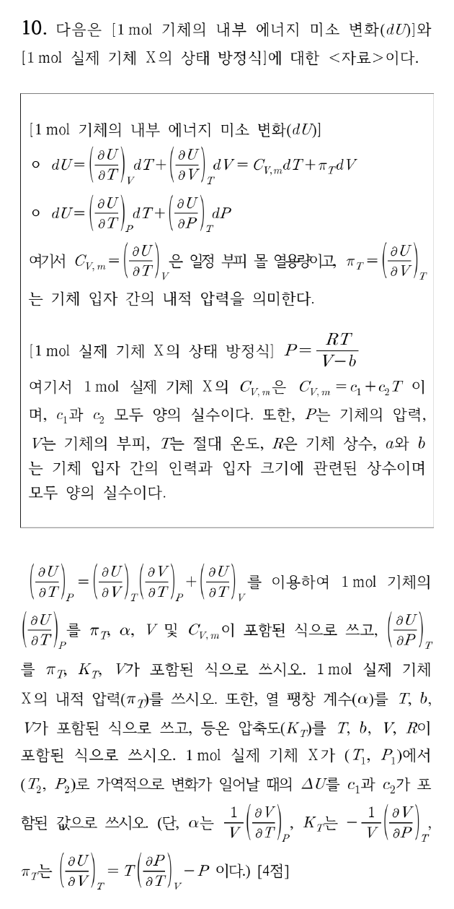

**정답** (답지 난이도 ★★★★☆)

- $\left(\dfrac{\partial U}{\partial T}\right)_P = \pi_T\alpha V + C_{V,m}$, $\left(\dfrac{\partial U}{\partial P}\right)_T = -\pi_T\kappa_TV$
- 실제 기체 X의 $\pi_T = 0$
- $\alpha = \dfrac{V-b}{VT}$, $\kappa_T = \dfrac{(V-b)^2}{VRT}$
- $\Delta U = c_1(T_2-T_1) + \tfrac12c_2(T_2^2-T_1^2)$

**공식·핵심 개념**

- 열역학 상태식 $\pi_T = T\left(\frac{\partial P}{\partial T}\right)_V - P$
- $\alpha = \frac1V\left(\frac{\partial V}{\partial T}\right)_P$, $\kappa_T = -\frac1V\left(\frac{\partial V}{\partial P}\right)_T$
- 반발력만 있는 기체($P = RT/(V-b)$)는 $\pi_T = 0$ → $U$는 $T$만의 함수

**2027 출제 가능성 ★★★★☆ 높음** — 편미분 관계식, 내부 압력, 실제 기체 상태식은 물리화학 서술형의 단골입니다.

**주어진 것** $dU = C_{V,m}dT + \pi_TdV$, $P = \dfrac{RT}{V-b}$, $C_{V,m} = c_1 + c_2T$

**구할 것** $(\partial U/\partial T)_P$, $(\partial U/\partial P)_T$, $\pi_T$, $\alpha$, $\kappa_T$, $\Delta U$

**풀이 전략** $U(T,V)$를 연쇄 법칙으로 $P$나 $T$ 고정 조건으로 바꾸고, 상태식을 미분해 각 계수를 구합니다.

**(1) $(\partial U/\partial T)_P$.**

$$\left(\frac{\partial U}{\partial T}\right)_P = \pi_T\left(\frac{\partial V}{\partial T}\right)_P + C_{V,m} = \pi_T\alpha V + C_{V,m}$$

**(2) $(\partial U/\partial P)_T$.** $T$ 고정이면 $dU = \pi_TdV$이므로

$$\left(\frac{\partial U}{\partial P}\right)_T = \pi_T\left(\frac{\partial V}{\partial P}\right)_T = -\pi_T\kappa_TV$$

**(3) $\pi_T$.**

$$\left(\frac{\partial P}{\partial T}\right)_V = \frac{R}{V-b}$$

$$\pi_T = T\cdot\frac{R}{V-b} - \frac{RT}{V-b} = 0$$

**(4) $\alpha$.** 상태식을 $V = \frac{RT}{P} + b$로 바꾸면

$$\left(\frac{\partial V}{\partial T}\right)_P = \frac{R}{P} = \frac{V-b}{T}\ \Rightarrow\ \alpha = \frac{V-b}{VT} = \left(1-\frac bV\right)\frac1T$$

**(5) $\kappa_T$.**

$$\left(\frac{\partial V}{\partial P}\right)_T = -\frac{RT}{P^2} = -\frac{(V-b)^2}{RT}$$

$$\kappa_T = \frac{(V-b)^2}{V}\cdot\frac{1}{RT}$$

**(6) $\Delta U$.** $\pi_T = 0$이므로 $dU = C_{V,m}dT$이고, 경로·압력과 무관합니다.

$$\Delta U = \int_{T_1}^{T_2}(c_1 + c_2T)\,dT = c_1(T_2 - T_1) + \frac12c_2(T_2^2 - T_1^2)$$

**검산** $b \to 0$이면 $\alpha \to 1/T$, $\kappa_T \to V/RT = 1/P$로 이상 기체 결과와 같습니다 ✓. 차원: $\kappa_T$는 $\mathrm{m^6/(m^3\cdot J)} = 1/\mathrm{Pa}$ ✓.

**채점 포인트·함정**

- $\kappa_T$에 마이너스 부호가 정의에 들어 있어 $(\partial U/\partial P)_T$의 부호가 **음**입니다.
- 이 기체는 $a$(인력항)가 없어서 $\pi_T = 0$입니다. 반데르발스 기체라면 $\pi_T = a/V^2$입니다.

## 25. 1회 A형 4번 · 2원자 이상 기체의 등온·등압 가역 팽창 {#r1a4}

**엄선 이유** — 이상 기체 등온·등압 가역 과정의 q·w·ΔU·ΔS

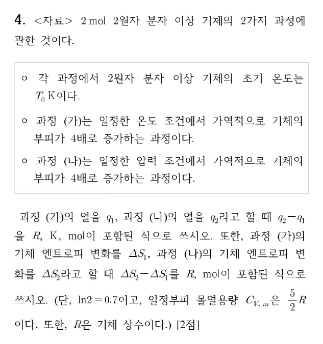

**정답** (답지 난이도 ★★☆☆☆) $q_2 - q_1 = $ **$18.2\,T_0R$** (단위 K·mol 포함: $18.2\,R\,T_0\ \mathrm{K\cdot mol}$), $\Delta S_2 - \Delta S_1 = $ **$7R$** (mol)

**공식·핵심 개념**

- 등온 가역: $\Delta U = 0$, $q = nRT\ln\dfrac{V_2}{V_1}$, $\Delta S = nR\ln\dfrac{V_2}{V_1}$
- 등압: $q_P = nC_{P,m}\Delta T$, $\Delta S = nC_{P,m}\ln\dfrac{T_2}{T_1}$
- 이상 기체 $C_{P,m} = C_{V,m} + R$

**2027 출제 가능성 ★★★★☆ 높음** — 이상 기체 과정별 q, w, ΔU, ΔS 비교는 물리화학 열역학의 기본 문항으로 꾸준히 나옵니다.

**주어진 것** $n = 2$ mol, $T_i = T_0$, (가) 등온 가역 $V \to 4V$, (나) 등압 가역 $V \to 4V$, $C_{V,m} = \tfrac52R$, $\ln2 = 0.7$

**구할 것** $q_2 - q_1$, $\Delta S_2 - \Delta S_1$

**풀이 전략** 과정별로 q와 ΔS를 따로 구한 뒤 뺍니다. $\ln4 = 2\ln2 = 1.4$를 씁니다.

**(1) 과정 (가) — 등온.** 내부 에너지가 온도만의 함수이므로 $\Delta U = 0$, $q_1 = -w = nRT\ln(V_2/V_1)$.

$$q_1 = 2R T_0\ln4 = 2R T_0(1.4) = 2.8\,RT_0$$

$$\Delta S_1 = nR\ln4 = 2R(1.4) = 2.8\,R$$

**(2) 과정 (나) — 등압.** $PV = nRT$에서 $P$ 일정이면 $T \propto V$이므로 $T_f = 4T_0$, $\Delta T = 3T_0$.

$$C_{P,m} = \tfrac52R + R = \tfrac72R$$

$$q_2 = nC_{P,m}\Delta T = 2\cdot\tfrac72R\cdot3T_0 = 21\,RT_0$$

$$\Delta S_2 = nC_{P,m}\ln\frac{T_f}{T_0} = 2\cdot\tfrac72R\cdot\ln4 = 7R(1.4) = 9.8\,R$$

**(3) 차이.**

$$q_2 - q_1 = 21RT_0 - 2.8RT_0 = 18.2\,RT_0$$

$$\Delta S_2 - \Delta S_1 = 9.8R - 2.8R = 7.0\,R$$

**검산** ΔS 차이를 한 번에: $\Delta S_2 - \Delta S_1 = n(C_{P,m} - R)\ln4 = nC_{V,m}\ln4 = 2\cdot2.5R\cdot1.4 = 7R$ ✓ (등압 과정 = 등온 팽창 + 등적 가열로 나누어 본 것과 같음).

**채점 포인트·함정**

- 등압 과정의 열은 $C_V$가 아니라 **$C_P$**로 계산합니다.
- 답지는 단위를 붙여 "18.2 T₀R·K·mol", "7R·mol"로 적었습니다. $R$의 단위(J K⁻¹ mol⁻¹)와 곱해 J이 되도록 K·mol을 붙인 것입니다.

## 26. 2회 A형 4번 · 이종핵 이원자 분자의 진동-회전 스펙트럼 {#r2a4}

**엄선 이유** — 진동-회전 스펙트럼과 결합 차이법

**정답** (답지 난이도 ★★☆☆☆) 진동 선택 규칙 **Δv = +1**(흡수), P가지 **ΔJ = −1**, R가지 **ΔJ = +1**, $B_0 = \dfrac{a}{6}\ \mathrm{cm^{-1}}$, $B_1 = \dfrac{b}{10}\ \mathrm{cm^{-1}}$

**공식·핵심 개념**

- $R(J) = \tilde\nu_0 + B_1(J+1)(J+2) - B_0J(J+1)$
- $P(J) = \tilde\nu_0 + B_1(J-1)J - B_0J(J+1)$
- 결합 차이: $R(J-1) - P(J+1) = 4B_0(J + \frac12)$, $R(J) - P(J) = 4B_1(J + \frac12)$

**2027 출제 가능성 ★★★★☆ 높음** — 진동-회전 분광은 물리화학 분광의 단골이며, 결합 차이법은 최근 출제 경향입니다.

**주어진 것** Q가지 없음, J가 커질수록 P 간격 증가·R 간격 감소, $R(0) - P(2) = a$, $R(2) - P(2) = b$ (cm⁻¹)

**구할 것** 선택 규칙, $B_0$(v = 0), $B_1$(v = 1)

**풀이 전략** 각 선의 위치를 $\tilde\nu_0, B_0, B_1$로 쓰고, 같은 들뜬 준위로 가는 두 선(→ $B_0$)과 같은 바닥 준위에서 출발하는 두 선(→ $B_1$)의 차이를 이용합니다.

**(1) 선택 규칙.** 흡수이므로 Δv = +1. 회전은 ΔJ = ±1(P: −1, R: +1)이며, Q가지(ΔJ = 0)가 없다는 것은 ¹Σ 상태(전자 각운동량 0)의 이원자 분자라는 뜻입니다.

**(2) 선 위치.** $F_v(J) = B_vJ(J+1)$이므로

$$R(J) = \tilde\nu_0 + B_1(J+1)(J+2) - B_0J(J+1)$$

$$P(J) = \tilde\nu_0 + B_1(J-1)J - B_0J(J+1)$$

**(3) $B_0$: R(0)과 P(2)는 둘 다 v=1, J=1로 갑니다.**

$$R(0) = \tilde\nu_0 + 2B_1, \qquad P(2) = \tilde\nu_0 + 2B_1 - 6B_0$$

$$R(0) - P(2) = 6B_0 = a \;\Rightarrow\; B_0 = \frac a6$$

**(4) $B_1$: R(2)와 P(2)는 둘 다 v=0, J=2에서 출발합니다.**

$$R(2) = \tilde\nu_0 + 12B_1 - 6B_0$$

$$R(2) - P(2) = 12B_1 - 2B_1 = 10B_1 = b \;\Rightarrow\; B_1 = \frac{b}{10}$$

**검산** P 간격 증가·R 간격 감소는 $B_1 < B_0$일 때 나타납니다(진동 들뜸으로 결합 길이 증가). 따라서 $\frac{b}{10} < \frac a6$이어야 일관됩니다. 일반식 $4B(J + \frac12)$에 J = 1, 2를 넣어도 $6B_0$, $10B_1$이 나옵니다.

**채점 포인트·함정**

- $B_0$에는 **바닥** 진동 상태, $B_1$에는 **들뜬** 진동 상태의 회전 상수를 씁니다. 두 결합 차이를 바꿔 쓰기 쉽습니다.

## 27. 3회 B형 11번 · 수소 원자 3p 오비탈 {#r3b11}

**엄선 이유** — 수소 원자 3p 파동함수의 마디·정규화·각운동량

**정답** (답지 난이도 ★★★☆☆)

- $n = $ **3**, 방사상 마디 $r = $ **6a₀**
- (A)의 $N = \left(\dfrac{3}{4\pi}\right)^{1/2}$
- 궤도 각운동량의 크기 **$\sqrt2\,\hbar$**
- 각도 마디가 xz 평면인 것: **(B)**

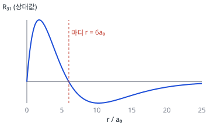

**공식·핵심 개념**

- 방사상 마디 수 $= n - l - 1$, 각도 마디 수 $= l$
- $|\mathbf L| = \sqrt{l(l+1)}\,\hbar$
- $x/r = \sin\theta\cos\phi$, $y/r = \sin\theta\sin\phi$, $z/r = \cos\theta$

**2027 출제 가능성 ★★★★☆ 높음** — 수소 원자 파동함수의 마디와 정규화는 물리화학 단골 소재입니다.

**주어진 것** $R(r) \propto \left(\frac{6}{a_0}r - \frac{1}{a_0^2}r^2\right)e^{-r/3a_0}$, 각도 함수 (A) $Nx/r$, (B) $\propto y/r$, (C) $\propto z/r$

**구할 것** $n$, 방사상 마디, (A)의 $N$, $|\mathbf L|$, xz 평면 마디를 가진 것

**풀이 전략** 지수 $e^{-r/na_0}$로 $n$을, 각도 함수(x/r 형태)로 $l = 1$을 정합니다. 다항식의 근이 마디입니다.

**(1) $n$.** $e^{-r/3a_0} = e^{-r/na_0}$이므로 $n = 3$입니다. 각도 함수가 x, y, z의 1차식이므로 $l = 1$(3p)입니다.

**(2) 방사상 마디.**

$$\frac{6}{a_0}r - \frac{r^2}{a_0^2} = \frac{r}{a_0}\left(6 - \frac{r}{a_0}\right) = 0$$

$r > 0$이므로 $r = 6a_0$입니다. 마디 수 $n - l - 1 = 1$개 ✓.

**(3) (A)의 정규화.** $x/r = \sin\theta\cos\phi$이므로

$$N^2\int_0^\pi\sin^2\theta\sin\theta\,d\theta\int_0^{2\pi}\cos^2\phi\,d\phi = N^2\cdot\frac43\cdot\pi = 1$$

$$N = \left(\frac{3}{4\pi}\right)^{1/2}$$

(B), (C)와 같은 값입니다.

**(4) 각운동량.**

$$|\mathbf L| = \sqrt{1(1+1)}\,\hbar = \sqrt2\,\hbar$$

**(5) xz 평면 마디.** xz 평면은 $y = 0$입니다. $y/r$이 0이 되는 (B)($3p_y$)입니다.

**검산** sympy: $\int\sin^3\theta\,d\theta\int\cos^2\phi\,d\phi = 4\pi/3$ ✓. $r = 0$은 원점이라 마디로 세지 않습니다.

**채점 포인트·함정**

- 방사상 마디를 $r = 0$까지 포함해 두 개로 쓰면 틀립니다.
- (A)의 각도 마디는 yz 평면, (C)는 xy 평면입니다.

---

