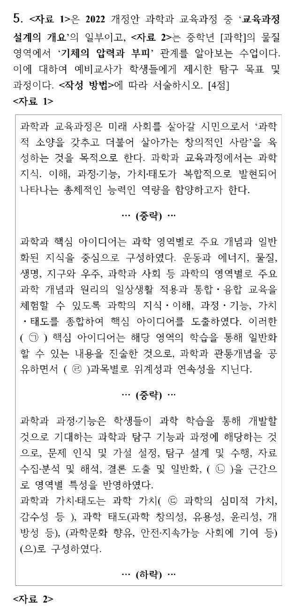
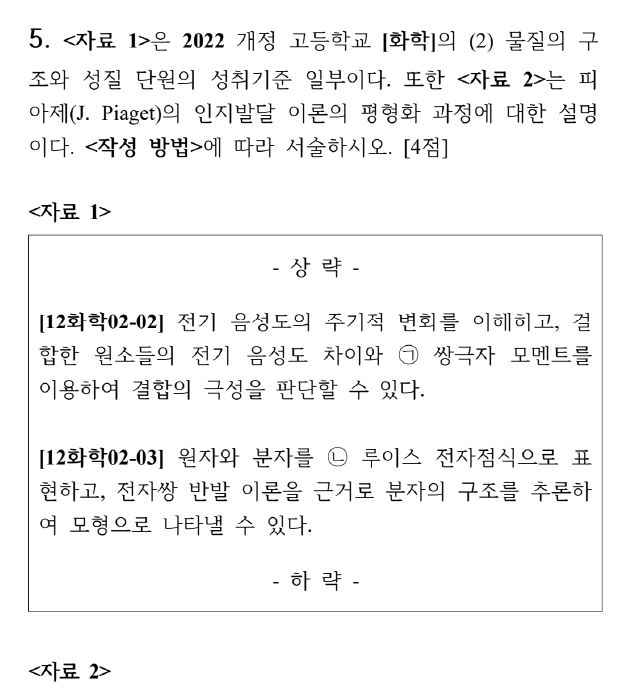
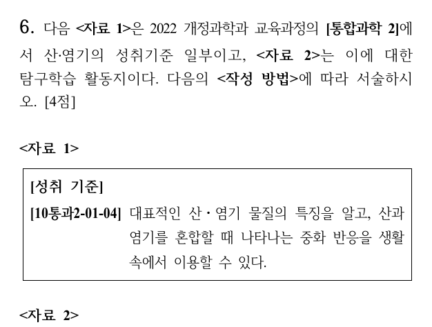
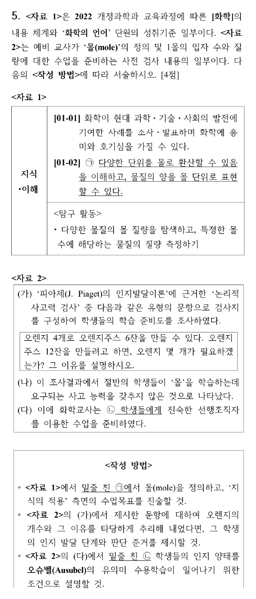
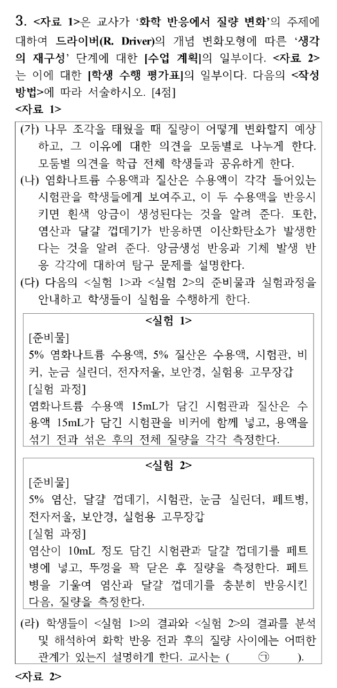

# 안병천 1~3회 엄선 문항 — 2027 출제 가능성 높은 문제

안병천 전공화학 모의고사 1·2·3회(69문항)에서 **2027학년도 중등 화학 임용에 나올 가능성이 매우 높은(★★★★★) 문항**을 골라 영역별로 묶었습니다. 물리화학은 ★5 문항이 없어, ★4 가운데 기출 유형과 가장 가까운 2문항을 넣었습니다. 총 **22문항**입니다.

**고른 기준**: ① 1997~2026 기출에서 거의 매년 나오는 유형인가, ② 2022 개정 교육과정 첫 적용 시기에 맞는 소재인가(교육론), ③ 한 문항 안에 여러 개념을 묶어 실전 서술형 형식에 가까운가, ④ 풀이 과정·메커니즘이 공부할 가치가 있을 만큼 좋은가. 계산만 반복하는 2점 문항이나 출제 빈도가 낮은 소재(고리 위 입자, 라만 회전 분광, 자리옮김 반응 등)는 뺐습니다.

각 문항의 원문·정답·공식 박스·단계별 풀이·메커니즘은 원래 회차 해설지와 같습니다. 본문의 "검토 메모"는 해당 회차 해설지 1쪽의 메모를 가리킵니다.

## 엄선 문항 목록 {#toc}

### 전공 A 엄선 목록

| 번호 | 출처 | 영역 · 주제 | 출제 가능성 |
|---|---|---|---|
| [1](#r1a3) | 1회 A형 3번 | 유기화학 · IR·¹H NMR로 에스터 구조 결정, 산 촉매 가수분해 | ★★★★★ |
| [2](#r2a3) | 2회 A형 3번 | 유기화학 · C₄H₈O의 IR·MS·¹H NMR | ★★★★★ |
| [3](#r3a3) | 3회 A형 3번 | 유기화학 · 분광 자료로 C₁₀H₁₂O₂ 구조 결정 | ★★★★★ |
| [4](#r2a8) | 2회 A형 8번 | 유기화학 · 1-isopropylcyclohexene의 수소붕소화와 E2 | ★★★★★ |
| [5](#r3b9) | 3회 B형 9번 | 유기화학 · 니트로벤젠에서 1-브로모-2,6-다이클로로-4-tert-뷰틸벤젠 합성 | ★★★★★ |
| [6](#r2a9) | 2회 A형 9번 | 무기화학 · 1,2-dichloroethane(C₂ₕ)의 C–H 신축 진동 | ★★★★★ |
| [7](#r2b6) | 2회 B형 6번 | 무기화학 · d⁸ Ni²⁺ 착물의 Tanabe–Sugano 해석 | ★★★★★ |
| [8](#r2b1) | 2회 B형 1번 | 분석화학 · HCl + Na₂HPO₄ 혼합액의 적정 | ★★★★★ |
| [9](#r2b11) | 2회 B형 11번 | 분석화학 · 결정형이 다른 두 MX₂ 전극으로 만든 전지 | ★★★★★ |
| [10](#r1b7) | 1회 B형 7번 | 물리화학 · 사전평형 근사와 겉보기 활성화 에너지 | ★★★★☆ |
| [11](#r3a10) | 3회 A형 10번 | 물리화학 · 내부 압력, 열팽창 계수, 등온 압축률 | ★★★★☆ |

### 전공 B 엄선 목록 (화학교육론)

| 번호 | 출처 | 영역 · 주제 | 출제 가능성 |
|---|---|---|---|
| [12](#r1a5) | 1회 A형 5번 | 화학교육론 · 2022 개정 '교육과정 설계의 개요'와 기체의 압력·부피 | ★★★★★ |
| [13](#r1b4) | 1회 B형 4번 | 화학교육론 · 통합과학 2와 STS 수업모형 | ★★★★★ |
| [14](#r1b5) | 1회 B형 5번 | 화학교육론 · 2022 개정 [화학] 성취기준, 개념변화, 순환학습 | ★★★★★ |
| [15](#r2a5) | 2회 A형 5번 | 화학교육론 · 라카토스의 연구 프로그램과 개념 변화 | ★★★★★ |
| [16](#r2a6) | 2회 A형 6번 | 화학교육론 · 헤론의 탐구 수준과 귀납적 추리 | ★★★★★ |
| [17](#r2a7) | 2회 A형 7번 | 화학교육론 · 질량 보존 실험과 동료평가 | ★★★★★ |
| [18](#r2b3) | 2회 B형 3번 | 화학교육론 · 상자 속 물체 활동과 비유 수업 | ★★★★★ |
| [19](#r2b5) | 2회 B형 5번 | 화학교육론 · 로슨의 경험-귀추적 순환학습 | ★★★★★ |
| [20](#r3a5) | 3회 A형 5번 | 화학교육론 · 몰 개념, 피아제 논리적 사고력, 오수벨 | ★★★★★ |
| [21](#r3a6) | 3회 A형 6번 | 화학교육론 · 로슨 순환학습의 연이은 적용 (산화·환원) | ★★★★★ |
| [22](#r3b3) | 3회 B형 3번 | 화학교육론 · 드라이버 개념 변화 모형 (화학 반응의 질량 보존) | ★★★★★ |

원문: 2027학년도 대비 안병천 전공화학통합모의고사 제1·2·3회(임용닷컴) 문제지·답지·강의 필기. 개인 학습용 정리입니다.

# 전공 A

## 1. 1회 A형 3번 · IR·¹H NMR로 에스터 구조 결정, 산 촉매 가수분해 {#r1a3}

**엄선 이유** — 분광(IR·NMR) 구조 결정 + 가수분해 — 매년 나오는 유형

**정답** A = **methyl pivalate** (CH₃)₃C–CO–OCH₃ (methyl 2,2-dimethylpropanoate). 가수분해 생성물: **pivalic acid** (CH₃)₃CCOOH + **CH₃OH**

**공식·핵심 개념**

- 수소결핍지수 $= \dfrac{2C + 2 - H}{2}$
- 에스터 C=O 신축 ≈ 1735–1750 cm⁻¹, C–O 1150–1300 cm⁻¹
- OCH₃(에스터) δ ≈ 3.7, tert-뷰틸 δ ≈ 1.2 (s, 9H)
- 산 촉매 에스터 가수분해(AAC2) = Fischer 에스터화의 역반응

**2027 출제 가능성 ★★★★★ 매우 높음** — 분자식 + IR + ¹H NMR로 구조를 정하는 문항은 거의 매년 나옵니다. 에스터 가수분해와 묶는 형태도 기본형입니다.

**주어진 것** C₆H₁₂O₂, IR 1737 cm⁻¹(강함), 3000 cm⁻¹ 위 넓은 O–H 없음, ¹H NMR: δ 3.7(s), δ 1.2(s), 적분 높이 비 약 1 : 3

**구할 것** A의 구조, 산 촉매 가수분해 생성물

**풀이 전략** 분자식 → 불포화도 → IR로 작용기 → NMR의 적분·갈라짐으로 조각을 맞춥니다.

**(1) 불포화도.**

$$\text{IHD} = \frac{2(6) + 2 - 12}{2} = 1$$

C=O 하나면 끝입니다(고리·C=C 없음).

**(2) IR.** 1737 cm⁻¹ 강한 띠 = **에스터 C=O**(케톤 1715, 산 1710보다 높음). 3300~2500 cm⁻¹의 넓은 O–H 띠가 없으므로 카복실산이 아닙니다. 1150–1250 cm⁻¹의 강한 띠는 C–O 신축입니다.

**(3) ¹H NMR.** 12H를 적분 비 1 : 3으로 나누면 **3H : 9H**.

| δ (ppm) | 적분 | 갈라짐 | 배정 | 근거 |
|---|---|---|---|---|
| 3.7 | 3H | s | –CO–O**CH₃** | O에 직접 결합, 이웃 H 없음 |
| 1.2 | 9H | s | –C(**CH₃**)₃ | 4차 탄소에 붙은 동등한 메틸 3개 |

**(4) 조립.** CH₃O– + –C(=O)– + –C(CH₃)₃ = C₆H₁₂O₂ ✓. 9H 단일선은 tert-뷰틸, 3.7 ppm 3H 단일선은 메톡시이므로 **(CH₃)₃CCO₂CH₃**입니다.

**(5) 산 촉매 가수분해.**

$$\mathrm{(CH_3)_3CCO_2CH_3 + H_2O \xrightleftharpoons{H_3O^+} (CH_3)_3CCOOH + CH_3OH}$$

**왜 이 생성물인가** 산 촉매 가수분해는 아실–산소 결합(C(=O)–OCH₃)이 끊기는 AAC2 경로입니다. 물이 카보닐 탄소를 공격해 사면체 중간체를 거치고, 양성자화된 OCH₃가 CH₃OH로 떨어집니다. 따라서 산소 위의 메틸은 **메탄올**로 나오고, 카보닐 쪽은 **pivalic acid**가 됩니다. 이성질체 tert-butyl acetate(CH₃CO₂C(CH₃)₃)는 δ 2.0(s, 3H)·1.45(s, 9H)이므로 3.7 ppm 신호를 설명할 수 없습니다.

**메커니즘 — 산 촉매 에스터 가수분해(AAC2)**

**검산** 적분 3 + 9 = 12H ✓, 탄소 1 + 1 + 4 = 6 ✓, 산소 2 ✓.

**채점 포인트·함정**

- tert-butyl acetate와 혼동하지 않습니다. 3.7 ppm은 **O–CH₃**, 2.0 ppm이면 **CO–CH₃**입니다.
- 가수분해 생성물은 "모두" 그려야 하므로 메탄올을 빠뜨리면 감점입니다.

## 2. 2회 A형 3번 · C₄H₈O의 IR·MS·¹H NMR {#r2a3}

**엄선 이유** — IR·MS·NMR 종합 구조 결정

**정답** **butanal** CH₃CH₂CH₂CHO. 2820, 2715 cm⁻¹은 **알데하이드의 C–H(포밀 C–H) 결합**(아래 빨간 원)

**공식·핵심 개념**

- 불포화도 $= \frac{2C + 2 - H}{2}$
- 알데하이드: C=O 1725 cm⁻¹, C–H 2820·2720 cm⁻¹ 이중선(페르미 공명), ¹H 9.5–10 ppm
- n+1 규칙, McLafferty 자리옮김(γ-H)

**2027 출제 가능성 ★★★★★ 매우 높음** — 분광 자료로 구조를 정하는 문항은 해마다 나옵니다.

**주어진 것** C₄H₈O, IR 2820·2715(이중선)·1725 cm⁻¹, MS 72·71·29, ¹H 9.7(s, 1H), 2.40(t), 1.6(6중선), 0.9(t)

**구할 것** 구조와 2820·2715 cm⁻¹에 해당하는 결합

**풀이 전략** 불포화도 → IR로 작용기 → NMR 갈라짐으로 사슬 연결 순서 → MS 조각으로 확인.

**(1) 불포화도.** $\frac{2(4) + 2 - 8}{2} = 1$ → C=O 하나(또는 고리·C=C).

**(2) IR.** 1725 cm⁻¹는 포화 알데하이드 C=O. 2820·2715 cm⁻¹ 이중선은 CHO의 C–H 신축이 C–H 굽힘 배음과 페르미 공명으로 둘로 갈라진 것입니다. 케톤에는 없습니다.

**(3) ¹H NMR 배정**

| δ (ppm) | 갈라짐 | 수소 | 근거 |
|---|---|---|---|
| 9.7 | s(작은 t) | –CHO | 카보닐 이방성 + O의 끌어당김 |
| 2.40 | t | –CH₂–CHO | 이웃 CH₂ 2H → n+1 = 3 |
| 1.6 | 6중선 | CH₃–CH₂–CH₂ | 이웃 H 3 + 2 = 5 → 6중선 |
| 0.9 | t | CH₃– | 이웃 CH₂ 2H |

(9.7 ppm은 실제로는 이웃 CH₂와 J ≈ 1.7 Hz로 작게 갈라진 삼중선이지만 문제는 단일선으로 주었습니다.)

**(4) MS.** M⁺ 72 = C₄H₈O. 71 = M − H(아실륨 C₃H₇CO⁺). 29 = CHO⁺(또는 C₂H₅⁺). 그림의 가장 큰 봉우리 44는 γ-H가 있는 알데하이드의 McLafferty 자리옮김 조각(CH₂=CHOH⁺•), 43은 C₃H₇⁺입니다.

**검산** 사슬 CH₃–CH₂–CH₂–CHO의 수소 3 + 2 + 2 + 1 = 8, 갈라짐이 t–6중선–t–s로 정확히 맞습니다. 2-methylpropanal이면 0.9 ppm이 6H 이중선이어야 하므로 제외됩니다.

**채점 포인트·함정**

- 동그라미는 C=O가 아니라 **포밀 C–H 결합**에 칩니다.
- butanone(C₄H₈O)도 불포화도 1이지만 9.7 ppm 신호와 2820/2715 이중선이 없습니다.

## 3. 3회 A형 3번 · 분광 자료로 C₁₀H₁₂O₂ 구조 결정 {#r3a3}

**엄선 이유** — ¹H·¹³C NMR까지 쓰는 구조 결정, 최근 기출과 형식이 가장 비슷

**정답** (공식 정답 없음 · 직접 풀이) **1-(4-methoxyphenyl)propan-2-one** (4-methoxyphenylacetone, p-CH₃O–C₆H₄–CH₂–CO–CH₃)

**공식·핵심 개념**

- IR 1711 cm⁻¹: 비콘쥬게이션 지방족 케톤 C=O(콘쥬게이션 케톤은 ~1685)
- ¹H 7.1/6.85 doublet 2쌍 = **para 이치환 벤젠**(AA′BB′)
- 3.8 ppm s 3H = Ar–OCH₃, 3.6 ppm s 2H = Ar–CH₂–C=O, 2.1 ppm s 3H = CH₃C=O

**2027 출제 가능성 ★★★★★ 매우 높음** — 분광 해석(IR + NMR)은 거의 매년 나오는 유기 소재입니다.

**주어진 것** C₁₀H₁₂O₂의 IR(1711 cm⁻¹ 강함), ¹H NMR(7.1 d, 6.85 d, 3.78 s, 3.62 s, 2.13 s), ¹³C NMR(158, 131, 127, 115, 56, 51, 30 ppm, 그 밖에 77 = CDCl₃, 0 = TMS)

**구할 것** 화합물 구조

**풀이 전략** 불포화도 → IR 작용기 → ¹H 조각(적분·갈라짐) → ¹³C로 탄소 종류 확인 → 조립.

**(1) 불포화도.**

$$\frac{2(10)+2-12}{2} = 5 = \text{벤젠 고리 }4 + \text{C=O }1$$

**(2) IR.** 1711 cm⁻¹는 C=O입니다. 1735 이상(에스터)이 아니고 1685 정도(아릴 케톤)도 아니므로 **방향족과 콘쥬게이션되지 않은 케톤**입니다. 3200–3600 cm⁻¹에 O–H가 없으므로 두 번째 O는 **에터**입니다.

**(3) ¹H NMR 조각.**

| δ (ppm) | 갈라짐 | 적분 | 조각 |
|---|---|---|---|
| 7.10, 6.85 | doublet × 2 | 2H + 2H | para 이치환 벤젠 |
| 3.78 | singlet | 3H | Ar–O–CH₃ |
| 3.62 | singlet | 2H | Ar–CH₂–C(=O) (이웃 H 없음) |
| 2.13 | singlet | 3H | CH₃–C(=O) |

H 합계 4 + 3 + 2 + 3 = 12 ✓.

**(4) ¹³C 확인.**

- 158(C–O 방향족), 131·115(CH 각 2개라 봉우리가 큼), 127(C–CH₂) → para 이치환 고리의 4종 탄소
- 56: OCH₃, 51: CH₂, 30: COCH₃
- 케톤 C=O(≈206)는 그림 범위(≤170) 밖이라 보이지 않습니다.

**(5) 조립.** CH₃O–C₆H₄–CH₂–C(=O)–CH₃. CH₂가 고리와 C=O 사이에 있어 3.6 ppm로 탈차폐되고 단일선입니다. OMe는 전자 주개라 오르토 H(6.85)가 메타 H(7.1)보다 높은 장에 나옵니다.

**검산** C: 6(고리) + 1(OMe) + 1(CH₂) + 2(COCH₃) = 10, H 12, O 2 → C₁₀H₁₂O₂ ✓(RDKit). 메틸 케톤이 Ar–CO–CH₂CH₃였다면 1685 cm⁻¹와 2.9 q / 1.2 t가 나와야 하므로 제외됩니다.

**채점 포인트·함정**

- 4-methoxyphenyl **acetone**(케톤)입니다. methyl 4-methylphenylacetate(에스터, 1740 cm⁻¹)와 헷갈리기 쉽지만 IR 1711이 케톤을 가리킵니다.
- 3.8 ppm 3H를 에스터 OCH₃로 보면 C=O 위치가 맞지 않습니다.

## 4. 2회 A형 8번 · 1-isopropylcyclohexene의 수소붕소화와 E2 {#r2a8}

**엄선 이유** — 수소붕소화의 syn 첨가 + 고리 E2(anti-periplanar) 입체 선택성

**정답** A **trans-2-isopropylcyclohexan-1-ol**(라셈), B **3-isopropylcyclohexene**(라셈), C **3-isopropylcyclohexene**(B와 같음, 라셈)

**공식·핵심 개념**

- 수소붕소화–산화: anti-Markovnikov, **syn 첨가**, 자리옮김 없음, 산화 단계에서 배열 유지
- POCl₃/pyridine, TsCl → t-BuOK: OH를 좋은 이탈기로 바꾼 뒤 **E2**
- 고리 E2: 이탈기와 β-H가 **트랜스-이축(anti-periplanar)**이어야 함

**2027 출제 가능성 ★★★★★ 매우 높음** — 입체 특이적 첨가와 고리 E2의 위치 선택성은 유기 서술형의 고정 소재입니다.

**주어진 것** 1-isopropylcyclohexene, (1) 9-BBN (2) H₂O₂/NaOH → A, A + POCl₃/pyridine → B, A + (1) TsCl (2) t-BuOK → C, 모두 라셈

**구할 것** A, B, C 구조

**풀이 전략** 수소붕소화의 위치·입체 선택성으로 A의 상대 배열(cis/trans)을 정하고, 그 배열에서 이탈기와 anti-periplanar인 β-H가 어느 쪽에 있는지로 알켄 위치를 정합니다.

**(1) A.** B는 덜 치환되고 덜 붐비는 C2에, H는 C1에 붙습니다(부피 큰 9-BBN이라 선택성이 더 큼). B와 H가 같은 면(syn)으로 들어가므로 새 C1–H와 C2–B가 cis, 즉 **C2–B와 C1–iPr은 trans**입니다. 산화에서 B가 OH로 배열을 유지하며 바뀌므로 OH와 iPr은 trans → **trans-2-isopropylcyclohexanol**. 위·아래 면 공격 확률이 같아 라셈입니다.

**(2) B.** POCl₃가 OH를 –OPOCl₂로 바꾸고 피리딘이 E2를 일으킵니다. 이탈기가 축 방향일 때만 E2가 가능한데, trans-1,2에서 OPOCl₂가 축이면 iPr도 축이고 그 탄소의 H(3차 H)는 **적도**라 anti-periplanar가 아닙니다. 남은 β-H는 반대쪽 CH₂(C6)의 축 H뿐 → C1=C6 이중결합 → 번호를 다시 매기면 **3-isopropylcyclohexene**(덜 치환된 알켄, 비-Zaitsev).

**(3) C.** TsCl은 C–O 결합을 건드리지 않고 OTs를 만듭니다(배열 유지). t-BuOK도 같은 이유로 C6의 축 H만 제거할 수 있고, 부피 큰 염기라 덜 치환된 쪽을 선호하는 성질까지 겹쳐 **B와 같은 생성물**이 됩니다.

**메커니즘 — 수소붕소화–산화 (A)**

**메커니즘 — POCl₃/pyridine E2 (B)**

**메커니즘 — 토실화 후 t-BuOK E2 (C)**

**왜 이 생성물인가.** E2의 위치 선택성은 "더 치환된 알켄(Zaitsev)"보다 **입체 조건(anti-periplanar)**이 먼저입니다. 3차 H가 이탈기와 trans-이축이 될 수 없으므로 Zaitsev 생성물(1-isopropylcyclohexene)은 거의 생기지 않습니다.

**검산** A C₉H₁₈O(출발물 C₉H₁₆ + H₂O), B·C C₉H₁₆(A − H₂O). RDKit로 확인한 A의 두 입체중심은 (1S,2R)/(1R,2S) 짝으로 trans입니다.

**채점 포인트·함정**

- A를 cis로 그리거나, B를 Zaitsev 생성물(출발물로 되돌아간 구조)로 쓰는 것이 가장 흔한 오답입니다.
- "라세미 혼합물"이라 했으므로 입체 표시는 상대 배열(trans)만 맞으면 됩니다.

## 5. 3회 B형 9번 · 니트로벤젠에서 1-브로모-2,6-다이클로로-4-tert-뷰틸벤젠 합성 {#r3b9}

**엄선 이유** — 보호기·지향성·다이아조늄을 엮는 방향족 다단계 합성

**정답** (공식 정답 없음 · 직접 풀이·필기 일치)

- A: **N-(4-tert-butylphenyl)acetamide**
- B: **4-tert-butylaniline**
- C: **2,6-dichloro-4-tert-butylaniline**
- (가) **NaNO₂, HCl (0–5 °C)**, (나) **CuBr** (Sandmeyer)

**공식·핵심 개념**

- Fe/HCl: Ar–NO₂ → Ar–NH₃⁺ → (NaOH) Ar–NH₂
- 아세틸 보호: –NHAc는 여전히 o,p-지향이지만 덜 활성화되고 루이스 산과 착물을 만들지 않음
- 다이아조화: ArNH₂ + HNO₂ → ArN₂⁺, Sandmeyer: CuX → ArX

**2027 출제 가능성 ★★★★★ 매우 높음** — 방향족 다단계 합성(보호기 + 지향성 + 다이아조늄)은 유기 4점 문항의 단골입니다.

**주어진 것** 니트로벤젠 → 1. Fe, HCl 2. NaOH → 3. Ac₂O/pyridine 4. t-BuCl/AlCl₃ → A → ⁻OH, 가열 → B → Cl₂ → C → (가) → (나) → D

**구할 것** A~C 구조, (가)·(나) 시약

**풀이 전략** D에서 거꾸로 봅니다. Br은 다이아조늄으로 바꾸어 넣고, 두 Cl은 NH₂의 ortho로 들어가며, t-Bu는 para에 있습니다.

**(1) 아닐린과 아세틸화.** Fe/HCl로 니트로기를 아민으로 환원하고 NaOH로 중화하면 아닐린이 됩니다. Ac₂O/pyridine으로 아세트아닐라이드를 만듭니다. 이 보호에는 두 가지 이유가 있습니다.

- 자유 NH₂는 AlCl₃와 루이스 산–염기 착물을 이루어 Friedel–Crafts를 막습니다.
- 과도한 활성화로 다중 치환이 일어납니다.

**(2) Friedel–Crafts 알킬화 → A.** AlCl₃가 t-Bu⁺를 만들고, –NHAc의 o,p-지향 중 입체적으로 유리한 **para**에 붙습니다.

**(3) 가수분해 → B.** ⁻OH와 가열로 아마이드를 가수분해하여 4-tert-butylaniline을 얻습니다.

**(4) 염소화 → C.** NH₂는 강한 o,p-지향 활성화기입니다. para는 t-Bu가 막고 있으므로 두 **ortho** 자리(2, 6)에 Cl₂가 들어갑니다. 아닐린은 활성이 커서 루이스 산 없이도 이중 치환됩니다.

**(5) (가)·(나).** NaNO₂/HCl(0–5 °C)로 NO⁺를 만들어 다이아조늄염을 얻습니다. 이어 CuBr(Sandmeyer)로 N₂를 Br로 바꿉니다.

**왜 이 생성물인가** NH₂를 "지향기"로 쓴 뒤 다이아조늄으로 바꾸어 원하는 치환기(Br)로 교체하는 전략입니다. Br을 직접 넣으면 tert-뷰틸 기준 위치가 맞지 않습니다. NH₂가 있던 자리(1번)에만 Br을 넣을 수 있는 방법이 Sandmeyer입니다.

**검산** 분자식 A C₁₂H₁₇NO, B C₁₀H₁₅N, C C₁₀H₁₃Cl₂N, D C₁₀H₁₁BrCl₂(RDKit) ✓.

**채점 포인트·함정**

- A에서 t-Bu를 ortho에 쓰면 틀립니다(입체 장애 → **para**).
- (나)를 CuCl이나 HBr만 쓰면 감점됩니다. **CuBr**입니다.
- 다이아조화 온도(0–5 °C)를 쓰면 좋습니다(분해 방지).

## 6. 2회 A형 9번 · 1,2-dichloroethane(C₂ₕ)의 C–H 신축 진동 {#r2a9}

**엄선 이유** — 진동 모드 기약표현과 IR/Raman 활성 — 군론 고정 출제

**정답** (답지 난이도 ★★☆☆☆) $\Gamma_{C-H}$ = **4, 0, 0, 0** (E, C₂, i, σh), $\Gamma = A_g + B_g + A_u + B_u$, IR 활성 **$A_u + B_u$**

**공식·핵심 개념**

- 결합 벡터의 지표 = 그 연산에서 제자리에 남는 C–H 결합 수
- 축소 공식 $n_i = \frac1h\sum_R \chi(R)\chi_i(R)$, C₂ₕ는 $h = 4$
- IR 활성: x, y, z와 같은 기약표현 / 중심 대칭 분자는 상호 배제

**2027 출제 가능성 ★★★★★ 매우 높음** — 진동 모드의 기약표현과 IR/Raman 활성은 무기 영역에서 거의 매년 나옵니다.

**주어진 것** anti 형태의 ClCH₂–CH₂Cl(C₂ₕ), 지표표

**구할 것** C–H 신축 가약 표현의 지표, IR 활성 기약 표현, 진동 모드 그림

**풀이 전략** C–H 결합 4개를 벡터로 두고 각 연산에서 제자리에 남는 개수를 센 뒤 축소합니다.

**(1) 대칭 요소 확인.** σh = Cl–C–C–Cl이 놓인 분자 평면, C₂ = C–C 중점을 지나 그 평면에 수직, i = C–C 중점. H 네 개는 모두 평면 밖(위 2, 아래 2)에 있습니다.

**(2) 지표.**

| 연산 | 제자리 C–H | χ |
|---|---|---|
| E | 4 | 4 |
| C₂ | 0 (H1↔H3 등, 탄소가 바뀜) | 0 |
| i | 0 (H1↔H4) | 0 |
| σh | 0 (평면 위 H ↔ 아래 H) | 0 |

**(3) 축소.**

$$n(A_g) = \tfrac14[4(1) + 0 + 0 + 0] = 1, \quad n(B_g) = \tfrac14[4(1) + 0 + 0 + 0] = 1$$

$$n(A_u) = \tfrac14[4(1) + 0 + 0 + 0] = 1, \quad n(B_u) = \tfrac14[4(1) + 0 + 0 + 0] = 1$$

$\Gamma = A_g + B_g + A_u + B_u$. 그중 $A_u(z)$, $B_u(x, y)$가 IR 활성, $A_g$, $B_g$는 Raman 활성입니다.

**(4) 모드 모양(투영 연산자).** H1(Ca, 앞), H2(Ca, 뒤), H3(Cb, 앞), H4(Cb, 뒤)라 하면 C₂: H1→H3, i: H1→H4, σh: H1→H2입니다.

$$A_u:\ r_1 + r_3 - r_4 - r_2$$

앞쪽(쐐기) H 둘이 늘어날 때 뒤쪽(점선) H 둘이 줄어듦 → 알짜 쌍극자가 분자 평면에 수직(z).

$$B_u:\ r_1 - r_3 - r_4 + r_2$$

한 CH₂의 두 C–H가 함께 늘어날 때 다른 CH₂는 함께 줄어듦 → 쌍극자가 분자 평면 안(x, y).

**검산** 모드 수 1 + 1 + 1 + 1 = 4 = C–H 결합 수. 중심 대칭이 있으므로 IR 활성(u)과 Raman 활성(g)이 겹치지 않습니다(상호 배제).

**채점 포인트·함정**

- σh에서 H가 제자리라고 세기 쉽습니다. H는 평면 위·아래에 있어 서로 바뀝니다.
- 그림은 모드마다 4개 결합의 늘어남·줄어듦 위상을 모두 표시해야 합니다.

## 7. 2회 B형 6번 · d⁸ Ni²⁺ 착물의 Tanabe–Sugano 해석 {#r2b6}

**엄선 이유** — Ni²⁺ Tanabe–Sugano 해석(Δo, B, 혼합 x) — 결정장 대표 문항

**정답** (답지 난이도 ★★★☆☆) Ni²⁺ 바닥 상태 **³F₄**, [NiX₆]²⁺ **Δo = 11,000**, **x = 1,800**, **B = 1,000 cm⁻¹**, [NiY₆]²⁺ **x = 0.8a cm⁻¹**, ³A₂g → ³T₁g(P) **2a cm⁻¹**

**공식·핵심 개념**

- 팔면체 d⁸(약한 장·강한 장 같음): ³A₂g → ³T₂g = Δo
- ³A₂g → ³T₁g(F) = 1.8Δo − x, ³A₂g → ³T₁g(P) = 1.2Δo + 15B + x
- 같은 대칭 상태(T₁g)끼리 섞이면 서로 밀어냄(x)

**2027 출제 가능성 ★★★★★ 매우 높음** — Ni²⁺ 전자 스펙트럼은 결정장 문항의 대표 예시이며 해마다 변형되어 나옵니다.

**주어진 것** [NiX₆]²⁺ 흡수띠 11,000·18,000·30,000 cm⁻¹ / [NiY₆]²⁺: Δo = a, ³T₂g와 ³T₁g(F) 에너지 같음, 무한 장에서 B = 0

**구할 것** 자유 이온 항, X의 Δo·x·B, Y의 x, Y의 ³A₂g → ³T₁g(P)

**풀이 전략** d⁸ 세 전이의 에너지 식을 세워 세 흡수띠에 대응시킵니다.

**(1) 자유 이온 항.** Ni²⁺ = [Ar]3d⁸. 홀전자 2개 → S = 1, 최대 L: $m_l$ = 2, 2, 1, 1, 0, 0, −1, −1 다음 2개 전자를 2, 1에 → L = 3(F). 반 넘게 찬 껍질이므로 J = L + S = 4 → **³F₄**.

**(2) 전이 에너지 식(바닥 ³A₂g = 0 기준).**

| 들뜬 상태 | 에너지 |
|---|---|
| ³T₂g | Δo |
| ³T₁g(F) | 1.8Δo − x |
| ³T₁g(P) | 1.2Δo + 15B + x |

**(3) [NiX₆]²⁺.**

$$\Delta_o = 11{,}000\ \mathrm{cm^{-1}}$$

$$1.8(11{,}000) - x = 18{,}000 \;\Rightarrow\; x = 19{,}800 - 18{,}000 = 1{,}800\ \mathrm{cm^{-1}}$$

$$1.2(11{,}000) + 15B + 1{,}800 = 30{,}000$$

$$15B = 15{,}000 \;\Rightarrow\; B = 1{,}000\ \mathrm{cm^{-1}}$$

**(4) [NiY₆]²⁺.** ³T₂g와 ³T₁g(F) 에너지가 같으므로

$$1.8a - x = a \;\Rightarrow\; x = 0.8a$$

무한 장에서 B = 0이므로

$$E(^3T_{1g}(P)) = 1.2a + 15(0) + 0.8a = 2a$$

**검산** 합 규칙: ³T₁g(F) + ³T₁g(P) = 3Δo + 15B. X: 18,000 + 30,000 = 48,000 = 33,000 + 15,000 ✓. Y: a + 2a = 3a + 0 ✓. 자유 Ni²⁺의 B(≈1,080 cm⁻¹)보다 작은 1,000 cm⁻¹는 네펠라욱세틱 효과로 타당합니다.

**채점 포인트·함정**

- 자유 이온 항은 "스핀–궤도 짝지음 고려"이므로 J까지(³F₄) 써야 합니다.
- 혼합 효과 x를 빼면 세 흡수띠가 서로 맞지 않습니다.

## 8. 2회 B형 1번 · HCl + Na₂HPO₄ 혼합액의 적정 {#r2b1}

**엄선 이유** — 다양성자산 혼합물 적정과 지시약 — 분석 최빈출

**정답** (답지 난이도 ★★☆☆☆) **x = 0.20**, **y = 0.10**

**공식·핵심 개념**

- 양쪽성 화학종 pH $\approx \frac12(pK_{a,n} + pK_{a,n+1})$
- H₂PO₄⁻ 당량점 ≈ 4.7 (브로모크레졸 그린), HPO₄²⁻ 당량점 ≈ 9.7 (페놀프탈레인)
- 혼합물에서는 먼저 강산이 약염기를 양성자화

**2027 출제 가능성 ★★★★★ 매우 높음** — 다양성자산 혼합물 적정과 지시약 선택은 분석화학 최빈출 유형입니다.

**주어진 것** HCl x M + Na₂HPO₄ y M 혼합액 10 mL, 0.10 M NaOH, pKa 2.15·7.19·12.2, BCG 종말점 10 mL, 페놀프탈레인 종말점 20 mL

**구할 것** x, y

**풀이 전략** 두 지시약의 종말점에서 인산이 어떤 형태인지 정하고, 처음 상태에서 그 형태까지 가는 데 필요한 OH⁻ 몰수를 셉니다.

**(1) 종말점의 형태.** BCG(3.8~5.4)는 H₂PO₄⁻ 당량점 $\frac{2.15 + 7.19}{2} = 4.67$에서, 페놀프탈레인(8.4~10.0)은 HPO₄²⁻ 당량점 $\frac{7.19 + 12.2}{2} = 9.70$에서 변색합니다.

**(2) 혼합 직후.** 강산 HCl이 HPO₄²⁻를 H₂PO₄⁻로 바꿉니다(x > y). 남은 것: H⁺ $(x - y)$·10 mmol, H₂PO₄⁻ $y$·10 mmol.

**(3) (가) BCG.** 인산은 H₂PO₄⁻ 그대로 두고 남은 HCl만 적정합니다.

$$10(x - y) = 0.10\times10 = 1.0\ \mathrm{mmol}$$

**(4) (나) 페놀프탈레인.** H₂PO₄⁻까지 HPO₄²⁻로 되돌리므로 결국 처음 넣은 HCl 전부를 적정한 것과 같습니다.

$$10x = 0.10\times20 = 2.0\ \mathrm{mmol} \;\Rightarrow\; x = 0.20\ \mathrm{M}$$

**(5)** (3)에 넣으면 $10y = 2.0 - 1.0 = 1.0$ → $y = 0.10\ \mathrm{M}$

**검산** (나) − (가) = 10 mL = H₂PO₄⁻ 1.0 mmol을 HPO₄²⁻로 바꾸는 데 쓴 양 = 10y ✓.

**채점 포인트·함정**

- 페놀프탈레인 종말점에서 인산은 PO₄³⁻가 아니라 **HPO₄²⁻**입니다(pKa3 = 12.2라 수용액 적정에서 끝점이 안 보임).

## 9. 2회 B형 11번 · 결정형이 다른 두 MX₂ 전극으로 만든 전지 {#r2b11}

**엄선 이유** — 전지 전위 ↔ Ksp 연결 계산

**정답** (답지 난이도 ★★★★☆) $E^\circ(MX_2(\alpha) + 2e^- \rightleftharpoons M + 2X^-)$ = **−0.40 V**, $K_{sp}(MX_2, \beta)$ = **1.0×10⁻³⁰**

**공식·핵심 개념**

- 난용성 염 전극: $E^\circ_{MX_2/M} = E^\circ_{M^{2+}/M} + \frac{0.060}{2}\log K_{sp}$
- $E_{전지} = E_+ - E_-$ (오른쪽 − 왼쪽)
- 두 반쪽의 [X⁻]가 같으면 로그 항이 약분

**2027 출제 가능성 ★★★★★ 매우 높음** — 전지 전위와 Ksp를 연결하는 계산은 분석화학 고빈도 유형입니다.

**주어진 것** $E^\circ(M^{2+}/M) = 0.20$ V, $K_{sp}(\alpha) = 1.0\times10^{-20}$, 양쪽 [X⁻] = 0.10 M, $E_{전지} = 0.30$ V, 0.060 V

**구할 것** α형 반응의 E°, β형의 Ksp

**풀이 전략** 난용성 염 전극의 E°를 Ksp로 나타내고, 두 반쪽 전위의 차가 0.30 V가 되도록 β형의 E°를 구합니다.

**(1) α형의 E°.** $MX_2 + 2e^- \rightarrow M + 2X^-$는 $MX_2 \rightarrow M^{2+} + 2X^-$($K_{sp}$)와 $M^{2+} + 2e^- \rightarrow M$의 합입니다.

$$E^\circ_\alpha = E^\circ_{M^{2+}/M} + \frac{0.060}{2}\log K_{sp,\alpha} = 0.20 + 0.030(-20) = -0.40\ \mathrm{V}$$

**(2) 반쪽 전위.** 오른쪽(+): α형, 왼쪽(−): β형.

$$E_+ = -0.40 - \frac{0.060}{2}\log(0.10)^2 = -0.40 + 0.060 = -0.34\ \mathrm{V}$$

$$E_- = E^\circ_\beta - \frac{0.060}{2}\log(0.10)^2 = E^\circ_\beta + 0.060$$

**(3) β형의 E°.**

$$E_{전지} = E_+ - E_- = -0.34 - (E^\circ_\beta + 0.060) = 0.30 \;\Rightarrow\; E^\circ_\beta = -0.70\ \mathrm{V}$$

**(4) β형의 Ksp.**

$$-0.70 = 0.20 + 0.030\log K_{sp,\beta}$$

$$\log K_{sp,\beta} = -30 \;\Rightarrow\; K_{sp,\beta} = 1.0\times10^{-30}$$

**검산** [X⁻]가 같으므로 $E_{전지} = E^\circ_\alpha - E^\circ_\beta = 0.030(\log K_{sp,\alpha} - \log K_{sp,\beta}) = 0.030(10) = 0.30$ V ✓. 더 안정한(덜 녹는) β형이 음극(−) 쪽입니다.

**채점 포인트·함정**

- 2전자 반응이므로 0.060/2 = 0.030을 씁니다.
- 전지 표기의 오른쪽이 (+), 왼쪽이 (−)입니다. 바꾸면 Ksp가 10⁻¹⁰이 됩니다.

## 10. 1회 B형 7번 · 사전평형 근사와 겉보기 활성화 에너지 {#r1b7}

**엄선 이유** — 사전평형 근사와 겉보기 활성화 에너지 — 2024 기출 계열 (★4 중 선별)

**정답** (답지 난이도 ★★★☆☆) $k = $ **$k_3\left(\dfrac{k_1}{k_2}\right)^{1/2}$** ($v = k[\mathrm A]^{1/2}[\mathrm B]^{1/2}$), $E_a(\text{전체}) = $ **$E_{a3} + \tfrac12E_{a1} - \tfrac12E_{a2}$**

**공식·핵심 개념**

- 빠른 평형: $K = \dfrac{k_1}{k_2} = \dfrac{[\mathrm D]^2}{[\mathrm A][\mathrm B]}$
- 속도 결정 단계(느림)의 속도 = 전체 속도
- 아레니우스 $k = Ae^{-E_a/RT}$ → $E_a = RT^2\dfrac{d\ln k}{dT}$
- $k = \prod k_i^{n_i}$이면 $E_a = \sum n_iE_{a,i}$

**2027 출제 가능성 ★★★★☆ 높음** — 사전평형·정류 상태 근사로 속도식을 유도하는 문항은 속도론의 고정 유형이며, 겉보기 활성화 에너지까지 묻는 확장이 자주 붙습니다.

**주어진 것** A + B ⇌ 2D (빠름, $k_1, k_2$), D → C (느림, $k_3$), C + D → E (빠름, $k_4$)

**구할 것** $v = k[\mathrm A]^m[\mathrm B]^n$의 k, 전체 $E_a$

**풀이 전략** 느린 단계 속도를 [D]로 쓰고, [D]를 빠른 평형에서 반응물 농도로 바꿉니다.

**(1) 속도 결정 단계.** C는 생기자마자 D와 빠르게 E가 되므로 E의 생성 속도 = C의 생성 속도.

$$v = k_3[\mathrm D]$$

**(2) 사전평형.**

$$k_1[\mathrm A][\mathrm B] = k_2[\mathrm D]^2 \;\Rightarrow\; [\mathrm D] = \left(\frac{k_1}{k_2}\right)^{1/2}[\mathrm A]^{1/2}[\mathrm B]^{1/2}$$

**(3) 속도식.**

$$v = k_3\left(\frac{k_1}{k_2}\right)^{1/2}[\mathrm A]^{1/2}[\mathrm B]^{1/2}, \qquad k = k_3\left(\frac{k_1}{k_2}\right)^{1/2}$$

**(4) 활성화 에너지.** 각 $k_i = A_ie^{-E_{ai}/RT}$를 넣으면

$$k = A_3\left(\frac{A_1}{A_2}\right)^{1/2}\exp\left[-\frac{E_{a3} + \frac12E_{a1} - \frac12E_{a2}}{RT}\right]$$

$$E_a(\text{전체}) = E_{a3} + \tfrac12E_{a1} - \tfrac12E_{a2}$$

**검산** 로그 미분: $\ln k = \ln k_3 + \tfrac12\ln k_1 - \tfrac12\ln k_2$ → 양변에 $RT^2\,d/dT$ → 같은 결과 ✓. $\tfrac12(E_{a1} - E_{a2}) = \tfrac12\Delta H°$(첫 단계)이므로, 첫 단계가 발열이면 겉보기 $E_a$가 $E_{a3}$보다 작습니다.

**채점 포인트·함정**

- 2D이므로 $K$에 $[\mathrm D]^2$가 들어가 지수가 1/2이 됩니다. $[\mathrm D] = K[\mathrm A][\mathrm B]$로 쓰면 틀립니다.
- 빠른 마지막 단계의 $k_4$, $E_{a4}$는 속도식에 들어가지 않습니다.

## 11. 3회 A형 10번 · 내부 압력, 열팽창 계수, 등온 압축률 {#r3a10}

**엄선 이유** — 내부 압력·α·κT 편미분 관계식 — 서술형 단골 (★4 중 선별)

**정답** (답지 난이도 ★★★★☆)

- $\left(\dfrac{\partial U}{\partial T}\right)_P = \pi_T\alpha V + C_{V,m}$, $\left(\dfrac{\partial U}{\partial P}\right)_T = -\pi_T\kappa_TV$
- 실제 기체 X의 $\pi_T = 0$
- $\alpha = \dfrac{V-b}{VT}$, $\kappa_T = \dfrac{(V-b)^2}{VRT}$
- $\Delta U = c_1(T_2-T_1) + \tfrac12c_2(T_2^2-T_1^2)$

**공식·핵심 개념**

- 열역학 상태식 $\pi_T = T\left(\frac{\partial P}{\partial T}\right)_V - P$
- $\alpha = \frac1V\left(\frac{\partial V}{\partial T}\right)_P$, $\kappa_T = -\frac1V\left(\frac{\partial V}{\partial P}\right)_T$
- 반발력만 있는 기체($P = RT/(V-b)$)는 $\pi_T = 0$ → $U$는 $T$만의 함수

**2027 출제 가능성 ★★★★☆ 높음** — 편미분 관계식, 내부 압력, 실제 기체 상태식은 물리화학 서술형의 단골입니다.

**주어진 것** $dU = C_{V,m}dT + \pi_TdV$, $P = \dfrac{RT}{V-b}$, $C_{V,m} = c_1 + c_2T$

**구할 것** $(\partial U/\partial T)_P$, $(\partial U/\partial P)_T$, $\pi_T$, $\alpha$, $\kappa_T$, $\Delta U$

**풀이 전략** $U(T,V)$를 연쇄 법칙으로 $P$나 $T$ 고정 조건으로 바꾸고, 상태식을 미분해 각 계수를 구합니다.

**(1) $(\partial U/\partial T)_P$.**

$$\left(\frac{\partial U}{\partial T}\right)_P = \pi_T\left(\frac{\partial V}{\partial T}\right)_P + C_{V,m} = \pi_T\alpha V + C_{V,m}$$

**(2) $(\partial U/\partial P)_T$.** $T$ 고정이면 $dU = \pi_TdV$이므로

$$\left(\frac{\partial U}{\partial P}\right)_T = \pi_T\left(\frac{\partial V}{\partial P}\right)_T = -\pi_T\kappa_TV$$

**(3) $\pi_T$.**

$$\left(\frac{\partial P}{\partial T}\right)_V = \frac{R}{V-b}$$

$$\pi_T = T\cdot\frac{R}{V-b} - \frac{RT}{V-b} = 0$$

**(4) $\alpha$.** 상태식을 $V = \frac{RT}{P} + b$로 바꾸면

$$\left(\frac{\partial V}{\partial T}\right)_P = \frac{R}{P} = \frac{V-b}{T}\ \Rightarrow\ \alpha = \frac{V-b}{VT} = \left(1-\frac bV\right)\frac1T$$

**(5) $\kappa_T$.**

$$\left(\frac{\partial V}{\partial P}\right)_T = -\frac{RT}{P^2} = -\frac{(V-b)^2}{RT}$$

$$\kappa_T = \frac{(V-b)^2}{V}\cdot\frac{1}{RT}$$

**(6) $\Delta U$.** $\pi_T = 0$이므로 $dU = C_{V,m}dT$이고, 경로·압력과 무관합니다.

$$\Delta U = \int_{T_1}^{T_2}(c_1 + c_2T)\,dT = c_1(T_2 - T_1) + \frac12c_2(T_2^2 - T_1^2)$$

**검산** $b \to 0$이면 $\alpha \to 1/T$, $\kappa_T \to V/RT = 1/P$로 이상 기체 결과와 같습니다 ✓. 차원: $\kappa_T$는 $\mathrm{m^6/(m^3\cdot J)} = 1/\mathrm{Pa}$ ✓.

**채점 포인트·함정**

- $\kappa_T$에 마이너스 부호가 정의에 들어 있어 $(\partial U/\partial P)_T$의 부호가 **음**입니다.
- 이 기체는 $a$(인력항)가 없어서 $\pi_T = 0$입니다. 반데르발스 기체라면 $\pi_T = a/V^2$입니다.

## 12. 1회 A형 5번 · 2022 개정 '교육과정 설계의 개요'와 기체의 압력·부피 {#r1a5}

**엄선 이유** — 2022 개정 「교육과정 설계의 개요」 — 적용 첫해 핵심

**정답**

- (㉠, 답지 추가 항목) 물질 영역 핵심 아이디어: **물질은 여러 가지 상태로 존재하며, 구성 입자의 운동에 따라 물질의 상태와 물리적 성질이 변한다.**
- ㉡ **의사소통과 협업**
- ㉢ 심미적 가치는 **내용과 형식의 일치에서 오는 쾌감**으로, [탐구 목표](압력–부피 관계를 입자 모형으로 설명)를 [탐구 과정](측정 → 그래프 → 해석)을 통해 이루어 내며 얻는 **성취감**을 통해 길러질 수 있다. (예: 압력을 0.5기압씩 올릴 때 부피가 규칙적으로 줄어 그래프가 매끈한 반비례 곡선으로 그려지고, 이를 입자 충돌로 깔끔하게 설명해 낼 때 느끼는 아름다움)
- ㉣ **과목별 위계성과 연속성**에 따라, 압력과 부피 사이의 **양적 관계를 계산하는 정량적 내용은 고등학교 '물질과 에너지'**에서 다루므로, 중학교에서는 **입자 모형을 이용한 정성적 설명**(압력이 커지면 부피가 줄어든다)에 주안점을 둔다.

**공식·핵심 개념**

- 2022 개정 과학과 역량 구성: **지식·이해 / 과정·기능 / 가치·태도**
- 과정·기능: 문제 인식 및 가설 설정, 탐구 설계 및 수행, 자료 수집·분석 및 해석, 결론 도출 및 일반화, **의사소통과 협업**
- 가치·태도: 과학 가치(심미적 가치, 감수성), 과학 태도(창의성, 유용성, 윤리성, 개방성), 참여·실천(과학문화 향유, 안전·지속가능 사회 기여)
- 핵심 아이디어는 과학과 관통 개념을 공유하며 **과목별 위계성과 연속성**을 지님

**2027 출제 가능성 ★★★★★ 매우 높음** — 2022 개정 교육과정의 '설계의 개요'(역량, 핵심 아이디어, 과정·기능, 가치·태도)는 적용 첫해부터 교육론 서술형의 중심 소재입니다.

**㉡.** (라)는 측정 결과를 그래프로 나타내 해석하는 활동(자료 분석·해석), (마)는 결과를 기록하고 **모둠별로 토의·발표**하는 활동입니다. 이 둘을 수행할 때 기대하는 과정·기능 중 빈칸에 들어갈 것은 목록의 마지막 항목인 **의사소통과 협업**입니다.

**㉢.** 심미적 가치는 과학 지식의 간결함·규칙성·조화에서 느끼는 아름다움입니다. 이 수업에서는 "기체의 압력–부피 관계를 입자 모형으로 설명한다"는 목표(내용)가 주사기 실험 → 표 → 그래프 → 해석의 과정(형식)과 맞아떨어질 때 느끼는 쾌감·성취감이 그 예입니다.

**㉣.** 2022 개정 중학교 과학은 기체의 압력과 부피의 관계를 **실험으로 확인하고 입자 모형으로 설명**하도록 합니다. $PV = $ 일정 같은 양적 계산은 고등학교 선택 과목 '물질과 에너지'로 넘어갑니다. 그래서 탐구 과정의 표·그래프도 "부피가 줄어드는 경향"을 확인하는 수준이면 충분합니다.

**채점 포인트·함정**

- ㉡은 "의사소통"만 쓰면 부족합니다. 2022 개정 용어는 **의사소통과 협업**입니다.
- ㉣은 "정성적"이라는 단어와 함께 **정량적 내용이 어느 과목으로 가는지**('물질과 에너지')까지 써야 근거가 됩니다.

## 13. 1회 B형 4번 · 통합과학 2와 STS 수업모형 {#r1b4}

**엄선 이유** — STS 수업모형 + 통합과학 2 내용 체계

**정답**

- ㉠ **온실 기체와 지구 온난화**
- 순서: **D → B → A → C**
- B 단계: **탐색**. 예: 우리 학교의 여건과 태양광 발전 장치 설치와 관련 있는 다양한 자료와 정보를 수집한다. / 설치 여부를 결정하기 위한 조사 방법이나 실험 계획을 세우고 수행한다. / 자료를 근거로 다른 학생과 토의하여 설치 여부를 결정하는 방안을 모색한다. (중 1개)
- 마지막 단계(실행)의 활동 예: **우리 학교에 태양광 발전 장치를 설치할지에 대한 학생들의 최종 의견을 학교 해당 위원회에 전달한다.**

**공식·핵심 개념**

- Yager의 STS 수업모형: **문제로의 초대 → 탐색 → 설명 및 해결 방안 제시 → 실행**
- 실행 단계: 의사결정, 지식·기능 적용, 정보·생각 교환, 새로운 질문 찾기, 사회적 행동
- 2022 통합과학 2 '환경과 에너지': 생태계 구성 요소, 생태계 평형, 대기와 해양의 상호작용, 온실 기체와 지구 온난화, 핵융합, 발전, 에너지 전환과 효율

**2027 출제 가능성 ★★★★★ 매우 높음** — STS 수업모형은 교육론의 최빈출 모형이며, 2022 개정 통합과학의 내용 체계와 묶어 내기 좋습니다.

**단계 배열.**

| 순서 | 단계 | 활동 | 근거 |
|---|---|---|---|
| 1 | 문제로의 초대 | D | 화석 연료 고갈·지구 온난화 상황 제시(동영상) |
| 2 | 탐색 | B | 햇빛·바람·지열·폐기물 에너지 조사 |
| 3 | 설명 및 해결 방안 제시 | A | 방안 구체화·평가·재조사·선택 |
| 4 | 실행 | C | 실생활 적용, 정보 공유, 새 질문 |

**㉠.** '환경과 에너지' 영역의 내용 요소 중 대기와 해양의 상호작용 다음이 **온실 기체와 지구 온난화**입니다. 학습 목표(탄소 배출 없는 에너지)와도 연결됩니다.

**채점 포인트·함정**

- 탐색과 '설명 및 해결 방안 제시'를 혼동하기 쉽습니다. 정보 조사·자료 수집은 **탐색**, 방안을 구체화·평가·선택하는 것은 **해결 방안 제시**입니다.
- 실행 단계 예시에는 학교 밖(위원회)으로의 **사회적 행동·의사결정의 전달**이 드러나야 합니다.

## 14. 1회 B형 5번 · 2022 개정 [화학] 성취기준, 개념변화, 순환학습 {#r1b5}

**엄선 이유** — 2022 개정 [화학] 성취기준 해설 + 포스너·로슨

**정답**

- ㉠ 쌍극자 모멘트: **정성적으로만 다룬다.**
- ㉡ 루이스 전자점식의 중심 원자: **2, 3주기 전형 원소 중 Be, B와 옥텟 규칙을 따르는 경우로 한정한다.**
- 차시 지도 방략(포스너): **분자 구조를 이해하면 공유 결합 화합물의 성질을 예측하고 설명할 수 있음을 학습함으로써 화학의 유용성(생산성)을 깨닫도록 지도한다.**
- 로슨 순환학습 단계: **탐색 단계** — 학생들에게 직접적인 경험을 충분히 제공하여 제시된 학습 자료와의 구체적인 상호작용을 통해 **인지적 갈등(비평형)을 일으키는 단계**이기 때문이다.

**공식·핵심 개념**

- 포스너 개념변화 조건: **불만족 → 이해 가능성 → 그럴듯함 → 유용성(생산성)**
- 피아제: 동화·조절(적응), 비평형 → 평형화
- 로슨 순환학습: **탐색**(비평형 유발) → **용어 도입**(조절) → **개념 적용**(조직화·일반화)

**2027 출제 가능성 ★★★★★ 매우 높음** — 성취기준 해설·'적용 시 고려 사항'의 문구를 묻는 문항은 2022 개정 적용 이후 매년 나올 가능성이 큽니다. 포스너·피아제·로슨은 교육론 고정 출제 이론입니다.

**성취기준의 범위(적용 시 고려 사항).** [12화학02-02]의 쌍극자 모멘트는 계산하지 않고 결합의 극성과 분자의 극성을 판단하는 데 **정성적으로** 씁니다. [12화학02-03]의 루이스 전자점식은 중심 원자를 **2, 3주기 전형 원소**로 하되 옥텟 예외는 **Be, B**만 다룹니다(확장된 옥텟 SF₆ 등은 제외).

**포스너 조건 적용.**

| 조건 | 02-03 수업에서의 의미 |
|---|---|
| 불만족 | 기존 생각(분자는 평면·직선)으로 설명이 안 되는 현상 |
| 이해 가능성 | 전자쌍 반발 이론을 이해할 수 있음 |
| 그럴듯함 | 모형이 실제 분자 구조(결합각)와 맞음 |
| **유용성** | 구조로 극성·끓는점 등 **성질을 예측·설명** → 차시 방략 |

**(가)와 로슨 탐색 단계.** (가)는 기존 인지 구조 I이 새 환경 II를 만나 **갈등 → 비평형**이 되는 과정(조절의 출발점)입니다. 로슨의 순환학습에서 학생이 자료를 직접 다루며 기존 생각으로 설명되지 않는 결과를 마주하는 단계가 **탐색**입니다. 이어지는 용어 도입 단계에서 인지 구조 II가 형성(평형화)됩니다.

**채점 포인트·함정**

- ㉡은 "2, 3주기"와 "Be, B 예외" 두 요소를 모두 써야 합니다.
- 차시 방략은 포스너의 네 조건 중 **유용성**을 쓰라는 의도입니다(02-03 학습 후 → 다음 차시에서 성질 설명으로 확장).
- 문항 원문이 "그 판"에서 끊겨 있습니다. "그 판단 근거를 쓸 것"으로 보고 답했습니다.

## 15. 2회 A형 5번 · 라카토스의 연구 프로그램과 개념 변화 {#r2a5}

**엄선 이유** — 라카토스 연구 프로그램 + 개념 변화

**정답**

- **(나)** — 아르곤이 "자신의 이론 체계에서 설명될 수 없으므로 원소일 수 없다"며 **새로운 보조 가설을 상정해 반증 사례를 배척**했습니다. 견고한 핵은 수정되지 않고 그대로 있어야 한다는 요구가 담긴 **부정적 발견법**입니다.
- (가)의 **견고한 핵**: 원소의 성질과 원자량 사이에 주기적인 관계가 있다. **보호대**: 그때까지 발견되지 않았던 새로운 원소들이 발견될 것이다(빈자리 예측).
- 개념 변화: "양초가 연소할 때 유리종 속의 산소가 소비된 양만큼 물이 올라온다"는 선개념(견고한 핵)이 "유리종 속의 온도가 내려가 내부 압력이 낮아졌기 때문"이라는 과학적 개념으로 **개념 교환**이 일어났습니다.
- 추리: **귀추적 추리** — 이전 상황의 성공적인 설명(온도 상승을 고려하지 않았던 점)을 새로운 상황에 빌려와 가설을 생성하는 정신적 과정이기 때문입니다.

**공식·핵심 개념**

- 라카토스: 견고한 핵 + 보호대(보조 가설), 부정적 발견법(핵 보호) / 긍정적 발견법(보호대 수정·확장)
- 개념 변화: 개념 포착(동화, 약한 재구성) vs 개념 교환(조절, 급진적 재구성)
- 귀추: 의문 → 유사 경험(원천) 탐색 → 설명 가설 생성

**2027 출제 가능성 ★★★★★ 매우 높음** — 라카토스와 귀추적 추리는 화학교육론에서 거의 매년 나옵니다.

**판단 근거.** (가)에서 빈칸은 이론을 버리는 근거가 아니라 **새 원소 예측**(긍정적 발견법 쪽)으로 쓰였습니다. (나)에서는 이론에 맞지 않는 Ar을 "원소가 아니다"라고 하여 반례를 핵이 아닌 곳으로 돌렸습니다. 학생은 산소 소비라는 핵심 생각 자체를 버리고 온도·압력이라는 새 설명 틀로 바꿨으므로 단순 보완(포착)이 아니라 교환입니다.

**채점 포인트·함정**

- 학생의 개념 변화를 쓸 때 "견고한 핵"(산소 소비 = 물 높이)을 반드시 넣으라고 했습니다.
- 귀추의 판단 준거: "기존 지식·경험을 빌려와 새 상황을 설명하는 가설을 만든다"는 문장이 들어가야 합니다.

## 16. 2회 A형 6번 · 헤론의 탐구 수준과 귀납적 추리 {#r2a6}

**엄선 이유** — 헤론 탐구 수준 + 통합과학 성취기준 적용 범위

**정답**

- 헤론 **1수준** 실험 — 수업한 내용을 **확인**하거나 **조작적 기술 습득**을 목적으로 하는 실험(문제·방법·결과를 교사가 모두 제시)
- 추리: **귀납적 추리**. 한계: 몇 가지 사례로부터 일반화하므로 **일반화의 오류**를 범하기 쉽습니다(예: 모든 산이 Mg와 같은 속도로 반응하거나 같은 전도성을 보이는 것은 아님).
- 차시 수업: [통합과학 2]에서 산·염기 정의는 **아레니우스 정의만** 다루고, 중화 반응 과정의 변화는 **용액의 온도 변화와 지시약의 색 변화만** 다룹니다. → 산과 염기를 혼합할 때 **용액의 온도를 측정하여 그래프로 나타내기**

**공식·핵심 개념**

- 헤론(Herron) 탐구 수준: 0(확인) / 1(문제·방법 제시) / 2(문제만 제시) / 3(모두 학생) — 강의 기준 1수준 = 확인·기능 습득
- 귀납: 사례 → 일반화, 한계 = 일반화의 오류
- 2022 개정 통합과학 2 [10통과2-01-04] 성취기준 해설

**2027 출제 가능성 ★★★★★ 매우 높음** — 통합과학 성취기준 적용 범위를 묻는 문항은 2022 개정 첫 적용 시기의 대표 유형입니다.

**판단 근거.** 활동지에 실험 과정과 기록 표가 모두 정해져 있고 학생은 그대로 수행해 결과를 확인합니다. 결론("산은 전류가 흐르고, Mg를 녹여 기체를 발생하며 BTB와 반응해 노란색")은 식초·염산 두 사례에서 일반화한 것입니다.

**채점 포인트·함정**

- 차시 탐구는 성취기준 해설의 "온도 변화와 지시약의 색 변화만" 범위 안이어야 합니다. pH 미터를 쓰는 중화 적정 곡선은 [화학] 과목 내용입니다.

## 17. 2회 A형 7번 · 질량 보존 실험과 동료평가 {#r2a7}

**엄선 이유** — 2022 개정 과정·기능 용어 + 동료평가

**정답**

- 과정·기능 ① **다양한 도구를 활용하여 자료를 수집하고 변환하기** — [결과 및 논의] (1)·(2)에서 질량을 측정해 기록하고 그래프로 나타냄
- 과정·기능 ② **융합적 사고, 수학적 사고와 컴퓨터 등을 활용해 자료를 분석·평가·추론하기** — (3)·(4)에서 입자 모형과 3D 프로그램으로 분석·평가
- ㉡ 질량 보존 법칙이 성립하는 이유를 **입자 모형을 이용하여 설명**하였다.
- ㉢ 실험 결과를 해석하고 논의하는 과정에서 **여러 의견을 조정**하였다.
- 평가 도구의 특성: **타당도(내용 타당도)** — 평가 준거가 성취기준·학습 목표의 내용을 제대로 측정하는가

**공식·핵심 개념**

- 2022 개정 과학과 과정·기능: 문제 인식·가설, 탐구 설계·수행, 자료 수집·변환, 분석·평가·추론, 결론 도출·적용, 의사소통·협업
- 평가 도구의 질: 타당도(내용·준거·구인), 신뢰도, 객관도, 실용도
- 질량 보존: 원자는 생성·소멸 없이 배열만 바뀜

**2027 출제 가능성 ★★★★★ 매우 높음** — 2022 개정 과정·기능 용어와 평가 도구의 특성은 교육과정 문항의 핵심입니다.

**채점 포인트·함정**

- 과정·기능 2가지는 <자료 1>의 문장 그대로 쓰고, 각각 활동 번호((1)(2), (3)(4))를 근거로 짝지어야 합니다.
- [관찰 3]은 기체(CO₂)가 발생하므로 뚜껑을 닫은 상태여야 질량이 보존됩니다.

## 18. 2회 B형 3번 · 상자 속 물체 활동과 비유 수업 {#r2b3}

**엄선 이유** — 귀추·비유 수업(TWA)·오수벨 조합

**정답**

- ㉠ **귀추적 추리** — 귀추법은 **발견의 논리**, 일반적 탐구 방법으로서의 가설 연역은 **정당화의 논리**라는 차이가 있습니다.
- ㉡ **모형을 만들어 물질 현상을 해석하기**
- ㉢ **α 입자 산란 실험과 원자핵 발견의 이해 확인**
- ㉣ 궁금증을 유발시켜 학습 의욕을 불러일으키기 때문에 **심리적 유의미가**를 갖습니다.

**공식·핵심 개념**

- 귀추(발견의 맥락) vs 가설 연역(정당화의 맥락)
- TWA: 목표 개념 도입 → 비유물 소개 → 특징 확인 → 대응 → 결론 도출 → 한계 지적
- 오수벨 유의미 학습 조건: 논리적·잠재적·심리적 유의미가

**2027 출제 가능성 ★★★★★ 매우 높음** — 귀추와 비유 수업(TWA), 오수벨은 교육론 최빈출 조합입니다.

**판단 근거.** 학생들은 탄알 자국이라는 결과로부터 그 원인이 되는 물체의 모양을 거꾸로 추정합니다(결과 → 원인 가설). 결론 도출 단계는 비유물(상자)과 목표 개념(원자 구조)을 연결해 정리하는 단계이며, 실제 상자 속 물체와 다르다는 경험은 호기심을 일으킵니다.

**채점 포인트·함정**

- ㉠은 "유비추리 제외" 조건이 있으므로 귀추적 추리로 씁니다.

## 19. 2회 B형 5번 · 로슨의 경험-귀추적 순환학습 {#r2b5}

**엄선 이유** — 로슨 순환학습 3유형 구별과 재구성

**정답**

- 첫 단계(의문 상황의 관찰): **온도와 반응물의 농도를 일정하게 유지했음에도 불구하고 이산화망간을 넣었을 때 반응 속도가 증가하였다.**
- 수정: 탐색 단계 활동 (라)의 인과적 질문에 대한 **가설을 제시**하고, (마)에서 **실험적 방법과 절차에 의해 제시된 가설을 검증**합니다.
- 개념 적용 단계: 탐구 단계와 개념 도입 단계에서 학습한 개념과 원리를 **새로운 상황과 문제에 적용**하는 단계로, 일상생활에서 각각의 예를 찾아 **화학의 유용성을 인식**하고 새로운 개념의 **적용 범위를 확장**합니다.

**공식·핵심 개념**

- 로슨 순환학습: 탐색 → 개념 도입 → 개념 적용
- 유형: 서술적 / 경험-귀추적 / 가설-연역적
- 귀추 가설 생성: 의문 관찰 → 원천(유사 경험) 탐색 → 가설 차용

**2027 출제 가능성 ★★★★★ 매우 높음** — 순환학습 3유형 구별과 재구성은 교육론 최빈출입니다.

**채점 포인트·함정**

- 가설-연역적으로 바꿀 때 "가설 명시"와 "실험으로 검증" 두 요소가 모두 있어야 합니다.

## 20. 3회 A형 5번 · 몰 개념, 피아제 논리적 사고력, 오수벨 {#r3a5}

**엄선 이유** — 2022 개정 [화학] 「화학의 언어」 + 피아제·오수벨

**정답**

- ㉠ 몰은 **물질의 양을 나타내는 기본 물리량**이다.
- '지식의 적용' 수업목표: 기본 물리량인 몰이 물질의 양을 표현하는 데 **유용함을 말할 수 있다.**
- (가)에 옳게 답한 학생(8개): **형식적 조작기**. 판단 준거: **형식적 조작, 비례 논리를 이용한 가역적(연역적) 사고**를 할 수 있기 때문이다.
- ㉡: 학습 과제는 실사성과 구속성을 갖춘 **논리적 유의미가**를 가지지만, 학생이 관련 **인지구조(정착 지식)**를 갖추지 못해 **잠재적 유의미가**를 갖추지 못했다.

**공식·핵심 개념**

- 몰: SI 기본 단위(2019 재정의, $N_A = 6.022\,140\,76\times10^{23}$ mol⁻¹ 고정)
- 피아제 형식적 조작기: 비례·조합·변인 통제·확률·상관 논리
- 오수벨 유의미 학습 조건: 논리적 유의미가(과제: 실사성·구속성) + 잠재적 유의미가(학습자의 관련 정착 지식) + 유의미 학습 태세

**2027 출제 가능성 ★★★★★ 매우 높음** — 2022 개정 [화학] '화학의 언어' 성취기준은 새 교육과정 문항으로 아주 유력합니다. 피아제·오수벨도 반복 출제되는 학습 이론입니다.

**㉠ 몰의 정의.** 2022 개정 [화학]은 몰을 "물질의 양을 나타내는 기본 물리량"으로 다룹니다. '지식·이해 → 지식의 적용' 수업목표는 몰 단위의 **유용성을 설명**하는 수준으로 진술합니다.

**(가) 오렌지 문항.** 4개 : 6잔 = $x$ : 12잔에서 $x = 8$개입니다. 이것은 피아제 **논리적 사고력 검사(GALT/TOLT)**의 **비례 논리** 문항입니다. 비례 관계를 일반화하여 추론하면 **형식적 조작기**로 판단합니다. 몰 계산(입자 수 ↔ 질량 ↔ 몰)이 바로 비례 추론이라서, 이 검사가 학습 준비도 진단에 쓰였습니다.

**(다) ㉡.** 오수벨 유의미 수용학습의 두 조건은 다음과 같습니다.

- **논리적 유의미가**(과제 측면): 실사성(표현이 바뀌어도 의미가 같음)과 구속성(임의로 바꿀 수 없는 관계)을 갖추어야 합니다. 몰 개념은 이를 갖추었습니다.
- **잠재적 유의미가**(학습자 측면): 학습자의 인지구조에 관련 정착 지식이 있어야 합니다.

절반의 학생은 이 정착 지식이 없으므로 교사가 **선행조직자**(설명 조직자·비교 조직자)로 다리를 놓으려는 것입니다.

**채점 포인트·함정**

- ㉡은 "학습 태세가 없다"가 아니라 **잠재적 유의미가의 결여**입니다.
- 형식적 조작기의 근거로 "추상적 사고"만 쓰면 부족합니다. **비례 논리**를 명시하세요.

## 21. 3회 A형 6번 · 로슨 순환학습의 연이은 적용 (산화·환원) {#r3a6}

**엄선 이유** — 로슨 순환학습 연속 적용 + 통합과학 2 산화·환원

**정답**

- 두 번째 순환학습의 개념 도입 → 개념 적용: **(마) → (나)**
- ㉠의 예: $4\mathrm{Al}(s) + 3\mathrm O_2(g) \to 2\mathrm{Al_2O_3}(s)$에서 알루미늄은 **산소를 얻고 동시에 전자를 잃는다**(Al → Al³⁺ + 3e⁻).
- 새 순환학습의 탐색: $5\mathrm{Fe^{2+}} + \mathrm{MnO_4^-} + 8\mathrm H^+ \to 5\mathrm{Fe^{3+}} + \mathrm{Mn^{2+}} + 4\mathrm{H_2O}$ 반응에서 철과 이산화망가니즈(과망가니즈산 이온)의 산화·환원 관계를 **산소 또는 전자의 이동으로 설명**해 보게 하여 **인지적 갈등을 유발**한다(산소 이동만으로는 설명이 안 되고 산화수 개념이 필요해짐).
- 교사의 개념: 산화제와 환원제는 **정해져 있는 것이 아니라** 특정 산화·환원 반응에서 **상대적 세기**에 의해 결정된다.

**공식·핵심 개념**

- 로슨 순환학습: 탐색 → 개념 도입 → 개념 적용, 한 순환의 적용이 다음 순환의 탐색으로 이어짐
- 산화·환원 개념의 발달: 산소 → 전자 → 산화수
- 같은 물질(H₂O₂, SO₂ 등)이 반응에 따라 산화제도 환원제도 됨

**2027 출제 가능성 ★★★★★ 매우 높음** — 로슨 순환학습은 교수·학습 모형 중 출제 빈도가 가장 높습니다. 통합과학 2 산화·환원 단원과의 결합은 2022 개정 첫 적용기에 특히 유력합니다.

**단계 배열.** (가)가 첫 탐색이므로 두 순환은 다음과 같습니다.

| 순환 | 탐색 | 개념 도입 | 개념 적용 |
|---|---|---|---|
| 1 (산소) | (가) 산소 관련 반응 토의 | (라) 산소의 이동으로 정의 | (바) 철의 부식·메탄올 연소에 적용 |
| 2 (전자) | (다) Mg 연소·CuO 환원 관찰, 산소–전자 관계 토의 | **(마)** 전자의 이동으로 정의 | **(나)** CuSO₄ + Zn에 적용 |

(나)는 산소가 없는 반응이라 전자 개념이 생긴 **뒤에만** 적용할 수 있습니다.

**㉠의 예.** Al은 산화물에서 Al³⁺가 되므로, 산소를 얻은 것(산소 관점)과 전자 3개를 잃은 것(전자 관점)이 같은 사건입니다. O₂는 전자를 얻어 O²⁻가 됩니다.

**새 순환의 탐색.** [12반응02-01]은 **산화수 변화**와 **반쪽 반응식**을 요구합니다. Fe²⁺ → Fe³⁺(전자 잃음)는 전자로 설명되지만, Mn은 +7 → +2로 바뀌면서 산소가 물로 빠져나갑니다. 산소·전자 개념만으로는 깔끔하게 설명하기 어렵다는 **갈등**이 산화수 개념 도입을 준비합니다.

**채점 포인트·함정**

- 부호 순서를 (나)–(마)로 바꾸면 틀립니다.
- 탐색 활동은 반드시 **Fe²⁺–MnO₄⁻ 반응식**을 포함해야 합니다(조건).

## 22. 3회 B형 3번 · 드라이버 개념 변화 모형 (화학 반응의 질량 보존) {#r3b3}

**엄선 이유** — 드라이버 개념 변화 모형 + 질량 보존

**정답**

- (다): '생각의 재구성'의 하위 단계 **상충된 상황에 노출**
- 이유: 앙금 생성 반응과 기체 발생 탐구 실험 전후에 **질량의 변화가 없음을 경험**하게 하여, 나무 연소에서 질량이 변한다는 생각과 **인지 갈등**을 일으키기 때문이다.
- ㉠: 화학 반응이 일어날 때 물질을 구성하는 **원자의 배열만 변하고, 원자의 종류와 수는 변하지 않음**을 설명한다.
- ㉡: **가설의 확정**(가설의 기각 또는 수용)

**공식·핵심 개념**

- 드라이버 개념 변화 모형: 오리엔테이션 → 생각의 표현 → **생각의 재구성**(명료화와 교환 → 상충된 상황에 노출 → 새로운 생각의 구성 → 새로운 생각의 평가) → 생각의 적용 → 생각 변화의 검토
- 질량 보존: 닫힌 계에서 반응 전후 질량 합이 같음

**2027 출제 가능성 ★★★★★ 매우 높음** — 드라이버 모형은 개념 변화 학습 이론 중 가장 자주 나옵니다. 질량 보존 단원과 결합한 수업 계획 문항이 전형입니다.

**단계 판단.** (가)는 모둠 의견을 나누어 공유하므로 **명료화와 교환**입니다. (다)는 닫힌 계 실험으로 "질량이 변하지 않는다"는 반례를 경험시키므로 **상충된 상황에 노출**입니다. (라)는 원인을 설명하므로 **새로운 생각의 구성**입니다.

**㉠과 2022 개정 [과학].** 원자 수준 설명은 중학교 '화학 반응의 규칙과 에너지 변화' 성취기준에 근거합니다. 질량 보존을 **원자의 재배열**로 설명하는 것이 핵심입니다.

**㉡.** 결론 도출은 탐구 과정의 마지막 요소이므로, 실험 결과를 근거로 처음 가설("질량이 변한다")을 **기각하거나 수용**하는지를 평가합니다.

**채점 포인트·함정**

- (다)를 "새로운 생각의 구성"으로 쓰면 틀립니다. 직접 실험으로 반례를 보는 단계는 **상충된 상황에 노출**입니다.
- ㉠은 "질량이 보존된다"만 쓰면 부족합니다. **원자의 종류와 수 불변**을 써야 합니다.

---

